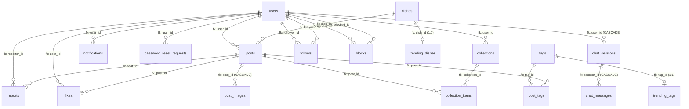
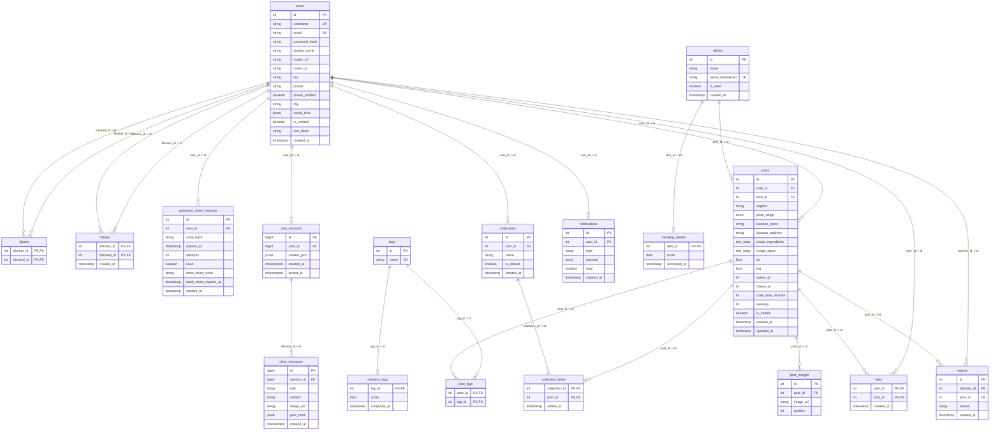

# TỔNG QUAN HỆ THỐNG CƠ SỞ DỮ LIỆU (DATABASE OVERVIEW & DATA DICTIONARY)

> **Dự án**: Nền tảng chia sẻ trải nghiệm ẩm thực & Trợ lý ẩm thực AI (HDV Project)  
> **Kiến trúc**: Service-Oriented Backend (FastAPI + Strawberry GraphQL) kết nối PostgreSQL 16 qua SQLAlchemy 2.0 ORM  
> **Phạm vi tài liệu**: Tổng hợp toàn diện công nghệ CSDL, danh mục thực thể (Entities), sơ đồ quan hệ ERD chuẩn xác theo Foreign Key thật trong codebase, ma trận liên kết và cấu trúc chi tiết toàn bộ **18 bảng vật lý** cùng các cơ chế tối ưu hóa hiệu năng.

---

## 1. CÔNG NGHỆ SỬ DỤNG (TECHNOLOGY STACK)

| Thành phần | Công nghệ / Phiên bản | Vai trò & Đặc điểm kỹ thuật |
|---|---|---|
| **Hệ quản trị CSDL (DBMS)** | **PostgreSQL 16 (Alpine Linux)** | Khởi chạy qua Docker container (`postgres:16-alpine`), quản lý dữ liệu quan hệ, dữ liệu bán cấu trúc (`JSONB`) và mảng dữ liệu (`ARRAY`). |
| **Phần mở rộng (Extensions)** | **`pg_trgm`** & **`unaccent`** | - `pg_trgm`: Cung cấp cơ chế đánh chỉ mục GIN Trigram (`gin_trgm_ops`) phục vụ tìm kiếm gần đúng (fuzzy search, `LIKE '%keyword%'`) tốc độ cao cho tên món ăn và địa điểm. - `unaccent`: Hỗ trợ chuẩn hóa và tìm kiếm văn bản tiếng Việt không phân biệt dấu (accent-insensitive search). |
| **ORM / Data Access Layer** | **SQLAlchemy 2.0+** | Khai báo thực thể hiện đại (`Mapped[...]`, `mapped_column`, kế thừa `DeclarativeBase`). Quản lý quan hệ đối tượng (`relationship`), cơ chế cascade và eager loading (`joinedload`, `selectinload`). |
| **Trình điều khiển (DB Driver)** | **Psycopg 3 (`psycopg[binary] >= 3.2`)** | Driver PostgreSQL thế hệ mới nhất cho Python, kết nối qua giao thức `postgresql+psycopg://`, tối ưu hóa hiệu năng I/O và hỗ trợ kiểu dữ liệu native PG. |
| **Quản lý Migration** | **Alembic 1.13+** | Quản lý và kiểm soát lịch sử tiến hóa schema qua chuỗi 8 migration script tuần tự (`a3529fd62439` → `f2a4c6e8b0d1`), đảm bảo không có độ lệch schema (schema drift). |
| **Kiểu dữ liệu nâng cao** | **Native Enum, JSONB, ARRAY, TIMESTAMPTZ** | - Native Enum: `pricerange` (phân khúc giá bài đăng). - `JSONB`: Lưu liên kết mạng xã hội (`social_links`), dữ liệu thông báo động (`payload`), ngữ cảnh phiên AI (`context_json`), bản nháp bài đăng (`post_draft`). - `ARRAY(Text)`: Lưu danh sách nguyên liệu và các bước công thức nấu ăn. - `TIMESTAMPTZ`: Ghi nhận mốc thời gian kèm múi giờ chuẩn ISO 8601 cho các phiên hội thoại AI. |
| **Connection Pooling** | **SQLAlchemy Engine Pool** | Quản lý vòng đời kết nối với cờ `pool_pre_ping=True` (kiểm tra liveness của kết nối trước khi cấp cho phiên làm việc, loại bỏ hoàn toàn lỗi stale/dropped connection). |
| **Background Scheduler** | **APScheduler 3.10+** | Định kỳ tính toán điểm xu hướng món ăn/tag (`trending_dishes`, `trending_tags`) mỗi giờ và quét tác vụ nhắc nhở bữa ăn hàng ngày. |

---

## 2. DANH MỤC THỰC THỂ KHÁI NIỆM (CONCEPTUAL ENTITIES)

Hệ thống được chuẩn hóa với đúng **18 thực thể**, phân chia thành 3 nhóm chức năng rõ rệt:

### 2.1 Bảng phân loại 18 thực thể hệ thống

| STT | Tên thực thể (Entity) | Bảng vật lý (Table) | Phân loại | Khóa chính (Primary Key) | Vai trò & Ý nghĩa nghiệp vụ |
|:---:|---|---|---|---|---|
| **1** | `User` | `users` | Thực thể lõi (Core) | `id` (INTEGER) | Tài khoản người dùng, hồ sơ cá nhân, thông tin bảo mật và định danh liên lạc. |
| **2** | `Post` | `posts` | Thực thể lõi (Core) | `id` (INTEGER) | Bài viết chia sẻ trải nghiệm ẩm thực, quán ăn, toạ độ GPS, công thức nấu ăn và phân khúc giá. |
| **3** | `PostImage` | `post_images` | Thực thể yếu (Weak Core) | `id` (INTEGER) | Danh sách hình ảnh đính kèm bài viết, sắp xếp theo thứ tự hiển thị `position`. |
| **4** | `Dish` | `dishes` | Thực thể lõi (Core) | `id` (INTEGER) | Danh mục món ăn ẩm thực, chuẩn hóa tên không dấu để chống trùng lặp dữ liệu. |
| **5** | `Tag` | `tags` | Thực thể lõi (Core) | `id` (INTEGER) | Từ khóa/nhãn tự do (khu vực, hương vị, loại món) dùng để phân loại bài viết. |
| **6** | `Collection` | `collections` | Thực thể lõi (Core) | `id` (INTEGER) | Bộ sưu tập / thư mục đánh dấu lưu bài viết do người dùng quản lý. |
| **7** | `Notification` | `notifications` | Thực thể lõi (Core) | `id` (INTEGER) | Thông báo đẩy trong ứng dụng gửi đến người dùng. |
| **8** | `PasswordResetRequest` | `password_reset_requests` | Thực thể lõi (Core) | `id` (INTEGER) | Yêu cầu cấp mã OTP khôi phục mật khẩu (bảo mật 1 lần, lưu chuỗi hash). |
| **9** | `ChatSession` | `chat_sessions` | Thực thể lõi (Core) | `id` (BIGINT) | Phiên đối thoại giữa người dùng và Trợ lý ẩm thực AI, lưu ngữ cảnh tóm tắt. |
| **10** | `ChatMessage` | `chat_messages` | Thực thể lõi (Core) | `id` (BIGINT) | Từng lượt tin nhắn văn bản, ảnh hoặc bản thảo bài đăng do AI sinh ra. |
| **11** | `PostTag` | `post_tags` | Thực thể kết hợp (Associative) | `(post_id, tag_id)` | Liên kết nhiều-nhiều (N-N) giữa bài đăng và nhãn gắn (`Post` ↔ `Tag`). |
| **12** | `Like` | `likes` | Thực thể kết hợp (Associative) | `(user_id, post_id)` | Hành động thả tim / thích bài viết của người dùng (`User` ↔ `Post`). |
| **13** | `CollectionItem` | `collection_items` | Thực thể kết hợp (Associative) | `(collection_id, post_id)` | Lưu bài viết vào các bộ sưu tập tương ứng (`Collection` ↔ `Post`). |
| **14** | `Follow` | `follows` | Thực thể kết hợp (Associative) | `(follower_id, followee_id)` | Mối quan hệ theo dõi một chiều giữa hai tài khoản (`User` ↔ `User`). |
| **15** | `Report` | `reports` | Thực thể kết hợp (Associative) | `id` (INTEGER) | Báo cáo vi phạm bài viết từ cộng đồng, phục vụ tự động ẩn bài (`User` ↔ `Post`). |
| **16** | `Block` | `blocks` | Thực thể kết hợp (Associative) | `(blocker_id, blocked_id)` | Chặn tương tác hai chiều giữa hai người dùng (`User` ↔ `User`). |
| **17** | `TrendingDish` | `trending_dishes` | Thực thể dẫn xuất (Derived) | `dish_id` (INTEGER) | Điểm xu hướng của món ăn được tính toán sẵn định kỳ trong cửa sổ 7 ngày. |
| **18** | `TrendingTag` | `trending_tags` | Thực thể dẫn xuất (Derived) | `tag_id` (INTEGER) | Điểm xu hướng của thẻ tag được tính toán sẵn định kỳ trong cửa sổ 7 ngày. |

---

## 3. SƠ ĐỒ THỰC THỂ - QUAN HỆ (CONCEPTUAL ERD)

> **Quy tắc thiết kế cốt lõi**:
> 1. **Khớp trọn vẹn 18 bảng** có trong kiến trúc hệ thống và codebase.
> 2. **Mọi quan hệ đều tương ứng với Khóa Ngoại (Foreign Key) thực tế** được khai báo trong SQLAlchemy Model và Alembic Migrations (tổng cộng 22 quan hệ FK thật). Tuyệt đối không vẽ quan hệ suy diễn hoặc quan hệ trừu tượng không có FK trực tiếp.

### 3.1 Sơ đồ mức Khái niệm (Conceptual ERD Diagram)

### 3.2 Sơ đồ Thực thể Chi tiết (Logical / Detailed ERD with Keys & Attributes)

---

## 4. MA TRẬN LIÊN KẾT KHÓA NGOẠI (FOREIGN KEY RELATIONSHIP MATRIX)

Toàn bộ hệ thống có đúng **22 ràng buộc khóa ngoại thật**, liên kết chặt chẽ giữa 18 bảng:

| STT | Bảng con (Source Table) | Cột Khóa ngoại (FK) | Bảng cha (Target Table) | Cột Khóa chính (PK) | Bản số (Cardinality) | Hành vi ON DELETE | Ánh xạ SQLAlchemy ORM | Ý nghĩa nghiệp vụ |
|:---:|---|---|---|---|:---:|---|---|---|
| **1** | `posts` | `user_id` | `users` | `id` | N : 1 | NO ACTION / RESTRICT | `Post.user` ↔ `User.posts` | Tác giả đăng bài viết ẩm thực. |
| **2** | `posts` | `dish_id` | `dishes` | `id` | N : 1 | NO ACTION / RESTRICT | `Post.dish` | Món ăn chính được đề cập trong bài viết. |
| **3** | `post_images` | `post_id` | `posts` | `id` | N : 1 | **CASCADE** (DB level) | `PostImage.post` ↔ `Post.images` (`cascade="all, delete-orphan"`) | Ảnh đính kèm theo bài viết (xóa bài tự động xóa ảnh). |
| **4** | `post_tags` | `post_id` | `posts` | `id` | N : 1 | NO ACTION / RESTRICT | `Post.tags` (`secondary="post_tags"`) | Bài viết được gắn thẻ tag. |
| **5** | `post_tags` | `tag_id` | `tags` | `id` | N : 1 | NO ACTION / RESTRICT | Liên kết nhiều-nhiều qua `secondary` | Thẻ tag được gán cho bài viết. |
| **6** | `likes` | `user_id` | `users` | `id` | N : 1 | NO ACTION / RESTRICT | Quản lý tại Repository | Người dùng thực hiện thả tim bài viết. |
| **7** | `likes` | `post_id` | `posts` | `id` | N : 1 | NO ACTION / RESTRICT | `delete_with_children` ở Repo | Bài viết nhận được lượt thả tim. |
| **8** | `collections` | `user_id` | `users` | `id` | N : 1 | NO ACTION / RESTRICT | Quản lý tại Service Layer | Người dùng sở hữu bộ sưu tập. |
| **9** | `collection_items` | `collection_id` | `collections` | `id` | N : 1 | NO ACTION / RESTRICT | Quản lý tại Repo | Bộ sưu tập lưu trữ bài viết. |
| **10** | `collection_items` | `post_id` | `posts` | `id` | N : 1 | NO ACTION / RESTRICT | `delete_with_children` ở Repo | Bài viết được lưu vào bộ sưu tập. |
| **11** | `reports` | `reporter_id` | `users` | `id` | N : 1 | NO ACTION / RESTRICT | Quản lý tại Service Layer | Người dùng gửi khiếu nại / báo cáo vi phạm. |
| **12** | `reports` | `post_id` | `posts` | `id` | N : 1 | NO ACTION / RESTRICT | `delete_with_children` ở Repo | Bài viết bị người dùng báo cáo vi phạm. |
| **13** | `follows` | `follower_id` | `users` | `id` | N : 1 | NO ACTION / RESTRICT | Quản lý tại Follow Repo | Người dùng chủ động bấm theo dõi. |
| **14** | `follows` | `followee_id` | `users` | `id` | N : 1 | NO ACTION / RESTRICT | Quản lý tại Follow Repo | Người dùng nhận lượt theo dõi từ người khác. |
| **15** | `blocks` | `blocker_id` | `users` | `id` | N : 1 | NO ACTION / RESTRICT | Quản lý tại Block Repo | Người dùng thiết lập hành vi chặn. |
| **16** | `blocks` | `blocked_id` | `users` | `id` | N : 1 | NO ACTION / RESTRICT | Quản lý tại Block Repo | Người dùng bị chặn tương tác. |
| **17** | `notifications` | `user_id` | `users` | `id` | N : 1 | NO ACTION / RESTRICT | Quản lý tại Notification Repo | Người dùng nhận thông báo trong ứng dụng. |
| **18** | `password_reset_requests` | `user_id` | `users` | `id` | N : 1 | NO ACTION / RESTRICT | Quản lý tại Auth Service | Người dùng gửi yêu cầu cấp OTP khôi phục mật khẩu. |
| **19** | `trending_dishes` | `dish_id` | `dishes` | `id` | 1 : 1 / 1 : 0..1 | NO ACTION / RESTRICT | Quản lý tại APScheduler Job | Bảng đệm lưu điểm xu hướng 7 ngày của món ăn. |
| **20** | `trending_tags` | `tag_id` | `tags` | `id` | 1 : 1 / 1 : 0..1 | NO ACTION / RESTRICT | Quản lý tại APScheduler Job | Bảng đệm lưu điểm xu hướng 7 ngày của thẻ tag. |
| **21** | `chat_sessions` | `user_id` | `users` | `id` | N : 1 | **CASCADE** (DB level) | `ChatSession.user` | Người dùng sở hữu phiên chat với trợ lý AI. |
| **22** | `chat_messages` | `session_id` | `chat_sessions` | `id` | N : 1 | **CASCADE** (DB level) | `ChatMessage.session` ↔ `ChatSession.messages` (`cascade="all, delete-orphan"`) | Tin nhắn thuộc về một phiên trò chuyện cụ thể. |

---

## 5. CẤU TRÚC CHI TIẾT 18 BẢNG VẬT LÝ (DATA DICTIONARY)

---

### NHÓM 1: NGƯỜI DÙNG, BẢO MẬT & QUAN HỆ XÃ HỘI

#### 5.1 Bảng `users`
- **Model ORM**: `app.models.user.User`
- **Mô tả nghiệp vụ**: Quản lý tài khoản đăng ký, thông tin hồ sơ người dùng, thông tin liên lạc và token thông báo đẩy.

| STT | Tên cột (Column) | Kiểu dữ liệu PG | Kiểu SQLAlchemy | Nullable | Mặc định (Default) | Ràng buộc / Chỉ mục | Diễn giải nghiệp vụ |
|:---:|---|---|---|:---:|---|---|---|
| 1 | `id` | `INTEGER` | `Mapped[int]` | **NO** | Auto-increment | **PK** | Định danh duy nhất của người dùng. |
| 2 | `username` | `TEXT` | `Mapped[str]` | **NO** | *None* | **UNIQUE** (`users_username_key`) | Tên tài khoản người dùng duy nhất, dùng định danh handle (@username). |
| 3 | `email` | `TEXT` | `Mapped[str]` | **NO** | *None* | **UNIQUE** (`users_email_key`) | Địa chỉ email đăng nhập và nhận mã OTP. |
| 4 | `password_hash` | `TEXT` | `Mapped[str]` | **NO** | *None* | - | Mật khẩu được băm bằng thuật toán bcrypt. |
| 5 | `avatar_url` | `TEXT` | `Mapped[str \| None]` | YES | *None* | - | URL ảnh đại diện cá nhân (Cloudinary / local upload). |
| 6 | `display_name` | `TEXT` | `Mapped[str \| None]` | YES | *None* | - | Tên hiển thị người dùng (Nickname hoặc Họ tên đầy đủ). |
| 7 | `bio` | `TEXT` | `Mapped[str \| None]` | YES | *None* | - | Đoạn mô tả tiểu sử ngắn của người dùng. |
| 8 | `cover_url` | `TEXT` | `Mapped[str \| None]` | YES | *None* | - | URL ảnh bìa trang cá nhân. |
| 9 | `phone` | `TEXT` | `Mapped[str \| None]` | YES | *None* | - | Số điện thoại liên hệ. |
| 10 | `phone_verified` | `BOOLEAN` | `Mapped[bool]` | **NO** | `false` | - | Trạng thái xác minh số điện thoại (`true`: đã xác thực). |
| 11 | `city` | `TEXT` | `Mapped[str \| None]` | YES | *None* | - | Tỉnh/thành phố cư trú của người dùng. |
| 12 | `social_links` | `JSONB` | `Mapped[dict \| None]` | YES | *None* | - | Danh sách liên kết mạng xã hội dạng JSON (facebook, instagram, tiktok). |
| 13 | `is_verified` | `BOOLEAN` | `Mapped[bool]` | **NO** | `false` | - | Trạng thái tài khoản tích xanh / uy tín trong cộng đồng. |
| 14 | `fcm_token` | `TEXT` | `Mapped[str \| None]` | YES | *None* | - | Token Firebase Cloud Messaging nhận thông báo đẩy. |
| 15 | `created_at` | `TIMESTAMP` | `Mapped[datetime]` | **NO** | `now()` | - | Mốc thời gian tạo tài khoản. |

- **Khóa chính**: `id`
- **Ràng buộc duy nhất**: `username`, `email`
- **Quan hệ ORM**: `posts` (`relationship(back_populates="user")`)

---

#### 5.2 Bảng `blocks`
- **Model ORM**: `app.models.user.Block`
- **Mô tả nghiệp vụ**: Quản lý hành vi chặn tương tác 2 chiều giữa hai người dùng (bảo vệ quyền riêng tư, lọc bài viết khỏi Feed và kết quả tìm kiếm).

| STT | Tên cột (Column) | Kiểu dữ liệu PG | Kiểu SQLAlchemy | Nullable | Mặc định (Default) | Ràng buộc / Chỉ mục | Diễn giải nghiệp vụ |
|:---:|---|---|---|:---:|---|---|---|
| 1 | `blocker_id` | `INTEGER` | `Mapped[int]` | **NO** | *None* | **PK, FK** → `users.id` | ID người dùng thực hiện thao tác chặn. |
| 2 | `blocked_id` | `INTEGER` | `Mapped[int]` | **NO** | *None* | **PK, FK** → `users.id` | ID người dùng bị chặn tương tác. |

- **Khóa chính**: Phức hợp `(blocker_id, blocked_id)`
- **Khóa ngoại**:
  - `blocker_id` → `users.id`
  - `blocked_id` → `users.id`
- **Logic xử lý**: Phép lọc 2 chiều tự động áp dụng trong mọi truy vấn Feed (`block_repo.not_blocked_clause`).

---

#### 5.3 Bảng `follows`
- **Model ORM**: `app.models.follow.Follow`
- **Mô tả nghiệp vụ**: Quản lý mạng lưới quan hệ theo dõi một chiều giữa các tài khoản người dùng.

| STT | Tên cột (Column) | Kiểu dữ liệu PG | Kiểu SQLAlchemy | Nullable | Mặc định (Default) | Ràng buộc / Chỉ mục | Diễn giải nghiệp vụ |
|:---:|---|---|---|:---:|---|---|---|
| 1 | `follower_id` | `INTEGER` | `Mapped[int]` | **NO** | *None* | **PK, FK** → `users.id` | ID người bấm theo dõi. |
| 2 | `followee_id` | `INTEGER` | `Mapped[int]` | **NO** | *None* | **PK, FK** → `users.id`, **INDEX** | ID người được theo dõi. |
| 3 | `created_at` | `TIMESTAMP` | `Mapped[datetime]` | **NO** | `now()` | - | Thời điểm bấm theo dõi. |

- **Khóa chính**: Phức hợp `(follower_id, followee_id)`
- **Khóa ngoại**:
  - `follower_id` → `users.id`
  - `followee_id` → `users.id`
- **Chỉ mục**: `ix_follows_followee_id` (B-Tree trên `followee_id` giúp tối ưu tốc độ đếm số người theo dõi / danh sách Followers).

---

#### 5.4 Bảng `password_reset_requests`
- **Model ORM**: `app.models.password_reset.PasswordResetRequest`
- **Mô tả nghiệp vụ**: Quản lý quy trình cấp và xác minh mã OTP khôi phục mật khẩu theo chu trình 3 bước (Request OTP → Verify Code → Reset Password). Mã thô không bao giờ lưu trữ trong CSDL.

| STT | Tên cột (Column) | Kiểu dữ liệu PG | Kiểu SQLAlchemy | Nullable | Mặc định (Default) | Ràng buộc / Chỉ mục | Diễn giải nghiệp vụ |
|:---:|---|---|---|:---:|---|---|---|
| 1 | `id` | `INTEGER` | `Mapped[int]` | **NO** | Auto-increment | **PK** | Định danh lượt yêu cầu khôi phục mật khẩu. |
| 2 | `user_id` | `INTEGER` | `Mapped[int]` | **NO** | *None* | **FK** → `users.id`, **INDEX** | ID người dùng yêu cầu khôi phục mật khẩu. |
| 3 | `code_hash` | `TEXT` | `Mapped[str]` | **NO** | *None* | - | Chuỗi băm bcrypt của mã OTP 6 số. |
| 4 | `expires_at` | `TIMESTAMP` | `Mapped[datetime]` | **NO** | *None* | - | Thời điểm hết hạn của mã OTP. |
| 5 | `attempts` | `INTEGER` | `Mapped[int]` | **NO** | `0` | - | Số lần thử nhập sai mã (ngăn chặn tấn công brute-force). |
| 6 | `used` | `BOOLEAN` | `Mapped[bool]` | **NO** | `false` | - | Cờ đánh dấu yêu cầu đã hoàn tất hoặc bị vô hiệu. |
| 7 | `reset_token_hash` | `TEXT` | `Mapped[str \| None]` | YES | *None* | **INDEX** | Chuỗi băm SHA-256 của token xác minh thành công. |
| 8 | `reset_token_expires_at` | `TIMESTAMP` | `Mapped[datetime \| None]` | YES | *None* | - | Thời hạn hiệu lực của token đổi mật khẩu. |
| 9 | `created_at` | `TIMESTAMP` | `Mapped[datetime]` | **NO** | `now()` | - | Mốc thời gian tạo yêu cầu OTP. |

- **Khóa chính**: `id`
- **Khóa ngoại**: `user_id` → `users.id`
- **Chỉ mục**:
  - `ix_password_reset_requests_user_id` (B-Tree trên `user_id`)
  - `ix_password_reset_requests_reset_token_hash` (B-Tree trên `reset_token_hash`)

---

### NHÓM 2: MÓN ĂN, BÀI VIẾT & HÌNH ẢNH

#### 5.5 Bảng `dishes`
- **Model ORM**: `app.models.dish.Dish`
- **Mô tả nghiệp vụ**: Danh mục các món ăn trong hệ thống. Tên chuẩn hóa `name_normalized` đóng vai trò định danh trung tâm (Canonical identity) chống trùng lặp.

| STT | Tên cột (Column) | Kiểu dữ liệu PG | Kiểu SQLAlchemy | Nullable | Mặc định (Default) | Ràng buộc / Chỉ mục | Diễn giải nghiệp vụ |
|:---:|---|---|---|:---:|---|---|---|
| 1 | `id` | `INTEGER` | `Mapped[int]` | **NO** | Auto-increment | **PK** | Định danh duy nhất của món ăn. |
| 2 | `name` | `TEXT` | `Mapped[str]` | **NO** | *None* | - | Tên hiển thị đầy đủ của món ăn (ví dụ: "Phở Bò Tái Lăn"). |
| 3 | `name_normalized` | `TEXT` | `Mapped[str]` | **NO** | *None* | **UNIQUE, GIN INDEX** | Tên chuẩn hóa chữ thường, bỏ dấu tiếng Việt (ví dụ: "pho bo tai lan"). |
| 4 | `is_seed` | `BOOLEAN` | `Mapped[bool]` | **NO** | `false` | - | Cờ đánh dấu món ăn thuộc tập dữ liệu mẫu ban đầu (seed catalog). |
| 5 | `created_at` | `TIMESTAMP` | `Mapped[datetime]` | **NO** | `now()` | - | Mốc thời gian tạo bản ghi món ăn. |

- **Khóa chính**: `id`
- **Ràng buộc duy nhất**: `name_normalized`
- **Chỉ mục đặc biệt**:
  - `ix_dishes_name_trgm`: Chỉ mục **GIN Trigram** (`USING gin (name_normalized gin_trgm_ops)`) phục vụ tìm kiếm gần đúng (`LIKE '%keyword%'`) với độ trễ tối thiểu.

---

#### 5.6 Bảng `posts`
- **Model ORM**: `app.models.post.Post`
- **Mô tả nghiệp vụ**: Bảng trung tâm lưu trữ bài viết chia sẻ ẩm thực, tích hợp dữ liệu địa điểm quán ăn, toạ độ địa lý (GPS), phân khúc giá, công thức và quy trình chế biến.

| STT | Tên cột (Column) | Kiểu dữ liệu PG | Kiểu SQLAlchemy | Nullable | Mặc định (Default) | Ràng buộc / Chỉ mục | Diễn giải nghiệp vụ |
|:---:|---|---|---|:---:|---|---|---|
| 1 | `id` | `INTEGER` | `Mapped[int]` | **NO** | Auto-increment | **PK** | Định danh duy nhất của bài viết. |
| 2 | `user_id` | `INTEGER` | `Mapped[int]` | **NO** | *None* | **FK** → `users.id`, **INDEX** | ID người đăng bài viết. |
| 3 | `dish_id` | `INTEGER` | `Mapped[int]` | **NO** | *None* | **FK** → `dishes.id`, **INDEX** | ID món ăn chính được nói đến trong bài viết. |
| 4 | `caption` | `TEXT` | `Mapped[str \| None]` | YES | *None* | - | Nội dung mô tả / bài cảm nhận đánh giá ẩm thực. |
| 5 | `price_range` | `pricerange` (Enum) | `Mapped[PriceRange \| None]` | YES | *None* | - | Phân khúc giá (`UNDER_50K`, `FROM_50K`, `FROM_100K`, `FROM_200K`, `FROM_500K`). |
| 6 | `location_name` | `TEXT` | `Mapped[str \| None]` | YES | *None* | **GIN INDEX** | Tên quán ăn / nhà hàng (ví dụ: "Phở Thìn 13 Lò Đúc"). |
| 7 | `location_address` | `TEXT` | `Mapped[str \| None]` | YES | *None* | - | Địa chỉ đường phố chi tiết của quán ăn. |
| 8 | `recipe_ingredients`| `TEXT[]` | `Mapped[list[str]]` | **NO** | `{}` (mảng rỗng) | - | Mảng danh sách các nguyên liệu chế biến. |
| 9 | `recipe_steps` | `TEXT[]` | `Mapped[list[str]]` | **NO** | `{}` (mảng rỗng) | - | Mảng các bước hướng dẫn nấu ăn tuần tự. |
| 10 | `lat` | `FLOAT` | `Mapped[float \| None]` | YES | *None* | - | Vĩ độ GPS (Latitude) phục vụ tính năng tìm quán gần đây. |
| 11 | `lng` | `FLOAT` | `Mapped[float \| None]` | YES | *None* | - | Kinh độ GPS (Longitude) phục vụ tính năng tìm quán gần đây. |
| 12 | `opens_at` | `INTEGER` | `Mapped[int \| None]` | YES | *None* | - | Giờ mở cửa quán hàng ngày (0 - 23 giờ). |
| 13 | `closes_at` | `INTEGER` | `Mapped[int \| None]` | YES | *None* | - | Giờ đóng cửa quán hàng ngày (0 - 23 giờ). |
| 14 | `cook_time_minutes` | `INTEGER` | `Mapped[int \| None]` | YES | *None* | - | Thời gian nấu nướng / chế biến (đơn vị: phút). |
| 15 | `servings` | `INTEGER` | `Mapped[int \| None]` | YES | *None* | - | Khẩu phần ăn (số người phục vụ). |
| 16 | `is_hidden` | `BOOLEAN` | `Mapped[bool]` | **NO** | `false` | **INDEX** | Cờ ẩn bài viết khi bị kiểm duyệt hoặc đủ số lượt report vi phạm. |
| 17 | `created_at` | `TIMESTAMP` | `Mapped[datetime]` | **NO** | `now()` | **INDEX (DESC)** | Thời điểm tạo bài viết. |
| 18 | `updated_at` | `TIMESTAMP` | `Mapped[datetime]` | **NO** | `now()` | - | Thời điểm cập nhật bài viết gần nhất. |

- **Khóa chính**: `id`
- **Khóa ngoại**:
  - `user_id` → `users.id`
  - `dish_id` → `dishes.id`
- **Chỉ mục quan trọng**:
  - `ix_posts_dish_id` (B-Tree trên `dish_id`)
  - `ix_posts_user_id` (B-Tree trên `user_id`)
  - `ix_posts_is_hidden` (B-Tree trên `is_hidden` hỗ trợ lọc bài hợp lệ)
  - `ix_posts_created_at` (B-Tree **DESC** `created_at DESC` phục vụ tải trang Feed mới nhất tức thì)
  - `ix_posts_location_trgm` (Chỉ mục **GIN Trigram** trên `location_name` phục vụ tìm kiếm địa danh)
- **Quan hệ ORM**:
  - `user`: `relationship(back_populates="posts")`
  - `dish`: `relationship()`
  - `images`: `relationship(back_populates="post", cascade="all, delete-orphan", order_by="PostImage.position")`
  - `tags`: `relationship(secondary="post_tags")`

---

#### 5.7 Bảng `post_images`
- **Model ORM**: `app.models.post.PostImage`
- **Mô tả nghiệp vụ**: Thực thể yếu (Weak Entity) lưu trữ các hình ảnh đính kèm theo bài viết, phụ thuộc vòng đời hoàn toàn vào bài viết (`posts`).

| STT | Tên cột (Column) | Kiểu dữ liệu PG | Kiểu SQLAlchemy | Nullable | Mặc định (Default) | Ràng buộc / Chỉ mục | Diễn giải nghiệp vụ |
|:---:|---|---|---|:---:|---|---|---|
| 1 | `id` | `INTEGER` | `Mapped[int]` | **NO** | Auto-increment | **PK** | Định danh duy nhất của hình ảnh. |
| 2 | `post_id` | `INTEGER` | `Mapped[int]` | **NO** | *None* | **FK** → `posts.id`, **INDEX** | ID bài viết chứa hình ảnh. |
| 3 | `image_url` | `TEXT` | `Mapped[str]` | **NO** | *None* | - | Đường dẫn URL của hình ảnh bài đăng. |
| 4 | `position` | `INTEGER` | `Mapped[int]` | **NO** | `0` | - | Thứ tự hiển thị của ảnh trong bài viết (0, 1, 2...). |

- **Khóa chính**: `id`
- **Khóa ngoại**: `post_id` → `posts.id` kèm ràng buộc **`ON DELETE CASCADE`** (xóa post tự động cascade xóa sạch các post_images liên quan).
- **Chỉ mục**: `ix_post_images_post_id` (B-Tree trên `post_id`).
- **Quan hệ ORM**: `post` (`relationship(back_populates="images")`).

---

#### 5.8 Bảng `tags`
- **Model ORM**: `app.models.tag.Tag`
- **Mô tả nghiệp vụ**: Danh mục nhãn/thẻ tự do dùng để phân loại món ăn, bài viết (ví dụ: "ha-noi", "an-vat", "cay-nong", "via-he").

| STT | Tên cột (Column) | Kiểu dữ liệu PG | Kiểu SQLAlchemy | Nullable | Mặc định (Default) | Ràng buộc / Chỉ mục | Diễn giải nghiệp vụ |
|:---:|---|---|---|:---:|---|---|---|
| 1 | `id` | `INTEGER` | `Mapped[int]` | **NO** | Auto-increment | **PK** | Định danh duy nhất của nhãn tag. |
| 2 | `name` | `TEXT` | `Mapped[str]` | **NO** | *None* | **UNIQUE** (`tags_name_key`) | Tên nhãn định danh duy nhất (slug chữ thường). |

- **Khóa chính**: `id`
- **Ràng buộc duy nhất**: `name`

---

#### 5.9 Bảng `post_tags`
- **Model ORM**: `app.models.tag.PostTag`
- **Mô tả nghiệp vụ**: Bảng liên kết nhiều-nhiều (Associative Table) kết nối giữa bài viết và các nhãn gắn.

| STT | Tên cột (Column) | Kiểu dữ liệu PG | Kiểu SQLAlchemy | Nullable | Mặc định (Default) | Ràng buộc / Chỉ mục | Diễn giải nghiệp vụ |
|:---:|---|---|---|:---:|---|---|---|
| 1 | `post_id` | `INTEGER` | `Mapped[int]` | **NO** | *None* | **PK, FK** → `posts.id` | ID bài viết được gắn nhãn. |
| 2 | `tag_id` | `INTEGER` | `Mapped[int]` | **NO** | *None* | **PK, FK** → `tags.id`, **INDEX** | ID thẻ nhãn được gắn. |

- **Khóa chính**: Phức hợp `(post_id, tag_id)`
- **Khóa ngoại**:
  - `post_id` → `posts.id`
  - `tag_id` → `tags.id`
- **Chỉ mục**: `ix_post_tags_tag_id` (B-Tree trên `tag_id` để tăng tốc độ truy vấn danh sách bài viết theo một thẻ tag).

---

### NHÓM 3: TƯƠNG TÁC, LƯU TRỮ & KIỂM DUYỆT

#### 5.10 Bảng `likes`
- **Model ORM**: `app.models.engagement.Like`
- **Mô tả nghiệp vụ**: Lưu trữ lượt thích / thả tim bài viết của người dùng. Khóa phức hợp bảo đảm mỗi tài khoản chỉ thích một bài viết tối đa một lần.

| STT | Tên cột (Column) | Kiểu dữ liệu PG | Kiểu SQLAlchemy | Nullable | Mặc định (Default) | Ràng buộc / Chỉ mục | Diễn giải nghiệp vụ |
|:---:|---|---|---|:---:|---|---|---|
| 1 | `user_id` | `INTEGER` | `Mapped[int]` | **NO** | *None* | **PK, FK** → `users.id` | ID người dùng thực hiện thả tim. |
| 2 | `post_id` | `INTEGER` | `Mapped[int]` | **NO** | *None* | **PK, FK** → `posts.id`, **INDEX** | ID bài viết được thả tim. |
| 3 | `created_at` | `TIMESTAMP` | `Mapped[datetime]` | **NO** | `now()` | - | Thời điểm thả tim bài viết. |

- **Khóa chính**: Phức hợp `(user_id, post_id)`
- **Khóa ngoại**:
  - `user_id` → `users.id`
  - `post_id` → `posts.id`
- **Chỉ mục**: `ix_likes_post_id` (B-Tree trên `post_id` phục vụ kiểm tra trạng thái tương tác và đếm tổng lượt like của bài viết).

---

#### 5.11 Bảng `collections`
- **Model ORM**: `app.models.engagement.Collection`
- **Mô tả nghiệp vụ**: Quản lý các bộ sưu tập / thư mục đánh dấu lưu bài viết của người dùng (ví dụ: "Đã lưu", "Món ngon cuối tuần", "Quán gần cơ quan").

| STT | Tên cột (Column) | Kiểu dữ liệu PG | Kiểu SQLAlchemy | Nullable | Mặc định (Default) | Ràng buộc / Chỉ mục | Diễn giải nghiệp vụ |
|:---:|---|---|---|:---:|---|---|---|
| 1 | `id` | `INTEGER` | `Mapped[int]` | **NO** | Auto-increment | **PK** | Định danh duy nhất của bộ sưu tập. |
| 2 | `user_id` | `INTEGER` | `Mapped[int]` | **NO** | *None* | **FK** → `users.id`, **INDEX** | ID người dùng sở hữu bộ sưu tập. |
| 3 | `name` | `TEXT` | `Mapped[str]` | **NO** | *None* | - | Tên hiển thị của bộ sưu tập. |
| 4 | `is_default` | `BOOLEAN` | `Mapped[bool]` | **NO** | `false` | - | Đánh dấu bộ sưu tập mặc định ("Đã lưu") của user; cờ này vẫn tồn tại nếu đổi tên. |
| 5 | `created_at` | `TIMESTAMP` | `Mapped[datetime]` | **NO** | `now()` | - | Mốc thời gian khởi tạo bộ sưu tập. |

- **Khóa chính**: `id`
- **Khóa ngoại**: `user_id` → `users.id`
- **Chỉ mục**: `ix_collections_user_id` (B-Tree trên `user_id`).

---

#### 5.12 Bảng `collection_items`
- **Model ORM**: `app.models.engagement.CollectionItem`
- **Mô tả nghiệp vụ**: Bảng liên kết nhiều-nhiều lưu trữ các bài viết được thêm vào từng bộ sưu tập. Khóa phức hợp bảo đảm một bài viết không bị lưu lặp lại trong cùng một bộ sưu tập.

| STT | Tên cột (Column) | Kiểu dữ liệu PG | Kiểu SQLAlchemy | Nullable | Mặc định (Default) | Ràng buộc / Chỉ mục | Diễn giải nghiệp vụ |
|:---:|---|---|---|:---:|---|---|---|
| 1 | `collection_id` | `INTEGER` | `Mapped[int]` | **NO** | *None* | **PK, FK** → `collections.id` | ID bộ sưu tập chứa bài viết. |
| 2 | `post_id` | `INTEGER` | `Mapped[int]` | **NO** | *None* | **PK, FK** → `posts.id`, **INDEX** | ID bài viết được lưu. |
| 3 | `added_at` | `TIMESTAMP` | `Mapped[datetime]` | **NO** | `now()` | - | Thời điểm lưu bài viết vào bộ sưu tập. |

- **Khóa chính**: Phức hợp `(collection_id, post_id)`
- **Khóa ngoại**:
  - `collection_id` → `collections.id`
  - `post_id` → `posts.id`
- **Chỉ mục**: `ix_collection_items_post_id` (B-Tree trên `post_id` phục vụ kiểm tra trạng thái bài viết đã được lưu hay chưa).

---

#### 5.13 Bảng `reports`
- **Model ORM**: `app.models.engagement.Report`
- **Mô tả nghiệp vụ**: Tiếp nhận và quản lý các báo cáo vi phạm bài viết từ cộng đồng. Hỗ trợ cơ chế tự động ẩn bài viết khi vượt ngưỡng quy định.

| STT | Tên cột (Column) | Kiểu dữ liệu PG | Kiểu SQLAlchemy | Nullable | Mặc định (Default) | Ràng buộc / Chỉ mục | Diễn giải nghiệp vụ |
|:---:|---|---|---|:---:|---|---|---|
| 1 | `id` | `INTEGER` | `Mapped[int]` | **NO** | Auto-increment | **PK** | Định danh duy nhất của lượt báo cáo vi phạm. |
| 2 | `reporter_id` | `INTEGER` | `Mapped[int]` | **NO** | *None* | **FK** → `users.id` | ID người dùng gửi báo cáo vi phạm. |
| 3 | `post_id` | `INTEGER` | `Mapped[int]` | **NO** | *None* | **FK** → `posts.id`, **INDEX** | ID bài viết bị báo cáo. |
| 4 | `reason` | `TEXT` | `Mapped[str]` | **NO** | *None* | - | Lý do báo cáo vi phạm (Spam, phản cảm, thông tin quán sai lệch...). |
| 5 | `created_at` | `TIMESTAMP` | `Mapped[datetime]` | **NO** | `now()` | - | Thời điểm gửi báo cáo. |

- **Khóa chính**: `id`
- **Khóa ngoại**:
  - `reporter_id` → `users.id`
  - `post_id` → `posts.id`
- **Chỉ mục**: `ix_reports_post_id` (B-Tree trên `post_id`).
- **Quy tắc nghiệp vụ**: Khi tổng số bản ghi báo cáo cho một bài viết chạm ngưỡng `auto_hide_report_threshold = 5`, hệ thống tự động gán `posts.is_hidden = true`.

---

#### 5.14 Bảng `notifications`
- **Model ORM**: `app.models.notification.Notification`
- **Mô tả nghiệp vụ**: Lưu trữ thông báo trong ứng dụng cho người dùng (thông báo like, follow, nhắc nhở bữa ăn hàng ngày).

| STT | Tên cột (Column) | Kiểu dữ liệu PG | Kiểu SQLAlchemy | Nullable | Mặc định (Default) | Ràng buộc / Chỉ mục | Diễn giải nghiệp vụ |
|:---:|---|---|---|:---:|---|---|---|
| 1 | `id` | `INTEGER` | `Mapped[int]` | **NO** | Auto-increment | **PK** | Định danh duy nhất của thông báo. |
| 2 | `user_id` | `INTEGER` | `Mapped[int]` | **NO** | *None* | **FK** → `users.id`, **INDEX** | ID người dùng nhận thông báo. |
| 3 | `type` | `TEXT` | `Mapped[str]` | **NO** | *None* | - | Loại thông báo (`LIKE`, `FOLLOW`, `DAILY_REMINDER`...). |
| 4 | `payload` | `JSONB` | `Mapped[dict \| None]` | YES | *None* | - | Dữ liệu ngữ cảnh bổ sung dạng JSON (actorId, postId, nội dung tóm tắt). |
| 5 | `read` | `BOOLEAN` | `Mapped[bool]` | **NO** | `false` | - | Trạng thái đọc (`true`: đã đọc, `false`: chưa đọc). |
| 6 | `created_at` | `TIMESTAMP` | `Mapped[datetime]` | **NO** | `now()` | - | Mốc thời gian phát sinh thông báo. |

- **Khóa chính**: `id`
- **Khóa ngoại**: `user_id` → `users.id`
- **Chỉ mục**: `ix_notifications_user_id` (B-Tree trên `user_id`).

---

### NHÓM 4: BẢNG TÍNH SẴN XU HƯỚNG (TRENDING CACHE)

#### 5.15 Bảng `trending_dishes`
- **Model ORM**: `app.models.trending.TrendingDish`
- **Mô tả nghiệp vụ**: Bảng lưu điểm số xu hướng tính toán sẵn cho từng món ăn trong cửa sổ trượt 7 ngày. Giữ quan hệ 1-1 / 1-0..1 với bảng `dishes`.

| STT | Tên cột (Column) | Kiểu dữ liệu PG | Kiểu SQLAlchemy | Nullable | Mặc định (Default) | Ràng buộc / Chỉ mục | Diễn giải nghiệp vụ |
|:---:|---|---|---|:---:|---|---|---|
| 1 | `dish_id` | `INTEGER` | `Mapped[int]` | **NO** | *None* | **PK, FK** → `dishes.id` | ID món ăn (vừa là PK vừa là FK tới `dishes.id`). |
| 2 | `score` | `FLOAT` | `Mapped[float]` | **NO** | `0.0` | - | Điểm xu hướng tổng hợp từ số bài post, lượt like và bookmark trong 7 ngày. |
| 3 | `computed_at` | `TIMESTAMP` | `Mapped[datetime]` | **NO** | `now()` | - | Thời điểm chạy tác vụ tính toán điểm xu hướng. |

- **Khóa chính**: `dish_id`
- **Khóa ngoại**: `dish_id` → `dishes.id`

---

#### 5.16 Bảng `trending_tags`
- **Model ORM**: `app.models.trending.TrendingTag`
- **Mô tả nghiệp vụ**: Bảng lưu điểm số xu hướng tính toán sẵn cho từng thẻ tag trong cửa sổ trượt 7 ngày. Giữ quan hệ 1-1 / 1-0..1 với bảng `tags`.

| STT | Tên cột (Column) | Kiểu dữ liệu PG | Kiểu SQLAlchemy | Nullable | Mặc định (Default) | Ràng buộc / Chỉ mục | Diễn giải nghiệp vụ |
|:---:|---|---|---|:---:|---|---|---|
| 1 | `tag_id` | `INTEGER` | `Mapped[int]` | **NO** | *None* | **PK, FK** → `tags.id` | ID thẻ nhãn (vừa là PK vừa là FK tới `tags.id`). |
| 2 | `score` | `FLOAT` | `Mapped[float]` | **NO** | `0.0` | - | Điểm xu hướng của tag trong cửa sổ 7 ngày gần nhất. |
| 3 | `computed_at` | `TIMESTAMP` | `Mapped[datetime]` | **NO** | `now()` | - | Thời điểm chạy tác vụ tính toán điểm xu hướng. |

- **Khóa chính**: `tag_id`
- **Khóa ngoại**: `tag_id` → `tags.id`

---

### NHÓM 5: TRỢ LÝ AI & CHATBOT

#### 5.17 Bảng `chat_sessions`
- **Model ORM**: `app.models.chat.ChatSession`
- **Mô tả nghiệp vụ**: Quản lý các phiên hội thoại tương tác giữa người dùng và Trợ lý ẩm thực AI. Tích hợp bộ đệm ngữ cảnh cá nhân hóa (`context_json`) để tối ưu chi phí token LLM.

| STT | Tên cột (Column) | Kiểu dữ liệu PG | Kiểu SQLAlchemy | Nullable | Mặc định (Default) | Ràng buộc / Chỉ mục | Diễn giải nghiệp vụ |
|:---:|---|---|---|:---:|---|---|---|
| 1 | `id` | `BIGINT` | `Mapped[int]` | **NO** | Auto-increment | **PK** | Định danh duy nhất 64-bit của phiên đối thoại AI. |
| 2 | `user_id` | `BIGINT` | `Mapped[int]` | **NO** | *None* | **FK** → `users.id`, **INDEX** | ID người dùng sở hữu phiên chat. |
| 3 | `context_json` | `JSONB` | `Mapped[dict \| None]` | YES | *None* | - | Tóm tắt ngữ cảnh cá nhân (khẩu vị, phong cách viết, địa bàn) được nạp lúc mở phiên. |
| 4 | `created_at` | `TIMESTAMPTZ` | `Mapped[datetime]` | **NO** | `now()` | **INDEX (DESC)** | Mốc thời gian bắt đầu phiên chat (có múi giờ). |
| 5 | `ended_at` | `TIMESTAMPTZ` | `Mapped[datetime \| None]` | YES | *None* | - | Mốc thời gian kết thúc phiên chat (`NULL` tức phiên đang mở). |

- **Khóa chính**: `id`
- **Khóa ngoại**: `user_id` → `users.id` kèm ràng buộc **`ON DELETE CASCADE`** (xóa user tự động xóa toàn bộ chat_sessions).
- **Chỉ mục**: `ix_chat_sessions_user_id_created_at` (B-Tree trên `(user_id, created_at DESC)` hỗ trợ lấy danh sách phiên chat gần nhất của người dùng).
- **Quan hệ ORM**:
  - `user`: `relationship()`
  - `messages`: `relationship(back_populates="session", cascade="all, delete-orphan", order_by="ChatMessage.created_at")`

---

#### 5.18 Bảng `chat_messages`
- **Model ORM**: `app.models.chat.ChatMessage`
- **Mô tả nghiệp vụ**: Lưu trữ chi tiết từng tin nhắn trao đổi trong phiên chat AI, hỗ trợ đính kèm ảnh món ăn và bản nháp bài đăng hoàn chỉnh (`post_draft`).

| STT | Tên cột (Column) | Kiểu dữ liệu PG | Kiểu SQLAlchemy | Nullable | Mặc định (Default) | Ràng buộc / Chỉ mục | Diễn giải nghiệp vụ |
|:---:|---|---|---|:---:|---|---|---|
| 1 | `id` | `BIGINT` | `Mapped[int]` | **NO** | Auto-increment | **PK** | Định danh duy nhất 64-bit của tin nhắn. |
| 2 | `session_id` | `BIGINT` | `Mapped[int]` | **NO** | *None* | **FK** → `chat_sessions.id`, **INDEX** | ID phiên chat chứa tin nhắn. |
| 3 | `role` | `TEXT` | `Mapped[str]` | **NO** | *None* | **CHECK** (`ck_chat_messages_role`) | Vai trò người gửi tin (`user` hoặc `assistant`). |
| 4 | `content` | `TEXT` | `Mapped[str]` | **NO** | *None* | - | Nội dung văn bản của tin nhắn. |
| 5 | `image_url` | `TEXT` | `Mapped[str \| None]` | YES | *None* | - | Đường dẫn ảnh do AI gợi ý (định dạng `/uploads/chat/...`). |
| 6 | `post_draft` | `JSONB` | `Mapped[dict \| None]` | YES | *None* | - | Bản thảo bài viết do AI soạn sẵn (tiêu đề, quán ăn có thật từ DB, công thức). |
| 7 | `created_at` | `TIMESTAMPTZ` | `Mapped[datetime]` | **NO** | `now()` | **INDEX** | Mốc thời gian gửi tin nhắn (kèm múi giờ). |

- **Khóa chính**: `id`
- **Khóa ngoại**: `session_id` → `chat_sessions.id` kèm ràng buộc **`ON DELETE CASCADE`** (xóa session tự động xóa sạch toàn bộ chat_messages).
- **Ràng buộc kiểm tra (Check Constraint)**: `ck_chat_messages_role`: `CHECK (role IN ('user', 'assistant'))`.
- **Chỉ mục**: `ix_chat_messages_session_id_created_at` (B-Tree trên `(session_id, created_at)` phục vụ Keyset pagination tin nhắn theo phiên).
- **Quan hệ ORM**: `session` (`relationship(back_populates="messages")`).

---

## 6. CÁC CƠ CHẾ KỸ THUẬT & TỐI ƯU HÓA HIỆU NĂNG

### 6.1 Cơ chế chống trùng lặp & Chuẩn hóa định danh (Deduplication)
- **Tên món ăn (`dishes.name_normalized`)**: Tên món người dùng nhập tự do được hàm `normalize_dish_name` chuẩn hóa tự động (chuyển chữ thường, chuyển `đ` → `d`, phân tách NFD để loại bỏ dấu thanh, thu gọn khoảng trắng thừa). Nhờ ràng buộc `UNIQUE` trên `name_normalized`, các biến thể như "Phở Bò", "phở bò", "PHỞ BÒ" đều ánh xạ về một thực thể món ăn duy nhất.
- **Tài khoản & Nhãn**: Ràng buộc `UNIQUE` trên `users.username`, `users.email` và `tags.name` ngăn chặn triệt để hiện tượng phân mảnh dữ liệu.
- **Tương tác**: Các bảng kết hợp `likes`, `follows`, `blocks`, `collection_items`, `post_tags` đều dùng **Khóa chính phức hợp (Composite PK)**, tự nhiên ngăn chặn hành động trùng lặp (ví dụ: bấm like 2 lần, follow 2 lần).

### 6.2 Cơ chế Tìm kiếm mờ & Tiếng Việt không dấu (Fuzzy Search & Unaccent)
- **GIN Trigram Index (`pg_trgm`)**: Tạo chỉ mục `ix_dishes_name_trgm` trên `dishes.name_normalized` và `ix_posts_location_trgm` trên `posts.location_name` với toán tử `gin_trgm_ops`. Khi người dùng gõ từ khóa tìm kiếm (`LIKE '%pho bo%'`), PostgreSQL quét trực tiếp trên cây chỉ mục GIN thay vì quét tuần tự toàn bộ bảng (Seq Scan).
- **Tìm kiếm không dấu (`unaccent`)**: Sử dụng tiện ích mở rộng `unaccent` để loại bỏ dấu thanh khi tìm kiếm tên quán và nguyên liệu nấu ăn, cho phép người dùng gõ tiếng Việt không dấu vẫn tìm ra chính xác kết quả có dấu.

### 6.3 Tối ưu hóa phân trang Feed (Keyset Pagination & B-Tree DESC Index)
- Chỉ mục `ix_posts_created_at` được cấu hình rõ ràng dạng **B-Tree DESC** (`created_at DESC`). Nhờ đó, câu lệnh truy vấn Feed mới nhất (`ORDER BY created_at DESC LIMIT 20`) đọc trực tiếp dữ liệu theo thứ tự đã sắp xếp sẵn trong index với độ phức tạp $O(1)$, không cần tốn chi phí thực hiện thuật toán QuickSort trong bộ nhớ RAM (`Sort Scan`).
- Phân trang tin nhắn hội thoại AI qua chỉ mục phức hợp `ix_chat_messages_session_id_created_at` trên `(session_id, created_at)` hỗ trợ phân trang theo con trỏ thời gian (Cursor-based / Keyset pagination).

### 6.4 Tìm kiếm quán ăn lân cận (Spatial Bounding Box + Haversine Formula)
- Thay vì cài đặt phần mở rộng nặng nề PostGIS, hệ thống áp dụng kỹ thuật lọc 2 tầng cực kỳ tối ưu:
  1. **Tầng SQL**: Lọc sơ bộ bằng hộp toạ độ giới hạn (Bounding Box) trên 2 trường số thực `lat` và `lng` (`lat BETWEEN ... AND ... AND lng BETWEEN ...`) kết hợp điều kiện `is_hidden = false`.
  2. **Tầng Service**: Tính khoảng cách địa lý chính xác theo công thức **Haversine** trên tập kết quả nhỏ đã được thu hẹp, sắp xếp theo khoảng cách và trả về quán gần nhất.

### 6.5 Hiệu năng bảng Tính sẵn Xu hướng (Precomputed Trending Boards)
- Điểm xu hướng món ăn (`trending_dishes`) và thẻ tag (`trending_tags`) không tính toán trực tiếp lúc người dùng truy cập trang Khám phá (Explore Screen).
- Một tác vụ ngầm chạy định kỳ bằng **APScheduler** mỗi giờ một lần sẽ tổng hợp số lượt đăng bài, lượt thích và lượt lưu trong 7 ngày gần nhất, tính điểm trọng số và ghi đè tập trung vào 2 bảng `trending_dishes` và `trending_tags`. Do đó, API khám phá chỉ cần thực hiện phép `SELECT` đơn giản với thời gian phản hồi ở mức vài mili-giây.

### 6.6 Cơ chế Xóa dây chuyền (Cascade Delete Architecture)
Hệ thống kết hợp hài hoà giữa 2 cấp độ cascade nhằm cân bằng giữa tính toàn vẹn dữ liệu và an toàn nghiệp vụ:
1. **Cascade cấp Cơ sở dữ liệu (Database-level `ON DELETE CASCADE`)**:
   - Áp dụng cho các thực thể phụ thuộc hoàn toàn vào thực thể cha:
     - `post_images` phụ thuộc vào `posts` (`FOREIGN KEY (post_id) REFERENCES posts(id) ON DELETE CASCADE`).
     - `chat_sessions` phụ thuộc vào `users` (`FOREIGN KEY (user_id) REFERENCES users(id) ON DELETE CASCADE`).
     - `chat_messages` phụ thuộc vào `chat_sessions` (`FOREIGN KEY (session_id) REFERENCES chat_sessions(id) ON DELETE CASCADE`).
2. **Cascade cấp Tầng Kho Dữ liệu (Repository-level `delete_with_children`)**:
   - Đối với các bảng tương tác xã hội nhiều bên (`likes`, `collection_items`, `post_tags`, `reports`), hàm `post_repo.delete_with_children` chủ động thực thi lệnh xóa các bản ghi phụ thuộc theo lô trước khi xóa bài viết cha, tránh tình trạng khóa bảng diện rộng (table lock contention) và cho phép ghi log kiểm toán (audit trail) tường minh.
