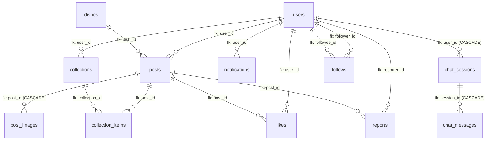
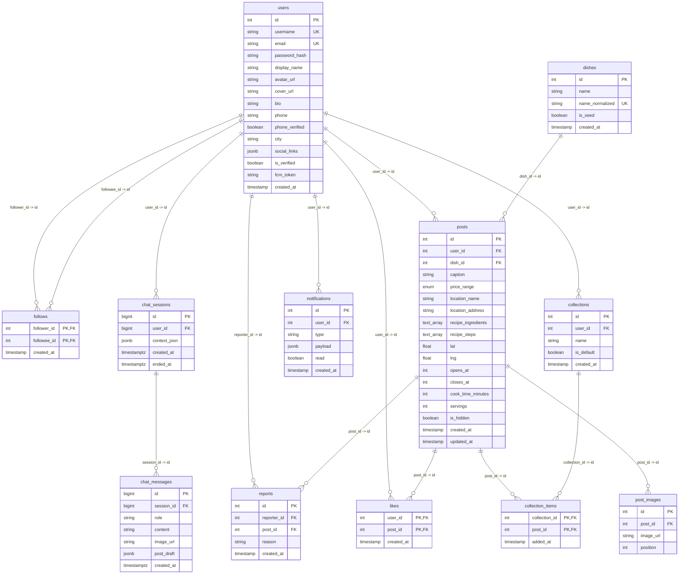

# TỔNG QUAN HỆ THỐNG CƠ SỞ DỮ LIỆU (DATABASE OVERVIEW & CONCEPTUAL ERD - SPRINT 1)

> **Dự án**: Nền tảng chia sẻ trải nghiệm ẩm thực & Trợ lý ẩm thực AI (HDV Project)  
> **Kiến trúc**: Service-Oriented Backend (FastAPI + Strawberry GraphQL) kết nối PostgreSQL 16 qua SQLAlchemy 2.0 ORM  
> **Phạm vi tài liệu**: Khớp trọn vẹn theo **5 Process Flows chính** của Backend Sprint 1 (WBS 1.3.1 - tài liệu `2.2_process_flows_BE.md`). Đã chuẩn hóa và lược bỏ các bảng dữ liệu chưa liên quan cấp thiết ở S1 để tập trung tối đa vào **12 bảng vật lý cốt lõi** và **15 ràng buộc Khóa Ngoại (Foreign Key) thực tế**.

---

## 1. CÔNG NGHỆ SỬ DỤNG (TECHNOLOGY STACK)

| Thành phần | Công nghệ / Phiên bản | Vai trò & Đặc điểm kỹ thuật |
|---|---|---|
| **Hệ quản trị CSDL (DBMS)** | **PostgreSQL 16 (Alpine Linux)** | Khởi chạy qua Docker container (`postgres:16-alpine`), quản lý dữ liệu quan hệ, dữ liệu bán cấu trúc (`JSONB`) và mảng dữ liệu (`ARRAY`). |
| **Phần mở rộng (Extensions)** | **`pg_trgm`** & **`unaccent`** | - `pg_trgm`: Cung cấp cơ chế đánh chỉ mục GIN Trigram (`gin_trgm_ops`) phục vụ tìm kiếm gần đúng (fuzzy search, `LIKE '%keyword%'`) tốc độ cao cho tên món ăn và địa điểm. - `unaccent`: Hỗ trợ chuẩn hóa và tìm kiếm văn bản tiếng Việt không phân biệt dấu (accent-insensitive search). |
| **ORM / Data Access Layer** | **SQLAlchemy 2.0+** | Khai báo thực thể hiện đại (`Mapped[...]`, `mapped_column`, kế thừa `DeclarativeBase`). Quản lý quan hệ đối tượng (`relationship`), cơ chế cascade và eager loading (`joinedload`, `selectinload`). |
| **Trình điều khiển (DB Driver)** | **Psycopg 3 (`psycopg[binary] >= 3.2`)** | Driver PostgreSQL thế hệ mới nhất cho Python, kết nối qua giao thức `postgresql+psycopg://`, tối ưu hóa hiệu năng I/O và hỗ trợ kiểu dữ liệu native PG. |
| **Quản lý Migration** | **Alembic 1.13+** | Quản lý và kiểm soát lịch sử tiến hóa schema tuần tự, đảm bảo không có độ lệch schema (schema drift). |
| **Kiểu dữ liệu nâng cao** | **Native Enum, JSONB, ARRAY, TIMESTAMPTZ** | - Native Enum: `pricerange` (phân khúc giá bài đăng). - `JSONB`: Lưu liên kết mạng xã hội (`social_links`), dữ liệu thông báo động (`payload`), ngữ cảnh phiên AI (`context_json`), bản nháp bài đăng (`post_draft`). - `ARRAY(Text)`: Lưu danh sách nguyên liệu và các bước công thức nấu ăn. - `TIMESTAMPTZ`: Ghi nhận mốc thời gian kèm múi giờ chuẩn ISO 8601 cho các phiên hội thoại AI. |
| **Connection Pooling** | **SQLAlchemy Engine Pool** | Quản lý vòng đời kết nối với cờ `pool_pre_ping=True` (kiểm tra liveness của kết nối trước khi cấp cho phiên làm việc, loại bỏ hoàn toàn lỗi stale/dropped connection). |
| **Background Scheduler** | **APScheduler 3.10+** | Quét tác vụ nhắc nhở bữa ăn hàng ngày (`notifications`) và dọn dẹp các phiên hội thoại cũ. |

---

## 2. DANH MỤC THỰC THỂ KHÁI NIỆM (CONCEPTUAL ENTITIES)

### 2.1 Bảng phân loại 12 thực thể cốt lõi phục vụ 5 Process Flows (S1)

Đối chiếu trực tiếp với 5 Process Flows Backend (WBS 1.3.1 trong `2.2_process_flows_BE.md`):
- **Luồng 1 (Tạo bài đăng - UC-07/19)**: Cần `User`, `Post`, `PostImage`, `Dish`.
- **Luồng 2 (Thích / lưu + thông báo - UC-13)**: Cần `User`, `Post`, `Like`, `Collection`, `CollectionItem`, `Notification`.
- **Luồng 3 (Theo dõi + thông báo - UC-14)**: Cần `User`, `Follow`, `Notification`.
- **Luồng 4 (Báo cáo bài - UC-15)**: Cần `User`, `Post`, `Report`.
- **Luồng 5 (Hỏi trợ lý → bản nháp → đăng - UC-18/19)**: Cần `User`, `ChatSession`, `ChatMessage` (kết hợp luồng tạo bài).

| STT | Tên thực thể (Entity) | Bảng vật lý (Table) | Phân loại | Khóa chính (PK) | Luồng phục vụ trực tiếp | Vai trò & Ý nghĩa nghiệp vụ |
|:---:|---|---|---|---|:---:|---|
| **1** | `User` | `users` | Cốt lõi (Core) | `id` (INT) | Luồng 1, 2, 3, 4, 5 | Tài khoản tác giả, người tương tác, người nhận thông báo và người hỏi trợ lý AI. |
| **2** | `Post` | `posts` | Cốt lõi (Core) | `id` (INT) | Luồng 1, 2, 4, 5 | Bài viết chia sẻ món ăn, quán ăn, toạ độ GPS, công thức và phân khúc giá. |
| **3** | `PostImage` | `post_images` | Yếu (Weak Core) | `id` (INT) | Luồng 1, 5 | Ảnh chụp món ăn đính kèm bài viết (upload qua Lưu trữ ảnh theo BR-06). |
| **4** | `Dish` | `dishes` | Cốt lõi (Core) | `id` (INT) | Luồng 1, 5 | Danh mục món ăn ẩm thực chuẩn hóa (bài đăng bắt buộc có tên món theo BR-04/QD-05). |
| **5** | `Collection` | `collections` | Cốt lõi (Core) | `id` (INT) | Luồng 2 | Thư mục bộ sưu tập bài viết (bắt buộc có bộ mặc định "Đã lưu" theo QD-08). |
| **6** | `CollectionItem` | `collection_items` | Kết hợp (Assoc) | `(collection_id, post_id)` | Luồng 2 | Lưu bài viết vào bộ sưu tập tương ứng của người dùng. |
| **7** | `Like` | `likes` | Kết hợp (Assoc) | `(user_id, post_id)` | Luồng 2 | Lượt thả tim bài viết (cơ chế toggle 1 đối tượng 1 lần theo BR-05). |
| **8** | `Follow` | `follows` | Kết hợp (Assoc) | `(follower_id, followee_id)` | Luồng 3 | Quan hệ theo dõi giữa hai tài khoản (cơ chế toggle theo BR-05). |
| **9** | `Notification` | `notifications` | Cốt lõi (Core) | `id` (INT) | Luồng 2, 3 | Thông báo đẩy trong ứng dụng cho chủ bài khi có like/lưu, hoặc khi có người follow. |
| **10** | `Report` | `reports` | Kết hợp (Assoc) | `id` (INT) | Luồng 4 | Báo cáo vi phạm từ cộng đồng kèm lý do (BR-01/QD-10: ghi nhận chờ xử lý, không tự ẩn). |
| **11** | `ChatSession` | `chat_sessions` | Cốt lõi (Core) | `id` (BIGINT) | Luồng 5 | Phiên đối thoại với Trợ lý ẩm thực AI, lưu ngữ cảnh tóm tắt (`context_json`). |
| **12** | `ChatMessage` | `chat_messages` | Cốt lõi (Core) | `id` (BIGINT) | Luồng 5 | Lượt tin nhắn hỏi đáp, ảnh và bản thảo bài đăng AI soạn sẵn (`post_draft`). |

---

### 2.2 Bảng phân tích các thực thể lược bỏ (Tạm hoãn sang Sprint 2 / Giai đoạn sau)

Căn cứ vào mục *Ghi chú phạm vi & traceability* của tài liệu `2.2_process_flows_BE.md`, **6 bảng** sau được lược bỏ khỏi phạm vi Sprint 1 do chưa liên quan cấp thiết đến 5 luồng xử lý:

| STT | Thực thể / Bảng lược bỏ | Lý do lược bỏ theo Process Flow & WBS | Kế hoạch triển khai |
|:---:|---|---|---|
| **1** | `blocks` | 5 process flows trong WBS 1.3.1 không có luồng "Chặn người dùng". Tính năng quan hệ xã hội trong S1 chỉ tập trung vào Luồng 3 (Follow). | Hoãn sang S2 (hoàn thiện tính năng Profile & Privacy). |
| **2** | `password_reset_requests` | WBS 1.3.1 ghi rõ *"Không vẽ luồng Auth/Onboarding/Feed (thuộc FE 1.2.2)"*. Quy trình cấp mã OTP qua email là tính năng mở rộng của Auth. | Đưa vào giai đoạn hoàn thiện Auth nâng cao. |
| **3** | `tags` | Luồng 1 (Tạo bài) chỉ bắt buộc tên món (`Dish`), nội dung, quán, giá, ảnh; không có bước gắn nhãn tag. UC-20 (Tìm kiếm/Tag) chưa có luồng ở S1. | Hoãn sang S2 cùng với UC-20 Tìm kiếm & Khám phá. |
| **4** | `post_tags` | Bảng liên kết trung gian giữa `Post` và `Tag`, phụ thuộc trực tiếp vào bảng `tags` đã lược bỏ. | Hoãn sang S2 đồng bộ với bảng `tags`. |
| **5** | `trending_dishes` | Tài liệu 2.2 nêu rõ: *"UC-20 (Tìm kiếm, gồm xem xu hướng) chưa có đặc tả (catalog: đề xuất BE viết S2) nên chưa có luồng"*. Chưa cần bảng cache này ở S1. | Hoãn sang S2/S6 khi xây dựng bảng xếp hạng Xu hướng. |
| **6** | `trending_tags` | Tương tự `trending_dishes`, thuộc tính năng xu hướng của thẻ tag chưa được đặc tả luồng trong S1. | Hoãn sang S2/S6 khi hoàn thiện thuật toán Trending. |

---

## 3. SƠ ĐỒ THỰC THỂ - QUAN HỆ (CONCEPTUAL ERD)

### 3.1 Sơ đồ mức Khái niệm (Conceptual ERD Diagram)

### 3.2 Sơ đồ Thực thể Chi tiết (Logical / Detailed ERD with Keys & Attributes)

---

## 4. MA TRẬN LIÊN KẾT KHÓA NGOẠI (FOREIGN KEY RELATIONSHIP MATRIX)

Hệ thống rút gọn gồm đúng **15 ràng buộc khóa ngoại thật**, liên kết chặt chẽ giữa 12 bảng:

| STT | Bảng con (Source Table) | Cột Khóa ngoại (FK) | Bảng cha (Target Table) | Cột Khóa chính (PK) | Bản số (Cardinality) | Hành vi ON DELETE | Ánh xạ SQLAlchemy ORM | Luồng áp dụng & Ý nghĩa nghiệp vụ |
|:---:|---|---|---|---|:---:|---|---|---|
| **1** | `posts` | `user_id` | `users` | `id` | N : 1 | NO ACTION / RESTRICT | `Post.user` ↔ `User.posts` | Luồng 1, 5: Tác giả tạo bài viết ẩm thực. |
| **2** | `posts` | `dish_id` | `dishes` | `id` | N : 1 | NO ACTION / RESTRICT | `Post.dish` | Luồng 1, 5: Món ăn chuẩn hóa gắn với bài đăng (BR-04/QD-05). |
| **3** | `post_images` | `post_id` | `posts` | `id` | N : 1 | **CASCADE** (DB level) | `PostImage.post` ↔ `Post.images` (`cascade="all, delete-orphan"`) | Luồng 1, 5: Ảnh đính kèm bài viết (upload theo BR-06, xóa bài xóa ảnh). |
| **4** | `likes` | `user_id` | `users` | `id` | N : 1 | NO ACTION / RESTRICT | Quản lý tại Repository | Luồng 2: Người dùng thực hiện thả tim bài viết (BR-05 toggle). |
| **5** | `likes` | `post_id` | `posts` | `id` | N : 1 | NO ACTION / RESTRICT | `delete_with_children` ở Repo | Luồng 2: Bài viết nhận được lượt thả tim. |
| **6** | `collections` | `user_id` | `users` | `id` | N : 1 | NO ACTION / RESTRICT | Quản lý tại Service Layer | Luồng 2: Người dùng sở hữu bộ sưu tập (mặc định "Đã lưu" theo QD-08). |
| **7** | `collection_items` | `collection_id` | `collections` | `id` | N : 1 | NO ACTION / RESTRICT | Quản lý tại Repo | Luồng 2: Bộ sưu tập chứa danh sách bài viết đã lưu. |
| **8** | `collection_items` | `post_id` | `posts` | `id` | N : 1 | NO ACTION / RESTRICT | `delete_with_children` ở Repo | Luồng 2: Bài viết được lưu vào bộ sưu tập. |
| **9** | `reports` | `reporter_id` | `users` | `id` | N : 1 | NO ACTION / RESTRICT | Quản lý tại Service Layer | Luồng 4: Người dùng gửi báo cáo vi phạm bài viết. |
| **10** | `reports` | `post_id` | `posts` | `id` | N : 1 | NO ACTION / RESTRICT | `delete_with_children` ở Repo | Luồng 4: Bài viết bị báo cáo vi phạm (BR-01/QD-10: không tự ẩn). |
| **11** | `follows` | `follower_id` | `users` | `id` | N : 1 | NO ACTION / RESTRICT | Quản lý tại Follow Repo | Luồng 3: Người dùng chủ động bấm theo dõi người khác (BR-05 toggle). |
| **12** | `follows` | `followee_id` | `users` | `id` | N : 1 | NO ACTION / RESTRICT | Quản lý tại Follow Repo | Luồng 3: Người dùng nhận lượt theo dõi từ người khác. |
| **13** | `notifications` | `user_id` | `users` | `id` | N : 1 | NO ACTION / RESTRICT | Quản lý tại Notification Repo | Luồng 2, 3: Người dùng nhận thông báo like/follow trong ứng dụng. |
| **14** | `chat_sessions` | `user_id` | `users` | `id` | N : 1 | **CASCADE** (DB level) | `ChatSession.user` | Luồng 5: Người dùng sở hữu phiên chat với trợ lý AI. |
| **15** | `chat_messages` | `session_id` | `chat_sessions` | `id` | N : 1 | **CASCADE** (DB level) | `ChatMessage.session` ↔ `ChatSession.messages` (`cascade="all, delete-orphan"`) | Luồng 5: Tin nhắn trong phiên chat (lưu text, lý do gợi ý và post_draft). |

---

## 5. CẤU TRÚC CHI TIẾT 12 BẢNG VẬT LÝ CỐT LÕI (DATA DICTIONARY)

---

### NHÓM 1: TÀI KHOẢN & QUAN HỆ THEO DÕI

#### 5.1 Bảng `users`
- **Model ORM**: `app.models.user.User`
- **Mô tả nghiệp vụ**: Quản lý tài khoản đăng ký, thông tin hồ sơ người dùng, thông tin liên lạc và token thông báo đẩy (áp dụng xuyên suốt Luồng 1, 2, 3, 4, 5).

| STT | Tên cột (Column) | Kiểu dữ liệu PG | Kiểu SQLAlchemy | Nullable | Mặc định (Default) | Ràng buộc / Chỉ mục | Diễn giải nghiệp vụ |
|:---:|---|---|---|:---:|---|---|---|
| 1 | `id` | `INTEGER` | `Mapped[int]` | **NO** | Auto-increment | **PK** | Định danh duy nhất của người dùng. |
| 2 | `username` | `TEXT` | `Mapped[str]` | **NO** | *None* | **UNIQUE** (`users_username_key`) | Tên tài khoản người dùng duy nhất, dùng định danh handle (@username). |
| 3 | `email` | `TEXT` | `Mapped[str]` | **NO** | *None* | **UNIQUE** (`users_email_key`) | Địa chỉ email đăng nhập. |
| 4 | `password_hash` | `TEXT` | `Mapped[str]` | **NO** | *None* | - | Mật khẩu được băm bằng thuật toán bcrypt. |
| 5 | `avatar_url` | `TEXT` | `Mapped[str \| None]` | YES | *None* | - | URL ảnh đại diện cá nhân (Cloudinary / local upload). |
| 6 | `display_name` | `TEXT` | `Mapped[str \| None]` | YES | *None* | - | Tên hiển thị người dùng (Nickname hoặc Họ tên đầy đủ). |
| 7 | `bio` | `TEXT` | `Mapped[str \| None]` | YES | *None* | - | Đoạn mô tả tiểu sử ngắn của người dùng. |
| 8 | `cover_url` | `TEXT` | `Mapped[str \| None]` | YES | *None* | - | URL ảnh bìa trang cá nhân. |
| 9 | `phone` | `TEXT` | `Mapped[str \| None]` | YES | *None* | - | Số điện thoại liên hệ. |
| 10 | `phone_verified` | `BOOLEAN` | `Mapped[bool]` | **NO** | `false` | - | Trạng thái xác minh số điện thoại (`true`: đã xác thực). |
| 11 | `city` | `TEXT` | `Mapped[str \| None]` | YES | *None* | - | Tỉnh/thành phố cư trú của người dùng. |
| 12 | `social_links` | `JSONB` | `Mapped[dict \| None]` | YES | *None* | - | Danh sách liên kết mạng xã hội dạng JSON (facebook, instagram, tiktok). |
| 13 | `is_verified` | `BOOLEAN` | `Mapped[bool]` | **NO** | `false` | - | Trạng thái tài khoản tích xanh / uy tín trong cộng đồng. |
| 14 | `fcm_token` | `TEXT` | `Mapped[str \| None]` | YES | *None* | - | Token Firebase Cloud Messaging nhận thông báo đẩy qua dịch vụ Push. |
| 15 | `created_at` | `TIMESTAMP` | `Mapped[datetime]` | **NO** | `now()` | - | Mốc thời gian tạo tài khoản. |

- **Khóa chính**: `id`
- **Ràng buộc duy nhất**: `username`, `email`
- **Quan hệ ORM**: `posts` (`relationship(back_populates="user")`)

---

#### 5.2 Bảng `follows`
- **Model ORM**: `app.models.follow.Follow`
- **Mô tả nghiệp vụ**: Quản lý mạng lưới quan hệ theo dõi một chiều giữa các tài khoản người dùng (phục vụ trực tiếp Luồng 3 UC-14, cơ chế toggle theo BR-05).

| STT | Tên cột (Column) | Kiểu dữ liệu PG | Kiểu SQLAlchemy | Nullable | Mặc định (Default) | Ràng buộc / Chỉ mục | Diễn giải nghiệp vụ |
|:---:|---|---|---|:---:|---|---|---|
| 1 | `follower_id` | `INTEGER` | `Mapped[int]` | **NO** | *None* | **PK, FK** → `users.id` | ID người dùng chủ động bấm theo dõi. |
| 2 | `followee_id` | `INTEGER` | `Mapped[int]` | **NO** | *None* | **PK, FK** → `users.id`, **INDEX** | ID người dùng được theo dõi. |
| 3 | `created_at` | `TIMESTAMP` | `Mapped[datetime]` | **NO** | `now()` | - | Thời điểm bấm theo dõi. |

- **Khóa chính**: Phức hợp `(follower_id, followee_id)`
- **Khóa ngoại**:
  - `follower_id` → `users.id`
  - `followee_id` → `users.id`
- **Chỉ mục**: `ix_follows_followee_id` (B-Tree trên `followee_id` giúp tối ưu tốc độ đếm số người theo dõi / danh sách Followers).

---

### NHÓM 2: MÓN ĂN, BÀI VIẾT & HÌNH ẢNH

#### 5.3 Bảng `dishes`
- **Model ORM**: `app.models.dish.Dish`
- **Mô tả nghiệp vụ**: Danh mục các món ăn trong hệ thống. Tên chuẩn hóa `name_normalized` đóng vai trò định danh trung tâm chống trùng lặp; bài đăng bắt buộc phải có tên món ăn theo BR-04/QD-05 (phục vụ Luồng 1 UC-07 và Luồng 5 UC-19).

| STT | Tên cột (Column) | Kiểu dữ liệu PG | Kiểu SQLAlchemy | Nullable | Mặc định (Default) | Ràng buộc / Chỉ mục | Diễn giải nghiệp vụ |
|:---:|---|---|---|:---:|---|---|---|
| 1 | `id` | `INTEGER` | `Mapped[int]` | **NO** | Auto-increment | **PK** | Định danh duy nhất của món ăn. |
| 2 | `name` | `TEXT` | `Mapped[str]` | **NO** | *None* | - | Tên hiển thị đầy đủ của món ăn (ví dụ: "Phở Bò Tái Lăn"). |
| 3 | `name_normalized` | `TEXT` | `Mapped[str]` | **NO** | *None* | **UNIQUE, GIN INDEX** | Tên chuẩn hóa chữ thường, bỏ dấu tiếng Việt (ví dụ: "pho bo tai lan"). |
| 4 | `is_seed` | `BOOLEAN` | `Mapped[bool]` | **NO** | `false` | - | Cờ đánh dấu món ăn thuộc tập dữ liệu mẫu ban đầu (seed catalog). |
| 5 | `created_at` | `TIMESTAMP` | `Mapped[datetime]` | **NO** | `now()` | - | Mốc thời gian tạo bản ghi món ăn. |

- **Khóa chính**: `id`
- **Ràng buộc duy nhất**: `name_normalized`
- **Chỉ mục đặc biệt**:
  - `ix_dishes_name_trgm`: Chỉ mục **GIN Trigram** (`USING gin (name_normalized gin_trgm_ops)`) phục vụ tìm kiếm gần đúng (`LIKE '%keyword%'`) với độ trễ tối thiểu.

---

#### 5.4 Bảng `posts`
- **Model ORM**: `app.models.post.Post`
- **Mô tả nghiệp vụ**: Bảng trung tâm lưu trữ bài viết chia sẻ trải nghiệm ẩm thực, quán ăn, toạ độ GPS, phân khúc giá và công thức chế biến (phục vụ trực tiếp Luồng 1, 2, 4, 5).

| STT | Tên cột (Column) | Kiểu dữ liệu PG | Kiểu SQLAlchemy | Nullable | Mặc định (Default) | Ràng buộc / Chỉ mục | Diễn giải nghiệp vụ |
|:---:|---|---|---|:---:|---|---|---|
| 1 | `id` | `INTEGER` | `Mapped[int]` | **NO** | Auto-increment | **PK** | Định danh duy nhất của bài viết. |
| 2 | `user_id` | `INTEGER` | `Mapped[int]` | **NO** | *None* | **FK** → `users.id`, **INDEX** | ID người đăng bài viết. |
| 3 | `dish_id` | `INTEGER` | `Mapped[int]` | **NO** | *None* | **FK** → `dishes.id`, **INDEX** | ID món ăn chính được nói đến trong bài viết (BR-04/QD-05: bắt buộc). |
| 4 | `caption` | `TEXT` | `Mapped[str \| None]` | YES | *None* | - | Nội dung mô tả / bài cảm nhận đánh giá ẩm thực. |
| 5 | `price_range` | `pricerange` (Enum) | `Mapped[PriceRange \| None]` | YES | *None* | - | Phân khúc giá (`UNDER_50K`, `FROM_50K`, `FROM_100K`, `FROM_200K`, `FROM_500K`). |
| 6 | `location_name` | `TEXT` | `Mapped[str \| None]` | YES | *None* | **GIN INDEX** | Tên quán ăn / nhà hàng (ví dụ: "Phở Thìn 13 Lò Đúc"). |
| 7 | `location_address` | `TEXT` | `Mapped[str \| None]` | YES | *None* | - | Địa chỉ đường phố chi tiết của quán ăn. |
| 8 | `recipe_ingredients`| `TEXT[]` | `Mapped[list[str]]` | **NO** | `{}` (mảng rỗng) | - | Mảng danh sách các nguyên liệu chế biến. |
| 9 | `recipe_steps` | `TEXT[]` | `Mapped[list[str]]` | **NO** | `{}` (mảng rỗng) | - | Mảng các bước hướng dẫn nấu ăn tuần tự. |
| 10 | `lat` | `FLOAT` | `Mapped[float \| None]` | YES | *None* | - | Vĩ độ GPS (Latitude) phục vụ tính năng tìm quán gần đây. |
| 11 | `lng` | `FLOAT` | `Mapped[float \| None]` | YES | *None* | - | Kinh độ GPS (Longitude) phục vụ tính năng tìm quán gần đây. |
| 12 | `opens_at` | `INTEGER` | `Mapped[int \| None]` | YES | *None* | - | Giờ mở cửa quán hàng ngày (0 - 23 giờ). |
| 13 | `closes_at` | `INTEGER` | `Mapped[int \| None]` | YES | *None* | - | Giờ đóng cửa quán hàng ngày (0 - 23 giờ). |
| 14 | `cook_time_minutes` | `INTEGER` | `Mapped[int \| None]` | YES | *None* | - | Thời gian nấu nướng / chế biến (đơn vị: phút). |
| 15 | `servings` | `INTEGER` | `Mapped[int \| None]` | YES | *None* | - | Khẩu phần ăn (số người phục vụ). |
| 16 | `is_hidden` | `BOOLEAN` | `Mapped[bool]` | **NO** | `false` | **INDEX** | Cờ ẩn bài viết khi bị kiểm duyệt (theo QD-10: không tự động ẩn ngay khi bị report). |
| 17 | `created_at` | `TIMESTAMP` | `Mapped[datetime]` | **NO** | `now()` | **INDEX (DESC)** | Thời điểm tạo bài viết. |
| 18 | `updated_at` | `TIMESTAMP` | `Mapped[datetime]` | **NO** | `now()` | - | Thời điểm cập nhật bài viết gần nhất. |

- **Khóa chính**: `id`
- **Khóa ngoại**:
  - `user_id` → `users.id`
  - `dish_id` → `dishes.id`
- **Chỉ mục quan trọng**:
  - `ix_posts_dish_id` (B-Tree trên `dish_id`)
  - `ix_posts_user_id` (B-Tree trên `user_id`)
  - `ix_posts_is_hidden` (B-Tree trên `is_hidden` hỗ trợ lọc bài hợp lệ)
  - `ix_posts_created_at` (B-Tree **DESC** `created_at DESC` phục vụ tải trang Feed mới nhất tức thì)
  - `ix_posts_location_trgm` (Chỉ mục **GIN Trigram** trên `location_name` phục vụ tìm kiếm địa danh)
- **Quan hệ ORM**:
  - `user`: `relationship(back_populates="posts")`
  - `dish`: `relationship()`
  - `images`: `relationship(back_populates="post", cascade="all, delete-orphan", order_by="PostImage.position")`

---

#### 5.5 Bảng `post_images`
- **Model ORM**: `app.models.post.PostImage`
- **Mô tả nghiệp vụ**: Thực thể yếu (Weak Entity) lưu trữ các hình ảnh đính kèm theo bài viết (upload qua dịch vụ Lưu trữ ảnh theo BR-06, tối đa 10MB/ảnh, resize cạnh dài 1600px). Phụ thuộc vòng đời hoàn toàn vào bài viết (`posts`).

| STT | Tên cột (Column) | Kiểu dữ liệu PG | Kiểu SQLAlchemy | Nullable | Mặc định (Default) | Ràng buộc / Chỉ mục | Diễn giải nghiệp vụ |
|:---:|---|---|---|:---:|---|---|---|
| 1 | `id` | `INTEGER` | `Mapped[int]` | **NO** | Auto-increment | **PK** | Định danh duy nhất của hình ảnh. |
| 2 | `post_id` | `INTEGER` | `Mapped[int]` | **NO** | *None* | **FK** → `posts.id`, **INDEX** | ID bài viết chứa hình ảnh. |
| 3 | `image_url` | `TEXT` | `Mapped[str]` | **NO** | *None* | - | Đường dẫn URL của hình ảnh bài đăng (Lưu trữ ảnh Cloudinary / local). |
| 4 | `position` | `INTEGER` | `Mapped[int]` | **NO** | `0` | - | Thứ tự hiển thị của ảnh trong bài viết (0, 1, 2...). |

- **Khóa chính**: `id`
- **Khóa ngoại**: `post_id` → `posts.id` kèm ràng buộc **`ON DELETE CASCADE`** (xóa post tự động cascade xóa sạch các post_images liên quan).
- **Chỉ mục**: `ix_post_images_post_id` (B-Tree trên `post_id`).
- **Quan hệ ORM**: `post` (`relationship(back_populates="images")`).

---

### NHÓM 3: TƯƠNG TÁC, LƯU TRỮ, BÁO CÁO & THÔNG BÁO

#### 5.6 Bảng `likes`
- **Model ORM**: `app.models.engagement.Like`
- **Mô tả nghiệp vụ**: Lưu trữ lượt thích / thả tim bài viết của người dùng (phục vụ Luồng 2 UC-13). Áp dụng cơ chế toggle 1 đối tượng 1 lần theo BR-05; lỗi gửi push notification song song không được phép chặn hành vi like.

| STT | Tên cột (Column) | Kiểu dữ liệu PG | Kiểu SQLAlchemy | Nullable | Mặc định (Default) | Ràng buộc / Chỉ mục | Diễn giải nghiệp vụ |
|:---:|---|---|---|:---:|---|---|---|
| 1 | `user_id` | `INTEGER` | `Mapped[int]` | **NO** | *None* | **PK, FK** → `users.id` | ID người dùng thực hiện thả tim. |
| 2 | `post_id` | `INTEGER` | `Mapped[int]` | **NO** | *None* | **PK, FK** → `posts.id`, **INDEX** | ID bài viết được thả tim. |
| 3 | `created_at` | `TIMESTAMP` | `Mapped[datetime]` | **NO** | `now()` | - | Thời điểm thả tim bài viết. |

- **Khóa chính**: Phức hợp `(user_id, post_id)`
- **Khóa ngoại**:
  - `user_id` → `users.id`
  - `post_id` → `posts.id`
- **Chỉ mục**: `ix_likes_post_id` (B-Tree trên `post_id` phục vụ kiểm tra trạng thái tương tác và đếm tổng lượt like của bài viết).

---

#### 5.7 Bảng `collections`
- **Model ORM**: `app.models.engagement.Collection`
- **Mô tả nghiệp vụ**: Quản lý các bộ sưu tập / thư mục đánh dấu lưu bài viết của người dùng (phục vụ Luồng 2 UC-13). Theo QD-08, luôn đảm bảo có bộ sưu tập mặc định mang tên "Đã lưu" (`is_default = true`).

| STT | Tên cột (Column) | Kiểu dữ liệu PG | Kiểu SQLAlchemy | Nullable | Mặc định (Default) | Ràng buộc / Chỉ mục | Diễn giải nghiệp vụ |
|:---:|---|---|---|:---:|---|---|---|
| 1 | `id` | `INTEGER` | `Mapped[int]` | **NO** | Auto-increment | **PK** | Định danh duy nhất của bộ sưu tập. |
| 2 | `user_id` | `INTEGER` | `Mapped[int]` | **NO** | *None* | **FK** → `users.id`, **INDEX** | ID người dùng sở hữu bộ sưu tập. |
| 3 | `name` | `TEXT` | `Mapped[str]` | **NO** | *None* | - | Tên hiển thị của bộ sưu tập (mặc định là "Đã lưu"). |
| 4 | `is_default` | `BOOLEAN` | `Mapped[bool]` | **NO** | `false` | - | Đánh dấu bộ sưu tập mặc định ("Đã lưu") của user; cờ này vẫn tồn tại nếu đổi tên. |
| 5 | `created_at` | `TIMESTAMP` | `Mapped[datetime]` | **NO** | `now()` | - | Mốc thời gian khởi tạo bộ sưu tập. |

- **Khóa chính**: `id`
- **Khóa ngoại**: `user_id` → `users.id`
- **Chỉ mục**: `ix_collections_user_id` (B-Tree trên `user_id`).

---

#### 5.8 Bảng `collection_items`
- **Model ORM**: `app.models.engagement.CollectionItem`
- **Mô tả nghiệp vụ**: Bảng liên kết nhiều-nhiều lưu trữ các bài viết được thêm vào từng bộ sưu tập (phục vụ Luồng 2 UC-13). Khóa phức hợp bảo đảm một bài viết không bị lưu lặp lại trong cùng một bộ sưu tập.

| STT | Tên cột (Column) | Kiểu dữ liệu PG | Kiểu SQLAlchemy | Nullable | Mặc định (Default) | Ràng buộc / Chỉ mục | Diễn giải nghiệp vụ |
|:---:|---|---|---|:---:|---|---|---|
| 1 | `collection_id` | `INTEGER` | `Mapped[int]` | **NO** | *None* | **PK, FK** → `collections.id` | ID bộ sưu tập chứa bài viết. |
| 2 | `post_id` | `INTEGER` | `Mapped[int]` | **NO** | *None* | **PK, FK** → `posts.id`, **INDEX** | ID bài viết được lưu. |
| 3 | `added_at` | `TIMESTAMP` | `Mapped[datetime]` | **NO** | `now()` | - | Thời điểm lưu bài viết vào bộ sưu tập. |

- **Khóa chính**: Phức hợp `(collection_id, post_id)`
- **Khóa ngoại**:
  - `collection_id` → `collections.id`
  - `post_id` → `posts.id`
- **Chỉ mục**: `ix_collection_items_post_id` (B-Tree trên `post_id` phục vụ kiểm tra trạng thái bài viết đã được lưu hay chưa).

---

#### 5.9 Bảng `reports`
- **Model ORM**: `app.models.engagement.Report`
- **Mô tả nghiệp vụ**: Tiếp nhận và quản lý các báo cáo vi phạm bài viết từ cộng đồng (phục vụ Luồng 4 UC-15). Theo BR-01 và QD-10, báo cáo chỉ ghi nhận thông tin lý do và giữ nguyên bài hiển thị kèm số đếm chờ xử lý, **tuyệt đối không tự động ẩn ngay** (cơ chế ngưỡng ẩn và thẩm quyền đang là câu hỏi mở ở RV-10).

| STT | Tên cột (Column) | Kiểu dữ liệu PG | Kiểu SQLAlchemy | Nullable | Mặc định (Default) | Ràng buộc / Chỉ mục | Diễn giải nghiệp vụ |
|:---:|---|---|---|:---:|---|---|---|
| 1 | `id` | `INTEGER` | `Mapped[int]` | **NO** | Auto-increment | **PK** | Định danh duy nhất của lượt báo cáo vi phạm. |
| 2 | `reporter_id` | `INTEGER` | `Mapped[int]` | **NO** | *None* | **FK** → `users.id` | ID người dùng gửi báo cáo vi phạm. |
| 3 | `post_id` | `INTEGER` | `Mapped[int]` | **NO** | *None* | **FK** → `posts.id`, **INDEX** | ID bài viết bị báo cáo. |
| 4 | `reason` | `TEXT` | `Mapped[str]` | **NO** | *None* | - | Lý do báo cáo vi phạm (Spam, phản cảm, thông tin quán sai lệch...). |
| 5 | `created_at` | `TIMESTAMP` | `Mapped[datetime]` | **NO** | `now()` | - | Thời điểm gửi báo cáo. |

- **Khóa chính**: `id`
- **Khóa ngoại**:
  - `reporter_id` → `users.id`
  - `post_id` → `posts.id`
- **Chỉ mục**: `ix_reports_post_id` (B-Tree trên `post_id`).
- **Quy tắc nghiệp vụ**: Tuân thủ QD-10: không tự động đổi `posts.is_hidden = true` ngay khi người dùng bấm report.

---

#### 5.10 Bảng `notifications`
- **Model ORM**: `app.models.notification.Notification`
- **Mô tả nghiệp vụ**: Lưu trữ thông báo trong ứng dụng cho người dùng (phục vụ Luồng 2: thông báo like/lưu, Luồng 3: thông báo follow và tác vụ nhắc nhở bữa ăn).

| STT | Tên cột (Column) | Kiểu dữ liệu PG | Kiểu SQLAlchemy | Nullable | Mặc định (Default) | Ràng buộc / Chỉ mục | Diễn giải nghiệp vụ |
|:---:|---|---|---|:---:|---|---|---|
| 1 | `id` | `INTEGER` | `Mapped[int]` | **NO** | Auto-increment | **PK** | Định danh duy nhất của thông báo. |
| 2 | `user_id` | `INTEGER` | `Mapped[int]` | **NO** | *None* | **FK** → `users.id`, **INDEX** | ID người dùng nhận thông báo. |
| 3 | `type` | `TEXT` | `Mapped[str]` | **NO** | *None* | - | Loại thông báo (`LIKE`, `FOLLOW`, `DAILY_REMINDER`...). |
| 4 | `payload` | `JSONB` | `Mapped[dict \| None]` | YES | *None* | - | Dữ liệu ngữ cảnh bổ sung dạng JSON (actorId, postId, nội dung tóm tắt). |
| 5 | `read` | `BOOLEAN` | `Mapped[bool]` | **NO** | `false` | - | Trạng thái đọc (`true`: đã đọc, `false`: chưa đọc). |
| 6 | `created_at` | `TIMESTAMP` | `Mapped[datetime]` | **NO** | `now()` | - | Mốc thời gian phát sinh thông báo. |

- **Khóa chính**: `id`
- **Khóa ngoại**: `user_id` → `users.id`
- **Chỉ mục**: `ix_notifications_user_id` (B-Tree trên `user_id`).

---

### NHÓM 4: TRỢ LÝ AI & CHATBOT

#### 5.11 Bảng `chat_sessions`
- **Model ORM**: `app.models.chat.ChatSession`
- **Mô tả nghiệp vụ**: Quản lý các phiên hội thoại tương tác giữa người dùng và Trợ lý ẩm thực AI (phục vụ Luồng 5 UC-18). Tích hợp bộ đệm ngữ cảnh cá nhân hóa (`context_json`) để tối ưu chi phí token LLM.

| STT | Tên cột (Column) | Kiểu dữ liệu PG | Kiểu SQLAlchemy | Nullable | Mặc định (Default) | Ràng buộc / Chỉ mục | Diễn giải nghiệp vụ |
|:---:|---|---|---|:---:|---|---|---|
| 1 | `id` | `BIGINT` | `Mapped[int]` | **NO** | Auto-increment | **PK** | Định danh duy nhất 64-bit của phiên đối thoại AI. |
| 2 | `user_id` | `BIGINT` | `Mapped[int]` | **NO** | *None* | **FK** → `users.id`, **INDEX** | ID người dùng sở hữu phiên chat. |
| 3 | `context_json` | `JSONB` | `Mapped[dict \| None]` | YES | *None* | - | Tóm tắt ngữ cảnh cá nhân (khẩu vị, phong cách viết, địa bàn) được nạp lúc mở phiên. |
| 4 | `created_at` | `TIMESTAMPTZ` | `Mapped[datetime]` | **NO** | `now()` | **INDEX (DESC)** | Mốc thời gian bắt đầu phiên chat (có múi giờ). |
| 5 | `ended_at` | `TIMESTAMPTZ` | `Mapped[datetime \| None]` | YES | *None* | - | Mốc thời gian kết thúc phiên chat (`NULL` tức phiên đang mở). |

- **Khóa chính**: `id`
- **Khóa ngoại**: `user_id` → `users.id` kèm ràng buộc **`ON DELETE CASCADE`** (xóa user tự động xóa toàn bộ chat_sessions).
- **Chỉ mục**: `ix_chat_sessions_user_id_created_at` (B-Tree trên `(user_id, created_at DESC)` hỗ trợ lấy danh sách phiên chat gần nhất của người dùng).
- **Quan hệ ORM**:
  - `user`: `relationship()`
  - `messages`: `relationship(back_populates="session", cascade="all, delete-orphan", order_by="ChatMessage.created_at")`

---

#### 5.12 Bảng `chat_messages`
- **Model ORM**: `app.models.chat.ChatMessage`
- **Mô tả nghiệp vụ**: Lưu trữ chi tiết từng tin nhắn trao đổi trong phiên chat AI (phục vụ Luồng 5 UC-18 & UC-19). Hỗ trợ hiển thị gợi ý kèm lý do (BR-03), giữ lịch sử khi LLM timeout (BR-09), và lưu trữ bản nháp bài đăng hoàn chỉnh (`post_draft`) để prefill qua màn hình đăng bài Luồng 1.

| STT | Tên cột (Column) | Kiểu dữ liệu PG | Kiểu SQLAlchemy | Nullable | Mặc định (Default) | Ràng buộc / Chỉ mục | Diễn giải nghiệp vụ |
|:---:|---|---|---|:---:|---|---|---|
| 1 | `id` | `BIGINT` | `Mapped[int]` | **NO** | Auto-increment | **PK** | Định danh duy nhất 64-bit của tin nhắn. |
| 2 | `session_id` | `BIGINT` | `Mapped[int]` | **NO** | *None* | **FK** → `chat_sessions.id`, **INDEX** | ID phiên chat chứa tin nhắn. |
| 3 | `role` | `TEXT` | `Mapped[str]` | **NO** | *None* | **CHECK** (`ck_chat_messages_role`) | Vai trò người gửi tin (`user` hoặc `assistant`). |
| 4 | `content` | `TEXT` | `Mapped[str]` | **NO** | *None* | - | Nội dung văn bản của tin nhắn (gợi ý kèm lý do). |
| 5 | `image_url` | `TEXT` | `Mapped[str \| None]` | YES | *None* | - | Đường dẫn ảnh do AI gợi ý (định dạng `/uploads/chat/...`). |
| 6 | `post_draft` | `JSONB` | `Mapped[dict \| None]` | YES | *None* | - | Bản thảo bài viết do AI soạn sẵn (tiêu đề, quán ăn có thật từ DB, công thức). |
| 7 | `created_at` | `TIMESTAMPTZ` | `Mapped[datetime]` | **NO** | `now()` | **INDEX** | Mốc thời gian gửi tin nhắn (kèm múi giờ). |

- **Khóa chính**: `id`
- **Khóa ngoại**: `session_id` → `chat_sessions.id` kèm ràng buộc **`ON DELETE CASCADE`** (xóa session tự động xóa sạch toàn bộ chat_messages).
- **Ràng buộc kiểm tra (Check Constraint)**: `ck_chat_messages_role`: `CHECK (role IN ('user', 'assistant'))`.
- **Chỉ mục**: `ix_chat_messages_session_id_created_at` (B-Tree trên `(session_id, created_at)` phục vụ Keyset pagination tin nhắn theo phiên).
- **Quan hệ ORM**: `session` (`relationship(back_populates="messages")`).

---

### PHỤ LỤC: DANH MỤC 6 BẢNG DỮ LIỆU TẠM HOÃN SANG SPRINT 2

Nhằm phục vụ tra cứu và mở rộng trong tương lai, bảng dưới đây lưu lại cấu trúc sơ bộ của 6 thực thể tạm hoãn khỏi phạm vi S1:

| Tên bảng | Khóa chính (PK) | Khóa ngoại (FK) | Mục đích nghiệp vụ khi kích hoạt (S2+) |
|---|---|---|---|
| `blocks` | `(blocker_id, blocked_id)` | `blocker_id` → `users.id`, `blocked_id` → `users.id` | Chặn tương tác hai chiều và lọc bỏ bài viết của người bị chặn khỏi Feed và Search. |
| `password_reset_requests` | `id` | `user_id` → `users.id` | Cấp mã xác thực OTP qua email và token đổi mật khẩu dùng một lần (Auth nâng cao). |
| `tags` | `id` | Không có | Danh mục nhãn/thẻ phân loại tự do (slug chữ thường duy nhất) dùng cho UC-20 Tìm kiếm. |
| `post_tags` | `(post_id, tag_id)` | `post_id` → `posts.id`, `tag_id` → `tags.id` | Bảng liên kết nhiều-nhiều gán nhãn tag cho bài viết ẩm thực. |
| `trending_dishes` | `dish_id` | `dish_id` → `dishes.id` | Cache điểm xu hướng 7 ngày của món ăn, cập nhật bởi batch job APScheduler. |
| `trending_tags` | `tag_id` | `tag_id` → `tags.id` | Cache điểm xu hướng 7 ngày của thẻ nhãn, cập nhật bởi batch job APScheduler. |

---

## 6. CÁC CƠ CHẾ KỸ THUẬT & TỐI ƯU HÓA HIỆU NĂNG

### 6.1 Cơ chế chống trùng lặp & Chuẩn hóa định danh (Deduplication)
- **Tên món ăn (`dishes.name_normalized`)**: Tên món người dùng nhập tự do trong Luồng 1 và Luồng 5 được hàm `normalize_dish_name` chuẩn hóa tự động (chuyển chữ thường, chuyển `đ` → `d`, phân tách NFD để loại bỏ dấu thanh, thu gọn khoảng trắng thừa). Nhờ ràng buộc `UNIQUE` trên `name_normalized`, các biến thể như "Phở Bò", "phở bò", "PHỞ BÒ" đều ánh xạ về một thực thể món ăn duy nhất.
- **Tài khoản**: Ràng buộc `UNIQUE` trên `users.username` và `users.email` ngăn chặn trùng lặp danh tính người dùng.
- **Tương tác**: Các bảng kết hợp `likes`, `follows`, `collection_items` đều dùng **Khóa chính phức hợp (Composite PK)**, tự nhiên ngăn chặn hành động trùng lặp (ví dụ: bấm like 2 lần, follow 2 lần, lưu trùng bài vào 1 bộ sưu tập).

### 6.2 Cơ chế Tìm kiếm mờ & Tiếng Việt không dấu (Fuzzy Search & Unaccent)
- **GIN Trigram Index (`pg_trgm`)**: Tạo chỉ mục `ix_dishes_name_trgm` trên `dishes.name_normalized` và `ix_posts_location_trgm` trên `posts.location_name` với toán tử `gin_trgm_ops`. Khi người dùng gõ từ khóa tìm kiếm (`LIKE '%pho bo%'`), PostgreSQL quét trực tiếp trên cây chỉ mục GIN thay vì quét tuần tự toàn bộ bảng (Seq Scan).
- **Tìm kiếm không dấu (`unaccent`)**: Sử dụng tiện ích mở rộng `unaccent` để loại bỏ dấu thanh khi tìm kiếm tên quán và nguyên liệu nấu ăn, cho phép người dùng gõ tiếng Việt không dấu vẫn tìm ra chính xác kết quả có dấu.

### 6.3 Tối ưu hóa phân trang Feed & Chat (Keyset Pagination & B-Tree DESC Index)
- Chỉ mục `ix_posts_created_at` được cấu hình rõ ràng dạng **B-Tree DESC** (`created_at DESC`). Nhờ đó, câu lệnh truy vấn Feed mới nhất (`ORDER BY created_at DESC LIMIT 20`) đọc trực tiếp dữ liệu theo thứ tự đã sắp xếp sẵn trong index với độ phức tạp $O(1)$, không cần tốn chi phí thực hiện thuật toán QuickSort trong bộ nhớ RAM (`Sort Scan`).
- Phân trang tin nhắn hội thoại AI qua chỉ mục phức hợp `ix_chat_messages_session_id_created_at` trên `(session_id, created_at)` hỗ trợ phân trang theo con trỏ thời gian (Cursor-based / Keyset pagination).

### 6.4 Tìm kiếm quán ăn lân cận (Spatial Bounding Box + Haversine Formula)
- Thay vì cài đặt phần mở rộng nặng nề PostGIS, hệ thống áp dụng kỹ thuật lọc 2 tầng cực kỳ tối ưu:
  1. **Tầng SQL**: Lọc sơ bộ bằng hộp toạ độ giới hạn (Bounding Box) trên 2 trường số thực `lat` và `lng` (`lat BETWEEN ... AND ... AND lng BETWEEN ...`) kết hợp điều kiện `is_hidden = false`.
  2. **Tầng Service**: Tính khoảng cách địa lý chính xác theo công thức **Haversine** trên tập kết quả nhỏ đã được thu hẹp, sắp xếp theo khoảng cách và trả về quán gần nhất (hỗ trợ UC-18 khi người dùng hỏi trợ lý kèm tọa độ).

### 6.5 Cơ chế Xóa dây chuyền (Cascade Delete Architecture)
Hệ thống kết hợp hài hoà giữa 2 cấp độ cascade nhằm cân bằng giữa tính toàn vẹn dữ liệu và an toàn nghiệp vụ:
1. **Cascade cấp Cơ sở dữ liệu (Database-level `ON DELETE CASCADE`)**:
   - Áp dụng cho các thực thể phụ thuộc hoàn toàn vào thực thể cha:
     - `post_images` phụ thuộc vào `posts` (`FOREIGN KEY (post_id) REFERENCES posts(id) ON DELETE CASCADE`).
     - `chat_sessions` phụ thuộc vào `users` (`FOREIGN KEY (user_id) REFERENCES users(id) ON DELETE CASCADE`).
     - `chat_messages` phụ thuộc vào `chat_sessions` (`FOREIGN KEY (session_id) REFERENCES chat_sessions(id) ON DELETE CASCADE`).
2. **Cascade cấp Tầng Kho Dữ liệu (Repository-level `delete_with_children`)**:
   - Đối với các bảng tương tác xã hội nhiều bên (`likes`, `collection_items`, `reports`), hàm `post_repo.delete_with_children` chủ động thực thi lệnh xóa các bản ghi phụ thuộc theo lô trước khi xóa bài viết cha, tránh tình trạng khóa bảng diện rộng (table lock contention) và cho phép ghi log kiểm toán (audit trail) tường minh.
