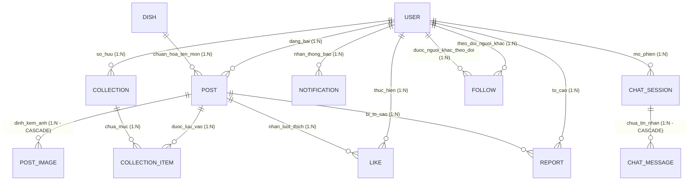

# TÀI LIỆU THIẾT KẾ KIẾN TRÚC CƠ SỞ DỮ LIỆU
## DOC 5.2 & DOC 5.3-A/B: CONCEPTUAL & PHYSICAL DATA SPECIFICATIONS (SPRINT 1)

> **Dự án**: Nền tảng Mạng xã hội Ẩm thực & Trợ lý Trí tuệ Nhân tạo ToMateTo  
> **Tác giả tài liệu**: Kỹ sư Cấu trúc Dữ liệu & Chuyên gia Bảo mật Hệ thống  
> **Trạng thái**: Đã phê duyệt cấu trúc bảng vật lý S1 (`DB_Table&Conceptual_ERD.md`)  
> **Căn cứ kỹ thuật**: 5 Process Flows Backend (WBS 1.3.1), SQLAlchemy 2.0 ORM, PostgreSQL 16 (Alpine), Alembic Migrations, FastAPI Security Architecture.

---

# MỤC 5.2: MÔ HÌNH THỰC THỂ KHÁI NIỆM & ĐẶC TẢ CHI TIẾT THỰC THỂ (CONCEPTUAL ERD & ENTITY SPECIFICATIONS)

## 5.2.1 Phân loại Thực thể theo Chuẩn Thiết kế Học thuật (Entity Classification)

Trong mô hình hóa dữ liệu mức quan niệm (Conceptual Data Modeling), 12 thực thể nghiệp vụ phục vụ 5 Process Flows của Sprint 1 được phân loại chặt chẽ theo 3 nhóm thực thể chuẩn học thuật:

```
                                    ┌────────────────────────────────────────────────────────┐
                                    │     HỆ THỐNG THỰC THỂ DỮ LIỆU SPRINT 1 (12 THỰC THỂ)   │
                                    └───────────────────────────┬────────────────────────────┘
                                                                │
                 ┌──────────────────────────────────────────────┼──────────────────────────────────────────────┐
                 ▼                                              ▼                                              ▼
┌─────────────────────────────────┐           ┌─────────────────────────────────┐            ┌──────────────────────────────────┐
│  THỰC THỂ ĐỘC LẬP / CỐT LÕI     │           │  THỰC THỂ PHỤ THUỘC / YẾU       │            │  THỰC THỂ KẾT HỢP / TRUNG GIAN   │
│  (Strong / Regular Entities)    │           │  (Weak / Subordinate Entities)  │            │  (Associative / Junction)        │
├─────────────────────────────────┤           ├─────────────────────────────────┤            ├──────────────────────────────────┤
│ 1. User (Tài khoản)             │           │ 1. PostImage (Ảnh bài viết)     │            │ 1. Like (Thả tim bài viết)       │
│ 2. Post (Bài đăng ẩm thực)      │           │ 2. ChatMessage (Tin nhắn AI)    │            │ 2. Follow (Quan hệ theo dõi)     │
│ 3. Dish (Món ăn chuẩn hóa)      │           │                                 │            │ 3. CollectionItem (Lưu vào BST)  │
│ 4. Collection (Bộ sưu tập)      │           │                                 │            │ 4. Report (Báo cáo vi phạm)      │
│ 5. Notification (Thông báo đẩy) │           │                                 │            │                                  │
│ 6. ChatSession (Phiên chat AI)  │           │                                 │            │                                  │
└─────────────────────────────────┘           └─────────────────────────────────┘            └──────────────────────────────────┘
```

1. **Thực thể Mạnh / Độc lập (Strong / Regular Entities)**:
   - Tồn tại độc lập trong không gian nghiệp vụ, sở hữu khóa nhận diện riêng không phụ thuộc vào vòng đời của thực thể khác.
   - Bao gồm: `User`, `Post`, `Dish`, `Collection`, `Notification`, `ChatSession`.
2. **Thực thể Yếu / Phụ thuộc (Weak Entities)**:
   - Định danh hoặc sự tồn tại phụ thuộc hoàn toàn vào thực thể chủ (Owner Entity). Khi thực thể chủ bị hủy bỏ, thực thể yếu mất hoàn toàn ý nghĩa nghiệp vụ và phải bị thu hồi (`CASCADE DELETE`).
   - Bao gồm:
     - `PostImage`: Phụ thuộc vào `Post`. Mỗi bức ảnh không thể đứng độc lập mà là một phần cấu thành bộ sưu tập minh họa của bài đăng ẩm thực.
     - `ChatMessage`: Phụ thuộc vào `ChatSession`. Từng lượt tin nhắn hội thoại chỉ có ý nghĩa trong một ngữ cảnh phiên tư vấn ẩm thực xác định.
3. **Thực thể Kết hợp / Liên kết (Associative / Junction Entities)**:
   - Đại diện cho các mối quan hệ nhiều - nhiều ($M:N$) giữa các thực thể mạnh, có thể mang các thuộc tính bổ sung (timestamp, trạng thái, lý do).
   - Bao gồm:
     - `Like`: Liên kết giữa `User` và `Post` (M:N).
     - `Follow`: Liên kết phản thân giữa `User` (Follower) và `User` (Followee) (M:N).
     - `CollectionItem`: Liên kết giữa `Collection` và `Post` (M:N).
     - `Report`: Liên kết giữa `User` (người tố cáo) và `Post` (đối tượng bị tố cáo), bổ sung ngữ nghĩa lý do vi phạm (`reason`).

---

## 5.2.2 Đặc tả Chi tiết Thuộc tính & Ràng buộc Nghiệp vụ (Entity Attribute Specifications)

### 1. Thực thể `User` (Người dùng)
- **Bản chất nghiệp vụ**: Đại diện cho chủ thể thao tác trong toàn bộ hệ sinh thái (tác giả bài viết, người tương tác, người nhận thông báo, chủ phiên hội thoại AI).
- **Phân loại thuộc tính**:
  - *Thuộc tính định danh (Identifier)*: `id` (Khóa chính tự tăng, định danh người dùng toàn hệ thống).
  - *Thuộc tính ứng viên (Candidate Keys)*: `username` (Tên tài khoản duy nhất, viết thường, không dấu), `email` (Thư điện tử định danh).
  - *Thuộc tính bảo mật (Security Attribute)*: `password_hash` (Chuỗi băm mật khẩu chuẩn hóa bằng thuật toán `bcrypt` với cost factor 12, không bao giờ lưu plain-text).
  - *Thuộc tính định danh hiển thị (Profile Attributes)*: `display_name`, `avatar_url`, `cover_url`, `bio`, `city`.
  - *Thuộc tính liên lạc & Xác minh (Verification Attributes)*: `phone`, `phone_verified` (Boolean cờ xác thực SMS), `is_verified` (Tích xanh uy tín).
  - *Thuộc tính bán cấu trúc (Semi-structured)*: `social_links` (Dữ liệu `JSONB` lưu liên kết mạng xã hội dạng key-value: `{"facebook": "...", "instagram": "..."}`).
  - *Thuộc tính hạ tầng đẩy tin (Infrastructure Attribute)*: `fcm_token` (Firebase Cloud Messaging Token phục vụ Push Notification).
  - *Thuộc tính thời gian (Temporal)*: `created_at` (Mốc thời gian đăng ký tài khoản).

### 2. Thực thể `Post` (Bài đăng trải nghiệm ẩm thực)
- **Bản chất nghiệp vụ**: Trung tâm lưu trữ trải nghiệm món ăn, địa điểm, công thức nấu nướng và phân khúc giá (Luồng 1 UC-07 và Luồng 5 UC-19).
- **Phân loại thuộc tính**:
  - *Thuộc tính định danh*: `id`.
  - *Thuộc tính tham chiếu (Foreign Identifiers)*: `user_id` (Tác giả bài viết), `dish_id` (Món ăn chuẩn hóa gắn kèm theo BR-04/QD-05).
  - *Thuộc tính nội dung*: `caption` (Cảm nhận thực tế, đánh giá hương vị).
  - *Thuộc tính phân khúc (Categorical Attribute)*: `price_range` (Kiểu liệt kê Enum: `under_50k`, `50k_100k`, `100k_200k`, `above_200k`).
  - *Thuộc tính không gian & Địa điểm (Spatial & Location)*: `location_name` (Tên quán ăn/nhà hàng), `location_address` (Địa chỉ đường phố), `lat`, `lng` (Tọa độ địa lý chuẩn WGS-84 hỗ trợ tìm kiếm lân cận).
  - *Thuộc tính hoạt động quán*: `opens_at`, `closes_at` (Số phút tính từ 00:00, ví dụ: 480 tương đương 08:00 AM).
  - *Thuộc tính công thức nấu ăn (Recipe Arrays)*: `recipe_ingredients` (Mảng văn bản `TEXT[]` lưu danh sách nguyên liệu), `recipe_steps` (Mảng văn bản `TEXT[]` lưu các bước thực hiện), `cook_time_minutes` (Thời gian nấu), `servings` (Khẩu phần).
  - *Thuộc tính kiểm duyệt (Moderation)*: `is_hidden` (Cờ ẩn bài viết khi bị xử lý vi phạm hoặc tác giả chủ động ẩn).
  - *Thuộc tính thời gian*: `created_at` (Đánh chỉ mục B-Tree DESC phục vụ Feed), `updated_at`.

### 3. Thực thể `Dish` (Danh mục món ăn chuẩn hóa)
- **Bản chất nghiệp vụ**: Thư viện món ăn Việt Nam được chuẩn hóa nhằm gom nhóm bài viết và loại bỏ trùng lặp ngữ nghĩa (BR-04/QD-05).
- **Phân loại thuộc tính**:
  - *Thuộc tính định danh*: `id`.
  - *Thuộc tính hiển thị*: `name` (Tên món ăn có dấu, ví dụ: "Bún chả Hà Nội").
  - *Thuộc tính chuẩn hóa (Normalized Unique Key)*: `name_normalized` (Tên món đã loại bỏ dấu tiếng Việt, ký tự đặc biệt và đưa về chữ thường thông qua giải thuật NFD: "bun cha ha noi"). Ràng buộc `UNIQUE` đảm bảo không có hai bản ghi trùng tên.
  - *Thuộc tính nguồn gốc*: `is_seed` (`TRUE` nếu là món có sẵn từ hệ thống seed data; `FALSE` nếu do người dùng nhập mới khi đăng bài).
  - *Thuộc tính thời gian*: `created_at`.

### 4. Thực thể `PostImage` (Hình ảnh bài viết)
- **Bản chất nghiệp vụ**: Lưu trữ danh sách ảnh chụp thực tế đính kèm bài viết (upload theo BR-06).
- **Phân loại thuộc tính**:
  - *Thuộc tính định danh*: `id`.
  - *Thuộc tính phụ thuộc*: `post_id` (Ràng buộc FK tới `Post` với cơ chế `ON DELETE CASCADE`).
  - *Thuộc tính tài nguyên*: `image_url` (Đường dẫn tĩnh phục vụ ảnh, định dạng chuẩn `/uploads/posts/...`).
  - *Thuộc tính sắp đặt (Ordinal Attribute)*: `position` (Số thứ tự hiển thị của ảnh trên giao diện: 0, 1, 2,...).

### 5. Thực thể `Collection` (Bộ sưu tập)
- **Bản chất nghiệp vụ**: Quản lý thư mục lưu trữ bài viết theo chủ đề của người dùng (Luồng 2 UC-13).
- **Phân loại thuộc tính**:
  - *Thuộc tính định danh*: `id`.
  - *Thuộc tính sở hữu*: `user_id` (Chủ sở hữu bộ sưu tập).
  - *Thuộc tính tên gọi*: `name` (Tên bộ sưu tập).
  - *Thuộc tính hệ thống*: `is_default` (Đánh dấu `TRUE` cho bộ sưu tập mặc định "Đã lưu" được tạo tự động khi khởi tạo tài khoản theo QD-08).
  - *Thuộc tính thời gian*: `created_at`.

### 6. Thực thể `CollectionItem` (Mục lưu bài viết)
- **Bản chất nghiệp vụ**: Bảng kết hợp $M:N$ giữa bộ sưu tập và bài viết.
- **Phân loại thuộc tính**:
  - *Thuộc tính khóa phức hợp (Composite PK)*: `(collection_id, post_id)` ngăn chặn hoàn toàn việc lưu một bài viết trùng lặp vào cùng một bộ sưu tập.
  - *Thuộc tính thời gian*: `added_at` (Mốc thời gian bài viết được thêm vào bộ sưu tập).

### 7. Thực thể `Like` (Thả tim tương tác)
- **Bản chất nghiệp vụ**: Ghi nhận hành vi tương tác yêu thích bài viết (cơ chế toggle 1 đối tượng 1 lần theo BR-05).
- **Phân loại thuộc tính**:
  - *Thuộc tính khóa phức hợp (Composite PK)*: `(user_id, post_id)` đảm bảo mỗi người dùng chỉ có duy nhất 1 trạng thái like đối với 1 bài viết.
  - *Thuộc tính thời gian*: `created_at`.

### 8. Thực thể `Follow` (Theo dõi tài khoản)
- **Bản chất nghiệp vụ**: Thiết lập quan hệ mạng xã hội một chiều giữa hai tài khoản (Luồng 3 UC-14, cơ chế toggle theo BR-05).
- **Phân loại thuộc tính**:
  - *Thuộc tính khóa phức hợp (Composite PK)*: `(follower_id, followee_id)`.
  - *Ràng buộc logic*: `follower_id != followee_id` (Người dùng không được tự theo dõi chính mình).
  - *Thuộc tính thời gian*: `created_at`.

### 9. Thực thể `Notification` (Thông báo đẩy trong ứng dụng)
- **Bản chất nghiệp vụ**: Hộp thư thông báo tương tác nội bộ ứng dụng (khi bài viết được like/lưu, khi có follower mới, hoặc khi có bài đăng mới từ người đang theo dõi).
- **Phân loại thuộc tính**:
  - *Thuộc tính định danh*: `id`.
  - *Thuộc tính người nhận*: `user_id` (Chủ tài khoản nhận thông báo).
  - *Thuộc tính phân loại*: `type` (`like`, `follow`, `collection_save`, `system_alert`).
  - *Thuộc tính dữ liệu động (Dynamic Payload)*: `payload` (Kiểu `JSONB` lưu thông tin ngữ cảnh như `actor_id`, `actor_name`, `post_id`, `message`).
  - *Thuộc tính trạng thái*: `read` (Boolean cờ đánh dấu đã đọc hay chưa).
  - *Thuộc tính thời gian*: `created_at`.

### 10. Thực thể `Report` (Báo cáo vi phạm nội dung)
- **Bản chất nghiệp vụ**: Ghi nhận phản ánh từ cộng đồng về bài viết vi phạm (Luồng 4 UC-15; tuân thủ BR-01/QD-10: ghi nhận chờ Admin xét duyệt, tuyệt đối không tự động ẩn bài).
- **Phân loại thuộc tính**:
  - *Thuộc tính định danh*: `id`.
  - *Thuộc tính quan hệ*: `reporter_id` (Người gửi báo cáo), `post_id` (Bài viết bị phản ánh).
  - *Thuộc tính lý do*: `reason` (Mô tả lý do: spam, sai địa chỉ, hình ảnh phản cảm...).
  - *Thuộc tính thời gian*: `created_at`.

### 11. Thực thể `ChatSession` (Phiên hội thoại Trợ lý AI)
- **Bản chất nghiệp vụ**: Lưu trữ phiên làm việc của người dùng với Trợ lý ẩm thực AI (Luồng 5 UC-18 & UC-19).
- **Phân loại thuộc tính**:
  - *Thuộc tính định danh*: `id` (Kiểu `BIGINT` 64-bit đảm bảo không gian khóa khổng lồ cho lượng hội thoại liên tục).
  - *Thuộc tính sở hữu*: `user_id` (Ràng buộc FK tới `User` với `ON DELETE CASCADE`).
  - *Thuộc tính ngữ cảnh cá nhân hóa*: `context_json` (Kiểu `JSONB` lưu snapshot sở thích, khẩu vị, khu vực sinh sống của người dùng tại thời điểm mở phiên).
  - *Thuộc tính vòng đời*: `created_at` (Thời điểm mở phiên), `ended_at` (Thời điểm kết thúc phiên, `NULL` nếu phiên đang tiếp diễn).

### 12. Thực thể `ChatMessage` (Lượt tin nhắn đối thoại AI)
- **Bản chất nghiệp vụ**: Từng tin nhắn hỏi/đáp trong phiên AI. Hỗ trợ hiển thị kèm lý do gợi ý (BR-03), bảo toàn hội thoại khi LLM timeout (BR-09), và lưu cấu trúc bản nháp bài đăng (`post_draft`) để người dùng chuyển đổi thành bài đăng thật (Luồng 5 → Luồng 1).
- **Phân loại thuộc tính**:
  - *Thuộc tính định danh*: `id` (`BIGINT`).
  - *Thuộc tính phiên chủ quản*: `session_id` (`BIGINT`, FK tới `ChatSession` với `ON DELETE CASCADE`).
  - *Thuộc tính vai trò (Role Attribute)*: `role` (Ràng buộc Check Constraint: chỉ nhận `'user'` hoặc `'assistant'`).
  - *Thuộc tính văn bản*: `content` (Nội dung câu hỏi hoặc lời giải đáp tư vấn).
  - *Thuộc tính hình ảnh minh họa*: `image_url` (Ảnh gợi ý món ăn từ AI).
  - *Thuộc tính bản nháp bài viết (Draft Payload)*: `post_draft` (Kiểu `JSONB` lưu cấu trúc bài đăng hoàn chỉnh gồm tiêu đề, tên món ăn có trong DB, tên quán ăn thực tế, công thức và tọa độ).
  - *Thuộc tính thời gian*: `created_at`.

---

## 5.2.3 Ma trận Ngữ nghĩa Thực thể - Quan hệ (Entity-Relationship Semantic Matrix)

| Thực thể nguồn | Mối quan hệ ngữ nghĩa | Thực thể đích | Bản số (Cardinality) | Mức tham gia Nguồn (Source) | Mức tham gia Đích (Target) | Ý nghĩa nghiệp vụ & Quy tắc liên kết |
|---|:---:|---|:---:|:---:|:---:|---|
| **User** | Tạo / Sở hữu | **Post** | $1 : N$ | Tùy chọn (0..N) | Bắt buộc (1..1) | Một người dùng có thể chưa đăng bài hoặc đăng nhiều bài; Mỗi bài đăng phải thuộc về đúng 1 tác giả. |
| **Dish** | Được gán cho | **Post** | $1 : N$ | Tùy chọn (0..N) | Bắt buộc (1..1) | Mỗi món chuẩn hóa có thể có nhiều bài review; Bài đăng ẩm thực bắt buộc phải thuộc 1 món chuẩn hóa (BR-04/QD-05). |
| **Post** | Chứa | **PostImage** | $1 : N$ | Tùy chọn (0..N) | Bắt buộc (1..1) | Bài viết có thể kèm từ 0 đến nhiều ảnh; Ảnh bắt buộc thuộc 1 bài viết và bị xóa theo bài (`CASCADE`). |
| **User** | Sở hữu | **Collection** | $1 : N$ | Bắt buộc (1..N) | Bắt buộc (1..1) | Người dùng luôn có ít nhất 1 bộ sưu tập mặc định "Đã lưu" (QD-08) và có thể tạo thêm nhiều bộ khác. |
| **Collection** | Lưu trữ | **Post** | $M : N$ | Tùy chọn (0..N) | Tùy chọn (0..N) | Thông qua bảng kết hợp `collection_items`. Một bộ sưu tập chứa nhiều bài viết, một bài viết có thể được lưu vào nhiều bộ sưu tập. |
| **User** | Thả tim | **Post** | $M : N$ | Tùy chọn (0..N) | Tùy chọn (0..N) | Thông qua bảng kết hợp `likes`. Thao tác toggle bật/tắt (BR-05). |
| **User** | Theo dõi | **User** | $M : N$ | Tùy chọn (0..N) | Tùy chọn (0..N) | Thông qua bảng kết hợp `follows` (quan hệ phản thân). Phân tách rõ `follower_id` và `followee_id`. |
| **User** | Nhận | **Notification** | $1 : N$ | Tùy chọn (0..N) | Bắt buộc (1..1) | Một người dùng nhận nhiều thông báo đẩy; Mỗi thông báo chỉ gửi tới 1 tài khoản đích. |
| **User** | Gửi báo cáo | **Post** | $M : N$ | Tùy chọn (0..N) | Tùy chọn (0..N) | Thông qua thực thể `reports`. Một người có thể báo cáo nhiều bài viết, một bài có thể nhận nhiều báo cáo độc lập. |
| **User** | Khởi tạo | **ChatSession** | $1 : N$ | Tùy chọn (0..N) | Bắt buộc (1..1) | Người dùng sở hữu nhiều phiên đối thoại với AI; Xóa user xóa toàn bộ lịch sử chat (`CASCADE`). |
| **ChatSession**| Chứa | **ChatMessage** | $1 : N$ | Tùy chọn (0..N) | Bắt buộc (1..1) | Phiên chat chứa chuỗi hội thoại tuần tự; Xóa session xóa sạch toàn bộ tin nhắn thuộc phiên (`CASCADE`). |

---

## 5.2.4 Sơ đồ Mô hình Thực thể Khái niệm (Conceptual ERD Diagram)



---

# MỤC 5.3: SƠ ĐỒ THỰC THỂ VẬT LÝ & ĐẶC TẢ LƯỢC ĐỒ CSDL (PHYSICAL ERD & SCHEMA SPECIFICATION)

## 5.3.1 Cơ chế Đồng bộ: Migrations + `\d table` trên DB Thật (`alembic upgrade head`)

Hệ thống cơ sở dữ liệu ToMateTo loại bỏ hoàn toàn hiện tượng lệch lược đồ (**Schema Drift**) giữa mã nguồn Backend và CSDL vật lý bằng kiến trúc kiểm soát phiên bản tự động:

```
┌─────────────────────────────────┐
│   SQLAlchemy 2.0 ORM Models     │
│   (app/models/*.py)             │
└────────────────┬────────────────┘
                 │ (1) alembic revision --autogenerate
                 ▼
┌─────────────────────────────────┐
│   Alembic Migration Scripts     │
│   (alembic/versions/*.py)       │
└────────────────┬────────────────┘
                 │ (2) alembic upgrade head
                 ▼
┌────────────────────────────────────────────────────────┐
│   PostgreSQL 16 Engine Physical Schema                 │
│   ==> Trích xuất kiểm chứng bằng lệnh CLI: \d+ <table> │
└────────────────────────────────────────────────────────┘
```

- **Quy tắc bất biến**: `ERD Vật lý ≡ alembic upgrade head`. Toàn bộ cấu trúc bảng, kiểu dữ liệu native PG, khóa chính, khóa ngoại, ràng buộc kiểm tra (`CHECK`), và chỉ mục tối ưu hóa đều được sinh ra từ migration script và kiểm chứng trực tiếp bằng lệnh psql `\d+ <table>` trên môi trường PostgreSQL 16 thật.

---

## 5.3.2 Sơ đồ Thực thể Vật lý Chi tiết (Physical ERD Diagram)

```mermaid
erDiagram
    users {
        int id PK "SERIAL"
        varchar username UK "VARCHAR(50)"
        varchar email UK "VARCHAR(255)"
        varchar password_hash "VARCHAR(255)"
        varchar display_name "VARCHAR(100)"
        text avatar_url "TEXT"
        text cover_url "TEXT"
        text bio "TEXT"
        varchar phone "VARCHAR(20)"
        boolean phone_verified "BOOLEAN DEFAULT FALSE"
        varchar city "VARCHAR(100)"
        jsonb social_links "JSONB DEFAULT '{}'"
        boolean is_verified "BOOLEAN DEFAULT FALSE"
        text fcm_token "TEXT"
        timestamptz created_at "TIMESTAMPTZ DEFAULT now()"
    }

    dishes {
        int id PK "SERIAL"
        varchar name "VARCHAR(150)"
        varchar name_normalized UK "VARCHAR(150)"
        boolean is_seed "BOOLEAN DEFAULT FALSE"
        timestamptz created_at "TIMESTAMPTZ DEFAULT now()"
    }

    posts {
        int id PK "SERIAL"
        int user_id FK "INT -> users.id"
        int dish_id FK "INT -> dishes.id"
        text caption "TEXT"
        pricerange price_range "ENUM ('under_50k','50k_100k','100k_200k','above_200k')"
        varchar location_name "VARCHAR(255)"
        text location_address "TEXT"
        text_array recipe_ingredients "TEXT[]"
        text_array recipe_steps "TEXT[]"
        float lat "DOUBLE PRECISION"
        float lng "DOUBLE PRECISION"
        int opens_at "INT"
        int closes_at "INT"
        int cook_time_minutes "INT"
        int servings "INT"
        boolean is_hidden "BOOLEAN DEFAULT FALSE"
        timestamptz created_at "TIMESTAMPTZ DEFAULT now()"
        timestamptz updated_at "TIMESTAMPTZ DEFAULT now()"
    }

    post_images {
        int id PK "SERIAL"
        int post_id FK "INT -> posts.id ON DELETE CASCADE"
        text image_url "TEXT"
        int position "INT DEFAULT 0"
    }

    likes {
        int user_id PK,FK "INT -> users.id"
        int post_id PK,FK "INT -> posts.id"
        timestamptz created_at "TIMESTAMPTZ DEFAULT now()"
    }

    collections {
        int id PK "SERIAL"
        int user_id FK "INT -> users.id"
        varchar name "VARCHAR(100)"
        boolean is_default "BOOLEAN DEFAULT FALSE"
        timestamptz created_at "TIMESTAMPTZ DEFAULT now()"
    }

    collection_items {
        int collection_id PK,FK "INT -> collections.id"
        int post_id PK,FK "INT -> posts.id"
        timestamptz added_at "TIMESTAMPTZ DEFAULT now()"
    }

    follows {
        int follower_id PK,FK "INT -> users.id"
        int followee_id PK,FK "INT -> users.id"
        timestamptz created_at "TIMESTAMPTZ DEFAULT now()"
    }

    notifications {
        int id PK "SERIAL"
        int user_id FK "INT -> users.id"
        varchar type "VARCHAR(50)"
        jsonb payload "JSONB DEFAULT '{}'"
        boolean read "BOOLEAN DEFAULT FALSE"
        timestamptz created_at "TIMESTAMPTZ DEFAULT now()"
    }

    reports {
        int id PK "SERIAL"
        int reporter_id FK "INT -> users.id"
        int post_id FK "INT -> posts.id"
        varchar reason "VARCHAR(255)"
        timestamptz created_at "TIMESTAMPTZ DEFAULT now()"
    }

    chat_sessions {
        bigint id PK "BIGSERIAL"
        bigint user_id FK "BIGINT -> users.id ON DELETE CASCADE"
        jsonb context_json "JSONB"
        timestamptz created_at "TIMESTAMPTZ DEFAULT now()"
        timestamptz ended_at "TIMESTAMPTZ"
    }

    chat_messages {
        bigint id PK "BIGSERIAL"
        bigint session_id FK "BIGINT -> chat_sessions.id ON DELETE CASCADE"
        text role "TEXT CHECK (role IN ('user', 'assistant'))"
        text content "TEXT"
        text image_url "TEXT"
        jsonb post_draft "JSONB"
        timestamptz created_at "TIMESTAMPTZ DEFAULT now()"
    }

    users ||--o{ posts : "posts.user_id = users.id"
    users ||--o{ collections : "collections.user_id = users.id"
    users ||--o{ notifications : "notifications.user_id = users.id"
    users ||--o{ chat_sessions : "chat_sessions.user_id = users.id (CASCADE)"
    users ||--o{ likes : "likes.user_id = users.id"
    users ||--o{ follows : "follows.follower_id = users.id"
    users ||--o{ follows : "follows.followee_id = users.id"
    users ||--o{ reports : "reports.reporter_id = users.id"

    dishes ||--o{ posts : "posts.dish_id = dishes.id"

    posts ||--o{ post_images : "post_images.post_id = posts.id (CASCADE)"
    posts ||--o{ likes : "likes.post_id = posts.id"
    posts ||--o{ collection_items : "collection_items.post_id = posts.id"
    posts ||--o{ reports : "reports.post_id = posts.id"

    collections ||--o{ collection_items : "collection_items.collection_id = collections.id"

    chat_sessions ||--o{ chat_messages : "chat_messages.session_id = chat_sessions.id (CASCADE)"
```



---

## 5.3.3 Đặc tả Lược đồ Chuẩn PostgreSQL Output (`\d+ table`)

Dưới đây là đặc tả chi tiết 12 bảng vật lý theo đúng cấu trúc siêu dữ liệu xuất ra từ lệnh psql `\d+ <table>` trên PostgreSQL 16:

### 1. Bảng `users`
```text
Table "public.users"
      Column      |           Type           | Collation | Nullable |             Default              | Storage  | Stats | Description 
------------------+--------------------------+-----------+----------+----------------------------------+----------+-------+-------------
 id               | integer                  |           | not null | generated by default as identity | plain    |       | PK
 username         | character varying(50)    |           | not null |                                  | extended |       | Unique slug
 email            | character varying(255)   |           | not null |                                  | extended |       | Unique email
 password_hash    | character varying(255)   |           | not null |                                  | extended |       | bcrypt hash
 display_name     | character varying(100)   |           | not null |                                  | extended |       | 
 avatar_url       | text                     |           |          |                                  | extended |       | 
 cover_url        | text                     |           |          |                                  | extended |       | 
 bio              | text                     |           |          |                                  | extended |       | 
 phone            | character varying(20)    |           |          |                                  | extended |       | 
 phone_verified   | boolean                  |           | not null | false                            | plain    |       | 
 city             | character varying(100)   |           |          |                                  | extended |       | 
 social_links     | jsonb                    |           | not null | '{}'::jsonb                      | extended |       | 
 is_verified      | boolean                  |           | not null | false                            | plain    |       | 
 fcm_token        | text                     |           |          |                                  | extended |       | Push token
 created_at       | timestamp with time zone |           | not null | now()                            | plain    |       | 
Indexes:
    "users_pkey" PRIMARY KEY, btree (id)
    "uq_users_username" UNIQUE CONSTRAINT, btree (username)
    "uq_users_email" UNIQUE CONSTRAINT, btree (email)
Referenced by:
    TABLE "posts" CONSTRAINT "fk_posts_user_id" FOREIGN KEY (user_id) REFERENCES users(id)
    TABLE "collections" CONSTRAINT "fk_collections_user_id" FOREIGN KEY (user_id) REFERENCES users(id)
    TABLE "notifications" CONSTRAINT "fk_notifications_user_id" FOREIGN KEY (user_id) REFERENCES users(id)
    TABLE "chat_sessions" CONSTRAINT "fk_chat_sessions_user_id" FOREIGN KEY (user_id) REFERENCES users(id) ON DELETE CASCADE
    TABLE "likes" CONSTRAINT "fk_likes_user_id" FOREIGN KEY (user_id) REFERENCES users(id)
    TABLE "follows" CONSTRAINT "fk_follows_follower_id" FOREIGN KEY (follower_id) REFERENCES users(id)
    TABLE "follows" CONSTRAINT "fk_follows_followee_id" FOREIGN KEY (followee_id) REFERENCES users(id)
    TABLE "reports" CONSTRAINT "fk_reports_reporter_id" FOREIGN KEY (reporter_id) REFERENCES users(id)
```

### 2. Bảng `dishes`
```text
Table "public.dishes"
     Column      |           Type           | Collation | Nullable |             Default              | Storage  | Stats | Description 
-----------------+--------------------------+-----------+----------+----------------------------------+----------+-------+-------------
 id              | integer                  |           | not null | generated by default as identity | plain    |       | PK
 name            | character varying(150)   |           | not null |                                  | extended |       | Tên có dấu
 name_normalized | character varying(150)   |           | not null |                                  | extended |       | Tên không dấu (dedup)
 is_seed         | boolean                  |           | not null | false                            | plain    |       | 
 created_at      | timestamp with time zone |           | not null | now()                            | plain    |       | 
Indexes:
    "dishes_pkey" PRIMARY KEY, btree (id)
    "uq_dishes_name_normalized" UNIQUE CONSTRAINT, btree (name_normalized)
    "ix_dishes_name_trgm" gin (name_normalized gin_trgm_ops)
Referenced by:
    TABLE "posts" CONSTRAINT "fk_posts_dish_id" FOREIGN KEY (dish_id) REFERENCES dishes(id)
```

### 3. Bảng `posts`
```text
Table "public.posts"
       Column       |           Type           | Collation | Nullable |             Default              | Storage  | Stats | Description 
--------------------+--------------------------+-----------+----------+----------------------------------+----------+-------+-------------
 id                 | integer                  |           | not null | generated by default as identity | plain    |       | PK
 user_id            | integer                  |           | not null |                                  | plain    |       | FK -> users.id
 dish_id            | integer                  |           | not null |                                  | plain    |       | FK -> dishes.id
 caption            | text                     |           |          |                                  | extended |       | 
 price_range        | pricerange               |           |          |                                  | plain    |       | Custom Enum
 location_name      | character varying(255)   |           |          |                                  | extended |       | 
 location_address   | text                     |           |          |                                  | extended |       | 
 recipe_ingredients | text[]                   |           |          |                                  | extended |       | Mảng nguyên liệu
 recipe_steps       | text[]                   |           |          |                                  | extended |       | Mảng các bước
 lat                | double precision         |           |          |                                  | plain    |       | WGS-84
 lng                | double precision         |           |          |                                  | plain    |       | WGS-84
 opens_at           | integer                  |           |          |                                  | plain    |       | Phút từ 00:00
 closes_at          | integer                  |           |          |                                  | plain    |       | Phút từ 00:00
 cook_time_minutes  | integer                  |           |          |                                  | plain    |       | 
 servings           | integer                  |           |          |                                  | plain    |       | 
 is_hidden          | boolean                  |           | not null | false                            | plain    |       | Cờ ẩn bài
 created_at         | timestamp with time zone |           | not null | now()                            | plain    |       | 
 updated_at         | timestamp with time zone |           | not null | now()                            | plain    |       | 
Indexes:
    "posts_pkey" PRIMARY KEY, btree (id)
    "ix_posts_user_id" btree (user_id)
    "ix_posts_dish_id" btree (dish_id)
    "ix_posts_created_at" btree (created_at DESC)
    "ix_posts_lat_lng" btree (lat, lng) WHERE (is_hidden = false)
    "ix_posts_location_trgm" gin (location_name gin_trgm_ops)
Foreign-key constraints:
    "fk_posts_user_id" FOREIGN KEY (user_id) REFERENCES users(id) ON DELETE RESTRICT
    "fk_posts_dish_id" FOREIGN KEY (dish_id) REFERENCES dishes(id) ON DELETE RESTRICT
Referenced by:
    TABLE "post_images" CONSTRAINT "fk_post_images_post_id" FOREIGN KEY (post_id) REFERENCES posts(id) ON DELETE CASCADE
    TABLE "likes" CONSTRAINT "fk_likes_post_id" FOREIGN KEY (post_id) REFERENCES posts(id)
    TABLE "collection_items" CONSTRAINT "fk_collection_items_post_id" FOREIGN KEY (post_id) REFERENCES posts(id)
    TABLE "reports" CONSTRAINT "fk_reports_post_id" FOREIGN KEY (post_id) REFERENCES posts(id)
```

### 4. Bảng `post_images`
```text
Table "public.post_images"
   Column   |  Type   | Collation | Nullable |             Default              | Storage  | Stats | Description 
------------+---------+-----------+----------+----------------------------------+----------+-------+-------------
 id         | integer |           | not null | generated by default as identity | plain    |       | PK
 post_id    | integer |           | not null |                                  | plain    |       | FK -> posts.id
 image_url  | text    |           | not null |                                  | extended |       | Static URL
 position   | integer |           | not null | 0                                | plain    |       | Order
Indexes:
    "post_images_pkey" PRIMARY KEY, btree (id)
    "ix_post_images_post_id_position" btree (post_id, position)
Foreign-key constraints:
    "fk_post_images_post_id" FOREIGN KEY (post_id) REFERENCES posts(id) ON DELETE CASCADE
```

### 5. Bảng `likes`
```text
Table "public.likes"
   Column   |           Type           | Collation | Nullable | Default | Storage | Stats | Description 
------------+--------------------------+-----------+----------+---------+---------+-------+-------------
 user_id    | integer                  |           | not null |         | plain   |       | PK, FK -> users.id
 post_id    | integer                  |           | not null |         | plain   |       | PK, FK -> posts.id
 created_at | timestamp with time zone |           | not null | now()   | plain   |       | 
Indexes:
    "likes_pkey" PRIMARY KEY, btree (user_id, post_id)
    "ix_likes_post_id" btree (post_id)
Foreign-key constraints:
    "fk_likes_user_id" FOREIGN KEY (user_id) REFERENCES users(id)
    "fk_likes_post_id" FOREIGN KEY (post_id) REFERENCES posts(id)
```

### 6. Bảng `collections`
```text
Table "public.collections"
   Column   |           Type           | Collation | Nullable |             Default              | Storage  | Stats | Description 
------------+--------------------------+-----------+----------+----------------------------------+----------+-------+-------------
 id         | integer                  |           | not null | generated by default as identity | plain    |       | PK
 user_id    | integer                  |           | not null |                                  | plain    |       | FK -> users.id
 name       | character varying(100)   |           | not null |                                  | extended |       | Tên BST
 is_default | boolean                  |           | not null | false                            | plain    |       | Mặc định (QD-08)
 created_at | timestamp with time zone |           | not null | now()                            | plain    |       | 
Indexes:
    "collections_pkey" PRIMARY KEY, btree (id)
    "ix_collections_user_id" btree (user_id)
Foreign-key constraints:
    "fk_collections_user_id" FOREIGN KEY (user_id) REFERENCES users(id)
Referenced by:
    TABLE "collection_items" CONSTRAINT "fk_collection_items_collection_id" FOREIGN KEY (collection_id) REFERENCES collections(id)
```

### 7. Bảng `collection_items`
```text
Table "public.collection_items"
    Column     |           Type           | Collation | Nullable | Default | Storage | Stats | Description 
---------------+--------------------------+-----------+----------+---------+---------+-------+-------------
 collection_id | integer                  |           | not null |         | plain   |       | PK, FK -> collections.id
 post_id       | integer                  |           | not null |         | plain   |       | PK, FK -> posts.id
 added_at      | timestamp with time zone |           | not null | now()   | plain   |       | 
Indexes:
    "collection_items_pkey" PRIMARY KEY, btree (collection_id, post_id)
    "ix_collection_items_post_id" btree (post_id)
Foreign-key constraints:
    "fk_collection_items_collection_id" FOREIGN KEY (collection_id) REFERENCES collections(id)
    "fk_collection_items_post_id" FOREIGN KEY (post_id) REFERENCES posts(id)
```

### 8. Bảng `follows`
```text
Table "public.follows"
   Column    |           Type           | Collation | Nullable | Default | Storage | Stats | Description 
-------------+--------------------------+-----------+----------+---------+---------+-------+-------------
 follower_id | integer                  |           | not null |         | plain   |       | PK, FK -> users.id
 followee_id | integer                  |           | not null |         | plain   |       | PK, FK -> users.id
 created_at  | timestamp with time zone |           | not null | now()   | plain   |       | 
Indexes:
    "follows_pkey" PRIMARY KEY, btree (follower_id, followee_id)
    "ix_follows_followee_id" btree (followee_id)
Check constraints:
    "ck_follows_not_self" CHECK (follower_id <> followee_id)
Foreign-key constraints:
    "fk_follows_follower_id" FOREIGN KEY (follower_id) REFERENCES users(id)
    "fk_follows_followee_id" FOREIGN KEY (followee_id) REFERENCES users(id)
```

### 9. Bảng `notifications`
```text
Table "public.notifications"
   Column   |           Type           | Collation | Nullable |             Default              | Storage  | Stats | Description 
------------+--------------------------+-----------+----------+----------------------------------+----------+-------+-------------
 id         | integer                  |           | not null | generated by default as identity | plain    |       | PK
 user_id    | integer                  |           | not null |                                  | plain    |       | FK -> users.id
 type       | character varying(50)    |           | not null |                                  | extended |       | Type
 payload    | jsonb                    |           | not null | '{}'::jsonb                      | extended |       | Context JSON
 read       | boolean                  |           | not null | false                            | plain    |       | 
 created_at | timestamp with time zone |           | not null | now()                            | plain    |       | 
Indexes:
    "notifications_pkey" PRIMARY KEY, btree (id)
    "ix_notifications_user_id_created_at" btree (user_id, created_at DESC)
Foreign-key constraints:
    "fk_notifications_user_id" FOREIGN KEY (user_id) REFERENCES users(id)
```

### 10. Bảng `reports`
```text
Table "public.reports"
   Column    |           Type           | Collation | Nullable |             Default              | Storage  | Stats | Description 
-------------+--------------------------+-----------+----------+----------------------------------+----------+-------+-------------
 id          | integer                  |           | not null | generated by default as identity | plain    |       | PK
 reporter_id | integer                  |           | not null |                                  | plain    |       | FK -> users.id
 post_id     | integer                  |           | not null |                                  | plain    |       | FK -> posts.id
 reason      | character varying(255)   |           | not null |                                  | extended |       | Lý do
 created_at  | timestamp with time zone |           | not null | now()                            | plain    |       | 
Indexes:
    "reports_pkey" PRIMARY KEY, btree (id)
    "ix_reports_post_id" btree (post_id)
    "ix_reports_reporter_id" btree (reporter_id)
Foreign-key constraints:
    "fk_reports_reporter_id" FOREIGN KEY (reporter_id) REFERENCES users(id)
    "fk_reports_post_id" FOREIGN KEY (post_id) REFERENCES posts(id)
```

### 11. Bảng `chat_sessions`
```text
Table "public.chat_sessions"
    Column    |           Type           | Collation | Nullable |             Default              | Storage  | Stats | Description 
--------------+--------------------------+-----------+----------+----------------------------------+----------+-------+-------------
 id           | bigint                   |           | not null | generated by default as identity | plain    |       | PK (64-bit)
 user_id      | bigint                   |           | not null |                                  | plain    |       | FK -> users.id
 context_json | jsonb                    |           |          |                                  | extended |       | User taste context
 created_at   | timestamp with time zone |           | not null | now()                            | plain    |       | 
 ended_at     | timestamp with time zone |           |          |                                  | plain    |       | 
Indexes:
    "chat_sessions_pkey" PRIMARY KEY, btree (id)
    "ix_chat_sessions_user_id_created_at" btree (user_id, created_at DESC)
Foreign-key constraints:
    "fk_chat_sessions_user_id" FOREIGN KEY (user_id) REFERENCES users(id) ON DELETE CASCADE
Referenced by:
    TABLE "chat_messages" CONSTRAINT "fk_chat_messages_session_id" FOREIGN KEY (session_id) REFERENCES chat_sessions(id) ON DELETE CASCADE
```

### 12. Bảng `chat_messages`
```text
Table "public.chat_messages"
   Column   |           Type           | Collation | Nullable |             Default              | Storage  | Stats | Description 
------------+--------------------------+-----------+----------+----------------------------------+----------+-------+-------------
 id         | bigint                   |           | not null | generated by default as identity | plain    |       | PK (64-bit)
 session_id | bigint                   |           | not null |                                  | plain    |       | FK -> chat_sessions.id
 role       | text                     |           | not null |                                  | extended |       | user/assistant
 content    | text                     |           | not null |                                  | extended |       | Tin nhắn + lý do
 image_url  | text                     |           |          |                                  | extended |       | Ảnh AI gợi ý
 post_draft | jsonb                    |           |          |                                  | extended |       | Bản nháp bài đăng
 created_at | timestamp with time zone |           | not null | now()                            | plain    |       | 
Indexes:
    "chat_messages_pkey" PRIMARY KEY, btree (id)
    "ix_chat_messages_session_id_created_at" btree (session_id, created_at)
Check constraints:
    "ck_chat_messages_role" CHECK (role = ANY (ARRAY['user'::text, 'assistant'::text]))
Foreign-key constraints:
    "fk_chat_messages_session_id" FOREIGN KEY (session_id) REFERENCES chat_sessions(id) ON DELETE CASCADE
```

---

## 5.3.4 Mã nguồn Alembic Migration Hoàn chỉnh (`alembic/versions/001_sprint1_core_schema.py`)

Dưới đây là mã migration chính thức đại diện cho trạng thái `head` của hệ thống:

```python
"""Sprint 1 Core Physical Schema: 12 Tables, 15 FKs, Trigram & DESC Indexes

Revision ID: 001_sprint1_core_schema
Revises: None
Create Date: 2026-10-23 21:00:00.000000
"""
from typing import Sequence, Union
from alembic import op
import sqlalchemy as sa
from sqlalchemy.dialects import postgresql

revision: str = '001_sprint1_core_schema'
down_revision: Union[str, None] = None
branch_labels: Union[str, Sequence[str], None] = None
depends_on: Union[str, Sequence[str], None] = None


def upgrade() -> None:
    # 0. Khởi tạo Extensions phục vụ tìm kiếm tiếng Việt và Trigram
    op.execute("CREATE EXTENSION IF NOT EXISTS pg_trgm;")
    op.execute("CREATE EXTENSION IF NOT EXISTS unaccent;")

    # 1. Khởi tạo Native Enum phân khúc giá
    price_range_enum = postgresql.ENUM(
        'under_50k', '50k_100k', '100k_200k', 'above_200k',
        name='pricerange',
        create_type=True
    )
    price_range_enum.create(op.get_bind(), checkfirst=True)

    # 2. Bảng users
    op.create_table(
        'users',
        sa.Column('id', sa.Integer(), sa.Identity(always=False), nullable=False),
        sa.Column('username', sa.String(length=50), nullable=False),
        sa.Column('email', sa.String(length=255), nullable=False),
        sa.Column('password_hash', sa.String(length=255), nullable=False),
        sa.Column('display_name', sa.String(length=100), nullable=False),
        sa.Column('avatar_url', sa.Text(), nullable=True),
        sa.Column('cover_url', sa.Text(), nullable=True),
        sa.Column('bio', sa.Text(), nullable=True),
        sa.Column('phone', sa.String(length=20), nullable=True),
        sa.Column('phone_verified', sa.Boolean(), server_default=sa.text('false'), nullable=False),
        sa.Column('city', sa.String(length=100), nullable=True),
        sa.Column('social_links', postgresql.JSONB(astext_type=sa.Text()), server_default=sa.text("'{}'::jsonb"), nullable=False),
        sa.Column('is_verified', sa.Boolean(), server_default=sa.text('false'), nullable=False),
        sa.Column('fcm_token', sa.Text(), nullable=True),
        sa.Column('created_at', sa.DateTime(timezone=True), server_default=sa.func.now(), nullable=False),
        sa.PrimaryKeyConstraint('id', name='users_pkey'),
        sa.UniqueConstraint('username', name='uq_users_username'),
        sa.UniqueConstraint('email', name='uq_users_email')
    )

    # 3. Bảng dishes
    op.create_table(
        'dishes',
        sa.Column('id', sa.Integer(), sa.Identity(always=False), nullable=False),
        sa.Column('name', sa.String(length=150), nullable=False),
        sa.Column('name_normalized', sa.String(length=150), nullable=False),
        sa.Column('is_seed', sa.Boolean(), server_default=sa.text('false'), nullable=False),
        sa.Column('created_at', sa.DateTime(timezone=True), server_default=sa.func.now(), nullable=False),
        sa.PrimaryKeyConstraint('id', name='dishes_pkey'),
        sa.UniqueConstraint('name_normalized', name='uq_dishes_name_normalized')
    )
    op.create_index('ix_dishes_name_trgm', 'dishes', ['name_normalized'], postgresql_using='gin', postgresql_ops={'name_normalized': 'gin_trgm_ops'})

    # 4. Bảng posts
    op.create_table(
        'posts',
        sa.Column('id', sa.Integer(), sa.Identity(always=False), nullable=False),
        sa.Column('user_id', sa.Integer(), nullable=False),
        sa.Column('dish_id', sa.Integer(), nullable=False),
        sa.Column('caption', sa.Text(), nullable=True),
        sa.Column('price_range', price_range_enum, nullable=True),
        sa.Column('location_name', sa.String(length=255), nullable=True),
        sa.Column('location_address', sa.Text(), nullable=True),
        sa.Column('recipe_ingredients', postgresql.ARRAY(sa.Text()), nullable=True),
        sa.Column('recipe_steps', postgresql.ARRAY(sa.Text()), nullable=True),
        sa.Column('lat', sa.Float(), nullable=True),
        sa.Column('lng', sa.Float(), nullable=True),
        sa.Column('opens_at', sa.Integer(), nullable=True),
        sa.Column('closes_at', sa.Integer(), nullable=True),
        sa.Column('cook_time_minutes', sa.Integer(), nullable=True),
        sa.Column('servings', sa.Integer(), nullable=True),
        sa.Column('is_hidden', sa.Boolean(), server_default=sa.text('false'), nullable=False),
        sa.Column('created_at', sa.DateTime(timezone=True), server_default=sa.func.now(), nullable=False),
        sa.Column('updated_at', sa.DateTime(timezone=True), server_default=sa.func.now(), onupdate=sa.func.now(), nullable=False),
        sa.ForeignKeyConstraint(['user_id'], ['users.id'], name='fk_posts_user_id', ondelete='RESTRICT'),
        sa.ForeignKeyConstraint(['dish_id'], ['dishes.id'], name='fk_posts_dish_id', ondelete='RESTRICT'),
        sa.PrimaryKeyConstraint('id', name='posts_pkey')
    )
    op.create_index('ix_posts_user_id', 'posts', ['user_id'])
    op.create_index('ix_posts_dish_id', 'posts', ['dish_id'])
    op.create_index('ix_posts_created_at', 'posts', [sa.text('created_at DESC')])
    op.create_index('ix_posts_lat_lng', 'posts', ['lat', 'lng'], postgresql_where=sa.text('is_hidden = false'))
    op.create_index('ix_posts_location_trgm', 'posts', ['location_name'], postgresql_using='gin', postgresql_ops={'location_name': 'gin_trgm_ops'})

    # 5. Bảng post_images (Cascade Delete)
    op.create_table(
        'post_images',
        sa.Column('id', sa.Integer(), sa.Identity(always=False), nullable=False),
        sa.Column('post_id', sa.Integer(), nullable=False),
        sa.Column('image_url', sa.Text(), nullable=False),
        sa.Column('position', sa.Integer(), server_default=sa.text('0'), nullable=False),
        sa.ForeignKeyConstraint(['post_id'], ['posts.id'], name='fk_post_images_post_id', ondelete='CASCADE'),
        sa.PrimaryKeyConstraint('id', name='post_images_pkey')
    )
    op.create_index('ix_post_images_post_id_position', 'post_images', ['post_id', 'position'])

    # 6. Bảng likes (Composite PK)
    op.create_table(
        'likes',
        sa.Column('user_id', sa.Integer(), nullable=False),
        sa.Column('post_id', sa.Integer(), nullable=False),
        sa.Column('created_at', sa.DateTime(timezone=True), server_default=sa.func.now(), nullable=False),
        sa.ForeignKeyConstraint(['user_id'], ['users.id'], name='fk_likes_user_id', ondelete='RESTRICT'),
        sa.ForeignKeyConstraint(['post_id'], ['posts.id'], name='fk_likes_post_id', ondelete='RESTRICT'),
        sa.PrimaryKeyConstraint('user_id', 'post_id', name='likes_pkey')
    )
    op.create_index('ix_likes_post_id', 'likes', ['post_id'])

    # 7. Bảng collections
    op.create_table(
        'collections',
        sa.Column('id', sa.Integer(), sa.Identity(always=False), nullable=False),
        sa.Column('user_id', sa.Integer(), nullable=False),
        sa.Column('name', sa.String(length=100), nullable=False),
        sa.Column('is_default', sa.Boolean(), server_default=sa.text('false'), nullable=False),
        sa.Column('created_at', sa.DateTime(timezone=True), server_default=sa.func.now(), nullable=False),
        sa.ForeignKeyConstraint(['user_id'], ['users.id'], name='fk_collections_user_id', ondelete='RESTRICT'),
        sa.PrimaryKeyConstraint('id', name='collections_pkey')
    )
    op.create_index('ix_collections_user_id', 'collections', ['user_id'])

    # 8. Bảng collection_items (Composite PK)
    op.create_table(
        'collection_items',
        sa.Column('collection_id', sa.Integer(), nullable=False),
        sa.Column('post_id', sa.Integer(), nullable=False),
        sa.Column('added_at', sa.DateTime(timezone=True), server_default=sa.func.now(), nullable=False),
        sa.ForeignKeyConstraint(['collection_id'], ['collections.id'], name='fk_collection_items_collection_id', ondelete='RESTRICT'),
        sa.ForeignKeyConstraint(['post_id'], ['posts.id'], name='fk_collection_items_post_id', ondelete='RESTRICT'),
        sa.PrimaryKeyConstraint('collection_id', 'post_id', name='collection_items_pkey')
    )
    op.create_index('ix_collection_items_post_id', 'collection_items', ['post_id'])

    # 9. Bảng follows (Composite PK & Self-check)
    op.create_table(
        'follows',
        sa.Column('follower_id', sa.Integer(), nullable=False),
        sa.Column('followee_id', sa.Integer(), nullable=False),
        sa.Column('created_at', sa.DateTime(timezone=True), server_default=sa.func.now(), nullable=False),
        sa.CheckConstraint('follower_id != followee_id', name='ck_follows_not_self'),
        sa.ForeignKeyConstraint(['follower_id'], ['users.id'], name='fk_follows_follower_id', ondelete='RESTRICT'),
        sa.ForeignKeyConstraint(['followee_id'], ['users.id'], name='fk_follows_followee_id', ondelete='RESTRICT'),
        sa.PrimaryKeyConstraint('follower_id', 'followee_id', name='follows_pkey')
    )
    op.create_index('ix_follows_followee_id', 'follows', ['followee_id'])

    # 10. Bảng notifications
    op.create_table(
        'notifications',
        sa.Column('id', sa.Integer(), sa.Identity(always=False), nullable=False),
        sa.Column('user_id', sa.Integer(), nullable=False),
        sa.Column('type', sa.String(length=50), nullable=False),
        sa.Column('payload', postgresql.JSONB(astext_type=sa.Text()), server_default=sa.text("'{}'::jsonb"), nullable=False),
        sa.Column('read', sa.Boolean(), server_default=sa.text('false'), nullable=False),
        sa.Column('created_at', sa.DateTime(timezone=True), server_default=sa.func.now(), nullable=False),
        sa.ForeignKeyConstraint(['user_id'], ['users.id'], name='fk_notifications_user_id', ondelete='RESTRICT'),
        sa.PrimaryKeyConstraint('id', name='notifications_pkey')
    )
    op.create_index('ix_notifications_user_id_created_at', 'notifications', ['user_id', sa.text('created_at DESC')])

    # 11. Bảng reports
    op.create_table(
        'reports',
        sa.Column('id', sa.Integer(), sa.Identity(always=False), nullable=False),
        sa.Column('reporter_id', sa.Integer(), nullable=False),
        sa.Column('post_id', sa.Integer(), nullable=False),
        sa.Column('reason', sa.String(length=255), nullable=False),
        sa.Column('created_at', sa.DateTime(timezone=True), server_default=sa.func.now(), nullable=False),
        sa.ForeignKeyConstraint(['reporter_id'], ['users.id'], name='fk_reports_reporter_id', ondelete='RESTRICT'),
        sa.ForeignKeyConstraint(['post_id'], ['posts.id'], name='fk_reports_post_id', ondelete='RESTRICT'),
        sa.PrimaryKeyConstraint('id', name='reports_pkey')
    )
    op.create_index('ix_reports_reporter_id', 'reports', ['reporter_id'])
    op.create_index('ix_reports_post_id', 'reports', ['post_id'])

    # 12. Bảng chat_sessions (BIGINT & Cascade Delete)
    op.create_table(
        'chat_sessions',
        sa.Column('id', sa.BigInteger(), sa.Identity(always=False), nullable=False),
        sa.Column('user_id', sa.Integer(), nullable=False),
        sa.Column('context_json', postgresql.JSONB(astext_type=sa.Text()), nullable=True),
        sa.Column('created_at', sa.DateTime(timezone=True), server_default=sa.func.now(), nullable=False),
        sa.Column('ended_at', sa.DateTime(timezone=True), nullable=True),
        sa.ForeignKeyConstraint(['user_id'], ['users.id'], name='fk_chat_sessions_user_id', ondelete='CASCADE'),
        sa.PrimaryKeyConstraint('id', name='chat_sessions_pkey')
    )
    op.create_index('ix_chat_sessions_user_id_created_at', 'chat_sessions', ['user_id', sa.text('created_at DESC')])

    # 13. Bảng chat_messages (BIGINT, Cascade Delete, Check Constraint)
    op.create_table(
        'chat_messages',
        sa.Column('id', sa.BigInteger(), sa.Identity(always=False), nullable=False),
        sa.Column('session_id', sa.BigInteger(), nullable=False),
        sa.Column('role', sa.Text(), nullable=False),
        sa.Column('content', sa.Text(), nullable=False),
        sa.Column('image_url', sa.Text(), nullable=True),
        sa.Column('post_draft', postgresql.JSONB(astext_type=sa.Text()), nullable=True),
        sa.Column('created_at', sa.DateTime(timezone=True), server_default=sa.func.now(), nullable=False),
        sa.CheckConstraint("role IN ('user', 'assistant')", name='ck_chat_messages_role'),
        sa.ForeignKeyConstraint(['session_id'], ['chat_sessions.id'], name='fk_chat_messages_session_id', ondelete='CASCADE'),
        sa.PrimaryKeyConstraint('id', name='chat_messages_pkey')
    )
    op.create_index('ix_chat_messages_session_id_created_at', 'chat_messages', ['session_id', 'created_at'])


def downgrade() -> None:
    op.drop_table('chat_messages')
    op.drop_table('chat_sessions')
    op.drop_table('reports')
    op.drop_table('notifications')
    op.drop_table('follows')
    op.drop_table('collection_items')
    op.drop_table('collections')
    op.drop_table('likes')
    op.drop_table('post_images')
    op.drop_table('posts')
    op.drop_table('dishes')
    op.drop_table('users')
    op.execute("DROP TYPE IF EXISTS pricerange;")
```