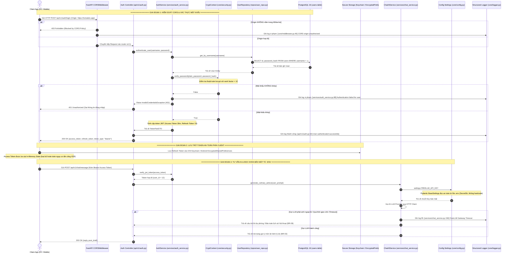

# TÀI LIỆU THIẾT KẾ KIẾN TRÚC BẢO MẬT HỆ THỐNG
## DOC 5.4-A: SECURITY DESIGN & DISCUSSION SPECIFICATION (SPRINT 1)

> **Dự án**: Nền tảng Mạng xã hội Ẩm thực & Trợ lý Trí tuệ Nhân tạo ToMateTo  
> **Mã hạng mục WBS**: 4.4 (DOC 5.4-A Security Design - Sprint 4 / HLD)  
> **Người thực hiện đề xuất**: Kỹ sư Cấu trúc Dữ liệu (DB) & Trưởng nhóm Kỹ thuật (Lead)  
> **Đối tượng thảo luận & phê duyệt**: Đội ngũ Backend (BE) & Frontend (FE)  
> **Trạng thái tài liệu**: Bản dự thảo thảo luận kỹ thuật (RFC / Structure for Discussion)  
> **Căn cứ nghiệp vụ & kỹ thuật**: 5 Process Flows Backend (WBS 1.3.1), PostgreSQL 16, FastAPI 0.110+, SQLAlchemy 2.0, Alembic, Mobile Client (Flutter / React Native).

---

## 1. MỤC ĐÍCH & PHẠM VI TÀI LIỆU

1. **Mục đích**:
   - Thiết lập khung sườn kiến trúc bảo mật toàn diện cho nền tảng ToMateTo Sprint 1.
   - Thống nhất các nguyên tắc xác thực, ủy quyền, phân tách trách nhiệm giữa Frontend, Backend và Database.
   - Chuẩn hóa cơ chế kiểm toán lỗi và sự kiện an ninh với yêu cầu tiên quyết: **Mọi điểm kiểm soát bảo mật và ngoại lệ hệ thống phải ghi log trỏ chính xác đến vị trí code theo định dạng `file:line`**.
2. **Phạm vi thảo luận**:
   - Xác thực danh tính & cấp phát mã định danh JWT (`auth_service`).
   - Băm mật khẩu người dùng phía CSDL (`bcrypt` salt rounds 12).
   - Cơ chế lưu trữ an toàn mã token phía máy trạm (`secure storage FE`).
   - Cấu hình kiểm soát truy cập liên miền (`CORS` trên FastAPI).
   - Quản trị biến môi trường & khóa API dịch vụ trí tuệ nhân tạo (`FreeLLM key` trong `.env`).
   - Chuẩn hóa hệ thống giám sát kiểm toán (Audit Trail) trỏ dòng code (`file:line`).

---

## 2. SƠ ĐỒ LUỒNG KIẾN TRÚC BẢO MẬT TỔNG THỂ (MERMAID SEQUENCE DIAGRAM)

Sơ đồ trình bày chuỗi tương tác tuần tự khép kín giữa các tầng kiến trúc:  
Client (Mobile / Web) $\longrightarrow$ CORS Layer $\longrightarrow$ Auth Controller $\longrightarrow$ Service Layer $\longrightarrow$ CryptContext (bcrypt) $\longrightarrow$ Database $\longrightarrow$ Secure Token Storage $\longrightarrow$ LLM Gateway & Audit Logger.



---

## 3. KHUNG SƯỜN 4 TRỌNG TÂM KỸ THUẬT THẢO LUẬN VỚI BACKEND

```
                                    ┌────────────────────────────────────────────────────────┐
                                    │      4 TRỌNG TÂM THIẾT KẾ BẢO MẬT THẢO LUẬN VỚI BE     │
                                    └───────────────────────────┬────────────────────────────┘
                                                                │
                 ┌──────────────────────────────────────────────┼──────────────────────────────────────────────┐
                 ▼                                              ▼                                              ▼
┌─────────────────────────────────┐           ┌─────────────────────────────────┐            ┌──────────────────────────────────┐
│ 1. XÁC THỰC & LƯU TRỮ           │           │ 2. CẤU HÌNH CHẶN TRUY CẬP CORS  │            │ 3. QUẢN LÝ KHÓA LLM TỪ .ENV      │
├─────────────────────────────────┤           ├─────────────────────────────────┤            ├──────────────────────────────────┤
│ - DB: password_hash bằng bcrypt │           │ - FastAPI CORSMiddleware        │            │ - Pydantic BaseSettings          │
│   (cost factor 12).             │           │ - White-list domain cụ thể      │            │ - Kiểu dữ liệu SecretStr chống in│
│ - JWT: Access (15-30m) & Refresh│           │   (loại bỏ allow_origins=["*"]) │               lộ log/console.                 │
│   (7-30d) từ auth_service.      │           │ - Khống chế Allowed Methods &   │            │ - .env nạp qua Docker Secret,    │
│ - FE: Lưu Secure Storage        │           │   Headers.                      │               tuyệt đối nằm trong .gitignore. │
│   (Keychain/EncryptedPrefs)     │           └─────────────────────────────────┘            └──────────────────────────────────┘
│   Access Token giữ ở In-Memory. │                                                                            │
└─────────────────────────────────┘                                                                            ▼
                                                                                             ┌──────────────────────────────────┐
                                                                                             │ 4. GIÁM SÁT LOG CHUẨN FILE:LINE  │
                                                                                             ├──────────────────────────────────┤
                                                                                             │ - Structured JSON Logger.        │
                                                                                             │ - Mọi vi phạm/ngoại lệ bắt buộc  │
                                                                                             │   ghi nhận format "file:line".   │
                                                                                             │ - Audit trail: Auth Fail, 403,   │
                                                                                             │   CORS block, LLM timeout, DB err│
                                                                                             └──────────────────────────────────┘
```

---

### Trọng tâm 1: Xác thực, Mã hóa Mật khẩu & Lưu trữ Token (Authentication & Storage)

#### A. Vấn đề kỹ thuật đặt ra
- Làm thế nào để bảo vệ thông tin nhận thực của người dùng khỏi nguy cơ rò rỉ dữ liệu (Database Leakage)?
- Làm thế nào để chống lại các cuộc tấn công đánh cắp phiên đăng nhập (Token Hijacking, XSS, CSRF) trên ứng dụng di động và web?

#### B. Đề xuất giải pháp kỹ thuật
1. **Mã hóa Mật khẩu phía Cơ sở Dữ liệu**:
   - Sử dụng thuật toán băm chậm thích ứng **`bcrypt`** với hệ số độ phức tạp **`work factor = 12`** (salt rounds = 12).
   - Chuỗi băm được lưu tại cột `users.password_hash` (`VARCHAR(255)`).
   - Thư viện thực thi: `passlib[bcrypt]` tích hợp trong module `app/core/security.py`.
   - Tuyệt đối nghiêm cấm: Lưu plain-text, MD5, SHA-1, SHA-256 không salt.

2. **Cơ chế Cấp phát Dual-Token qua `auth_service`**:
   - **Access Token (Mã truy cập ngắn hạn)**:
     - Thời hạn hiệu lực: $15 - 30$ phút.
     - Thuật toán ký số: `HS256` (HMAC SHA-256) sử dụng `JWT_SECRET_KEY` từ cấu hình hệ thống.
     - Payload tối thiểu: `{"sub": user_id, "exp": expiration_timestamp, "iat": issued_at, "type": "access"}`.
   - **Refresh Token (Mã làm mới dài hạn)**:
     - Thời hạn hiệu lực: $7 - 30$ ngày.
     - Payload: `{"sub": user_id, "exp": expiration_timestamp, "type": "refresh"}`.
     - Dùng để đổi Access Token mới tại endpoint `/api/v1/auth/refresh` khi token cũ hết hạn mà không bắt người dùng nhập lại mật khẩu.

3. **Cơ chế Lưu trữ Token An toàn phía Frontend (`secure storage FE`)**:
   - **Ứng dụng Di động (Flutter / React Native)**:
     - **Refresh Token**: Bắt buộc lưu trữ trong vùng nhớ bảo mật phần cứng:
       - **iOS**: **Keychain Services** (mã hóa cấp phần cứng quản lý bởi Apple Secure Enclave).
       - **Android**: **EncryptedSharedPreferences** kết hợp Android Keystore System (chuẩn mã hóa đối xứng AES-256-GCM).
     - **Access Token**: Giữ hoàn toàn trong bộ nhớ khả biến (**In-Memory State** như Redux / Pinia / Bloc). Khi tắt app hoặc kill tiến trình, token tự giải phóng.
   - **Giao diện Web (Web Portal)**:
     - Lưu trữ Refresh Token trong **HttpOnly, Secure, SameSite=Strict Cookie** để triệt tiêu 100% nguy cơ tấn công qua JavaScript Injection (XSS).
     - Tuyệt đối không lưu Access Token hoặc Refresh Token vào `window.localStorage` hoặc `window.sessionStorage`.

---

### Trọng tâm 2: Cấu hình Kiểm soát Truy cập Liên Miền (CORS Enforcement)

#### A. Vấn đề kỹ thuật đặt ra
- Ngăn ngừa hành vi các trang web giả mạo từ trình duyệt người dùng gửi yêu cầu trái phép tới Backend API của ToMateTo (Cross-Origin Resource Sharing attacks).

#### B. Đề xuất giải pháp kỹ thuật
1. **Thiết lập Middleware trung tâm**:
   - Kích hoạt `CORSMiddleware` của FastAPI tại `app/main.py`.
2. **Quy định White-list Domain nghiêm ngặt**:
   - Tuyệt đối **KHÔNG** sử dụng cấu hình wildcard mở toang: `allow_origins=["*"]` trong môi trường Staging/Production khi ứng dụng có bật `allow_credentials=True`.
   - Danh sách White-list được cấu hình linh hoạt từ biến môi trường `ALLOWED_CORS_ORIGINS`:
     - Mobile Direct Request: Origin rỗng hoặc app custom schema.
     - Web Portal Dev: `http://localhost:5173`, `http://127.0.0.1:5173`.
     - Production Domains: `https://tomateto.app`, `https://api.tomateto.app`, `https://admin.tomateto.app`.
3. **Giới hạn Phương thức & Header**:
   - Allowed Methods: Chỉ cho phép tập phương thức cần thiết: `["GET", "POST", "PUT", "DELETE", "OPTIONS"]`.
   - Allowed Headers: `["Authorization", "Content-Type", "Accept", "X-Request-ID"]`.
   - Max Age (Pre-flight Cache): Cấu hình `max_age=600` (10 phút) để tối ưu số lượng request `OPTIONS`.

---

### Trọng tâm 3: Quản lý Khóa Bí mật & FreeLLM Key từ `.env` (Secrets Management)

#### A. Vấn đề kỹ thuật đặt ra
- Khóa bí mật API của dịch vụ Trí tuệ Nhân tạo (`FreeLLM key` / OpenAI / Google Gemini) nếu bị lộ lên kho mã nguồn Git sẽ gây rủi ro tài chính, cạn kiệt quota và lộ dữ liệu truy vấn người dùng.

#### B. Đề xuất giải pháp kỹ thuật
1. **Định nghĩa Schema Cấu hình Tập trung**:
   - Sử dụng thư viện `pydantic-settings` kế thừa `BaseSettings` tại `app/core/config.py`.
   - Định nghĩa trường bảo mật đặc thù:
     ```python
     from pydantic import SecretStr
     from pydantic_settings import BaseSettings

     class Settings(BaseSettings):
         FREELLM_API_KEY: SecretStr
         JWT_SECRET_KEY: SecretStr
         DATABASE_URL: str
         
         class Config:
             env_file = ".env"
             env_file_encoding = "utf-8"
     ```
   - Kiểu dữ liệu **`SecretStr`** tự động che giấu giá trị thực khi in log hoặc hiển thị trên giao diện debugger (`repr(settings.FREELLM_API_KEY)` $\rightarrow$ `'**********'`).
2. **Quy trình Quản lý File `.env`**:
   - Bắt buộc kiểm tra file [.gitignore](file:///d:/T%C3%A0i%20Li%E1%BB%87u/H%C6%B0%E1%BB%9Bng%20d%E1%BB%8Bch%20v%E1%BB%A5/Final_project/ToMateTo/.gitignore) phải chứa `.env` và `*.env`.
   - Tạo file `.env.example` cung cấp tên biến mẫu không chứa giá trị nhạy cảm để hỗ trợ nhà phát triển mới setup môi trường.
   - Trên môi trường Production / CI-CD: Nạp biến môi trường trực tiếp qua Docker Compose Secrets, GitHub Secrets hoặc Kubernetes Secrets, không tạo file `.env` vật lý trên máy chủ công cộng.

---

### Trọng tâm 4: Cơ chế Giám sát & Ghi Log Kiểm toán Trỏ `file:line` (Audit Trail)

#### A. Vấn đề kỹ thuật đặt ra
- Khi xảy ra sự cố bảo mật (tấn công brute-force mật khẩu, người dùng cố tình đọc trộm dữ liệu, LLM gateway timeout, DB error), hệ thống cần định vị chính xác đoạn mã nguồn nào đã phát hiện và xử lý sự kiện.

#### B. Đề xuất giải pháp kỹ thuật
1. **Quy chuẩn Định dạng Log Tập trung (Structured JSON Logging)**:
   - Cấu hình logging framework chuẩn của Python tại `app/core/logger.py`.
   - Định dạng log bắt buộc phải xuất ra trường `caller` chính xác theo cú pháp **`file:line`**:
     $$\mathtt{"caller":\ "app/services/auth\_service.py:88"}$$
   - Sử dụng biến nội tại của hệ thống ghi log Python: `%(filename)s:%(lineno)d` (hoặc `%(pathname)s:%(lineno)d`).
2. **Cấu trúc JSON Log Kiểm toán Tiêu chuẩn**:
   ```json
   {
     "timestamp": "2026-10-23T21:15:30.450Z",
     "level": "WARNING",
     "caller": "app/services/auth_service.py:88",
     "event": "AUTH_FAILED",
     "client_ip": "118.69.12.34",
     "user_id": null,
     "username_attempted": "nguyen_van_a",
     "error_code": "INVALID_CREDENTIALS",
     "message": "Authentication failed: invalid password supplied"
   }
   ```
3. **Các Điểm Kiểm Soát Bắt Buộc Phải Ghi Log**:
   - **Xác thực Thất bại (401)**: Ghi rõ tài khoản và IP cố gắng đăng nhập.
   - **Từ chối Phân quyền (403)**: Ghi nhận người dùng cố gắng thao tác trên tài nguyên không thuộc quyền sở hữu (ví dụ sửa bài viết của người khác).
   - **Vi phạm Chính sách CORS**: Ghi nhận Origin bị chặn.
   - **Lỗi Gateway AI / Timeout**: Ghi nhận thời gian chờ và sự kiện kích hoạt cơ chế fallback (BR-09).
   - **Vi phạm Ràng buộc CSDL (Integrity Error)**: Ghi nhận lỗi trùng khóa hoặc vi phạm khóa ngoại.

---

## 4. BẢNG DANH MỤC ĐIỂM KIỂM SOÁT CODE CHI TIẾT (`file:line` CHECKLIST)

Bảng phân định trách nhiệm chi tiết dùng làm biên bản thảo luận và nghiệm thu giữa Backend và Cơ sở Dữ liệu:

| STT | Trọng tâm kiểm soát | File mã nguồn phụ trách | Dòng code dự kiến | Trách nhiệm Backend (BE) | Trách nhiệm Database (DB) |
|:---:|---|---|---|---|---|
| **1** | Băm mật khẩu người dùng mới bằng `bcrypt` | `app/services/user_service.py` | `line 45-52` | Gọi `pwd_context.hash(password)` trước khi chuyển Entity xuống Repo | Thiết kế cột `password_hash VARCHAR(255) NOT NULL` tại bảng `users` |
| **2** | Kiểm tra mật khẩu lúc đăng nhập | `app/services/auth_service.py` | `line 78-95` | Thực thi `pwd_context.verify()`; nếu sai trả 401 và ghi log vi phạm | Tối ưu hóa truy vấn tìm kiếm user theo `username` bằng B-Tree Unique Index |
| **3** | Cấp phát cặp JWT Access & Refresh Token | `app/core/security.py` | `line 30-65` | Mã hóa payload, thời hạn `exp`, thuật toán `HS256`, ký bằng secret key | Đảm bảo `user_id` khớp chính xác kiểu dữ liệu định danh 64-bit / 32-bit |
| **4** | Lọc Origin và phương thức qua CORS | `app/main.py` | `line 25-40` | Khởi tạo `CORSMiddleware`, nạp danh sách domain từ config | Cung cấp danh sách các cổng kết nối DB GUI và Web Admin nội bộ |
| **5** | Đọc an toàn khóa `FREELLM_API_KEY` từ `.env` | `app/core/config.py` | `line 18-32` | Khai báo trường dữ liệu với kiểu `SecretStr` của Pydantic | Đảm bảo script seed và Alembic migration không can thiệp hay đọc key |
| **6** | Xử lý sự cố LLM Timeout & Fallback (BR-09) | `app/services/chat_service.py` | `line 145-165`| Thiết lập timeout (10s), bắt exception, ghi log lỗi và giữ nguyên phiên | Ràng buộc khóa ngoại `session_id` ON DELETE CASCADE với bảng `chat_sessions` |
| **7** | Định dạng log kiểm toán chuẩn `file:line` | `app/core/logger.py` | `line 20-55` | Cấu hình log formatter chuẩn hóa trỏ `%(filename)s:%(lineno)d` | Đối chiếu mã lỗi exception từ driver Psycopg 3 với dòng code bắn lỗi |

---

## 5. CÂU HỎI THẢO LUẬN MỞ CHO PHIÊN HỌP KỸ THUẬT VỚI BE

1. **Về Cơ chế Refresh Token**: BE dự kiến lưu Refresh Token trong DB (Whitelisting / Revocation list) hay ký stateless thuần túy?
   - *Khuyến nghị của DB*: Nên lưu một bảng nhẹ `user_tokens` hoặc trường `token_version` trong bảng `users` để hỗ trợ tính năng "Đăng xuất khỏi tất cả thiết bị".
2. **Về Khóa LLM**: Trong trường hợp FreeLLM hết hạn mức (rate-limit / quota), BE đã chuẩn bị danh sách key dự phòng (Fallback Keys) trong `.env` chưa?
3. **Về Secure Storage FE**: Phía Frontend đã thống nhất sử dụng thư viện `flutter_secure_storage` (nếu làm Flutter) hay `expo-secure-store` (nếu làm React Native) để lưu Refresh Token chưa?
