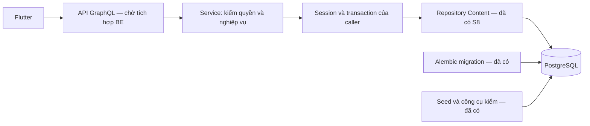
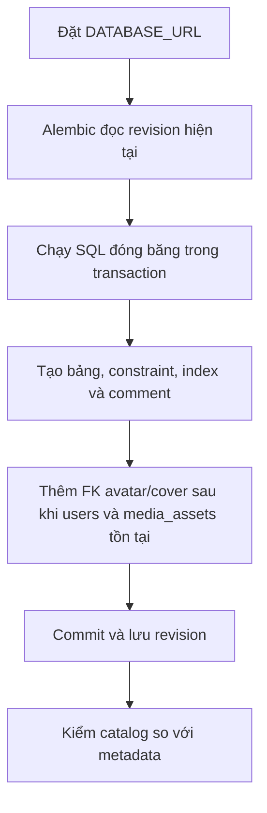
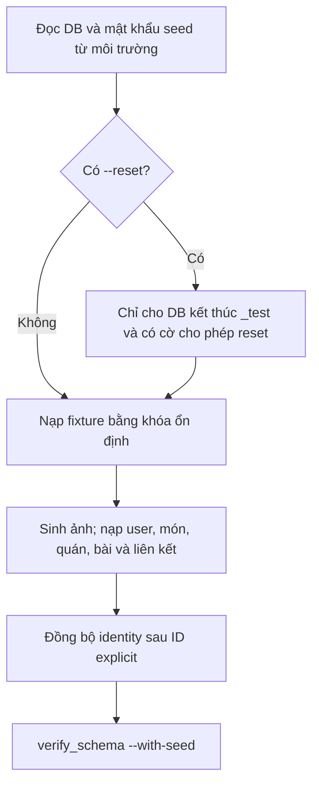
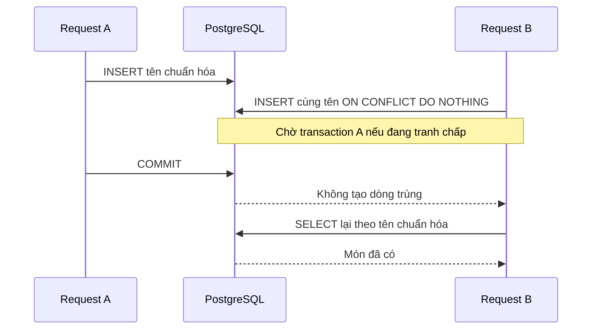
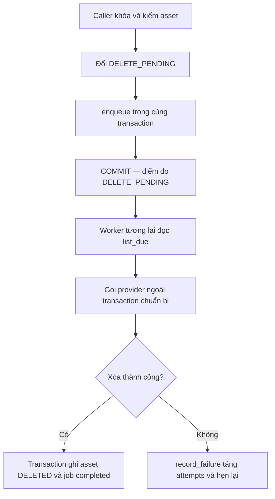

# S8 DB nhóm 4.2 — Mô tả triển khai và luồng hoạt động

Ngày đối chiếu: **19/11/2026**. Nhánh: `feat/db-s8-content-migration-repositories`.

## 1. Mục tiêu và phạm vi S8

S8 chuyển thiết kế dữ liệu thành nền tảng chạy được: tạo cấu trúc PostgreSQL bằng migration, nạp dữ liệu kiểm thử và viết repository Content. Phạm vi là **WP42-S8.1/S8.2** trong [hướng dẫn nhóm 4.2](../quan_ly/huong_dan_s8_s11/CHI_TIET_DB_4.2_CONTENT.md). Nguồn schema là [DOC 6.4-A](../thiet_ke/6.4-A_data_dictionary.md) và [DOC 6.4-B](../thiet_ke/6.4-B_ddl.md); vòng đời/transaction theo [DOC 5.3-B](../thiet_ke/5.3-B_schema_specification.md), repository theo [DOC 6.1-A](../thiet_ke/6.1-A_class_diagrams_backend.md).

| Công việc | Đầu ra hiện có |
|---|---|
| WP42-S8.1 | Migration đủ 25 bảng; metadata; seed và ảnh kiểm; kiểm catalog; upgrade/downgrade |
| WP42-S8.2 | Model/record Content và 5 repository: Post, Dish, Restaurant, MediaUpload, MediaCleanup; test PostgreSQL thật |

Schema tạo đủ 25 bảng cho toàn dự án. Hành vi repository ở S8 tập trung Content; tạo bảng chat/notification/trending không có nghĩa service các nhóm đó đã được lập trình. Upsert quán còn chờ policy Lead, nên chưa tuyên bố toàn bộ S8 đã nghiệm thu.

## 2. Vị trí của phần DB trong ứng dụng

FE gửi yêu cầu; API kiểm đầu vào; service kiểm quyền rồi gọi repository. Repository thực hiện SQL và trả dữ liệu. Service quyết định commit hoặc rollback. S8 DB được kiểm tại tầng repository và DB, chưa có luồng API–Flutter chạy xuyên suốt.

Repository nhận Session từ caller, không tự commit và không gọi provider qua mạng. Mỗi request/luồng sử dụng Session riêng. Nhờ vậy service có thể ghi bài, nhận asset và tạo liên kết ảnh trong cùng transaction: tất cả thành công hoặc cùng rollback.

## 3. Cấu trúc file và cách nối vào BE

| Vị trí | Vai trò |
|---|---|
| `backend/pyproject.toml` | Package backend; cấu hình Ruff, mypy strict, pytest |
| `backend/src/tomateto/dataaccess/schema.py` | Metadata SQLAlchemy đủ 25 bảng |
| `backend/src/tomateto/dataaccess/content/models.py` | 6 entity: Post, PostImage, Dish, Restaurant, MediaAsset, MediaCleanupJob |
| `backend/src/tomateto/dataaccess/content/*_repo.py` | Năm repository Content |
| `backend/src/tomateto/dataaccess/content/sql/feed_latest.sql` | SQL feed, được đóng gói cùng backend |
| `backend/src/tomateto/domain/content/records.py` | Giá trị trả ra khỏi repository, tách khỏi Session |
| `backend/src/tomateto/domain/content/paging.py` | Cursor và phân trang nội bộ |
| `backend/src/tomateto/domain/content/normalization.py` | Chuẩn hóa tên dùng chung cho seed/repository |
| `backend/tests/integration/content/` | Test repository, phân trang, tranh chấp, khóa |
| `db/migrations/`, `db/alembic.ini` | Migration có version, upgrade/downgrade |
| `db/schema.py` | Re-export metadata cho công cụ DB; nguồn thật ở backend |
| `db/seeds/` | Sinh dữ liệu và ảnh kiểm thử |
| `db/scripts/verify_schema.py` | Đọc catalog/seed để kiểm, không tự sửa schema |
| `db/testing.py`, `db/tests/` | Fixture và test migration/schema/seed |
| `db/compose.test.yaml`, `db/Dockerfile.s8-tests` | Môi trường kiểm riêng Python 3.11/PostgreSQL 16 |
| `db/requirements.lock`, `db/source_manifest.json` | Dependency đã kiểm; nguồn và fingerprint DDL |

Runtime backend không import ngược công cụ `db`; công cụ DB được phép import metadata backend. Phương thức Python dùng snake_case như `find_by_id`, `list_feed`; adapter GraphQL chịu trách nhiệm ánh xạ tên API camelCase. Không duy trì hai bộ alias Python.

**Phiên bản Python:** giữ 3.11 theo chuẩn chung Lead và lựa chọn người yêu cầu ngày 19/11. Chuẩn BE ghi 3.12: cần nhóm thống nhất trước khi đổi runtime. Docker, Ruff và mypy hiện nhắm 3.11.

## 4. Migration tạo những gì?

Migration là thay đổi cấu trúc DB có mã phiên bản. `upgrade head` áp dụng đến bản mới nhất; `downgrade base` gỡ schema ứng dụng theo chiều ngược. Revision đầu: **e0c5233f8e90**.

SQL nằm trong `db/migrations/versions/0001_initial_schema.sql`, không trích lại từ Markdown khi chạy. SHA-256: `ad6c25c96f0103f9c28711a6f3e2a8f671cbb3258548e9df84242b2b18a54553`. Sau khi phát hành, thay đổi tiếp phải tạo revision mới để giữ lịch sử.

Kết quả: **25 bảng, 161 cột, 116 constraint, 70 index**. Constraint gồm 25 PK, 37 FK, 15 UNIQUE, 39 CHECK. Index gồm các index phục vụ PK/UNIQUE và 30 khai báo riêng, trong đó có 2 partial UNIQUE. Tên và biểu thức phải khớp thiết kế: BE có thể ánh xạ lỗi dựa vào SQLSTATE và tên constraint. Test kiểm cả metadata/predicate/deferred, không chỉ đếm số lượng.

### 4.1. Danh mục đủ 25 bảng

| Nhóm | Bảng | Ý nghĩa |
|---|---|---|
| Tài khoản | `users` | Tài khoản, hồ sơ, tham chiếu avatar/cover |
| Tài khoản | `password_resets` | Dữ liệu đặt lại mật khẩu |
| Tài khoản | `revoked_tokens` | Token đã thu hồi |
| Tài khoản | `user_devices` | Thiết bị/push token |
| Media | `media_assets` | Chủ sở hữu, kho lưu, thông số và vòng đời ảnh |
| Danh mục | `dishes` | Món và tên chuẩn hóa duy nhất |
| Danh mục | `restaurants` | Quán, địa chỉ, tọa độ; chưa có UNIQUE tên |
| Thẻ | `tags` | Danh mục thẻ |
| Nội dung | `posts` | Bài đăng, tác giả, món, quán, nội dung |
| Nội dung | `post_images` | Gắn asset vào bài và xác định thứ tự ảnh |
| Thẻ | `post_tags` | Quan hệ bài–thẻ |
| Tương tác | `likes` | Người dùng thích bài |
| Tương tác | `follows` | Quan hệ theo dõi |
| Lưu bài | `collections` | Bộ sưu tập thuộc người dùng |
| Lưu bài | `collection_items` | Bài nằm trong bộ sưu tập |
| Kiểm duyệt | `reports` | Báo cáo và snapshot dữ liệu liên quan |
| Thông báo | `notifications` | Dữ liệu thông báo |
| Hội thoại | `chat_sessions` | Phiên hỏi đáp |
| Hội thoại | `chat_messages` | Câu hỏi/phản hồi và liên kết trong phiên |
| Xu hướng | `trending_runs` | Lần công bố kết quả tính xu hướng |
| Xu hướng | `trending_post_snapshots` | Kết quả xu hướng bài |
| Xu hướng | `trending_dish_snapshots` | Kết quả xu hướng món |
| Xu hướng | `trending_tag_snapshots` | Kết quả xu hướng thẻ |
| Media | `media_cleanup_jobs` | Tác vụ dọn byte ảnh |
| Quyền đọc | `user_blocks` | Quan hệ chặn để lọc đọc hai chiều |

Ba bảng thẻ được giữ theo thiết kế/DDL nguồn; có schema không tự mở API Tag. Phạm vi API theo hợp đồng đã chốt khi tích hợp.

### 4.2. Vòng phụ thuộc và hoàn tác

`users` tham chiếu ảnh, còn `media_assets` tham chiếu chủ sở hữu user. Vì vậy tạo hai bảng trước rồi thêm FK avatar/cover; khi downgrade bỏ hai FK đó trước rồi xóa bảng theo thứ tự ngược phụ thuộc.

DDL dùng TEXT + CHECK để giới hạn giá trị như khoảng giá, không tạo enum `pricerange`. Bản SQL đóng băng bỏ BEGIN/COMMIT ngoài cùng vì Alembic quản transaction. Sau downgrade base, bảng `alembic_version` được giữ rỗng. Extension dùng chung thuộc môi trường, không bị drop trong revision này.

## 5. Seed dữ liệu kiểm thử

Seed nạp bộ dữ liệu xác định để các nhóm có cùng đầu vào kiểm. Các lựa chọn đã chốt: 4 user; Guest không có dòng users; quán giả ghi nhãn rõ; không tự gộp quán.

| Dữ liệu | Số lượng/đặc điểm |
|---|---|
| User | 4: user_a–user_d; Guest là request không token |
| Món | 100 |
| Quán | 60 quán giả trong 5 km quanh 21.0285, 105.8542 |
| Bài | 200; 150 bài có ảnh; 3 bài bị ẩn |
| Hồ sơ đặc biệt | user_c ẩn tên công khai; user_d chưa có bài |
| Báo cáo | 1 |
| Ảnh | 150 PNG nhỏ gắn bài và bộ đầu vào NFR-05 riêng |

Ảnh là tệp kiểm được sinh, chưa phải ảnh món thật. PostgreSQL giữ metadata/liên kết, byte ảnh nằm trong `uploads/media/`. Bộ NFR-05 gồm PNG 9,9 MiB, PNG 10,1 MiB, tệp không phải ảnh và PNG rộng 2000 px. Chúng cung cấp đầu vào để kiểm endpoint upload/resize ở bước sau; S8 chưa có endpoint đó.

Mật khẩu băm bcrypt cost 12 từ `SEED_USER_PASSWORD`, không đưa mật khẩu vào Git. Seed lặp không reset không nhân đôi fixture và không ghi đè dữ liệu đã sửa. Vì seed gán ID rõ ràng, cần đồng bộ bộ đếm identity để insert tiếp không lấy lại ID đã dùng. Reset chỉ chạy trên DB test biệt lập vì xóa dữ liệu toàn schema.

## 6. Repository và luồng hoạt động

### 6.1. PostRepository — bài và feed

Có `save`, `update`, `delete`, `find_by_id`, `replace_images`, `list_feed`, `list_by_author`. Repository trả record không có lazy loader, nên service không phải giữ Session mở để đọc kết quả.

`find_by_id(..., for_update=True)` khóa dòng đến lúc transaction kết thúc để hai giao dịch ghi không cùng sửa một trạng thái mà bỏ qua thay đổi của nhau. Khóa không cấm người dùng xem bài và không thay kiểm quyền. `find_by_id` là primitive dữ liệu; service phải kiểm quyền truy cập trực tiếp trước trả API. Có row không có nghĩa caller được xem hoặc sửa.

Luồng feed LATEST:

1. Nhận viewer, `first` và cursor nội bộ `(created_at, id)`; mặc định 10, giới hạn 50, từ chối kích thước không hợp lệ.
2. Lọc bài ẩn, tác giả theo yêu cầu và block hai chiều **trước LIMIT**. Guest không có danh tính để áp quan hệ chặn cá nhân, vẫn lọc bài ẩn.
3. Sắp mới trước bằng thời gian rồi ID. Cursor giúp chọn các dòng đứng sau khóa của trang trước.
4. Lấy `first + 1` dòng để biết còn trang; batch ảnh, tổng like, trạng thái like/save trong một SQL.
5. Trả tối đa `first` item, `has_next_page` và cursor của item cuối thực trả.

Hai bài cùng thời gian được phân định bằng ID để không lặp trang. Cursor hiện là giá trị Python nội bộ; BE cần codec chuyển thành chuỗi opaque cho GraphQL/FE. TRENDING thuộc tích hợp Discovery S10, hiện báo rõ chưa hỗ trợ.

Luồng ghi bài khi tích hợp: service kiểm quyền → mở transaction → khóa dữ liệu cần sửa → ghi bài và liên kết ảnh → commit. Nếu xóa/thay ảnh, caller còn phải đổi trạng thái asset và enqueue cleanup trong cùng transaction. Repository chưa tự điều phối toàn bộ service này.

### 6.2. DishRepository — dùng lại món, tránh trùng

Tên chuẩn hóa bỏ dấu, đổi đ thành d, chữ thường và chuẩn hóa khoảng trắng. Tên gốc giữ cho hiển thị. Upsert dùng dòng đã có hoặc tạo khi chưa có.

UNIQUE ở DB quyết định tính duy nhất. SELECT trước rồi INSERT riêng lẻ không đủ khi hai request đồng thời. Triển khai dùng READ COMMITTED để SELECT kế tiếp thấy dòng vừa commit. Có test hai transaction thật cho trường hợp này.

### 6.3. RestaurantRepository — tìm/tạo quán

Có tìm ID, tìm danh sách theo tên chuẩn hóa và tạo. Hai quán cùng tên có thể khác địa điểm nên schema không có UNIQUE tên. Nếu hàm cần một kết quả nhưng có nhiều ứng viên, repository báo cần phân giải thay vì chọn tùy ý.

**Không tự gộp trong 100 m** theo lựa chọn đã chốt. Lead cần xác định khóa nhận diện, cách phân giải nhiều ứng viên và xử lý tranh chấp trước khi viết upsert quán. Phần này vẫn còn thiếu policy chính thức.

### 6.4. MediaUploadRepository — nhận asset để gắn nội dung

Asset là tài nguyên ảnh kèm UUID, owner, purpose, trạng thái, storage key, URL, kích thước và hạn. `create` ghi metadata, không tự tải byte lên provider.

Luồng `consume`:

1. SELECT asset FOR UPDATE.
2. Kiểm tồn tại, owner, purpose, trạng thái PENDING và chưa hết hạn.
3. Chuyển ATTACHED, ghi `consumed_at`, trả record.
4. Caller ghi liên kết `post_images` và commit cùng transaction. Nếu lỗi thì rollback cả việc nhận asset và ghi bài.

Hai request nhận cùng asset phải lần lượt qua khóa. Request sau kiểm lại trạng thái sau commit của request trước nên không nhận lại asset đã gắn. `UploadRejectedError` là lỗi nội bộ cần BE chuyển sang mã API.

`list_expired` chỉ đọc PENDING hết hạn. Worker tương lai phải khóa và kiểm lại trước đổi trạng thái; danh sách đọc ra có thể đã thay đổi. `mark_deleted` chỉ chuyển DELETE_PENDING sang DELETED để tránh đánh dấu ảnh còn gắn là đã xóa.

### 6.5. MediaCleanupRepository — tác vụ dọn ảnh

S8 có các thao tác repository trong sơ đồ; worker/provider chưa được lập trình. `enqueue` khóa asset theo thứ tự ID, chỉ nhận DELETE_PENDING. UNIQUE theo media giúp gọi lặp không tạo job trùng. Rollback phải khôi phục cả trạng thái và job.

`list_due` đọc job chưa hoàn tất đã đến giờ chạy; không claim job cho nhiều worker. V1 phải giữ một cleanup worker hoặc bổ sung thiết kế claim/lock trước khi tăng số worker. Lỗi lưu bằng mã đã làm sạch, không lưu exception thô. Gọi mạng sau commit, tránh giữ khóa DB trong lúc chờ provider.

## 7. Kết quả kiểm chứng

Chạy lại sau chuẩn hóa ngày 19/11/2026 trên **Python 3.11.18/PostgreSQL 16.14** bằng Docker:

| Phép kiểm | Kết quả/phạm vi |
|---|---|
| Pytest | 29/29 đạt; lượt cuối với dependency build đã khóa: 3,33 giây, không phải p95 API |
| Ruff check và format | Đạt cho backend và công cụ DB |
| mypy strict | Đạt 38 file nguồn/test |
| Catalog/metadata | 25 bảng, 161 cột, 116 constraint, 70 index; không drift |
| Migration | Upgrade → downgrade base → upgrade trên DB riêng |
| Seed | Lặp không đổi số lượng; kiểm identity, tọa độ, ảnh |
| Feed | Lọc trước phân trang; không trùng trang; batch một SQL |
| Đồng thời | Tranh UNIQUE món; tranh consume asset; FOR UPDATE chặn connection khác |
| EXPLAIN | Dùng ix_posts_feed ở fixture kiểm, không ép tắt Seq Scan |
| Rollback | Khôi phục trạng thái asset và job enqueue |
| CLI thật | Alembic upgrade → seed reset → seed lặp → verify đều đạt |

CLI xác nhận 4 users, 200 bài, 150 bài gắn ảnh, 60 quán trong 5 km, 3 bài ẩn. Có 153 PNG: 150 PNG bài và 3 PNG đầu vào NFR; thêm 1 tệp không phải ảnh. Số tệp PNG không phải số bài có ảnh.

SQLSTATE 55P03 trong test lock timeout là lỗi kỳ vọng để chứng minh connection thứ hai bị chặn. Bộ này không thay kiểm API/UI, p95 hay worker thật. Đã build wheel backend thành công, kiểm bên trong có SQL feed và import runtime từ ngoài thư mục repo thành công.

## 8. Đối chiếu nhánh và chuẩn bị push

Đã fetch remote ngày 19/11. Main: `dfdd097b9c17e32a2cd58e9b4170a91f71c9f043`; nhánh DB đã fast-forward tới nền này. FE S8: `00c6270a67e599fb29273b5924112a4e9bc346ff`, nhánh `feat/fe-s8-flutter-foundation`, đổi 53 file trong `app/`. Các tài liệu BE S7 được đọc để chuẩn hóa layout/Python. Chưa thấy implementation BE/Lead S8 cung cấp khung Python dùng chung trong remote đã kiểm.

Đã gộp thử bằng **Git index tạm**, không thay index thật hay merge Flutter vào nhánh DB: cây S8 DB đổi 55 file; FE đổi 53 file; **không trùng đường dẫn, 0 unmerged entry**. Nền chung chính là main trên. Không tạo commit để mô phỏng.

DB giữ thay đổi ở `backend/`, `db/`, `.gitignore` và hai báo cáo DB. FE giữ `app/`. Docker test dùng file ignore riêng theo Dockerfile, tránh thay cấu hình build toàn repo. `.gitignore` giữ ngoài Git các file môi trường, cache, ảnh sinh và hai hướng dẫn trình bày nội bộ.

Kết quả chứng minh gộp file tại các SHA đã kiểm, chưa chứng minh tương thích API và không bảo đảm các commit phát sinh sau sẽ không conflict. Trước push nếu remote đổi cần fetch/đối chiếu lại. Phần S8 được bàn giao trên nhánh riêng để nhóm review; chưa gộp main. Những file review nội bộ ngoài phạm vi không đưa vào danh sách bàn giao.

## 9. Còn cần nhóm cung cấp hoặc chốt

| Nội dung | Việc còn lại |
|---|---|
| Policy quán | Chốt khóa nhận diện và tranh chấp để hoàn tất upsert |
| Python 3.11/3.12 | Hiện giữ 3.11; nhóm cần thống nhất với chuẩn BE |
| AccountRepository/WriteAuthorizationPolicy/TransactionManager | Nối kiểm quyền và transaction chung ở service |
| CursorCodec/ErrorMapper | Chuyển paging/lỗi nội bộ sang hợp đồng GraphQL/FE |
| “Brief mục 5” trong hướng dẫn | Chưa có nội dung script để xác nhận đã chạy bộ kiểm đó |
| API runtime và CI chung | Chưa có kiểm chạy xuyên suốt API/Flutter |
| Upload/resize/provider/cleanup worker | Hiện có primitive và fixture; chưa có luồng HTTP/worker thật |

Các quyết định 4 user + Guest, quán giả và không tự gộp quán đã được ghi nhận; không còn chờ người yêu cầu chọn lại. Các phần thiếu policy/nguồn không tự suy diễn để tuyên bố hoàn tất.

## 10. Nội dung trình bày với nhóm

“S8 DB nhóm 4.2 đã chuyển DDL thành migration chạy được, đủ 25 bảng. Có seed 200 bài, trong đó 150 bài có ảnh, để các nhóm dùng cùng dữ liệu kiểm. Đã viết 5 repository Content cho bài, món, quán và metadata/vòng đời ảnh. Caller quản transaction; UNIQUE và khóa dòng giữ nhất quán khi request đồng thời. Bộ 29 test PostgreSQL thật đạt sau chuẩn hóa. Phần còn chờ là policy upsert quán và nối service/API chung.”

## 11. Thuật ngữ

| Từ | Nghĩa trong S8 |
|---|---|
| DDL | SQL định nghĩa bảng, ràng buộc, index |
| Migration/revision | Thay đổi schema có phiên bản để áp dụng/hoàn tác |
| Metadata/model | Mô tả schema Python/ánh xạ entity vào bảng |
| Repository | Lớp tập trung truy cập dữ liệu cho nhóm nghiệp vụ |
| Record | Gói giá trị trả ra, không giữ lazy loader ORM |
| Session | Ngữ cảnh làm việc với DB của một request/luồng |
| Transaction | Các thay đổi cùng commit hoặc rollback |
| FOR UPDATE | Khóa dòng để phối hợp giao dịch ghi đồng thời |
| Upsert | Tạo khi chưa có, dùng dòng hiện có nếu trùng khóa nhận diện |
| Idempotent | Chạy lặp cùng đầu vào không nhân đôi kết quả |
| Cursor/keyset | Dùng khóa dòng cuối để xác định trang tiếp |
| Batch hydration | Ghép dữ liệu thành lô, tránh truy vấn từng bài |
| Catalog | Thông tin cấu trúc DB thực do PostgreSQL quản lý |
| Drift | Cấu trúc DB thực lệch mô tả mong đợi |
| Partial UNIQUE | Duy nhất cho những dòng thỏa điều kiện index |
| Deferred | Có thể kiểm ràng buộc muộn theo cấu hình transaction |
| Asset/storage key | Tài nguyên ảnh/khóa định vị byte ảnh trong kho |
| Enqueue/worker | Ghi việc vào hàng đợi/tiến trình xử lý việc |
| Fixture | Dữ liệu hoặc tệp xác định dùng kiểm thử |
| SQLSTATE | Mã PostgreSQL để phân loại lỗi |

Lệnh chạy ở [db/README.md](../../db/README.md). Nguồn và truy vết ở [báo cáo S8](REPORT_S8_DB_4.2.md).
