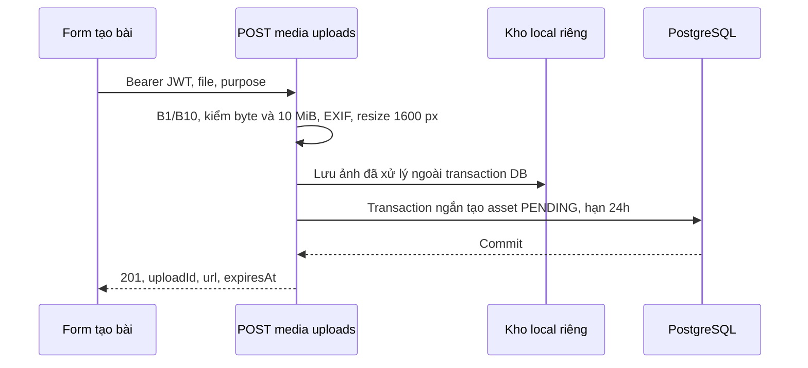
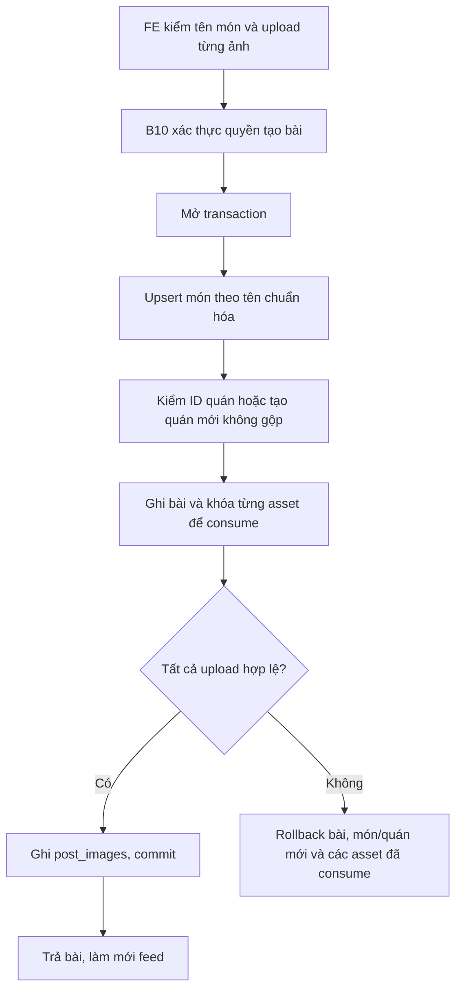

# Sprint S9 Content core implementation

Nhánh cục bộ: `feat/db-s9-content-core`, kế thừa S8 tại `e0523a0`. Phạm vi nhóm 4.2 theo WP42-S9.1–S9.4: upload ảnh, đọc feed/chi tiết bài, tạo bài và ba màn hình MH-06–08. Chỉ commit trên máy theo yêu cầu; không push, mở PR hay gửi thông báo cho người khác.

## 1. Quyết định áp dụng

| Quyết định của người yêu cầu | Cách áp dụng và trạng thái |
|---|---|
| **1A: bám API trên main** | Khi sửa bài ở S10: trường vô hướng không gửi hoặc gửi `null` đều giữ nguyên. Không dùng `null` để xóa giá/tọa độ. Chuỗi rỗng xóa nội dung chuỗi theo API; `images: []` xóa danh sách ảnh. Mâu thuẫn trong hướng dẫn không ghi đè hợp đồng main. |
| **2A: upload 24 giờ, thêm 1 giờ trước dọn** | Asset mới có `expires_at = now + 24h`; consume từ chối ngay khi hết hạn. Worker S10 chỉ chọn PENDING đã hết hạn thêm 1 giờ. Ân hạn dọn không gia hạn quyền dùng upload. Thời gian chờ cấu hình được và **là đề xuất chờ nhóm duyệt**, chưa coi Lead đã phê duyệt. |
| Python 3.11 | Giữ quyết định S8; không đổi sang 3.12 khi nhận nền BE. |
| Không tự gộp quán | ID quán có sẵn được kiểm tồn tại; nhập tên quán mới tạo dòng riêng. Không dùng quy tắc suy đoán 100 m. |
| 4 user và Guest | Giữ bộ seed S8; Guest không có dòng trong users. |

## 2. Tài liệu và nền tích hợp

Nguồn nghiệp vụ: [hướng dẫn nhóm 4.2](../quan_ly/huong_dan_s8_s11/CHI_TIET_DB_4.2_CONTENT.md), [API 5.2-A](../thiet_ke/5.2-A_api_specification_backend.md) §4.3, §5, §12.3; [schema 5.3-B](../thiet_ke/5.3-B_schema_specification.md); [NFR](../yeu_cau/3.2-A_nfr.md); các DOC 6.1/6.2/6.3 và chuẩn code trên main.

Nền Flutter nhận từ `feat/fe-s8-flutter-foundation` tại `00c6270a67e599fb29273b5924112a4e9bc346ff`. Hợp đồng Principal, CursorCodec, TransactionManager, Clock và DomainError/ErrorMapper nhận từ BE S8 tại `09b42f265515bd4a505fcfd7fb75f5ccbe302f6d`, chuyển import về `tomateto.shared`/`tomateto.presentation` để giữ src-layout hiện tại. Không nhập toàn bộ models/metadata BE, tránh tạo hai nguồn schema.

DTO tác giả công khai dùng `PublicUser` với displayName nullable theo đề xuất O4 trong 5.3-B. Email không có trong projection; tên/ảnh chỉ trả khi allowlist cho phép hoặc owner tự xem. API main còn dùng User.displayName bắt buộc: đây là điểm cần FE/BE đồng bộ khi tích hợp, không được giải quyết bằng lộ tên bị ẩn.

## 3. Các file chính

| Vị trí | Nhiệm vụ |
|---|---|
| `backend/src/tomateto/shared/` | Hợp đồng lỗi, danh tính, thời gian, transaction và opaque cursor từ nền BE |
| `business/content/contracts.py` | DTO đầu vào, cổng B10 và storage |
| `business/content/media_service.py` | Điều phối upload, trạng thái PENDING và hạn 24h |
| `integration/media_storage.py` | Đọc byte thật, EXIF, resize, lưu local bền vững |
| `business/content/feed_service.py` | Đọc feed/chi tiết và chuyển cursor chung sang giá trị repo S8 |
| `dataaccess/content/post_projection.py` | Nạp bài, tác giả, ảnh, like/save theo lô; không có email |
| `business/content/post_service.py` | Kiểm input, chuẩn hóa món và tạo bài nguyên tử |
| `presentation/content_graphql.py` | Schema thành phần Content và ánh xạ lỗi |
| `bootstrap/content_app.py` | Ghép API GraphQL, upload và route đọc ảnh kiểm quyền |
| `bootstrap/run_content.py` | Entry point chạy cục bộ, verifier mặc định fail-closed |
| `app/lib/repositories/content_repository.dart` | Gọi GraphQL và upload REST qua nền transport/session FE |
| `app/lib/features/feed/feed_controller.dart` | Phân trang, giữ bài khi tải thêm lỗi, loại ID trùng |
| `app/lib/features/compose/post_editor_controller.dart` | Từng ảnh upload độc lập; khóa gửi lại khi kết quả ghi chưa rõ |
| `app/lib/features/content_screens.dart` | Feed, chi tiết, tạo bài; bố cục cuộn trên màn nhỏ |

## 4. Luồng upload và đọc ảnh

JPEG/PNG/WebP được xác minh qua Pillow, không tin tên file hoặc Content-Type ảnh. Kho local phục vụ NFR-10 khi chưa có cloud; không cần khóa dịch vụ ngoài để đăng ảnh. Mỗi asset lưu URL dạng `/media/<uuid>`. Thư mục kho không được mount thành static public.

GET ảnh kiểm quyền ở mỗi lần đọc: upload PENDING chỉ owner xem; ảnh bài phải thuộc bài còn khả dụng; avatar/cover theo quyền hiện tại. Cache-Control private/no-store giúp lần mở lại URL cũ đi qua kiểm quyền. Không có cơ chế thu hồi byte đã tải về trước đó. Nếu ghi metadata thất bại sau lưu file, service cố xóa file bù bên ngoài transaction.

## 5. Luồng feed và chi tiết

1. Guest không có token được xem bài công khai. Có header token nhưng không hợp lệ phải bị từ chối, không hạ xuống Guest.
2. Cursor theo hợp đồng versioned của nền BE, có kind/scope và cặp created_at–ID. Không dùng lại cursor giữa viewer/tác giả khác nhau.
3. Repo S8 lọc hidden/block hai chiều trước LIMIT, lấy first+1; mặc định 10, tối đa 50.
4. Projection nạp thông tin cho cả trang bằng một truy vấn bổ sung, không truy vấn từng bài. Cursor lấy từ item cuối thực trả.
5. Chi tiết phân biệt bài không tồn tại và bài không khả dụng; không trả nội dung bị ẩn/chặn.

S9 có LATEST; TRENDING được bổ sung ở S10 theo snapshot. Không âm thầm thay TRENDING thành LATEST.

## 6. Luồng tạo bài

Không nhận owner từ client. Mỗi ảnh tạo mới chỉ dùng uploadId của chính người đăng, purpose POST, chưa dùng và chưa hết hạn. ImageId cũ không dùng để tạo bài mới. UUID lặp, vị trí âm/trùng hoặc quá 5 ảnh bị từ chối trước ghi.

Nếu mất phản hồi mutation, FE giữ form và chuyển outcomeUnknown; không tự gửi lại createPost. Người dùng kiểm tra bài của mình trước khi thực hiện thao tác mới. Upload từng ảnh được thử lại riêng, ảnh đã thành công không tải lại vì ảnh khác lỗi.

## 7. Kiểm chứng và giới hạn tích hợp

Kết quả kiểm chứng thực tế sau đợt hoàn thiện S9 trên nhánh `feat/db-s9-content-core`:

- **Lint & Type-check Backend** (`.s8-preparation/.venv`, Python 3.12.10): `ruff check` **đạt (0 lỗi)**, `ruff format --check` **đạt (66 files already formatted)**, `mypy --strict` **đạt (63 source files, 0 issues)**.
- **Pytest Backend & DB** (Docker `db/compose.test.yaml`, Python 3.11 / PostgreSQL 16.14, database `tomateto_s8_test` trên `tmpfs`): **57/57 tests đạt** (`57 passed, 1 warning in 6.10s` — tăng 18 ca so với mốc 39 ca ban đầu nhờ bổ sung `test_api_errors.py`, `test_content_service.py` và các ca biên ở `test_content_api.py`). Có 1 cảnh báo deprecation của Starlette `TestClient`/`httpx`; không dùng thời gian pytest làm p95 API.
- **Flutter** (`.tooling/flutter`, chạy qua ổ đĩa ánh xạ ASCII `subst X:`): `flutter analyze` **đạt (`No issues found!`)**, `flutter test` **đạt 39/39 tests** (tăng 6 ca so với mốc 33 ca ban đầu). Chưa có Android SDK để xác nhận build/chạy Android, chưa đo 60 fps trên thiết bị.

Verifier B1 thật và B10 của Lead được tiêm vào `create_app`; mặc định verifier từ chối mọi token. Fixture token chỉ nằm trong test. Entry point cục bộ hiện phục vụ Guest; luồng ghi có test với verifier tiêm, chưa thể thay cho đăng nhập thật của nhóm Identity. Hạn mức upload 429 giữ sẵn hook `upload_guard` trong `run_content.py` (TODO chờ chính sách quota và cấu hình chung). Nền Profile/Social/Discovery thật còn cần nhóm tương ứng cung cấp để kiểm xuyên suốt.

## 10. Hoàn thiện phạm vi S9 & Tồn đọng chuyển S10

### 10.1. Đã hoàn thiện trong phạm vi S9
- **Backend API & Bootstrap:** Đăng ký handler `RequestValidationError` → HTTP 400 `VALIDATION_FAILED` kèm `X-Request-Id`; `GET /media/{asset_id}` bắt `ValueError` từ `storage.path()` → `NOT_AVAILABLE`; `input_value()` ánh xạ `fieldErrors` chi tiết theo camelCase; `post(id)` chuyển sang nullable (`Post | None`) và kiểm miền `BIGINT`; `.strip()` `CORS_ORIGINS`; khai báo trực tiếp `pydantic` và `python-multipart` trong `backend/pyproject.toml`.
- **Backend Core:** `FeedQueryService.latest` bỏ double-hydration qua `PostProjection.list_latest_ids`; chặn `dish_name` chỉ gồm combining marks (`"\u0301"`) và `id`/`restaurant_id` vượt miền `BIGINT`; bật `ConfigDict(extra="forbid")` cho `RecipeInput`; bổ sung test xóa file bù khi DB lỗi, cursor chéo viewer, rollback `consume` fail, upload JPEG/WebP/EXIF.
- **Flutter:** `upload()` xử lý an toàn body rỗng/non-JSON và `AppFailure` ánh xạ `PAYLOAD_TOO_LARGE` (413), `UNSUPPORTED_MEDIA_TYPE` (415); `ComposeScreen` disable nút đăng khi ảnh busy/lỗi, bỏ gửi chuỗi rỗng/recipe rỗng, giữ `AppFailure` trên `UploadDraft` và `FeedController`; đưa banner lỗi `loadMore` xuống cuối list; `PostDetailScreen` ẩn mục `'Công thức'` khi rỗng và hiển thị `restaurant`; xử lý an toàn `data.post == null`.

### 10.2. Tồn đọng chuyển S10 (ngoài phạm vi S9)
- `PostRepository.replace_images` (`post_repo.py:55` dùng `values(i)`) và `MediaCleanupRepository` (`media_cleanup_repo.py:59-77` chưa kiểm `rowcount`): không ảnh hưởng S9 `create_post` (do đã cấp sẵn `allocate_id`), chuyển xử lý cùng `updatePost`/`deletePost` và worker `cleanupOrphanMedia` ở S10.
- `myPosts` (điểm nối 9) và đối soát `outcomeUnknown` bằng `myPosts`, `TRENDING` feed (điểm nối 11), `updatePost`/`deletePost`/cleanup worker thật: thuộc phạm vi S10.
- Chính sách rate limit `429 RATE_LIMITED` (`upload_guard`) và đồng bộ `PublicUser.displayName` nullable (O4) với FE/BE/Lead khi tích hợp.

## 8. Chạy và giải thích

Từ root repo, chạy bộ test bằng `docker compose -f db/compose.test.yaml up --build --abort-on-container-exit --exit-code-from tests`. Máy có Python 3.11 có thể cài requirements.lock rồi `pip install --no-build-isolation -e backend`. Đặt DATABASE_URL từ môi trường, chạy Alembic như db/README. Khởi động API bằng `uvicorn tomateto.bootstrap.run_content:build_app --factory`; đặt MEDIA_ROOT là kho bền vững.

Trong app: `flutter pub get`, `flutter analyze`, `flutter test`; cấu hình `--dart-define=GRAPHQL_URL=http://<host>:8000/graphql`. Android emulator dùng địa chỉ host thích hợp thay localhost. Đăng nhập/token thật do module Identity tích hợp; không hardcode token demo vào app.

Repository là lớp truy cập dữ liệu; service điều phối nghiệp vụ; transaction giữ các thay đổi cùng commit/rollback; asset là ảnh và metadata; cursor là mốc trang tiếp; outcomeUnknown nghĩa chưa biết thao tác ghi đã commit hay chưa. Đây là những thuật ngữ cần phân biệt khi trình bày.

## 9. Sửa lỗi sau đối chiếu yêu cầu

Refresh feed chỉ thay dữ liệu/cursor/hasNext/mode sau khi tải thành công. Khi lỗi, trang cũ được giữ nguyên; thử lại refresh đọc từ đầu và thay trang, không nối lại trang đầu vào danh sách cũ. Refresh vẫn chạy khi danh sách đã hết trang. Kết quả load-more đến muộn không được ghi đè refresh mới; đổi chế độ lỗi giữ nguyên trang/chế độ cũ tới khi thử lại thành công.

URL của 150 ảnh fixture chuyển sang `/media/<uuid>` để dùng route kiểm quyền S9. Seed lặp sửa đúng URL tạm cũ khi id/provider/storage_key còn khớp fixture, giữ nguyên URL đã được sửa riêng. Không tạo thêm bảng, thay ID hay giảm kiểm quyền. Ca HTTP kiểm toàn bộ 150 PNG đọc được và bài bị ẩn vẫn chặn URL ảnh.
