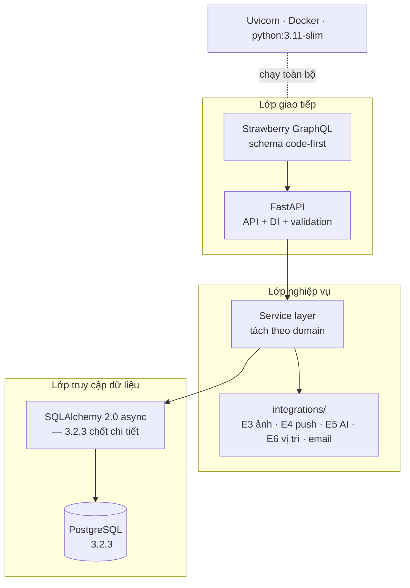

# DOC 4.2-A (phần BE) — Quyết định Công nghệ Kỹ thuật: Backend

> Owner: BE | Reviewer: Lead (WBS 3.2.4) | Approver: Lead | Sprint: S3 (19–25/10/2026)
> WBS: 3.2.1 — Lựa chọn + phương án bị loại: backend
> Định dạng: theo manual 4.2 — DOC 4.2-A (6 mục). Phần FE (3.2.2) và dữ liệu (3.2.3) do thành viên khác; gộp thành DOC 4.2-A đầy đủ sau review.

## 1. Tổng quan Công nghệ Kỹ thuật (phía backend)

## 2. Quyết định Công nghệ theo Danh mục

### Ngôn ngữ & Khung làm việc

| Hạng mục | Chọn | Phiên bản | Lý do |
|---|---|---|---|
| Ngôn ngữ backend | **Python** | ≥ 3.11 | 3.11 là mức tối thiểu Strawberry cam kết hỗ trợ; typing + mypy phục vụ tách lớp (AD-09, NFR-14) |
| Khung máy chủ | **FastAPI** | ≥ 0.161 | Ràng buộc cứng NFR-13; async native (gọi E3–E5 không chặn luồng đọc, NFR-10/04); dependency injection là nơi gom một cửa kiểm quyền cho mọi thao tác ghi (NFR-07); validate bằng Pydantic; OpenAPI sinh sẵn cho hợp đồng API (S4) |
| Thư viện GraphQL | **Strawberry GraphQL** | ≥ 0.336 | FastAPI doc giới thiệu là thư viện đề xuất, thiết kế gần FastAPI nhất; code-first từ type hints nên schema ít sai lệch FE/BE (NFR-14) |
| Máy chủ ASGI | **Uvicorn** | bản hiện hành | Đi kèm FastAPI, chạy cục bộ bằng `docker compose` (NFR-13) |
| Xác thực | **PyJWT + bcrypt** | bản hiện hành | Đúng NFR-06: JWT 7 ngày, mật khẩu băm; không tự viết thuật toán băm/token |

### Khung kiểm thử

| Công cụ | Dùng cho |
|---|---|
| pytest ≥ 8 + pytest-asyncio | Test đơn vị service/resolver |
| httpx `AsyncClient` | Test tích hợp API GraphQL không cần chạy server thật |
| respx (hoặc `httpx.MockTransport`) | Giả lập lỗi/quá hạn dịch vụ ngoài để kiểm chế độ lùi (NFR-10) |
| coverage.py | Mức phủ khi merge |
| ruff + mypy | Lint + kiểm kiểu trước khi vào nhánh chính (NFR-14) |

### Các danh mục còn lại

Cơ sở dữ liệu, hạ tầng, DevOps thuộc WBS 3.2.3 (DB) và DOC 4.2-A gộp; phần backend chỉ xác nhận: mọi khoá bí mật nạp qua biến môi trường (NFR-08), đóng gói Docker (NFR-13), log ra stdout cho `docker compose logs` (NFR-09).

## 3. Ma trận Quyết định

So sánh ứng viên backend trên các tiêu chí: yêu cầu hiệu năng/phi đồng bộ, chuyên môn đội ngũ, hệ sinh thái tích hợp, hỗ trợ nền tảng Docker cục bộ, chi phí ≈0, đúng ràng buộc NFR-13. Thang 1–5, tổng 30.

| Tiêu chí | FastAPI + Strawberry | Django + Graphene | Flask + Ariadne | NestJS + Apollo | Go + gqlgen | Spring + GraphQL |
|---|:---:|:---:|:---:|:---:|:---:|:---:|
| Hiệu năng & phi đồng bộ | 5 | 3 | 3 | 4 | 5 | 4 |
| Chuyên môn đội ngũ (giả thuyết) | 4 | 3 | 3 | 2 | 1 | 1 |
| Hệ sinh thái tích hợp dịch vụ ngoài | 5 | 5 | 3 | 4 | 2 | 3 |
| Hỗ trợ nền tảng/Docker cục bộ | 5 | 5 | 5 | 5 | 5 | 5 |
| Chi phí ≈0 | 5 | 5 | 5 | 5 | 5 | 5 |
| Đúng ràng buộc NFR-13 (cứng) | 5 | 2 | 2 | 1 | 1 | 1 |
| **Tổng (30)** | **29** | 23 | 21 | 21 | 19 | 19 |

**Phương án bị loại** (một dòng mỗi loại):

- **Django + Graphene** — cộng thêm tầng REST khi hệ đã GraphQL, hai lớp API song song; ORM đồng bộ cản luồng async; không phải FastAPI.
- **Flask + Ariadne** — thiếu DI/validator built-in, mỗi chỗ ghi tự kiểm quyền dễ trốn cửa kiểm quyền duy nhất; SDL-first phải quản lý schema tách khỏi type Python.
- **NestJS + Apollo** — đổi backend sang JS/TS trong khi FE là Dart → hai hệ sinh thái cho 4 người theo; không phải FastAPI.
- **Go + gqlgen** — hiệu năng dư cho mục tiêu 2 giây trên 200 bài, tích hợp dịch vụ ngoài phải viết tay nhiều hơn; không phải FastAPI.
- **Spring + GraphQL** — nặng, cấu hình nhiều, hợp service doanh nghiệp; chi phí học cao nhất với 4 người/10 tuần; không phải FastAPI.

Ứng viên vi phạm NFR-13 bị loại bất kể tổng điểm — điểm số ghi lại lý do, không đảo ngược ràng buộc cứng.

## 4. Truy vết

| Quyết định | Driver / NFR |
|---|---|
| FastAPI + Python | NFR-13 (Cứng), AD-09 |
| Strawberry GraphQL | NFR-13 (Cứng), AD-09, AD-01 |
| Async + httpx timeout | AD-04, AD-07, NFR-04, NFR-10 |
| Dependency injection FastAPI | AD-05, NFR-07, REQ-028 |
| PyJWT + bcrypt | NFR-06, AD-05 |
| Biến môi trường thay hardcode | AD-10, NFR-08 |
| Docker + Uvicorn cục bộ | AD-13, AD-16, NFR-13 |
| pytest + httpx + respx + ruff/mypy | AD-15, NFR-14 |

## 5. Rủi ro và Giảm thiểu

| Rủi ro | Ảnh hưởng | Giảm thiểu |
|---|---|---|
| Chưa ai xác nhận quen Python/FastAPI (điểm chuyên môn là giả thuyết) | Trễ S8 | Xác nhận ở họp CN 25/10; nếu thấp hơn giả thuyết thì đưa vào S8 0,5 ngày học chính thức |
| Strawberry còn bản 0.x, có breaking changes giữa bản | Phá schema khi nâng | Ghim phiên bản + lock file; nâng chỉ trong PR riêng có test xanh |
| GraphQL dễ sinh truy vấn N+1, feed chậm khi dữ liệu tăng | AD-01 | Ở 4.3 định hướng gom truy vấn theo lát (DataLoader) + chỉ mục phân trang con trỏ; đo p95 theo NFR-01 |
| Gọi AI tới 30 giây chiếm worker | AD-07, NFR-04 | Timeout 30 giây + trả trạng thái đang xử lý + cho bỏ qua |

## 6. Giả định

- Cả nhóm quen Python ở mức đọc/sửa được — giả thuyết, chờ xác nhận họp CN 25/10.
- Scaffold tham chiếu ở DOC 1.3-A (`app/core/config.py`, `app/graphql/*.py`) đã là FastAPI + Strawberry → giữ nguyên.
- Phiên bản ghim cụ thể khi dựng môi trường ở S8, đối chiếu CHANGELOG Strawberry.

## Ký duyệt

| Vai trò | Họ tên | Ngày | Chữ ký |
|---|---|---|---|
| Owner (BE) | | | |
| Reviewer (Lead) | | | |
| Approver (Lead) | | | |