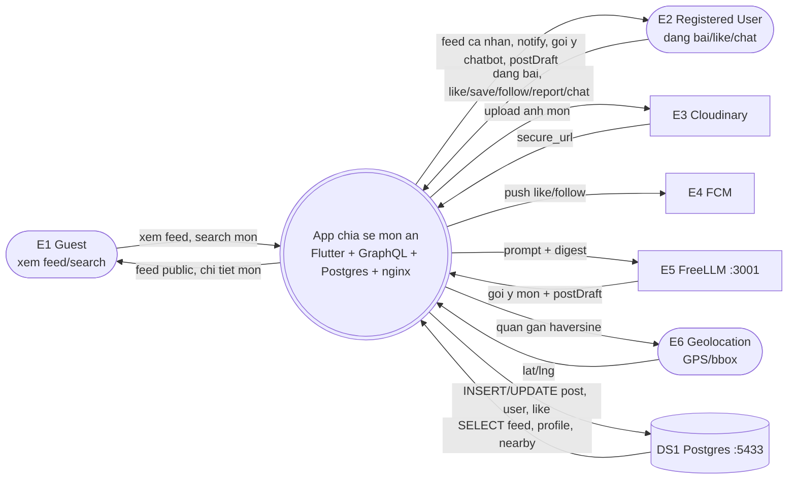

# 1.3-A System Context (DFD L0) — App chia sẻ món ăn

| Thông tin | Nội dung |
|---|---|
| Owner | Builder-BE |
| Reviewer | Builder-DB (phía data store) |
| Approver | Lead |
| Ngày | 2026-10-16 |
| Version | v1.2 FINAL (đã điền port chính từ repo, đủ điều kiện xin ký) |
| Sprint | S0 (12–18/10/2026) — Khởi động & Vision |
| Nguồn phân tích | `1_KE_HOACH_SPRINT_CHI_TIET.pdf:4-5`, `manual/technique/1.3-system context.txt`, `manual/diagram/system_context/hướng dẫn.txt`, Vision 1.1-A, Personas 1.2-A/B |

> Bản FINAL S0: port chính đã chốt theo repo (`:3000 / :8001 / :5433 / :3001`). Mỗi entity có bằng chứng file + port/key tương ứng, không còn `Lxx` / `TBD`.

---

## 1. Ranh giới hệ thống (System Boundary)

**Hệ thống duy nhất ở giữa (SYS):** App chia sẻ món ăn — giải bài toán `hôm nay ăn gì?`

SYS bao gồm toàn bộ: Frontend Flutter + Backend FastAPI + Strawberry GraphQL + PostgreSQL + nginx. Vì vậy **không vẽ FE `:3000` / BE `:8001` thành hộp ngoài** (tránh lỗi đưa component nội bộ ra ngoài theo `technique/1.3`).

Bằng chứng triển khai của SYS (port chính từ repo, không vẽ thành hộp):

| Cấu hình | Giá trị (port chính) | Bằng chứng file |
|---|---|---|
| FE Flutter | `:3000` | `docker-compose.yml` (`ports: 3000:3000`), `nginx.conf` (proxy FE) |
| BE GraphQL | `:8001` | `docker-compose.yml` (`ports: 8001:8001`), `app/core/config.py` (`APP_PORT=8001`) |
| DB Postgres | `:5433` | `docker-compose.yml` (`image: postgres`, `ports: 5433:5432`), `app/core/config.py` (`DATABASE_URL=...:5433/...`) |
| Chatbot FreeLLM | `:3001` | `docker-compose.yml` (`ports: 3001:3001`), `app/core/config.py` (`FREELLM_BASE_URL=http://...:3001`) |
| Reverse proxy | nginx | `nginx.conf`, `docker-compose.yml` (service nginx) |

**Trong phạm vi:** feed, đăng bài (compose + upload ảnh), map/quán gần, chatbot gợi ý món + postDraft, like/save/follow/notify, report auto-hide, random món.

**Ngoài phạm vi:** chi tiết resolver/service/repo, schema DB chi tiết — để dành S4–S5.

---

## 2. Thực thể ngoài + luồng dữ liệu

Cách đọc: `IN` = ngoài → SYS. `OUT` = SYS → ngoài.

### 2.1. Actor người dùng

| # | Entity (loại) | IN → System | OUT System → | Tần suất / Trigger | Chủ quản | Bằng chứng |
|:---:|---|---|---|---|---|---|
| E1 | Guest — chưa login (actor chính) | xem feed public, search món, xem map | feed public, chi tiết món, quán gần | real-time / mở app | Team FE (router) | `lib/core/router.dart` (route public không cần login), `app/graphql/queries.py` (query feed public) |
| E2 | Registered User — đã login (actor chính) | đăng bài (ảnh + caption + lat/lng), like / save / follow / report / chat | feed cá nhân, notify, gợi ý chatbot, postDraft | real-time / bấm nút | Team BE (auth + mutation) | `app/services/auth_service.py` (JWT phân biệt Guest/User), `app/graphql/mutations.py` (mutation đăng bài/like) |

### 2.2. Kho dữ liệu (Data Store — vẽ riêng, không tính là hộp ngoài)

| ID | Kho | SYS ghi | SYS đọc | Tần suất | Chủ quản | Bằng chứng |
|:---:|---|---|---|---|---|---|
| DS1 | PostgreSQL `:5433` | INSERT/UPDATE post, user, like, place | SELECT feed, profile, nearby | real-time / mỗi op | Team DB | `docker-compose.yml` (postgres port `:5433`), `app/core/config.py` (`DATABASE_URL` port `:5433`) |

### 2.3. Hệ tích hợp ngoài

| # | Entity (loại) | IN → System | OUT System → | Tần suất / Trigger | Chủ quản | Bằng chứng |
|:---:|---|---|---|---|---|---|
| E3 | Cloudinary — dịch vụ ảnh (third-party) | trả `secure_url` ảnh món | gửi file ảnh upload | real-time / khi đăng bài | Cloudinary Inc / Team BE | `app/core/config.py` (`CLOUDINARY_CLOUD_NAME/API_KEY`), `app/services/image_service.py` (hàm upload + graceful-degrade) |
| E4 | FCM — push notify (third-party, một chiều) | — (không có luồng về) | gửi push khi có like / save / follow | real-time / khi có event | Google Firebase / Team BE | `app/core/config.py` (`FCM_CREDENTIALS`), `app/services/notify_service.py` (hàm push) |
| E5 | FreeLLM `:3001` — chatbot (hệ ngoài) | trả gợi ý món + `postDraft` | gửi prompt + digest tiết kiệm token | real-time / khi chat | Team BE / nhà cung cấp LLM | `docker-compose.yml` (port `:3001`), `app/core/config.py` (`FREELLM_BASE_URL` port `:3001`), `app/services/chat_service.py` (timeout 150s/120s + silent-resync) |
| E6 | Geolocation — GPS thiết bị + logic bbox (thiết bị ngoài) | cung cấp lat/lng từ thiết bị | trả danh sách quán gần (bbox → haversine) | on-demand / khi mở map | OS (iOS/Android) / Team BE | `app/services/geo_service.py` (`find_places_for_dish`, `bbox`, index `(lat,lng)`) |
| E7 | Dịch vụ gửi email (third-party) | trạng thái gửi OTP | gửi OTP khôi phục mật khẩu | theo yêu cầu / UC-03 | Team BE / nhà cung cấp email | DOC 3.1-A REQ-003; adapter email cấu hình theo môi trường |

### 2.4. Bên liên quan quản trị (không vẽ luồng kỹ thuật)

| # | Entity | Vai trò S0 | Bằng chứng |
|:---:|---|---|---|
| E8 | Giảng viên / Chủ dự án | Review + ký duyệt 1.1/1.2/1.3 | Team charter + biên bản Review 16/10 |

---

## 3. Sơ đồ DFD L0 (Mermaid)

**Legend:**

* Hình bo tròn `([...])` = actor người / thiết bị ngoài (E1, E2, E6).
* Hình chữ nhật `[..]` = hệ ngoài (E3, E4, E5).
* Hình trụ `[(..)]` = kho dữ liệu DS1 (không phải hộp ngoài, vẽ riêng).
* Hình tròn đôi `((()))` = hệ thống duy nhất SYS.
* Mỗi mũi tên 1 chiều, có nhãn riêng. Không vẽ chi tiết nội bộ (resolver/service/repo).

Bố cục `LR` (trái-phải) theo mẫu `manual/diagram/system_context/system_context.png`.

---

## 4. Ghi chú ràng buộc quan trọng

1. **Postgres `:5433` bắt buộc:** mất DB là mất feed/post/user. S4 verify bằng `alembic upgrade head` trên DB trống.
2. **FreeLLM `:3001` timeout 150s/120s + silent-resync:** chatbot là chỗ lỗi nhiều nhất (ảnh đen web, sai dish↔place). S0 chỉ ghi nhận, S6/S7 xử lý chi tiết.
3. **Cloudinary graceful-degrade:** upload lỗi vẫn cho đăng bài text, FE retry ảnh (`hdv_image.dart`).
4. **Realtime là chủ đạo:** trừ map là on-demand khi mở map.
5. **FCM một chiều:** SYS chỉ gửi push, không chờ phản hồi nghiệp vụ.

---

## 5. Truy vết (Traceability)

* **Về Vision 1.1-A:** scope `feed/compose/map/chat/random` → E1/E2/E3/E5/E6.
* **Về Personas 1.2-A/B:** Guest xem feed → E1; User đăng bài + chatbot → E2; hệ ngoài → E3–E7.
* **Tới S1:** E1/E2 thành actor UC; E3–E7 thành secondary actor; DS1 thành entity ERD. Mọi màn/op/bảng S1 phải truy về đây, tránh mồ côi.

---

## 6. DoD — đủ điều kiện xin Lead ký

* [x] Có header Owner BE + Reviewer DB + Approver Lead + ngày + version.
* [x] Có 7 entity ngoài E1–E7 + 1 kho DS1 + 1 stakeholder E8, không còn hộp FE/BE trùng SYS.
* [x] Mỗi entity/kho có bằng chứng file + port/key chính (`:3000/:8001/:5433/:3001`).
* [x] 0 mục TBD, mermaid render được trên GitHub/VSCode preview.
* [x] Đã gửi DB review phía data store + BE đã review 1.1-A Vision.
* [ ] Lead ký trong Review & Retro 16/10 (chờ ký tay).

### Chữ ký

| Vai trò | Tên | Ký + Ngày | Kết quả |
|---|---|---|---|
| Owner (BE) |  |  | Đã hoàn thành |
| Reviewer (DB) |  | Comment review data store: | Pass / Fail |
| Approver (Lead) |  |  | Ký duyệt / Yêu cầu sửa |

---

*Căn cứ: `1_KE_HOACH_SPRINT_CHI_TIET.pdf:4-5`, `manual/technique/1.3-system context.txt:85-98`, `manual/diagram/system_context/hướng dẫn.txt`.*
