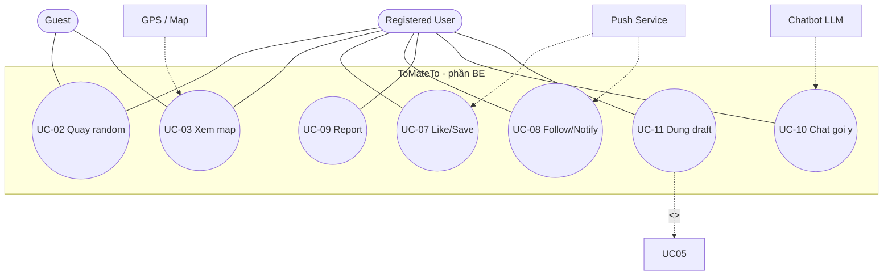

# 2.1-B Use Case — Phần BE (WBS 1.2.3 — bản gọn)

| Thông tin | Nội dung |
|---|---|
| Owner | BE (WBS 1.2.3: tương tác, khám phá, trợ lý AI — 1.25 ngày) |
| Reviewer / Approver | Lead (gộp ở 1.2.4) |
| Ngày | 2026-10-14 |
| Phạm vi | Chỉ làm phần BE. Phần FE (1.2.2: tài khoản, feed, bài đăng, hồ sơ) do FE viết, Lead gộp diagram ở 1.2.4 |
| Nguồn | Personas trong docx, `1.3_system_context.md` (E1-E6) |

## 1. Actor 

* **Chính:** Guest (xem trước), Registered User (like/save/follow/report/chat).
* **Phụ (từ 1.3):** GPS/Map (UC-03), Push Service (UC-07/08), Chatbot LLM (UC-10/11), Image Store (dùng ké UC-05 khi vẽ luồng đăng bài).

## 2. Danh mục UC phần BE 

| ID | Tên UC | Actor | Mô tả 1 câu | Ưu tiên |
|---|---|---|---|---|
| UC-02 | Quay random món | Guest, User | Quay ra món gợi ý theo filter. | Trung bình |
| UC-03 | Xem map quán gần | Guest, User | Xem quán gần vị trí hiện tại hoặc fallback. | Cao |
| UC-07 | Like / Save bài | User | Thích / lưu bài để xem lại. | Cao |
| UC-08 | Follow / Nhận notify | User | Theo dõi người khác + nhận notify like/follow. | Trung bình |
| UC-09 | Report bài | User | Báo cáo bài sai, đủ N thì ẩn chờ duyệt. | Thấp |
| UC-10 | Chat gợi ý món | User | Hỏi chatbot, nhận gợi ý + lý do. | Cao |
| UC-11 | Dùng postDraft để đăng | User | Chuyển gợi ý thành nháp để đăng. | Cao |

## 3. Đặc tả chi tiết 

### UC-03 Xem map quán gần (đại diện khám phá)

* Pre: mở /map.
* Main:
  1. User mở /map.
  2. Hệ thống xin quyền vị trí.
  3. User cho phép → hệ thống nhận lat/lng từ GPS.
  4. Hệ thống gọi getNearbyPlaces, trả quán gần.
  5. User bấm quán → xem bài liên quan.
* Alt:
  * 3a. Từ chối vị trí → dùng fallback (khu vực mặc định) vẫn trả quán.
  * 4a. Không có quán gần → báo + mở rộng bán kính.
* Exception: GPS lỗi → dùng fallback + ghi rõ đang dùng vị trí ước lượng.
* Post: danh sách quán gần hiển thị kèm nguồn vị trí.
* BR: BR-M01 Không bắt cấp vị trí mới được xem map.

### UC-07 Like / Save bài (đại diện tương tác)

* Pre: đã login (Guest bấm → chuyển login trước).
* Main:
  1. User bấm Like/Save ở /post/:id.
  2. Hệ thống toggleLike / savePost, cập nhật số lượng.
  3. Hệ thống gửi notify cho chủ bài qua Push Service (song song, lỗi push không chặn like).
* Alt:
  * 1a. Bấm lại → hủy (toggle).
* Exception: mất mạng → giữ trạng thái cũ + báo lỗi.
* Post: Like/CollectionItem ghi nhận; chủ bài có notify.
* BR: BR-05 Mỗi user like 1 bài 1 lần (toggle).

### UC-10 + UC-11 Chat gợi ý → draft (đại diện trợ lý AI, gộp vì cùng phiên)

* Pre: mở chat bằng FAB.
* Main:
  1. User tạo/mở session (createChatSession).
  2. User gửi câu hỏi (sendChatMessage).
  3. Hệ thống hiện typing, gửi prompt qua Chatbot LLM.
  4. Chatbot trả gợi ý + lý do giá/khu vực/nguồn.
  5. Nếu có postDraft, User bấm Đăng bài này → usePostDraft mở compose đã prefill.
* Alt:
  * 4a. Không có draft → User hỏi tiếp hoặc thoát (chỉ đọc).
* Exception: chatbot timeout → bong bóng lỗi, giữ lịch sử, cho gửi lại.
* Post: phiên + tin nhắn được lưu; draft (nếu có) mở được ở compose.
* BR: BR-03 Gợi ý kèm lý do. BR-04 Không bắt cấp vị trí/ảnh khi chỉ xem.

> UC-02/08/09 giữ mức brief ở §2, nâng lên full khi S2 cần.

## 4. Sơ đồ UC 

* `UC-05 Đăng bài` vẽ mờ để thấy include, bản full do FE + Lead chốt ở 1.2.4.

## 5. BR + Open issues 

* BR-03 Gợi ý kèm lý do. BR-04 Không bắt vị trí khi chỉ xem. BR-05 Like toggle. BR-M01 Map có fallback. BR-07 Chỉ chủ bài sửa/xóa (để FE dùng). BR-09 Giữ lịch sử chat khi lỗi.
* Open: N report ẩn bài + bán kính map + công thức Đang hot → để S2/S6. Persona là giả định → cần phỏng vấn thật trước sign-off.
