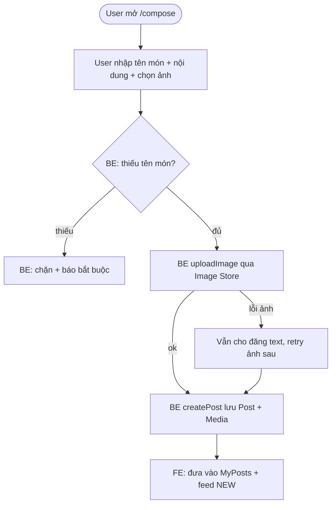
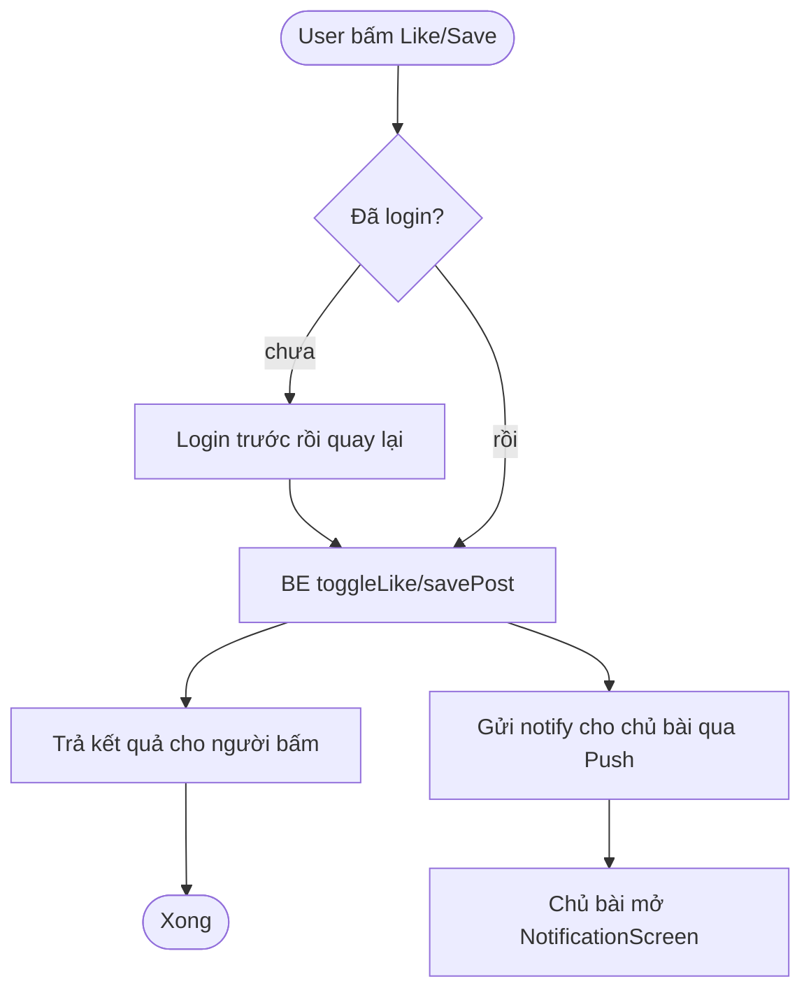
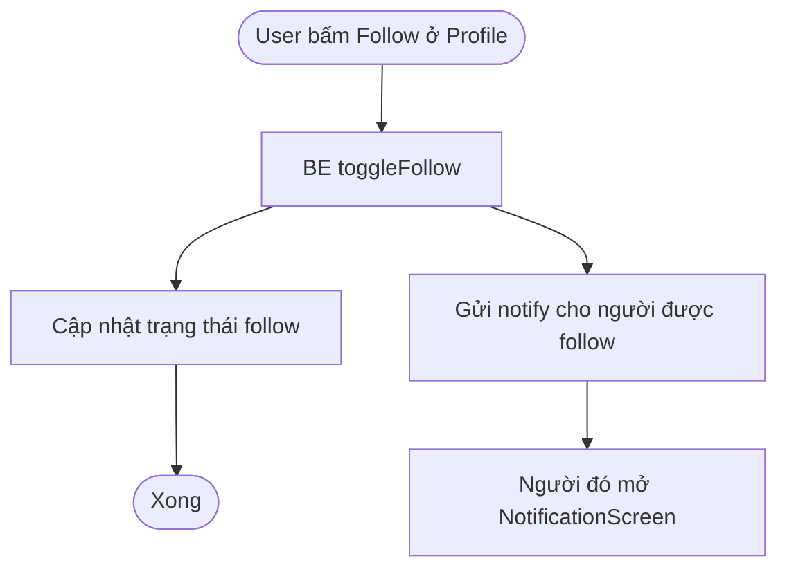
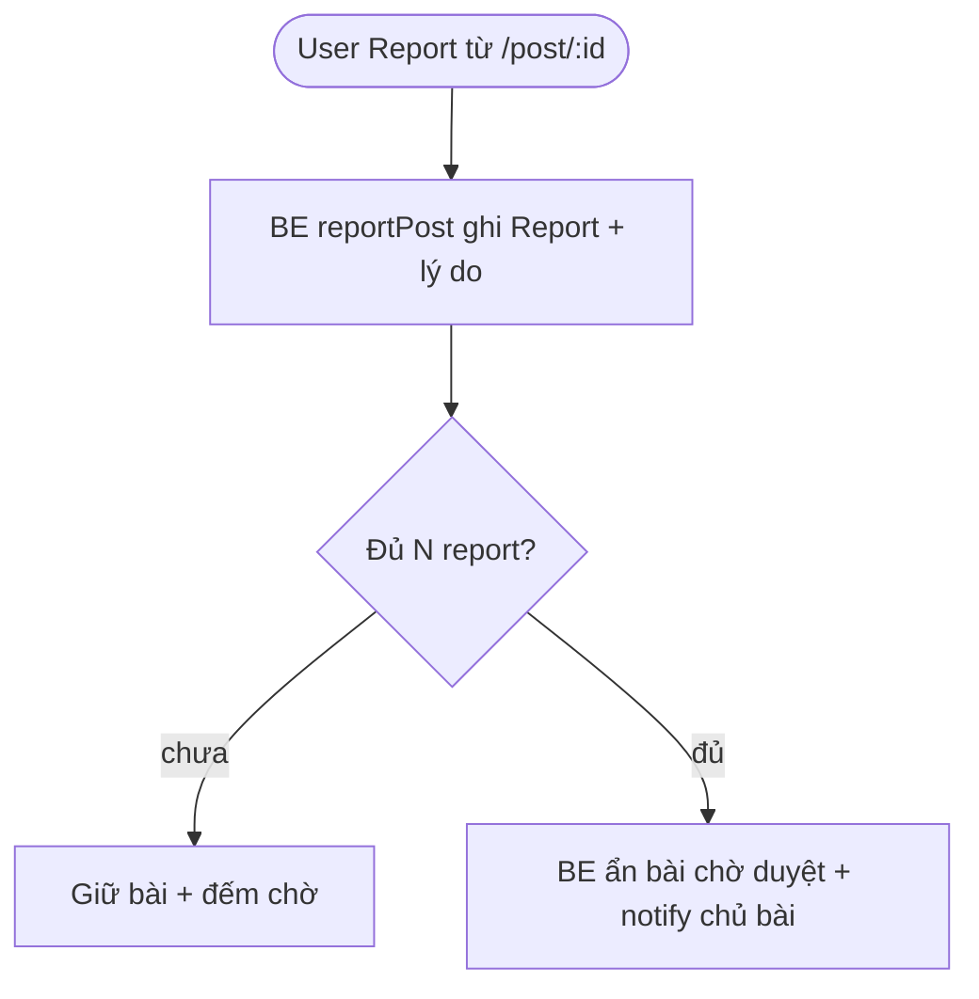
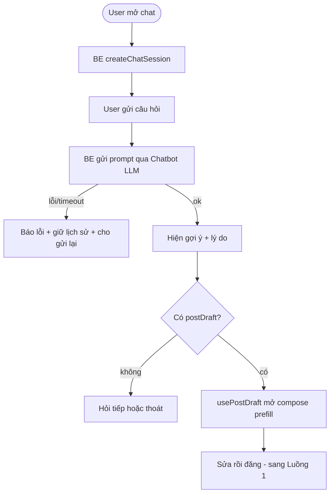

# 2.2-A Process Flows — BE (WBS 1.3.1 — bản gọn)

| Thông tin | Nội dung |
|---|---|
| Owner | BE (WBS 1.3.1: 1 ngày) |
| Reviewer | FE (WBS 1.3.2) |
| Phạm vi | Đúng 5 luồng trong WBS: đăng bài, thích + thông báo, theo dõi, báo cáo → ẩn bài, gợi ý AI |
| Nguồn | `2.1_usecase_BE.md` (UC-02,03,07,08,09,10,11) |

## Luồng 1: Đăng bài (UC-05)

* BR: tên món bắt buộc; ảnh lỗi không chặn đăng text. Bottleneck: upload ảnh mạng chậm.

## Luồng 2: Thích + thông báo (UC-07)

* BR: like toggle 1 user/1 bài. Bottleneck: push lỗi không được chặn like.

## Luồng 3: Theo dõi (UC-08 — tách riêng theo WBS)

* BR: save không cần follow. Tách khỏi Luồng 2 để rõ theo WBS.

## Luồng 4: Báo cáo → ẩn bài (UC-09)

* N chưa chốt ở S1, để S2. Bottleneck: report ảo → S2 chống spam.

## Luồng 5: Gợi ý AI → draft → đăng (UC-10/11)

* BR: gợi ý kèm lý do; không bắt cấp vị trí khi chỉ xem. Bottleneck: LLM timeout.

---
* Đã bỏ so với bản cũ: luồng Auth/Onboarding (thuộc FE 1.2.2) + luồng Feed/Random/Map gộp. Validate + đo time/volume để S2.
