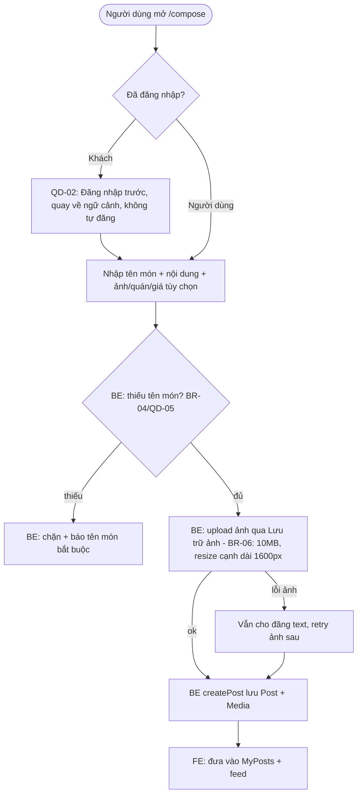
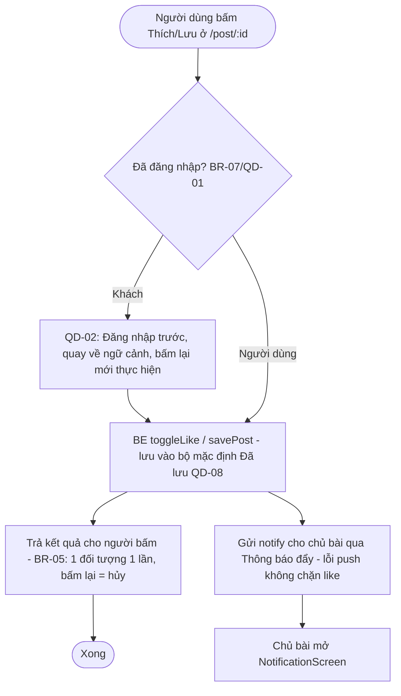
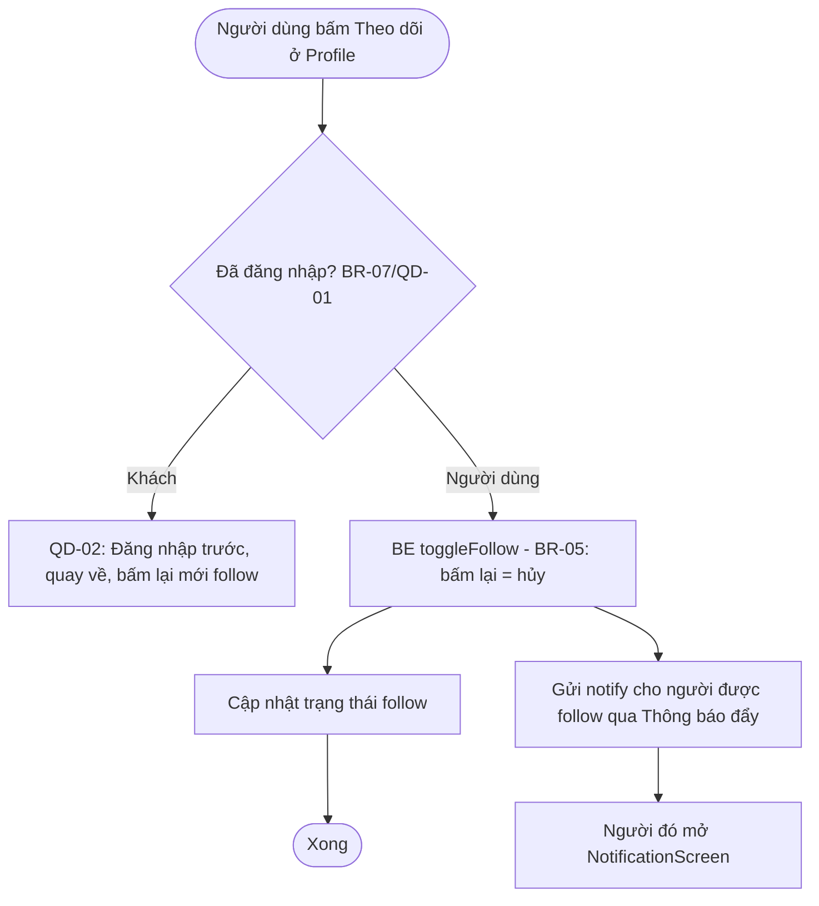
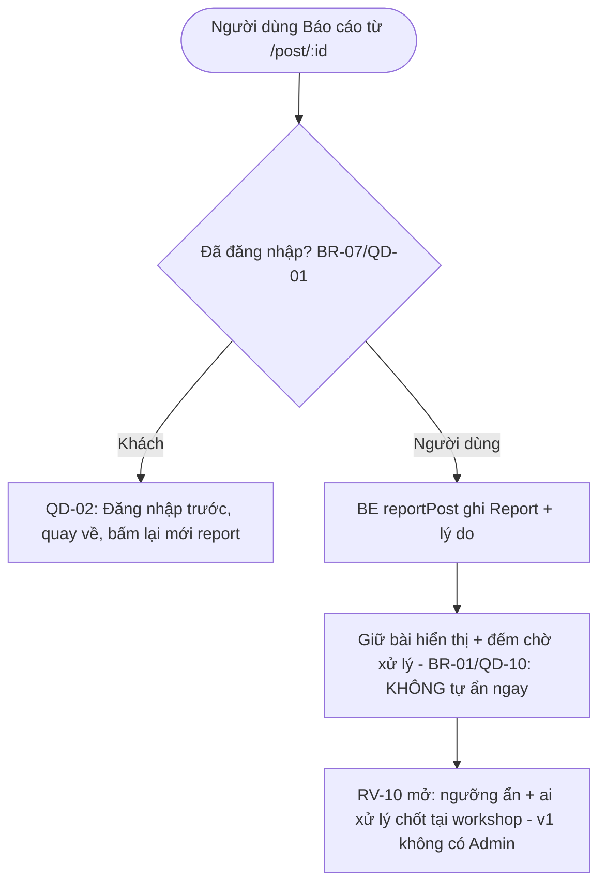
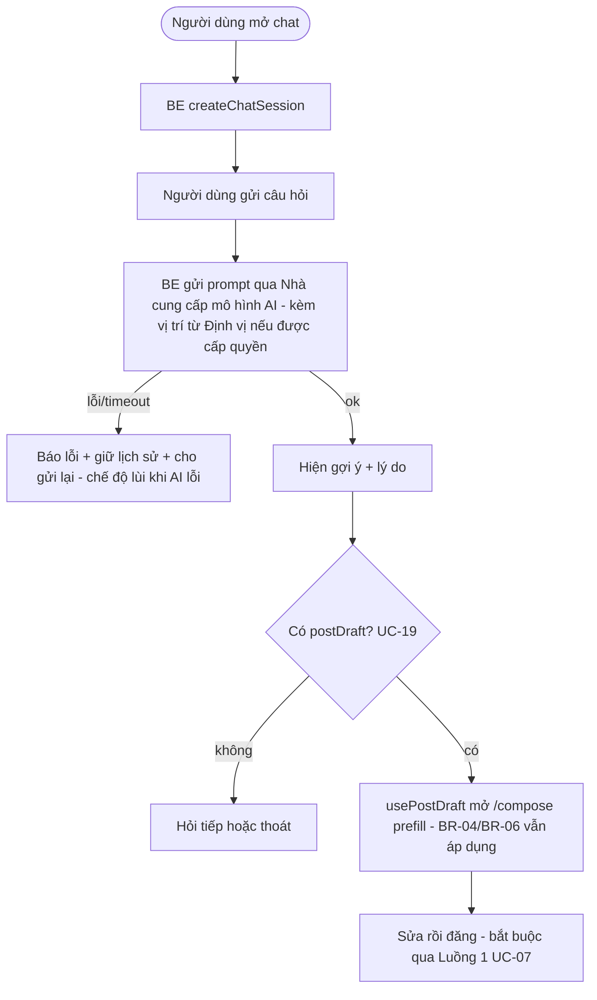

# 2.2-A Process Flows — BE (WBS 1.3.1)

| Thông tin | Nội dung |
|---|---|
| Owner | BE (WBS 1.3.1: 1 ngày) |
| Reviewer | FE (WBS 1.3.2) |
| Sprint | S1 (12–18/10/2026) |
| Phạm vi | Đúng 5 luồng WBS 1.3.1: tạo bài, thích/lưu + thông báo, theo dõi + thông báo, báo cáo (không tự ẩn), gợi ý AI → bản nháp → đăng |
| Nguồn | Lead `docs/yeu_cau/2.1-B_00_catalog.md` (UC Catalog 20 UC, QD-01…QD-10, BR-01…BR-09) + `docs/yeu_cau/2.1-A_usecase_diagram.md` (DOC 2.1-A); chi tiết UC-BE ở `2.1_usecase_BE.md` (UC-13,14,15,16,17,18,19) |
| Quy ước dùng trong file | Actor chính: **Khách** (A-01), **Người dùng** (A-02). Actor phụ đúng tên catalog: Lưu trữ ảnh, Thông báo đẩy, Nhà cung cấp mô hình AI, Định vị thiết bị, Dịch vụ gửi email. ID UC, BR, QD, RV giữ nguyên như catalog Lead — không tự đổi. `UC-19 «include» UC-07`: đăng từ bản nháp bắt buộc đi qua luồng tạo bài. |

## Đối chiếu luồng ↔ catalog Lead

| Luồng | UC Lead | Actor chính | Actor phụ | BR / QD chính |
|---|---|---|---|---|
| 1. Tạo bài đăng | UC-07 | Người dùng | Lưu trữ ảnh | BR-04 (QD-05), BR-06, BR-07, QD-01/QD-02 |
| 2. Thích / lưu + thông báo | UC-13 | Người dùng | Thông báo đẩy | BR-05, BR-07, QD-01/QD-02, QD-08 |
| 3. Theo dõi + thông báo | UC-14 | Người dùng | Thông báo đẩy | BR-05, BR-07, QD-01/QD-02, QD-09 |
| 4. Báo cáo bài | UC-15 | Người dùng | — | BR-01 (QD-10, RV-10 mở) |
| 5. Hỏi trợ lý → bản nháp → đăng | UC-18 + UC-19 (include UC-07) | Người dùng | Mô hình AI, Định vị (UC-18); Lưu trữ ảnh (UC-19 qua UC-07) | BR-04, BR-06, BR-08 |

## Luồng 1: Tạo bài đăng (UC-07 — cũng là điểm include của UC-19)

* BR: BR-04 bài chỉ bắt buộc tên món (QD-05); BR-06 giới hạn ảnh; BR-07 hành động ghi yêu cầu đăng nhập. Bottleneck: upload ảnh mạng chậm — không chặn đăng text.
* Liên hệ UC-19: bản nháp của trợ lý prefill compose rồi đi qua đúng luồng này (không đường tắt).

## Luồng 2: Thích / lưu + thông báo (UC-13)

* BR: BR-05 thích/lưu toggle; BR-07 ghi yêu cầu đăng nhập. QD: QD-01 (xem công khai, ghi cần login), QD-02 (không tự thực hiện sau login), QD-08 (lưu vào "Đã lưu"; tạo/đổi tên bộ riêng là chi tiết đặc tả, không tách UC). Bottleneck: push lỗi không được chặn like.

## Luồng 3: Theo dõi + thông báo (UC-14 — tách riêng theo WBS 1.3.1)

* BR: BR-05. QD: QD-09 theo dõi v1 không đổi feed (feed vẫn mới nhất + đang hot). Tách khỏi Luồng 2 để rõ theo WBS.

## Luồng 4: Báo cáo bài (UC-15 — QD-10: không tự ẩn ngay)

* BR: BR-01 (đang mở — RV-10) báo cáo không tự ẩn bài ngay (QD-10); ngưỡng và cơ chế ẩn chốt riêng. Bottleneck: report ảo → S2 chống spam. Không dùng logic cũ "đủ N thì ẩn".

## Luồng 5: Hỏi trợ lý → bản nháp → đăng (UC-18 + UC-19 «include» UC-07)

* BR: BR-08 từ chối vị trí → dùng tọa độ mặc định trung tâm Hà Nội (áp cho UC-18 xin vị trí + UC-16); gợi ý kèm lý do; không bắt cấp vị trí khi chỉ xem. Bottleneck: LLM timeout.
* Quan hệ: UC-19 «include» UC-07 duy nhất trong sơ đồ Lead — không đường tắt đăng bài.

---

## Ghi chú phạm vi + traceability

* WBS 1.3.1 chỉ yêu cầu 5 luồng trên. UC-16 (Xem bản đồ quán gần, BR-02 bán kính 5km) và UC-17 (Quay món ngẫu nhiên) thuộc WBS 1.2.3 — xem đặc tả ở `2.1_usecase_BE.md`, không vẽ thành luồng riêng ở đây. UC-20 (Tìm kiếm, gồm xem xu hướng) chưa có đặc tả (catalog: đề xuất BE viết S2) nên chưa có luồng.
* Không có actor Admin trong v1 (Vision 4.2 — RV-09 mở: sửa QD-06 hay sửa Vision). Không có UC riêng "Tải ảnh lên" — là bước con trong UC-07/UC-19. Không vẽ luồng Auth/Onboarding/Feed (thuộc FE 1.2.2).
* Validate + đo time/volume để S2 (FR 3.1-A).
