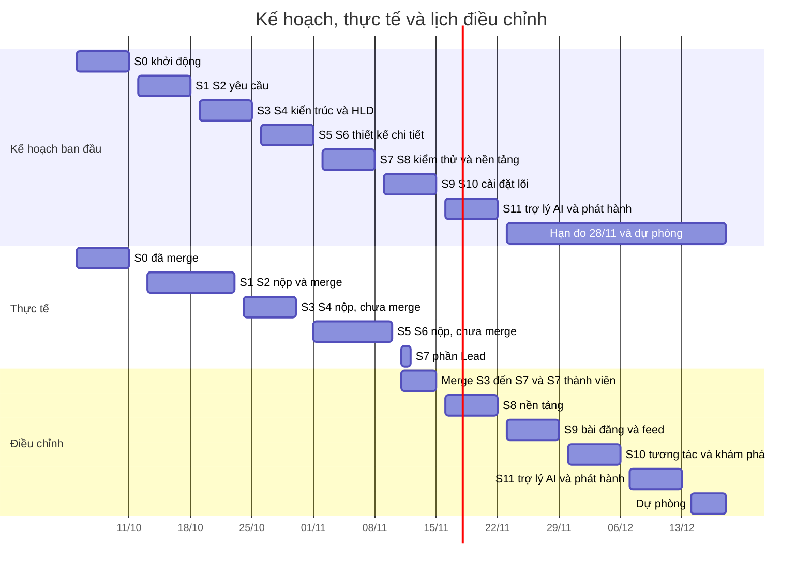

# DOC 7.5-B — Lịch trình ToMateTo: kế hoạch, thực tế và điều chỉnh

| Thuộc tính | Nội dung |
|---|---|
| Dự án | ToMateTo |
| Owner | Lead |
| Reviewer | BE (WBS 7.3.2) |
| Approver | Lead |
| Sprint / WBS | S7 / 7.3.1 |
| Ngày đo | 14/11/2026 |
| Trạng thái lịch điều chỉnh | Đề xuất của Lead, chốt tại buổi họp Chủ nhật 15/11/2026 |
| Đi kèm | DOC 7.5-A (WBS), DOC 7.5-C (rủi ro) |

## 1. Kế hoạch so với thực tế theo tuần

Thực tế đo từ git và GitHub ngày 14/11/2026 (DOC 7.5-A mục 1 giải thích cách đo).

| Tuần | Sprint theo kế hoạch | Thực tế |
|---|---|---|
| W0 · đến 11/10 | S0 khởi động | Ba PR của S0 mở và merge ngày 11/10, đúng hạn |
| W1 · 12–18/10 | S1, S2 yêu cầu | PR của FE (use case, wireframe) và DB (ERD khái niệm) mở 13–14/10, đúng hạn; PR của Lead và BE mở và merge 23/10 (trễ 5 ngày); cả bảy PR S1, S2 merge 23/10 |
| W2 · 19–25/10 | S3, S4 kiến trúc và HLD | Các PR mở từ 24/10 đến 30/10 (trễ 0 đến 5 ngày); không PR nào đã merge |
| W3 · 26/10–01/11 | S5, S6 LLD | PR của FE cho S5 mở 01/11 (đúng hạn); PR của FE cho S6 mở 06/11 (trễ 5 ngày); các PR của BE cho S5 và S6 mở 08/11 (trễ 7 ngày); các PR của DB cho S4, S5 và S6 mở 11/11 (trễ 10 ngày với S5 và S6) |
| W4 · 02–08/11 | S7 kiểm thử, chuẩn, WBS chính thức; S8 nền tảng | S7: phần của Lead hoàn thành ngày 11/11 (PR #27 và #28), phần của thành viên chưa có PR; S8: chưa có nhánh nào trong repo |
| W5 · 09–15/11 | S9, S10 | chưa bắt đầu |
| W6 · 16–22/11 | S11 | chưa bắt đầu |
| W7 · 23–29/11 | hạn đo mục tiêu sản phẩm 28/11 | chưa đến |

Từ 23/10 đến 14/11 nhánh `main` không nhận PR nào.

## 2. Đường găng

Chuỗi phụ thuộc của kế hoạch ban đầu: Vision, use case, FR và wireframe, NFR, kiến trúc, API và schema, class, sequence và DDL, thuật toán, test plan và WBS chính thức, rồi S8, S9, S10, S11 và bản phát hành.

Đoạn đang giữ lịch ở ngày 14/11/2026:

1. **Merge các tài liệu S3 đến S6 vào `main`.** S8 cần HLD của S4; S9 cần API và DDL của S5. Mười tám PR đang mở; merge chỉ diễn ra ở buổi họp Chủ nhật, nên buổi 15/11 là điểm nút.
2. **Sửa các lỗi lệch giữa tài liệu thiết kế** (API, class BE, DDL, thuật toán, xử lý lỗi) trước khi code theo chúng. BE, FE và DB đã sửa theo góp ý S5 và S6; còn các điểm cần chốt giữa BE, FE và DB (ngưỡng báo cáo mỗi giờ, tên trường thời gian thử lại, truy vấn Q06, Q08, Q15 của DB chưa khớp thuật toán BE).
3. **Việc S7 của thành viên** (test case 7.1.2 đến 7.1.4, chuẩn riêng 7.2.2 đến 7.2.4, review WBS 7.3.2) dựa trên đầu ra S7 của Lead ở PR #27; hạn mở PR 15/11.
4. **Hạ tầng S8** (cấu trúc repo, Docker Compose, CI): các lát S9 đến S11 đều dựa vào.

## 3. Điều chỉnh lịch S8 đến S11

| Sprint | Lịch ban đầu | Lịch điều chỉnh | Nội dung |
|---|---|---|---|
| S7 phần thành viên | 02–08/11 | mở PR trước 15/11, review xong 18/11 | test case, chuẩn riêng từng vai, review WBS |
| S8 | 02–08/11 | 16–22/11 | hạ tầng, dữ liệu lõi, xác thực, khung Flutter |
| S9 | 09–15/11 | 23–29/11 | bài đăng, feed, tải ảnh |
| S10 | 09–15/11 | 30/11–06/12 | thích, lưu, theo dõi, thông báo, bản đồ, quay món |
| S11 | 16–22/11 | 07–13/12 | trợ lý AI, hoàn thiện, phát hành v1.0, báo cáo |
| Hạn đo mục tiêu sản phẩm | 28/11 | 13/12 | buổi kiểm thử tổng hợp theo DOC 7.3-A mục 5 |
| Dự phòng | 23/11–18/12 | 14–18/12 | sửa lỗi, chuẩn bị thuyết trình |

Căn cứ điều chỉnh: S8 chưa có nhánh nào trong repo nên không thể hoàn thành trong tuần 02–08/11; ba sprint cài đặt còn lại giữ thứ tự theo phụ thuộc và mỗi sprint một tuần để mỗi lát có thời gian chạy test case của DOC 7.3-A; hạn đo dời từ 28/11 sang 13/12 và vẫn nằm trong khoảng dự phòng đến 18/12 của Vision, còn đệm 5 ngày. Nếu buổi họp 15/11 không merge được S3 đến S6 thì S8 trượt tương ứng và đệm 5 ngày là phần duy nhất còn lại.
