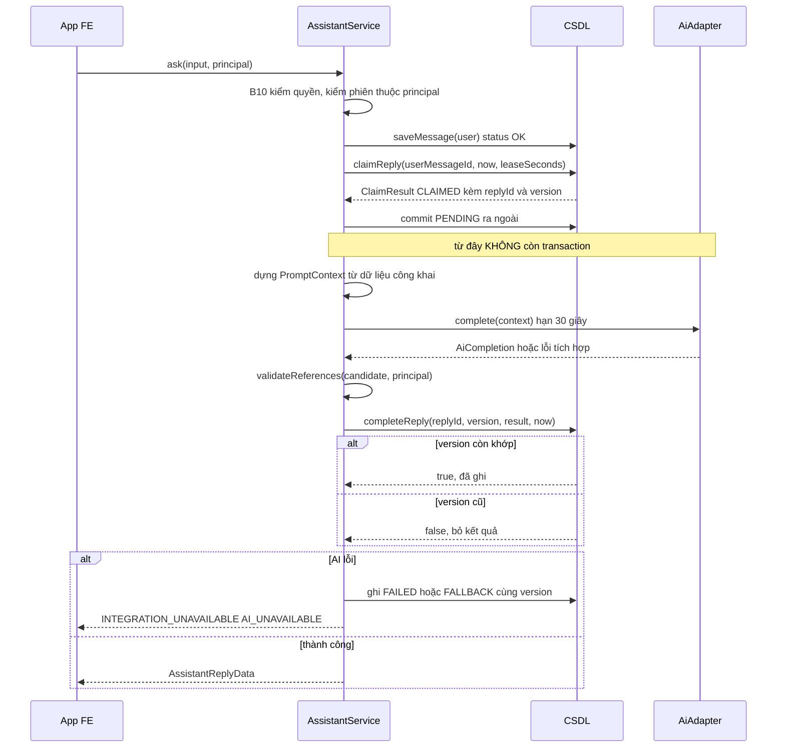
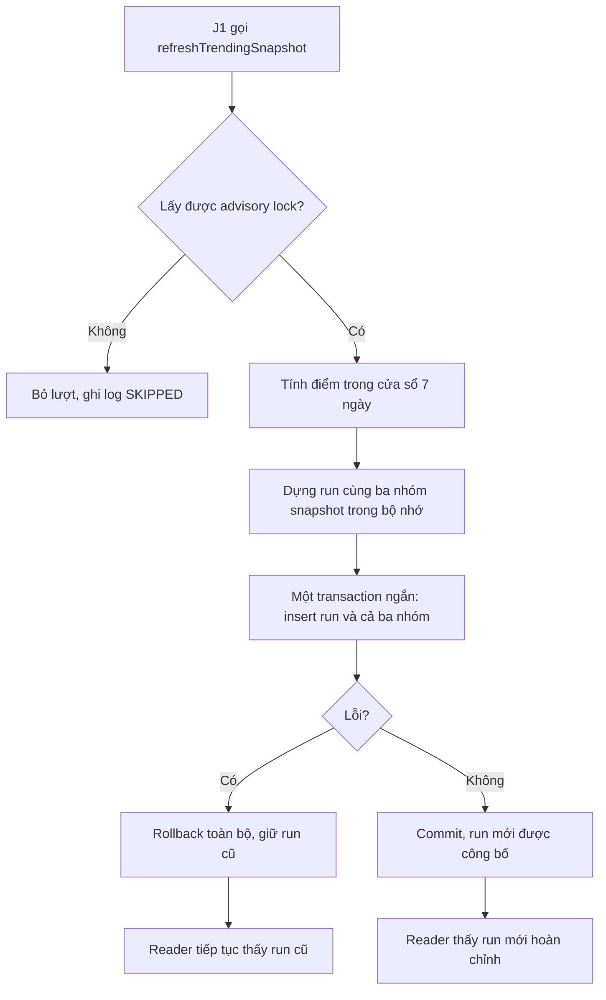
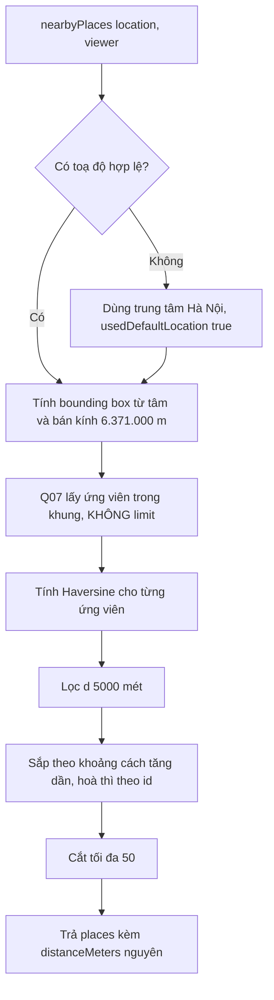
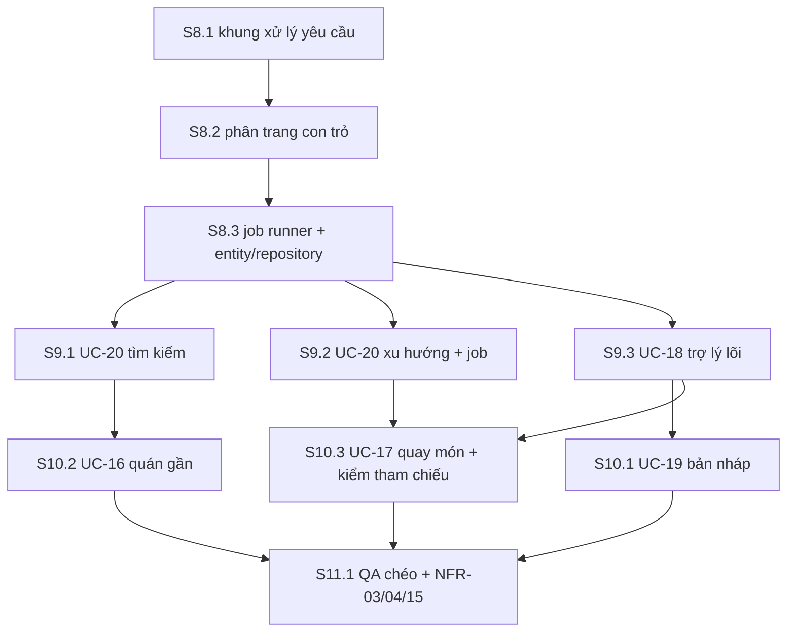

# CHI TIẾT CÀI ĐẶT — Nhóm 4.4 Discovery & Assistant (BE)

| Thuộc tính | Nội dung |
|---|---|
| Người phụ trách | BE (`khanhduy123qwe-ux`) |
| Nhóm | 4.4 Discovery & Assistant — DOC 6.1-A BE §4.4 |
| UC | UC-16 Quán gần, UC-17 Quay món, UC-18 Hỏi trợ lý, UC-19 Dùng bản nháp, UC-20 Tìm kiếm và xu hướng |
| Màn hình | MH-15 Tìm kiếm, MH-16 Xu hướng, MH-17 Quán gần, MH-18 Quay món, MH-19 Trợ lý |
| Bảng | T18 `chat_sessions`, T19 `chat_messages`, T20 `trending_runs`, T21 `trending_posts_snapshots`, T22 `trending_dish_snapshots`, T23 `trending_tag_snapshots` |
| Thành phần | P4, B8, B9, D4, X4 (AI); cộng khung dùng chung `ContextFactory`, `ErrorMapper`, `TransactionManager`, `CursorCodec`, `PageRequest`, `Config`, `Clock`, `BackgroundJobRunner` (J1) |
| Sprint | S8, S9, S10, S11 |
| Ngày | 12/11/2026 |
| Người đọc | Thành viên phụ trách nhóm 4.4, và coder (pane AI) nhận file này làm hợp đồng cài đặt |

---

## 0. Cách dùng file này

File này là **hợp đồng cài đặt** cho một coder nhận nhóm 4.4. Coder không cần đọc tài liệu nào khác ngoài các tài liệu được dẫn trong mục 2 và mục "Đọc thêm" của từng WP.

Thứ tự đọc: mục 1 (bạn ở đâu trong hệ thống) → mục 3 (phải hiểu gì trước khi code) → mục 4 (app mẫu) → mục 5 (chỗ tài liệu còn sai) → mục 6 (WP theo sprint, làm đúng thứ tự).

Khi xong một WP, báo: mã WP, các tệp đã tạo, kết quả `ruff`/`mypy`/`pytest`, và mã TC đã chạy. Xong cả sprint thì báo thêm ảnh chụp hoặc log của lệnh kiểm ở cột "Xong khi".

Điều cấm: không đọc/ghi `D:\ToMateTo`; không tự đặt ID mới (UC/MH/Txx/NFR/TC); không sửa tệp của nhóm khác; không viết cách sửa vào tài liệu thiết kế — chỉ ghi nhận lỗi ở mục 5.

---

## 1. Phạm vi và vai trò của nhóm trong hệ thống

Nhóm 4.4 giữ **phần khám phá và trợ lý** của app: người dùng tìm món/quán/bài (UC-20), xem món đang được quan tâm (UC-20 nhánh xu hướng), xem quán gần (UC-16), quay món ngẫu nhiên (UC-17), hỏi trợ lý (UC-18) và dùng bản nháp trợ lý soạn sẵn để đăng bài (UC-19). Chuỗi đầy đủ là **Flutter → resolver P4 → service B8/B9 → repository D4 → PostgreSQL**, cộng adapter X4 gọi nhà cung cấp AI.

Ngoài nhóm, trong **S8** bạn dựng **khung xử lý yêu cầu backend** mà cả bốn nhóm đứng lên: `ContextFactory` (đọc Bearer, hỏi B1), `ErrorMapper` + cây `DomainError`, `TransactionManager`, `CursorCodec`/`PageRequest`, `Config`, `Clock`, `BackgroundJobRunner` (J1). Khung này là điểm nối số 4 — ba nhóm còn lại code theo nó ngay từ S8, nên **phải xong trước khi bất kỳ UC nào của nhóm khác chạy**.

### 1.1 Giao cho ai / nhận từ ai

Bảng dưới lấy đúng 14 điểm nối ở mục 4 của `HUONG_DAN_S8_S11_THEO_NHOM.md`.

| Chiều | Điểm nối | Nội dung | Điều kiện sẵn sàng (bản giả trước khi có bản thật) |
|---|---|---|---|
| **Bạn giao** | **4** | `CursorCodec`, `PageRequest`, `ErrorMapper`, `TransactionManager` cho **cả 4 nhóm** | S8 tuần 1. Bản giả: `CursorCodec.encode/decode` chạy được với `(createdAt, id)` và trả `VALIDATION_FAILED` khi chuỗi hỏng; `ErrorMapper` map đủ 10 mã 5.2-A; `TransactionManager.run(callback)` rollback khi `DomainError`. Công bố chữ ký + bản giả ngay đầu S8, không đợi bản thật |
| **Bạn giao** | **11** | `TrendingSnapshotRepository.latestRun`, cursor TRENDING cho DB làm chế độ TRENDING của feed | S10 theo lịch, nhưng DB cần sớm: S9 đưa bản giả trả `latestRun() = null` (feed TRENDING ra rỗng) rồi thay bản thật. Payload cursor TRENDING phải chốt với DB trước khi DB code `listFeed` |
| **Bạn nhận** | **1** | `IdentityService.verifySession(rawToken) → Principal` từ FE (4.1) | S8. Bản giả: hàm đọc một `dict` token→Principal cố định để `ContextFactory` chạy được test |
| **Bạn nhận** | **3** | `WriteAuthorizationPolicy` (B10) từ Lead | S8. Bản giả: `authorizeWrite(...)` ném `FORBIDDEN` với mọi principal không có `userId`, cho qua còn lại |
| **Bạn nhận** | **6** | `LikeRepository`, `CollectionRepository` (trạng thái thích/lưu), `BlockRepository.listBlockedUserIds` từ Lead | S9. Bản giả: `listBlockedUserIds` trả `[]`; `LikeRepository.countByPost` trả 0. Bạn dùng cho: tính điểm xu hướng (đọc bảng T12/T15 — điểm nối 13) và lọc chặn |
| **Bạn nhận** | **12** | `PostEditorController.startCreate(draft)` ở MH-08 từ DB | S10. Bản giả: endpoint nhận `PostDraftData` và trả `draftId` giả để test luồng UC-19 |
| **Bạn nhận** | **13** | Bảng T12 `likes`, T15 `collection_items` từ Lead để job tính xu hướng đọc | S10. Bản giả: bảng có sẵn từ migration DB S8, chỉ cần Lead đảm bảo cột `created_at`/`added_at` đúng 5.3-B |

**Ranh giới quan trọng:** bạn **đọc** dữ liệu của Lead (thích/lưu/chặn) nhưng **không viết** vào bảng của Lead. Bạn **cấp** run xu hướng cho DB nhưng **không** viết code feed. Hai chiều đó đi qua repository của chủ bảng hoặc qua service của chủ nhóm, không chép truy vấn.

---

## 2. Bản đồ tài liệu cần đọc

Đường dẫn local tính từ `D:\hdv\quan_ly_du_an\s5s6_lead\noi_bo\src\`.

| # | Tài liệu, mục (đường dẫn local) | Đọc để hiểu gì | Cần cho sprint |
|---|---|---|---|
| 1 | `5.2-A_BE.md` §4.4–4.5, §12.6, §12.7 | 9 operation của nhóm: `search`, `trending`, `nearbyPlaces`, `randomDish`, `askAssistant`, `retryAssistant`, `assistantSessions`, `assistantHistory`, `useAssistantDraft`; tên field, kiểu, mã lỗi, `state: WAITING`, `usedDefaultLocation` | S8, S9, S10 |
| 2 | `7.1-A_BE@23a5f14.md` §3 xu hướng, §4 quán gần, §5 quay món, §6 trợ lý, §7 tìm kiếm, §9 biên/hiệu năng | Năm thuật toán; con số (7 ngày, 15 phút, 5 km, 50, 40 món, 70/30, 30 giây); ca biên từng thuật toán | S8, S9, S10 |
| 3 | `7.1-A.1_DB@439472c.md` Q06–Q22 và `7.1-A.1_queries@439472c.sql` | Câu truy vấn mẫu, khoá chống chạy trùng job (`pg_try_advisory_xact_lock`), công bố run nguyên tử, shape cursor | S8, S9, S10 |
| 4 | `5.3-B_S4@3ec4d83.md` T18–T23 | `UNIQUE(reply_to_id)`, `status IN (PENDING, OK, FAILED, FALLBACK)`, `processing_version`, `processing_expires_at`, `PRIMARY KEY(run_id, target_id)` của ba bảng snapshot, `CHECK` của `context_json` | S8, S9, S10 |
| 5 | `6.1-A_BE@3571426.md` §4.4, §5.2 (B8/B9), §5.3 (D4), §5.4 (X4), §5.7 (khung, J1) | Tên lớp, chữ ký phương thức, phụ thuộc, điều kiện trước/sau; `BackgroundJobRunner` | S8, S9, S10 |
| 6 | `6.2-A_BE@ed27b57.md` Hình 07 (hỏi trợ lý + retry), Hình 08 (dùng bản nháp), §5.3 (UC còn lại), §5.2.2 (A02, A03, A07–A13) | Thứ tự gọi, chỗ commit, `claimReply`/`completeReply`, gọi AI ngoài transaction, nhánh lỗi | S9, S10 |
| 7 | `6.1-A_FE@c3b8b46.md` §3.4, §4.34–4.38, §4.42 (`LocationAdapter`), §4.46 (`DiscoveryView`); `6.2-A_FE@c3b8b46.md` FE-SQ09, FE-SQ10 | Phía app gọi gì, tên tham số, cách xử lý retry và vị trí bị từ chối | S9, S10 |
| 8 | `6.3-A_mockup_hifi_fe@999e0be.md` MH-15…MH-19 | Màn hình cần trạng thái gì (tải, rỗng, lỗi, khách) | S10 |
| 9 | `3.2-A_nfr.md` NFR-01, NFR-02, NFR-03, NFR-04, NFR-09, NFR-10, NFR-15 | Ngưỡng để đo: ≤2 giây, ≤10/50 mục, ≤50 quán 5 km, ≤30 giây, log, chế độ lùi, ≥18/20 câu đúng | S9, S10, S11 |
| 10 | `5.4-A_BE.md` mục trợ lý, vị trí, che dữ liệu trong log | Không gửi email/token/vị trí người dùng cho AI; không lưu vị trí; che dữ liệu log | S9, S10 |
| 11 | `7.2-A_BE@23a5f14.md` §3 (mã lỗi), §7 (retry/ngắt mạch), §9 (ánh xạ luồng) | Mã lỗi cụ thể của nhóm: `LOCATION_INVALID`, `AI_UNAVAILABLE`, `CURSOR_INVALID`, `PAGE_SIZE_INVALID`, `IMAGE_EXPIRED`, `IMAGE_PURPOSE`; retry và ngắt mạch | S8, S9, S10 |
| 12 | `7.2-A_xu_ly_loi_frontend@999e0be.md` dòng 42, 41 | Câu thông báo FE hiển thị cho AI lỗi và vị trí từ chối — BE phải trả đúng mã để FE chọn đúng câu | S10 |
| 13 | `..\..\..\s7_lead\nop\7.4-A_chuan_chung.md` | Cấu trúc repo, tên nhánh, mẫu commit, Definition of Done, lệnh lint | S8 |
| 14 | `..\..\..\s7_lead\nop\7.3-A_test_plan.md` §2, §4, §6, §7 và `7.3-C_ma_tran_phu_uc.md` §2 hàng UC-16…UC-20 | Mức kiểm U/I/E/M/D, dữ liệu kiểm, cách đo NFR, mẫu ID `TC-BE-xxNN` | S8, S10, S11 |
| 15 | `..\..\..\s7_lead\nop\7.2-A_tong_hop_xu_ly_loi.md` | Mã lỗi API → cách BE xử lý → câu FE hiển thị; đối chiếu ô trống của nhóm | S10 |

---

## 3. Cần nắm

Bảy câu dưới đây là điều phải trả lời được bằng lời của mình trước khi code. Câu 1–5 đào sâu từ mục 8.3 của file tổng quan; câu 6–7 là phần **khung dùng chung** mà file tổng quan chỉ nêu ở mục 3, nhưng nhóm bạn là người viết nên phải hiểu ở mức chi tiết hơn.

### Câu 1. Vì sao phải gọi AI ngoài transaction, và cái gì bảo vệ dữ liệu khi một lượt AI trả lời muộn?

Một lượt hỏi trợ lý mất tới 30 giây (NFR-04). Nếu giữ transaction CSDL trong suốt 30 giây đó, mọi request khác chạm cùng bản ghi sẽ bị chặn, connection pool cạn, và một lỗi mạng ở phía AI sẽ rollback cả câu hỏi người dùng vừa gửi — người dùng mất câu hỏi dù họ không làm gì sai. Vì vậy thứ tự bắt buộc là: **ghi câu hỏi + dòng phản hồi `PENDING` → commit → gọi AI → ghi kết quả bằng một transaction mới**.

Cái bảo vệ dữ liệu không phải transaction mà là **ba ràng buộc trên bảng**:

| Ràng buộc | Ở đâu | Chặn được gì |
|---|---|---|
| `UNIQUE(reply_to_id)` khi khác NULL | T19, 5.3-B dòng 210 | Một câu hỏi có hai dòng phản hồi. Retry **cập nhật** dòng cũ, không tạo dòng mới |
| `processing_version` tăng mỗi lần nhận lượt | T19, 5.3-B dòng 208, 218 | Kết quả của lượt cũ trả về muộn đè lên lượt mới. Ghi chỉ thành công khi `version` còn khớp |
| `processing_expires_at` (lease) | T19, 5.3-B dòng 208, 218 | Hai tiến trình cùng nhận một lượt. Tiến trình chết để lại `PENDING` hết hạn, lần sau nhận lại được |



Ba trạng thái phải phân biệt rõ, vì mỗi trạng thái dẫn tới một hành vi khác nhau trên app:

| `status` | Nghĩa | App làm gì | Retry được không |
|---|---|---|---|
| `PENDING` | Đã nhận lượt, chưa có kết quả | Hiện đang chờ, không coi chuỗi rỗng là câu trả lời | Chỉ khi lease đã hết hạn |
| `OK` | Có kết quả từ provider, đã kiểm tham chiếu | Hiện câu trả lời | Không — hỏi tiếp thì tạo câu hỏi mới |
| `FALLBACK` | Có câu trả lời theo luật, provider lỗi | Hiện câu trả lời kèm dấu hiệu dự phòng | Có (chờ chốt, xem O-04) |
| `FAILED` | Không có kết quả | Hiện lỗi + "Thử lại" đúng phản hồi đó | Có |

### Câu 2. Vì sao không được tin nguyên văn lời AI, và kiểm lại chính xác những gì?

AI sinh văn bản, không truy vấn CSDL của bạn. Nó có thể nhắc một món không tồn tại, một quán đã đóng, hoặc một bài mà người hỏi bị chặn không được xem. Nếu trả nguyên văn, app hiển thị nội dung sai và có thể **rò rỉ nội dung người dùng không được xem** — đây là lỗi bảo mật chứ không chỉ là lỗi chất lượng (NFR-07, 5.4-A).

Hai chiều kiểm, cả hai đều bắt buộc:

| Chiều | Kiểm gì | Nguồn | Nếu không qua |
|---|---|---|---|
| **Vào** (dựng ngữ cảnh) | Chỉ dữ liệu công khai: món, quán, bài đã qua lọc quyền và lọc chặn. **Không** email, token, `userId` thô, vị trí chính xác của người hỏi | `PostRepository`, `DishRepository`, `RestaurantRepository`, `BlockRepository.listBlockedUserIds` | Loại khỏi ngữ cảnh trước khi gửi |
| **Ra** (kiểm tham chiếu) | Mỗi món/quán/bài AI nhắc phải tồn tại, không bị ẩn, người hỏi không bị chặn | `validateReferences(candidate, viewer)` — 6.1-A BE §4.4 dòng 905 | Loại tham chiếu đó khỏi câu trả lời; không thay bằng nội dung khác |

Điểm tinh tế: **kiểm tham chiếu chạy cho cả kết quả provider lẫn kết quả fallback**. `buildFallback` sinh câu trả lời theo luật nên trông "an toàn", nhưng nó vẫn có thể nhắc món lấy từ ngữ cảnh đã cũ — vì vậy 6.1-A dòng 900 ghi rõ `validateReferences` áp cho cả hai đường.

Việc dùng bản nháp (UC-19) cũng nằm trong nguyên tắc này: bản nháp là **dữ liệu AI sinh**, phải kiểm lại khi dùng, và **server không tạo bài**. Ranh giới: `createPostDraft` chỉ trả `PostDraftData`; bài chỉ sinh ra khi người dùng bấm đăng, qua `createPost` của nhóm DB.

### Câu 3. Xu hướng được tính và công bố thế nào để người dùng không bao giờ thấy kết quả dở dang?

Tính xu hướng là quét cửa sổ 7 ngày trên bài, lượt thích và lượt lưu — quá nặng để làm lúc người dùng mở trang. Vì vậy nó là **job nền 15 phút một lần**, ghi vào ba bảng snapshot và một bảng run. Điều quan trọng không phải tốc độ mà là **tính nguyên tử**: người đọc hoặc thấy run cũ hoàn chỉnh, hoặc thấy run mới hoàn chỉnh, không bao giờ thấy nửa run.

Cơ chế gồm bốn phần, cả bốn đều phải có:

| Phần | Cách làm | Căn cứ |
|---|---|---|
| **Khoá chống chạy trùng** | `pg_try_advisory_xact_lock(7101, 1)` — nếu không lấy được khoá thì bỏ lượt, không xếp hàng | 7.1-A.1 Q: dòng `s6_publish_lock` trong `7.1-A.1_queries@439472c.sql:184` |
| **Ghi trong một transaction ngắn** | Insert run + cả ba nhóm snapshot rồi commit một lần. Lỗi giữa chừng rollback toàn bộ | 5.3-B dòng 248, 7.1-A.1 dòng 248 |
| **Không có trạng thái "nửa xong"** | Bảng `trending_runs` chỉ có dòng đã công bố, không có cột trạng thái | 5.3-B dòng 232 |
| **Cursor gắn `run_id`** | Mọi trang của một lần lật dùng cùng run; cursor mang `run_id` để từ chối cursor của run khác | 5.3-B dòng 238, 7.1-A dòng 47–58 |



Hệ quả cho tầng đọc: `latestRun()` trả run mới nhất đã công bố; không có run nào thì trả `null` và `trending` trả `state: WAITING` với danh sách rỗng (5.2-A dòng 759). Cursor mang `run_id`; nếu run đó đã bị dọn thì từ chối bằng `VALIDATION_FAILED · CURSOR_INVALID` chứ không lặng lẽ đọc run khác (5.3-B dòng 248).

### Câu 4. Quán gần: vì sao phải lọc 5 km trước khi cắt 50, và vì sao không lưu vị trí?

Bài toán: có thể có hàng nghìn quán trong khung toạ độ, chỉ được trả 50. Nếu lấy 50 quán đầu rồi mới tính khoảng cách và lọc 5 km, kết quả có thể **thiếu quán hợp lệ** — 50 quán đầu theo thứ tự id đều ở xa, trong khi quán gần nằm ở vị trí 51. Vì vậy thứ tự bắt buộc là: lọc thô bằng khung toạ độ (dùng index B-tree) → tính Haversine cho **toàn bộ** ứng viên → lọc `d ≤ 5000` → sắp theo `(khoảng cách, id)` → **mới** cắt 50.



Bốn quy tắc ràng buộc:

1. **Toạ độ ngoài miền** (|lat| > 90 hoặc |lng| > 180) trả `VALIDATION_FAILED · LOCATION_INVALID` (7.1-A dòng 103, 7.2-A BE dòng 87). `(0,0)` là toạ độ hợp lệ, không phải "thiếu" (7.1-A dòng 211).
2. **Không có vị trí** → dùng trung tâm Hà Nội và bật `usedDefaultLocation: true` (5.2-A dòng 760, 7.1-A dòng 103). Toạ độ số cụ thể của điểm mặc định **chưa có trong tài liệu** — xem câu hỏi mở O-01.
3. **`distanceMeters` là số nguyên**: `floor(d + 0.5)`, nhưng việc lọc biên 5 km và sắp xếp dùng `d` **chưa làm tròn** (7.1-A.1 dòng 150–151).
4. **Không lưu vị trí người dùng**: không vào CSDL, không vào log, không vào ngữ cảnh AI (5.4-A dòng 268, 5.3-B dòng 204).

### Câu 5. Quay món và tìm kiếm: hai thuật toán còn thiếu chốt, code an toàn thế nào?

Đây là hai chỗ tài liệu **tự nhận chưa đủ** và đã đánh dấu là mẫu cũ (7.1-A.1 dòng 139, 162). Cách làm an toàn: code đúng **hợp đồng API** (thứ app thấy) và **để phần thuật toán sau một interface mỏng**, để khi chốt công thức chỉ đổi một chỗ.

| Chức năng | Đã chốt | Chưa chốt | Cách code an toàn |
|---|---|---|---|
| **Quay món** (UC-17) | Trả `DishSuggestion { dish, reason, state }`; không có món thì `state` rỗng, không lỗi server (5.2-A dòng 761). Ứng viên 40 món, 70% xu hướng + 30% seed (7.1-A dòng 122, 126) | Tỷ lệ và kích thước pool cần nhóm review (7.1-A dòng 122). Cách sinh số ngẫu nhiên và hạt giống để test lặp lại được (S6_BE lỗi #2). Nội dung trường `reason` (S6_BE lỗi #3) | Tách hàm chọn ứng viên và hàm chọn ngẫu nhiên; tham số hoá tỷ lệ và seed qua `Config` để test bơm seed cố định |
| **Tìm kiếm** (UC-20) | Tối thiểu 2 ký tự; không khớp trả connection rỗng **không phải lỗi**; chuẩn hoá bỏ dấu (kể cả `đ`→`d`), chữ thường, gộp khoảng trắng (5.2-A dòng 758, 7.1-A dòng 173, 176, 202) | Công thức "mức phù hợp" (relevance) và thứ tự giữa ba loại DISH/RESTAURANT/POST (7.1-A dòng 180, 7.1-A.1 dòng 139) | Sắp theo `(score, type_rank, id)` với `score` là hàm riêng; `type_rank` cố định theo thứ tự đã có trong Q06. Khi chốt công thức chỉ đổi hàm `score` |

Hai điểm nữa cần nhớ:

- **Chuẩn hoá dùng chung với nhóm DB.** `Dish.name_normalized` do `PostNormalizer` của nhóm DB sinh ra; nếu search của bạn chuẩn hoá khác (ví dụ không chuyển `đ`→`d`) thì cùng một món sẽ ra hai khoá khác nhau và UNIQUE của T06 không bắt được (7.1-A dòng 202, 7.1-A.1 dòng 127 — chỗ này hai tài liệu còn lệch, xem mục 5 L5). Bạn **không** tự viết hàm chuẩn hoá thứ hai; dùng chung một module với nhóm DB.
- **Quyền và chặn phải lọc trước LIMIT**, giống feed. Nếu lọc sau, trang có thể ra thiếu mục (7.1-A dòng 179).

### Câu 6. Khung dùng chung gồm những gì, và vì sao thứ tự dựng nó quan trọng?

Khung là phần **mọi request đi qua**, nên nó sai thì cả bốn nhóm sai và lỗi rất khó truy (một chỗ sai tầng làm hỏng mã lỗi của mọi operation). Vì vậy khung phải dựng **trước** mọi UC, và phải có test riêng.

```text
Request HTTP
  │
  ├─ Config (đọc biến môi trường một lần, kiểm khoá bắt buộc)
  ├─ AppContainer (dựng singleton: Clock, adapter, policy, ErrorMapper)
  │
  └─ RequestScope (tạo mới mỗi request)
       ├─ Session (SQLAlchemy, sync)
       ├─ 20 repository
       ├─ service + mapper
       └─ ContextFactory.build(request)
              ├─ đọc Authorization: Bearer
              ├─ B1.verifySession(rawToken) → Principal
              └─ RequestContext { principal, scope, clock }
  │
  Resolver
    └─ TransactionManager.run(callback)
         └─ Service → Repository → PostgreSQL
```

| Lớp | Trách nhiệm | Bất biến phải giữ |
|---|---|---|
| `Config` | Đọc biến môi trường một lần; kiểm đủ khoá bắt buộc trước khi app nhận request | Không có giá trị bí mật mặc định trong mã (NFR-08) |
| `AppContainer` | Gốc lắp ghép; chỉ chứa thành phần **không giữ trạng thái request** | Không dùng service locator; không đọc container từ trong lớp nghiệp vụ |
| `RequestScope` / `WorkerScope` | Mỗi request một `Session`; mỗi lượt job một `WorkerScope` | Không chia sẻ `Session` giữa hai request |
| `ContextFactory` | Đọc Bearer → `verifySession` → `RequestContext`; khách nhận `principal = null` | **Không** quyết định quyền; chỉ xác thực |
| `ErrorMapper` | `DomainError` → `errors[].extensions.code` + HTTP status cho route upload | Không trả stack trace; không map một mã thành hai nhóm |
| `TransactionManager` | `run(callback)` mở/commit/rollback; `afterCommit(callback)` chạy sau commit | Service sở hữu ranh giới; repository không tự commit |
| `Clock` | Nguồn thời gian duy nhất, thay được khi test | Không gọi `datetime.now()` rải rác trong service |
| `CursorCodec` / `PageRequest` | Mã hoá `(createdAt, id)` và `(runId, score, targetId)` thành chuỗi đục; giải mã sai → `VALIDATION_FAILED · CURSOR_INVALID` | Không lộ nội dung bản ghi trong cursor; không nhận `first` ngoài 1…50 |
| `BackgroundJobRunner` (J1) | `runScheduledJob(name)` lấy khoá theo tên, mở `WorkerScope`, log `SUCCESS/SKIPPED/FAILED` | Job chạy lặp an toàn; không ghi bí mật vào log |

**Vì sao thứ tự quan trọng:** `CursorCodec` phải có trước vì feed (nhóm DB), tìm kiếm và lịch sử trợ lý đều dùng; `ErrorMapper` phải có trước vì mọi test tích hợp đều kiểm mã lỗi; `TransactionManager` phải có trước vì mọi service đều mở transaction qua nó. Nếu dựng UC trước khung, mỗi UC sẽ tự viết một bản riêng và đến S10 sẽ không thống nhất được mã lỗi.

### Câu 7. Job nền J1 chạy ở đâu, và bốn job khác nhau ở điểm nào?

J1 chạy trong **tiến trình `worker`**, cùng image với API nhưng **không phục vụ request GraphQL** (6.1-A dòng 1523). Mỗi job là một hàm idempotent; khoá chống chạy trùng lấy theo tên job; kết quả ghi log `SUCCESS`, `SKIPPED` hoặc `FAILED` kèm số bản ghi.

| Job | Ai gọi | Việc | Ghi chú cho nhóm 4.4 |
|---|---|---|---|
| `refreshTrendingSnapshot` | B8 `DiscoveryService` | Tính và công bố run xu hướng | **Của bạn** — 15 phút một lần, khoá advisory, công bố nguyên tử |
| `cleanupOrphanMedia` | B4 `PostLifecycleService` | Dọn asset `PENDING` hết hạn và job dọn ảnh | Của nhóm DB; bạn chỉ cần biết nó tồn tại |
| `purgeExpiredResetRequests` | B2 `PasswordRecoveryService` | Dọn OTP/grant hết hạn | Của nhóm FE (4.1) |
| `purgeExpiredRevocations` | B1 `IdentityService` | Dọn `jti` hết hạn | Của nhóm FE (4.1) |

Điểm dễ sai: **`refreshTrendingSnapshot` không được tự commit từng phần**. Nếu bạn insert run trước rồi insert snapshot sau, người đọc có thể thấy run rỗng. Phải dùng một transaction, và phải lấy khoá advisory **trong** transaction đó (`pg_try_advisory_xact_lock` tự nhả khi transaction kết thúc).

---

## 4. Đối chiếu với app mẫu

App mẫu ở `D:\hdv\backend` là **thiết kế khác**: 13 bảng, `status` chỉ có chuỗi, không có `processing_version`, không có `run_id`. Bảng dưới đọc code thật, không đoán theo tên tệp.

| Việc | File và dòng trong app mẫu | App mẫu làm gì | Thiết kế mới khác ở đâu | Lấy / không lấy |
|---|---|---|---|---|
| **Gọi AI** | `app/services/chat_service.py:250-282` (`_chat_completion`) | `httpx.AsyncClient` với `timeout=settings.freellm_timeout_s`; lỗi HTTP/OSError → `ChatUnavailableError`; response rỗng cũng coi là lỗi | Thiết kế mới: hạn **30 giây** cố định theo NFR-04, và **kết quả phải ghi có điều kiện `processing_version`** — app mẫu không có khái niệm này | **Lấy** mẫu cấu trúc: một hàm adapter duy nhất, phân loại lỗi mạng vs lỗi nội dung, không để lộ chi tiết upstream. **Không lấy** việc ghi kết quả không kiểm version |
| **Trạng thái phản hồi** | `app/models/chat.py:62-74` | `chat_messages` chỉ có `role`, `content`, `image_url`, `post_draft`, `created_at`; `CHECK role IN ('user','assistant')` | T19 mới có thêm `reply_to_id`, `status IN (PENDING,OK,FAILED,FALLBACK)`, `processing_version`, `processing_expires_at`, `UNIQUE(reply_to_id)`. `rg processing_version` và `rg reply_to_id` trên toàn `D:\hdv\backend` = **0 kết quả** | **Lấy** cách đặt tên cột và index keyset. **Không lấy** mô hình "mỗi lượt là một dòng mới, không có dòng phản hồi" |
| **Ngữ cảnh gửi AI** | `app/services/chat_service.py:132-189` (`build_digest`) | Dựng digest ~800 token một lần mỗi phiên, lưu vào `context_json`: profile, 10 bài gần, 5 món đã thích/lưu, món xu hướng, quán gần, phong cách viết | Thiết kế mới: ngữ cảnh dựng **mỗi lượt** từ dữ liệu công khai đã lọc quyền/chặn (`7.1-A dòng 142`); `context_json` chỉ là ngữ cảnh phiên, không chứa email/token/vị trí (5.3-B dòng 204) | **Lấy** ý tưởng "dựng ngữ cảnh một lần cho phiên". **Không lấy** việc đưa hồ sơ người dùng và phong cách viết vào prompt — thiết kế mới không có yêu cầu này và 5.4-A cấm gửi dữ liệu riêng tư |
| **Kiểm tham chiếu** | `app/services/chat_service.py:349-372` (`_digest_dish_names`, `_find_dish_mentioned`) | Chỉ đối chiếu tên món AI nhắc với danh sách món trong digest; không kiểm quán, không kiểm bài, không kiểm quyền xem | Thiết kế mới: `validateReferences(candidate, viewer)` kiểm **món, quán và bài**, có kiểm ẩn/chặn (6.1-A dòng 905, 7.1-A.1 Q20) | **Lấy** ý "so tập tên AI nhắc với tập có thật". **Không lấy** phạm vi hẹp (chỉ món) |
| **Hỏi lại / retry** | `app/services/chat_service.py:716-824` (`send_message`), `chat_repo.add_message` | Mỗi lần gửi tạo dòng mới; không có `claimReply`/`completeReply`; retry không tồn tại | Thiết kế mới: `retry(messageId)` theo đúng ID phản hồi lỗi, dùng lease + version (6.2-A Hình 07 dòng 699, 737) | **Lấy** cách kiểm chủ phiên trước khi đọc/ghi (`get_session_view` dòng 664-671 trả `None` cho phiên người khác). **Không lấy** mô hình không có retry |
| **Xu hướng** | `app/jobs/trending_cron.py:32-96`, `app/models/trending.py:11-17`, `app/jobs/scheduler.py:44-52` | Chạy **mỗi giờ** (`CronTrigger(minute=0)`); bảng `trending_dishes`/`trending_tags` **ghi đè** bằng delete-all rồi insert; điểm = bài mới + like + save trong cửa sổ; không có `run_id` | Thiết kế mới: **15 phút** một lần (7.1-A dòng 83); có `trending_runs` + ba bảng snapshot theo `run_id`; công bố nguyên tử, không xoá run cũ ngay; cursor gắn `run_id` (5.3-B dòng 232-248) | **Lấy** công thức điểm `N + L + S` trọng số 1 và việc loại `is_hidden` (7.1-A dòng 88-89 khớp). **Không lấy** delete-all và ghi đè — thiết kế mới cần giữ run cũ để cursor không gãy |
| **Khoá chống chạy trùng job** | `app/jobs/scheduler.py:43-52` | APScheduler một tiến trình, không có khoá; tin vào việc chỉ chạy một scheduler | Thiết kế mới: `pg_try_advisory_xact_lock` ở tầng CSDL (7.1-A.1 dòng 184), vì worker có thể restart hoặc chạy hai bản | **Lấy** cách đăng ký job theo tên + log kết quả. **Không lấy** tin vào "chỉ một scheduler" |
| **Quán gần** | `app/services/geo_service.py:15-24` (`haversine_km`), `:43-65` (`nearby_places`) | Haversine với `EARTH_RADIUS_KM = 6371.0`; bounding box `radius_km/111.0`; tính khoảng cách **bằng SQL**; `radius_km=5.0`, `limit=50` | Thiết kế mới tách đôi: SQL chỉ lấy ứng viên bounding box, **Python tính Haversine** (7.1-A.1 dòng 143, 5.3-B dòng 310); `distanceMeters` làm tròn `floor(d+0.5)` (7.1-A.1 dòng 151) | **Lấy** công thức Haversine và bán kính 6371 km (khớp 7.1-A.1 dòng 146, 149). **Không lấy** tính khoảng cách trong SQL — thiết kế mới giao cho service |
| **Quay món** | `app/services/random_service.py:14-60` | Pool 40 món, 70% trending + 30% seed, bù nhóm thiếu, `secrets` để chọn | Thiết kế mới: cùng ý tưởng pool 40/70/30 (7.1-A dòng 122, 126) nhưng **tỷ lệ còn là đề xuất chờ duyệt**; app mẫu có thêm filter `area`/`price`/`tag` mà v1 **không có** (5.2-A dòng 761: "v1 không có filter") | **Lấy** cấu trúc pool + bù nhóm thiếu + dùng `secrets` thay `random`. **Không lấy** filter và việc coi 70/30 là đã chốt |
| **Tìm kiếm** | `app/services/search_service.py:20-55` (`fetch_search`), `:99-121` (`search_places`) | Sắp theo `NEW` hoặc `POPULAR` (đếm like all-time); tìm cả caption, recipe, địa điểm; giới hạn `first` 1…50 | Thiết kế mới: sắp theo **mức phù hợp** rồi id (7.1-A dòng 180, chưa có công thức); kết quả gộp ba loại `DISH/RESTAURANT/POST` trong `SearchResult` (5.2-A dòng 609); tìm trên `location_name` cần expression index (chưa có, 5.3-B dòng 148) | **Lấy** mẫu `search_conditions` (ghép điều kiện có/không có filter) và cách clamp `first`. **Không lấy** `POPULAR` theo all-time like — thiết kế mới không có tham số `sort` |
| **Phân trang** | `app/services/feed_service.py:78-96` (`encode_cursor`/`decode_cursor`) | `base64("createdAtIso|postId")` cho NEW, thêm `|score` cho HOT; `with_score` phải khớp | Thiết kế mới dùng cùng ý tưởng nhưng phải có **biến thể TRENDING** mang `(runId, score, targetId)` và từ chối cursor của run khác (7.1-A dòng 66, 5.3-B dòng 238) | **Lấy** toàn bộ mẫu base64 + kiểm `with_score`. **Không lấy** việc chỉ có hai biến thể — thiết kế mới cần biến thể thứ ba cho TRENDING |
| **Khung request** | `app/graphql/context.py:35-47`, `app/graphql/errors.py:15-27`, `app/core/exceptions.py:8-23` | `get_context` đọc Bearer → `decode_access_token` → `user_repo.get_by_id`; lỗi map bằng decorator `map_errors`; `AppError.code` là chuỗi | Thiết kế mới: `ContextFactory` gọi `B1.verifySession` (kiểm cả `jti` thu hồi và `ver`), không chỉ giải mã token (6.1-A dòng 1326); `DomainError` có **6 lớp con** và `ErrorMapper` map cả HTTP status (7.2-A BE dòng 31-69) | **Lấy** cấu trúc `BaseContext` + decorator map lỗi. **Không lấy** việc chỉ kiểm chữ ký token — thiếu kiểm thu hồi và `ver` là lỗ hổng bảo mật |
| **Clock** | `app/core/clock.py:9-15` | `utcnow_naive()` trả naive UTC vì cột là `TIMESTAMP` không tz | Thiết kế mới: cột là `TIMESTAMPTZ`, API trả UTC (5.3-B dòng 17); `Clock` là lớp tiêm được để test | **Lấy** ý "một nguồn thời gian duy nhất". **Không lấy** naive datetime — phải giữ timezone-aware |
| **Config** | `app/core/config.py:6-46` | `pydantic_settings`; `jwt_secret: str` không mặc định (đúng); có `otp_debug_echo` để trả OTP về response khi dev | Thiết kế mới không có `otp_debug_echo`; mọi khoá qua biến môi trường (NFR-08) | **Lấy** mẫu `BaseSettings` + ràng buộc không có default cho bí mật. **Không lấy** `otp_debug_echo` và các default trỏ `localhost` |
| **Test mẫu** | `app/tests/test_chat_phase2.py`, `test_discovery_service.py`, `test_geo_service.py`, `test_search_service.py` | Có test cho intent, parse draft, pool random, scoring trending, haversine, phân trang search | Thiết kế mới cần thêm test cho `processing_version`, `UNIQUE(reply_to_id)`, `claimReply`/`completeReply`, công bố nguyên tử, cursor gắn `run_id` — `rg` hai tên đầu trên toàn repo = **0 kết quả** | **Lấy** mẫu test có fixture `make_user`/`make_post` và tham số hoá. **Không lấy** việc thiếu test cho lease/version |

**Cách dùng bảng này:** khi code một việc, mở dòng tương ứng, đọc cột "Lấy" để biết mẫu nào đáng tham khảo, đọc cột "Không lấy" để biết chỗ thiết kế mới khác hẳn. Đừng đọc app mẫu như thể nó là yêu cầu.

---

## 5. Lỗi đã biết ở tài liệu thiết kế

Trích từ `D:\hdv\quan_ly_du_an\s5s6_lead\nop\gop_y\`. Mỗi dòng: vị trí, sai gì, cách tạm an toàn khi code. **Kiểm lại bản mới trước khi code** — các thành viên đang sửa.

| # | Vị trí | Sai gì | Coder tạm làm thế nào cho an toàn |
|---|---|---|---|
| L1 | `7.1-A_BE:81` §3 | Tiêu đề "Tính và đọc xu hướng" nhưng giả mã chỉ mô tả job tính, **thiếu toàn bộ giải thuật đọc** cho query `trending` của 5.2-A dòng 131 | Đọc bù ở 7.1-A.1 §7 và Q16–Q18; tự vẽ nhánh đọc trước khi code: `latestRun` → `listDishes(runId, page)` → lọc bài còn hiển thị và quyền |
| L2 | `7.1-A_BE:52` và `:66` | Khoá sắp xếp TRENDING khai `(score, id)` và payload cursor `runId, score, id`, nhưng T21 không có cột `id` mà dùng `post_id` | Dùng **`targetId`** trong payload và `(run_id, score, target_id)` trong truy vấn. Đây là cùng một sửa cho cả hai dòng |
| L3 | `7.1-A_BE:83` | Đầu ra job chỉ ghi "snapshot bài và món", **thiếu nhóm thẻ T23**, trái 5.3-B dòng 248 ("cả ba nhóm") | Cài đủ ba nhóm theo 5.3-B; nếu chưa có công thức cho thẻ (O-02) thì vẫn insert dòng thẻ với `score` tính theo cùng công thức, hoặc bỏ trống có ghi chú trong PR |
| L4 | `7.1-A_BE:97` | Nói lượt lưu tính theo "thời điểm tạo" nhưng T15 dùng cột **`added_at`**, không có `created_at` | Dùng `added_at` (5.3-B dòng 180); áp dụng luôn quy tắc khử trùng theo user và lấy `MIN(added_at)` của 7.1-A.1 dòng 217 |
| L5 | `7.1-A.1_DB:127` và `7.1-A_BE:202` | DB chuẩn hoá `trim → unaccent → lower`, **không chuyển `đ`→`d`**; BE bắt buộc chuyển cả `đ` và `Đ` | Dùng **một** hàm chuẩn hoá dùng chung với nhóm DB (6.1-A dòng 1296 không có, phải chốt với DB). Nếu chuẩn hoá khác nhau, `name_normalized` của cùng một món sẽ ra hai khoá và UNIQUE T06 không bắt |
| L6 | `7.1-A.1_DB:139` + `7.1-A_BE:180` | DB sắp `type_rank, id` (DISH → RESTAURANT → POST); BE yêu cầu "mức phù hợp rồi id" nhưng **chưa có công thức relevance** | Code theo interface `score(query, item) -> float`; mặc định trả hằng để giữ thứ tự `type_rank, id` như Q06. Khi chốt công thức chỉ đổi hàm |
| L7 | `7.1-A.1_DB:162` + `7.1-A_BE:122` | DB giữ `ORDER BY random() LIMIT 1` (tự nhận mẫu cũ); BE yêu cầu pool 40 món 70/30 nhưng tỷ lệ chưa duyệt | Code pool 40/70/30 với tham số hoá trong `Config`; khi chốt chỉ đổi cấu hình. Ghi "Giả thuyết" trong PR |
| L8 | `7.1-A.1_DB:249` | Q15 chỉ công bố bài/món, `tag_count = 0`, tự ghi "v1 chưa có công thức Tag" | Xem L3 — vẫn phải insert ba nhóm theo 5.3-B, không theo Q15 mẫu |
| L9 | `7.1-A.1_DB:262` + `7.1-A_BE:81-100` | DB yêu cầu món trending phải có bài nguồn hợp lệ với viewer (Q17); BE không mô tả | Cài theo Q17 (`EXISTS` bài nguồn còn hiển thị và không bị chặn) — an toàn hơn, không rò nội dung |
| L10 | `7.1-A.1_DB:175` + `7.1-A_BE:142` | DB đề xuất `K = 10` (tối đa 20) bài vào ngữ cảnh AI và cắt caption 200 ký tự; BE **không có con số nào** | Đọc `K` và độ dài caption từ `Config` với default 10/200; ghi "Giả thuyết" (xem O-03) |
| L11 | `7.1-A.1_DB:177` | Q20 chỉ kiểm tham chiếu **bài**; món và quán phải kiểm theo PK nhưng chưa có truy vấn | Viết thêm truy vấn kiểm `dishes.id` và `restaurants.id` trong `DishRepository`/`RestaurantRepository` (chỉ đọc theo PK, không cần index mới) |
| L12 | `7.1-A_queries`/`7.1-A.1:320` | Tìm trên `location_name` cần expression index, **chưa có** → quét toàn bảng `posts` | Chấp nhận ở v1 với dữ liệu 200 bài; ghi chú trong PR. Không tự thêm index — phải qua PR migration của DB (7.4-A mục 1) |
| L13 | `7.2-A_BE:152` | Nói `askAssistant` không tự gửi lại khi mất phản hồi nhưng **không nhắc khoá chống trùng**; 5.2-A dòng 859 nêu `Idempotency-Key` đang chờ chốt | Chưa code idempotency key; dựa vào `UNIQUE(reply_to_id)` + `processing_version` để chặn nhân đôi ở mức dữ liệu. Ghi "Giả thuyết" (xem O-05) |
| L14 | `7.2-A_BE:182` §9 | Ánh xạ luồng ngoại lệ chỉ phủ 15 UC, **thiếu UC-17, UC-19, UC-20** (và UC-14, UC-15 của nhóm khác) | Tra mã lỗi trực tiếp ở 7.2-A BE §3 theo dòng `VALIDATION_FAILED · …` / `INTEGRATION_UNAVAILABLE · AI_UNAVAILABLE`, không dựa vào bảng §9 |
| L15 | `7.2-A_BE:157` | Ngắt mạch mở sau 5 lỗi, half-open sau 30 giây — **không tài liệu nào khác nêu** hai con số này | Cài đặt nhưng để trong `Config` với default 5/30; ghi rõ là giá trị cấu hình chưa có căn cứ chéo (xem O-06) |
| L16 | `7.1-A_BE:41` | Đầu ra feed khai "danh sách bài, endCursor, hasNextPage", **thiếu cấu trúc Relay `edges { cursor node }`** của 5.2-A dòng 118 | Khi trả `TrendingConnection`/`SearchConnection`, dựng đủ `edges[]` + `pageInfo`; đọc mapper của `PageMapper` (6.1-A dòng 1172) |
| L17 | `S5_FE:9` (`6.1-A_FE:1213`) | `DiscoveryRepository` phía FE không có phương thức cho `assistantSessions`; §5 thiếu model `AssistantSession` | Bạn là BE: vẫn trả đúng `AssistantSessionConnection` theo 5.2-A dòng 621. FE sẽ bổ sung ở phía họ; ghi chú trong PR để họ biết |
| L18 | `S5_lien_ket:11` | Sơ đồ tuần tự FE ghi `retry(messageId)` nhưng **không nói** ID đó là của câu hỏi hay của phản hồi lỗi; backend + 5.2-A ghi ID **phản hồi thất bại** | Chốt theo backend: `retryAssistant(input.messageId)` là ID **phản hồi assistant** bị lỗi; `claimReply` nhận `userMessageId` sau khi tự lần qua `reply_to_id`. Ghi rõ trong mô tả PR để FE khớp |

---

## 6. Task theo sprint

Bốn sprint, **12 gói công việc**. S8 là khung dùng chung (3 WP) cộng entity/repository của nhóm (2 WP). S9 là tìm kiếm + xu hướng + trợ lý lõi (3 WP). S10 là ba UC còn lại (3 WP). S11 là đo NFR và QA/QC (1 WP).

Thứ tự trong mỗi sprint là thứ tự làm thật, không phải thứ tự ưu tiên: test trước → entity → repository → service → resolver.

---

### S8 · W4 · 16–22/11/2026 — khung dùng chung + entity/repository

| Việc | Tài liệu chính khi code (DOC + mục) | Xong khi |
|---|---|---|
| Dựng khung xử lý yêu cầu: `Config`, `Clock`, `AppContainer`/`RequestScope`/`WorkerScope`, `ContextFactory`, `ErrorMapper` + cây `DomainError`, `TransactionManager` | `6.1-A_BE@3571426.md` §5.7 (dòng 1317–1346), §9 (dòng 1501–1532); `7.2-A_BE@23a5f14.md` §2 (dòng 29–71), §5 (dòng 127–136) | Một query mẫu `{ __typename }` chạy qua đủ `ContextFactory`; một service ném `DomainError` ra đúng `extensions.code`; test 6 lớp lỗi xanh |
| Phân trang bằng con trỏ: `PageRequest`, `CursorCodec` (3 biến thể payload), `PageMapper` | `6.1-A_BE@3571426.md` §5.7 dòng 1346; `7.1-A_BE@23a5f14.md` §2 (dòng 41–66); `5.2-A_BE.md` §4.1 (dòng 118) | Test `first` 0/−1/51/thiếu; cursor hỏng trả `VALIDATION_FAILED · CURSOR_INVALID`; ba biến thể LATEST/SAVED/TRENDING mã hoá–giải mã khứ hồi đúng |
| Job runner J1: `BackgroundJobRunner.runScheduledJob(name)` với khoá theo tên, `WorkerScope`, log kết quả | `6.1-A_BE@3571426.md` §4.5 (dòng 1049–1052), §5.7 (dòng 1325), §9 (dòng 1523–1532) | Hai lượt chạy cùng tên job: lượt hai trả `SKIPPED`; test xác nhận không có hai `WorkerScope` cùng mở cho một tên |
| Entity + repository cho T18, T19 (chat) và T20–T23 (trending) | `5.3-B_S4@3ec4d83.md` T18 (dòng 200–204), T19 (dòng 206–218), T20–T23 (dòng 228–248); `6.1-A_BE@3571426.md` §5.5 (dòng 1279–1284), §7 (dòng 1390–1394) | `alembic upgrade` chạy sạch; test repository trên CSDL thật xanh, gồm test `UNIQUE(reply_to_id)` bị chặn và `CHECK status` từ chối giá trị lạ |
| `SearchRepository`: `searchDishes`, `searchRestaurants`, `searchPosts`, `findNearby`, `listTrendingDishes` | `7.1-A.1_queries@439472c.sql` Q06, Q07; `5.3-B_S4@3ec4d83.md` T06 (dòng 111–115), T07 (dòng 117–121), T09 (dòng 129–148) | Test repository xanh trên dữ liệu kiểm 200 bài/100 món/60 quán; `EXPLAIN` xác nhận Q07 dùng `ix_restaurants_coordinates` |

#### WP44-S8.1 — Khung xử lý yêu cầu backend

**Cốt lõi:** đây là **điểm nối số 4** cấp cho cả bốn nhóm. Nếu khung sai, ba nhóm còn lại không code được và mã lỗi sẽ không thống nhất. Khung không phải "hạ tầng phụ" mà là điều kiện để mọi UC chạy đúng.

**Phải hiểu trước khi code:**
1. `ContextFactory` **chỉ xác thực**, không quyết định quyền. Nó đọc Bearer, gọi `B1.verifySession`, dựng `RequestContext { principal, scope, clock }`. Trả `principal = null` cho khách — không ném lỗi, vì query công khai phải chạy được.
2. `ErrorMapper` map **một** `DomainError` thành **hai** dạng đầu ra: `toGraphQLError` cho GraphQL (HTTP 200 + `errors[]`) và `toHttpStatus` cho route upload (400/401/413/415/429/503). Không được dùng một hàm cho cả hai.
3. `DomainError` có **6 lớp con** (7.2-A BE dòng 31–38): `ValidationError`, `BusinessRuleError`, `AuthorizationError`, `NotFoundError`, `IntegrationError`, `SystemError`. Bảng map mã API → lớp ở dòng 62–69. Hai mã upload `PAYLOAD_TOO_LARGE`/`UNSUPPORTED_MEDIA_TYPE` thuộc `ValidationError`.
4. `TransactionManager.run(callback)` **trả kết quả của callback** hoặc rethrow sau rollback. Không đổi thành `begin`/`commit` công khai — service không tự gọi commit.
5. `Config` phải **kiểm đủ khoá bắt buộc lúc khởi động** và dừng app nếu thiếu. Không có default cho bí mật (NFR-08).
6. `RequestScope` và `WorkerScope` **không chia sẻ `Session`**. Mỗi request một session; mỗi lượt job một session riêng.

**Spec:**

| Thành phần | Đầu vào | Đầu ra | Quy tắc |
|---|---|---|---|
| `Config` | biến môi trường | đối tượng cấu hình bất biến | Thiếu `jwtSecret`, `databaseUrl` → dừng app. Không log giá trị |
| `Clock` | — | `now(): datetime` (UTC, có tz), `today(): date` | Không gọi `datetime.now()` ngoài lớp này |
| `AppContainer` | `Config`, `Clock` | singleton: adapter, policy, `ErrorMapper`, `SessionTokenService` | Không giữ trạng thái request |
| `RequestScope` | `Session` | repository + service + mapper | Dựng mới mỗi request |
| `WorkerScope` | `Session` | B1, B2, B4, B8 + repository liên quan | Dựng mới mỗi lượt job |
| `ContextFactory.build(request)` | `Request`, `RequestScope` | `RequestContext` | Không có Bearer → `principal = null`; có nhưng sai → `UNAUTHENTICATED · SESSION_INVALID` |
| `ErrorMapper.toGraphQLError` | `DomainError` | `GraphQLError` với `extensions.code` | Kèm `fieldErrors` khi `ValidationError` có trường |
| `ErrorMapper.toHttpStatus` | `DomainError` | `int` | 400/401/403/404/413/415/429/500/503 theo 5.2-A dòng 331–338 và 7.2-A BE dòng 117 |
| `TransactionManager.run` | callback | kết quả callback | Mở → chạy → commit; `DomainError` → rollback → rethrow |
| `TransactionManager.afterCommit` | callback | — | Chạy sau commit, lỗi ở đây chỉ log |

**Tệp cần tạo** (theo cấu trúc 7.4-A mục 1 — `backend/` là thư mục của vai BE):

```text
backend/app/core/config.py            Config
backend/app/core/clock.py             Clock
backend/app/core/exceptions.py        6 lớp DomainError
backend/app/core/container.py         AppContainer, RequestScope, WorkerScope
backend/app/core/transaction.py       TransactionManager
backend/app/graphql/context.py        ContextFactory
backend/app/graphql/errors.py         ErrorMapper
backend/app/core/pagination.py        PageRequest, CursorCodec, PageMapper
backend/tests/test_config.py
backend/tests/test_errors_mapper.py
backend/tests/test_pagination.py
```

**Kế hoạch từng bước:**
1. Viết `tests/test_errors_mapper.py` trước: 6 lớp lỗi × 2 hàm map, bảng mã → status.
2. Viết `tests/test_pagination.py`: `first` biên (0, −1, 1, 10, 50, 51, thiếu), cursor hỏng, khứ hồi ba biến thể.
3. Viết `tests/test_config.py`: thiếu khoá bắt buộc → lỗi khởi động; có đủ → đọc đúng.
4. Code `exceptions.py` (6 lớp) → `errors.py` (map) → `pagination.py` → `clock.py` → `config.py`.
5. Code `transaction.py` (run + afterCommit) → `container.py` (hai scope) → `context.py`.
6. Viết `tests/test_context_factory.py`: không token → khách; token sai chữ ký/hết hạn/`jti` thu hồi/`ver` lệch → `UNAUTHENTICATED`.
7. Chạy `ruff`, `mypy`, `pytest`.

**Test cần viết:** `TC-BE-N0701` (NFR-07, mức U) phân quyền 3 mức qua `ContextFactory`; `TC-BE-N1401` (NFR-14, mức U) lint/type/test xanh; cộng test đơn vị cho mapper và cursor (không cần mã TC vì không truy vết UC/NFR trực tiếp, nhưng phải có).

**Đọc thêm:** `6.1-A_BE@3571426.md` §5.7 dòng 1317–1346 (bảng lớp hỗ trợ, bảng mã lỗi); `7.2-A_BE@23a5f14.md` §2 dòng 29–71, §4 dòng 109–125, §5 dòng 127–136; app mẫu `D:\hdv\backend\app\graphql\context.py:35-47`, `D:\hdv\backend\app\graphql\errors.py:15-27`, `D:\hdv\backend\app\core\exceptions.py:8-23`, `D:\hdv\backend\app\main.py:23-48`.

**Hay sai ở đâu:**
- Dùng `jwt.decode` là xong mà **quên kiểm `jti` thu hồi và `ver`** — app mẫu `context.py:44` chỉ giải mã, đây là lỗ hổng phải tránh.
- Map `NOT_AVAILABLE` vào `NotFoundError` như bảng 7.2-A BE dòng 66, nhưng dòng 97 mô tả nó là lỗi quyền xem (mục 5 L14/L20). Code theo **dòng 97** (nhóm quyền) để FE hiểu đúng, ghi chú trong PR.
- Trả `INTERNAL_ERROR` kèm HTTP 500 cho GraphQL trong khi 5.2-A không có 500 (mục 5, lỗi L3 của K3). GraphQL luôn HTTP 200 + `errors[]`.
- Để `TransactionManager` commit cả khi `DomainError` — phải rollback rồi rethrow.

#### WP44-S8.2 — Phân trang bằng con trỏ

**Cốt lõi:** ba nhóm dùng chung cơ chế này (feed của DB, tìm kiếm và lịch sử của bạn, thông báo của Lead). Nó phải **một** cài đặt, không mỗi nơi một bản — vì nếu khác nhau thì cursor của màn này không dùng được ở màn khác và khó kiểm NFR-02.

**Phải hiểu trước khi code:**
1. Cursor là **khoá sắp xếp đã mã hoá**, không phải số trang. Vì vậy nó ổn định khi có bản ghi mới: đọc "sau bài X" luôn đúng, còn "trang 3" thì lệch.
2. Khoá sắp xếp phải **có cột phân biệt duy nhất** ở cuối (`id` hoặc `target_id`), nếu không hai bản ghi cùng thời điểm sẽ gây trùng/sót.
3. `first + 1` để biết còn trang sau mà không cần query `COUNT`.
4. **Ba biến thể payload**, không phải một: LATEST `(createdAt, id)`, collection `(addedAt, postId)`, TRENDING `(runId, score, targetId)`. Dùng sai biến thể → từ chối.
5. TRENDING phải mang `runId` để **từ chối cursor của run khác** (5.3-B dòng 238).
6. `first > 50` thì **cắt về 50**, không báo lỗi; `first ≤ 0` mới là lỗi (7.1-A dòng 45).

**Spec:**

| Hàm | Đầu vào | Đầu ra | Lỗi |
|---|---|---|---|
| `PageRequest.of(first, after)` | `first: int?`, `after: str?` | `PageRequest` | `first ≤ 0` → `VALIDATION_FAILED · PAGE_SIZE_INVALID`; `first` thiếu → 10; `> 50` → cắt 50 |
| `CursorCodec.encodeLatest(createdAt, id)` | hai giá trị | chuỗi đục (base64) | — |
| `CursorCodec.encodeSaved(addedAt, postId)` | hai giá trị | chuỗi | — |
| `CursorCodec.encodeTrending(runId, score, targetId)` | ba giá trị | chuỗi | `score` đi dạng chuỗi thập phân, **không** qua float (7.1-A.1 dòng 93) |
| `CursorCodec.decode(cursor, kind)` | chuỗi + loại kỳ vọng | bộ giá trị | Sai base64/thiếu phần/sai loại → `VALIDATION_FAILED · CURSOR_INVALID` |
| `PageMapper.toConnection(items, hasNext, cursor)` | danh sách + cờ | `{ edges: [{cursor, node}], pageInfo: {endCursor, hasNextPage} }` | `endCursor` lấy từ **dòng cuối thực trả**, không lấy dòng dư (7.1-A.1 dòng 95) |

**Tệp cần tạo:** `backend/app/core/pagination.py`, `backend/tests/test_pagination.py` (đã ghi ở WP44-S8.1, mở rộng thêm).

**Kế hoạch từng bước:**
1. Test `PageRequest`: 7 giá trị biên `first`, gồm 0, −1, 1, 10, 50, 51, `None`.
2. Test khứ hồi 3 biến thể: encode → decode → bằng giá trị gốc; và decode chéo loại → lỗi.
3. Test `score` thập phân chính xác (ví dụ `1.0000001`) không mất chữ số.
4. Code `PageRequest` → `CursorCodec` → `PageMapper`.
5. Test `PageMapper` với danh sách rỗng, 1 phần tử, đúng `first` phần tử, và có dòng dư.

**Test cần viết:** `TC-BE-N0201` (NFR-02, mức U) giới hạn trang; `TC-BE-0502`/`TC-BE-0503` (UC-05) khi DB dùng — phối hợp với nhóm DB để không viết trùng.

**Đọc thêm:** `7.1-A_BE@23a5f14.md` §2 dòng 41–66; `7.1-A.1_DB@439472c.md` dòng 85–95 (bảng danh sách × khoá × ngữ cảnh); `5.2-A_BE.md` §4.1 dòng 95–118; app mẫu `D:\hdv\backend\app\services\feed_service.py:78-96`.

**Hay sai ở đâu:**
- Dùng `id` trong payload TRENDING thay vì `targetId` — T21 không có cột `id` (mục 5 L2).
- Lấy `endCursor` từ dòng dư (dòng `first+1`) → trang sau **bỏ sót** đúng dòng đó.
- Mã hoá `score` qua `float()` → mất chính xác, cursor không khớp và trả trùng bài.
- Trả `edges` thiếu `cursor` từng phần tử (mục 5 L16).

#### WP44-S8.3 — Job runner J1 và entity/repository của nhóm

**Cốt lõi:** J1 là **nơi duy nhất** chạy việc định kỳ; nhóm bạn dùng nó cho `refreshTrendingSnapshot`. Entity/repository là nền cho mọi UC của nhóm — code sai kiểu ở đây thì service và resolver đều phải sửa lại.

**Phải hiểu trước khi code:**
1. Job chạy trong tiến trình `worker`, **không** phục vụ GraphQL (6.1-A dòng 1523). Vì vậy không có `RequestContext`, chỉ có `WorkerScope`.
2. Khoá chống chạy trùng lấy **theo tên job**, và phải nhả khi job xong **hoặc** khi tiến trình chết → khoá phải ở tầng CSDL (`pg_try_advisory_xact_lock`), không phải biến trong bộ nhớ.
3. Job phải **idempotent**: chạy lại cùng tên không sinh dữ liệu trùng.
4. `ChatMessage` có **hai CHECK quan trọng**: `role IN ('user','assistant')` và `status IN ('PENDING','OK','FAILED','FALLBACK')`; cộng `UNIQUE(reply_to_id)` khi khác NULL, và CHECK `user không có reply_to_id, assistant có reply_to_id` (5.3-B dòng 210).
5. `processing_version` mặc định 0; `processing_expires_at` bắt buộc khác NULL khi `status = PENDING` và phải NULL ở các trạng thái còn lại (5.3-B dòng 218).
6. Ba bảng snapshot dùng **cùng** khoá `(run_id, target_id)` nhưng `target_id` là `post_id`/`dish_id`/`tag_id` tuỳ bảng.

**Spec:**

| Bảng | Cột bắt buộc | Ràng buộc |
|---|---|---|
| T18 `chat_sessions` | `id`, `user_id`, `context_json` (object), `created_at`, `ended_at?` | `CHECK context_json là object`; `ended_at ≥ created_at` |
| T19 `chat_messages` | `id`, `session_id`, `reply_to_id?`, `role`, `content`, `status`, `post_draft?`, `processing_version`, `processing_expires_at?`, `created_at`, `updated_at` | 3 CHECK + 1 UNIQUE ở trên; `post_draft` chỉ thuộc assistant |
| T20 `trending_runs` | `id`, `window_start`, `window_end`, `formula_version`, `published_at` | `CHECK window_end > window_start` |
| T21/T22/T23 | `run_id`, `post_id`/`dish_id`/`tag_id`, `score` | `PRIMARY KEY(run_id, target_id)`; `FK run_id CASCADE` |

| Repository | Phương thức (6.1-A dòng 909–935) |
|---|---|
| `SearchRepository` | `searchDishes(query, page)`, `searchRestaurants(query, page)`, `searchPosts(query, page, viewerId)`, `findNearby(location, radiusMeters)`, `listTrendingDishes(limit)` |
| `TrendingSnapshotRepository` | `latestRun()`, `listDishes(runId, page)`, `publish(run, posts[], dishes[], tags[])` |
| `AssistantConversationRepository` | `createSession`, `findSession(sessionId, ownerId)`, `listSessions`, `saveMessage`, `listMessages`, `findMessage(messageId, ownerId)`, `claimReply(userMessageId, now, leaseSeconds)`, `completeReply(replyId, processingVersion, result, now)` |

**Tệp cần tạo:**

```text
backend/app/models/chat.py             ChatSession, ChatMessage
backend/app/models/trending.py         TrendingRun, 3 lớp snapshot
backend/app/repositories/search_repo.py
backend/app/repositories/trending_repo.py
backend/app/repositories/chat_repo.py
backend/app/jobs/runner.py             BackgroundJobRunner
backend/tests/test_chat_models.py
backend/tests/test_trending_models.py
backend/tests/test_search_repo.py
backend/tests/test_runner.py
```

**Kế hoạch từng bước:**
1. Đọc 5.3-B T18–T23 và 6.1-A §5.5 dòng 1279–1286, ghi ra giấy từng cột + ràng buộc.
2. Test entity trước: `UNIQUE(reply_to_id)` bị chặn khi insert dòng thứ hai; `CHECK status` từ chối `'DONE'`; `CHECK user không có reply_to_id`.
3. Test cascade: xoá session xoá message; xoá run xoá snapshot.
4. Code 5 lớp entity → migration (nhờ DB review).
5. Code 3 repository với test trên CSDL thật.
6. Code `BackgroundJobRunner`: test hai lượt cùng tên → một `SKIPPED`; test job ném lỗi → rollback, log `FAILED`.

**Test cần viết:** `TC-BE-1802` (UC-18) phiên sai chủ → `NOT_FOUND`; `TC-DB-2001` (UC-20) do nhóm DB chạy — bạn cung cấp dữ liệu và kỳ vọng; test đơn vị cho `UNIQUE(reply_to_id)` và `CHECK status` (không cần mã TC, nhưng bắt buộc có).

**Đọc thêm:** `5.3-B_S4@3ec4d83.md` T18 dòng 200–204, T19 dòng 206–218, T20–T23 dòng 228–248; `6.1-A_BE@3571426.md` §5.5 dòng 1279–1286, §7 dòng 1390–1396; `7.1-A.1_DB@439472c.md` dòng 200–215 (bảng schema chi tiết); app mẫu `D:\hdv\backend\app\models\chat.py:25-74`, `D:\hdv\backend\app\models\trending.py:11-17`, `D:\hdv\backend\app\repositories\chat_repo.py`, `D:\hdv\backend\app\repositories\trending_repo.py:10-29`, `D:\hdv\backend\tests\test_chat_models.py:24-121`.

**Hay sai ở đâu:**
- Bỏ `UNIQUE(reply_to_id)` vì "app mẫu không có" — thiếu nó thì retry tạo dòng thứ hai và mất kiểm soát (mục 4, dòng "Trạng thái phản hồi").
- Để `processing_expires_at` khác NULL ở trạng thái `OK` — CHECK của 5.3-B dòng 218 sẽ chặn.
- Dùng `context_json` lưu vị trí người dùng hoặc email — 5.3-B dòng 204 cấm.
- Dùng khoá trong bộ nhớ cho job runner — mất khi restart, hai worker cùng chạy.

---

### S9 · W5 · 23–29/11/2026 — tìm kiếm, xu hướng, trợ lý lõi

| Việc | Tài liệu chính khi code (DOC + mục) | Xong khi |
|---|---|---|
| UC-20 Tìm kiếm: `DiscoveryService.search`, `SearchResolver.search`, chuẩn hoá từ khoá, phân trang con trỏ | `5.2-A_BE.md` §12.6 (dòng 758); `7.1-A_BE@23a5f14.md` §7 (dòng 171–184); `7.1-A.1_DB@439472c.md` Q06 | Query 1 ký tự → `VALIDATION_FAILED`; không khớp → connection rỗng **không phải lỗi**; tìm `pho` khớp `Phở`; trang 2 nối tiếp không trùng |
| UC-20 Xu hướng đọc: `trending` trả `state: WAITING` khi chưa có run; cursor gắn `run_id` | `5.2-A_BE.md` §12.6 (dòng 759); `5.3-B_S4@3ec4d83.md` T20–T23 (dòng 228–248); `7.1-A.1_DB@439472c.md` §7 + Q16–Q18 | Chưa có run → `state: WAITING` + rỗng; hai trang cùng lần lật dùng cùng `run_id`; cursor của run khác → `CURSOR_INVALID` |
| Job `refreshTrendingSnapshot` trên J1: tính cửa sổ 7 ngày, công bố nguyên tử, khoá advisory | `7.1-A_BE@23a5f14.md` §3 (dòng 81–100); `7.1-A.1_DB@439472c.md` Q09–Q18 (dòng 145–248) | Hai job chạy cùng lúc chỉ một công bố; lỗi giữa chừng → run cũ còn nguyên; ba nhóm snapshot cùng `run_id` |
| UC-18 Trợ lý lõi: `ask`, `claimReply`/`completeReply`, gọi AI ngoài transaction hạn 30 giây, chế độ lùi, `AiAdapter` + bản giả | `6.2-A_BE@ed27b57.md` Hình 07 (dòng 644–763); `5.3-B_S4@3ec4d83.md` T19 (dòng 206–218); `7.2-A_BE@23a5f14.md` §7 (dòng 148–159) | Commit `PENDING` trước khi gọi AI; AI lỗi → `FAILED`/`FALLBACK` + `INTEGRATION_UNAVAILABLE`; kết quả lượt cũ về muộn bị bỏ; tắt AI thì feed vẫn dùng được (NFR-10) |

#### WP44-S9.1 — UC-20 Tìm kiếm

**Cốt lõi:** người dùng gõ từ khoá và nhận ba loại kết quả trộn (món, quán, bài) trong một connection. Đây là UC **Should**, nhưng nó là cửa vào của MH-15 và dùng chung `CursorCodec` với feed nên phải khớp chuẩn phân trang.

**Phải hiểu trước khi code:**
1. **Không khớp không phải lỗi.** Trả connection rỗng với `hasNextPage: false` (5.2-A dòng 758). Chỉ `VALIDATION_FAILED` khi query < 2 ký tự hoặc cursor hỏng.
2. **Chuẩn hoá dùng chung** với nhóm DB (mục 5 L5). Bạn không viết hàm chuẩn hoá thứ hai; gọi `Dish.normalize()` hoặc module chung.
3. **Thứ tự `type_rank` cố định** DISH → RESTAURANT → POST (Q06), rồi `id`. Công thức relevance chưa chốt (mục 5 L6) → để sau một interface `score()`.
4. **Lọc quyền và chặn trước LIMIT** (7.1-A dòng 179). Với bài, dùng `BlockRepository.listBlockedUserIds` (điểm nối 6).
5. Kết quả gộp ba loại dùng `SearchResult { type, dish, restaurant, post }` (5.2-A dòng 609): chỉ **một** trong ba trường có giá trị.
6. `SearchType` bỏ trống nghĩa là cả ba nhóm (7.1-A dòng 173).

**Spec:**

```text
search(query, type, page, viewer)
  ├─ chuẩn hoá query (trim, bỏ dấu kể cả đ→d, chữ thường, gộp khoảng trắng)
  ├─ query sau chuẩn hoá < 2 ký tự  → VALIDATION_FAILED · VALIDATION_FAILED
  ├─ giải mã cursor (kind = SEARCH) → sai → CURSOR_INVALID
  ├─ chọn nhóm theo type (rỗng = cả ba)
  ├─ với mỗi nhóm: lọc quyền + chặn TRƯỚC LIMIT
  ├─ sắp theo (score(query, item) DESC, type_rank ASC, id ASC)
  ├─ đọc first + 1
  └─ trả Connection: edges[{cursor, node}], pageInfo{endCursor, hasNextPage}
```

| Mã lỗi | Khi nào |
|---|---|
| `VALIDATION_FAILED · REQUIRED_FIELD` | Query rỗng hoặc < 2 ký tự sau trim |
| `VALIDATION_FAILED · CURSOR_INVALID` | Cursor hỏng, sai loại, hoặc không khớp tiêu chí tìm kiếm |
| `VALIDATION_FAILED · PAGE_SIZE_INVALID` | `first ≤ 0` |

**Tệp cần tạo:**

```text
backend/app/services/discovery_service.py      (phần search)
backend/app/graphql/resolvers/discovery.py     DiscoveryResolver.search
backend/app/graphql/mappers/search_mapper.py
backend/tests/test_search_service.py
```

**Kế hoạch từng bước:**
1. Viết test trước: query 1 ký tự → lỗi; query không khớp → rỗng không lỗi; `pho` khớp `Phở`; trang 2 nối tiếp; `type` rỗng trả ba loại.
2. Code `SearchRepository.searchDishes/searchRestaurants/searchPosts` (đã có ở S8, bổ sung điều kiện theo `type`).
3. Code hàm `score()` trả hằng 0 (giữ `type_rank, id`) — đánh dấu `# TODO(relevance)` và ghi vào PR là giả thuyết.
4. Code `DiscoveryService.search`: chuẩn hoá → kiểm query → giải mã cursor → gọi ba repository → gộp → sắp → mapper.
5. Code `DiscoveryResolver.search` (chỉ chuyển tiếp, không logic).
6. Code `SearchMapper` dựng `SearchConnection` với `edges`.

**Test cần viết:** `TC-BE-2001` (ca chính, mức I) tìm `pho` trả món/quán/bài; `TC-BE-2002` (mức I) query 1 ký tự → `VALIDATION_FAILED`; `TC-BE-2003` cursor hỏng → `CURSOR_INVALID`; `TC-BE-2004` không khớp → rỗng, không lỗi.

**Đọc thêm:** `7.1-A_BE@23a5f14.md` §7 dòng 171–184; `7.1-A.1_DB@439472c.md` dòng 127–140 (chuẩn hoá + Q06); `5.2-A_BE.md` dòng 130, 609–611, 758; app mẫu `D:\hdv\backend\app\services\search_service.py:20-55`, `D:\hdv\backend\tests\test_search_service.py:26-116`.

**Hay sai ở đâu:**
- Lọc chặn **sau** LIMIT → trang thiếu mục (7.1-A dòng 179).
- Trả `null` thay vì connection rỗng khi không khớp — FE sẽ hiện lỗi thay vì "không có kết quả".
- Viết hàm bỏ dấu riêng không chuyển `đ→d` → lệch với `name_normalized` của DB.
- Trả ba trường cùng có giá trị trong một `SearchResult` thay vì đúng một.

#### WP44-S9.2 — UC-20 Xu hướng (đọc + job)

**Cốt lõi:** tính sẵn bằng job, đọc bằng run đã công bố. Hai nửa phải khớp `run_id`; nếu không, người dùng lật trang sẽ thấy trùng hoặc sót.

**Phải hiểu trước khi code:**
1. **Job 15 phút** một lần (7.1-A dòng 83), cửa sổ **7 ngày** `[T−7d, T)`.
2. Điểm: bài `L + S`; món `N + L + S`; trọng số **1** cho mọi sự kiện (7.1-A dòng 88–89, 95). Chỉ tính quan hệ **còn tồn tại** (huỷ thích/gỡ lưu thì không tính) — 7.1-A dòng 97.
3. Lưu: khử trùng theo `user_id`, lấy `MIN(added_at)` trên các bộ còn lưu (7.1-A.1 dòng 217). Dùng `added_at`, **không** `created_at` (mục 5 L4).
4. **Ba nhóm snapshot**, gồm thẻ T23 (mục 5 L3).
5. Công bố **nguyên tử** bằng một transaction + khoá advisory (mục 3 câu 3).
6. Đọc: `latestRun()` → nếu `null` trả `state: WAITING` + rỗng; nếu có, `listDishes(runId, page)` và lọc bài còn hiển thị/quyền trước LIMIT (5.3-B dòng 238, Q17).
7. Cursor TRENDING mang `(runId, score, targetId)`; cursor của run khác → `CURSOR_INVALID`.

**Spec:**

| Bước job | Việc | Chống sai |
|---|---|---|
| 1 | Lấy `pg_try_advisory_xact_lock(7101, 1)` | Không lấy được → log `SKIPPED`, thoát sạch |
| 2 | Xác định `window_start = now − 7d`, `window_end = now` | Dùng `Clock.now()`, không `datetime.now()` |
| 3 | Tính điểm bài, rồi món, rồi thẻ | Chỉ quan hệ còn tồn tại; loại `is_hidden` |
| 4 | Sắp giảm dần theo điểm, hoà thì theo id tăng | Ổn định để test lặp lại được |
| 5 | Insert run + 3×N snapshot trong **một** transaction | Rollback toàn bộ nếu lỗi bất kỳ |
| 6 | Commit, log `SUCCESS` kèm số bản ghi | — |

| Trường hợp đọc | Đầu ra |
|---|---|
| Chưa có run nào | `TrendingConnection { state: "WAITING", edges: [], pageInfo: {endCursor: null, hasNextPage: false} }` |
| Có run | `state: "OK"`, edges theo `(score DESC, targetId DESC)` |
| Cursor của run khác | `VALIDATION_FAILED · CURSOR_INVALID` |

**Tệp cần tạo:**

```text
backend/app/services/trending_service.py        tính điểm + đọc
backend/app/jobs/trending_cron.py               job entry
backend/app/graphql/resolvers/discovery.py      DiscoveryResolver.trending
backend/tests/test_trending_service.py
backend/tests/test_trending_job.py
```

**Kế hoạch từng bước:**
1. Test tính điểm: 1 bài 2 like 1 lưu → điểm bài 3, đóng góp món 4 (khớp ví dụ 7.1-A dòng 95: món có 2 bài mới + 3 like + 1 lưu = 6).
2. Test loại `is_hidden`: bài ẩn không cộng điểm.
3. Test khử trùng lưu: cùng user lưu 1 bài ở 2 bộ → tính 1 lần, lấy `MIN(added_at)`.
4. Test công bố nguyên tử: bơm lỗi ở insert nhóm thẻ → cả run không có, run cũ còn.
5. Test khoá: gọi job hai lần đồng thời → một `SUCCESS`, một `SKIPPED`.
6. Code `TrendingSnapshotRepository.publish` trong một transaction; `latestRun`; `listDishes`.
7. Code `DiscoveryService.refreshTrendingSnapshot` + `getTrending`.
8. Code `DiscoveryResolver.trending` trả `state`.

**Test cần viết:** `TC-BE-2005` (mức I) chưa có run → `WAITING`; `TC-BE-2006` hai job đồng thời → một công bố; `TC-BE-2007` lỗi giữa chừng → run cũ còn; `TC-DB-2001` (nhóm DB) kiểm chỉ mục `(run_id, score DESC, target_id DESC)`.

**Đọc thêm:** `7.1-A_BE@23a5f14.md` §3 dòng 81–100; `7.1-A.1_DB@439472c.md` dòng 211–260 (công thức + Q09–Q18); `5.3-B_S4@3ec4d83.md` dòng 228–248; app mẫu `D:\hdv\backend\app\jobs\trending_cron.py:32-96`, `D:\hdv\backend\app\services\trending_service.py:16-39`, `D:\hdv\backend\app\jobs\scheduler.py:44-52`.

**Hay sai ở đâu:**
- Insert run trước rồi insert snapshot sau → người đọc thấy run rỗng trong khoảng giữa.
- Chỉ công bố bài + món, bỏ thẻ (mục 5 L3, L8).
- Dùng `created_at` của `collection_items` (không tồn tại) thay `added_at` (mục 5 L4).
- Đếm mọi lượt lưu thay vì khử trùng theo user → điểm phồng, đẩy bài lên top sai.

#### WP44-S9.3 — UC-18 Trợ lý lõi và `AiAdapter`

**Cốt lõi:** đây là UC phức tạp nhất của nhóm: một lời gọi mạng 30 giây, có thể chết giữa chừng, có thể trả lời muộn, và người dùng có thể bấm thử lại. Ba ràng buộc `UNIQUE(reply_to_id)`, `processing_version`, lease là cách chống mọi trường hợp đó.

**Phải hiểu trước khi code:**
1. Thứ tự bắt buộc: `saveMessage(user)` → `claimReply` → **commit `PENDING`** → dựng ngữ cảnh → gọi AI → `validateReferences` → `completeReply`.
2. `claimReply` trả `ClaimResult { state: CLAIMED|BUSY|COMPLETED, replyId, processingVersion, currentReply }`. `BUSY` = đang có lượt chạy; `COMPLETED` = đã có kết quả (trả luôn, không gọi AI).
3. `completeReply(replyId, version, result, now)` chỉ ghi khi version còn khớp và `status = PENDING` và lease chưa hết. Trả `false` = bỏ kết quả, không lỗi.
4. **Không giữ transaction trong lúc gọi AI** (5.3-B dòng 226, 6.1-A dòng 1324).
5. AI lỗi: ghi `FAILED` (không có kết quả) hoặc `FALLBACK` (có kết quả theo luật), rồi trả `INTEGRATION_UNAVAILABLE · AI_UNAVAILABLE`.
6. `PromptContext` chỉ chứa **dữ liệu công khai**: món/quán/bài đã lọc quyền và chặn. Không email, token, `userId` thô, vị trí chính xác (5.4-A dòng 268, 5.3-B dòng 204).
7. `AiAdapter` là **cổng ra**: một phương thức `complete(context) → AiCompletion`; timeout 30 giây nằm trong adapter (6.1-A dòng 1252).
8. Tiến trình chết khi `PENDING`: dòng còn nguyên, lease hết hạn, lần retry sau nhận lại được (5.3-B dòng 224).

**Spec:**

| Tình huống | Hành vi |
|---|---|
| Phiên không tồn tại | `NOT_FOUND · RESOURCE_MISSING` |
| Phiên của người khác | `NOT_FOUND · RESOURCE_MISSING` (không `FORBIDDEN` — không để lộ phiên có thật) |
| `reply_to_id` không thuộc tin user cùng phiên | `VALIDATION_FAILED` (CHECK của CSDL chặn; service kiểm trước) |
| `claimReply` trả `BUSY` | Trả trạng thái `PENDING` hiện có; không gọi AI |
| `claimReply` trả `COMPLETED` | Trả `currentReply`; không gọi AI |
| AI timeout/lỗi | Ghi `FAILED`/`FALLBACK`, trả `INTEGRATION_UNAVAILABLE · AI_UNAVAILABLE` |
| Kết quả về nhưng version cũ | `completeReply` trả `false`, bỏ kết quả, log |
| Nội dung AI rỗng | Coi như lỗi tích hợp → `FAILED` (không ghi chuỗi rỗng làm câu trả lời) |

**Tệp cần tạo:**

```text
backend/app/adapters/ai_adapter.py                AiAdapter + AiAdapterFake
backend/app/services/assistant_service.py         ask, retry, validateReferences, buildFallback
backend/app/graphql/resolvers/assistant.py        AssistantResolver
backend/app/graphql/mappers/assistant_mapper.py
backend/tests/test_assistant_service.py
backend/tests/test_ai_adapter.py
```

**Kế hoạch từng bước:**
1. Test `claimReply` trước (repository, đã có từ S8): claim lần 1 → `CLAIMED`; claim lần 2 khi lease còn → `BUSY`; claim sau khi lease hết → `CLAIMED` với version +1.
2. Test `completeReply`: version đúng → `true` và `status` đổi; version cũ → `false` và dòng không đổi.
3. Test service với `AiAdapterFake`: gọi AI lỗi → `FAILED` + `INTEGRATION_UNAVAILABLE`; gọi thành công → `OK`.
4. Test kết quả về muộn: bơm "trả lời lượt 1" sau khi đã claim lượt 2 → bị bỏ.
5. Code `AiAdapter` (httpx, timeout 30s, phân loại lỗi) + `AiAdapterFake`.
6. Code `AssistantService.ask` theo đúng thứ tự 8 bước.
7. Code resolver + mapper.
8. Test `NFR-10`: tắt adapter → chat trả lỗi nhưng `feed`/`search` vẫn chạy.

**Test cần viết:** `TC-BE-1801` (ca chính mức I) hỏi thành công → `OK`; `TC-BE-1802` phiên người khác → `NOT_FOUND`; `TC-BE-1803` AI lỗi → `INTEGRATION_UNAVAILABLE` + trạng thái `FAILED`; `TC-BE-1804` hai lượt tranh lease → một ghi; `TC-BE-N0401` (NFR-04, mức I) timeout 30 giây; `TC-BE-N1001` (NFR-10, mức I) AI lỗi không chặn luồng khác.

**Đọc thêm:** `6.2-A_BE@ed27b57.md` Hình 07 dòng 644–763; `5.3-B_S4@3ec4d83.md` dòng 206–226; `7.2-A_BE@23a5f14.md` §7 dòng 148–159; `6.1-A_BE@3571426.md` §4.4 dòng 898–940, §5.4 dòng 1245–1254; app mẫu `D:\hdv\backend\app\services\chat_service.py:250-282` (gọi AI), `:716-824` (send_message — **không có** claim/version), `D:\hdv\backend\tests\test_chat_service.py:184-223`.

**Hay sai ở đâu:**
- Giữ transaction quanh `await adapter.complete(...)` → connection bị giữ 30 giây, mọi request khác chờ.
- Không commit `PENDING` trước khi gọi AI → nếu tiến trình chết, không còn dấu vết câu hỏi.
- Bỏ qua `ClaimResult.state` và luôn gọi AI → hai request song song cùng gọi provider, tốn tiền và có thể ghi đè.
- Trả `FORBIDDEN` cho phiên người khác thay vì `NOT_FOUND` → lộ việc phiên đó tồn tại.
- Ghi kết quả khi version đã đổi → lượt cũ đè lượt mới.

---

### S10 · W5–W6 · 30/11–06/12/2026 — ba UC còn lại và chế độ lùi

| Việc | Tài liệu chính khi code (DOC + mục) | Xong khi |
|---|---|---|
| UC-19 Dùng bản nháp: `useAssistantDraft`, `createPostDraft`, nối MH-08 qua điểm nối 12 | `5.2-A_BE.md` §12.7 (dòng 781); `6.2-A_BE@ed27b57.md` Hình 08 (dòng 769–821); `5.3-B_S4@3ec4d83.md` T19 dòng 214 | Bản nháp không hợp lệ bị bỏ; server **không** tạo bài; `FORBIDDEN`/`NOT_FOUND` đúng chủ |
| UC-16 Quán gần: `nearbyPlaces`, Haversine tách khỏi SQL, `usedDefaultLocation`, `distanceMeters` | `5.2-A_BE.md` §12.6 (dòng 760, 636–637); `7.1-A_BE@23a5f14.md` §4 (dòng 101–116); `7.1-A.1_DB@439472c.md` Q07 (dòng 143–155) | ≤50 quán, tăng dần theo khoảng cách, đều trong 5 km; toạ độ sai → `LOCATION_INVALID`; thiếu toạ độ → cờ `true` |
| UC-17 Quay món: pool 40 món 70/30, bù nhóm thiếu, `reason`, trạng thái rỗng | `5.2-A_BE.md` §12.6 (dòng 761, 640); `7.1-A_BE@23a5f14.md` §5 (dòng 118–133) | Không có món → `state` rỗng, không lỗi server; 40/70/30 lấy từ `Config`; mỗi món xuất hiện tối đa một lần |
| Kiểm tham chiếu AI đầy đủ: món, quán, bài; `buildFallback`; chốt bộ 20 câu hỏi chuẩn | `7.1-A.1_DB@439472c.md` dòng 166–180 (Q19–Q22); `6.1-A_BE@3571426.md` §5.2 dòng 1187; `3.2-A_nfr.md` NFR-15 (dòng 97–100) | AI nhắc món/quán không có trong CSDL → bị loại; bộ 20 câu đã đóng băng trong tệp dữ liệu kiểm |

#### WP44-S10.1 — UC-19 Dùng bản nháp

**Cốt lõi:** trợ lý soạn sẵn bản nháp, người dùng xem rồi tự đăng. Ranh giới tuyệt đối: **server không tạo bài**. Nếu vượt ranh giới này, người dùng có thể thấy bài mình không định đăng.

**Phải hiểu trước khi code:**
1. `useAssistantDraft(messageId)` trả `AssistantDraft { dishName, caption, recipe, restaurantName }` để FE prefill MH-08 (5.2-A dòng 693, 624).
2. Chỉ đọc draft của **phản hồi assistant** thuộc phiên của người gọi; sai chủ → `FORBIDDEN`; không có draft → `NOT_FOUND` (5.2-A dòng 693).
3. `PostDraftData.dishName` khác rỗng mới là draft dùng được (6.1-A dòng 1298).
4. Bản nháp JSONB phải **kiểm lại tham chiếu khi dùng**, không chỉ khi sinh (5.3-B dòng 214).
5. Đường nối sang MH-08 là `PostEditorController.startCreate(draft)` của nhóm DB — bạn trả draft, họ mở màn. Không gọi `createPost`.
6. `ChatMessage.toDraft()` là phương thức entity; `AssistantMapper.toDraft(data)` dựng DTO (6.1-A dòng 1172).

**Spec:**

| Operation | Đầu vào | Đầu ra | Lỗi |
|---|---|---|---|
| `useAssistantDraft(messageId)` | ID phản hồi | `AssistantDraft` | `FORBIDDEN` (không phải chủ), `NOT_FOUND` (không có draft hoặc không có message) |
| `createPostDraft(messageId)` (service) | ID + principal | `PostDraftData` | Như trên; cộng `VALIDATION_FAILED` nếu `dishName` rỗng |

**Tệp cần tạo:** mở rộng `backend/app/services/assistant_service.py`, `backend/app/graphql/resolvers/assistant.py`, `backend/app/graphql/mappers/assistant_mapper.py`, `backend/tests/test_assistant_draft.py`.

**Kế hoạch từng bước:**
1. Test: message không có draft → `NOT_FOUND`; message của người khác → `FORBIDDEN`; draft hợp lệ → trả đủ 4 trường.
2. Test: `dishName` rỗng trong `post_draft` → bỏ, coi như không có draft.
3. Test: draft nhắc món không còn tồn tại → `validateReferences` loại; ghi chú rằng draft vẫn trả nhưng FE sẽ hiện cảnh báo — **hoặc** trả `NOT_FOUND` (chọn một, ghi vào PR; xem O-07).
4. Code `createPostDraft` + `AssistantMapper.toDraft`.
5. Code resolver `useAssistantDraft`.
6. Test tích hợp với MH-08 qua endpoint giả của điểm nối 12.

**Test cần viết:** `TC-BE-1901` (mức I) draft hợp lệ trả đủ trường; `TC-BE-1902` người khác → `FORBIDDEN`; `TC-BE-1903` không có draft → `NOT_FOUND`; `TC-BE-1904` server không tạo `posts` khi gọi `useAssistantDraft` (đếm bảng `posts` trước/sau).

**Đọc thêm:** `6.2-A_BE@ed27b57.md` Hình 08 dòng 769–821; `5.2-A_BE.md` dòng 624, 693, 781; `7.1-A.1_DB@439472c.md` dòng 179 ("SessionId tùy chọn của API phải được BE giải quyết rõ trước Q21"); app mẫu `D:\hdv\backend\app\services\chat_service.py:423-467` (`_parse_post_draft`), `D:\hdv\backend\tests\test_chat_phase2.py:125-194`.

**Hay sai ở đâu:**
- Gọi `createPost` từ trong `createPostDraft` — vi phạm ranh giới, người dùng thấy bài tự sinh.
- Không kiểm chủ tin nhắn → người khác đọc draft của người khác.
- Tin draft cũ mà không kiểm lại `dishId` → draft trỏ món đã bị xoá.
- Trả `post_draft` thô (JSONB) ra DTO — phải qua mapper.

#### WP44-S10.2 — UC-16 Quán gần

**Cốt lõi:** người dùng mở MH-17 thấy quán quanh mình. Hai cái bẫy: lọc 5 km **sau** khi cắt 50 (ra thiếu quán), và lưu vị trí người dùng (vi phạm 5.4-A).

**Phải hiểu trước khi code:**
1. SQL chỉ lấy ứng viên bằng **bounding box** với index B-tree; **Python tính Haversine** (7.1-A.1 dòng 143, 5.3-B dòng 310). Không dùng PostGIS.
2. Bán kính **R = 6.371.000 m** (7.1-A.1 dòng 146); công thức Haversine đầy đủ ở dòng 149.
3. Lọc `d ≤ 5000` **trước** khi cắt 50 (7.1-A dòng 114).
4. `distanceMeters = floor(d + 0.5)`; nhưng sắp xếp và lọc biên dùng `d` **chưa làm tròn** (7.1-A.1 dòng 150–151).
5. `(0,0)` hợp lệ; ngoài miền `|lat|>90`/`|lng|>180` → `LOCATION_INVALID` (7.1-A dòng 211, 103).
6. Không có toạ độ → trung tâm Hà Nội + `usedDefaultLocation: true`. Toạ độ số chưa có → `Config` (O-01).
7. **Không lưu vị trí**: không CSDL, không log, không vào `context_json` (5.4-A dòng 268, 5.3-B dòng 204).

**Spec:**

```text
nearbyPlaces(location?, viewer)
  ├─ location null            → dùng Config.defaultCenter, usedDefault = true
  ├─ location ngoài miền      → VALIDATION_FAILED · LOCATION_INVALID
  ├─ tính bounding box: delta_lat = R/111000, delta_lng từ cos(lat)
  ├─ Q07 findNearby(center, radius) KHÔNG LIMIT
  ├─ với mỗi ứng viên: d = haversine(center, quán)  (mét)
  ├─ lọc d ≤ 5000 ; sắp (d ASC, id ASC)
  ├─ cắt 50 ; distanceMeters = floor(d + 0.5)
  └─ trả NearbyPlacesResult { usedDefaultLocation, places[] }
```

| Trường hợp | Đầu ra |
|---|---|
| Không có quán trong 5 km | `places: []`, không phải lỗi |
| Quán đúng 5.000 m | **Được giữ** (7.1-A dòng 211) |
| Quán thiếu toạ độ | Không tham gia (5.3-B dòng 310) |
| Có >50 quán trong 5 km | 50 quán gần nhất |

**Tệp cần tạo:** `backend/app/services/geo.py` (haversine thuần, không phụ thuộc DB), mở rộng `backend/app/services/discovery_service.py`, `backend/app/graphql/resolvers/discovery.py`, `backend/tests/test_geo.py`, `backend/tests/test_nearby.py`.

**Kế hoạch từng bước:**
1. Test `haversine`: hai điểm đã biết khoảng cách; cùng điểm → 0; đối xứng.
2. Test lọc: quán 4.999 m giữ, 5.001 m loại, đúng 5.000 m giữ.
3. Test sắp: khoảng cách tăng dần, hoà thì id tăng.
4. Test giới hạn: 60 quán trong 5 km → trả 50 gần nhất (không phải 50 đầu theo id).
5. Test toạ độ: `(0,0)` hợp lệ; `(91, 0)` → `LOCATION_INVALID`; `null` → cờ `true`.
6. Code `haversine` → `boundingBox` → `DiscoveryService.getNearbyRestaurants` → resolver.

**Test cần viết:** `TC-BE-1601` (mức I) 60 quán → 50 gần nhất; `TC-BE-1602` toạ độ ngoài miền → `LOCATION_INVALID`; `TC-BE-1603` thiếu toạ độ → `usedDefaultLocation: true`; `TC-BE-N0301` (NFR-03) ≤2 giây với 60 quán.

**Đọc thêm:** `7.1-A_BE@23a5f14.md` §4 dòng 101–116; `7.1-A.1_DB@439472c.md` dòng 143–155; `5.3-B_S4@3ec4d83.md` dòng 310; app mẫu `D:\hdv\backend\app\services\geo_service.py:15-65`, `D:\hdv\backend\tests\test_geo_service.py:8-63`.

**Hay sai ở đâu:**
- `LIMIT 50` trong SQL rồi mới Haversine → thiếu quán gần (5.3-B dòng 310 nói rõ "Không LIMIT 50 ứng viên trước khi tính khoảng cách").
- Dùng `distanceMeters` đã làm tròn để lọc 5 km → quán 5.000,4 m bị giữ sai, hoặc 4.999,6 m bị loại sai.
- Lưu toạ độ người dùng vào `context_json` để "dùng lại cho phiên" — 5.3-B dòng 204 cấm.
- Coi `null` location là lỗi thay vì dùng mặc định.

#### WP44-S10.3 — UC-17 Quay món + kiểm tham chiếu AI đầy đủ

**Cốt lõi:** hai việc gộp vì cùng sprint và cùng nguyên tắc "không tin dữ liệu chưa kiểm". Quay món chọn từ tập ứng viên đã lọc hợp lệ; kiểm tham chiếu lọc lại những gì AI nhắc.

**Phải hiểu trước khi code (quay món):**
1. Pool **40 món**, **70% xu hướng + 30% seed** — nhưng cả hai số còn là **đề xuất chờ duyệt** (7.1-A dòng 122). Đưa vào `Config`.
2. Loại trùng id; thiếu một nhóm thì **bù từ nhóm còn lại**; tổng < 40 thì dùng hết (7.1-A dòng 127, 133).
3. Chọn ngẫu nhiên bằng bộ sinh **có seed** để test lặp lại được (S6_BE lỗi #2). Dùng `secrets` cho production, seed cố định cho test.
4. Trường `reason` **chưa có quy tắc sinh** (S6_BE lỗi #3) → trả câu cố định ngắn, ghi "Giả thuyết" (O-08).
5. Không có món → `state` rỗng, **không phải lỗi server** (5.2-A dòng 761).

**Phải hiểu trước khi code (kiểm tham chiếu):**
1. `validateReferences(candidate, viewer)` kiểm **ba loại**: món theo `name`/`id`, quán theo `name`/`id`, bài theo `id` (6.1-A dòng 905, 7.1-A.1 dòng 177).
2. Với bài, dùng Q20: tồn tại + không ẩn + không bị chặn (7.1-A.1 dòng 284–291).
3. Với món/quán, kiểm theo PK (chưa có câu mẫu — mục 5 L11; bạn tự viết, chỉ đọc theo PK).
4. Áp cho **cả** kết quả provider **và** `buildFallback` (6.1-A dòng 900).
5. Kết quả bị loại **không thay** bằng nội dung khác — bỏ tham chiếu, giữ phần còn lại.

**Spec:**

| Hàm | Đầu vào | Đầu ra |
|---|---|---|
| `chooseRandomDish(seed?)` | `Config.poolSize`, `Config.trendRatio` | `DishSuggestionData { dish, reason, state }` |
| `validateReferences(candidate, viewer)` | `AssistantReplyData` + `Principal` | `AssistantReplyData` đã lọc tham chiếu |
| `buildFallback(context)` | `PromptContext` | `AssistantReplyData` theo luật, không gọi AI |

**Tệp cần tạo:** `backend/app/services/random_dish.py` (pool + chọn), mở rộng `backend/app/services/assistant_service.py` (validate + fallback), `backend/tests/test_random_dish.py`, `backend/tests/test_validate_refs.py`, `backend/data/ai_questions_20.json` (bộ 20 câu, dùng cho NFR-15).

**Kế hoạch từng bước:**
1. Test pool: 100 món (60 trending, 40 seed) → pool 40 gồm 28 trending + 12 seed.
2. Test bù: chỉ 5 món trending → pool gồm 5 trending + 35 seed (nếu đủ).
3. Test trùng: cùng một món ở cả hai nhóm → chỉ xuất hiện một lần.
4. Test rỗng: 0 món → `state` rỗng, không ném lỗi.
5. Test seed cố định → cùng kết quả hai lần chạy.
6. Test `validateReferences`: AI nhắc món không có → bị loại; nhắc bài bị ẩn → bị loại; nhắc bài của người bị chặn → bị loại.
7. Test `buildFallback` rồi `validateReferences` trên kết quả fallback.
8. Code, chạy lint.

**Test cần viết:** `TC-BE-1701` (mức I) pool đúng tỷ lệ; `TC-BE-1702` không có món → `state` rỗng; `TC-BE-1703` seed cố định → lặp lại được; `TC-BE-1805` AI nhắc món không tồn tại → bị loại; `TC-BE-N1501` (NFR-15) 20 câu → ≥18 đúng.

**Đọc thêm:** `7.1-A_BE@23a5f14.md` §5 dòng 118–133; `7.1-A.1_DB@439472c.md` dòng 158–182 (Q08, Q19–Q22); `5.2-A_BE.md` dòng 640, 761; app mẫu `D:\hdv\backend\app\services\random_service.py:14-60`, `D:\hdv\backend\app\services\chat_service.py:349-372` (kiểm tham chiếu hẹp), `D:\hdv\backend\tests\test_discovery_service.py:51-105`.

**Hay sai ở đâu:**
- Coi 70/30 là đã chốt và hard-code → khi nhóm đổi tỷ lệ phải sửa mã.
- Kiểm tham chiếu chỉ cho kết quả provider, bỏ qua `buildFallback` → vẫn có thể lộ nội dung.
- Chọn ngẫu nhiên không seed → test không lặp lại được, flaky.
- Ném `NOT_FOUND` khi không có món → app hiện lỗi thay vì trạng thái rỗng (5.2-A dòng 761 nói rõ đây không phải lỗi server).

---

### S11 · W6 · 07–13/12/2026 — QA/QC chéo và đo NFR

| Việc | Tài liệu chính khi code (DOC + mục) | Xong khi |
|---|---|---|
| QA/QC chéo nhóm 4.1 (Identity & Recovery) theo phiếu 7.3-A mục 9 | `..\..\..\s7_lead\nop\7.3-A_test_plan.md` §2, §9; `7.3-C_ma_tran_phu_uc.md` hàng UC-01…UC-04 | Chạy lại test case UC-01/02/03/04 của FE; lỗi ghi thành issue đúng mức Chặn/Nghiêm trọng/Trung bình/Nhẹ |
| Đo NFR-03, NFR-04, NFR-15 của nhóm và ghi biên bản | `3.2-A_nfr.md` NFR-03 (dòng 27), NFR-04 (dòng 32), NFR-15 (dòng 97); `7.3-A_test_plan.md` §6 | Số đo ghi vào biên bản kiểm thử: quán gần ≤2 s, AI ≤30 s, trợ lý ≥18/20 câu đúng |
| Sửa lỗi nhóm mình do nhóm khác báo; slide demo nhóm 4.4 | `7.4-A_chuan_chung.md` §6, §7 | Lỗi Chặn và Nghiêm trọng của nhóm đã đóng; slide có 5 màn MH-15…MH-19 |

#### WP44-S11.1 — QA/QC chéo và đo NFR

**Cốt lõi:** S11 không code thêm tính năng. Việc chính là **kiểm chéo** (nhóm khác làm) và **đo NFR có số** cho nhóm mình — vì NFR-03/04/15 đều thuộc nhóm bạn.

**Phải hiểu trước khi code:**
1. Người QA/QC chéo của bạn là **Lead** (mục 9.2 của file tổng quan). Bạn QA/QC chéo cho **FE (4.1)**.
2. Lỗi ghi thành issue với tiêu đề `[Chặn|Nghiêm trọng|Trung bình|Nhẹ][be|fe|db] <tóm tắt>` (7.4-A §7). Lỗi Chặn xử lý ngay, không đợi họp.
3. Ba NFR của nhóm cần số đo thật, không phải "chạy được":
   - **NFR-03**: 60 quán, gọi `nearbyPlaces`, đo p95 ≤ 2 giây, kiểm mọi kết quả trong 5 km.
   - **NFR-04**: 5 câu liên tiếp, đo từng lượt ≤ 30 giây; chặn kết nối AI để kiểm chế độ lùi.
   - **NFR-15**: 20 câu chuẩn, đối chiếu từng món/quán/bài AI nhắc với CSDL, đếm tỉ lệ đúng ≥ 18/20.
4. Bộ 20 câu phải **đóng băng** trong tệp dữ liệu kiểm trước buổi kiểm thử tổng hợp (7.3-A §4, NFR-15 dòng 99).

**Spec:**

| NFR | Nguồn ngưỡng | Cách đo | Kết quả ghi vào |
|---|---|---|---|
| NFR-03 | 3.2-A dòng 27 | 20 lần gọi `nearbyPlaces` với tâm mặc định, 60 quán trong 5 km; lấy p95; kiểm `max(distanceMeters) ≤ 5000` | `TC-BE-N0301` |
| NFR-04 | 3.2-A dòng 32 | 5 câu liên tiếp qua `askAssistant`, đo từng lượt; sau đó chặn adapter và kiểm `INTEGRATION_UNAVAILABLE` trong ≤30 giây | `TC-BE-N0401` |
| NFR-15 | 3.2-A dòng 97 | 20 câu từ `data/ai_questions_20.json`; với mỗi câu, đối chiếu món/quán/bài AI nhắc với CSDL; đếm số câu có **mọi** tham chiếu đúng | `TC-BE-N1501` |

**Tệp cần tạo:** `backend/data/ai_questions_20.json` (nếu chưa có từ S10), `backend/tests/test_nfr_be.py`, `s8s11/noi_bo/ket_qua_do_nfr_be44.md` (biên bản thô, không phải file nộp).

**Kế hoạch từng bước:**
1. Chạy lại toàn bộ test của nhóm: `pytest backend/tests -k "chat or trending or geo or search or random"`.
2. Chạy `ruff check`, `ruff format --check`, `mypy`.
3. Đo NFR-03, ghi số thật vào biên bản.
4. Đo NFR-04 (gồm ca chặn adapter), ghi số thật.
5. Chạy 20 câu NFR-15, ghi từng câu đúng/sai.
6. QA/QC chéo nhóm 4.1: chạy test case UC-01…04, ghi issue nếu có.
7. Đóng lỗi Chặn/Nghiêm trọng do người khác báo cho nhóm mình.
8. Làm slide: 5 màn MH-15…MH-19 + ba con số NFR + hai sơ đồ (một lượt AI, một job xu hướng).

**Test cần viết:** `TC-BE-N0301`, `TC-BE-N0401`, `TC-BE-N1501` (ba cái này là phần chính của WP). QA/QC chéo dùng test case của FE, không viết mới.

**Đọc thêm:** `..\..\..\s7_lead\nop\7.3-A_test_plan.md` §2, §5, §6, §9; `..\..\..\s7_lead\nop\7.3-C_ma_tran_phu_uc.md` hàng UC-16…UC-20 (mức kiểm bắt buộc); `3.2-A_nfr.md` dòng 27, 32, 97–100.

**Hay sai ở đâu:**
- Ghi "đã chạy được" thay vì số đo — 7.3-A §5 yêu cầu số.
- Đo NFR-01 (feed/tìm kiếm) nhưng quên nhóm bạn chịu NFR-03/04/15.
- Đóng lỗi Chặn mà không có bằng chứng chạy lại.
- Bộ 20 câu chưa đóng băng → mỗi lần đo một bộ khác, không so được.

---

## 7. Phân công cho coder

### 7.1 Thứ tự làm và phụ thuộc



**Song song được:**
- S8: `S8.1` → `S8.2` → `S8.3` là **tuần tự** (mỗi cái dùng cái trước), nhưng `S8.3` tách được: entity/repository (S8.3a) và job runner (S8.3b) làm song song được sau khi `S8.1` xong.
- S9: ba WP **song song được** sau `S8.3`. `S9.1` (tìm kiếm) và `S9.2` (xu hướng) đều chỉ dùng `CursorCodec` + repository; `S9.3` (trợ lý) độc lập.
- S10: `S10.1` phụ thuộc `S9.3` (dùng `AssistantReplyData`); `S10.2` chỉ phụ thuộc `S9.1` (dùng `CursorCodec` + `SearchRepository`); `S10.3` phụ thuộc `S9.3` + `S9.2`. Ba cái này **song song được** nếu có hai người.

**Chặn bởi nhóm khác:**

| WP của bạn | Bị chặn bởi | Bản giả để không ngồi chờ |
|---|---|---|
| `S8.1` (`ContextFactory`) | Điểm nối 1 — `IdentityService.verifySession` từ FE (4.1) | Tự viết `verifySession` giả đọc `dict` token→Principal cố định; đặt sau interface, đổi khi FE giao bản thật |
| `S8.1` (quyền ghi) | Điểm nối 3 — `WriteAuthorizationPolicy` từ Lead | Bản giả: `authorizeWrite` ném `FORBIDDEN` nếu `principal.userId` là null, cho qua còn lại |
| `S9.1`, `S9.3` (lọc chặn) | Điểm nối 6 — `BlockRepository.listBlockedUserIds` từ Lead | Bản giả trả `[]`; test vẫn chạy được, khi có bản thật thì test lọc chặn mới bật |
| `S9.2` (tính điểm xu hướng) | Điểm nối 13 — bảng T12 `likes`, T15 `collection_items` có sẵn từ migration của DB S8 | Không cần bản giả nếu DB kịp S8; nếu chưa, tự tạo bảng tối thiểu trong fixture test |
| `S10.1` (nối MH-08) | Điểm nối 12 — `PostEditorController.startCreate(draft)` từ DB | Bản giả: endpoint nhận `PostDraftData` trả `{draftId}` để test luồng |
| `S9.2` (cấp run cho feed) | Bạn **cấp** cho DB (điểm nối 11) | Đưa bản giả `latestRun() = null` ngay S9 để DB code feed TRENDING; thay bản thật khi `S9.2` xong |

**Quy tắc báo đổi chữ ký:** đổi chữ ký một phương thức ở bảng điểm nối (mục 1.1) phải báo người dùng **trước**, ghi vào mô tả PR, và cả hai cùng review (file tổng quan mục 4).

### 7.2 Lệnh giao việc cho coder — S8

```text
Bạn làm nhóm 4.4 Discovery & Assistant (BE). Hợp đồng: D:\hdv\quan_ly_du_an\s8s11\CHI_TIET_BE_4.4_DISCOVERY.md
Sprint S8: làm WP44-S8.1 → S8.2 → S8.3, đúng thứ tự (mục 6 và mục 7.1 của file).
Đọc trước: mục 0, 1, 3 (câu 6 và 7), 5 (L1–L18). Mỗi WP đọc "Đọc thêm" của nó.
Viết test trước khi code, theo mục "Test cần viết" của từng WP, mã TC theo mẫu 7.3-A §7.
Xong WP ghi: mã WP, tệp đã tạo, output ruff/mypy/pytest, mã TC đã chạy.
Cấm: không đọc/ghi D:\ToMateTo; không sửa tệp nhóm khác; không đặt ID mới; không viết cách sửa vào tài liệu thiết kế.
Báo xong cả sprint khi: mục "Xong khi" của cả 5 dòng bảng S8 đạt, kèm output lệnh kiểm.
```

### 7.3 Lệnh giao việc cho coder — S9

```text
Tiếp nhóm 4.4, sprint S9. Hợp đồng vẫn là CHI_TIET_BE_4.4_DISCOVERY.md.
Làm WP44-S9.1 (tìm kiếm) → S9.2 (xu hướng) → S9.3 (trợ lý lõi); ba WP này song song được nếu có hai người.
Điều kiện vào: S8 xong (khung + CursorCodec + entity/repository đã có test xanh).
Điều quan trọng nhất của S9: S9.3 là chỗ dễ sai nhất — commit PENDING TRƯỚC khi gọi AI, và ghi kết quả phải kiểm processing_version.
Bản giả cần trước khi bắt đầu: AiAdapterFake (trả văn bản cố định), BlockRepository giả trả [].
Xong WP ghi như S8. Cấm như S8. Báo xong khi mục "Xong khi" của 4 dòng bảng S9 đạt.
```

### 7.4 Lệnh giao việc cho coder — S10

```text
Tiếp nhóm 4.4, sprint S10. Hợp đồng: CHI_TIET_BE_4.4_DISCOVERY.md.
Làm WP44-S10.1 (UC-19 bản nháp) → S10.2 (UC-16 quán gần) → S10.3 (UC-17 quay món + kiểm tham chiếu).
Ba WP song song được. Điều kiện vào: S9 xong.
Ba cạm bẫy phải tránh: (1) useAssistantDraft KHÔNG được gọi createPost; (2) quán gần phải lọc 5 km TRƯỚC khi cắt 50; (3) không lưu toạ độ người dùng ở đâu cả.
Trước khi xong S10 phải đóng băng bộ 20 câu hỏi trợ lý vào tệp dữ liệu kiểm (dùng cho NFR-15 ở S11).
Xong WP ghi như S8. Cấm như S8. Báo xong khi mục "Xong khi" của 4 dòng bảng S10 đạt.
```

### 7.5 Lệnh giao việc cho coder — S11

```text
Tiếp nhóm 4.4, sprint S11 (không code tính năng mới).
Làm WP44-S11.1: đo NFR-03, NFR-04, NFR-15 có số thật; QA/QC chéo nhóm 4.1; đóng lỗi Chặn/Nghiêm trọng của nhóm mình.
Bạn QA/QC chéo cho FE (4.1), người QA/QC chéo cho bạn là Lead (mục 9.2 HUONG_DAN).
Lỗi ghi thành issue theo mẫu [Chặn|Nghiêm trọng|Trung bình|Nhẹ][be|fe|db] <tóm tắt>, kèm bước tái hiện.
Kết quả đo ghi vào biên bản thô, KHÔNG phải file nộp. Số đo phải là số, không phải "chạy được".
Báo xong khi: ba NFR có số đo ghi lại; lỗi Chặn/Nghiêm trọng của nhóm đã đóng; slide nhóm có 5 màn và 3 con số.
```

---

## 8. Câu hỏi mở và giả thuyết

Mã `O-xx` do file này đặt để trao đổi trong nhóm, **không** thay mã `O1–O14` của DOC 5.3-A. Cột "Giả thuyết đang dùng" là cách code tạm cho tới khi chốt.

| Mã | Câu hỏi | Nguồn | Ai quyết | Giả thuyết đang dùng |
|---|---|---|---|---|
| **O-01** | Toạ độ số cụ thể của "trung tâm Hà Nội" (điểm dự phòng) là gì? | 7.1-A dòng 103 nói dùng trung tâm Hà Nội nhưng không cho số; 7.1-A.1 dòng 145 nói "cần BE/FE thống nhất cấu hình, tài liệu này không tự chọn" | BE + FE | Đọc từ `Config.defaultCenter`, **không** hard-code. Giá trị mặc định tạm: đặt trong `.env.example` và ghi rõ là chưa chốt |
| **O-02** | Công thức điểm cho **thẻ** T23 (`trending_tag_snapshots`) là gì? | 7.1-A.1 dòng 249 tự ghi "chưa có công thức Tag v1"; 7.1-A dòng 83 bỏ nhóm thẻ | Lead + BE | Dùng cùng công thức món `N + L + S` trên các bài có thẻ đó; nhưng v1 không có API ghi thẻ nên bảng sẽ rỗng. Vẫn insert để đúng 5.3-B dòng 248 |
| **O-03** | `K` (số bài đưa vào ngữ cảnh AI) và độ dài cắt `caption`? | 7.1-A.1 dòng 175 đề xuất K=10 tối đa 20, caption 200 ký tự; 7.1-A dòng 142 không có số | BE | `Config.contextPosts = 10`, `Config.contextCaptionChars = 200`; ghi "Giả thuyết" trong PR |
| **O-04** | Trạng thái `FALLBACK` có được phép thử lại không? | 6.2-A dòng 765 nói FALLBACK cho phép retry cùng câu hỏi; 5.3-B dòng 220 nói "OK/FALLBACK trả kết quả đã có" (tức không retry) | BE + DB + Lead | Theo 5.3-B (không retry khi `FALLBACK`) vì đó là tài liệu schema; ghi mâu thuẫn vào PR |
| **O-05** | Có dùng `Idempotency-Key` cho `askAssistant` không? | 5.2-A dòng 859 nêu header đang chờ chốt; 7.2-A BE dòng 152 không nhắc | Lead + FE + BE | Không dùng; dựa vào `UNIQUE(reply_to_id)` + `processing_version` để chặn nhân đôi. Ghi "Giả thuyết" |
| **O-06** | Ngưỡng ngắt mạch 5 lỗi / 30 giây có hiệu lực không? | Chỉ 7.2-A BE dòng 157 nêu; không tài liệu khác đối chiếu | BE | Cài trong `Config` với default 5/30; ghi rõ "chưa có căn cứ chéo" trong PR |
| **O-07** | `useAssistantDraft` khi draft trỏ món đã bị xoá: trả draft (FE tự cảnh báo) hay `NOT_FOUND`? | 5.3-B dòng 214 nói "Bản nháp JSONB phải được kiểm lại tham chiếu lúc sử dụng"; 5.2-A dòng 693 chỉ nêu `FORBIDDEN`/`NOT_FOUND` | BE + FE | Trả `NOT_FOUND` nếu `dishName` không còn món tương ứng — an toàn hơn cho người dùng (không prefill món không tồn tại). Ghi vào PR để FE biết |
| **O-08** | Quy tắc sinh nội dung trường `reason` của `DishSuggestion`? | 5.2-A dòng 640 có trường; 7.1-A dòng 130 không có quy tắc (S6_BE lỗi #3) | FE + BE | Trả câu cố định ngắn "Gợi ý ngẫu nhiên từ danh mục món" + tên quán nếu có. Ghi "Giả thuyết" |
| **O-09** | Điểm khác nhau giữa tìm kiếm và xu hướng khi cả hai đều gộp món/quán/bài? | 2.1-B UC-20 gộp cả hai; 5.2-A tách hai operation | Lead | Giữ hai operation riêng theo 5.2-A; `trending` chỉ trả món, `search` trả ba loại |
| **O-10** | Giới hạn 20 lượt hỏi trợ lý mỗi giờ có hiệu lực ở v1 không? | Mục 8.5 của file tổng quan nêu "giới hạn 20 lượt hỏi mỗi giờ"; 5.2-A dòng 508 nói quota chưa quy định | Lead + BE | Không cài ở v1; ghi vào PR là chưa chốt. Nếu cài: `RATE_LIMITED · REQUEST_LIMIT` kèm `retryAfterSeconds` |
| **O-11** | Cách sinh số ngẫu nhiên cho quay món: `random` hay `secrets`, seed lưu ở đâu? | S6_BE lỗi #2 nêu thiếu định nghĩa; 7.1-A dòng 129 chỉ ghi "TRỘN" | BE | `secrets` cho production; seed cố định qua `Config.randomSeed` cho test. Ghi vào PR |
| **O-12** | Chuẩn hoá `đ`→`d` do ai sở hữu? | 7.1-A dòng 202 (BE) và 7.1-A.1 dòng 127 (DB) lệch nhau (mục 5 L5) | BE + DB | Dùng module chung; nếu chưa chốt, bạn gọi `Dish.normalize()` của nhóm DB, không viết bản thứ hai |
| **O-13** | Có expression index cho `posts.location_name` ở v1 không? | 5.3-B dòng 148 nói "chốt ở S5"; 7.1-A.1 dòng 320 nói chưa có, sẽ quét bảng | DB + BE | Không thêm ở v1; chấp nhận quét bảng với 200 bài. Ghi chú trong PR |
| **O-14** | `window_end` có cần index riêng cho Q11 không? | 5.3-B dòng 232 chỉ có `Index(published_at DESC, id DESC)`; 7.1-A.1 dòng 324 ghi "chưa cần thêm index khi chưa đo" | DB | Không thêm; đo trước khi quyết. Nếu chậm thì mở PR migration |
| **O-15** | Chiều lọc chặn: một chiều hay hai chiều? | 5.3-B dòng 264 đề xuất **một chiều** (viewer chặn author); 7.1-A dòng 50 và 179 nói **hai chiều**; 6.2-A dòng 765 nói block hai chiều | Lead + BE + DB | Cài **hai chiều** theo 7.1-A và 6.2-A (an toàn hơn, không rò nội dung). Ghi mâu thuẫn với 5.3-B vào PR |

---

## 9. Câu viva và Định nghĩa xong

### 9.1 Câu viva của nhóm

Bốn câu của mục 8.6 file tổng quan, giữ nguyên, cộng bốn câu bổ sung cho phần khung dùng chung (vì nhóm này viết khung).

| # | Câu hỏi | Trả lời phải chạm |
|---|---|---|
| 1 | Vì sao không gọi AI trong transaction? Nếu tiến trình chết lúc đang `PENDING` thì lần thử lại xử lý thế nào? | Transaction giữ connection và chặn bản ghi 30 giây; `PENDING` + lease hết hạn cho lần sau nhận lại; `UNIQUE(reply_to_id)` giữ một dòng phản hồi |
| 2 | `processing_version` chặn tình huống nào? | Kết quả của lượt cũ trả về muộn đè lên lượt mới; hai tiến trình cùng ghi |
| 3 | Hai trang của feed xu hướng có thể lấy từ hai lần tính khác nhau không? Vì sao? | Không; cursor mang `run_id`, cursor của run khác bị từ chối `CURSOR_INVALID` |
| 4 | Vì sao lọc 5 km xong mới cắt 50, không làm ngược lại? | `LIMIT 50` trước sẽ bỏ quán gần ở vị trí 51; 5.3-B dòng 310 cấm điều đó |
| 5 | `ContextFactory` kiểm bốn điều gì trước khi cho một request chạy? | Chữ ký, hạn, `jti` đã thu hồi, `ver` khớp `token_version` |
| 6 | Vì sao `CursorCodec` phải có ba biến thể payload, không phải một? | LATEST `(createdAt, id)`; SAVED `(addedAt, postId)`; TRENDING `(runId, score, targetId)` — dùng sai biến thể thì trang sau đọc sai tập |
| 7 | Job xu hướng lấy khoá ở đâu, và vì sao không dùng biến trong bộ nhớ? | `pg_try_advisory_xact_lock` ở CSDL; khoá trong bộ nhớ mất khi restart và không chặn được hai worker |
| 8 | AI nhắc một món không có trong CSDL: cái gì loại nó, và có phải loại cả kết quả `FALLBACK` không? | `validateReferences(candidate, viewer)`; có, áp cho cả provider và fallback vì fallback cũng lấy từ ngữ cảnh có thể đã cũ |

### 9.2 Định nghĩa xong của nhóm

Một WP của nhóm 4.4 xong khi **tất cả** điều sau đúng:

| # | Điều kiện | Cách kiểm |
|---|---|---|
| 1 | Test case ca chính **và** ca lỗi của UC tương ứng đạt ở mức bắt buộc theo 7.3-C hàng UC-16…UC-20 | Chạy `pytest -k <mã TC>`; ghi output |
| 2 | `ruff check`, `ruff format --check`, `mypy`, `pytest` xanh | Chạy 4 lệnh, ghi output vào mô tả PR |
| 3 | Mã lỗi trả về khớp 7.2-A BE §3 (đúng mã **và** đúng tên nhãn sau dấu `·`) | Đối chiếu từng nhánh lỗi với bảng §3 |
| 4 | Không có `processing_version`/`reply_to_id` bị bỏ qua khi ghi kết quả AI | Review code: mọi đường ghi phản hồi đều qua `completeReply` |
| 5 | Không có vị trí người dùng, email, token trong `context_json`, log, hay `PromptContext` | `rg` ba loại dữ liệu đó trong mã và trong tệp log mẫu |
| 6 | Khung dùng chung (nếu WP là S8.1/S8.2) có test riêng và không làm hỏng test của nhóm khác | Chạy `pytest` toàn repo, không chỉ test của mình |
| 7 | Người QA/QC chéo (Lead) đã chạy lại và đạt | Ghi tên + ngày vào mô tả PR |
| 8 | Trả lời được 8 câu viva ở mục 9.1 | Họp Chủ nhật |
| 9 | PR đã merge vào `main` sau buổi họp | Trạng thái PR |

**Định nghĩa xong của cả nhóm (cuối S11):** 5 UC có test case đạt ở mức bắt buộc; ba NFR-03/04/15 có **số đo thật** ghi vào biên bản; khung dùng chung ổn định (không PR nào của ba nhóm khác phải sửa nó trong S10–S11); không còn lỗi Chặn hoặc Nghiêm trọng mở; slide demo 5 màn MH-15…MH-19 chạy được trên `docker compose`.
