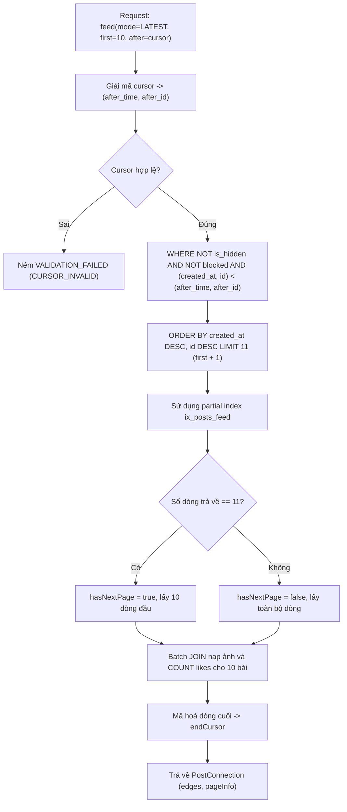
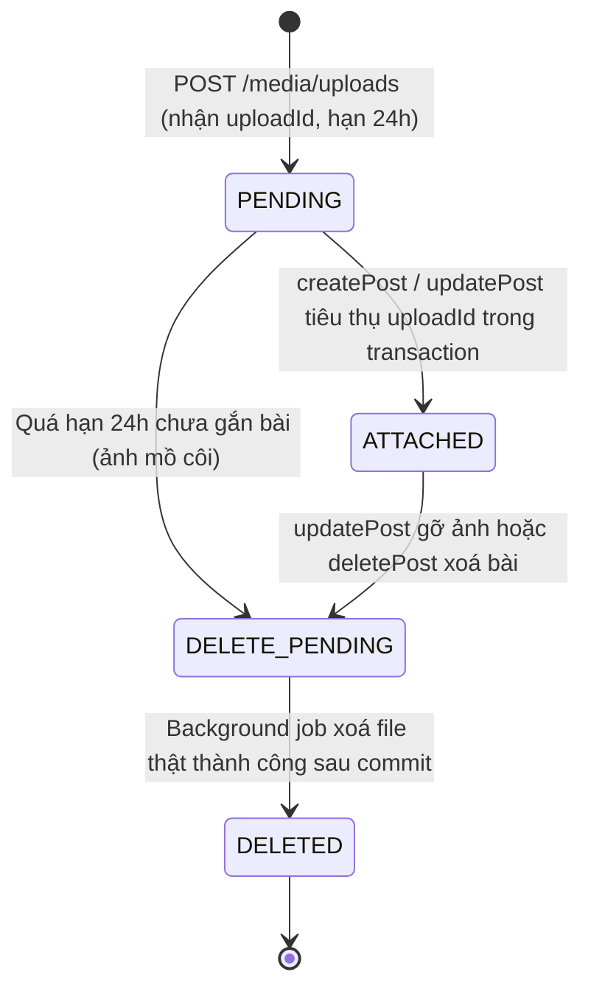
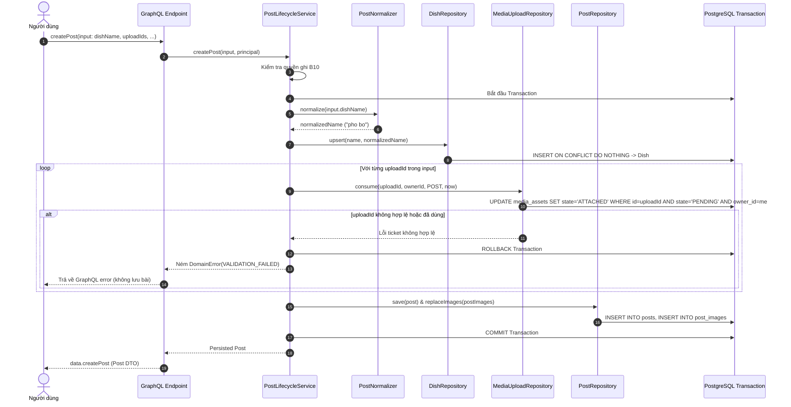

# Chi tiết cài đặt nhóm 4.2 Content & Posts (S8–S11)

| Thuộc tính | Nội dung |
|---|---|
| Người phụ trách | **DB** (phụ trách chính CSDL dự án và toàn bộ nhóm 4.2) |
| Nhóm | **4.2 Content & Posts** (Nội dung, bài đăng, hình ảnh và danh mục) |
| Use Case (UC) | UC-05 Xem feed, UC-06 Xem chi tiết bài, UC-07 Tạo bài đăng, UC-08 Sửa bài của mình, UC-09 Xoá bài của mình |
| Màn hình (6.3-A) | MH-06 Bảng tin, MH-07 Chi tiết bài (kèm nút Báo cáo/Xoá), MH-08 Tạo bài, MH-09 Chỉnh sửa bài |
| Bảng CSDL (5.3-B, 6.4-B) | T05 `media_assets`, T06 `dishes`, T07 `restaurants`, T09 `posts`, T10 `post_images`, T24 `media_cleanup_jobs` (T08 `tags`, T11 `post_tags`: hoãn ở v1) |
| Thành phần hệ thống | P2 (Resolver/Endpoint), B3 (FeedQueryService), B4 (PostLifecycleService), D2 (Repositories nhóm 4.2), X1 (MediaStorageAdapter lưu trữ ảnh) |
| Khối nền toàn dự án (S8) | Khởi tạo CSDL 25 bảng bằng Alembic, kịch bản nạp dữ liệu kiểm (DOC 7.3-A §4), môi trường test DB biệt lập |
| Sprint | S8, S9, S10, S11 |
| Ngày | 12/11/2026 |
| Người đọc | Thành viên phụ trách nhóm (DB) và coder (pane AI) được giao cài đặt |

---

## 0. Cách dùng file này

1. File này là hợp đồng kỹ thuật chi tiết duy nhất để coder cài đặt toàn bộ nhóm 4.2 từ CSDL, API backend đến giao diện Flutter theo đúng chuẩn thiết kế ToMateTo.
2. Thứ tự đọc: đọc kỹ từ mục 0 đến mục 5 để hiểu toàn cảnh kiến trúc, đối chiếu sự khác biệt với app mẫu và các điểm nối; khi code sprint nào thì mở đúng mục 6 của sprint đó và thực hiện lần lượt từng gói công việc (WP).
3. Báo cáo khi xong: sau khi hoàn thành mỗi sprint hoặc toàn bộ gói, chạy script kiểm tra ở mục 5 của brief, đối chiếu Định nghĩa xong (mục 9), mở PR theo mẫu DOC 7.4-B và thông báo cho Lead qua lệnh: `oteam send lead "DONE C42: xem s8s11/REPORT_CHI_TIET_DB_4.2.md"`.
4. Điều cấm tuyệt đối: không tự ý sửa đổi thư mục `D:\ToMateTo` ngoài phạm vi giao việc, không commit/push lên GitHub khi chưa có lệnh của Lead, không gọi dịch vụ ngoài trong transaction CSDL, không tự gửi lại mutation ghi khi mất kết nối mạng.
5. Quy tắc thực hiện: code từ dưới lên (Entity/DDL → Repository + Test DB → Service + Test Mock → Resolver/Endpoint → Flutter Controller/View), kiểm thử liên tục trên CSDL thật bằng `pytest` và `flutter test`.

---

## 1. Phạm vi và vai trò của nhóm trong hệ thống

### 1.1 Vai trò trong hệ thống
Nhóm 4.2 Content & Posts giữ **trọng tâm dữ liệu và trải nghiệm người dùng** của mạng xã hội ToMateTo:
- Quản lý toàn bộ vòng đời nội dung: từ lúc ảnh được tải lên tạm thời (`media_assets`), tạo bài đăng (`posts`) gắn với món ăn (`dishes`) và quán ăn (`restaurants`), hiển thị trên bảng tin phân trang theo con trỏ (`feed`), xem chi tiết (`post`), chỉnh sửa nội dung/ảnh (`updatePost`), đến xoá an toàn (`deletePost`) và dọn dẹp tập tin vật lý qua tiến trình nền (`media_cleanup_jobs`).
- Ngoài phạm vi chức năng của nhóm, thành viên DB giữ **nền tảng CSDL cho toàn bộ dự án** trong Sprint S8: viết bộ migration Alembic đầu tiên khởi tạo chuẩn xác 25 bảng từ DDL 6.4-B, kiểm thử hai chiều `upgrade head -> downgrade base -> upgrade head`, thiết lập CSDL kiểm thử biệt lập (`test_db`), và xây dựng kịch bản nạp dữ liệu kiểm thử (DOC 7.3-A mục 4) gồm tối thiểu 200 bài đăng, 100 món, 60 quán có toạ độ trong bán kính 5 km, 5 tài khoản mẫu và các trường hợp biên. Trong suốt quá trình dự án, DB là người kiểm duyệt chuyên môn (review) mọi thay đổi schema, chỉ mục và truy vấn của cả 4 nhóm.

Chuỗi trách nhiệm từ giao diện đến lưu trữ:
```text
Flutter View (MH-06..09)
  │
FeedController / PostDetailController / PostEditorController (app/lib/features/...)
  │
GraphQLContentRepository / MediaAdapter (app/lib/repositories/...)
  │
GraphQL API (/graphql) & REST Upload Endpoint (POST /media/uploads)
  │
Resolver (P2: FeedQueryResolver, PostMutationResolver, MediaUploadEndpoint)
  │
Service Layer (B3: FeedQueryService, B4: PostLifecycleService, PostNormalizer, PostFactory)
  │
Repository Layer (D2: PostRepository, DishRepository, RestaurantRepository, MediaUploadRepository, MediaCleanupRepository)
  │
PostgreSQL Database (T05, T06, T07, T09, T10, T24) & Disk/Cloud Storage (MediaStorageAdapter X1)
```

### 1.2 Bảng điểm nối giữa nhóm 4.2 và các nhóm khác

Nhóm 4.2 tương tác chặt chẽ với các nhóm 4.1 (FE), 4.3 (Lead), và 4.4 (BE). Bảng dưới đây liệt kê chi tiết các điểm nối bạn cung cấp (giao) và các điểm nối bạn nhận từ người khác theo mục 4 của `HUONG_DAN_S8_S11_THEO_NHOM.md`:

| Điểm nối | Chiều | Thành phần / Phương thức liên quan | Bên liên quan | Điều kiện sẵn sàng & Thiết kế bản giả (Stub/Fake) | Cần từ |
|---|---|---|---|---|---|
| **7** | **Giao** | `PostRepository.findById(postId: int, forUpdate: bool = false) -> Post?` | Lead (UC-13 Thích/Lưu, UC-15 Báo cáo) | **Sẵn sàng:** S9. **Bản giả cho Lead:** InMemoryPostRepository trả về đối tượng `Post` giả lập, có cờ khoá mô phỏng `forUpdate`. Khi `forUpdate=true`, kiểm tra post tồn tại và chưa bị xoá. | S9 |
| **8** | **Giao** | Tuyến REST `POST /media/uploads` và `MediaUploadRepository.consume(uploadId, ownerId, purpose, now)` hỗ trợ purpose `AVATAR` và `COVER` | Lead (UC-11 Cập nhật ảnh đại diện, ảnh bìa) | **Sẵn sàng:** S10. **Bản giả cho Lead:** Hàm consume giả lập kiểm tra chuỗi `uploadId` hợp lệ, gán `state=ATTACHED`, cập nhật `consumed_at=now` và trả về URL ảnh tĩnh. | S10 |
| **9** | **Giao** | `FeedQueryService.listPostsByAuthor(authorId: int, page: PageRequest, viewer: Principal) -> PageResult` | Lead (UC-10 Xem hồ sơ `profilePosts`, `myPosts`) | **Sẵn sàng:** S10. **Bản giả cho Lead:** Trả về danh sách bài đăng giả phân trang theo con trỏ keyset (10 bài mẫu), lọc bài theo `authorId` và áp dụng quyền xem công khai. | S10 |
| **12** | **Giao** | `PostEditorController.startCreate(draft: AssistantDraft?)` trên màn hình MH-08 | BE (UC-19 Dùng bản nháp trợ lý) | **Sẵn sàng:** S10. **Bản giả cho BE:** Flutter route mở MH-08 chấp nhận tham số `AssistantDraft(dishName, caption, address, priceRange)`, tự động điền sẵn vào các trường của `PostForm`. | S10 |
| **2** | **Nhận** | `AccountRepository.findById(userId: int) -> User?` | FE (4.1) | **Mục đích:** Nạp thông tin tác giả bài đăng (`displayName`, `avatarUrl`) trên feed và chi tiết bài. **Bản giả:** `FakeAccountRepository` trả về đối tượng `User(id=userId, display_name="User Test", avatar_url="https://...")`. | S8 |
| **3** | **Nhận** | `WriteAuthorizationPolicy.authorizeWrite(principal, action, resource)` (B10) | Lead (4.3) | **Mục đích:** Kiểm tra quyền ghi trước khi tạo, sửa, xoá bài hoặc tải ảnh. **Bản giả:** Cho phép nếu `principal.is_authenticated`, ném `DomainError(FORBIDDEN)` nếu sửa/xoá tài nguyên không phải do mình sở hữu. | S8 |
| **4** | **Nhận** | `CursorCodec`, `PageRequest`, `ErrorMapper`, `TransactionManager` | BE (4.4) | **Mục đích:** Khung backend dùng chung để mã hoá cursor `(created_at, id)`, quản lý transaction nguyên tử và chuẩn hoá mã lỗi GraphQL. **Bản giả:** Sử dụng codec Base64 đơn giản `createdAt|id` và context manager quản lý transaction SQLAlchemy cục bộ. | S8 |
| **6** | **Nhận** | `LikeRepository` (đếm và kiểm tra `isLiked`), `CollectionRepository` (kiểm tra `isSaved`), `BlockRepository.listBlockedUserIds(viewerId)` | Lead (4.3) | **Mục đích:** Hydrate trạng thái tương tác trên feed và lọc bài của người dùng bị chặn hai chiều trước khi LIMIT. **Bản giả:** Trả về tập rỗng cho block, `isLiked=false`, `isSaved=false`, `likeCount=0`. | S9 |
| **11** | **Nhận** | `TrendingSnapshotRepository.latestRun()`, con trỏ TRENDING `(runId, score, postId)` | BE (4.4) | **Mục đích:** Hỗ trợ chế độ xem feed `TRENDING` trên MH-06 (UC-05). **Bản giả:** Trả về `None` khi chưa có run (feed hiển thị danh sách rỗng thành công) hoặc trả danh sách snapshot cố định sắp xếp theo điểm số giảm dần. | S10 |
| **14** | **Nhận** | `SocialInteractionService.reportPost(postId, reason, reporterId)` | Lead (4.3) | **Mục đích:** Chuyển tiếp hành động báo cáo bài viết từ menu ba chấm trên MH-07 (Chi tiết bài). **Bản giả:** Ghi log và trả về `ReportReceipt(id=1, status="ACCEPTED")`. | S10 |

---

## 2. Bản đồ tài liệu cần đọc

Để cài đặt chuẩn xác nhóm 4.2 và không vi phạm hợp đồng hệ thống, coder bắt buộc phải đọc các tài liệu sau theo đường dẫn nội bộ:

| # | Tài liệu, mục (đường dẫn local) | Đọc để hiểu gì | Cần cho sprint |
|---|---|---|---|
| 1 | `D:\hdv\quan_ly_du_an\s5s6_lead\noi_bo\src\6.4-B_ddl.md` | DDL chuẩn 25 bảng, ràng buộc khoá ngoại, kiểu dữ liệu, thứ tự tạo bảng, chỉ mục hiệu năng (`ix_posts_feed`, `ix_posts_author`, `ix_media_assets_state_expiry`) | S8, S9, S10, S11 |
| 2 | `D:\hdv\quan_ly_du_an\s5s6_lead\noi_bo\src\6.4-A_data_dictionary.md` | Từ điển dữ liệu chi tiết cho T05, T06, T07, T09, T10, T24; quy định kích thước, miền giá trị và giá trị mặc định | S8, S9 |
| 3 | `D:\hdv\quan_ly_du_an\s7_lead\nop\7.3-A_test_plan.md` (mục 3, 4, 6) | Quy định bộ dữ liệu kiểm ban đầu (200 bài, 100 món, 60 quán có toạ độ trong 5 km, 5 user mẫu); tiêu chuẩn đo NFR-01, NFR-02, NFR-05 | S8, S11 |
| 4 | `D:\hdv\quan_ly_du_an\s5s6_lead\noi_bo\src\5.3-B_schema_specification.md` (mục 2, 3, 4) | Ranh giới transaction khi tạo/sửa/xoá bài; 4 trạng thái vòng đời ảnh `media_assets`; hành vi cascade khi xoá bài và bảo toàn dữ liệu bằng chứng báo cáo | S8, S9, S10 |
| 5 | `D:\hdv\quan_ly_du_an\s5s6_lead\noi_bo\src\7.1-A_BE@23a5f14.md` (mục 2, 8, 9) | Thuật toán phân trang con trỏ feed keyset `(created_at, id)`; quy tắc chuẩn hoá tên món `PostNormalizer` (bỏ dấu tiếng Việt, chuyển `đ`/`Đ` thành `d`, gộp khoảng trắng) | S8, S9 |
| 6 | `D:\hdv\quan_ly_du_an\s5s6_lead\noi_bo\src\7.1-A.1_DB@439472c.md` (mục 2, 3, 9) & `7.1-A.1_queries@439472c.sql` (Q01–Q04) | Mẫu SQL tối ưu cho feed mới nhất (`s6_feed_latest`), chi tiết bài (`s6_post_visible`), bài tác giả (`s6_author_posts`); cơ chế batch COUNT likes và aggregate ảnh qua CTE | S8, S9, S10 |
| 7 | `D:\hdv\quan_ly_du_an\s5s6_lead\noi_bo\src\5.2-A_BE.md` (mục 4.4, 4.5, 5.1–5.3, 12.3, 12.8) | Hợp đồng GraphQL và REST: `feed`, `post`, `myPosts`, `createPost`, `updatePost`, `deletePost`; tuyến `POST /media/uploads`; 6 mã HTTP lỗi upload; quy tắc 4 giá trị price range | S9, S10 |
| 8 | `D:\hdv\quan_ly_du_an\s5s6_lead\noi_bo\src\6.1-A_BE@3571426.md` (mục 4.2, 5.2–5.5) | Thiết kế lớp backend chi tiết: `FeedQueryResolver`, `PostMutationResolver`, `MediaUploadEndpoint`, `PostLifecycleService`, `PostNormalizer`, `PostRepository`, `MediaUploadRepository`, `MediaStorageAdapter` | S8, S9, S10 |
| 9 | `D:\hdv\quan_ly_du_an\s5s6_lead\noi_bo\src\6.2-A_BE@ed27b57.md` (Hình 03, 04, 05 và mục 5.2) | Sơ đồ tuần tự backend: Tạo bài (Hình 03), Sửa bài có khoá `forUpdate` (Hình 04), Xoá bài an toàn idempotent (Hình 05); quy tắc rollback khi upload ticket sai | S9, S10 |
| 10 | `D:\hdv\quan_ly_du_an\s5s6_lead\noi_bo\src\6.1-A_FE@c3b8b46.md` (mục 4.19–4.27, 4.41, 4.44) | Thiết kế lớp frontend: `ContentRepository`, `FeedController`, `PostDetailController`, `PostEditorController`, `PostForm`, `PostPatch`, `MediaAdapter`, `ContentView` | S9, S10 |
| 11 | `D:\hdv\quan_ly_du_an\s5s6_lead\noi_bo\src\6.2-A_FE@c3b8b46.md` (FE-SQ03, FE-SQ04, FE-SQ05) | Sơ đồ tuần tự frontend: Tải feed và phân trang không trùng lặp (FE-SQ03), Tạo bài và upload ảnh xử lý mất phản hồi (FE-SQ04), Sửa bài với danh sách ảnh cuối cùng (FE-SQ05) | S9, S10 |
| 12 | `D:\hdv\quan_ly_du_an\s5s6_lead\noi_bo\src\6.3-A_mockup_hifi_fe@999e0be.md` (MH-06..09) & `6.3-B_design_system_fe@999e0be.md` | Đặc tả màn hình MH-06 (Bảng tin 1 cột mobile / 2 cột web), MH-07 (Chi tiết), MH-08 (Tạo bài), MH-09 (Sửa bài); token thiết kế màu sắc, khoảng cách, kích thước chạm ≥44 px | S9, S10 |
| 13 | `D:\hdv\quan_ly_du_an\s7_lead\nop\7.2-A_tong_hop_xu_ly_loi.md` & `7.2-A_BE@23a5f14.md` | Ma trận mã lỗi và xử lý ngoại lệ: `VALIDATION_FAILED`, `CURSOR_INVALID`, `PAGE_SIZE_INVALID`, `OWNER_REQUIRED`, `PAYLOAD_TOO_LARGE` (413), `INTEGRATION_UNAVAILABLE` (503) | S9, S10 |
| 14 | `D:\hdv\quan_ly_du_an\s7_lead\nop\7.3-C_ma_tran_phu_uc.md` & `7.4-A_chuan_chung.md` | Ma trận bao phủ test case: TC-BE-0501..09, TC-BE-0601..09, TC-BE-0701..09, TC-BE-0801..09, TC-BE-0901..09; quy chuẩn đặt tên nhánh, commit và cấu trúc mã nguồn | S8, S9, S10, S11 |

---

## 3. Cần nắm: CSDL, bài đăng, ảnh và feed con trỏ

Trước khi viết bất kỳ dòng mã nào, coder phải nắm vững 7 nguyên lý sống còn của nhóm:

### Câu 1. Phân trang feed con trỏ hoạt động thế nào để không trùng, không sót và không bị chậm ở trang sâu?
1. **Bản chất của Keyset Pagination:** Thay vì dùng `OFFSET` (PostgreSQL phải quét bỏ qua $N$ dòng đầu, gây suy giảm hiệu năng nghiêm trọng ở trang sâu, vi phạm NFR-02), feed dùng cặp khoá ổn định `(created_at, id)`. Khi người dùng yêu cầu trang tiếp theo sau một con trỏ `after`, server giải mã thành mốc thời gian `after_created_at` và định danh `after_id`, sau đó truy vấn bằng điều kiện so sánh tuple:
   ```sql
   (p.created_at, p.id) < (after_created_at, after_id)
   ```
2. **Vai trò của `id` trong khoá sắp xếp:** Mốc thời gian `created_at` có thể trùng nhau khi có hai bài đăng được tạo trong cùng một mili-giây hoặc nạp hàng loạt qua seed data. Nếu không có `p.id` làm điều kiện phụ, thứ tự sắp xếp của PostgreSQL sẽ không mang tính tất định (non-deterministic), dẫn tới hiện tượng trùng lặp hoặc nhảy cóc bài giữa hai lần tải trang.
3. **Vì sao phải lấy `first + 1` dòng:** Server truy vấn $K = first + 1$ dòng. Nếu kết quả trả về đúng $K$ dòng, chứng tỏ vẫn còn bài ở trang sau (`hasNextPage = true`); lúc này server chỉ cắt lấy đúng $first$ dòng trả cho client và mã hoá dòng thứ $first$ làm `endCursor`. Nếu kết quả $\le first$, `hasNextPage = false` và không có trang tiếp theo. Kỹ thuật này loại bỏ hoàn toàn lệnh `COUNT(*)` đắt đỏ trên toàn bảng bài đăng.
4. **Thứ tự lọc quyền và chặn người dùng:** Điều kiện lọc bài bị ẩn (`NOT p.is_hidden`) và chặn hai chiều (`user_blocks`) bắt buộc phải nằm trong mệnh đề `WHERE` của CTE/subquery **TRƯỚC KHI** thực hiện `LIMIT ($first + 1)`. Nếu áp dụng LIMIT trước rồi mới loại bài bị chặn/ẩn ở tầng ứng dụng, trang trả về sẽ bị hụt số lượng (ví dụ yêu cầu 10 bài nhưng chỉ trả về 7 bài dù CSDL còn rất nhiều bài phía sau).
5. **Đếm lượt thích theo lô (Batch count) thay vì cột `likes_count`:** Thiết kế 25 bảng của ToMateTo loại bỏ cột `likes_count` trên bảng `posts` để tránh hiện tượng lệch số liệu (drift) do tranh chấp ghi đồng thời. Thay vào đó, khi nạp một trang bài viết (tối đa 10 hoặc 50 bài), query thực hiện `JOIN` hoặc gom nhóm theo lô (batch) trên bảng `likes` (`SELECT post_id, COUNT(*) FROM likes WHERE post_id IN (...) GROUP BY post_id`), đạt độ phức tạp $O(1)$ round-trip mà không gây ra vấn đề $N+1$.



---

### Câu 2. Vòng đời của một tài nguyên ảnh (`media_assets`) diễn ra thế nào, và vì sao upload tách riêng khỏi transaction tạo bài?
1. **Tách biệt luồng I/O mạng và Transaction CSDL:** Upload ảnh là thao tác tốn thời gian (truyền tệp qua mạng, kiểm tra định dạng hình ảnh bằng Pillow, resize về cạnh dài $\le 1600$ px, tính toán băm SHA-256 hoặc đẩy lên Cloudinary). Nếu gom upload vào trong transaction tạo bài, kết nối CSDL sẽ bị giữ chiếm dụng trong nhiều giây, làm cạn kiệt connection pool của PostgreSQL và gây sập hệ thống dưới tải cao (vi phạm NFR-10). Vì vậy, upload được tách riêng thành tuyến REST `POST /media/uploads`.
2. **Bốn trạng thái vòng đời của ảnh:**
   - `PENDING`: Ảnh được tải lên thành công qua REST endpoint, nhận một `uploadId` (UUID) và thời hạn `expires_at` (24 giờ). Lúc này ảnh chưa thuộc về bài đăng hay thực thể nào.
   - `ATTACHED`: Khi người dùng hoàn tất tạo bài hoặc sửa bài, mutation GraphQL tiêu thụ `uploadId`, gán `consumed_at = now()` và chuyển trạng thái sang `ATTACHED`. Ràng buộc DB: `consumed_at IS NOT NULL AND deleted_at IS NULL`.
   - `DELETE_PENDING`: Khi bài đăng bị sửa (gỡ ảnh) hoặc bài đăng bị xoá hoàn toàn, các ảnh liên quan được chuyển sang `DELETE_PENDING` và ghi nhận một bản ghi vào bảng `media_cleanup_jobs` trong cùng transaction CSDL.
   - `DELETED`: Job nền dọn dẹp (`cleanupOrphanMedia`) lấy các tác vụ trong `media_cleanup_jobs`, xoá tệp vật lý trên đĩa hoặc gọi storage provider xoá ảnh, sau đó cập nhật `deleted_at = now()` và `state = 'DELETED'`.
3. **Quy tắc an toàn của `uploadId`:** Mỗi `uploadId` chỉ được dùng đúng một lần (single-use), chỉ thuộc về chính tài khoản đã tải lên (`owner_id = principal.user_id`), và phải khớp mục đích sử dụng (`purpose = 'POST'`). Nếu dùng lại `uploadId` đã `ATTACHED` hoặc dùng ảnh của người khác, mutation ném `VALIDATION_FAILED`.



---

### Câu 3. Tạo bài viết (UC-07) và chuẩn hoá tên món ăn hoạt động ra sao? Vì sao một ảnh lỗi làm huỷ toàn bộ bài?
1. **Transaction nguyên tử duy nhất:** Quá trình tạo bài bao gồm: chuẩn hoá tên món, tìm hoặc tạo món mới (`dishes`), tìm hoặc tạo quán mới (`restaurants`), kiểm tra và tiêu thụ toàn bộ danh sách `uploadId` (`media_assets`), chèn bản ghi bài đăng (`posts`) và các liên kết ảnh (`post_images`). Toàn bộ chuỗi thao tác này phải nằm trong một transaction CSDL duy nhất của `PostLifecycleService`.
2. **Quy tắc Fail-Fast đối với ảnh:** Nếu bất kỳ một `uploadId` nào trong danh sách bị sai (không tồn tại, đã bị tiêu thụ trước đó, đã hết hạn, sai chủ sở hữu, hoặc sai purpose), transaction lập tức `ROLLBACK` toàn bộ. Hệ thống **tuyệt đối không tự ý bỏ ảnh lỗi để đăng bài chỉ có chữ**, vì hành vi đó vi phạm trực tiếp ý định của người dùng và làm sai lệch nội dung bài đăng.
3. **Thuật toán chuẩn hoá tên món ăn (`PostNormalizer`):** Để tránh phân mảnh dữ liệu danh mục món ăn (ví dụ "Phở bò", "phở  bò", "PHỞ BÒ" phải trỏ về cùng một món ăn trong hệ thống), tên món phải được chuẩn hoá theo quy tắc:
   - Cắt khoảng trắng đầu và cuối chuỗi (`trim`).
   - Gộp các khoảng trắng liên tiếp ở giữa thành đúng một khoảng trắng đơn.
   - Chuyển toàn bộ về chữ thường (`lower`).
   - Chuyển đổi ký tự gạch ngang đặc thù của tiếng Việt: `đ` và `Đ` bắt buộc chuyển thành `d`.
   - Bỏ toàn bộ dấu thanh/dấu mũ tiếng Việt bằng chuẩn phân rã Unicode NFD kết hợp loại bỏ combining marks (`unicodedata.normalize('NFD', ...)`).
   - *Ví dụ:* `"  Bánh   Đậu Xanh  "` $\rightarrow$ `"banh dau xanh"`. Chuỗi sau chuẩn hoá dùng làm khoá duy nhất `name_normalized` trên bảng `dishes`.
4. **Chống xung đột tạo đồng thời (Race Condition):** Khi hai người dùng cùng đăng một món mới chưa từng có trong hệ thống tại cùng một thời điểm, cả hai sẽ cùng cố gắng chèn vào bảng `dishes`. CSDL ngăn chặn trùng lặp bằng ràng buộc `UNIQUE (name_normalized)`. Coder phải sử dụng cú pháp `INSERT ... ON CONFLICT (name_normalized) DO NOTHING` kết hợp truy vấn lại (`re-fetch`), tránh để phát sinh ngoại lệ `IntegrityError` (HTTP 500) ra ngoài API.



---

### Câu 4. Sửa bài (UC-08) và Xoá bài (UC-09): Quyền hạn, cơ chế khoá và lan truyền dữ liệu thế nào?
1. **Kiểm tra quyền sở hữu và Khoá dòng (`FOR UPDATE`):** Chỉ tác giả bài viết mới có quyền sửa hoặc xoá bài (`post.user_id == principal.user_id`). Quy tắc bắt buộc: Service phải gọi `PostRepository.findById(postId, forUpdate=true)` để xác lập khoá bi quan (pessimistic lock) trên dòng CSDL trước khi thực hiện kiểm tra quyền và thay đổi dữ liệu. Điều này ngăn chặn hiện tượng race condition khi có hai thao tác đồng thời (ví dụ vừa sửa vừa xoá). Nếu người khác cố tình sửa/xoá, hệ thống trả về mã lỗi `FORBIDDEN` (`OWNER_REQUIRED`).
2. **Quy tắc cập nhật danh sách ảnh cuối cùng (Final Images Semantic):** Khi cập nhật bài viết qua `updatePost(id, input)`:
   - Nếu trường `images` bị bỏ qua (không gửi hoặc null): giữ nguyên toàn bộ ảnh hiện tại của bài viết.
   - Nếu gửi mảng rỗng `images: []`: xoá toàn bộ ảnh của bài viết.
   - Nếu gửi danh sách ảnh: đây là trạng thái cuối cùng mong muốn. Mỗi phần tử trong mảng chỉ được chứa một trong hai định danh: hoặc `imageId` (ảnh cũ giữ lại, kèm vị trí `position` mới), hoặc `uploadId` (ảnh mới vừa upload thành công).
   - Những ảnh cũ có trong bài nhưng không xuất hiện trong danh sách mới sẽ bị gỡ bỏ: chuyển trạng thái sang `DELETE_PENDING` và ghi vào `media_cleanup_jobs`.
3. **Tính chất Idempotent khi Xoá bài (Safe Retry):**
   - Khi bài viết bị xoá, toàn bộ lượt thích (`likes`) và các mục trong bộ sưu tập (`collection_items`) liên kết với bài đó sẽ bị xoá lan truyền tự động thông qua ràng buộc khoá ngoại `ON DELETE CASCADE`.
   - Các ảnh của bài trong `post_images` bị xoá cascade, đồng thời các bản ghi tương ứng trong `media_assets` được chuyển sang `DELETE_PENDING` để job nền dọn dẹp file.
   - Các báo cáo vi phạm (`reports`) và thông báo (`notifications`) **tuyệt đối không bị xoá theo**; trường liên kết khoá ngoại trỏ tới bài đăng được đặt về `NULL` (`ON DELETE SET NULL`) hoặc lưu lại `original_post_id` dạng số nguyên độc lập để giữ nguyên bằng chứng kiểm duyệt.
   - Nếu client gửi lại lệnh xoá một bài đã bị xoá trước đó (do mạng chập chờn hoặc retry), server kiểm tra không tìm thấy bài nhưng vẫn trả về `success = true` (HTTP 200 GraphQL). Điều này đảm bảo tính an toàn idempotent, không gây lỗi giả mạo cho ứng dụng.

---

### Câu 5. Phía Flutter app xử lý lỗi mạng, mất phản hồi và đồng bộ trạng thái như thế nào?
1. **Nguyên tắc "Outcome Unknown" khi mất phản hồi mạng (FE-SQ04):** Khi người dùng bấm "Đăng bài" hoặc "Lưu bài", app gửi mutation lên backend. Nếu kết nối mạng bị ngắt giữa chừng và app không nhận được phản hồi (timeout hoặc mất mạng):
   - Ứng dụng **tuyệt đối không được tự động gửi lại mutation `createPost`**, vì yêu cầu đầu tiên có thể đã thành công trên server; việc tự ý retry sẽ tạo ra hai bài viết trùng lặp (duplicate post).
   - Controller chuyển form sang trạng thái `outcomeUnknown`, hiển thị thông báo: *"Chưa xác định được kết quả đăng bài. Vui lòng kiểm tra danh sách bài đăng của bạn."*
   - Cung cấp nút chuyển nhanh sang màn hình "Bài viết của tôi" (`myPosts`). Nếu bài đã xuất hiện, coi như thành công và đóng form; nếu bài chưa có, người dùng mới chủ động bấm nút gửi lại.
2. **Quản lý danh sách Feed không trùng lặp (`PagedPostsNotifier` / FE-SQ03):**
   - Khi người dùng cuộn để tải thêm trang mới (`loadMore`), danh sách kết quả mới được nối vào danh sách hiện tại theo cơ chế hợp nhất khử trùng (deduplicate by `id`).
   - Nếu thao tác tải thêm gặp lỗi mạng: giữ nguyên toàn bộ các bài viết đã tải thành công và giữ nguyên `endCursor` hiện tại, đồng thời hiển thị nút "Thử lại" ở cuối danh sách. Khi bấm "Thử lại", app tiếp tục gọi từ chính `endCursor` đó mà không tải lại toàn bộ từ đầu.
   - Nếu người dùng chuyển đổi tab (từ `LATEST` sang `TRENDING`) hoặc đăng xuất tài khoản: huỷ bỏ toàn bộ các response đang bay của tab cũ bằng cờ thế hệ (`generation token`), ngăn chặn việc dữ liệu của tab cũ chèn đè vào tab mới.

---

### Câu 6. Khối nền CSDL dự án (S8): Thứ tự tạo 25 bảng và quy trình kiểm thử migration
1. **Ràng buộc phụ thuộc vòng giữa `users` và `media_assets`:**
   - Bảng `users` (T01) có hai cột khoá ngoại `avatar_media_id` và `cover_media_id` tham chiếu tới `media_assets(id)`.
   - Ngược lại, bảng `media_assets` (T05) có cột khoá ngoại `owner_id` tham chiếu tới `users(id)`.
   - Để phá vỡ vòng lặp phụ thuộc khi chạy script khởi tạo:
     - Bước 1: Tạo bảng `users` trước, nhưng **chưa khai báo** hai khoá ngoại trỏ tới `media_assets`.
     - Bước 2: Tạo bảng `media_assets` với khoá ngoại `fk_media_assets_owner_id` trỏ về `users(id)`.
     - Bước 3: Dùng lệnh `ALTER TABLE users ADD CONSTRAINT fk_users_avatar_media_id ...` và `fk_users_cover_media_id` để bổ sung hai khoá ngoại sau khi `media_assets` đã tồn tại.
     - Khi hạ cấp (`downgrade`): bắt buộc phải `DROP CONSTRAINT` hai khoá ngoại này trên bảng `users` **trước khi** thực hiện `DROP TABLE media_assets`.
2. **Quy trình kiểm thử Migration bắt buộc (Smoke Test):**
   - Mỗi file migration Alembic tạo ra phải được kiểm chứng chu kỳ 3 bước trên môi trường PostgreSQL sạch:
     ```bash
     alembic upgrade head
     alembic downgrade base
     alembic upgrade head
     ```
   - Lệnh downgrade về `base` phải dọn sạch hoàn toàn 25 bảng, toàn bộ kiểu enum (ví dụ `pricerange`), toàn bộ chỉ mục và bảng quản lý `alembic_version`. Lần upgrade thứ hai phải chạy trơn tru không lỗi.
3. **Quy tắc nạp dữ liệu kiểm (DOC 7.3-A mục 4):**
   - Kịch bản nạp dữ liệu (`db/seeds/seed_test_data.py`) phải có tính tự khôi phục (idempotent), nạp lại được trạng thái ban đầu bằng đúng một lệnh duy nhất (`python -m db.seeds.seed_test_data --reset`).
   - Đảm bảo đầy đủ số lượng tối thiểu phục vụ nghiệm thu NFR: 200 bài đăng (trong đó $\ge 30$ bài có ảnh), 100 món ăn, 60 quán có toạ độ trong bán kính 5 km quanh điểm mặc định (Hà Nội: 21.0285, 105.8542), 5 tài khoản thử nghiệm chuẩn (`khach`, `user_a`, `user_b`, `user_c`, `user_d`), 3 bài ở trạng thái ẩn/xoá và 1 bài bị báo cáo vi phạm.

---

### Câu 7. Tích hợp điểm nối và xây dựng bản giả (Stubs/Fakes) cho phát triển độc lập
1. **Nguyên tắc không chờ đợi bản thật:** Trong giai đoạn S8–S10, các nhóm khác có thể chưa hoàn thành phần việc của họ. Coder nhóm 4.2 không ngồi chờ mà phải xây dựng các lớp giả lập in-memory theo đúng chữ ký giao diện đã thống nhất tại mục 1.2.
2. **Cấu trúc bản giả cần chuẩn bị:**
   - `FakeAccountRepository`: lưu dictionary `{user_id: User}`, cung cấp phương thức `findById(id)`.
   - `FakeWriteAuthorizationPolicy`: cung cấp `authorizeWrite(principal, action, resource)` mặc định cho phép nếu `principal` hợp lệ.
   - `FakeLikeRepository`: lưu set `{(user_id, post_id)}`, cung cấp hàm đếm và kiểm tra `isLiked`.
   - `FakeBlockRepository`: lưu set các cặp bị chặn `{(blocker_id, blocked_id)}`, cung cấp `listBlockedUserIds(viewerId)`.
   - `FakeTrendingSnapshotRepository`: lưu danh sách bài snapshot giả định để test feed `TRENDING`.
   - `MockMediaStorage`: lưu file ảnh trên thư mục tạm `tests/scratch/` hoặc mock byte buffer trong bộ nhớ thay vì gọi dịch vụ cloud thật.

---

## 4. Đối chiếu với app mẫu

Bảng đối chiếu dưới đây phân tích chi tiết mã nguồn app mẫu hiện tại (`D:\hdv\backend` và `D:\hdv\app_flutter`) so với thiết kế chuẩn mới của ToMateTo (25 bảng, DOC 5.x–7.x):

| Việc | File và dòng trong app mẫu | App mẫu làm gì | Thiết kế mới ToMateTo khác ở đâu | Lấy / không lấy từ app mẫu |
|---|---|---|---|---|
| **Mô hình Bài đăng (Post Model)** | `D:\hdv\backend\app\models\post.py:40-91` | Bảng `posts` gồm 13 bảng: lưu trực tiếp toạ độ `lat/lng`, địa chỉ, giờ mở/đóng quán trên dòng post; enum `pricerange` có 5 mức (`UNDER_50K`, `FROM_50K`, `FROM_100K`, `FROM_200K`, `FROM_500K`); có quan hệ `tags` qua bảng phụ | Schema 25 bảng chuẩn (6.4-B): tách quán thành bảng riêng T07 `restaurants` (khoá ngoại `restaurant_id`), phân khúc giá có đúng 4 mức (`UNDER_50K`, `FROM_50K_TO_100K`, `FROM_100K_TO_200K`, `ABOVE_200K`); hoãn tính năng thẻ ở v1 | **Lấy:** cách khai báo quan hệ SQLAlchemy `relationship`, chỉ mục composite DESC.<br>**Không lấy:** 5 mức giá cũ, không nhúng thông tin quán vào bảng post, không cài đặt tags ở v1. |
| **Mô hình Media & Vòng đời ảnh** | `D:\hdv\backend\app\models\media.py:11-21` & `post.py:93-107` | Bảng `media` chỉ có `key`, `width`, `height`, `placeholder`, `dominant_color`, `remote_url`. Bảng `post_images` liên kết `media_key` dạng chuỗi | Bảng T05 `media_assets`: dùng khoá chính `id` UUID, quản lý 4 trạng thái chặt chẽ (`PENDING`, `ATTACHED`, `DELETE_PENDING`, `DELETED`), có `owner_id`, `purpose` (`POST`, `AVATAR`, `COVER`), `expires_at`, `consumed_at`, `deleted_at`. Bảng T24 `media_cleanup_jobs` theo dõi việc dọn ảnh | **Lấy:** ý tưởng tạo ảnh nhỏ mờ placeholder base64 và dominant_color.<br>**Không lấy:** schema bảng `media` đơn giản cũ; phải cài đặt đúng 4 trạng thái vòng đời của `media_assets`. |
| **Chuẩn hoá tên món** | `D:\hdv\backend\app\core\normalize.py:9-24` | Hàm `normalize_dish_name`: lowercase, chuyển `đ` thành `d`, NFD decompose bỏ dấu, gộp khoảng trắng | Thiết kế mới (7.1-A §8): thuật toán tương đồng, nhưng nhấn mạnh quy tắc chuyển cả `đ` và `Đ` thành `d`, đưa logic vào helper `PostNormalizer` và phương thức tĩnh `Dish.normalize()` | **Lấy:** toàn bộ thuật toán regex/unicodedata của `normalize_dish_name`.<br>**Bổ sung:** xử lý rõ ràng chữ hoa `Đ` và tích hợp vào `PostNormalizer`. |
| **Truy vấn Feed con trỏ** | `D:\hdv\backend\app\repositories\post_repo.py:100-124` & `services\feed_service.py:78-96` | Hàm `page_new` dùng tuple comparison `tuple_(Post.created_at, Post.id) < tuple_(...)`, limit `first + 1`. Cursor encode Base64 dạng `created_at|id` | Thiết kế mới (7.1-A.1 Q02): tối ưu hoá bằng CTE `WITH page AS MATERIALIZED`, tận dụng partial index `ix_posts_feed`, lọc chặn 2 chiều `user_blocks` trước LIMIT; cursor cho `TRENDING` bổ sung thêm `runId` và `score` | **Lấy:** kỹ thuật so sánh tuple keyset và mã hoá cursor Base64.<br>**Không lấy:** query cũ chưa có CTE materialize và chưa hỗ trợ payload cursor của TRENDING. |
| **Tạo và sửa bài (Business Service)** | `D:\hdv\backend\app\services\post_service.py:88-181` | Hàm `create_post` và `update_post`: cho phép bài không có ảnh nếu có công thức; dùng `db.commit()` phân tán; sửa bài kiểm tra quyền trực tiếp `post.user_id != user.id` | Thiết kế mới (6.1-A, 6.2-A): kiểm quyền qua `WriteAuthorizationPolicy` (B10); khoá dòng `findById(forUpdate=true)`; `createPost` kiểm tra tiêu thụ `uploadId` trong transaction; sửa bài cập nhật theo danh sách ảnh cuối cùng và đẩy ảnh cũ vào `media_cleanup_jobs` | **Lấy:** cấu trúc DTO đầu vào `PostCreateData`, xử lý strip chuỗi.<br>**Không lấy:** cơ chế commit tuỳ tiện; phải bọc trong `TransactionManager` và dùng B10. |
| **Đường dẫn Upload ảnh** | `D:\hdv\backend\app\services\upload_service.py:130-174` & `media_service.py:130-140` | Tuyến upload nhận ảnh, lưu cục bộ hoặc đẩy lên Cloudinary, sinh variants WebP `w160..w1280` | Thiết kế mới (5.2-A §5): tuyến REST chuẩn `POST /media/uploads` yêu cầu trường `purpose` bắt buộc, giới hạn cứng 10 MB, resize cạnh dài $\le 1600$ px, trả về `uploadId`, `url`, `expiresAt` (24h) | **Lấy:** mã xử lý xoay ảnh theo EXIF (`ImageOps.exif_transpose`) và nén WebP.<br>**Không lấy:** luồng lưu không có `purpose` và không quản lý `uploadId` PENDING. |
| **Migration CSDL khởi tạo** | `D:\hdv\backend\alembic\versions\a3529fd62439_initial_schema.py:22-195` | Migration tạo 13 bảng ban đầu của app mẫu | Thiết kế mới (6.4-B): migration khởi tạo toàn bộ 25 bảng, giải quyết vòng lặp khoá ngoại giữa `users` và `media_assets`, thiết lập đầy đủ 25 primary keys, check constraints và partial indexes | **Lấy:** khung lệnh mẫu của Alembic.<br>**Không lấy:** danh sách bảng và cột của app mẫu cũ (thiếu 12 bảng so với ToMateTo). |
| **Seed dữ liệu kiểm thử** | `D:\hdv\backend\scripts\seed_data.py:1-400` | Kịch bản seed bài đăng mẫu lấy dữ liệu ngẫu nhiên | Thiết kế mới (7.3-A §4): kịch bản seed chuẩn xác 200 bài đăng, 100 món, 60 quán có toạ độ thật tại Hà Nội để kiểm thử Haversine 5 km, 5 user mẫu với mật khẩu bcrypt cost 12 | **Lấy:** danh sách mẫu mô tả ẩm thực tiếng Việt.<br>**Không lấy:** schema dữ liệu cũ không có toạ độ chuẩn và không liên kết với bảng `restaurants`. |
| **Giao diện Flutter Bảng tin (Feed)** | `D:\hdv\app_flutter\lib\features\feed\feed_screen.dart` & `shared\paged_posts_notifier.dart` | `PagedPostsNotifier` quản lý cuộn phân trang, xử lý refresh và append bài viết | Thiết kế mới (6.1-A FE, 6.3-A MH-06): giao diện responsive (1 cột mobile, 2 cột web/tablet), xử lý thế hệ tải (generation) tránh race condition khi đổi tab, đúng token thiết kế 6.3-B | **Lấy:** pattern kế thừa `ChangeNotifier` của `PagedPostsNotifier`.<br>**Điều chỉnh:** tích hợp đúng GraphQL DTO mới, xử lý hiển thị like count tính theo batch. |
| **Giao diện Flutter Đăng bài** | `D:\hdv\app_flutter\lib\features\compose\compose_screen.dart:1-450` | Form tạo bài chọn ảnh, nhập tên món, địa chỉ, công thức | Thiết kế mới (6.2-A FE FE-SQ04, MH-08): quy trình upload từng ảnh độc lập trước khi submit, xử lý trạng thái `outcomeUnknown` khi mất kết nối mạng, tích hợp nhận bản nháp trợ lý `startCreate(draft)` | **Lấy:** giao diện chọn ảnh bằng `image_picker`.<br>**Không lấy:** hành vi submit gửi ảnh trực tiếp cùng lúc tạo bài; phải upload qua REST trước rồi mới gửi mutation. |

---

## 5. Lỗi đã biết ở tài liệu thiết kế

Dưới đây là các điểm sai lệch, mâu thuẫn hoặc thiếu sót đã ghi nhận trong các tài liệu thiết kế liên quan đến nhóm 4.2 (tổng hợp từ `gop_y/S5_BE.md`, `gop_y/S6_DB.md`, `gop_y/S6_lien_ket.md`). Coder cần đọc kỹ để không code sai:

1. **Chuẩn hoá tên món và ký tự đ/Đ (`S6_lien_ket.md` mục 15):** DOC 7.1-A.1 DB dòng 127 chỉ dùng hàm `unaccent()` của PostgreSQL (hàm này không chuyển chữ `đ`/`Đ` thành `d`), trong khi 7.1-A BE mục 8 dòng 202 bắt buộc chuyển cả `đ` và `Đ` thành `d`. **Hướng xử lý an toàn:** Coder phải thực hiện chuẩn hoá bằng Python ở tầng ứng dụng (`PostNormalizer`) chuyển triệt để `đ`/`Đ` thành `d` trước khi ghi vào CSDL hoặc truy vấn.
2. **Thiếu sơ đồ tuần tự UC-05 Xem feed (`S5_BE.md` mục 7):** DOC 6.2-A BE dòng 930 không vẽ sơ đồ tuần tự cho UC-05 dù đây là yêu cầu Must. **Hướng xử lý an toàn:** Coder tuân thủ sơ đồ tuần tự và luồng xử lý chi tiết đã chuẩn hoá tại Câu 1 mục 3 và WP42-S9.2 của file này.
3. **Liên kết báo cáo bài viết ở PostMutationResolver (`S5_BE.md` mục 3):** DOC 6.1-A BE dòng 397 khai báo `PostMutationResolver.reportPost` nhưng sơ đồ lớp thiếu cạnh nối tới `SocialInteractionService`. **Hướng xử lý an toàn:** Coder nhóm 4.2 cài đặt `reportPost` như một delegate chuyển tiếp cuộc gọi sang `SocialInteractionService` của Lead (điểm nối 14).
4. **Xử lý ảnh mồ côi khi rollback tạo bài (`S6_BE.md` mục 17):** DOC 7.2-A BE dòng 154 chưa mô tả rõ việc dọn dẹp ảnh đã upload lên storage nhưng transaction tạo bài bị huỷ. **Hướng xử lý an toàn:** Các ảnh này nằm ở trạng thái `PENDING`; coder cài đặt job nền `cleanupOrphanMedia` quét các bản ghi `media_assets` có `state='PENDING'` và `expires_at < now()` để thu hồi và dọn dẹp file vật lý.
5. **Mã lỗi ảnh hết hạn và sai mục đích (`S6_lien_ket.md` mục 5):** DOC 7.2-A BE dòng 89 quy định ảnh hết hạn hoặc sai mục đích trả `VALIDATION_FAILED` trong GraphQL mutation, nhưng 7.2-A FE lại xử lý ảnh theo mã HTTP của route upload. **Hướng xử lý an toàn:** Phân định rõ 2 tầng: Tuyến REST upload trả HTTP `400/413/415/429/503`; còn mutation `createPost`/`updatePost` nếu nhận phải `uploadId` quá hạn hoặc sai purpose thì trả GraphQL `extensions.code = "VALIDATION_FAILED"`.
6. **Không tự động retry khi mất phản hồi ghi bài (`S6_BE.md` mục 16):** DOC 7.2-A BE dòng 152 quy định không tự gửi lại khi mất kết nối nhưng chưa có header Idempotency-Key chính thức. **Hướng xử lý an toàn:** Coder frontend tuyệt đối không tự retry mutation `createPost`; chuyển sang trạng thái `outcomeUnknown` và hướng dẫn người dùng kiểm tra qua `myPosts`.
7. **Lệch thông điệp lỗi người dùng giữa BE và FE (`S6_lien_ket.md` mục 8):** Bảng mã lỗi ở 7.2-A BE và 7.2-A FE có một số câu thông báo lệch chữ. **Hướng xử lý an toàn:** Frontend chỉ bắt mã máy trong `extensions.code` và hiển thị chuỗi thông báo chuẩn theo tài liệu `7.2-A_xu_ly_loi_frontend.md`.

---

## 6. Task theo sprint (S8, S9, S10, S11)

### Sprint S8: Nền tảng CSDL dự án và Repositories nhóm 4.2

| Việc | Tài liệu chính khi code (DOC + mục) | Xong khi |
|---|---|---|
| **CSDL nền toàn dự án:** Migration Alembic 25 bảng và kịch bản nạp dữ liệu kiểm | DOC 6.4-B; DOC 7.3-A §4; DOC 5.3-B §2 | Lệnh `alembic upgrade head -> downgrade base -> upgrade head` chạy sạch trên DB trắng; kịch bản nạp đủ 200 bài, 100 món, 60 quán trong 5 km quanh Hà Nội bằng một lệnh |
| **Entities, Repositories và Test CSDL nhóm 4.2:** T05, T06, T07, T09, T10, T24 | DOC 6.4-B; DOC 6.1-A BE §4.2; DOC 7.1-A.1 §3 | Toàn bộ unit/integration test của 5 repository nhóm 4.2 chạy trên CSDL thật xanh 100%; truy vấn feed keyset sử dụng đúng index `ix_posts_feed` qua lệnh `EXPLAIN` |

---

### WP42-S8.1: CSDL nền toàn dự án — Migration 25 bảng và Kịch bản nạp dữ liệu kiểm

- **Cốt lõi:** DB chịu trách nhiệm dựng toàn bộ hạ tầng dữ liệu cho 4 nhóm. Việc này cung cấp schema hoàn chỉnh cho hệ thống và bộ dữ liệu phong phú để đo lường các chỉ số hiệu năng (NFR).
- **Phải hiểu trước khi code:**
  1. Ràng buộc khoá ngoại vòng giữa `users` và `media_assets`: bảng `users` tham chiếu `media_assets` (avatar/cover) và `media_assets` tham chiếu `users` (owner). Bắt buộc phải tạo `users` trước, sau đó tạo `media_assets`, rồi mới `ALTER TABLE users ADD CONSTRAINT` cho avatar/cover.
  2. Thứ tự xoá bảng khi downgrade phải đảo ngược hoàn toàn thứ tự tạo để không bị lỗi vi phạm foreign key.
  3. Chỉ mục từng phần (partial index): `ix_posts_feed` có mệnh đề `WHERE is_hidden = false` giúp giảm kích thước index và tăng tốc độ đọc bảng tin.
  4. Bộ dữ liệu kiểm thử bắt buộc phải đủ số lượng và chất lượng theo DOC 7.3-A mục 4: toạ độ 60 quán phải nằm thực tế trong bán kính 5 km quanh trung tâm Hà Nội (21.0285, 105.8542) để kiểm thử thuật toán Haversine của UC-16.
  5. Mật khẩu tài khoản mẫu (`user_a`, `user_b`, ...) phải được băm bằng bcrypt cost 12 theo chuẩn NFR-06.
- **Spec kỹ thuật:**
  - *Đầu vào:* File DDL chuẩn `6.4-B_ddl.md` và quy định dữ liệu `7.3-A_test_plan.md` mục 4.
  - *Đầu ra:* File migration Alembic khởi tạo 25 bảng và script Python nạp dữ liệu seed idempotent.
  - *File cần tạo (theo chuẩn 7.4-A):*
    - `db/migrations/env.py`
    - `db/migrations/versions/001_initial_tomateno_schema.py`
    - `db/seeds/seed_test_data.py`
    - `db/scripts/verify_schema.py`
- **Kế hoạch từng bước:**
  1. Viết file migration `001_initial_tomateno_schema.py` định nghĩa đủ 25 bảng, ràng buộc check, unique và index từ `6.4-B_ddl.md`.
  2. Thực thi kiểm thử chu kỳ 3 bước trên container PostgreSQL sạch: `alembic upgrade head`, `alembic downgrade base`, `alembic upgrade head`.
  3. Viết script `seed_test_data.py` nạp: 5 tài khoản (`khach`, `user_a`, `user_b`, `user_c`, `user_d`), 100 món ăn, 60 quán ăn có toạ độ thực quanh Hà Nội, 200 bài đăng (với ít nhất 30 bài có ảnh `media_assets`), 3 bài ẩn/xoá và 1 bài bị báo cáo.
  4. Viết script kiểm tra tự động `verify_schema.py` đếm đủ 25 bảng và xác nhận số lượng bản ghi sau seed.
- **Test cần viết:**
  - `TC-DB-0801` (D): Kiểm tra toàn vẹn schema 25 bảng sau upgrade.
  - `TC-DB-0802` (D): Kiểm tra downgrade base dọn sạch toàn bộ bảng và custom types.
  - `TC-DB-0803` (D): Kiểm tra tính idempotent của script seed data khi chạy liên tiếp 2 lần.
- **Đọc thêm:**
  - `6.4-B_ddl.md:40-415` (toàn bộ mã DDL chuẩn).
  - App mẫu: `D:\hdv\backend\alembic\versions\a3529fd62439_initial_schema.py:22-195` (tham khảo cấu trúc Alembic).
  - App mẫu: `D:\hdv\docker\postgres-init\01-create-test-db.sh:1-25` (cách khởi tạo test DB).
- **Hay sai ở đâu:**
  1. Quên không tạo extension `pg_trgm` và `unaccent` trước khi tạo các chỉ mục GIN, dẫn tới lỗi syntax khi migrate.
  2. Xung đột khoá ngoại khi downgrade do không drop constraint avatar/cover trên `users` trước.
  3. Toạ độ quán seed nằm ngoài bán kính 5 km hoặc toạ độ đảo ngược giữa latitude và longitude.

---

### WP42-S8.2: Entities, Repositories và Test CSDL nhóm 4.2

- **Cốt lõi:** Xây dựng tầng truy cập dữ liệu (ORM Entities và Repositories) cho 6 bảng của nhóm 4.2, đảm bảo các truy vấn feed và bài viết đạt hiệu năng tối ưu ngay tại tầng CSDL.
- **Phải hiểu trước khi code:**
  1. Thực thể `PostImage` liên kết với `MediaAsset` qua UUID `media_id`, có thứ tự `position` bắt đầu từ 0.
  2. Phương thức `PostRepository.findById` phải có tham số tuỳ chọn `forUpdate: bool = false`. Khi `forUpdate=true`, sinh câu lệnh `SELECT ... FOR UPDATE` để khoá dòng phục vụ thao tác sửa/xoá.
  3. Phương thức `PostRepository.listFeed` áp dụng keyset pagination `(created_at, id) < (cursor_time, cursor_id)`, lọc chặn hai chiều `user_blocks` và giới hạn cứng `LIMIT (first + 1)`.
  4. `DishRepository.upsert` sử dụng cú pháp race-safe `INSERT INTO dishes ... ON CONFLICT (name_normalized) DO NOTHING` kết hợp re-fetch để không bao giờ văng ngoại lệ khi có hai tiến trình ghi cùng lúc.
  5. `MediaUploadRepository.consume` kiểm tra đồng thời 4 điều kiện: `state == 'PENDING'`, `owner_id == caller_id`, `purpose == target_purpose`, và `expires_at > now()`.
- **Spec kỹ thuật:**
  - *Đầu vào:* CSDL đã chạy migration 25 bảng; các tham số nghiệp vụ từ 6.1-A BE §4.2.
  - *Đầu ra:* Các lớp Repository trả về đối tượng miền (domain entities), không làm rò rỉ session CSDL ra ngoài.
  - *File cần tạo (theo chuẩn 7.4-A):*
    - `backend/app/models/content.py` (các entity: Post, PostImage, MediaAsset, Dish, Restaurant, MediaCleanupJob)
    - `backend/app/repositories/post_repo.py`
    - `backend/app/repositories/dish_repo.py`
    - `backend/app/repositories/restaurant_repo.py`
    - `backend/app/repositories/media_upload_repo.py`
    - `backend/app/repositories/media_cleanup_repo.py`
    - `backend/tests/repositories/test_post_repo.py`
    - `backend/tests/repositories/test_dish_repo.py`
    - `backend/tests/repositories/test_media_upload_repo.py`
- **Kế hoạch từng bước:**
  1. Viết test suite trước (`test_post_repo.py`, ...) mô tả các ca kiểm thử đọc/ghi trên CSDL PostgreSQL thật.
  2. Định nghĩa các entity SQLAlchemy trong `backend/app/models/content.py` ánh xạ chuẩn xác các bảng T05, T06, T07, T09, T10, T24.
  3. Viết `DishRepository` và `RestaurantRepository` kèm hàm tìm kiếm theo tên chuẩn hoá và upsert an toàn.
  4. Viết `MediaUploadRepository` với các hàm `create`, `findById`, `consume`, `markDeleted`.
  5. Viết `PostRepository` với các hàm `save`, `update`, `delete`, `findById(forUpdate)`, `listFeed`, `listByAuthor`, `replaceImages`.
  6. Viết `MediaCleanupRepository` với hàm `enqueue`, `listDue`, `markCompleted`.
  7. Chạy `pytest backend/tests/repositories/` và xác nhận tất cả bài test đều xanh.
- **Test cần viết:**
  - `TC-DB-0501` (D): Kiểm tra `PostRepository.listFeed` dùng đúng index `ix_posts_feed` qua câu lệnh `EXPLAIN ANALYZE`.
  - `TC-DB-0502` (D): Kiểm tra phân trang feed không trả trùng bài và nhận diện đúng `hasNextPage`.
  - `TC-DB-0701` (D): Kiểm tra `MediaUploadRepository.consume` thành công chuyển `PENDING` sang `ATTACHED`.
  - `TC-DB-0702` (D): Kiểm tra `MediaUploadRepository.consume` thất bại nếu dùng lại lần hai hoặc sai owner.
  - `TC-DB-0804` (D): Kiểm tra `DishRepository.upsert` đồng thời không gây lỗi vi phạm khoá duy nhất.
- **Đọc thêm:**
  - `7.1-A.1_queries@439472c.sql:16-53` (truy vấn Q02 chuẩn).
  - App mẫu: `D:\hdv\backend\app\repositories\post_repo.py:38-125` (kỹ thuật nạp eager `selectinload`).
  - App mẫu: `D:\hdv\backend\app\repositories\dish_repo.py:17-31` (mẫu `on_conflict_do_nothing`).
- **Hay sai ở đâu:**
  1. Quên `forUpdate=true` trong các câu lệnh đọc bài để sửa/xoá, dẫn tới race condition.
  2. Nạp quan hệ ảnh bị lỗi $N+1$ truy vấn (cần dùng `joinedload` hoặc `selectinload` phù hợp).
  3. Lọc người bị chặn sau khi đã gọi `.limit()`, làm hụt số lượng bài của trang.

---
### Sprint S9: Các Use Case Must (UC-05, UC-06, UC-07) và Giao diện cốt lõi

| Việc | Tài liệu chính khi code (DOC + mục) | Xong khi |
|---|---|---|
| **Tuyến REST Upload ảnh & Lưu trữ Media:** `POST /media/uploads` và `MediaStorageAdapter` (X1) | DOC 5.2-A §5; DOC 5.4-A mục upload ảnh; DOC 7.2-A BE §4 | Tuyến upload nhận ảnh $\le 10$ MB, resize cạnh dài $\le 1600$ px, trả về `uploadId` hạn 24h; từ chối tệp 10.1 MB (HTTP 413) hoặc sai mime (HTTP 400); có adapter mock cho test |
| **Backend Feed con trỏ & Chi tiết bài:** UC-05, UC-06 (`FeedQueryService`, `FeedQueryResolver`) | DOC 7.1-A §2; DOC 7.1-A.1 Q02, Q03; DOC 5.2-A §4.4 | Trang 1 và trang $\ge 10$ của feed đều $\le 2$ giây (NFR-01, NFR-02); con trỏ sai trả `CURSOR_INVALID`; like count tính chuẩn theo batch không N+1; khách xem được feed |
| **Backend Tạo bài viết & Chuẩn hoá món:** UC-07 (`PostLifecycleService.createPost`, `PostNormalizer`) | DOC 6.2-A BE Hình 03; DOC 7.1-A §8; DOC 5.2-A §12.3 | Tạo bài có ảnh thành công tiêu thụ `uploadId`; chuẩn hoá tên món bỏ dấu/chữ đ; một `uploadId` sai/hết hạn làm rollback cả bài; bài mới xuất hiện ngay trên feed |
| **Giao diện Flutter MH-06, MH-07, MH-08 & Controllers:** Bảng tin, Chi tiết bài, Tạo bài | DOC 6.1-A FE §4.19–4.27; DOC 6.2-A FE FE-SQ03, 04; DOC 6.3-A MH-06..08 | Luồng giao diện chạy mượt trên Android/Web: xem feed cuộn mượt $\ge 60$ fps, mở chi tiết bài, tạo bài có chọn ảnh và upload; mất phản hồi mạng hiện `outcomeUnknown` |

---

### WP42-S9.1: Tuyến REST Upload ảnh và Lưu trữ Media (X1)

- **Cốt lõi:** Cung cấp kênh nạp tài nguyên hình ảnh độc lập qua HTTP multipart, xử lý chuẩn hoá kích thước và bảo mật ảnh trước khi gắn vào bài đăng.
- **Phải hiểu trước khi code:**
  1. Tuyến upload là REST HTTP (`POST /media/uploads`), không nằm trong GraphQL `/graphql`. Mã phản hồi thành công là HTTP `201 Created`.
  2. Xác thực bắt buộc: yêu cầu header `Authorization: Bearer <jwt>`. Nếu thiếu hoặc sai token, trả về HTTP `401 Unauthorized`.
  3. Tham số bắt buộc: `file` (multipart file) và `purpose` (chuỗi: `POST`, `AVATAR`, `COVER`). Thiếu hoặc sai `purpose` trả về HTTP `400 Bad Request`.
  4. Kiểm tra định dạng tệp thực tế qua thư viện Pillow bằng cách giải mã byte đầu vào (`Image.open(BytesIO)`), tuyệt đối không tin tưởng phần mở rộng `.jpg/.png` hoặc header `Content-Type` do client gửi lên.
  5. Quy tắc giới hạn kích thước (NFR-05): Tệp dung lượng $> 10$ MB ($10 \times 1024 \times 1024$ bytes) lập tức bị từ chối với HTTP `413 Payload Too Large` và mã lỗi `PAYLOAD_TOO_LARGE`. Nếu ảnh có kích thước pixel lớn, tự động co nhỏ (downscale) sao cho cạnh dài nhất $\le 1600$ px bằng bộ lọc Lanczos, bảo toàn tỉ lệ khung hình và xoay đúng chiều theo thông tin EXIF orientation.
  6. Ranh giới lưu trữ: File ảnh sau xử lý được lưu vào thư mục đĩa cục bộ `uploads/media/{storage_key}` (hoặc Cloudinary nếu cấu hình), đồng thời ghi một bản ghi vào bảng `media_assets` với trạng thái `PENDING`, hạn sử dụng `expires_at = now + 24 hours`.
- **Spec kỹ thuật:**
  - *Đầu vào:* `POST /media/uploads`, Form-data: `file` (binary), `purpose` (string).
  - *Đầu ra (JSON HTTP 201):* `{"uploadId": "uuid", "url": "https://...", "purpose": "POST", "width": 1200, "height": 900, "expiresAt": "2026-11-13T..."}`.
  - *Mã lỗi HTTP:* 400 (`VALIDATION_FAILED`), 401 (`UNAUTHENTICATED`), 413 (`PAYLOAD_TOO_LARGE`), 415 (`UNSUPPORTED_MEDIA_TYPE`), 429 (`RATE_LIMITED`), 503 (`INTEGRATION_UNAVAILABLE`).
  - *File cần tạo:*
    - `backend/app/endpoints/media_upload.py`
    - `backend/app/adapters/media_storage_adapter.py`
    - `backend/app/services/media_service.py`
    - `backend/tests/endpoints/test_media_upload.py`
- **Kế hoạch từng bước:**
  1. Viết test suite `test_media_upload.py` kiểm thử các ca: tải ảnh 9.9 MB hợp lệ (201), tải file 10.1 MB (413), gửi file text giả ảnh (400), thiếu purpose (400), không có JWT (401).
  2. Viết `MediaStorageAdapter` (X1) thực hiện giải mã, kiểm tra định dạng JPEG/PNG/WebP, xử lý EXIF transpose, resize cạnh dài $\le 1600$ px và lưu file cục bộ.
  3. Viết `MediaService.upload_media` gọi adapter, sinh UUID `uploadId`, chèn bản ghi `media_assets` trạng thái `PENDING`.
  4. Khai báo endpoint FastAPI `POST /media/uploads` trong `backend/app/endpoints/media_upload.py`.
- **Test cần viết:**
  - `TC-BE-0703` (I): Tải ảnh 10,1 MB bị từ chối với HTTP 413 `PAYLOAD_TOO_LARGE`.
  - `TC-BE-0704` (I): Dịch vụ lưu trữ gặp sự cố trả về HTTP 503 `INTEGRATION_UNAVAILABLE`.
  - `TC-BE-0706` (I): Tải ảnh 9,9 MB thành công trả về HTTP 201 và bản ghi trạng thái PENDING.
- **Đọc thêm:**
  - `5.2-A_BE.md:293-350` (đặc tả API upload ảnh).
  - `5.4-A_BE.md` mục upload ảnh (quy định an toàn byte).
  - App mẫu: `D:\hdv\backend\app\services\upload_service.py:73-174` (mẫu resize EXIF và lưu tệp).
  - App mẫu: `D:\hdv\backend\app\services\media_service.py:99-140` (mẫu tính băm nội dung).
- **Hay sai ở đâu:**
  1. Chỉ kiểm tra đuôi mở rộng file bằng chuỗi (ví dụ `.png`) mà không nạp byte kiểm tra bằng Pillow, làm lọt file mã độc.
  2. Quên xoay ảnh theo EXIF (`ImageOps.exif_transpose`), khiến ảnh chụp từ điện thoại bị xoay ngang khi hiển thị trên web.
  3. Quên đặt timezone UTC cho `expires_at`.

---

### WP42-S9.2: Backend Feed con trỏ và Chi tiết bài (UC-05, UC-06)

- **Cốt lõi:** Cung cấp API đọc dữ liệu bài viết cốt lõi của mạng xã hội, đảm bảo tốc độ phản hồi $\le 2$ giây cho 95% request (NFR-01) thông qua phân trang keyset.
- **Phải hiểu trước khi code:**
  1. Phân trang con trỏ (Relay Connection style): Trả về cấu trúc gồm `edges` (mỗi edge có `node` là bài viết và `cursor` riêng) và `pageInfo` (`endCursor`, `hasNextPage`).
  2. Tham số `first`: Mặc định là 10 nếu không truyền. Nếu $first \le 0$, ném lỗi `VALIDATION_FAILED` (`PAGE_SIZE_INVALID`). Nếu $first > 50$, tự động ép về 50 theo NFR-02.
  3. Xử lý con trỏ `after`: Giải mã từ Base64 `createdAtIso|postId`. Nếu chuỗi cursor bị sai định dạng hoặc không giải mã được ngày tháng, ném `VALIDATION_FAILED` (`CURSOR_INVALID`).
  4. Lọc quyền xem và chặn hai chiều: Khách vãng lai xem được mọi bài công khai (`is_hidden = false`). Người dùng đã đăng nhập không thấy bài của những người mình đã chặn hoặc những người đã chặn mình (lấy từ `BlockRepository.listBlockedUserIds`).
  5. Batch Hydration: Sau khi lấy được danh sách bài viết của trang (tối đa 10 hoặc 50 bài), thực hiện truy vấn gom nhóm lấy danh sách ảnh từ `post_images JOIN media_assets` và đếm lượt thích từ `likes`, kiểm tra `isLikedByViewer` và `isSavedByViewer`. Tuyệt đối không phát sinh vòng lặp truy vấn per-post.
  6. Xem chi tiết bài (`post(id)`): Nếu bài không tồn tại, trả về `NOT_FOUND` (`RESOURCE_MISSING`). Nếu bài bị ẩn (`is_hidden = true`) hoặc thuộc người bị chặn, trả về `NOT_AVAILABLE` (`RESOURCE_UNAVAILABLE`) để bảo vệ tính riêng tư.
- **Spec kỹ thuật:**
  - *GraphQL Operations:*
    - `query Feed($mode: FeedMode!, $page: PageInput) { feed(mode: $mode, page: $page) { edges { cursor node { id dishName caption address priceRange likeCount isLikedByViewer isSavedByViewer images { id url position } author { id displayName avatarUrl } createdAt } } pageInfo { endCursor hasNextPage } } }`
    - `query PostDetail($id: ID!) { post(id: $id) { id dishName caption address priceRange likeCount isLikedByViewer isSavedByViewer images { id url position } author { id displayName avatarUrl } createdAt } }`
  - *File cần tạo:*
    - `backend/app/graphql/resolvers/feed_resolver.py`
    - `backend/app/services/feed_query_service.py`
    - `backend/app/graphql/types/post_type.py`
    - `backend/tests/services/test_feed_query_service.py`
    - `backend/tests/graphql/test_feed_graphql.py`
- **Kế hoạch từng bước:**
  1. Viết test suite `test_feed_query_service.py` với các ca kiểm thử: phân trang trang đầu 10 bài, phân trang trang tiếp qua cursor, lọc bài bị ẩn, loại trừ bài của tài khoản bị chặn.
  2. Viết `FeedQueryService.listFeed` thực thi truy vấn CTE chuẩn từ `7.1-A.1_queries@439472c.sql` Q02.
  3. Viết `FeedQueryService.getPost` thực thi kiểm tra tính khả dụng của bài viết (Q03).
  4. Định nghĩa GraphQL Types trong Strawberry: `PostType`, `PostImageType`, `PostConnectionType`, `PageInfoType`.
  5. Đăng ký Query `feed` và `post` trong `FeedQueryResolver`.
  6. Chạy `pytest backend/tests/graphql/test_feed_graphql.py` kiểm tra schema GraphQL.
- **Test cần viết:**
  - `TC-BE-0501` (I): Khách chưa đăng nhập xem được trang đầu feed gồm 10 bài mới nhất.
  - `TC-BE-0502` (I): Truy vấn feed với cursor không hợp lệ trả về `VALIDATION_FAILED` (`CURSOR_INVALID`).
  - `TC-BE-0503` (I): Truy vấn feed với $first = 0$ trả về `PAGE_SIZE_INVALID`; $first = 100$ bị giới hạn về 50.
  - `TC-BE-0601` (I): Xem chi tiết bài viết công khai thành công, không chứa email của tác giả.
  - `TC-BE-0602` (I): Xem bài không tồn tại trả về `NOT_FOUND` (`RESOURCE_MISSING`).
- **Đọc thêm:**
  - `7.1-A_BE@23a5f14.md:39-75` (thuật toán feed con trỏ).
  - `7.1-A.1_DB@439472c.md:99-120` (kỹ thuật batch hydration cho feed).
  - App mẫu: `D:\hdv\backend\app\services\feed_service.py:104-200` (mẫu gom nhóm PostContext).
  - App mẫu: `D:\hdv\backend\tests\test_feed_service.py:1-120` (tham khảo test suite phân trang).
- **Hay sai ở đâu:**
  1. Trả về email của tác giả trong GraphQL payload (vi phạm nghiêm trọng NFR-07 và quy định bảo mật hồ sơ công khai).
  2. Lấy con trỏ `endCursor` từ dòng thứ $first+1$ thay vì dòng thứ $first$ thực sự trả về.
  3. Quên kiểm tra bài bị ẩn trong chi tiết bài, để lộ bài viết đã bị ban quản trị ẩn.

---

### WP42-S9.3: Backend Tạo bài viết và Chuẩn hoá món ăn (UC-07)

- **Cốt lõi:** Triển khai nghiệp vụ tạo bài đăng ẩm thực nguyên tử trong một transaction, tiêu thụ các vé upload ảnh hợp lệ và tự động phân loại danh mục món ăn.
- **Phải hiểu trước khi code:**
  1. Thao tác ghi yêu cầu đăng nhập: Kiểm tra `principal.is_authenticated`, nếu không có token ném `UNAUTHENTICATED`.
  2. Kiểm tra quyền ghi tập trung: Gọi `WriteAuthorizationPolicy.authorizeWrite(principal, 'createPost', None)` (B10) trước khi mở transaction.
  3. Kiểm tra trường bắt buộc: Tên món ăn (`dishName`) là trường bắt buộc duy nhất. Chuỗi rỗng hoặc chỉ có khoảng trắng ném `VALIDATION_FAILED` (`REQUIRED_FIELD`).
  4. Quy trình chuẩn hoá món: `PostNormalizer.resolveDish` gọi `Dish.normalize()` (chuyển chữ thường, bỏ dấu tiếng Việt, chuyển `đ`/`Đ` thành `d`, gộp khoảng trắng). Sau đó gọi `DishRepository.upsert` để tìm hoặc tạo món mới an toàn.
  5. Xử lý thông tin quán ăn: Nếu người dùng nhập địa chỉ/tên quán, chuẩn hoá và gọi `RestaurantRepository.upsert`. Nếu có toạ độ `latitude/longitude`, kiểm tra nằm trong miền hợp lệ $[-90, 90]$ và $[-180, 180]$.
  6. Tiêu thụ ảnh: Duyệt qua từng phần tử trong `input.images`, gọi `MediaUploadRepository.consume(uploadId, ownerId=principal.user_id, purpose='POST', now=now)`. Nếu bất kỳ ảnh nào bị lỗi, transaction tự động rollback toàn bộ và ném ngoại lệ tương ứng.
  7. Thay thế ảnh bài đăng: Tạo các bản ghi `post_images` liên kết `post.id` với `media_assets.id`, gán đúng thứ tự `position` $0, 1, 2, ...$
- **Spec kỹ thuật:**
  - *GraphQL Mutation:*
    - `mutation CreatePost($input: CreatePostInput!) { createPost(input: $input) { id dishName caption address priceRange images { id url position } createdAt } }`
  - *Input Types:*
    - `CreatePostInput`: `dishName` (String!), `caption` (String), `restaurantName` (String), `address` (String), `latitude` (Float), `longitude` (Float), `priceRange` (PriceRangeEnum), `feeling` (String), `images` ([PostImageInput!]).
    - `PostImageInput`: `uploadId` (String!), `position` (Int!).
  - *File cần tạo:*
    - `backend/app/graphql/resolvers/post_mutation_resolver.py`
    - `backend/app/services/post_lifecycle_service.py`
    - `backend/app/services/post_normalizer.py`
    - `backend/app/services/post_factory.py`
    - `backend/tests/services/test_post_lifecycle_service.py`
    - `backend/tests/services/test_post_normalizer.py`
- **Kế hoạch từng bước:**
  1. Viết test suite `test_post_normalizer.py` kiểm thử các ca: `"Phở Bò"` $\rightarrow$ `"pho bo"`, `"  BÁNH   ĐẬU XANH "` $\rightarrow$ `"banh dau xanh"`, chuỗi rỗng $\rightarrow$ ngoại lệ.
  2. Viết class `PostNormalizer` và tích hợp hàm chuẩn hoá vào thực thể `Dish`.
  3. Viết test suite `test_post_lifecycle_service.py` kiểm thử tạo bài thành công có ảnh, tạo bài không ảnh, tạo bài thất bại khi `uploadId` của người khác.
  4. Viết `PostLifecycleService.createPost` điều phối transaction qua `TransactionManager.run`.
  5. Viết `PostMutationResolver.create_post` ánh xạ input GraphQL và chuyển đổi DomainError thành GraphQL error.
- **Test cần viết:**
  - `TC-BE-0701` (I): Tạo bài đăng chỉ có tên món thành công, bài xuất hiện trên feed.
  - `TC-BE-0702` (I): Thiếu tên món ăn trả về `VALIDATION_FAILED` (`REQUIRED_FIELD`).
  - `TC-BE-0705` (I): Dùng `uploadId` đã hết hạn hoặc sai chủ sở hữu làm huỷ bỏ toàn bộ transaction tạo bài.
  - `TC-BE-0707` (U): Unit test chuẩn hoá tên món ăn chuyển đúng `Đ` hoa và `đ` thường thành `d`.
- **Đọc thêm:**
  - `6.2-A_BE@ed27b57.md:307-405` (sơ đồ tuần tự Hình 03 Tạo bài).
  - `7.1-A_BE@23a5f14.md:186-204` (thuật toán chuẩn hoá tên món).
  - App mẫu: `D:\hdv\backend\app\services\post_service.py:88-121` (tham khảo luồng tạo bài).
  - App mẫu: `D:\hdv\backend\app\core\normalize.py:9-24` (tham khảo regex chuẩn hoá).
- **Hay sai ở đâu:**
  1. Cho phép đăng bài khi một trong các ảnh bị lỗi bằng cách tự ý bỏ qua ảnh đó (vi phạm nghiêm trọng quy tắc fail-fast).
  2. Tạo bản ghi `post_images` nhưng không gọi `MediaUploadRepository.consume`, khiến ảnh vẫn ở trạng thái `PENDING` và bị job dọn dẹp xoá nhầm sau 24 giờ.
  3. Lưu chuỗi rỗng vào toạ độ hoặc phân khúc giá thay vì `None`/`NULL`.

---

### WP42-S9.4: Giao diện Flutter MH-06, MH-07, MH-08 và Controllers

- **Cốt lõi:** Xây dựng trải nghiệm người dùng hoàn chỉnh cho 3 màn hình cốt lõi trên Flutter (Android và Web), xử lý đồng bộ dữ liệu và bảo toàn trạng thái khi mạng không ổn định.
- **Phải hiểu trước khi code:**
  1. Màn hình MH-06 (Bảng tin): Giao diện 1 cột trên điện thoại di động (chiều rộng $< 600$ dp) và 2 cột dạng lưới so le trên web/tablet. Mỗi thẻ bài (`PostCard`) hiển thị ảnh bìa tỉ lệ 4:3, tên món, tên quán, tác giả, lượt thích và nút tương tác có vùng chạm $\ge 44$ px.
  2. Quản lý phân trang (`FeedController`): Tích hợp `PagedPostsNotifier`. Hỗ trợ kéo để làm mới (pull-to-refresh) và cuộn vô tận. Khi cuộn tới cuối trang, tự động gọi `loadMore()`. Nếu lỗi mạng xảy ra khi tải thêm, giữ nguyên các bài cũ và hiển thị banner "Không thể tải thêm bài viết. Bấm để thử lại".
  3. Màn hình MH-07 (Chi tiết bài): Hiển thị carousel trượt ảnh chất lượng cao, thông tin chi tiết quán ăn, bản đồ vị trí thu nhỏ (nếu có toạ độ), công thức nấu ăn (nếu có). Nếu viewer chính là tác giả bài viết, hiển thị menu 3 chấm chứa tuỳ chọn "Chỉnh sửa bài viết" và "Xoá bài viết". Khách xem không thấy các nút này.
  4. Màn hình MH-08 (Tạo bài viết): Cho phép chọn tối đa 5 ảnh từ thư viện (`image_picker`). Từng ảnh được hiển thị tiến trình tải lên độc lập qua `MediaAdapter`. Người dùng có thể xoá bỏ ảnh lỗi hoặc bấm thử lại từng ảnh.
  5. Xử lý mất phản hồi mạng (FE-SQ04): Nếu request `createPost` bị đứt kết nối mạng hoặc timeout, chuyển màn hình sang trạng thái `outcomeUnknown`. Không tự động gửi lại. Cung cấp nút "Kiểm tra bài viết của bạn" chuyển hướng sang MH-10/MH-06.
- **Spec kỹ thuật:**
  - *Màn hình Flutter:*
    - `MH-06`: `app/lib/features/feed/feed_screen.dart`
    - `MH-07`: `app/lib/features/post_detail/post_detail_screen.dart`
    - `MH-08`: `app/lib/features/compose/compose_screen.dart`
  - *State & Repositories:*
    - `app/lib/features/feed/feed_controller.dart`
    - `app/lib/features/post_detail/post_detail_controller.dart`
    - `app/lib/features/compose/post_editor_controller.dart`
    - `app/lib/repositories/graphql_content_repository.dart`
    - `app/lib/adapters/media_adapter.dart`
  - *Widgets dùng chung:*
    - `app/lib/shared/widgets/post_card.dart`
    - `app/lib/shared/widgets/image_carousel.dart`
- **Kế hoạch từng bước:**
  1. Viết `GraphQLContentRepository` hiện thực hoá các truy vấn GraphQL `feed`, `post`, `createPost` sử dụng thư viện `graphql_flutter` hoặc `ferry`.
  2. Viết `MediaAdapter` xử lý chọn ảnh bằng `image_picker`, kiểm tra dung lượng $\le 10$ MB và gọi tuyến REST `POST /media/uploads`.
  3. Cài đặt `FeedController` và dựng giao diện `FeedScreen` (MH-06) đáp ứng chuẩn thiết kế 6.3-A.
  4. Cài đặt `PostDetailController` và dựng giao diện `PostDetailScreen` (MH-07).
  5. Cài đặt `PostEditorController` và dựng giao diện `ComposeScreen` (MH-08) với đầy đủ các trạng thái form: đang upload ảnh, lỗi ảnh, đang tạo bài, mất kết nối mạng.
  6. Viết widget test kiểm tra render MH-06, MH-07, MH-08 không bị overflow pixel trên màn hình kích thước 360x800.
- **Test cần viết:**
  - `TC-FE-0501` (E): Mở app hiển thị danh sách 10 bài viết đầu tiên trên MH-06.
  - `TC-FE-0502` (E): Cuộn xuống đáy màn hình tự động tải thêm trang tiếp theo không bị giật lag hoặc trùng lặp bài.
  - `TC-FE-0601` (E): Bấm vào một thẻ bài chuyển hướng đúng sang MH-07 hiển thị đủ ảnh và thông tin quán.
  - `TC-FE-0701` (E): Tạo bài viết thành công đóng form và điều hướng về chi tiết bài viết mới.
  - `TC-FE-0705` (E): Mất phản hồi khi bấm Đăng bài hiển thị màn hình `outcomeUnknown` kèm nút kiểm tra bài viết.
- **Đọc thêm:**
  - `6.2-A_FE@c3b8b46.md:140-252` (sơ đồ tuần tự FE-SQ03, FE-SQ04).
  - `6.3-A_mockup_hifi_fe@999e0be.md:80-103` (mockup chi tiết MH-06, MH-07, MH-08).
  - App mẫu: `D:\hdv\app_flutter\lib\features\feed\feed_screen.dart:1-350` (tham khảo widget feed).
  - App mẫu: `D:\hdv\app_flutter\lib\shared\widgets\post_card.dart:1-250` (tham khảo cấu trúc PostCard).
  - App mẫu: `D:\hdv\app_flutter\lib\features\compose\compose_screen.dart:1-400` (tham khảo form tạo bài).
- **Hay sai ở đâu:**
  1. Hardcode kích thước cố định gây lỗi RenderFlex overflow trên màn hình nhỏ.
  2. Vùng bấm của nút Tim, Lưu hoặc Menu nhỏ hơn 44x44 px (vi phạm tiêu chuẩn accessibility của DOC 7.4-A).
  3. Tải lại toàn bộ feed từ đầu khi gặp lỗi ở trang 2 thay vì giữ nguyên trang 1.

---

### Sprint S10: Các Use Case Should/Could (UC-08, UC-09), Job nền và Tích hợp điểm nối

| Việc | Tài liệu chính khi code (DOC + mục) | Xong khi |
|---|---|---|
| **Backend Sửa & Xoá bài:** UC-08, UC-09 (`PostLifecycleService`, `PostRepository.findById forUpdate`) | DOC 6.2-A BE Hình 04, 05; DOC 5.2-A §12.3; DOC 5.3-B §3 | Sửa bài người khác bị `FORBIDDEN`; cập nhật ảnh theo danh sách cuối; xoá bài an toàn idempotent (xoá lại bài đã mất vẫn trả `success=true`); xoá cascade likes/saves nhưng giữ reports |
| **Tiến trình nền dọn dẹp ảnh:** `cleanupOrphanMedia` trên hạ tầng J1 | DOC 5.3-B T24; DOC 6.1-A BE §4.2; DOC 7.2-A BE §7 | Job quét ảnh PENDING quá hạn và ảnh DELETE_PENDING, xoá tệp vật lý, cập nhật trạng thái `DELETED`; có retry và ghi nhận `attempts` |
| **Tích hợp điểm nối nâng cao:** Feed TRENDING (11), Bản nháp trợ lý (12), Báo cáo bài (14), Bài tác giả (9) | DOC 7.1-A §3; DOC 6.2-A BE Hình 08; DOC 5.2-A §4.4 | Feed xem được chế độ TRENDING (dùng runId từ BE); `startCreate(draft)` điền sẵn form MH-08; nút Báo cáo gọi sang Lead; `myPosts` trả đúng bài của tác giả |
| **Giao diện Flutter MH-09 Chỉnh sửa bài & Hoàn thiện MH-07:** Nút Xoá, Báo cáo, huỷ form | DOC 6.2-A FE FE-SQ05; DOC 6.3-A MH-07, MH-09; DOC 7.2-A FE | Màn hình MH-09 sửa nội dung, gỡ ảnh cũ/thêm ảnh mới thành công; hộp thoại xác nhận huỷ thay đổi; nút Xoá bài có confirm dialog; menu Báo cáo hoạt động |

---

### WP42-S10.1: Backend Sửa bài (UC-08) và Xoá bài an toàn (UC-09)

- **Cốt lõi:** Hoàn thiện vòng đời nội dung bằng các chức năng chỉnh sửa và gỡ bỏ bài viết an toàn, đảm bảo tính toàn vẹn dữ liệu và tính idempotent khi gặp sự cố mạng.
- **Phải hiểu trước khi code:**
  1. Cơ chế khoá dòng chống xung đột ghi đồng thời: Khi nhận request `updatePost` hoặc `deletePost`, bắt buộc phải gọi `PostRepository.findById(postId, forUpdate=true)` để xác lập khoá trên dòng bài viết trước khi kiểm tra quyền và thay đổi dữ liệu.
  2. Kiểm tra quyền sở hữu bài viết: Gọi `WriteAuthorizationPolicy.authorizeWrite(principal, action, post)`. Nếu `post.user_id != principal.user_id`, ném `DomainError(FORBIDDEN)` (`OWNER_REQUIRED`).
  3. Cập nhật theo ngữ nghĩa danh sách ảnh cuối cùng (Final Images Semantic):
     - Duyệt danh sách `input.images`: Nếu là `imageId`, xác nhận ảnh đó thuộc bài viết hiện tại; nếu là `uploadId`, gọi `MediaUploadRepository.consume(uploadId, ownerId, 'POST', now)`.
     - Tìm danh sách các ảnh cũ không còn xuất hiện trong danh sách mới: gọi `MediaCleanupRepository.enqueue(removedAssetIds)` để đưa các ảnh này vào hàng đợi dọn dẹp và cập nhật trạng thái của chúng sang `DELETE_PENDING`.
     - Gọi `PostRepository.replaceImages(postId, finalImages)` để cập nhật lại bảng liên kết `post_images`.
  4. Cập nhật các trường vô hướng: Nếu trường không được truyền lên hoặc truyền `null`, giữ nguyên giá trị cũ. Muốn xoá caption hoặc địa chỉ thì người dùng phải gửi chuỗi rỗng `""`.
  5. Xoá bài an toàn idempotent (UC-09):
     - Nếu bài viết đã bị xoá trước đó (không tìm thấy trong CSDL): không ném lỗi `NOT_FOUND`, mà kết thúc transaction và trả về `deletePost.success = true`. Điều này giúp client retry an toàn khi mạng chập chờn.
     - Khi bài viết bị xoá thật: nạp toàn bộ danh sách `media_id` của các ảnh liên quan, gọi `MediaCleanupRepository.enqueue(assetIds)` chuyển chúng sang `DELETE_PENDING`.
     - Xoá bản ghi bài đăng: các bản ghi liên quan trong `likes`, `collection_items`, `post_images` tự động bị xoá nhờ ràng buộc `ON DELETE CASCADE`.
     - Báo cáo vi phạm (`reports`) và thông báo (`notifications`) không bị xoá theo bài viết; khoá ngoại được đặt về `NULL` (`ON DELETE SET NULL`) hoặc lưu lại `original_post_id` dạng snapshot độc lập.
- **Spec kỹ thuật:**
  - *GraphQL Mutations:*
    - `mutation UpdatePost($id: ID!, $input: UpdatePostInput!) { updatePost(id: $id, input: $input) { id dishName caption address priceRange images { id url position } updatedAt } }`
    - `mutation DeletePost($id: ID!) { deletePost(id: $id) { success } }`
  - *File cần tạo / cập nhật:*
    - `backend/app/services/post_lifecycle_service.py` (bổ sung hàm update_post, delete_post)
    - `backend/app/graphql/resolvers/post_mutation_resolver.py` (bổ sung mutation updatePost, deletePost)
    - `backend/tests/services/test_post_update_delete.py`
- **Kế hoạch từng bước:**
  1. Viết test suite `test_post_update_delete.py` kiểm thử các ca: chủ bài sửa tên món/caption thành công, người khác sửa bị `FORBIDDEN`, xoá bài thành công, xoá lặp lại bài đã mất vẫn trả `success=true`.
  2. Bổ sung hàm `PostLifecycleService.updatePost` với quy trình khoá dòng `forUpdate=true`, kiểm quyền B10, tiêu thụ ảnh mới, enqueue ảnh cũ bị gỡ và cập nhật CSDL.
  3. Bổ sung hàm `PostLifecycleService.deletePost` với quy trình khoá dòng, enqueue toàn bộ ảnh sang cleanup và xoá bản ghi bài đăng.
  4. Đăng ký mutation `updatePost` và `deletePost` trong `PostMutationResolver`.
- **Test cần viết:**
  - `TC-BE-0801` (I): Chủ bài sửa tên món và caption thành công, thời gian `updated_at` được cập nhật mới.
  - `TC-BE-0802` (I): Người dùng `user_b` sửa bài của `user_a` bị từ chối với lỗi `FORBIDDEN` (`OWNER_REQUIRED`).
  - `TC-BE-0901` (I): Chủ bài xoá bài thành công, bài lập tức biến mất khỏi feed và danh sách bài tác giả.
  - `TC-BE-0902` (I): Người dùng `user_b` xoá bài của `user_a` bị từ chối với lỗi `FORBIDDEN`.
  - `TC-BE-0904` (I): Gửi lệnh xoá bài lần thứ hai đối với bài đã xoá vẫn trả về `success = true`.
- **Đọc thêm:**
  - `6.2-A_BE@ed27b57.md:406-520` (sơ đồ tuần tự Hình 04 Sửa bài và Hình 05 Xoá bài).
  - `5.3-B_schema_specification.md:415-430` (quy định transaction và cascade).
  - App mẫu: `D:\hdv\backend\app\services\post_service.py:123-193` (tham khảo hàm update_post và delete_post).
- **Hay sai ở đâu:**
  1. Trả về lỗi `NOT_FOUND` khi xoá bài đã mất, khiến client báo lỗi đỏ cho người dùng dù mục tiêu xoá bài đã đạt được.
  2. Quên đưa ảnh bị gỡ vào bảng `media_cleanup_jobs`, gây rò rỉ dung lượng ổ đĩa theo thời gian.
  3. Cập nhật `post_images` bằng cách xoá hết chèn lại nhưng không giữ đúng `position`, làm xáo trộn thứ tự ảnh của người dùng.

---

### WP42-S10.2: Tiến trình nền dọn dẹp ảnh mồ côi và ảnh xoá

- **Cốt lõi:** Xây dựng worker định kỳ chạy trên hạ tầng Job Runner (J1) của Lead để thu hồi các file ảnh vật lý không còn sử dụng, giải phóng dung lượng lưu trữ an toàn.
- **Phải hiểu trước khi code:**
  1. Tuyệt đối không xoá file ảnh vật lý bên trong transaction CSDL: Thao tác I/O xoá file trên đĩa hoặc gọi API Cloudinary có thể bị treo hoặc thất bại; nếu xảy ra lỗi trong khi dữ liệu CSDL đã commit hoặc rollback thì dữ liệu và file sẽ bị lệch pha.
  2. Hai loại ảnh cần dọn dẹp:
     - *Ảnh đã xoá / đã gỡ:* Có tác vụ ghi trong bảng `media_cleanup_jobs` với trạng thái chưa hoàn thành (`completed_at IS NULL`) và thời gian `next_attempt_at <= now()`.
     - *Ảnh mồ côi (Orphan Media):* Các bản ghi trong `media_assets` có trạng thái `PENDING` và thời hạn `expires_at < now()` (do người dùng tải ảnh lên nhưng huỷ không đăng bài).
  3. Cơ chế Retry có Backoff luỹ tiến: Nếu xoá file vật lý thất bại (lỗi mạng storage provider), tăng số lần thử `attempts = attempts + 1`, ghi nhận `last_error_code`, và dời `next_attempt_at` về sau theo công thức luỹ tiến ($5 \text{ phút} \times 2^{attempts}$).
  4. Đánh dấu hoàn tất: Khi xoá file thành công, cập nhật `media_cleanup_jobs.completed_at = now()` và cập nhật `media_assets.state = 'DELETED'`, `media_assets.deleted_at = now()`.
- **Spec kỹ thuật:**
  - *Lớp dịch vụ:* `PostLifecycleService.cleanupOrphanMedia(now: datetime) -> int`
  - *Tần suất chạy job:* 1 lần mỗi giờ hoặc chạy hằng ngày vào ban đêm.
  - *File cần tạo:*
    - `backend/app/jobs/media_cleanup_job.py`
    - `backend/tests/jobs/test_media_cleanup_job.py`
- **Kế hoạch từng bước:**
  1. Viết test suite `test_media_cleanup_job.py` kiểm thử các ca: dọn dẹp thành công ảnh mồ côi quá hạn, dọn dẹp ảnh trong hàng đợi `media_cleanup_jobs`, xử lý retry khi adapter ném lỗi.
  2. Hiện thực hàm `MediaCleanupRepository.listDue` và `MediaUploadRepository.listExpired`.
  3. Viết hàm `PostLifecycleService.cleanupOrphanMedia` phối hợp giữa repository và `MediaStorageAdapter.remove`.
  4. Đăng ký job `cleanup_media` vào `BackgroundJobRunner` (J1).
- **Test cần viết:**
  - `TC-BE-0708` (I): Job nền dọn dẹp thành công các ảnh PENDING quá hạn 24 giờ.
  - `TC-BE-0709` (I): Job nền thử lại sau khi gặp lỗi xoá file và đánh dấu hoàn tất khi thành công.
- **Đọc thêm:**
  - `6.1-A_BE@3571426.md:419, 455-461` (lớp MediaCleanupRepository và cleanupOrphanMedia).
  - `5.3-B_schema_specification.md` bảng T24 `media_cleanup_jobs`.
  - App mẫu: `D:\hdv\backend\scripts\clean_e2e_data.py:1-100` (tham khảo kịch bản dọn dẹp dữ liệu).
- **Hay sai ở đâu:**
  1. Xoá nhầm các ảnh `PENDING` còn trong hạn sử dụng (dưới 24 giờ) của những người dùng đang soạn bài viết.
  2. Bỏ qua ngoại lệ khi xoá file khiến toàn bộ vòng lặp job bị dừng đột ngột.

---

### WP42-S10.3: Tích hợp các điểm nối nâng cao (Điểm nối 9, 11, 12, 14)

- **Cốt lõi:** Kết nối nhóm 4.2 với các thành phần của Lead, FE và BE, hoàn thiện các luồng tương tác chéo giữa feed, hồ sơ cá nhân và trợ lý ảo.
- **Phải hiểu trước khi code:**
  1. Điểm nối 11 (Feed TRENDING): Phối hợp với BE 4.4. Khi người dùng chọn tab `TRENDING` trên MH-06, `FeedQueryService` đọc `runId` mới nhất từ `TrendingSnapshotRepository.latestRun()`. Nếu chưa có run nào, trả về connection rỗng (`edges: []`, `hasNextPage: false`). Con trỏ của TRENDING mang payload `(runId, score, postId)`. Toàn bộ các trang tiếp theo của cùng một phiên đọc phải cố định cùng một `runId` để không bị nhảy bài.
  2. Điểm nối 12 (Dùng bản nháp trợ lý): Phối hợp với BE 4.4 (UC-19). Khi người dùng bấm "Dùng bản nháp" trong màn hình trò chuyện MH-18, app Flutter điều hướng sang màn hình tạo bài MH-08 bằng lệnh `PostEditorController.startCreate(draft)`. Form tạo bài tự động điền sẵn tên món, địa chỉ, gợi ý phân khúc giá từ draft. Bài viết chỉ thực sự được tạo khi người dùng tự tay bấm "Đăng bài".
  3. Điểm nối 14 (Báo cáo bài viết): Nút "Báo cáo bài viết" nằm trong menu 3 chấm của MH-07 (thuộc nhóm 4.2). Khi người dùng xác nhận gửi báo cáo, `PostMutationResolver.reportPost` chuyển tiếp tham số gọi sang `SocialInteractionService.reportPost` của Lead.
  4. Điểm nối 9 (Bài viết của tác giả): `FeedQueryService.listPostsByAuthor(authorId, page, viewer)` phục vụ màn hình hồ sơ cá nhân MH-10 (Lead). Áp dụng cùng logic con trỏ keyset `(created_at, id)`, lọc bài bị ẩn (trừ khi chính tác giả đang xem `myPosts`).
- **Spec kỹ thuật:**
  - *GraphQL Operations:*
    - `query ProfilePosts($userId: ID!, $page: PageInput) { profilePosts(userId: $userId, page: $page) { edges { node { id dishName images { url } } } pageInfo { endCursor hasNextPage } } }`
    - `mutation ReportPost($postId: ID!, $reason: String!) { reportPost(postId: $postId, reason: $reason) { id status } }`
  - *File cần tạo / cập nhật:*
    - `backend/app/services/feed_query_service.py` (bổ sung listPostsByAuthor, listFeedTrending)
    - `backend/app/graphql/resolvers/post_mutation_resolver.py` (bổ sung reportPost delegate)
    - `backend/tests/services/test_feed_trending.py`
- **Kế hoạch từng bước:**
  1. Viết test suite `test_feed_trending.py` kiểm thử feed TRENDING khi chưa có run và khi đã có snapshot.
  2. Bổ sung nhánh xử lý `FeedMode.TRENDING` trong `FeedQueryService` kết nối với `TrendingSnapshotRepository`.
  3. Bổ sung phương thức `listPostsByAuthor` trong `FeedQueryService`.
  4. Kết nối `reportPost` trong `PostMutationResolver` gọi sang service của Lead.
- **Test cần viết:**
  - `TC-BE-0505` (I): Feed chế độ TRENDING khi chưa có run trả về danh sách rỗng thành công (`hasNextPage=false`).
  - `TC-BE-0506` (I): Feed chế độ TRENDING phân trang cố định theo cùng một `runId`.
  - `TC-BE-1001` (I): Truy vấn danh sách bài của một tác giả trả đúng các bài công khai.
- **Đọc thêm:**
  - `7.1-A_BE@23a5f14.md:81-115` (thuật toán đọc xu hướng).
  - `6.2-A_BE@ed27b57.md:811-825` (sơ đồ tuần tự Hình 08 Dùng bản nháp).
  - App mẫu: `D:\hdv\backend\app\repositories\post_repo.py:127-147` (hàm `page_by_author`).
- **Hay sai ở đâu:**
  1. Lấy `runId` mới khi người dùng đang cuộn trang 2, khiến danh sách bị lặp hoặc sót bài.
  2. Báo cáo bài tự động ẩn bài viết (vi phạm quy định kiểm duyệt của hệ thống; báo cáo chỉ ghi nhận bằng chứng bất biến).

---

### WP42-S10.4: Giao diện Flutter MH-09 Chỉnh sửa bài và Hoàn thiện MH-07

- **Cốt lõi:** Hoàn thiện trải nghiệm người dùng phía client cho tác vụ sửa bài, tích hợp đầy đủ các hộp thoại xác nhận xoá/báo cáo và xử lý phân biệt ảnh cũ/mới.
- **Phải hiểu trước khi code:**
  1. Màn hình MH-09 (Chỉnh sửa bài): Kế thừa cấu trúc form của MH-08 nhưng nạp sẵn dữ liệu hiện tại của bài viết qua `PostEditorController.startEdit(postDetail)`.
  2. Phân biệt ảnh cũ và ảnh mới trên giao diện:
     - Ảnh cũ: hiển thị ảnh từ URL mạng, có badge đánh dấu vị trí hiện tại, có nút gỡ bỏ (X).
     - Ảnh mới chọn thêm: hiển thị từ tệp cục bộ, có thanh tiến trình upload, sinh `uploadId` sau khi tải lên thành công.
     - Cho phép kéo thả hoặc bấm nút mũi tên để thay đổi thứ tự `position` của ảnh.
  3. Huỷ form sửa bài (FE-SQ05): Nếu người dùng bấm nút Quay lại (Back) khi đã có thay đổi dữ liệu, hiển thị Dialog xác nhận: *"Huỷ các thay đổi vừa chỉnh sửa?"*. Nếu chọn "Đồng ý", hoàn tác toàn bộ và quay về bài viết gốc mà không gửi bất kỳ mutation nào.
  4. Hoàn thiện MH-07:
     - Nút "Xoá bài viết": Hiển thị Dialog cảnh báo màu đỏ: *"Bài viết sẽ bị xoá vĩnh viễn và không thể khôi phục. Bạn có chắc chắn muốn xoá?"*. Sau khi xoá thành công, hiển thị SnackBar thông báo và điều hướng về MH-06.
     - Menu "Báo cáo bài viết": Mở BottomSheet cho phép chọn lý do (Nội dung không phù hợp, Sai thông tin quán, Spam) và gửi báo cáo.
- **Spec kỹ thuật:**
  - *File cần tạo / cập nhật:*
    - `app/lib/features/compose/post_edit_screen.dart` (MH-09)
    - `app/lib/features/post_detail/widgets/report_dialog.dart`
    - `app/lib/features/post_detail/widgets/delete_confirm_dialog.dart`
    - `app/lib/features/compose/widgets/image_reorderable_list.dart`
- **Kế hoạch từng bước:**
  1. Xây dựng màn hình `PostEditScreen` (MH-09) kết nối với `PostEditorController.submitUpdate`.
  2. Viết widget sắp xếp và quản lý danh sách ảnh cuối cùng `ImageReorderableList`.
  3. Bổ sung hộp thoại xác nhận xoá bài và báo cáo bài viết trên MH-07.
  4. Viết integration test Flutter kiểm thử luồng sửa bài và xoá bài.
- **Test cần viết:**
  - `TC-FE-0801` (E): Mở MH-09 nạp đầy đủ thông tin cũ, sửa caption và bấm lưu thành công.
  - `TC-FE-0802` (E): Bấm Huỷ trên MH-09 hiển thị hộp thoại xác nhận và giữ nguyên bài gốc.
  - `TC-FE-0901` (E): Bấm Xoá bài trên MH-07 hiển thị dialog xác nhận, sau khi xoá quay về MH-06.
- **Đọc thêm:**
  - `6.2-A_FE@c3b8b46.md:253-297` (sơ đồ tuần tự FE-SQ05).
  - `6.3-A_mockup_hifi_fe@999e0be.md:104-120` (mockup MH-09).
  - App mẫu: `D:\hdv\app_flutter\lib\features\compose\post_edit_screen.dart:1-350` (tham khảo form edit).
- **Hay sai ở đâu:**
  1. Không có hộp thoại xác nhận khi xoá bài, khiến người dùng dễ bấm nhầm làm mất nội dung vĩnh viễn.
  2. Xáo trộn thứ tự ảnh sau khi sửa do không quản lý chặt chẽ chỉ số `position`.

---

### Sprint S11: Kiểm thử tổng hợp đo NFR, QA/QC chéo và Đóng gói phát hành v1.0

| Việc | Tài liệu chính khi code (DOC + mục) | Xong khi |
|---|---|---|
| **Đo đạc & Tối ưu hoá NFR nhóm 4.2:** NFR-01, NFR-02, NFR-05 | DOC 7.3-A §6; DOC 3.2-A; DOC 7.5-B | Feed đạt p95 $\le 2$ giây với 200 bài kiểm thử (NFR-01); phân trang con trỏ giới hạn cứng $\le 50$ mục (NFR-02); ảnh tải lên $\le 10$ MB và cạnh dài $\le 1600$ px (NFR-05); số liệu ghi vào biên bản nghiệm thu |
| **QA/QC chéo nhóm 4.3 & Hoàn thiện phát hành:** Soát lỗi chéo, slide, tag v1.0 | DOC 7.3-A §8, §9; DOC 7.4-A §6; DOC 7.5-B | Chạy toàn bộ test case chéo nhóm 4.3 Profile & Social, báo cáo issue nếu có; đóng 100% lỗi mức Chặn và Nghiêm trọng của nhóm 4.2 do nhóm 4.1 báo; sẵn sàng slide demo và tag git `v1.0` |

---

### WP42-S11.1: Đo đạc và Tối ưu hoá NFR nhóm 4.2 (NFR-01, NFR-02, NFR-05)

- **Cốt lõi:** Thực hiện đo lường chính xác các chỉ số phi chức năng trên môi trường thực tế với bộ dữ liệu kiểm 200 bài đăng, tối ưu hoá câu lệnh SQL và đảm bảo đạt chuẩn nghiệm thu kỹ thuật.
- **Phải hiểu trước khi code:**
  1. Đo NFR-01 (Thời gian phản hồi Feed): Dùng kịch bản tự động (`httpx` hoặc `k6`) gọi 20 lần truy vấn feed ở cả hai chế độ `LATEST` và `TRENDING`. Tính toán phân vị thứ 95 (p95). Chỉ số đạt yêu cầu khi p95 $\le 2.0$ giây. Nếu vượt ngưỡng, kiểm tra lại execution plan bằng `EXPLAIN (ANALYZE, BUFFERS)` để đảm bảo partial index `ix_posts_feed` được kích hoạt thay vì tuần tự quét bảng (Seq Scan).
  2. Đo NFR-02 (Quy tắc phân trang con trỏ): Kiểm tra 3 điều kiện:
     - Kích thước mặc định là 10.
     - Yêu cầu kích thước lớn hơn 50 (ví dụ $first = 100$) phải tự động bị giới hạn về 50.
     - Thời gian truy vấn trang sâu ($N \ge 10$) không được chậm hơn trang đầu ($N = 1$).
  3. Đo NFR-05 (Kiểm soát ảnh tải lên): Thử nghiệm tải 3 tệp mẫu: tệp 9.9 MB (chấp nhận, HTTP 201), tệp 10.1 MB (từ chối, HTTP 413), tệp giả định dạng (từ chối, HTTP 400). Sau khi upload ảnh có kích thước lớn (ví dụ $4000 \times 3000$ px), kiểm tra tệp lưu trữ cuối cùng đảm bảo cạnh dài nhất $\le 1600$ px.
- **Spec kỹ thuật:**
  - *Kịch bản đo đạc:* `backend/tests/benchmarks/benchmark_feed_nfr.py`, `backend/tests/benchmarks/benchmark_upload_nfr.py`.
  - *Biên bản đo:* Ghi các số liệu thực tế đo được vào báo cáo sprint S11.
- **Kế hoạch từng bước:**
  1. Nạp đầy đủ 200 bài đăng, 100 món, 60 quán bằng kịch bản `python -m db.seeds.seed_test_data --reset`.
  2. Chạy kịch bản `benchmark_feed_nfr.py` đo 20 lần truy vấn feed, xuất bảng thống kê p50, p90, p95.
  3. Chạy kịch bản `benchmark_upload_nfr.py` kiểm tra dung lượng và kích thước pixel ảnh sau xử lý.
  4. Nếu có câu truy vấn chậm, bổ sung gợi ý chỉ mục hoặc tinh chỉnh câu lệnh SQL CTE.
- **Test cần viết:**
  - `TC-BE-NFR01` (M): Kiểm tra thời gian phản hồi feed p95 $\le 2.0$ giây.
  - `TC-BE-NFR02` (M): Kiểm tra $first=100$ bị ép về 50 và trang sâu không bị suy thoái hiệu năng.
  - `TC-BE-NFR05` (M): Kiểm tra tệp 10.1 MB bị từ chối và ảnh xử lý có cạnh dài $\le 1600$ px.
- **Đọc thêm:**
  - `7.3-A_test_plan.md:68-87` (cách đo từng NFR ở mục 6).
  - `3.2-A_nfr.md` (định nghĩa gốc của NFR-01, NFR-02, NFR-05).
- **Hay sai ở đâu:**
  1. Đo hiệu năng khi chưa nạp dữ liệu kiểm (CSDL rỗng), dẫn tới số đo không có giá trị thực tế.
  2. Bật cờ debug hoặc logging quá mức làm sai lệch kết quả đo thời gian phản hồi.

---

### WP42-S11.2: QA/QC chéo nhóm 4.3 Profile & Social và Đóng gói phát hành

- **Cốt lõi:** Thực hiện trách nhiệm kiểm thử chéo khách quan đối với nhóm của Lead (4.3 Profile & Social) theo ma trận QA/QC, khắc phục triệt để các lỗi của nhóm mình do nhóm 4.1 báo, và hoàn tất slide báo cáo nghiệm thu.
- **Phải hiểu trước khi code:**
  1. Phân vai QA/QC chéo (mục 9.2 của hướng dẫn): DB (người làm nhóm 4.2) chịu trách nhiệm kiểm thử chéo toàn diện sản phẩm của Lead (nhóm 4.3 Profile & Social: UC-10 đến UC-15).
  2. Thực thi kiểm thử các ca chính và ca biên của nhóm 4.3: Thích bài hai lần (`setLike`), lưu bài vào bộ sưu tập mặc định, tự theo dõi chính mình (`SELF_FOLLOW`), báo cáo bài viết thứ 11 trong 1 giờ (`RATE_LIMITED`), bảo mật hồ sơ công khai không được lộ email.
  3. Báo cáo lỗi theo đúng chuẩn 7.3-A mục 9: Phân loại lỗi theo 4 mức độ: Chặn (Blocker), Nghiêm trọng (Critical), Trung bình (Major), Nhẹ (Minor). Mở issue rõ ràng kèm các bước tái hiện (reproduce steps).
  4. Xử lý các issue của nhóm 4.2: Đóng 100% các issue mức Chặn và Nghiêm trọng do nhóm 4.1 (FE) báo cáo về feed, chi tiết bài, upload ảnh hoặc tạo bài.
  5. Đóng gói sản phẩm: Xác nhận toàn bộ test suite xanh (`pytest`, `flutter test`), lint xanh (`ruff`, `flutter analyze`), chuẩn bị slide thuyết trình cho nhóm 4.2 và gắn tag release `v1.0`.
- **Spec kỹ thuật:**
  - *Báo cáo kiểm thử chéo:* `docs/qa_qc/S11_QA_CROSS_DB_REVIEWS_LEAD.md`.
  - *Slide nhóm 4.2:* `docs/presentation/S11_SLIDE_NHOM_4.2_CONTENT.md`.
- **Kế hoạch từng bước:**
  1. Đọc kịch bản kiểm thử của nhóm 4.3 trong `7.3-C_ma_tran_phu_uc.md`.
  2. Chạy thử nghiệm các API và màn hình của nhóm 4.3, ghi nhận nhật ký lỗi.
  3. Tiếp nhận danh sách bug từ nhóm 4.1 gửi sang cho nhóm 4.2, rà soát và viết bản vá (hotfix PR).
  4. Chạy kiểm tra toàn bộ hệ thống bằng script tự động CI cục bộ.
  5. Soạn thảo slide báo cáo tổng kết nhóm 4.2 nêu bật các kết quả kỹ thuật: thiết kế 25 bảng, kiến trúc vòng đời ảnh, hiệu năng feed keyset.
- **Test cần viết:**
  - Thực thi toàn bộ test cases chéo: `TC-LEAD-1001..1509`.
  - Re-test xác nhận các bản vá lỗi của nhóm 4.2 đã đóng hoàn toàn bug.
- **Đọc thêm:**
  - `HUONG_DAN_S8_S11_THEO_NHOM.md` mục 9 (quy trình làm việc và ma trận QA/QC).
  - `7.3-A_test_plan.md:128-138` (quản lý lỗi và mức độ nghiêm trọng).
- **Hay sai ở đâu:**
  1. Kiểm thử chéo qua loa chỉ bấm các luồng thành công mà không thử các ca biên hoặc ca lỗi bảo mật.
  2. Bỏ qua các cảnh báo lint/warning khi đóng gói release v1.0.

---
## 7. Phân công cho coder

### 7.1 Thứ tự thực hiện và ma trận phụ thuộc giữa các WP

Để tối ưu hoá tiến độ và không bị nghẽn (blocked), coder phải tuân thủ thứ tự triển khai sau:
- **Sprint S8:**
  - `WP42-S8.1` (Migration 25 bảng & Seed data) là **gốc của toàn bộ dự án**, phải làm ĐẦU TIÊN và hoàn thành ngay trong ngày đầu tiên của sprint. Việc này mở khoá cho cả 4 nhóm bắt đầu viết repository.
  - `WP42-S8.2` (Entities & Repositories nhóm 4.2) tiến hành ngay sau khi `WP42-S8.1` hoàn thành. Các repository có thể viết song song (`PostRepository`, `DishRepository`, `MediaUploadRepository`).
- **Sprint S9:**
  - `WP42-S9.1` (Tuyến REST upload ảnh) và `WP42-S9.2` (Backend Feed & Chi tiết) có thể tiến hành **song song hoàn toàn** vì một bên phụ trách I/O file và bảng `media_assets`, một bên phụ trách đọc bài đăng từ `posts`.
  - `WP42-S9.3` (Backend Tạo bài) bị chặn bởi cả `WP42-S9.1` (cần `MediaUploadRepository.consume`) và `WP42-S8.2` (cần `PostRepository`, `DishRepository`). Khi viết `WP42-S9.3`, nếu FE 4.1 chưa xong `AccountRepository` và Lead chưa xong `WriteAuthorizationPolicy` (B10), coder sử dụng các lớp bản giả (stubs) in-memory đã định nghĩa ở mục 1.2.
  - `WP42-S9.4` (Giao diện Flutter MH-06, 07, 08) có thể bắt đầu dựng UI với dữ liệu tĩnh ngay từ đầu sprint; sau đó nối với API backend sau khi `WP42-S9.1..S9.3` hoàn thành.
- **Sprint S10:**
  - `WP42-S10.1` (Sửa & Xoá bài) kế thừa trực tiếp từ `PostLifecycleService` và `PostRepository` của S9.
  - `WP42-S10.2` (Job nền dọn ảnh) có thể chạy độc lập trên worker process.
  - `WP42-S10.3` (Tích hợp điểm nối): Feed TRENDING dùng `FakeTrendingSnapshotRepository` nếu BE 4.4 chưa chốt job tính xu hướng; `reportPost` dùng mock delegate nếu Lead chưa mở API.
  - `WP42-S10.4` (Giao diện Flutter MH-09 và hoàn thiện MH-07) nối trực tiếp với backend của `WP42-S10.1`.
- **Sprint S11:**
  - `WP42-S11.1` (Đo đạc NFR) và `WP42-S11.2` (QA/QC chéo) thực hiện song song trong tuần kiểm thử tổng hợp.

---

### 7.2 Khối lệnh giao việc cho coder từng sprint (Copy-paste ready)

#### Lệnh giao việc Sprint S8:
```text
Bạn là coder phụ trách nhóm 4.2 Content & Posts và khối nền CSDL dự án trong Sprint S8.
Đọc kỹ file D:\hdv\quan_ly_du_an\s8s11\CHI_TIET_DB_4.2_CONTENT.md mục 6 (phần Sprint S8).
Nhiệm vụ: Thực hiện tuần tự WP42-S8.1 (Migration 25 bảng Alembic và kịch bản nạp dữ liệu kiểm 7.3-A §4) và WP42-S8.2 (Entities, Repositories T05, T06, T07, T09, T10, T24).
Yêu cầu bắt buộc: Test chạy trên CSDL PostgreSQL thật; migration vượt qua chu kỳ upgrade -> downgrade -> upgrade sạch sẽ; kiểm tra EXPLAIN index ix_posts_feed.
Điều cấm: Không sửa D:\ToMateTo, không commit, không push.
Xong việc: chạy kiểm tra mục 5 brief và báo cáo: oteam send lead "DONE S8 C42: CSDL 25 bảng và Repositories nhóm 4.2 đã sẵn sàng".
```

#### Lệnh giao việc Sprint S9:
```text
Bạn là coder phụ trách nhóm 4.2 Content & Posts trong Sprint S9.
Đọc kỹ file D:\hdv\quan_ly_du_an\s8s11\CHI_TIET_DB_4.2_CONTENT.md mục 6 (phần Sprint S9).
Nhiệm vụ: Cài đặt hoàn chỉnh các use case Must gồm WP42-S9.1 (Tuyến REST upload POST /media/uploads), WP42-S9.2 (Backend Feed con trỏ UC-05 và Chi tiết bài UC-06), WP42-S9.3 (Backend Tạo bài UC-07 và chuẩn hoá món ăn), WP42-S9.4 (Flutter MH-06, MH-07, MH-08).
Yêu cầu bắt buộc: Dùng bản giả cho các điểm nối 2, 3 nếu nhóm khác chưa xong; upload từ chối file 10.1 MB (HTTP 413); createPost fail-fast rollback khi uploadId sai; màn hình xử lý outcomeUnknown khi mất mạng.
Điều cấm: Không sửa D:\ToMateTo, không commit, không push.
Xong việc: chạy kiểm tra mục 5 brief và báo cáo: oteam send lead "DONE S9 C42: UC-05, UC-06, UC-07 đã chạy thông từ Flutter tới CSDL".
```

#### Lệnh giao việc Sprint S10:
```text
Bạn là coder phụ trách nhóm 4.2 Content & Posts trong Sprint S10.
Đọc kỹ file D:\hdv\quan_ly_du_an\s8s11\CHI_TIET_DB_4.2_CONTENT.md mục 6 (phần Sprint S10).
Nhiệm vụ: Cài đặt các gói công việc WP42-S10.1 (Backend Sửa bài UC-08 và Xoá bài UC-09 có khoá forUpdate), WP42-S10.2 (Job nền dọn dẹp ảnh media_cleanup_jobs), WP42-S10.3 (Tích hợp điểm nối feed TRENDING, draft trợ lý, reportPost), WP42-S10.4 (Flutter MH-09 và hoàn thiện MH-07).
Yêu cầu bắt buộc: Xoá bài an toàn idempotent (xoá lặp trả success=true); sửa bài cập nhật theo danh sách ảnh cuối cùng; job nền chạy độc lập không xoá file trong transaction; có confirm dialog khi xoá/huỷ form.
Điều cấm: Không sửa D:\ToMateTo, không commit, không push.
Xong việc: chạy kiểm tra mục 5 brief và báo cáo: oteam send lead "DONE S10 C42: UC-08, UC-09, job dọn ảnh và các điểm nối đã tích hợp xong".
```

#### Lệnh giao việc Sprint S11:
```text
Bạn là coder phụ trách nhóm 4.2 Content & Posts trong Sprint S11.
Đọc kỹ file D:\hdv\quan_ly_du_an\s8s11\CHI_TIET_DB_4.2_CONTENT.md mục 6 (phần Sprint S11).
Nhiệm vụ: Thực hiện WP42-S11.1 (Đo đạc và tối ưu NFR-01 feed <= 2s p95, NFR-02 limit <= 50, NFR-05 ảnh <= 10MB) và WP42-S11.2 (QA/QC chéo nhóm 4.3 Profile & Social, sửa bug do nhóm 4.1 báo, hoàn tất slide báo cáo).
Yêu cầu bắt buộc: Ghi số liệu đo đạc thực tế vào biên bản kiểm thử; đóng 100% bug mức Chặn và Nghiêm trọng của nhóm 4.2; toàn bộ test suite pytest và flutter test xanh 100%.
Điều cấm: Không sửa D:\ToMateTo, không commit, không push.
Xong việc: chạy kiểm tra mục 5 brief và báo cáo: oteam send lead "DONE C42: xem s8s11/REPORT_CHI_TIET_DB_4.2.md".
```

---

## 8. Câu hỏi mở và giả thuyết

Trong quá trình đối chiếu tài liệu thiết kế của dự án ToMateTo, một số điểm chưa được chốt dứt điểm (O-xx). Dưới đây là danh sách câu hỏi mở liên quan trực tiếp đến nhóm 4.2 và **giả thuyết kỹ thuật an toàn** mà coder phải áp dụng:

1. **O3 — Quy định 4 khoảng giá (Price Range):**
   - *Vấn đề:* Bảng `posts` trong DDL 6.4-B dòng 202 quy định 4 nhãn chuỗi: `'UNDER_50K'`, `'FROM_50K_TO_100K'`, `'FROM_100K_TO_200K'`, `'ABOVE_200K'`. Tuy nhiên app mẫu cũ có 5 nhãn enum (`UNDER_50K`, `FROM_50K`, `FROM_100K`, `FROM_200K`, `FROM_500K`).
   - *Giả thuyết áp dụng:* Coder cài đặt đúng **4 nhãn chuỗi theo DDL 6.4-B**. Không dùng 5 nhãn của app mẫu. Trường này là tuỳ chọn (`nullable`), nếu người dùng không chọn thì lưu `NULL`.
2. **O5 — Thời hạn hiệu lực của `uploadId` và chu kỳ dọn dẹp ảnh mồ côi:**
   - *Vấn đề:* DOC 5.2-A dòng 323 đề xuất `expiresAt` là 24 giờ kể từ thời điểm tải lên, nhưng chưa có văn bản chốt chính thức thời gian ân hạn trước khi xoá vĩnh viễn file vật lý.
   - *Giả thuyết áp dụng:* Gán cứng thời hạn `expires_at = now() + timedelta(hours=24)`. Job nền `cleanupOrphanMedia` chỉ quét và xoá các bản ghi `media_assets` có `state = 'PENDING'` và `expires_at < now() - timedelta(hours=1)` (ân hạn thêm 1 giờ để tránh xoá nhầm ảnh của người dùng mạng chậm đang cố gắng submit bài).
3. **O10 — Cơ chế khoá chống tạo trùng bài khi retry (Idempotency):**
   - *Vấn đề:* DOC 5.2-A §12.10 nêu ý tưởng header `Idempotency-Key` nhưng chưa định nghĩa bảng lưu trữ khoá idempotency trong schema 25 bảng.
   - *Giả thuyết áp dụng:* Ở v1.0, backend **chưa bổ sung bảng idempotency mới**. Thay vào đó, tuân thủ nghiêm ngặt quy tắc của DOC 6.2-A FE: phía Flutter app tuyệt đối không tự động retry `createPost` khi gặp timeout mạng; chuyển sang trạng thái `outcomeUnknown` và hướng dẫn người dùng kiểm tra danh sách bài qua `myPosts`.
4. **O11 — Cảm nhận (`feeling`) và Chú thích (`caption`):**
   - *Vấn đề:* DDL 6.4-B có hai cột riêng biệt `caption` và `feeling` trên bảng `posts`, nhưng mockup MH-08 chỉ có một ô nhập nội dung chính.
   - *Giả thuyết áp dụng:* Ô nhập văn bản chính của form lưu vào cột `caption`. Cột `feeling` được coi là trường tuỳ chọn mở rộng (nếu giao diện có icon cảm xúc thì ghi nhận chuỗi ngắn, nếu không có thì để `NULL`).
5. **O13 — Cơ chế ghép quán ăn trùng tên (`Restaurant Deduplication`):**
   - *Vấn đề:* Người dùng nhập tên quán có thể bị trùng lặp hoặc sai lệch nhỏ về địa chỉ.
   - *Giả thuyết áp dụng:* Sử dụng logic của `RestaurantRepository.upsert`: chuẩn hoá tên quán bằng `normalize_dish_name`, tìm quán theo `name_normalized`. Nếu đã có quán cùng tên chuẩn hoá và toạ độ gần nhau ($< 100$ mét), tái sử dụng quán cũ; nếu chưa có thì chèn dòng mới vào bảng `restaurants`.
6. **Cách xoá giá, toạ độ, công thức khi chỉnh sửa bài:**
   - *Vấn đề:* Hợp đồng GraphQL không phân biệt giữa việc "không gửi trường" và "gửi trường giá trị `null`".
   - *Giả thuyết áp dụng:* Đối với chuỗi (`caption`, `location_name`, `location_address`), gửi chuỗi rỗng `""` được hiểu là xoá giá trị (cập nhật thành `NULL` trong DB). Đối với mảng (`recipe_ingredients`, `recipe_steps`), gửi mảng rỗng `[]` để xoá toàn bộ. Đối với `price_range` và toạ độ, nếu client gửi giá trị `null` rõ ràng trong patch DTO thì cập nhật thành `NULL`.

---

## 9. Câu viva và Định nghĩa xong

### 9.1 Bộ câu hỏi Viva chuyên môn nhóm 4.2

Dưới đây là các câu hỏi vấn đáp chuyên môn bắt buộc mà người phụ trách nhóm 4.2 và coder phải trả lời trôi chảy, kèm đáp án kỹ thuật chuẩn mực:

#### Câu 1. Vì sao truy vấn feed lấy `first + 1` dòng? Nếu bỏ `id` ra khỏi mệnh đề ORDER BY thì lỗi gì xảy ra?
- **Đáp án:**
  - Lấy `first + 1` dòng là kỹ thuật kiểm tra xem còn trang sau hay không (`hasNextPage`) mà **không cần thực hiện câu lệnh `COUNT(*)`** tốn kém trên toàn bộ bảng `posts`. Nếu CSDL trả về đủ `first + 1` dòng, chứng tỏ còn dữ liệu phía sau (`hasNextPage = true`); server chỉ lấy `first` dòng đầu trả cho người dùng và dùng dòng thứ `first` để tạo con trỏ `endCursor`. Nếu trả về $\le first$ dòng, chứng tỏ đã hết dữ liệu (`hasNextPage = false`).
  - Mốc thời gian `created_at` trong PostgreSQL (hoặc khi nạp seed data hàng loạt) hoàn toàn có thể bị trùng nhau giữa nhiều bài viết. Nếu bỏ `id` khỏi mệnh đề sắp xếp (`ORDER BY created_at DESC`), thứ tự của các dòng có cùng mốc thời gian sẽ không mang tính tất định (non-deterministic). Khi client gửi con trỏ `after` để tải trang tiếp theo, CSDL có thể trả về trùng lặp các bài đã thấy ở trang trước hoặc bỏ sót hoàn toàn một số bài viết. Cặp `(created_at DESC, id DESC)` đảm bảo khoá sắp xếp là duy nhất tuyệt đối.

#### Câu 2. Ảnh đã tải lên thành công qua REST endpoint nhưng người dùng tắt app không đăng bài thì cuối cùng đi đâu, và tiến trình nào dọn dẹp?
- **Đáp án:**
  - Ảnh đó được lưu trên đĩa lưu trữ (hoặc Cloudinary) và có một bản ghi tương ứng trong bảng `media_assets` với trạng thái `state = 'PENDING'` cùng mốc thời hạn `expires_at = created_at + 24 hours`.
  - Đây được gọi là **ảnh mồ côi (orphan media)**. Bản ghi này sẽ không bao giờ được chuyển sang trạng thái `ATTACHED` vì transaction tạo bài không diễn ra.
  - Tiến trình nền `cleanupOrphanMedia` chạy định kỳ (qua Job Runner J1) sẽ thực thi câu truy vấn tìm các bản ghi có `state = 'PENDING' AND expires_at < now()`. Worker sẽ gọi `MediaStorageAdapter.remove` để xoá file vật lý trên đĩa, sau đó cập nhật bản ghi trong CSDL sang `state = 'DELETED'` và `deleted_at = now()`.

#### Câu 3. Vì sao tuyệt đối không được xoá file ảnh vật lý bên trong transaction CSDL xoá bài viết?
- **Đáp án:**
  - Thao tác xoá file vật lý trên đĩa cứng hoặc gọi API xoá ảnh trên Cloudinary là các thao tác I/O mạng/ngoại vi có độ trễ cao, tiềm ẩn rủi ro timeout hoặc mất kết nối bất ngờ.
  - Nếu xoá file vật lý trước hoặc trong khi transaction CSDL đang mở: giả sử việc xoá file thành công nhưng sau đó lệnh commit CSDL bị lỗi (hoặc mất điện, crash server), transaction bị rollback. Hậu quả là dữ liệu bài viết và thông tin ảnh vẫn còn nguyên trong CSDL nhưng file ảnh vật lý đã biến mất vĩnh viễn (lỗi broken image).
  - Ngược lại, nếu commit CSDL trước rồi gọi xoá file ngay trong cùng luồng xử lý: nếu xoá file lỗi, request bị gián đoạn và không có cơ chế tự động thử lại (retry), gây rò rỉ file rác.
  - **Giải pháp chuẩn:** Trong transaction xoá bài, hệ thống chỉ đổi trạng thái ảnh sang `DELETE_PENDING` và ghi tác vụ vào bảng `media_cleanup_jobs`. Việc xoá file vật lý được giao toàn quyền cho background worker thực hiện **sau khi commit**. Nếu worker xoá file thất bại, nó có cơ chế retry luỹ tiến (`attempts`) cho tới khi thành công.

#### Câu 4. Hai người dùng cùng nhập tên món "Phở  bò" và "phở bò" tại cùng một thời điểm, CSDL đảm bảo chỉ có duy nhất một món được tạo bằng cách nào?
- **Đáp án:**
  - Cả hai request khi đi qua `PostNormalizer` đều được chuẩn hoá theo cùng một quy tắc: cắt khoảng trắng thừa, chuyển chữ thường, bỏ dấu và chuyển `đ` thành `d`. Cả hai chuỗi đều cho ra cùng một khoá duy nhất: `"pho bo"`.
  - Tại tầng CSDL, bảng `dishes` có ràng buộc duy nhất trên cột chuẩn hoá: `CONSTRAINT uq_dishes_name_normalized UNIQUE (name_normalized)`.
  - Để tránh phát sinh lỗi xung đột khoá chính `IntegrityError` (gây lỗi 500 ra API), `DishRepository.upsert` sử dụng câu lệnh SQL an toàn:
    ```sql
    INSERT INTO dishes (name, name_normalized, is_seed)
    VALUES (:name, :name_normalized, false)
    ON CONFLICT (name_normalized) DO NOTHING;
    ```
  - Khi có hai request đồng thời: request đến trước sẽ chèn thành công bản ghi; request đến sau gặp xung đột sẽ bỏ qua (`DO NOTHING`). Ngay sau lệnh insert, repository thực hiện câu lệnh truy vấn lại: `SELECT * FROM dishes WHERE name_normalized = 'pho bo'`. Kết quả là cả hai request đều nhận được đúng một đối tượng `Dish` duy nhất mà không bị lỗi.

---

### 9.2 Định nghĩa xong (Definition of Done - DoD) của nhóm 4.2

Nhóm 4.2 được công nhận là **HOÀN THÀNH (DONE)** khi và chỉ khi thoả mãn toàn bộ các tiêu chí nghiệm thu sau:

1. **Toàn vẹn CSDL (Database DoD):**
   - Bộ migration Alembic khởi tạo chuẩn xác 25 bảng và vượt qua kiểm thử chu kỳ 3 bước sạch sẽ: `upgrade head -> downgrade base -> upgrade head`.
   - Toàn bộ các ràng buộc khoá ngoại, khoá chính, check constraint và partial index (`ix_posts_feed`, `ix_posts_author`, `ix_media_assets_state_expiry`) hoạt động chính xác.
   - Kịch bản nạp dữ liệu kiểm (`seed_test_data.py`) nạp thành công tối thiểu 200 bài đăng (với $\ge 30$ bài có ảnh), 100 món, 60 quán có toạ độ chuẩn trong bán kính 5 km quanh Hà Nội bằng một lệnh duy nhất.
2. **Chất lượng API Backend (Backend DoD):**
   - Hoàn thành đầy đủ 5 use case: UC-05 (Xem feed), UC-06 (Chi tiết bài), UC-07 (Tạo bài), UC-08 (Sửa bài), UC-09 (Xoá bài) cùng tuyến REST `POST /media/uploads`.
   - Toàn bộ test case mức Must, Should, Could (TC-BE-0501..09, TC-BE-0601..09, TC-BE-0701..09, TC-BE-0801..09, TC-BE-0901..09) đạt 100% tỷ lệ pass trên CSDL thật.
   - Thao tác tạo bài đảm bảo tính nguyên tử (fail-fast rollback khi ảnh lỗi); sửa/xoá bài có khoá dòng `forUpdate=true`; xoá bài đạt tính chất an toàn idempotent.
   - Job nền `cleanupOrphanMedia` thu hồi và dọn dẹp file ảnh mồ côi thành công mà không gây rò rỉ dung lượng ổ đĩa.
3. **Trải nghiệm ứng dụng Flutter (Frontend DoD):**
   - Bốn màn hình MH-06, MH-07, MH-08, MH-09 chạy ổn định trên Android và Web, đúng chuẩn token thiết kế 6.3-B, không bị overflow trên màn hình 360x800, vùng chạm các nút $\ge 44$ px.
   - Xử lý mượt mà phân trang con trỏ (pull-to-refresh, load-more), không trùng lặp bài viết, giữ nguyên state và cursor cũ khi gặp lỗi mạng.
   - Xử lý trạng thái `outcomeUnknown` khi mất kết nối lúc tạo bài; có hộp thoại xác nhận khi xoá bài hoặc huỷ form sửa bài.
4. **Hiệu năng và Bảo mật (NFR DoD):**
   - NFR-01: Thời gian phản hồi truy vấn Feed (cả 2 chế độ LATEST và TRENDING) đạt phân vị p95 $\le 2.0$ giây trên tập 200 bài kiểm thử.
   - NFR-02: Phân trang con trỏ không dùng OFFSET, giới hạn cứng tối đa 50 bài/trang; trang thứ 10 không chậm hơn trang thứ 1.
   - NFR-05: Tuyến upload từ chối tệp $> 10$ MB (HTTP 413) hoặc tệp giả mạo định dạng (HTTP 400); ảnh lưu trữ có cạnh dài nhất $\le 1600$ px.
   - NFR-07: Khách chỉ được xem bài công khai; thao tác ghi bắt buộc có JWT; người khác sửa/xoá bài bị chặn với mã lỗi `FORBIDDEN`. Tuyệt đối không để lộ email tác giả trong GraphQL response.
5. **Quy trình và Đóng gói (Release DoD):**
   - Mã nguồn vượt qua toàn bộ các công cụ kiểm tra tự động: `ruff check`, `mypy`, `pytest` (backend) và `dart format`, `flutter analyze`, `flutter test` (frontend).
   - Thực hiện đầy đủ trách nhiệm QA/QC chéo đối với nhóm 4.3 Profile & Social, đóng 100% bug mức Chặn và Nghiêm trọng do nhóm 4.1 báo.
   - Hoàn tất slide báo cáo nghiệm thu kỹ thuật và gắn tag phát hành `v1.0`.
