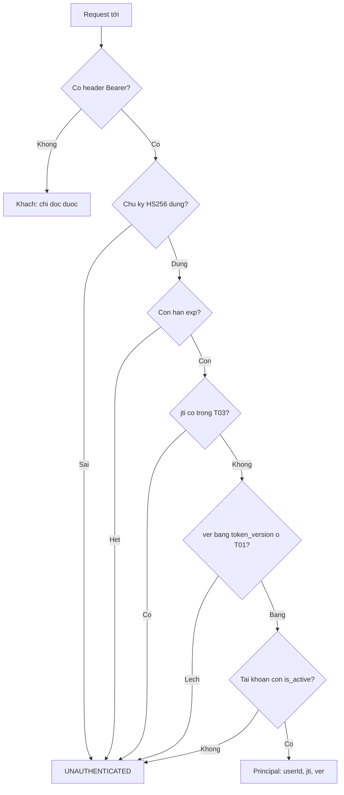
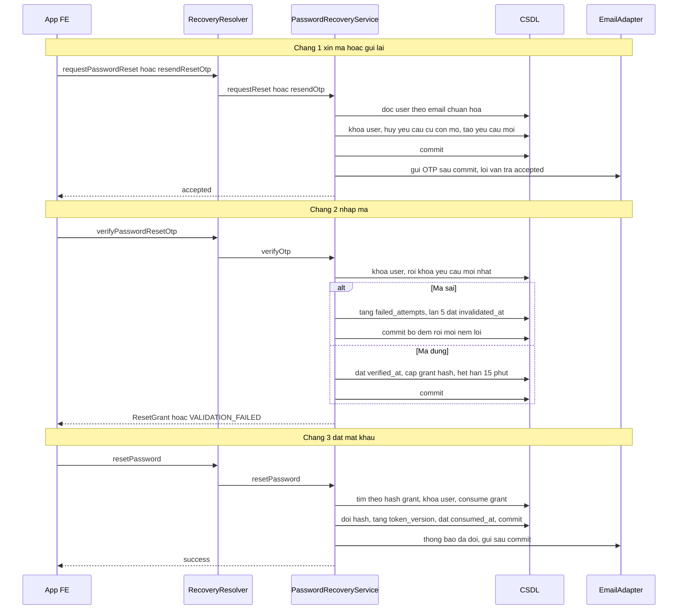
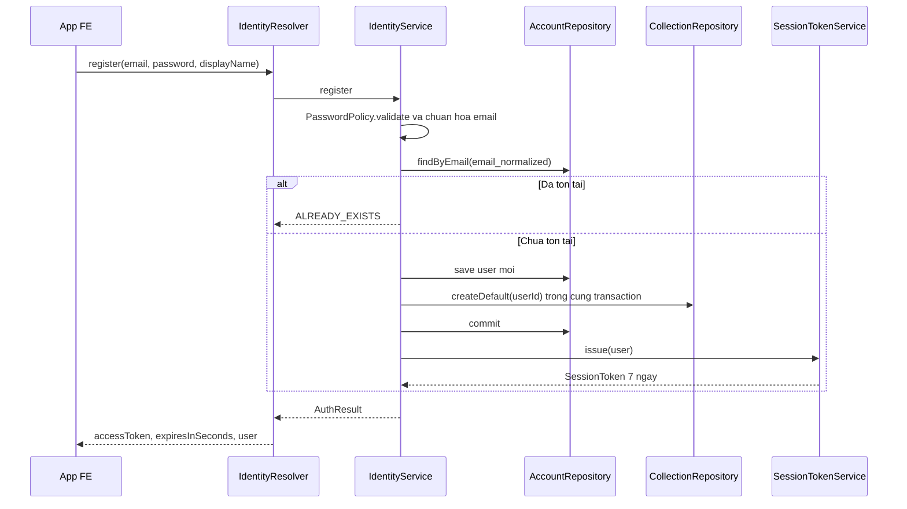
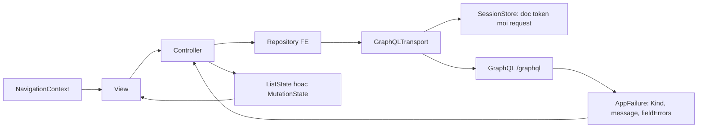

# CHI TIẾT NHÓM 4.1 — IDENTITY & RECOVERY (FE)

| Thuộc tính | Nội dung |
|---|---|
| Người phụ trách | FE (nhóm 4.1) |
| Nhóm | 4.1 Identity & Recovery (P1, B1, B2, D1, X2) |
| UC | UC-01 Đăng ký, UC-02 Đăng nhập, UC-03 Khôi phục mật khẩu, UC-04 Đăng xuất |
| Màn hình | MH-01 Đăng nhập, MH-02 Đăng ký, MH-03 Khôi phục, MH-05 Đặt mật khẩu |
| Bảng | T01 users, T02 password_resets, T03 revoked_tokens, T04 user_devices |
| Sprint | S8 16–22/11, S9 23–29/11, S10 30/11–06/12, S11 07–13/12 (DOC 7.5-B mục 3) |
| Ngày | 12/11/2026 |
| Người đọc | Thành viên FE phụ trách nhóm và coder (pane AI) nhận file này làm hợp đồng |

Ngoài nhóm, FE còn giữ **khung ứng dụng Flutter dùng chung** cho cả bốn nhóm (DOC 6.1-A FE §3.5, §4.1–4.7; HUONG_DAN mục 1). File này có WP riêng cho khung đó.

---

## 0. Cách dùng file này

1. File này là **hợp đồng** cho một coder: đọc hết mục 0–5 một lần, rồi làm đúng thứ tự WP ở mục 6 và mục 7; không đọc thêm nguồn nào ngoài các tài liệu được dẫn ở mục 2 và mã app mẫu ở mục 4.
2. Trước mỗi sprint, mở đúng bảng "Task theo sprint" của sprint đó và 2–5 tài liệu ở cột tài liệu chính; các mục khác để tra khi vướng.
3. Mỗi WP xong phải có: file đã tạo, test theo mã TC ghi ở WP chạy xanh, `flutter analyze`/`ruff`/`mypy` sạch, và một dòng trong PR nêu WP + TC + cách chạy.
4. Coder báo xong bằng: mã WP, danh sách file, output lệnh test (không tóm tắt thay output), ảnh chụp 360×800 với WP có màn hình, và các chỗ đã ghi "Giả thuyết".
5. Điều cấm: đổi chữ ký lớp đang là điểm nối (mục 1) mà không báo người dùng trước; đặt mã lỗi mới ngoài 10 mã của DOC 5.2-A §6; tự đặt ngưỡng rate limit/OTP resend; lưu token/OTP vào log, URL, `localStorage`; sửa file của nhóm khác.

---

## 1. Phạm vi và vai trò của nhóm trong hệ thống

Nhóm này là **cửa vào của toàn hệ thống**: nó quyết định "ai là ai" ở mỗi request và "còn được phép làm gì". Bốn UC chia hai nửa: đăng ký/đăng nhập/đăng xuất do B1 (`IdentityService`) và P1 (`IdentityResolver`) giữ; khôi phục mật khẩu do B2 (`PasswordRecoveryService`) giữ; dữ liệu nằm ở D1 (bốn repository trên T01–T04); email OTP đi qua X2 (`EmailAdapter`). Sai ở đây thì cả ba nhóm còn lại sai quyền, vì mọi resolver đều đứng sau cổng xác thực P0 gọi `IdentityService.verifySession`.

Ngoài bốn UC, FE giữ **khung ứng dụng Flutter** (S8): theme theo token DOC 6.3-B, router + `NavigationContext`, transport GraphQL, và bốn kiểu dùng chung `AppFailure`/`Result`/`Page`/`ListState`/`MutationState`. Ba nhóm kia dựng màn hình lên khung này, nên khung phải xong trước khi ai đó vẽ màn hình đầu tiên.

| # | Chiều | Lớp / phương thức | Đối tác dùng | Cần từ | Điều kiện sẵn sàng: bản giả trông thế nào |
|---|---|---|---|---|---|
| 1 | FE giao | `IdentityService.verifySession(rawToken) → Principal` (6.1-A BE §5.2) | BE `ContextFactory`, mọi nhóm | S8, tuần 1 | Chốt chữ ký ngay ngày đầu S8. Bản giả: `verifySession` nhận token dạng `test-<userId>` trả `Principal(userId, jti giả, tokenVersion=0, isActive=true)`, mọi chuỗi khác ném `UNAUTHENTICATED`. BE gắn vào `ContextFactory` bằng một adapter mỏng để thay bản thật không đổi resolver. |
| 2 | FE giao | `AccountRepository.findById(userId) → tài khoản công khai` (6.1-A BE §5.3) | DB (tác giả bài), Lead (hồ sơ) | S8, tuần 2 | Bản giả trả `id`, `displayName`, `avatarUrl` (không email, không bio); id lạ trả `None`. Chốt kiểu trả về với DB/Lead trước khi họ viết `PostMapper`/`ProfileMapper`. |
| 10 | FE giao | `DeviceRepository.save/remove/listByUser` (T04) | Lead (`NotificationService` gửi push) | S10 | Bản giả lưu danh sách trong RAM theo userId, không gọi FCM. Chỉ công bố khi O12 được chốt là **có** dùng thiết bị push. |
| 3 | FE nhận | `WriteAuthorizationPolicy.authorizeWrite(principal, action, resource)` | Lead | S8 | Bản giả: cho phép khi `principal.userId` trùng `resource.ownerId`, còn lại ném `FORBIDDEN`. Nhóm này chỉ dùng cho 2 chỗ: tạo bộ "Đã lưu" khi đăng ký (thực chất là ghi thay mặt chính user) và gỡ thiết bị của chính mình. |
| 4 | FE nhận | `TransactionManager`, `ErrorMapper`, `CursorCodec`, `PageRequest` | BE | S8 | Bản giả `TransactionManager.run(cb)` mở session, commit khi `cb` xong, rollback khi ném lỗi; `ErrorMapper` map exception nội bộ sang 10 mã DOC 5.2-A §6 và `fieldErrors`. Nhóm này **không** dùng `CursorCodec` (không có danh sách dài), nhưng dùng `PageRequest` cho lần đọc T02/T04 nếu cần. |
| 5 | FE nhận | `CollectionRepository.createDefault(userId)` | Lead | S9, trước WP41-S9.1 | Bản giả tạo một dòng bộ "Đã lưu" trong bộ nhớ và trả id; test của WP41-S9.1 đánh dấu rõ "đang chạy với bản giả" cho tới khi Lead giao bản thật. |

Đổi chữ ký một dòng trong bảng này phải báo người dùng trước, ghi vào mô tả PR, và hai bên cùng review (HUONG_DAN mục 4).

---

## 2. Bản đồ tài liệu cần đọc

Đường dẫn gốc của bản chụp thiết kế: `D:\hdv\quan_ly_du_an\s5s6_lead\noi_bo\src\`.

| # | Tài liệu, mục (đường dẫn local) | Đọc để hiểu gì | Cần cho sprint |
|---|---|---|---|
| 1 | `5.2-A_BE.md` §3.1, §3.3, §4.1–4.3, §6, §12.2 | Hợp đồng `register`/`login`/`logout` và 4 thao tác khôi phục; kiểu `AuthPayload`, `AcceptedPayload`, `ResetGrant`; mã lỗi từng thao tác; quy ước HTTP 200 + `errors[]` | S8 (đọc), S9, S10 |
| 2 | `5.4-A_BE.md` §2.1–2.9, §4.4, §5.6, §9 | Con số bắt buộc: JWT HS256 7 ngày có `sub`/`jti`/`ver`; bcrypt cost 12; mật khẩu ≥6 và ≤72 byte; OTP 6 số/10 phút/5 lần; grant 15 phút một lần; che dữ liệu trong log; ngưỡng rate limit **đề xuất** | S8 (hằng số), S9, S10 |
| 3 | `5.3-B_schema_specification.md` T01–T04 (dòng 30–110) | Cột, CHECK, index; partial unique một yêu cầu mở; thứ tự khoá users rồi password_resets; `reset_expires_at` tính từ `verified_at` | S8, S10 |
| 4 | `6.1-A_BE@3571426.md` §4.1, §5.2–5.4 | Tên lớp/phương thức phải viết: `IdentityService`, `PasswordRecoveryService`, `SessionTokenService`, `PasswordPolicy`, `OtpService`, bốn repository, `EmailAdapter`; điều kiện trước/sau của `login`, `logout`, `resetPassword` | S8, S9, S10 |
| 5 | `6.2-A_BE@ed27b57.md` §3.1 Hình 01, §3.2 Hình 02 | Thứ tự gọi, chỗ khoá, chỗ commit, nhánh lỗi của đăng nhập và ba chặng khôi phục | S9, S10 |
| 6 | `6.1-A_FE@c3b8b46.md` §3.1, §3.5, §4.1–4.18, §4.43, §5, §6 | Lớp phía app (`SessionSnapshot`, `SessionStore`, `AccountRepository`, `SessionController`, `RecoveryController`, `AuthFacade`, `AuthView`), kiểu dùng chung, DTO, provider và vòng đời state | S8, S9, S10 |
| 7 | `6.2-A_FE@c3b8b46.md` §3 FE-SQ01, §4 FE-SQ02, §8 FE-SQ06 | Quay lại ngữ cảnh sau đăng nhập; OTP + đặt mật khẩu; đăng xuất và kết thúc cục bộ | S9, S10 |
| 8 | `6.3-A_mockup_hifi_fe@999e0be.md` MH-01, 02, 03, 05 (dòng 48–80); `6.3-B_design_system_fe@999e0be.md` | Bố cục từng màn, điểm cần chú ý, token màu/chữ/khoảng cách/bo góc/vùng chạm | S9, S10 |
| 9 | `7.2-A_FE.md` (toàn bộ) và `7.2-A_BE@23a5f14.md` §2, §5 | Thông điệp tiếng Việt theo từng mã lỗi; dòng nào áp cho login/OTP/grant/logout; quy tắc `outcomeUnknown` | S9, S10 |
| 10 | `D:\hdv\quan_ly_du_an\s7_lead\nop\7.3-A_test_plan.md` §2, §7, §9; `7.3-C_ma_tran_phu_uc.md` §2, §3.1 | Mức U/I/E/M/D, mẫu test case, dải ID `TC-<vai>-<UC><số>`; ca chính/ca lỗi bắt buộc của UC-01…04 | Cả 4 sprint |
| 11 | `D:\hdv\quan_ly_du_an\s7_lead\nop\7.4-A_chuan_chung.md` §1–6, §9; `7.5-B_schedule.md` §3 | Cấu trúc repo `backend/`, `app/`, `db/`, `docs/`; nhánh, commit, PR, lệnh lint/test; lịch S8–S11 | S8 |
| 12 | `D:\hdv\quan_ly_du_an\s5s6_lead\nop\gop_y\S5_FE.md`, `S5_BE.md`, `S6_FE.md`, `S6_lien_ket.md` | Lỗi đã biết của tài liệu liên quan nhóm (mục 5) | S8 |

---

## 3. Cần nắm

Bảy câu dưới đây phải trả lời được bằng lời trước khi code. Câu 1–5 lấy nền từ HUONG_DAN mục 5.3 nhưng đào sâu theo tài liệu gốc; câu 6–7 là phần FE giữ thêm ngoài nhóm.

### Câu 1. Hệ thống biết "bạn là ai" ở mỗi request bằng cách nào, và khi nào token hết hiệu lực?

Mỗi request mang `Authorization: Bearer <JWT>` (5.2-A §2.3). Cổng P0 gọi `IdentityService.verifySession` **trước** khi vào resolver và kiểm năm điều, theo đúng thứ tự rẻ → đắt: chữ ký HS256; hạn `exp`; `jti` chưa có trong T03; `ver` trong token bằng `token_version` ở T01; tài khoản còn `is_active` (5.4-A §2.6 "Tài khoản bị vô hiệu hoá — từ chối mọi request"). Không có token, hoặc token không qua được bước nào, thì hoặc là khách (đọc công khai) hoặc `UNAUTHENTICATED` nếu operation cần đăng nhập.

Điểm phải hiểu: token **không chứa quyền** (5.4-A §2.2 "Không nhét quyền vào token"), nên quyền luôn suy từ dữ liệu hiện tại; và `ver` là cách duy nhất để giết mọi token cũ của một tài khoản mà không phải đi tìm từng `jti`.



Chi phí: mỗi request đã đăng nhập tốn 1 lần đọc T01 (lấy `token_version`, `is_active`) và 1 lần tra T03 theo PK `jti`, cộng phần xác minh chữ ký trong bộ nhớ. Vì vậy `purgeExpiredRevocations(now)` phải chạy định kỳ để T03 không phình (5.4-A §2.6 "Dọn danh sách thu hồi … xoá bản ghi đã quá `exp`"), và index `expires_at` của T03 tồn tại đúng cho việc này. Chưa có trong tài liệu: có cache kết quả `verifySession` trong một request hay không — **giả thuyết**: cache theo `(jti, ver)` trong phạm vi một request, không cache qua request (đưa vào mục 8).

### Câu 2. Làm sao người ngoài không dò ra email nào đã có tài khoản, và vì sao đăng ký là ngoại lệ?

Nguyên tắc: **phản hồi không được mang thông tin về sự tồn tại của tài khoản**, trừ chỗ bắt buộc phải nói thật để luồng còn chạy được. Ba chỗ áp dụng: đăng nhập sai email và sai mật khẩu trả cùng `UNAUTHENTICATED` (5.2-A §12.2); yêu cầu mã và gửi lại mã luôn trả `accepted` (cùng mục); đăng ký trùng email **phải** trả `ALREADY_EXISTS` để FE chuyển sang đăng nhập (5.4-A §2.9), và bù lại bằng rate limit theo IP (5.4-A §5.6).

| Thao tác | Email không tồn tại | Email có tài khoản | Vì sao |
|---|---|---|---|
| `login` | `UNAUTHENTICATED` | Sai mật khẩu cũng `UNAUTHENTICATED` | Không phân biệt được hai trường hợp |
| `requestPasswordReset` | `accepted: true` | `accepted: true` | REQ-003 |
| `resendResetOtp` | `accepted: true` | `accepted: true` hoặc `RATE_LIMITED` | `RATE_LIMITED` theo email/IP cũng không nói tài khoản có thật |
| `verifyPasswordResetOtp` | `VALIDATION_FAILED` | Sai mã cũng `VALIDATION_FAILED` | Cùng một mã lỗi, cùng một thông điệp |
| `register` | Tạo tài khoản | `ALREADY_EXISTS` | Bắt buộc để FE chuyển sang đăng nhập |

Hai hệ quả khi code: (a) không được log email đầy đủ — che dạng `n***a@domain` (5.4-A §4.4); (b) thời gian phản hồi cũng không được lộ: nhánh "email không tồn tại" của `requestReset` phải làm việc tương đương nhánh có tài khoản (không trả về ngay trước khi kiểm chính sách), nếu không kẻ dò đo được thời gian.

### Câu 3. Khôi phục mật khẩu đi qua mấy chặng, commit ở đâu, và vì sao phải tách?

Ba chặng, mỗi chặng một transaction riêng vì người dùng làm ở ba thời điểm (xin mã, nhập mã, đặt mật khẩu) và mất phản hồi ở chặng nào cũng không được làm hỏng chặng khác. Con số: OTP 6 số, 10 phút, sai 5 lần vô hiệu; grant 15 phút, dùng một lần (5.4-A §2.5).

Ba chỗ tinh tế, đều là lý do phải đọc T02 trước khi code:

1. **Sai OTP vẫn commit bộ đếm.** `failed_attempts` tăng rồi commit, sau đó mới trả lỗi; lần thứ 5 đặt `invalidated_at` (5.3-B T02, bảng chuyển trạng thái). Nếu rollback thì bộ đếm không bao giờ tăng và kẻ đoán thử vô hạn.
2. **Bước cuối làm ba việc trong một commit:** đổi `password_hash`, tăng `token_version`, đặt `consumed_at` của grant. Thiếu một việc là grant dùng lại được hoặc token cũ vẫn sống (6.1-A BE §5.2, điều kiện sau của `resetPassword`).
3. **Thứ tự khoá cố định:** khoá `users` trước, rồi dòng `password_resets` (5.3-B T02). Đảo thứ tự ở hai luồng khác nhau là deadlock.



Email **không bao giờ** nằm trong transaction (HUONG_DAN mục 3.1 luật 5): commit trước, gửi sau; lỗi gửi chỉ log, phản hồi vẫn `accepted` (6.1-A BE §5.4).

### Câu 4. Đăng ký gồm những bước nào, vì sao bộ "Đã lưu" phải cùng commit, và vì sao "đăng ký tự đăng nhập"?

Theo 5.2-A §12.2, `register` trả `AuthPayload` (token + user) — tức đăng ký xong là có phiên, FE không gọi `login` thêm lần nữa. Trình tự: kiểm email đúng dạng, mật khẩu ≥6 và ≤72 byte (5.4-A §2.4), chuẩn hoá email thành `email_normalized` (không bỏ dấu — 5.3-B T01), tạo user, gọi `CollectionRepository.createDefault` của Lead, commit một lần, rồi phát token. Bộ "Đã lưu" thiếu thì thao tác Lưu bài của người đó lỗi ngay từ lần đầu (HUONG_DAN mục 5.3 câu 4).



Phải hiểu: token được phát **sau** commit. Nếu phát token trước rồi commit hỏng, người dùng có token trỏ tới tài khoản không tồn tại. Đây là điểm khác app mẫu (mục 4, dòng `auth_service.py:16`): app mẫu commit user rồi mới phát token nhưng **không** tạo bộ mặc định, và kiểm trùng bằng `ValidationError` chứ không phải `ALREADY_EXISTS`.

### Câu 5. Phía app xử lý phiên, "lỡ tay" và mất phản hồi thế nào?

Bốn quy tắc, mỗi quy tắc ứng với một lớp trong 6.1-A FE:

| Tình huống | Hành vi đúng | Lớp / tài liệu |
|---|---|---|
| Đăng nhập/đăng ký thành công | Chỉ ghi kho phiên **sau khi** server trả `AuthPayload`; ghi kho lỗi thì coi như chưa có phiên | `SessionController.login`, 6.1-A FE §4.16 |
| Khách bấm thao tác cần đăng nhập | Lưu `(returnTarget, pendingIntent)`, mở MH-01; đăng nhập xong quay lại đúng bài cũ nhưng **không tự thực hiện** ý định; người dùng bấm lại | `NavigationContext.remember/resume`, FE-SQ01, QD-01/QD-02 (2.1-B mục 3, dòng 51–52) |
| Đăng xuất mất phản hồi | Không nói "đã thu hồi"; cho chọn thử lại (còn token) hoặc kết thúc cục bộ; kết thúc cục bộ thì xoá dữ liệu phiên và nói đúng "chưa xác nhận trên máy chủ" | `SessionController.logout/endLocalSession`, FE-SQ06, 7.2-A FE dòng cuối |
| Hết phiên giữa chừng (401/`UNAUTHENTICATED` ở thao tác cần đăng nhập) | Xoá phiên + dữ liệu riêng, lưu đích an toàn, bắt người dùng chủ động làm lại | 7.2-A FE dòng 27 |

Hai chi tiết dễ làm sai: (a) `AuthState` **không chứa** password/token để hiển thị (6.1-A FE §4.14) — token nằm trong `SessionStore`, UI chỉ đọc `userId`/`user`; (b) mọi phản hồi bất đồng bộ phải so **generation** trước khi ghi state, nếu không phản hồi của phiên cũ sẽ đè lên phiên mới sau khi đăng xuất/đổi tài khoản (6.1-A FE §6).

### Câu 6. Khung Flutter gồm những gì và nhóm khác dựa vào nó ở đâu?

Khung gồm bốn phần, theo đúng thứ tự phụ thuộc: (1) **token giao diện** đọc từ DOC 6.3-B thành một lớp `AppTokens` duy nhất; (2) **transport** `GraphQLTransport` biết gắn Bearer, phân biệt lỗi mạng/HTTP/GraphQL, trả `TransportResponse` (data, errors, status, requestId); (3) **kiểu dùng chung** `AppFailure`/`Result`/`PageRequest`/`Page`/`ListState`/`MutationState`; (4) **router + `NavigationContext`** cho điều hướng nội bộ và quay lại ngữ cảnh.



Ba điều nhóm khác sẽ giả định, nên phải làm đúng ngay từ S8: `transportProvider` đọc token **mỗi request** chứ không giữ token trong closure (6.1-A FE §6, dòng `transportProvider`); `AppFailure.kind` phân biệt `validation`, `unauthenticated`, `forbidden`, `notAvailable`, `serviceUnavailable`, `outcomeUnknown` (6.1-A FE §4.1); `ListState.phase` có đủ `idle/loading/ready/empty/loadingMore/error` để màn hình nào cũng vẽ được bốn trạng thái (6.1-A FE §4.5, HUONG_DAN mục 9.1).

### Câu 7. Cổng xác thực chạy ở đâu, ai gọi, và bản giả cho BE thay thế bằng cách nào?

`ContextFactory` (BE) là chỗ duy nhất gọi `verifySession`: đọc header, gọi service, gắn `Principal` hoặc `None` vào context (6.1-A BE §5.1, P0). Resolver **không** tự đọc header và **không** tự tra T03. Vì vậy bản giả ở điểm nối 1 phải có cùng chỗ gắn: BE viết `ContextFactory` gọi một interface `SessionVerifier`; S8 ta cung cấp implementation thật, trước đó là fake. Nếu BE gọi thẳng `decode_access_token` như app mẫu (`backend/app/graphql/context.py:35`), thì mọi tính năng `jti`/`ver` sẽ bị bỏ qua và test "token đã thu hồi bị từ chối" không bao giờ đỏ ở BE — đây là lỗi phải chặn ngay ở review PR S8.

---

## 4. Đối chiếu với app mẫu

App mẫu ở `D:\hdv\backend` và `D:\hdv\app_flutter`. Đây là **thiết kế khác** (13 bảng, nhiều tài khoản trên một máy, không có `jti`/`ver`); chỉ lấy cấu trúc và những đoạn xử lý đáng học, không lấy hành vi.

| Việc | File và dòng trong app mẫu | App mẫu làm gì | Thiết kế mới khác ở đâu | Lấy / không lấy |
|---|---|---|---|---|
| Đăng ký | `backend/app/services/auth_service.py:16` | Regex email đơn giản, `username` bắt buộc 2–30, mật khẩu ≥6, trùng email/username đều `ValidationError`, tạo user, `db.commit()`, phát JWT | Không có `username` bắt buộc (O9 còn mở), có `email_normalized`, trùng email trả `ALREADY_EXISTS`, phải tạo bộ "Đã lưu" cùng transaction, token phát sau commit | Lấy: thứ tự kiểm dữ liệu trước khi ghi. Không lấy: username bắt buộc, thiếu bộ mặc định, mã lỗi gộp một loại |
| Đăng nhập | `backend/app/services/auth_service.py:39` | `get_by_email` rồi `verify_password`, sai thì một `UnauthorizedError("Invalid email or password")` | Cùng tinh thần một lỗi, nhưng phải trả `UNAUTHENTICATED` + `LOGIN_FAILED` trong `extensions` | Lấy nguyên tắc "một lỗi cho hai trường hợp" |
| Sinh JWT | `backend/app/core/security.py:37` | Payload chỉ `sub`, `iat`, `exp`, hạn lấy từ `jwt_expire_minutes` | Thêm `jti` (UUIDv4) và `ver`; `exp = iat + 7 ngày`; HS256 với khoá ≥256 bit từ env | Lấy: ký/đọc tập trung một module. Không lấy: payload thiếu `jti`/`ver` |
| Đọc token trong context | `backend/app/graphql/context.py:35` | Decode JWT, nạp user, không kiểm thu hồi/phiên bản; `require_user` chỉ kiểm `None` (`:50`) | P0 kiểm 5 điều; resolver không tự kiểm | Không lấy: đây là lỗ hổng của app mẫu |
| Thu hồi khi đăng xuất | `app_flutter/lib/core/auth_controller.dart:187` | Chỉ xoá token/phiên trên máy, **không** gọi server | `logout` gọi BE, BE ghi `jti` vào T03; gọi lặp vẫn `success: true` | Không lấy: đăng xuất một phía |
| Nhiều tài khoản trên máy | `auth_controller.dart:209`, `app_flutter/lib/core/session_store.dart` | Lưu danh sách phiên + token từng tài khoản trong secure storage, có `switchTo` | Thiết kế mới không có chuyển tài khoản; mỗi lần đăng nhập một `jti`, đăng xuất một thiết bị không ảnh hưởng thiết bị khác | Không lấy: mô hình nhiều tài khoản |
| Lưu token web | `auth_controller.dart:37` (`FlutterSecureStorage`), `:111` | Dùng chung secure storage cho mọi nền tảng | Web giữ token trong bộ nhớ, tải lại trang phải đăng nhập lại (5.4-A §2.7) | Lấy: Android dùng kho bảo mật. Không lấy: web dùng lưu trữ bền |
| Gắn Bearer | `app_flutter/lib/core/graphql_client.dart:21` | `AuthLink` đọc token hiện tại mỗi request, `networkOnly` | Cùng ý tưởng, nhưng transport phải trả `AppFailure` có `kind`, không map theo chuỗi message | Lấy: đọc token mỗi request |
| Map lỗi | `graphql_client.dart:72`, `:108` | So khớp **chuỗi message** ("email", "password"…) để ra thông điệp Việt | Đọc `extensions.code` và `fieldErrors`; message không phải hợp đồng (5.2-A §6, 7.2-A FE) | Không lấy: so chuỗi message |
| Yêu cầu OTP | `backend/app/services/password_reset_service.py:67` | Email lạ trả `None`, không tạo dòng, resolver vẫn trả `sent=True`; huỷ yêu cầu cũ; commit; gửi mã | Cùng nguyên tắc chống dò; khác: khoá user trước, commit trước khi gửi, lỗi gửi vẫn `accepted` | Lấy: không tạo dòng cho email lạ; không lộ qua phản hồi. Không lấy: thiếu khoá, thiếu chính sách gửi lại |
| Sai OTP | `password_reset_service.py:86` | Tăng `attempts`, `db.commit()`, rồi ném lỗi; chặn khi `attempts >= 5` | Cùng ý tưởng "commit trước khi báo lỗi"; khác: lần thứ 5 đặt `invalidated_at`, grant tách khỏi OTP | Lấy: commit bộ đếm trước khi ném |
| Đặt lại mật khẩu | `password_reset_service.py:111` | Kiểm độ dài, tra theo hash token, kiểm `used`/hạn, đổi hash, `used = True`, commit | Phải thêm: khoá user, tăng `token_version`, `consumed_at`, cùng một transaction; grant hết hạn độc lập với OTP | Lấy: chỉ lưu hash, dùng một lần. Không lấy: đổi mật khẩu mà không tăng `ver` |
| Bảng reset | `backend/app/models/password_reset.py:18`, `backend/alembic/versions/ab47d2489b74_password_reset_requests.py:21` | Bảng `password_reset_requests`: `code_hash`, `expires_at`, `attempts`, `used`, `reset_token_hash`, `reset_token_expires_at` | T02 `password_resets`: `otp_hash`, `failed_attempts`, `otp_expires_at`, `verified_at`, `invalidated_at`, `reset_token_hash` UNIQUE, `reset_expires_at`, `consumed_at`, partial unique một yêu cầu mở | Lấy: chỉ lưu hash + một cờ dùng một lần. Không lấy: gộp OTP và grant vào hai cột của cùng một trạng thái |
| Thiết bị push | `backend/app/repositories/user_repo.py:31` | Gắn một `fcm_token` vào chính dòng `users` | T04 `user_devices` riêng, `UNIQUE(push_token)`, `platform IN ('android','web')`, `last_active_at` | Không lấy: cột token trên users |
| Sinh mã OTP | `password_reset_service.py:43` | `secrets.randbelow(1_000_000)` 6 số, giữ dạng chuỗi | Cùng yêu cầu 6 chữ số, nhưng lưu hash có khoá phụ của máy chủ (5.4-A §2.5), không lưu bản rõ | Lấy: `secrets`, không dùng `random` |
| So khớp bí mật | `password_reset_service.py:48` | SHA-256 cho reset token, bcrypt cho OTP | Cùng ý: OTP entropy thấp nên băm chậm; grant entropy cao nên băm nhanh; so sánh thời gian hằng | Lấy nguyên tắc chọn hàm băm |
| Màn đăng nhập | `app_flutter/lib/features/auth/login_screen.dart:35`, `:44` | Cờ `_submitting`, khoá nút khi gửi, hiện lỗi dưới form | Cùng yêu cầu (6.3-A MH-01), nhưng state tách thành `AuthState.phase` + `fieldErrors`, không giữ trong widget | Lấy: khoá nút khi gửi, giữ email khi lỗi |
| Màn OTP | `app_flutter/lib/features/auth/forgot_password_screen.dart:15`, `verify_otp_screen.dart:16`, `shared/widgets/otp_field.dart:33` | Tách 3 route: quên → nhập OTP → đặt mật khẩu | Thiết kế mới: OTP **cùng MH-03**, đặt mật khẩu ở MH-05 (6.3-A MH-03, MH-05) | Lấy: ô OTP 6 ô, bàn phím số. Không lấy: tách OTP thành route riêng ngoài MH-03 |
| Trạng thái lỗi dùng chung | `app_flutter/lib/shared/widgets/async_state_views.dart:57` | `ErrorView(message, onRetry)` | Cùng vai trò, nhưng là `AsyncFeedback` + `AppFailure` (6.1-A FE §4.47) | Lấy: một widget lỗi có nút Thử lại cho mọi màn |
| Theme | `app_flutter/lib/core/theme.dart:14` | Material 3 `seedColor` từ `HdvColors.primary` | Token 6.3-B khai báo từng màu/vai trò, không suy từ seed | Không lấy: seed colour tự sinh bảng màu |

---

## 5. Lỗi đã biết ở tài liệu thiết kế

Các mục dưới lấy từ `D:\hdv\quan_ly_du_an\s5s6_lead\nop\gop_y\` (đang được thành viên sửa). **Kiểm lại bản mới trước khi code**; nếu bản mới đã sửa thì làm theo bản mới.

| # | Vị trí | Sai gì (bằng lời) | Coder tạm làm thế nào cho an toàn |
|---|---|---|---|
| 1 | `S5_BE.md` dòng 20, 6.2-A BE mục 2 | UC-01 đăng ký là Must nhưng không có sơ đồ tuần tự riêng | Dùng sơ đồ ở mục 3 câu 4 của file này; khi tài liệu có hình mới thì đối chiếu lại thứ tự commit/token |
| 2 | `S5_BE.md` dòng 7, 6.1-A BE dòng 1409 so với 5.2-A §12.2 | Input `unregisterDevice` khai `fcmToken` ở sơ đồ lớp nhưng API khai `pushToken` | Code theo `pushToken` (5.2-A là hợp đồng client-facing); nếu O12 chốt dùng thiết bị thì ghi chú trong PR |
| 3 | `S5_FE.md` dòng 24, 6.2-A FE mục 4 | Nhánh "đổi email" trong FE-SQ02 nói về `stage=email` nhưng sơ đồ vẫn đi tiếp tới `verifyOtp` | Cài đúng hành vi: đổi email xoá OTP/grant và **dừng** ở bước nhập email, không gọi verify |
| 4 | `S5_FE.md` dòng 28, 6.2-A FE mục 13 | UC-01 không có sơ đồ tuần tự FE | Dùng mục 3 câu 4 và FE-SQ01 làm nền; tự vẽ luồng MH-02 → token → về đích trước khi code |
| 5 | `S6_FE.md` dòng 7, 6.3-B mục Màu và chữ | Thang cỡ chữ chỉ có 32/28/21/16/13 nhưng nhiều màn dùng 24 và 14 | Chỉ dùng 5 cỡ có token; chỗ cần 24 dùng 21, chỗ cần 14 dùng 13; ghi vào PR nếu lệch ảnh mockup |
| 6 | `S6_FE.md` dòng 8, 6.3-B mục Khoảng cách | Thang bo góc chỉ 12/16 nhưng chip/nhãn dùng bo tròn đầy (rx 99) | Chip dùng `StadiumBorder` với chiều cao 44; không tự thêm token bo góc mới |
| 7 | `S6_FE.md` dòng 9, 6.3-B mục Màu và chữ | 4 mã màu gradient trong SVG không có trong bảng token | Không dùng gradient nền; nền theo `Canvas`/`Surface`; ghi chú ở PR màn nào lệch mockup |
| 8 | `S6_FE.md` dòng 15, `svg/MH-01.svg` | Ba nút hành động không vừa bề ngang 332 px, nút "Đăng ký" rơi xuống hàng hai lệch | Dựng MH-01 theo bố cục một nút chính + một liên kết chữ; kiểm 360×800 trước khi báo xong |
| 9 | `S6_FE.md` dòng 43 / `S6_lien_ket.md` dòng 12 | `RATE_LIMITED` chỉ có dòng xử lý cho gửi OTP, thiếu cho thao tác khác | Với nhóm này chỉ gặp `RATE_LIMITED` ở gửi/gửi lại OTP và đăng nhập; dùng đúng dòng 29 của 7.2-A FE, không tự đặt câu khác |

---

## 6. Task theo sprint

Quy ước chung cho cả bốn sprint:

- Mã WP: `WP41-S<sprint>.<số>`.
- Mọi đường dẫn trong repo nộp (`D:\ToMateTo`) là **đề xuất** theo cấu trúc DOC 7.4-A §1 (`backend/`, `app/`, `db/`, `docs/`), vì repo nộp chưa có mã nguồn. Tên lớp và phương thức thì **không** được tự đổi: chúng lấy từ DOC 6.1-A BE §4.1/§5.2 và DOC 6.1-A FE §4.
- Test backend đặt trong `backend/tests/`, test Flutter trong `app/test/`; mã TC theo DOC 7.3-A §7 và dải ở DOC 7.3-C §2. Ca chính dùng số `01`, ca lỗi từ `02`, ca biên dùng các số sau (`07`, `08`, `09`). Test của khung dùng chung không gắn mã UC (DOC 7.3-C không có dòng cho khung) — đặt tên `test_<module>_<hành vi>`.
- Mỗi WP chỉ được coi là xong khi `ruff check`, `ruff format --check`, `mypy` (backend) và `flutter analyze`, `dart format --set-exit-if-changed` (Flutter) sạch trên phần mình sửa (DOC 7.4-A §9).

### 6.1 Sprint S8 (16–22/11) — nền: khung Flutter, bốn bảng, ba helper, cổng xác thực

| Việc | Tài liệu chính khi code | Xong khi |
|---|---|---|
| Khung Flutter dùng chung (theme token, transport, kiểu lỗi/trang/thao tác, router + NavigationContext) | DOC 6.3-B; DOC 6.1-A FE §3.5, §4.1–4.7, §4.47, §6 | `flutter analyze` sạch; có test mapper lỗi và transport; một màn thử gọi được `feed` bằng token giả |
| Entity + repository T01–T04 trên CSDL thật | DOC 5.3-B T01–T04; DOC 6.1-A BE §5.3 | `pytest backend/tests/test_*_repo.py` xanh trên CSDL kiểm thử; bốn ràng buộc UNIQUE/CHECK có test đỏ khi vi phạm |
| `PasswordPolicy`, `OtpService`, `SessionTokenService` | DOC 5.4-A §2.2, §2.4, §2.5; DOC 6.1-A BE §5.2 | Test đơn vị xanh; token phát ra có đủ `sub`/`jti`/`ver`/`iat`/`exp`; không log bí mật |
| `IdentityService.verifySession` đủ 5 nhánh + `Principal` + bản giả cho BE | DOC 5.4-A §2.2, §2.6, §2.9; DOC 6.1-A BE §4.1, §5.2 | 5 nhánh có test đỏ khi bỏ một điều kiện; BE gắn được vào `ContextFactory` và gọi thử một mutation cần đăng nhập |

#### WP41-S8.1 — Khung ứng dụng Flutter dùng chung

**Cốt lõi:** dựng sườn mà cả bốn nhóm dựng màn hình lên: một nguồn token giao diện, một transport GraphQL biết gắn Bearer và phân loại lỗi, bốn kiểu trạng thái dùng chung, và router có `NavigationContext`. Khung sai thì mọi màn hình sai theo, và sửa ở S9–S10 sẽ đắt gấp nhiều lần.

**Phải hiểu trước khi code:**
1. Token giao diện chỉ đọc từ DOC 6.3-B (màu, cỡ chữ 32/28/21/16/13, khoảng cách 4/8/12/16/24/32, bo góc 12/16, vùng chạm ≥44 px). Không đặt mã màu hay cỡ chữ lẻ trong màn hình (HUONG_DAN mục D2).
2. Transport là **nơi duy nhất** biết HTTP/GraphQL. Nó trả `TransportResponse` gồm `data`, `errors`, `status`, `requestId`; không ném lỗi cho controller và không tự hiện thông báo. HTTP 200 kèm `errors` chưa phải thành công (7.2-A FE, mục Cách đọc lỗi).
3. `AppFailure.kind` là hợp đồng UI: `validation`, `unauthenticated`, `forbidden`, `notAvailable`, `serviceUnavailable`, `outcomeUnknown` (6.1-A FE §4.1). UI chọn thông điệp theo `kind` + `fieldErrors`, **không** theo `message` server.
4. `ListState` và `MutationState` có `generation`/`phase`; mọi callback phải so generation trước khi ghi state, nếu không phản hồi của phiên cũ đè lên phiên mới (6.1-A FE §4.5, §4.6, §6).
5. `NavigationContext` chỉ nhận route nội bộ; `resume(authenticated)` trả đích quay về nhưng **không** chạy `pendingIntent` (6.1-A FE §4.7) — đây là điều kiện của QD-02.

**Spec:**

| File cần tạo (đề xuất) | Nội dung |
|---|---|
| `app/lib/core/theme/app_tokens.dart`, `app/lib/core/theme/app_theme.dart` | `AppTokens` giữ đúng 10 màu, 5 cỡ chữ, 6 mốc khoảng cách, 2 bo góc, 1 ngưỡng chạm của DOC 6.3-B; `ThemeData` dựng từ token, không dùng `ColorScheme.fromSeed` |
| `app/lib/core/transport/transport_response.dart`, `graphql_transport.dart` | `query/mutate(operation, variables, auth)`; `auth` là enum `required|optional|none`. Gắn `Authorization: Bearer` từ `SessionStore` **mỗi lần gọi**. Map lỗi mạng/HTTP/GraphQL thành `TransportResponse` |
| `app/lib/core/failure/app_failure.dart` | `AppFailure.fromTransport`; map 10 mã DOC 5.2-A §6 sang `kind`; giữ `fieldErrors` và `requestId` |
| `app/lib/core/result/result.dart`, `page.dart`, `page_request.dart` | `Result.success/failed`; `Page.fromConnection` (edges → items, `pageInfo.endCursor` → `nextCursor`); `PageRequest.first/next`, kiểm `limit` 1..50 |
| `app/lib/core/state/list_state.dart`, `mutation_state.dart` | `ListState` với 6 phase và `generation`; `MutationState` với `idle/submitting/succeeded/failed/outcomeUnknown` |
| `app/lib/core/navigation/navigation_context.dart`, `app_router.dart` | Route `/login`, `/register`, `/forgot-password`, `/reset-password`; `remember/resume/openPost/openCollection/openProfile/back`; `requireAuth(context)` |
| `app/lib/shared/widgets/async_feedback.dart` | Widget cho 3 trạng thái tải/rỗng/lỗi có nút Thử lại, dùng chung cho mọi màn |

Ranh giới transaction không áp ở đây; ranh giới quan trọng là **không** để widget gọi transport và **không** để repository giữ token trong closure.

**Kế hoạch từng bước:**
1. Viết test mapper lỗi trước: body `{"errors":[{"extensions":{"code":"UNAUTHENTICATED"}}]}` với HTTP 200 → `kind=unauthenticated`; HTTP 401 không body → `unauthenticated`; lỗi DNS → `serviceUnavailable`; `VALIDATION_FAILED` + `fieldErrors` → `validation` kèm map trường.
2. Viết `AppTokens` + theme, đối chiếu từng dòng với DOC 6.3-B; `flutter analyze` phải không còn màu/cỡ chữ literal trong `app/lib/features/`.
3. Viết `GraphQLTransport` + `SessionStore` tối thiểu (đọc token, chưa cần ghi) và test: header có Bearer đúng token hiện tại; đổi token trong store thì request sau mang token mới.
4. Viết `Result`/`Page`/`PageRequest`/`ListState`/`MutationState` và test `copyWith` + bất biến `hasMore=true` phải có `nextCursor`.
5. Viết router + `NavigationContext`; test `remember` → `resume(false)` trả đúng đích và `pendingIntent` vẫn còn; `resume(true)` không thực thi ý định.
6. Viết `AsyncFeedback`; chụp 360×800 ba trạng thái.
7. Gắn một màn thử (có thể là màn tạm trong `app/lib/features/_smoke/`) gọi `feed` bằng token giả để chứng minh transport chạy; xoá màn thử trước khi merge hoặc đánh dấu rõ.

**Test cần viết:** không gán mã TC-UC. Danh sách tối thiểu (mức U): 6 ca mapper lỗi (5 mã + lỗi mạng), 2 ca transport token, 3 ca `Result`/`Page`/`PageRequest`, 3 ca `ListState`/`MutationState`, 3 ca `NavigationContext`. Ghi tên test theo module; đóng góp NFR-14.

**Đọc thêm:** DOC 6.1-A FE §4.1–4.7 (đặc tả từng kiểu), §4.47 (`AsyncFeedback`), §6 (provider và generation); DOC 6.3-B toàn bộ; DOC 7.2-A FE phần Trách nhiệm; app mẫu `app_flutter/lib/core/theme.dart:14` (seed màu — không lấy), `app_flutter/lib/core/graphql_client.dart:21` (AuthLink), `app_flutter/lib/shared/widgets/async_state_views.dart:57` (`ErrorView`).

**Hay sai ở đâu:**
- Dùng `ColorScheme.fromSeed` hoặc tự chọn màu vì "thấy đẹp" — app mẫu làm vậy (`app_flutter/lib/core/theme.dart:14`), và đó là lý do giao diện app mẫu lệch token.
- Map lỗi theo `message` (như `app_flutter/lib/core/graphql_client.dart:72`) nên đổi câu chữ server là FE sai.
- Đọc token một lần trong closure của transport → sau đăng nhập, request vẫn mang token cũ hoặc rỗng.
- `resume(true)` tự chạy `pendingIntent` (tự thích hộ người dùng) — vi phạm QD-02.
- Quên `generation`: đăng xuất xong màn hình vẫn nhận dữ liệu của phiên cũ.

#### WP41-S8.2 — Entity và repository cho T01–T04 (chạy trên CSDL thật)

**Cốt lõi:** bốn bảng của nhóm cần lớp ánh xạ và bốn repository chỉ đọc/ghi bảng, không chứa quy tắc nghiệp vụ. DB tạo bảng bằng migration một lần cho cả dự án (HUONG_DAN mục 1); nhóm này viết entity/repository và test trên CSDL kiểm thử thật, không mock.

**Phải hiểu trước khi code:**
1. T01 `users` có `email_normalized` UNIQUE tách khỏi `email`; `token_version` mặc định 0; `is_active` mặc định true; `display_name` có CHECK khác rỗng (5.3-B T01).
2. T02 `password_resets` là **một** bảng chứa cả OTP và grant, phân biệt bằng mốc thời gian: `verified_at` có grant, `invalidated_at` bị huỷ, `consumed_at` đã dùng. Có partial UNIQUE `(user_id) WHERE invalidated_at IS NULL AND consumed_at IS NULL` — tối đa một yêu cầu mở (5.3-B T02).
3. T03 `revoked_tokens` khoá chính là `jti`; thu hồi lặp không tạo trùng; index `expires_at` cho job dọn (5.3-B T03).
4. T04 `user_devices` có `UNIQUE(push_token)`, `platform IN ('android','web')`; một push token thuộc tối đa một tài khoản tại một thời điểm (5.3-B T04, O12).
5. Repository không ném lỗi nghiệp vụ và không trả DTO; lỗi CSDL được chuyển thành lỗi hạ tầng ở một chỗ (6.1-A BE §5.3).

**Spec:**

| File cần tạo (đề xuất) | Nội dung |
|---|---|
| `backend/app/models/user.py` | `User`: id, email, email_normalized, username?, username_normalized?, password_hash, display_name, bio, city, social_links, public_profile_fields, avatar_media_id, cover_media_id, token_version, is_active, created_at, updated_at; hàm `change_password(hash)` tăng `token_version` |
| `backend/app/models/password_reset.py` | `PasswordReset`: các cột T02 + `register_failed_attempt()`, `is_otp_valid(now)`, `consume(now)` |
| `backend/app/models/revoked_token.py` | `RevokedToken`: jti, user_id, expires_at, revoked_at, `is_active(now)` |
| `backend/app/models/user_device.py` | `UserDevice`: id, user_id, push_token, platform, created_at, last_active_at, `belongsTo(userId)` |
| `backend/app/repositories/account_repo.py` | `findById(userId, forUpdate=False)`, `findByEmail(email)`, `save(user)`, `updatePassword(userId, hash)`, `getTokenVersion(userId)`, `bumpTokenVersion(userId)` |
| `backend/app/repositories/password_reset_repo.py` | `create`, `findLatestByEmail(email, forUpdate=False)`, `findByGrantHash(hash)`, `invalidateOpenForUser(userId)`, `save`, `consume(requestId, grantHash, now)`, `purgeExpired(now)` |
| `backend/app/repositories/session_repo.py` | `revoke(jti, userId, expiresAt)`, `isRevoked(jti)`, `prune(now)` |
| `backend/app/repositories/device_repo.py` | `save(device)`, `remove(userId, token)`, `listByUser(userId)` |
| `backend/tests/test_account_repo.py`, `test_password_reset_repo.py`, `test_session_repo.py` | Test trên CSDL kiểm thử, mỗi test một transaction rollback |

Nguồn dữ liệu là CSDL PostgreSQL kiểm thử tách riêng do DB cấp (HUONG_DAN mục 1); không dùng SQLite cho test repository vì mất CHECK/partial index.

**Kế hoạch từng bước:**
1. Đọc DDL thật của bốn bảng (DB giao ở S8 tuần 1) và đối chiếu với 5.3-B; ghi lại chỗ lệch vào PR thay vì tự sửa migration.
2. Viết test đỏ trước: `email_normalized` trùng phải lỗi; partial UNIQUE T02 chặn hai yêu cầu mở; `revoke` lặp không tăng số dòng; `prune` chỉ xoá dòng quá hạn; `push_token` trùng phải lỗi.
3. Viết bốn entity, ánh xạ đúng kiểu (UUID cho `jti`, TIMESTAMPTZ cho thời gian).
4. Viết bốn repository; tuyệt đối không thêm điều kiện nghiệp vụ (ví dụ không tự kiểm `failed_attempts < 5`).
5. Chạy `pytest` trên CSDL kiểm thử; kiểm `SELECT` sau mỗi test để chắc dữ liệu không rò sang test khác.
6. Báo DB/Lead chữ ký `findById` (điểm nối 2) và `DeviceRepository` (điểm nối 10) ngay khi xanh.

**Test cần viết:** TC-BE-0107 (U, UNIQUE `email_normalized` + `findById` trả None với id lạ), TC-BE-0109 (U, T04 `UNIQUE(push_token)` và CHECK platform), TC-BE-0307 (U, partial UNIQUE T02: không thể có hai yêu cầu mở), TC-BE-0308 (U, `findLatestByEmail(forUpdate=True)` khoá đúng dòng và trả yêu cầu mới nhất), TC-BE-0407 (U, `revoke` lặp không tạo trùng; `prune` xoá theo `expires_at`).

**Đọc thêm:** DOC 5.3-B T01–T04 (toàn bộ đoạn văn dưới bảng, đặc biệt bảng chuyển trạng thái T02); DOC 6.1-A BE §5.3; app mẫu `backend/app/repositories/user_repo.py:12` và `password_reset_repo.py:22` để thấy mức tối thiểu của một repository.

**Hay sai ở đâu:**
- Tự thêm cột vào bảng (ví dụ `otp_hash` cộng `used`) vì app mẫu làm vậy (`backend/app/models/password_reset.py:18`) — DDL mới là chuẩn, đổi cột phải qua DB.
- Dùng `datetime.now()` không UTC; T02/T03 so sánh thời gian nên lệch múi giờ làm test "hết hạn" chập chờn.
- Viết `invalidateOpenForUser` bằng vòng lặp đọc/sửa thay vì một `UPDATE` có điều kiện — sai khi chạy song song.
- Đặt điều kiện `now()` vào predicate của partial index (5.3-B T02 cảnh báo): yêu cầu hết hạn vẫn phải được đánh dấu `invalidated_at` khi cấp mới.
- Test bằng SQLite cho nhanh, rồi ràng buộc UNIQUE/CHECK không chạy.

#### WP41-S8.3 — Ba helper: `PasswordPolicy`, `OtpService`, `SessionTokenService`

**Cốt lõi:** gom toàn bộ số học bảo mật vào ba lớp nhỏ, không rải trong service: quy tắc mật khẩu + băm bcrypt; sinh/băm/so mã OTP; ký/đọc JWT 7 ngày có `jti` và `ver`. Ba lớp này được B1 và B2 dùng chung nên phải xong trước service.

**Phải hiểu trước khi code:**
1. Mật khẩu: tối thiểu 6 ký tự, tối đa 72 **byte** (giới hạn bcrypt), bcrypt cost 12, salt riêng mỗi bản ghi, so sánh bằng hàm của thư viện (5.4-A §2.4). Không áp quy tắc hoa/thường/số.
2. OTP: đúng 6 chữ số, sinh bằng nguồn ngẫu nhiên an toàn, **chỉ lưu hash có khoá phụ của máy chủ**, so sánh thời gian hằng (5.4-A §2.5). Hạn dùng không nằm trong `OtpService` mà ở `PasswordReset`.
3. Token: HS256, khoá ≥256 bit từ biến môi trường, `sub` là id dạng chuỗi, `jti` UUIDv4, `ver` chép từ `user.token_version`, `exp = iat + 7 ngày`; dưới 1 KB; không chứa email/tên/quyền (5.4-A §2.2).
4. `parse(raw)` chỉ kiểm chữ ký và hạn rồi trả claims; **không** kiểm thu hồi/phiên bản — việc đó thuộc `verifySession` (6.1-A BE §5.2).
5. Không có refresh token, không có hàm `refresh` (5.2-A §3.1).

**Spec:**

| File cần tạo (đề xuất) | Nội dung |
|---|---|
| `backend/app/services/password_policy.py` | `validate(raw)` ném `VALIDATION_FAILED` với `fieldErrors` (`password`/`PASSWORD_INVALID`); `hash(raw)`; `verify(raw, hash)` |
| `backend/app/services/otp_service.py` | `generate()`, `hash(code)`, `verify(code, stored)`; khoá phụ lấy từ `OTP_PEPPER` trong env |
| `backend/app/services/session_token_service.py` | `issue(user) → SessionToken(raw, jti, expiresAt)`, `parse(raw) → SessionClaims(sub, jti, ver, iat, exp)` |
| `backend/app/core/config.py` | `JWT_SECRET` (bắt buộc), `JWT_ALGORITHM=HS256`, `JWT_TTL_DAYS=7`, `OTP_PEPPER`; thiếu biến bắt buộc thì app dừng khi khởi động |
| `backend/tests/test_password_policy.py`, `test_otp_service.py`, `test_session_token.py` | Test đơn vị thuần, không CSDL |

**Kế hoạch từng bước:**
1. Test trước: mật khẩu 5 ký tự → lỗi; 6 ký tự → qua; 73 byte → lỗi; hai lần `hash` cùng mật khẩu ra hash khác nhau nhưng `verify` đều đúng.
2. Test OTP: 1000 mã sinh ra đều 6 chữ số (giữ số 0 đầu); `hash` hai lần khác nhau; `verify` sai lệch một ký tự thì false.
3. Test token: `issue` rồi `parse` trả đúng `sub/jti/ver`; sửa 1 ký tự token → lỗi; token hết hạn (dựng bằng `exp` quá khứ) → lỗi; token ký bằng khoá khác → lỗi; token thiếu `jti` → lỗi.
4. Cài đặt ba lớp, dùng `pyjwt` và `bcrypt` (thư viện app mẫu đã dùng: `backend/app/core/security.py:18`).
5. Đảm bảo không có `logger.*` nào in mật khẩu/OTP/token; thêm test đọc log capture.

**Test cần viết:** TC-BE-0106 (U, chính sách mật khẩu + băm), TC-BE-0306 (U, OTP 6 số + hash + so sánh), TC-BE-0207 và TC-BE-0208 (U, token hợp lệ được parse; token sai chữ ký/thiếu claim bị từ chối).

**Đọc thêm:** DOC 5.4-A §2.2, §2.4, §2.5, §4.4; DOC 6.1-A BE §5.2 (bảng điều kiện trước/sau); app mẫu `backend/app/core/security.py:18`, `:37`, `backend/app/services/password_reset_service.py:43`, `:48`.

**Hay sai ở đâu:**
- Đếm độ dài chuỗi thay vì số byte → mật khẩu tiếng Việt 30 ký tự có thể vượt 72 byte và bcrypt cắt âm thầm.
- Đặt `exp` bằng `datetime.now()` local hoặc dùng `timedelta(days=7)` từ `iat` kiểu khác — lệch giờ làm token chết sớm.
- Nhét `email` hoặc `role` vào token cho tiện — vi phạm 5.4-A §2.2 và làm token lộ PII.
- Trả `None` khi token sai thay vì ném `UNAUTHENTICATED`: `parse` là helper nội bộ, nhưng `verifySession` phải phân biệt "không có token" (khách) với "token hỏng" (lỗi) — nếu helper trả `None` cho cả hai thì cổng không làm được việc đó.
- Dùng `random` thay `secrets` để sinh OTP.

#### WP41-S8.4 — `IdentityService.verifySession` đủ 5 nhánh và bản giả cho BE

**Cốt lõi:** đây là điểm nối số 1 và là chỗ nhạy nhất của nhóm: một hàm trả `Principal` hoặc ném `UNAUTHENTICATED`, được BE gắn vào `ContextFactory` để mọi request đi qua. Sai một nhánh là token đã đăng xuất vẫn dùng được, hoặc đổi mật khẩu không giết được phiên cũ.

**Phải hiểu trước khi code:**
1. Năm nhánh phải phân biệt được: không có token → khách (trả `None` ở tầng context, **không** ném lỗi); chữ ký sai; hết hạn; `jti` có trong T03; `ver` lệch `token_version`. Thêm nhánh thứ sáu: `is_active = false` (5.4-A §2.6).
2. Thứ tự kiểm: chữ ký → hạn → `jti` → `ver` → `is_active`. Kiểm chữ ký trước để không tốn truy vấn CSDL với token rác.
3. `Principal` chứa `userId`, `jti`, `ver` — đủ để `logout` ghi T03 và `NotificationService` biết ai. **Giả thuyết** (chưa có trong tài liệu): trường tên chính xác; chốt với BE trong ngày đầu S8.
4. Token hợp lệ nhưng đã thu hồi: 5.2-A §12.2 nói `logout` gọi lặp vẫn `success: true`, nhưng **request khác** dùng token đã thu hồi phải `UNAUTHENTICATED`. Vì vậy `logout` không được đi qua đường "token phải còn sống"; resolver của `logout` dùng `parse` + `revoke` idempotent.
5. `verifySession` không cache qua request (giả thuyết ở câu 1) — nếu cache, phải nêu rõ TTL và cách vô hiệu khi `ver` đổi.

**Spec:**

| File cần tạo (đề xuất) | Nội dung |
|---|---|
| `backend/app/services/identity_service.py` | `verifySession(rawToken) → Principal`; `revokeSession(principal)`; các hàm khác của B1 để S9/S10 |
| `backend/app/core/principal.py` | `Principal(userId, jti, ver)` bất biến, không chứa email |
| `backend/app/graphql/context.py` | `ContextFactory` gọi `verifySession`; gắn `principal` hoặc `None`; **không** tự gọi `decode` |
| `backend/app/graphql/guards.py` | `requirePrincipal(context)` ném `UNAUTHENTICATED` khi `None` |
| `backend/tests/test_verify_session.py` | Sáu ca, mỗi ca một điều kiện bị vi phạm |
| `backend/tests/fakes/fake_session_verifier.py` | Bản giả cho BE dùng trước khi hàm thật xong |

**Kế hoạch từng bước:**
1. Viết `Principal` + test sáu ca với repository giả (không cần CSDL): thiếu token, sai chữ ký, hết hạn, `jti` thu hồi, `ver` lệch, `is_active=false`.
2. Cài `verifySession` theo đúng thứ tự kiểm; mỗi nhánh ném `UNAUTHENTICATED` với `fieldErrors` rỗng.
3. Thêm test đếm truy vấn: token sai chữ ký không được chạm CSDL (dùng spy repository).
4. Viết `ContextFactory` + `requirePrincipal`; test tích hợp: mutation cần đăng nhập không token → `UNAUTHENTICATED`; token hợp lệ → resolver thấy `principal.userId`.
5. Giao BE: chữ ký `verifySession(rawToken: str) -> Principal`, bản giả `fake_session_verifier.py` trả `Principal(1, uuid4(), 0)` cho token `test-1`, kèm ghi chú "thay bằng bản thật trong S8 tuần 2".
6. Ghi vào PR: 6 ca test, số truy vấn mỗi request đã đăng nhập (dự kiến 2: T01 + T03).

**Test cần viết:** TC-BE-0207 (U, thiếu token → khách/`UNAUTHENTICATED` theo ngữ cảnh), TC-BE-0208 (U, sai chữ ký), TC-BE-0209 (U, hết hạn), TC-BE-0407 (U, `jti` đã thu hồi bị từ chối), TC-BE-0408 (U, `ver` lệch và `is_active=false` bị từ chối).

**Đọc thêm:** DOC 6.1-A BE §4.1 (sơ đồ lớp), §5.1 (P0), §5.2 (`verifySession`); DOC 6.2-A BE §3.1 (nhánh lỗi của login để đối chiếu); app mẫu `backend/app/graphql/context.py:35`, `:50` (ví dụ **không** làm theo), `backend/tests/test_graphql_guards.py:9`.

**Hay sai ở đâu:**
- Kiểm `ver` trước `jti` rồi bỏ qua `jti` khi `ver` khớp — token đã đăng xuất vẫn sống.
- Trả `UNAUTHENTICATED` khi **không có** token ở mọi request: khách xem feed sẽ lỗi. `ContextFactory` phải phân biệt "không có header" với "có header nhưng hỏng".
- Quên `is_active`: tài khoản bị vô hiệu vẫn dùng được tới khi token hết hạn 7 ngày.
- Cho `verifySession` gọi `AccountRepository.findById` rồi trả cả entity: vô tình đưa `password_hash` vào context và có thể vào DTO.
- Không thông báo chữ ký cho BE, khiến BE tự decode và bỏ qua toàn bộ T03.

### 6.2 Sprint S9 (23–29/11) — UC-01, UC-02, UC-04 đủ ba tầng; MH-01, MH-02; phiên và quay lại ngữ cảnh

| Việc | Tài liệu chính khi code | Xong khi |
|---|---|---|
| BE: `register`, `login`, `logout` + bộ "Đã lưu" cùng transaction (nhận điểm nối 5) | DOC 5.2-A §12.2; DOC 6.2-A BE §3.1; DOC 5.3-B T01 và bảng ranh giới transaction | TC-BE-0101/0102/0103, 0201/0202, 0401/0402 xanh ở mức I; đăng xuất xong dùng lại token cũ bị `UNAUTHENTICATED` |
| FE: `SessionStore` hai nền tảng + `SessionController`/`AuthState` + MH-01, MH-02 | DOC 6.1-A FE §4.8–4.18; DOC 6.3-A MH-01/02; DOC 7.2-A FE | TC-FE-0101/0102, 0201/0202 xanh ở mức E trên Chrome và Android 360 dp; lỗi hiện dưới đúng trường |
| FE: quay lại ngữ cảnh sau đăng nhập (FE-SQ01), đăng xuất và mất phản hồi (FE-SQ06), chặn khách theo QD-01/QD-02 | DOC 6.2-A FE §3, §8; DOC 2.1-B mục 3 (QD-01, QD-02); DOC 7.2-A FE dòng 27 và dòng cuối | Khách bấm Thích → đăng nhập → về đúng bài, **không** tự thích; đăng xuất mất phản hồi không báo đã thu hồi |
| Đóng gói UC-01/02/04: đủ TC U/I/E, ảnh 360×800, mô tả PR theo 7.4-B | DOC 7.3-A §7, §9; DOC 7.4-A §4–6; DOC 7.4-B `pull_request_template.md` | PR có ảnh và output test; bảng theo dõi TC của nhóm cập nhật; reviewer BE đã chạy lại |

#### WP41-S9.1 — BE: đăng ký, đăng nhập, đăng xuất

**Cốt lõi:** ba mutation chạy thật từ resolver tới commit. Đăng ký là chỗ duy nhất trong nhóm ghi hai bảng trong một transaction (user + bộ "Đã lưu"), đăng nhập là chỗ duy nhất phát token, đăng xuất là chỗ duy nhất ghi T03.

**Phải hiểu trước khi code:**
1. Resolver chỉ đọc context và gọi đúng một phương thức service, trả DTO; không mở transaction, không tra CSDL (DOC 6.1-A BE §2.2, luật 1).
2. `register`: validate → chuẩn hoá `email_normalized` → `findByEmail` → `save` → `createDefault(userId)` → commit → `issue(user)`. Mọi bước trước commit nằm trong **một** transaction; token phát sau commit.
3. `login`: tìm theo email chuẩn hoá; không thấy hoặc sai mật khẩu đều ném `UNAUTHENTICATED` với `fieldErrors` rỗng và cùng một message. Không trả sớm khi không thấy user nếu điều đó làm thời gian phản hồi khác biệt rõ (5.4-A §2.9).
4. `logout`: đọc `jti` từ `parse` (không đòi token chưa thu hồi), gọi `revoke` idempotent, trả `success: true` kể cả khi đã thu hồi trước đó (5.2-A §12.2).
5. Không log mật khẩu, token; log thất bại đăng nhập phải che email (5.4-A §4.4).

**Spec:**

| Hạng mục | Nội dung |
|---|---|
| Đầu vào | `RegisterInput(email, password, displayName)`, `LoginInput(email, password)`, `logout` không tham số |
| Đầu ra | `AuthPayload(accessToken, expiresInSeconds=604800, user{id, displayName, avatarUrl})`; `SuccessPayload(success)` |
| Mã lỗi | `VALIDATION_FAILED` + fieldErrors (`email/EMAIL_INVALID`, `password/PASSWORD_INVALID`, `displayName/REQUIRED`); `ALREADY_EXISTS` + `email/EMAIL_EXISTS`; `UNAUTHENTICATED` + `LOGIN_FAILED` cho login; `UNAUTHENTICATED` cho logout chỉ khi thiếu/không parse được token |
| Ranh giới transaction | `register`: user + bộ mặc định + commit, token sau commit. `login`: chỉ đọc, không transaction ghi. `logout`: một lệnh ghi T03, commit trước khi trả |
| File cần tạo (đề xuất) | `backend/app/services/identity_service.py` (hoàn thiện từ S8), `backend/app/graphql/resolvers/identity.py`, `backend/app/graphql/dto/auth.py`, `backend/tests/test_identity_service.py`, `backend/tests/test_graphql_identity.py` |

**Kế hoạch từng bước:**
1. Viết test service với repository giả: đăng ký thành công gọi `createDefault` **trong** cùng callback transaction (spy ghi thứ tự gọi); trùng email ném `ALREADY_EXISTS` trước khi `save`; mật khẩu 5 ký tự ném `VALIDATION_FAILED` trước mọi truy vấn.
2. Viết test login: sai mật khẩu và email lạ cho cùng mã + cùng message + cùng `fieldErrors` rỗng; thành công trả token `exp-iat = 7 ngày`.
3. Viết test logout: gọi hai lần cùng token đều `success` và T03 chỉ có một dòng.
4. Cài service, rồi resolver (decorator `map_errors` của BE — điểm nối 4).
5. Test tích hợp qua endpoint GraphQL với CSDL thật: đăng ký → dùng token gọi `myProfile`; đăng xuất → gọi lại `myProfile` bằng token cũ → `UNAUTHENTICATED`.
6. Kiểm dữ liệu sau đăng ký: đúng một dòng `collections` mặc định cho user mới (bản thật hoặc bản giả của Lead — ghi rõ trong PR).

**Test cần viết:** TC-BE-0101 (I, ca chính: tài khoản + token + bộ "Đã lưu"), TC-BE-0102 (I, `ALREADY_EXISTS · EMAIL_EXISTS`), TC-BE-0103 (I, `VALIDATION_FAILED · PASSWORD_INVALID`), TC-BE-0201 (I, đăng nhập đúng trả token 7 ngày), TC-BE-0202 (I, sai mật khẩu → `UNAUTHENTICATED · LOGIN_FAILED`), TC-BE-0401 (I, đăng xuất thu hồi `jti`), TC-BE-0402 (I, dùng token đã thu hồi → `UNAUTHENTICATED · SESSION_INVALID`).

**Đọc thêm:** DOC 5.2-A §12.2 (bảng và ví dụ request/response); DOC 6.2-A BE §3.1 Hình 01; DOC 5.3-B T01 (đoạn allowlist không liên quan nhưng đọc để không trả email); app mẫu `backend/app/services/auth_service.py:16`, `:39`, `backend/app/graphql/mutations.py:146`, `:156`, `backend/tests/test_auth_service.py:10`–`:43`.

**Hay sai ở đâu:**
- Gọi `createDefault` sau commit → có tài khoản không có bộ "Đã lưu" khi bước sau lỗi (đúng lỗi thiết kế của app mẫu, xem mục 4).
- Trả `ALREADY_EXISTS` bằng cách ném lỗi CSDL thay vì kiểm trước: message lộ chi tiết index.
- `logout` đi qua `verifySession` nên token đã thu hồi trả `UNAUTHENTICATED` — sai hợp đồng idempotent.
- Trả `user` kèm `email` trong `AuthPayload`: 5.2-A §12.1 định nghĩa `User` chỉ `id/displayName/avatarUrl`.
- Mở transaction trong resolver hoặc commit trong repository.

#### WP41-S9.2 — FE: kho phiên, hai controller và MH-01/MH-02

**Cốt lõi:** app phải giữ được phiên đúng nền tảng (Android: kho bảo mật; web: bộ nhớ), đăng ký/đăng nhập qua đúng một đường, và hai màn hình chỉ hiển thị state chứ không tự gọi API.

**Phải hiểu trước khi code:**
1. `SessionSnapshot` gồm `userId`, `token` (kiểu bọc không log), `expiresAt`; `expiresAt` phía client chỉ để UX, server mới là nơi xác minh (6.1-A FE §4.8).
2. Chỉ ghi kho khi server đã trả `AuthPayload`; ghi kho lỗi thì **không** coi là đã đăng nhập (6.1-A FE §4.16).
3. `AuthState` chỉ có `phase`, `currentUser`, `fieldErrors`, `failure` — không chứa password/token (6.1-A FE §4.14).
4. Web không dùng `localStorage`/`sessionStorage`/cookie; tải lại trang phải đăng nhập lại (5.4-A §2.7). Android dùng kho bảo mật nền tảng, lỗi ghi/xoá không được giả báo hoàn tất (6.1-A FE §4.11).
5. MH-01: sai thông tin thì **giữ email**, lỗi nằm trong form, khoá nút khi đang gửi (6.3-A MH-01). MH-02: tên hiển thị + email + mật khẩu ≥6; trùng email thì mời sang đăng nhập với email đã nhập (6.3-A MH-02, 7.2-A FE dòng 31).

**Spec:**

| File cần tạo (đề xuất) | Nội dung |
|---|---|
| `app/lib/core/session/session_snapshot.dart`, `session_store.dart`, `memory_session_store.dart`, `android_session_store.dart` | Interface + hai adapter; `readSession/setSession/clearSession`; Android qua `SecureStoragePort` |
| `app/lib/features/auth/account_repository.dart`, `graphql_account_repository.dart` | 7 phương thức theo 6.1-A FE §4.12; mapper `AuthPayload` → `(SessionSnapshot, UserSummary)` |
| `app/lib/features/auth/session_controller.dart`, `auth_state.dart`, `auth_facade.dart` | `login/register/logout/endLocalSession`; state theo 6.1-A FE §4.14, §4.16, §4.18 |
| `app/lib/features/auth/login_screen.dart`, `register_screen.dart` | MH-01, MH-02; field có nhãn trên, lỗi dưới trường, focus trường sai đầu tiên (6.3-B) |
| `app/test/features/auth/session_controller_test.dart` | Test với repository giả và store giả |

**Kế hoạch từng bước:**
1. Test store: `MemorySessionStore` mất phiên khi dựng lại; `AndroidSessionStore` với `SecureStoragePort` giả ném lỗi ghi → `setSession` phải trả lỗi, không im lặng.
2. Test controller: đăng nhập thành công → store có đúng token; `setSession` lỗi → state `failed`, không có `currentUser`; đăng xuất → store rỗng.
3. Cài repository + mapper: thiếu `accessToken` trong `data.login` là lỗi mapping, không tạo state rỗng.
4. Dựng MH-01/MH-02 bằng token 6.3-B; kiểm trạng thái `submitting` (nút disabled + nhãn "Đang đăng nhập…"), lỗi field, lỗi chung.
5. Chụp 360×800 cả bốn trạng thái (idle, submitting, validation error, lỗi mạng) và đối chiếu 6.3-A.
6. Nối `authFacadeProvider` vào router; đăng ký xong đi tiếp như đăng nhập (vì BE đã trả token).

**Test cần viết:** TC-FE-0101 (E, đăng ký mới thành công, vào thẳng app với phiên mới), TC-FE-0102 (E, email trùng → "Email đã được sử dụng." + nút sang đăng nhập giữ email), TC-FE-0201 (E, đăng nhập đúng → về màn trước), TC-FE-0202 (E, sai mật khẩu → "Email hoặc mật khẩu chưa đúng.", giữ email), TC-FE-0203 (U, controller: lỗi ghi kho không thành công).

**Đọc thêm:** DOC 6.1-A FE §4.8–4.18, §5 (DTO), §6 (provider); DOC 6.3-A MH-01, MH-02; DOC 7.2-A FE dòng 25, 26, 31; app mẫu `app_flutter/lib/core/auth_controller.dart:111`, `app_flutter/lib/features/auth/login_screen.dart:35`, `:44`.

**Hay sai ở đâu:**
- Lưu token web vào bộ nhớ bền cho "tiện" — vi phạm 5.4-A §2.7 và làm test tải lại trang sai.
- Đưa `token` vào `AuthState` để widget dùng — lộ bí mật qua log/DevTools và trái 6.1-A FE §4.14.
- Ghi kho trước khi gọi API hoặc trước khi kiểm `data.login` — phiên rỗng nhưng app tưởng đã đăng nhập.
- Đổi state sau khi widget đã unmount (thiếu kiểm `mounted`).
- Hiện message server thay vì thông điệp 7.2-A FE; hoặc xoá email sau lỗi đăng nhập.

#### WP41-S9.3 — Quay lại ngữ cảnh sau đăng nhập, đăng xuất, hết phiên

**Cốt lõi:** ba tình huống "lỡ tay" quyết định cảm giác của app: khách bấm thao tác bị chặn, người dùng đăng xuất, phiên chết giữa chừng. Cả ba đều là quy tắc hành vi, không phải giao diện.

**Phải hiểu trước khi code:**
1. `remember(target, intent)` lưu đích + ý định; `resume(authenticated)` trả đích; **không** chạy ý định, kể cả khi đã đăng nhập (QD-02, 6.1-A FE §4.7).
2. Đăng xuất: gọi BE trước, chỉ `clearSession` khi `success: true`; mất phản hồi → `outcomeUnknown`, hiện "Chưa xác nhận đăng xuất trên máy chủ." với hai lựa chọn thử lại / kết thúc trên thiết bị (FE-SQ06, 7.2-A FE dòng cuối).
3. Kết thúc cục bộ phải xoá **mọi** dữ liệu riêng của phiên (cache controller, `sessionIdentity` generation) chứ không chỉ token (6.1-A FE §6).
4. Hết phiên giữa chừng: `UNAUTHENTICATED` ở thao tác cần đăng nhập → xoá phiên, lưu đích an toàn, hiện "Phiên đã hết. Vui lòng đăng nhập lại.", chỉ tiếp tục thao tác ghi khi người dùng làm lại (7.2-A FE dòng 27).
5. Không có chuyện "tự thích hộ" hay "tự lưu hộ" sau đăng nhập; không có chuyển tài khoản (khác app mẫu).

**Spec:**

| File cần tạo (đề xuất) | Nội dung |
|---|---|
| `app/lib/core/navigation/navigation_context.dart` | Đã có từ S8; bổ sung `TargetKey` theo `userGeneration` |
| `app/lib/features/auth/logout_flow.dart` | Hàm `logoutWithFeedback` dùng chung cho nút Đăng xuất (menu, hồ sơ) |
| `app/lib/features/auth/session_expiry.dart` | Xử lý `AppFailure.kind == unauthenticated` ở tầng controller: xoá phiên, phát sự kiện điều hướng |
| `app/test/features/auth/navigation_return_test.dart`, `logout_flow_test.dart` | Test không cần backend |

**Kế hoạch từng bước:**
1. Test `NavigationContext`: `remember(post-42, like)` → `resume(false)` trả `post-42`; `resume(true)` cũng trả `post-42` nhưng `pendingIntent` vẫn khác `executed`.
2. Test logout: BE `success` → store rỗng; BE lỗi mạng → store **giữ nguyên**, trạng thái `outcomeUnknown`; người dùng chọn kết thúc → store rỗng + cờ "chưa xác nhận server".
3. Cài `logoutWithFeedback` và gọi từ mọi nơi có nút Đăng xuất.
4. Cài `session_expiry`: bắt `unauthenticated` ở repository → `clearSession` → điều hướng `/login` kèm đích cũ.
5. Thử luồng thật: khách mở chi tiết bài, bấm Thích, đăng nhập, kiểm quay lại và **không** có like mới; sau đó bấm Thích lần nữa mới thành công.
6. Thử mất mạng lúc đăng xuất (tắt backend) và kiểm câu chữ.

**Test cần viết:** TC-FE-0204 (E, khách bấm Thao tác → đăng nhập → về đúng bài, chưa thực hiện), TC-FE-0205 (U, `resume` không chạy `pendingIntent`), TC-FE-0401 (E, đăng xuất thành công → guest), TC-FE-0402 (E, đăng xuất mất phản hồi → không tuyên bố đã thu hồi; kết thúc cục bộ sạch dữ liệu).

**Đọc thêm:** DOC 6.2-A FE §3 FE-SQ01, §8 FE-SQ06; DOC 7.2-A FE dòng 27 và dòng cuối; DOC 2.1-B mục 3 QD-01, QD-02; app mẫu `app_flutter/lib/core/router.dart:278` (`requireAuth`), `app_flutter/lib/core/auth_controller.dart:187` (đăng xuất cục bộ — không lấy).

**Hay sai ở đâu:**
- Chạy `pendingIntent` sau đăng nhập "cho mượt" — vi phạm QD-02 và tạo thao tác người dùng không xác nhận.
- Xoá phiên khi đăng xuất gặp lỗi mạng → người dùng tưởng đã đăng xuất mọi nơi.
- Báo "Đã đăng xuất" trong khi server chưa trả lời.
- Quên dọn cache controller: sau khi kết thúc cục bộ, màn hình vẫn hiện dữ liệu người cũ.
- `outcomeUnknown` rồi tự gọi lại `logout` vòng lặp.

#### WP41-S9.4 — Đóng gói UC-01/02/04

**Cốt lõi:** biến ba UC thành một lát nộp được: đủ test theo mức bắt buộc, ảnh chụp, mô tả PR, và bảng theo dõi TC được cập nhật để người QA/QC chéo (BE) chạy lại.

**Phải hiểu trước khi code:**
1. UC-01 bắt buộc I, U, E, M, D; UC-02 bắt buộc I, U, E, M; UC-04 bắt buộc I, E (DOC 7.3-C §2). Phần D và U của UC-01 thuộc DB nhưng nhóm phải cung cấp dữ liệu kiểm.
2. Mỗi UC Must phải có ít nhất một ca chính và một ca lỗi lấy từ DOC 7.2-A (7.3-A §1).
3. PR theo 7.4-B: việc WBS, UC, thay đổi, cách kiểm, ảnh chụp, reviewer; PR ≤400 dòng đổi (7.4-A §4).
4. QA/QC chéo của nhóm 4.1 là **BE** (HUONG_DAN mục 9.2) — phải mời từ lúc mở PR, không đợi cuối sprint.

**Spec:**

| Hạng mục | Nội dung |
|---|---|
| Đầu ra | Danh sách TC đã chạy kèm output; 4 ảnh 360×800 cho mỗi màn (idle, submitting, lỗi field, lỗi mạng); mô tả PR theo mẫu |
| Bảng theo dõi | `docs/s8s11/theo_doi_tc_4.1.md` (đề xuất): TC | Mức | Trạng thái | Người chạy | Ngày | Bằng chứng |
| Điều cấm | Nộp khi còn TC bắt buộc "Chưa chạy"; sửa test cho xanh bằng cách nới assert |

**Kế hoạch từng bước:**
1. Rà lại bảng TC của 7.3-C cho UC-01/02/04, đánh dấu TC nào đã có, TC nào chưa.
2. Chạy `flutter test`, `pytest -k "identity or auth"`, `flutter analyze`, `ruff check`, `mypy`; ghi output thô vào PR.
3. Chạy tay trên Chrome và Android 360 dp; chụp ảnh; đếm thao tác tới kết quả của từng UC (MH-01: 2 thao tác; MH-02: 3).
4. Mời BE review, nêu rõ ba câu hỏi "tại sao" (ví dụ: vì sao token phát sau commit; vì sao logout không qua verifySession; vì sao web không lưu token).
5. Cập nhật bảng theo dõi + ghi các chỗ còn giả thuyết.

**Test cần viết:** không thêm mã mới; rà đủ dải TC-BE-0101…0103, 0201…0202, 0401…0402 và TC-FE-0101…0103, 0201…0205, 0401…0402. NFR-12 ở mức M cho bốn màn.

**Đọc thêm:** DOC 7.3-A §5, §7, §9; DOC 7.3-C §2, §3.1; DOC 7.4-B `pull_request_template.md`; app mẫu `app_flutter/lib/features/auth/login_screen.dart:270` (khoá nút khi gửi) và `app_flutter/lib/shared/widgets/async_state_views.dart:57` (mẫu trạng thái lỗi).

**Hay sai ở đâu:**
- Chỉ chạy E trên Chrome, bỏ Android 360 dp — NFR-12 đòi cả hai.
- Ảnh chụp ở 390 px theo mockup thay vì 360×800 như yêu cầu kiểm.
- PR gộp cả S8 lẫn S9, quá 400 dòng, reviewer không đọc hết.
- Đánh dấu TC "Đạt" khi chỉ chạy phần backend.

### 6.3 Sprint S10 (30/11–06/12) — UC-03 ba chặng; MH-03, MH-05; email X2; job dọn; thiết bị push

| Việc | Tài liệu chính khi code | Xong khi |
|---|---|---|
| BE: `PasswordRecoveryService` ba chặng, khoá đúng thứ tự, commit bộ đếm sai, cấp/tiêu thụ grant | DOC 5.2-A §12.2; DOC 6.2-A BE §3.2; DOC 5.3-B T02 | TC-BE-0301…0304 xanh; sai 5 lần thì mã vô hiệu; grant dùng lần hai bị từ chối; `token_version` tăng sau reset |
| BE: `EmailAdapter` (X2) + bản giả + job `purgeExpiredResetRequests`, `purgeExpiredRevocations` | DOC 6.1-A BE §5.4; DOC 5.4-A §2.5, §5.8; DOC 5.3-B T02, T03 | Email lỗi vẫn `accepted`; log không có OTP; job xoá đúng và chạy lặp an toàn |
| FE: MH-03 (email + OTP cùng màn) và MH-05 (đặt mật khẩu) | DOC 6.1-A FE §4.15, §4.17; DOC 6.3-A MH-03, MH-05; DOC 6.2-A FE §4; DOC 7.2-A FE dòng 28–30 | TC-FE-0301…0304 xanh; đổi email xoá OTP; grant hết hạn về lại MH-03 |
| T04: `registerDevice`/`unregisterDevice` + bản giả cho Lead (điểm nối 10), chỉ khi O12 chốt dùng | DOC 5.2-A §12.2; DOC 5.3-B T04; O12 | Chốt O12 trong tuần 1; nếu dùng: token chuyển chủ đúng, không log push token |

#### WP41-S10.1 — Ba chặng khôi phục mật khẩu ở BE

**Cốt lõi:** đây là UC nhiều transaction nhất của nhóm. Mỗi chặng commit riêng; chặng 2 phải commit **trước khi** báo lỗi; chặng 3 làm ba việc trong một commit. Sai chỗ nào cũng thành lỗ hổng (đoán mã vô hạn, grant dùng lại, phiên cũ sống).

**Phải hiểu trước khi code:**
1. `requestReset`: tìm user theo email chuẩn hoá. Có user: khoá user → `invalidateOpenForUser` → `create` → commit → gửi email. Không có user: **không** tạo dòng, nhưng vẫn trả `accepted` và vẫn đi qua chính sách gửi để thời gian/ngưỡng không lộ.
2. `verifyOtp`: khoá user trước, rồi `findLatestByEmail(forUpdate)`; từ chối nếu yêu cầu không tồn tại, đã `verified_at`, đã `invalidated_at`, đã `consumed_at`, `failed_attempts >= 5`, hoặc quá `otp_expires_at`. OTP sai: `+1`, nếu thành 5 thì đặt `invalidated_at`, **commit**, rồi ném `VALIDATION_FAILED · OTP_INVALID`. OTP đúng: đặt `verified_at`, sinh grant, lưu hash, `reset_expires_at = verified_at + 15 phút`, commit, trả `ResetGrant(resetToken, expiresInSeconds=900)`.
3. `resetPassword`: validate mật khẩu + xác nhận trước khi chạm CSDL; tra candidate theo hash grant **không khoá**; rồi transaction: khoá user → `consume(requestId, grantHash, now)`; `false` thì `UNAUTHENTICATED · RESET_GRANT_INVALID` (rollback); `true` thì `updatePassword` + `bumpTokenVersion` + commit; gửi email thông báo sau commit.
4. Thứ tự khoá luôn là `users` rồi `password_resets` (5.3-B T02) — áp cho cả ba chặng.
5. Không gửi email trong transaction; lỗi gửi không đổi phản hồi `accepted` (6.1-A BE §5.4).

**Spec:**

| Hạng mục | Nội dung |
|---|---|
| Đầu vào | `requestPasswordReset(email)`, `resendResetOtp(email)`, `verifyPasswordResetOtp(email, otp)`, `resetPassword(resetToken, newPassword, confirmPassword)` |
| Đầu ra | `AcceptedPayload(accepted=true, retryAfterSeconds?)`, `ResetGrant(resetToken, expiresInSeconds=900)`, `SuccessPayload(success=true)` |
| Mã lỗi | `VALIDATION_FAILED` + `email/EMAIL_INVALID`, `password/PASSWORD_INVALID`, `otp/OTP_INVALID`; `RATE_LIMITED` + `retryAfterSeconds`; `UNAUTHENTICATED` + `resetToken/RESET_GRANT_INVALID` |
| Ranh giới transaction | Mỗi chặng một transaction; chặng 2 commit bộ đếm rồi mới ném lỗi; chặng 3 gộp đổi hash + tăng `ver` + `consumed_at` |
| File cần tạo (đề xuất) | `backend/app/services/password_recovery_service.py`, `backend/app/graphql/resolvers/recovery.py`, `backend/app/graphql/dto/recovery.py`, `backend/tests/test_password_recovery_service.py`, `backend/tests/test_graphql_recovery.py` |

**Kế hoạch từng bước:**
1. Test chặng 1: email lạ → `accepted` và **không** có dòng T02; email thật → đúng một dòng mở, yêu cầu cũ bị `invalidated_at`; gửi lại → yêu cầu cũ (kể cả grant chưa dùng) bị vô hiệu.
2. Test chặng 2: mã sai → `failed_attempts` tăng **sau khi** transaction commit (đọc lại từ CSDL trong test); lần thứ 5 → `invalidated_at` có giá trị; lần 6 với mã đúng → vẫn `OTP_INVALID`; mã hết hạn → từ chối; đúng → grant 900 giây.
3. Test chặng 3: grant đúng → mật khẩu đổi, `token_version` +1, `consumed_at` có giá trị, token cũ bị từ chối; grant dùng lần hai → `UNAUTHENTICATED`; `confirmPassword` lệch → `VALIDATION_FAILED` và **không** tiêu thụ grant.
4. Cài service theo đúng thứ tự kiểm; dùng `TransactionManager` của BE (điểm nối 4).
5. Test đồng thời: hai request `verifyOtp` cùng lúc với cùng mã — chỉ một cái thắng (khoá user + reset).
6. Kiểm log: không có OTP, không có email đầy đủ.

**Test cần viết:** TC-BE-0301 (I, ca chính ba chặng), TC-BE-0302 (I, sai 5 lần → `VALIDATION_FAILED · OTP_INVALID`), TC-BE-0303 (I, grant lần hai → `UNAUTHENTICATED · RESET_GRANT_INVALID`), TC-BE-0304 (I, gửi lại quá giới hạn → `RATE_LIMITED · REQUEST_LIMIT`), TC-BE-0305 (I, gửi lại vô hiệu grant cũ chưa dùng), TC-BE-0309 (I, email lỗi vẫn `accepted`).

**Đọc thêm:** DOC 6.2-A BE §3.2 Hình 02 (đọc cả phần chú thích dưới hình); DOC 5.3-B T02 bảng chuyển trạng thái; DOC 5.4-A §2.5; app mẫu `backend/app/services/password_reset_service.py:67`, `:86`, `:111` và test `backend/tests/test_password_reset.py:56`, `:71`.

**Hay sai ở đâu:**
- Rollback khi OTP sai → bộ đếm không tăng, đoán mã vô hạn.
- Khoá reset trước rồi mới khoá user → deadlock với luồng đăng nhập/đổi mật khẩu.
- Tính `reset_expires_at` từ `now` thay vì `verified_at` → grant sống lâu hơn 15 phút.
- Đổi mật khẩu nhưng quên `bumpTokenVersion` → mọi máy khác vẫn đăng nhập được bằng token cũ (app mẫu mắc đúng lỗi này).
- Trả `VALIDATION_FAILED` khi grant sai/đã dùng — hợp đồng là `UNAUTHENTICATED`.
- Gửi email trong transaction, hoặc để lỗi gửi làm hỏng phản hồi `accepted`.

#### WP41-S10.2 — Email X2, cờ soi mã chỉ ở dev, và hai job dọn

**Cốt lõi:** tách "gửi thư" thành adapter duy nhất để thay nhà cung cấp, và dọn hai bảng phụ để chúng không phình. Đây là chỗ dễ lộ OTP nhất trong toàn nhóm.

**Phải hiểu trước khi code:**
1. `EmailAdapter.sendResetCode(email, code)` là cổng duy nhất ra ngoài của B2 (6.1-A BE §5.4); lỗi nhà cung cấp chuyển thành lỗi tích hợp nội bộ, B2 bắt và vẫn trả `accepted`.
2. Không log OTP, không log email đầy đủ; nếu cần debug thì dùng cờ chỉ bật ở môi trường phát triển và **không** trả mã trong response production (5.4-A §5.8). App mẫu trả `debugCode` ra response (`backend/app/graphql/mutations.py:341` cùng `otp_debug_echo` trong `backend/app/core/config.py:24`) — không lấy.
3. Hai job: `purgeExpiredResetRequests(now)` xoá/đánh dấu yêu cầu quá hạn, `purgeExpiredRevocations(now)` xoá `jti` quá `expires_at`; chạy trong tiến trình `worker` (B11), không chạy trong request.
4. Job phải idempotent và log **số dòng** đã xử lý, không log nội dung bản ghi.

**Spec:**

| File cần tạo (đề xuất) | Nội dung |
|---|---|
| `backend/app/adapters/email_adapter.py` | `sendResetCode`; timeout cấu hình; ném `IntegrationError` khi lỗi |
| `backend/app/adapters/fake_email_adapter.py` | Ghi thư vào list trong bộ nhớ cho test; **không** dùng ở production |
| `backend/app/jobs/purge_identity.py` | Hai hàm purge; trả số dòng; đăng ký với runner của Lead |
| `backend/tests/test_email_adapter.py`, `test_purge_identity.py` | Test lỗi nhà cung cấp, test job chạy lặp |

**Kế hoạch từng bước:**
1. Viết test: adapter giả lỗi → `requestReset` vẫn trả `accepted`; log capture không chứa chuỗi OTP.
2. Cài adapter thật với timeout; cấu hình qua env (`EMAIL_*`), không hardcode.
3. Cài hai job; test: 3 `jti` hết hạn + 1 còn hạn → job xoá 2, chạy lần hai xoá 0.
4. Nối job vào runner của Lead; ghi chú tần suất đề xuất trong PR (chưa có trong tài liệu — giả thuyết: purge chạy hằng ngày như `cleanupOrphanMedia`, 5.2-A §7.2).
5. Kiểm bằng `docker compose logs`: không có OTP/token; có dòng "purged N".

**Test cần viết:** TC-BE-0309 (I, email lỗi vẫn `accepted`, log sạch), TC-BE-0409 (U, job thu hồi chỉ xoá `jti` quá hạn, chạy lặp không lỗi).

**Đọc thêm:** DOC 5.4-A §5.8, §6.4; DOC 6.1-A BE §5.4; DOC 7.2-A BE phần `INTEGRATION_UNAVAILABLE`; app mẫu `backend/app/graphql/mutations.py:341` và `backend/app/core/config.py:24` (cờ `otp_debug_echo` trả mã ra response — không lấy).

**Hay sai ở đâu:**
- Trả mã OTP trong response để "test cho nhanh" rồi quên tắt — lộ toàn bộ luồng khôi phục.
- Log `email` và `code` cùng dòng.
- Job chạy trong resolver hoặc trong transaction của request.
- Job xoá theo `created_at` thay vì `expires_at` → xoá `jti` còn hạn, người dùng bị đăng xuất oan.
- Adapter ném lỗi thô của nhà cung cấp ra client.

#### WP41-S10.3 — MH-03 (email + OTP) và MH-05 (đặt mật khẩu)

**Cốt lõi:** một màn hai chặng và một màn kết thúc, nhưng bốn trạng thái và ba nhánh lỗi phải rõ: email lạ vẫn "đã gửi", OTP sai giữ nguyên email, grant hết hạn quay lại đầu, gửi lại có đếm ngược.

**Phải hiểu trước khi code:**
1. `RecoveryState.stage` đi `email → otp → newPassword → done`; `resetGrant` chỉ nằm trong bộ nhớ, không persist, không vào URL (6.1-A FE §4.15).
2. `requestOtp` thành công (kể cả email lạ) → `stage=otp`; thông điệp **giống nhau** cho mọi email (6.3-A MH-03).
3. `changeEmail` xoá OTP/grant và tăng generation để bỏ phản hồi cũ; `cancel` cũng vậy, và không hoàn tác request đã gửi (6.1-A FE §4.17).
4. `resendOtp` dùng `retryAfterSeconds` server trả; không tự đặt quota (6.1-A FE §4.15).
5. MH-05: mật khẩu ≥6, xác nhận phải trùng; grant sai/hết hạn → `UNAUTHENTICATED` → xoá grant, về MH-03 với "Quyền đặt lại mật khẩu đã hết hiệu lực." (7.2-A FE dòng 30); thành công → màn xác nhận + nút về đăng nhập (6.3-A MH-05).

**Spec:**

| File cần tạo (đề xuất) | Nội dung |
|---|---|
| `app/lib/features/auth/recovery_controller.dart`, `recovery_state.dart` | Sáu phương thức theo 6.1-A FE §4.17; generation nội bộ |
| `app/lib/features/auth/forgot_password_screen.dart` | MH-03: bước email và bước OTP trong cùng route; ô OTP 6 ô |
| `app/lib/features/auth/reset_password_screen.dart` | MH-05: hai ô mật khẩu, đếm ký tự, lỗi field |
| `app/lib/features/auth/reset_done_screen.dart` | Xác nhận + nút "Về đăng nhập" |
| `app/test/features/auth/recovery_controller_test.dart` | Test state machine không cần backend |

**Kế hoạch từng bước:**
1. Test state machine: `requestOtp` lỗi mạng → vẫn `stage=email` + failure; thành công → `otp`; `changeEmail` → `email` và grant null; `verifyOtp` sai → vẫn `otp`; đúng → `newPassword`; `resetPassword` lỗi grant → grant null + `email`.
2. Dựng MH-03 với hai bước; bước OTP có nút "Gửi lại mã" + đếm ngược từ `retryAt`, nút "Đổi email".
3. Dựng MH-05; chặn submit khi hai ô lệch; focus ô lỗi đầu tiên.
4. Nối `recoveryControllerProvider` và dispose khi rời route (xoá grant).
5. Thử luồng thật với adapter email giả: nhận mã từ fake adapter, nhập đúng, đặt mật khẩu, đăng nhập lại bằng mật khẩu mới.
6. Thử các ca lỗi: mã sai 5 lần, grant hết hạn (dựng bằng cách chờ/đặt giờ test), gửi lại quá giới hạn.

**Test cần viết:** TC-FE-0301 (E, ca chính ba chặng), TC-FE-0302 (E, OTP sai → "Mã không hợp lệ hoặc đã hết hạn.", giữ email), TC-FE-0303 (U/E, grant hết hạn → về MH-03), TC-FE-0304 (E, gửi lại quá giới hạn → đếm ngược theo server).

**Đọc thêm:** DOC 6.2-A FE §4 FE-SQ02; DOC 6.3-A MH-03, MH-05; DOC 7.2-A FE dòng 28–30; app mẫu `app_flutter/lib/features/auth/forgot_password_screen.dart:15`, `app_flutter/lib/shared/widgets/otp_field.dart:33` (ô 6 ô) — nhưng **không** tách OTP thành route riêng.

**Hay sai ở đâu:**
- Hiện "Email không tồn tại" hoặc thông điệp khác nhau cho hai trường hợp.
- Đổi email mà vẫn giữ mã/grant cũ → người dùng nhập mã của email trước.
- Lưu `resetGrant` vào `SharedPreferences`/secure storage "để không mất khi back" — trái 6.1-A FE §4.15.
- Tự đặt 60 giây đếm ngược thay vì dùng `retryAfterSeconds`.
- Báo "Đặt lại thành công" khi mất phản hồi; phải giữ màn và cho kiểm tra/đăng nhập lại.

#### WP41-S10.4 — Thiết bị nhận push (T04) — có điều kiện O12

**Cốt lõi:** Lead cần biết gửi thông báo cho thiết bị nào. Nhóm này giữ bảng và repository; mutation chỉ mở khi O12 được chốt là **có** dùng trong v1.

**Phải hiểu trước khi code:**
1. O12 còn mở (HUONG_DAN mục 5.5): REQ-001…028 không mô tả luồng đăng ký thiết bị, nên đây là đề xuất (5.2-A §7.2.2). Tuần 1 S10 phải có câu trả lời; không có thì không mở mutation.
2. `push_token` là bí mật: `UNIQUE`, không log, không trả ra API; một token thuộc tối đa một tài khoản tại một thời điểm (5.3-B T04).
3. `platform` chỉ `android` hoặc `web`; `unregisterDevice` chỉ gỡ bản ghi của chính user hiện tại (`NOT_FOUND` nếu không có).
4. `DeviceRepository.listByUser` là hợp đồng với Lead (`NotificationService`); đổi chữ ký phải báo.

**Spec:**

| Hạng mục | Nội dung |
|---|---|
| Đầu vào | `registerDevice(pushToken, platform)`, `unregisterDevice(pushToken)` |
| Đầu ra | `SuccessPayload(success=true)` |
| Mã lỗi | `UNAUTHENTICATED`; `VALIDATION_FAILED` + `platform/INVALID`; `NOT_FOUND` khi gỡ token không thuộc user |
| Ranh giới transaction | Một lệnh ghi/ xoá, commit trước khi trả; không gọi dịch vụ push |
| File cần tạo (đề xuất) | `backend/app/services/device_service.py` (hoặc thêm vào `identity_service.py` theo 6.1-A BE §5.2), `backend/app/graphql/resolvers/device.py`, `backend/tests/test_device_service.py` |

**Kế hoạch từng bước:**
1. Chốt O12 với Lead trong tuần 1; ghi câu trả lời vào PR. Nếu **không** dùng: chỉ giữ repository + test, không mở resolver.
2. Test repository/service: đăng ký cùng token cho user B sau user A → token chuyển chủ (hoặc bị từ chối — chọn theo câu trả lời O12, ghi giả thuyết); gỡ token của người khác → `NOT_FOUND`.
3. Cài service + resolver; kiểm `requirePrincipal`.
4. Giao Lead bản giả `DeviceRepository` (list trong RAM) và chữ ký `listByUser(userId)` ngay từ đầu S10.
5. Test tích hợp: đăng ký thiết bị → Lead đọc được trong `listByUser`; đăng xuất **không** tự gỡ thiết bị (thiết kế không nói; giả thuyết: gữ nguyên, ghi vào mục 8).

**Test cần viết:** test module cho T04 (không gán TC-UC vì UC-14 thuộc Lead), cộng TC-BE-0109 đã có ở S8 cho ràng buộc bảng. Nếu O12 chốt dùng, thêm một ca tích hợp vào bảng theo dõi của nhóm.

**Đọc thêm:** DOC 5.2-A §12.2 (hai dòng `registerDevice`/`unregisterDevice`); DOC 5.3-B T04; DOC 5.2-A §7.2.2 (điểm còn mở về device); app mẫu `backend/app/repositories/user_repo.py:31` (cách **không** làm).

**Hay sai ở đâu:**
- Mở mutation trước khi O12 chốt, rồi Lead xây thông báo dựa trên giả định sai.
- Log `push_token` khi debug.
- Cho phép gỡ token của người khác.
- Đặt `platform` tự do (chuỗi bất kỳ) thay vì `android`/`web`.
- Gắn push token vào bảng `users` như app mẫu.

### 6.4 Sprint S11 (07–13/12) — QA/QC chéo, đo NFR, đóng lỗi, phát hành

| Việc | Tài liệu chính khi code | Xong khi |
|---|---|---|
| QA/QC chéo nhóm 4.2 (DB): chạy lại TC của 4.2, báo issue theo mức | DOC 7.3-A §9; DOC 7.3-C §2; DOC 7.4-A §5 | Có danh sách issue kèm TC, bước tái hiện, mức; không sửa hộ mã của DB |
| Đo NFR-06 và NFR-12 cho bốn màn của nhóm; đóng lỗi mức Chặn/Nghiêm trọng | DOC 7.3-A §6; DOC 7.2-A FE; DOC 6.3-B | Bảng đo có số thật (bcrypt, token 7 ngày, OTP 6 số/10 phút/5 lần, vùng chạm 44 px, 360–412 dp); 0 lỗi Chặn/Nghiêm trọng mở |
| Viva nhóm, slide 4.1, đóng gói phần nhóm trong v1.0 | HUONG_DAN mục 9.4; DOC 7.4-A §6 | Trả lời được 8 câu viva; slide 4–5 trang có bằng chứng; phần nhóm đã merge |

#### WP41-S11.1 — QA/QC chéo nhóm 4.2 (DB)

**Cốt lõi:** nhóm FE là người kiểm chéo cho nhóm nội dung (4.2). Việc này không phải "chạy lại test của bạn kia" mà là thử **ca biên** và báo lỗi có bằng chứng, để lỗi được đóng trước buổi kiểm thử tổng hợp.

**Phải hiểu trước khi code:**
1. QA/QC chéo nghĩa là người kiểm khác người làm; báo lỗi thành issue theo bốn mức Chặn/Nghiêm trọng/Trung bình/Nhẹ (7.3-A §9, HUONG_DAN mục 9.2).
2. Không viết hộ nội dung sửa, không đưa câu mẫu; chỉ nêu vị trí + sai gì (CLAUDE.md mục 6).
3. Lỗi phải tái hiện bằng yêu cầu thô (GraphQL/curl) trước khi kết luận thuộc phía nào (7.4-A §7).
4. Bốn màn của nhóm 4.2 là MH-06…09; TC của 4.2 nằm trong dải `TC-BE-05xx…09xx`, `TC-FE-05xx…09xx`, `TC-DB-…` (7.3-C §2).

**Spec:**

| Hạng mục | Nội dung |
|---|---|
| Đầu ra | `docs/s8s11/qa_cheo_4.2.md` (đề xuất): issue | TC | Mức | Bước tái hiện | Kết quả thực tế | Người nhận |
| Phạm vi | Toàn bộ UC-05…09 ở mức bắt buộc; cộng ca biên: ảnh sai loại, ảnh quá 10 MB, bài đã xoá, sửa bài người khác, phân trang hết |
| Điều cấm | Sửa mã 4.2; đóng issue khi chưa chạy lại; gộp nhiều lỗi vào một issue |

**Kế hoạch từng bước:**
1. Lấy danh sách TC bắt buộc của 4.2 từ 7.3-C, đánh dấu TC nào cần chạy lại.
2. Dựng môi trường `docker compose up` + dữ liệu kiểm; chạy các TC mức I và E.
3. Thử ca biên danh sách trên; mỗi lỗi tái hiện bằng request thô rồi mới ghi issue.
4. Gửi issue cho DB trong ngày; không chờ họp.
5. Chạy lại sau khi DB sửa, đóng issue kèm output mới.

**Test cần viết:** không viết TC mới; chạy lại TC của 4.2 và ghi kết quả thực tế. Nếu phát hiện khoảng trống TC (ví dụ chưa có ca ảnh 413), đề xuất bổ sung cho DB chứ không tự thêm vào dải của họ.

**Đọc thêm:** DOC 7.3-C §2, §3.1; DOC 7.3-A §9; DOC 7.4-A §5, §7; app mẫu `backend/tests/test_password_reset.py:27`, `:56` (mẫu ca lỗi có bước tái hiện rõ).

**Hay sai ở đâu:**
- Chỉ chạy TC mà DB đã đánh dấu, bỏ ca biên — đúng lỗi CLAUDE.md đã ghi (lọt lỗi chú giải bảng).
- Báo lỗi kèm cách sửa, biến QA thành làm hộ.
- Kết luận "BE sai" mà không có request thô.

#### WP41-S11.2 — Đo NFR-06, NFR-12 và đóng lỗi của nhóm

**Cốt lõi:** chứng minh bằng số rằng phần nhóm đạt các ngưỡng bắt buộc, và đóng hết lỗi mức Chặn/Nghiêm trọng trước hạn đo 13/12.

**Phải hiểu trước khi code:**
1. NFR-06: mật khẩu ≥6 ký tự và băm bcrypt; JWT 7 ngày; OTP 6 số/10 phút/5 lần; grant dùng một lần. Cách đo ghi ở 7.3-A §6 (đăng ký 5 ký tự bị từ chối, 6 ký tự được nhận, đọc CSDL xác nhận hash, sai OTP 5 lần, dùng grant lần 2).
2. NFR-12: Android và web Chrome/Edge; 360–412 dp và ≥1280 px; tiếng Việt; vùng chạm ≥44 px; chữ đọc được (7.3-A §6; HUONG_DAN D5).
3. Lỗi mức Chặn: luồng O1 không chạy hết, mất dữ liệu, lộ email/khoá, app chết (7.4-A §7).

**Spec:**

| Hạng mục | Nội dung |
|---|---|
| Đầu ra | `docs/s8s11/do_nfr_4.1.md` (đề xuất): NFR | Ngưỡng | Cách đo | Số đo | Đạt/Không | Ảnh/bằng chứng |
| Số phải có | `bcrypt` cost 12 (đọc hash), `exp-iat=604800`, OTP 6 số, `otp_expires_at-created_at=600s`, `reset_expires_at-verified_at=900s`, 5 lần sai → `invalidated_at` khác NULL, grant lần 2 → lỗi |
| Ảnh phải có | Bốn màn × 360 dp và 412 dp; MH-01 thêm web 1280 px |

**Kế hoạch từng bước:**
1. Viết script đo NFR-06 bằng `pytest` đọc thẳng CSDL sau mỗi bước (không tin response).
2. Chạy trên Chrome và Android; chụp ảnh; đo vùng chạm bằng DevTools/Inspector cho từng nút.
3. Đối chiếu thông điệp với 7.2-A FE từng dòng; sửa chỗ lệch.
4. Rà issue mức Chặn/Nghiêm trọng của nhóm; sửa và chạy lại TC tương ứng.
5. Ghi bảng đo vào PR/báo cáo, kèm commit hash.

**Test cần viết:** không thêm mã; chạy lại toàn bộ TC UC-01…04 và ghi kết quả. NFR-06 dùng TC-BE-N0601, NFR-12 dùng TC-FE-N1201 theo mẫu `TC-<vai>-N<NFR><số>` của 7.3-A §7 (đây là hai mã duy nhất được tạo mới ở S11, đúng mẫu).

**Đọc thêm:** DOC 7.3-A §6; DOC 3.2-A NFR-06, NFR-12; DOC 6.3-B (vùng chạm, cỡ chữ); app mẫu `backend/tests/test_auth_service.py:26` (mẫu ca biên mật khẩu ngắn).

**Hay sai ở đâu:**
- Đo bằng response thay vì đọc CSDL (hash, hạn OTP).
- Chỉ đo 390 px theo mockup, bỏ 360/412.
- Đo vùng chạm bằng mắt, không bằng công cụ.
- Đóng lỗi "Nghiêm trọng" bằng cách đổi TC sang mức thấp hơn.

#### WP41-S11.3 — Viva, slide và bàn giao phần nhóm

**Cốt lõi:** biến bốn sprint thành một câu chuyện 5 phút: cửa vào hệ thống hoạt động thế nào, ba quyết định khó (một token 7 ngày, OTP commit trước khi báo lỗi, grant một lần) và bằng chứng.

**Phải hiểu trước khi code:**
1. Viva chấm khả năng giải thích "vì sao", không chấm số dòng code; mỗi câu trả lời phải kèm file hoặc DOC làm bằng chứng.
2. Slide của nhóm: ai dùng, việc chính, ba quyết định, một con số đo được, một việc còn mở.
3. Bàn giao: người QA/QC chéo (BE) đã chạy lại; bảng theo dõi TC đã đóng; không còn nhánh treo.

**Spec:**

| Hạng mục | Nội dung |
|---|---|
| Đầu ra | Slide 4–5 trang; biên bản viva 8 câu; danh sách việc còn mở (O9, O10, O12, O14)
| Điều cấm | Slide kể lại lịch sử sửa ("đã gộp/cắt/đổi số"); nêu số liệu không có bằng chứng |

**Kế hoạch từng bước:**
1. Trả lời 8 câu viva ở mục 9 thành văn, mỗi câu 3–5 dòng kèm dẫn chứng.
2. Dựng slide theo mục Spec; chèn một ảnh màn hình và một bảng số đo.
3. Rà lại bảng theo dõi TC và danh sách issue.
4. Tập trình bày 5 phút, chuẩn bị hai câu hỏi phản biện (vì sao không refresh token; vì sao web không lưu token).

**Test cần viết:** không. Kiểm cuối là "định nghĩa xong" ở mục 9.

**Đọc thêm:** HUONG_DAN mục 5.6, 9.4; DOC 7.4-A §6; app mẫu `app_flutter/lib/features/auth/verify_otp_screen.dart:16` (ví dụ màn OTP để đối chiếu khi trình bày).

**Hay sai ở đâu:**
- Kể quá trình thay vì trạng thái cuối (CLAUDE.md C1).
- Nói "đã tối ưu bảo mật" mà không nêu cơ chế `jti`/`ver` và chỗ code.
- Quên nêu việc còn mở, khiến người nghe tưởng O12 đã chốt.

---

## 7. Phân công cho coder

### 7.1 Thứ tự và phụ thuộc

| Sprint | Làm trước | Song song được | Bị chặn bởi |
|---|---|---|---|
| S8 | WP41-S8.3 (helper) → WP41-S8.4 (`verifySession`) | WP41-S8.1 (khung Flutter) và WP41-S8.2 (entity/repository) chạy song song với nhau và với S8.3 | DB: migration 4 bảng (đầu S8); BE: `TransactionManager`, `ErrorMapper` (điểm nối 4); Lead: `WriteAuthorizationPolicy` (điểm nối 3) |
| S9 | WP41-S9.1 (BE) → WP41-S9.2 (FE) → WP41-S9.3 → WP41-S9.4 | S9.2 có thể bắt đầu bằng store + controller với repository giả khi S9.1 chưa xong | Lead: `CollectionRepository.createDefault` (điểm nối 5) — trước WP41-S9.1; BE: review chữ ký resolver |
| S10 | WP41-S10.1 (BE ba chặng) → WP41-S10.3 (FE) | WP41-S10.2 (email + job) song song với S10.1; WP41-S10.4 độc lập nhưng phải chốt O12 tuần 1 | Lead: câu trả lời O12 (S10.4); BE: `TransactionManager` đã ổn định từ S8 |
| S11 | WP41-S11.1 (QA chéo 4.2) chạy sớm trong tuần | WP41-S11.2 và WP41-S11.3 song song | DB: bản 4.2 đã merge; Lead: lịch buổi kiểm thử tổng hợp |

Ba việc có thể chặn người khác phải làm ngay ngày đầu: chữ ký `verifySession` (S8), bản giả `AccountRepository.findById` (S8), bản giả `DeviceRepository` (S10). Chậm ba việc này là chặn BE/DB/Lead, không chỉ chặn nhóm.

### 7.2 Lệnh giao việc — S8

```text
Bạn là coder nhóm 4.1 (Identity & Recovery), sprint S8.
Hợp đồng: D:\hdv\quan_ly_du_an\s8s11\CHI_TIET_FE_4.1_IDENTITY.md — đọc mục 0–5, rồi làm WP41-S8.1 đến WP41-S8.4 đúng thứ tự ở mục 7.1.
Chỉ được tạo/sửa file trong backend/app/{models,repositories,services,core,graphql}, backend/tests, app/lib/core, app/lib/shared và app/test.
Không đổi chữ ký verifySession/AccountRepository.findById/DeviceRepository mà không báo; không tự thêm màu/cỡ chữ ngoài DOC 6.3-B; không mock CSDL ở test repository.
Xong mỗi WP: chạy pytest/ruff/mypy hoặc flutter analyze + flutter test của phần đó, ghi output thô.
Báo xong: mã WP, file đã tạo, output lệnh, các chỗ ghi "Giả thuyết", và dòng "đã giao bản giả cho BE/DB/Lead".
Nếu thiếu migration 4 bảng hoặc TransactionManager: dừng, báo Lead, không tự tạo bảng.
```

### 7.3 Lệnh giao việc — S9

```text
Bạn là coder nhóm 4.1, sprint S9.
Hợp đồng: D:\hdv\quan_ly_du_an\s8s11\CHI_TIET_FE_4.1_IDENTITY.md — đọc mục 1, 3 (câu 4, 5), 5, rồi làm WP41-S9.1 → S9.4.
Trước khi code: xác nhận với Lead rằng CollectionRepository.createDefault đã có bản giả; nếu chưa, dùng bản giả trong file này và ghi rõ trong PR.
Được sửa: backend/app/services/identity_service.py, backend/app/graphql/{resolvers,dto}, backend/tests, app/lib/features/auth, app/lib/core/session, app/test.
Không: lưu token web vào localStorage/cookie; đưa token vào AuthState; tự thực hiện pendingIntent sau đăng nhập; báo "đã thu hồi" khi logout mất phản hồi.
Xong: chạy TC-BE-0101…0103, 0201…0202, 0401…0402 và TC-FE-0101…0104, 0201…0204, 0401…0402; chụp 360×800 bốn trạng thái mỗi màn.
Báo xong: mã WP, output test, ảnh, danh sách TC Đạt/Không đạt, chỗ lệch 7.2-A FE nếu có.
```

### 7.4 Lệnh giao việc — S10

```text
Bạn là coder nhóm 4.1, sprint S10.
Hợp đồng: D:\hdv\quan_ly_du_an\s8s11\CHI_TIET_FE_4.1_IDENTITY.md — đọc mục 3 (câu 3), 5, rồi làm WP41-S10.1 → S10.4.
Chốt O12 với Lead trong ngày đầu; nếu chưa có câu trả lời thì làm WP41-S10.1…S10.3, để S10.4 lại và ghi "chờ O12".
Không: rollback khi OTP sai; gửi email trong transaction; trả OTP trong response; lưu resetGrant ra storage; tự đặt quota gửi lại.
Xong: chạy TC-BE-0301…0305, 0309, 0409 và TC-FE-0301…0304; kiểm log không có OTP/token; thử 5 lần sai và grant dùng lần hai.
Báo xong: mã WP, output test, ảnh MH-03/MH-05, câu trả lời O12, và xác nhận job đã nối runner của Lead.
```

### 7.5 Lệnh giao việc — S11

```text
Bạn là coder nhóm 4.1, sprint S11.
Hợp đồng: D:\hdv\quan_ly_du_an\s8s11\CHI_TIET_FE_4.1_IDENTITY.md — đọc mục 6.4, 9, rồi làm WP41-S11.1 → S11.3.
Tuần 1: QA/QC chéo nhóm 4.2 theo DOC 7.3-A §9 — chỉ báo issue (vị trí + sai gì + bước tái hiện), không sửa mã 4.2, không viết hộ cách sửa.
Tuần 2: đo NFR-06 bằng đọc CSDL, đo NFR-12 trên 360/412 dp và web 1280 px; đóng lỗi Chặn/Nghiêm trọng của nhóm 4.1.
Không: đổi mức TC để đóng lỗi; nêu số liệu không có output; kể lịch sử sửa trong slide.
Báo xong: bảng đo NFR, danh sách issue đã đóng/còn mở, slide 4–5 trang, 8 câu viva đã trả lời.
```

---

## 8. Câu hỏi mở và giả thuyết

| Mã | Câu hỏi / chỗ chưa có trong tài liệu | Đang làm theo giả thuyết nào | Ai chốt, khi nào |
|---|---|---|---|
| O9 | Có dùng `username` không | Không dùng ở v1; T01 giữ cột nhưng API không nhận. `RegisterInput` chỉ có `email`, `password`, `displayName` (5.2-A §4.3) | Lead, trước S9 |
| O10 | Chính sách gửi lại OTP (số lần, khoảng cách) | Dùng bộ số **đề xuất** của 5.4-A §5.6: 3 lần/giờ theo email và IP; `retryAfterSeconds` lấy từ bộ đếm | Lead/BE, trước WP41-S10.1 |
| O12 | Có dùng đăng ký thiết bị push không | Chưa mở mutation; giữ repository T04. Nếu chốt có, làm WP41-S10.4 | Lead, tuần 1 S10 |
| O14 | `is_active` dùng thế nào khi không có API admin | Đọc trong `verifySession`; chỉ tắt bằng script/DB, không có API | Lead, trước S8 |
| — | Ngưỡng rate limit đăng nhập | Theo 5.4-A §5.6 (đề xuất): 10 lần/phút và 5 lần/15 phút theo IP và tài khoản; trả `RATE_LIMITED` + `retryAfterSeconds` | Lead, trước public deployment |
| — | Tên field `pushToken` hay `fcmToken` | Dùng `pushToken` theo 5.2-A §12.2; sơ đồ lớp 6.1-A BE dòng 1409 ghi `fcmToken` là lỗi đã biết (mục 5 dòng 2) | BE, khi mở WP41-S10.4 |
| — | Hình dạng `Principal` | `Principal(userId, jti, ver)`; có thể thêm `isActive`. Chưa có trong tài liệu | BE, ngày đầu S8 |
| — | Có cache `verifySession` trong một request không | Có, theo `(jti, ver)` trong phạm vi request; không cache qua request | BE, S8 |
| — | Tần suất hai job purge | Hằng ngày, giống `cleanupOrphanMedia` (5.2-A §7.2); chưa có trong tài liệu | Lead, khi nối runner S10 |
| — | Đăng xuất có gỡ thiết bị push không | Không tự gỡ; thiết bị gắn với user, không với phiên | Lead, khi chốt O12 |
| — | Độ dài `displayName` | Chỉ có CHECK khác rỗng (5.3-B T01); **giả thuyết** tối đa 50 ký tự, cắt ở client | Lead, trước S9 |
| — | Mã `fieldErrors` cụ thể (`EMAIL_EXISTS`, `OTP_INVALID`…) | Lấy theo 7.3-C §3 (đang dùng trong TC); chưa có bảng mã field chính thức trong 5.2-A | BE/Lead, trước S9 |
| — | Thông điệp khi `logout` mất phản hồi | Dùng đúng 7.2-A FE: "Chưa xác nhận đăng xuất trên máy chủ." | FE, S9 |
| — | Web giữ token trong bộ nhớ: có cần cờ "nhớ đăng nhập" không | Không làm; 5.4-A §2.7 chốt tải lại trang phải đăng nhập lại | Lead, S9 |

---

## 9. Câu viva và định nghĩa xong

### 9.1 Câu viva

1. Token đã đăng xuất bị chặn ở dòng nào, kiểm bằng bảng nào?
   Gợi ý trả lời: `IdentityService.verifySession` nhánh `jti`; bảng T03 `revoked_tokens`; `logout` ghi `jti` trong `revokeSession`; request sau bị `UNAUTHENTICATED`.
2. Vì sao OTP sai vẫn phải commit?
   Gợi ý: bộ đếm `failed_attempts` phải tăng bền vững trước khi báo lỗi, nếu rollback thì không giới hạn được số lần đoán (5.3-B T02).
3. Người dùng đổi mật khẩu trên máy A thì máy B bị đăng xuất bằng cơ chế gì?
   Gợi ý: `token_version` tăng trong cùng transaction với đổi hash; token máy B mang `ver` cũ nên `verifySession` từ chối ở nhánh `ver`.
4. Vì sao đăng ký phải tạo bộ "Đã lưu" trong cùng transaction với user?
   Gợi ý: tránh trạng thái tài khoản thiếu bộ mặc định, vì thao tác Lưu bài mặc định vào bộ đó; commit riêng sẽ có cửa sổ lỗi.
5. Vì sao không có refresh token, và điều đó đổi gì ở phía app?
   Gợi ý: NFR-06 chốt một token 7 ngày tuyệt đối; app không có luồng làm mới, hết hạn thì đăng nhập lại; đổi mật khẩu/đăng xuất phải có hiệu lực ngay nên dùng `ver`/`jti`.
6. Vì sao khôi phục mật khẩu tách ba transaction, và chỗ nào không được rollback?
   Gợi ý: ba thời điểm khác nhau; bộ đếm sai phải commit trước khi ném lỗi; bước cuối gộp ba việc.
7. Vì sao đăng ký được phép nói "email đã tồn tại" còn đăng nhập thì không?
   Gợi ý: không nói thì FE không có đường hoàn tất; bù bằng rate limit theo IP (5.4-A §2.9).
8. Vì sao app không tự chạy lại thao tác sau khi đăng nhập?
   Gợi ý: QD-02; người dùng phải chủ động; và thao tác ghi có thể đã thành công một phần.

### 9.2 Định nghĩa xong cho nhóm

Một UC của nhóm xong khi đủ **tất cả** các dòng sau (theo HUONG_DAN mục 9.4):

- [ ] TC ca chính và ca lỗi đạt ở mức bắt buộc của DOC 7.3-C §2 (UC-01: I, U, E, M, D; UC-02: I, U, E, M; UC-03: I, U, E, D; UC-04: I, E).
- [ ] `flutter analyze`, `flutter test`, `ruff check`, `ruff format --check`, `mypy`, `pytest` xanh trên phần đã sửa.
- [ ] Đủ trạng thái màn hình: đang tải, lỗi có nút Thử lại, khách bấm thao tác cần đăng nhập; ảnh 360×800 và 412 dp.
- [ ] Người QA/QC chéo (BE) đã chạy lại và đạt; issue mức Chặn/Nghiêm trọng đã đóng.
- [ ] Người làm trả lời được 8 câu viva ở mục 9.1.
- [ ] PR đã merge vào `main` theo mẫu 7.4-B, không còn nhánh treo.

Cả nhóm xong khi cả bốn UC đạt và khung Flutter được ba nhóm còn lại dùng mà không phải sửa chữ ký (`AppFailure`, `Result`, `Page`, `ListState`, `MutationState`, `NavigationContext`, `GraphQLTransport`).
