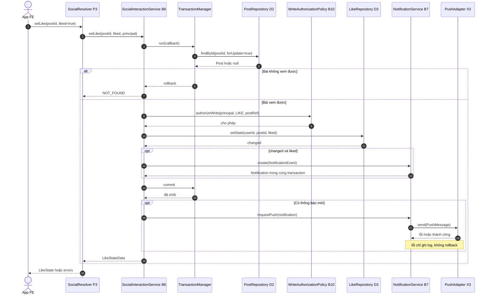
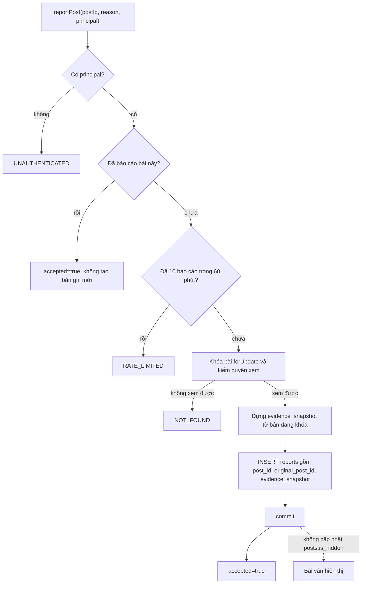
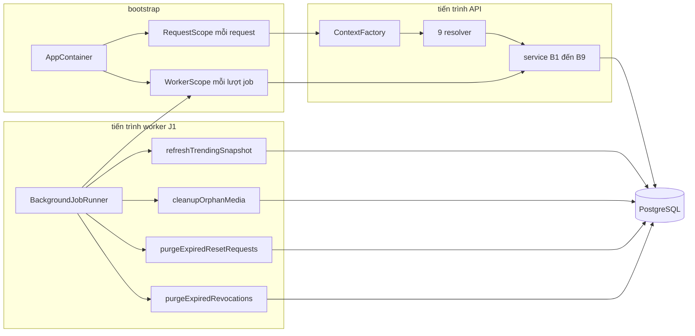

# Chi tiết nhóm 4.3 — Profile & Social (S8–S11)

| Thuộc tính | Nội dung |
|---|---|
| Người phụ trách | Lead (nhóm 4.3) |
| Nhóm | 4.3 Profile & Social |
| UC | UC-10 Xem hồ sơ, UC-11 Cập nhật hồ sơ, UC-12 Công khai hồ sơ, UC-13 Thích/lưu, UC-14 Theo dõi và thông báo, UC-15 Báo cáo bài |
| Màn hình | MH-10, MH-11, MH-12, MH-13, MH-14; nút Báo cáo ở MH-07 |
| Bảng | T12 likes, T13 follows, T14 collections, T15 collection_items, T16 reports, T17 notifications, T25 user_blocks |
| Thành phần | P3, B5, B6, B7, D3, X3 (push), B10 (dùng chung), J1 (dùng chung) |
| Sprint | S8, S9, S10, S11 |
| Ngày | 12/11/2026 |
| Người đọc | Thành viên nhóm 4.3 và coder (pane AI) được giao nhóm này |

## 0. Cách dùng file này

1. Đây là hợp đồng cài đặt của nhóm 4.3, không phải tài liệu nộp; coder chỉ cần file này cùng các tài liệu được dẫn trong từng WP.
2. Thứ tự đọc: mục 1 (phạm vi, điểm nối) → mục 2 (bản đồ tài liệu) → mục 3 (bảy câu phải trả lời được) → mục 4 (app mẫu, chỗ không được copy) → mục 5 (lỗi tài liệu) → WP của sprint đang làm ở mục 6 → mục 7 (thứ tự, lệnh giao việc).
3. Trước khi code một WP: đọc “Phải hiểu trước khi code” và “Spec”; viết test trước; chỉ đánh dấu xong khi “Test cần viết” xanh và đã tự QA theo mục 9.1 của file tổng quan.
4. Báo xong trong PR: mã WP, file đã tạo, lệnh test đã chạy kèm kết quả, chỗ lệch tài liệu (kèm DOC và mục), việc còn treo; không báo “xong” khi mới có code.
5. Cấm: tự đổi hợp đồng API hay thêm bảng/cột, gọi dịch vụ ngoài trong transaction, và copy hành vi app mẫu mà mục 4 ghi “không lấy” (tự ẩn bài, toggle, chặn hai chiều khi O6 chưa chốt).

## 1. Phạm vi và vai trò của nhóm trong hệ thống

Nhóm 4.3 giữ phần xã hội của ToMateTo: hồ sơ công khai và quyền công khai từng trường, thích, lưu vào bộ sưu tập, theo dõi, hộp thông báo kèm push, và báo cáo bài. Nhóm làm trọn chuỗi từ màn hình Flutter tới bảng dữ liệu, như mục 7.1 của file tổng quan đã chia (`HUONG_DAN_S8_S11_THEO_NHOM.md:402`).

Ngoài sáu UC, trong S8 nhóm dựng **hạ tầng làm việc chung** (repo, compose, mẫu cấu hình, CI lint + test) và viết hai thành phần mà ba nhóm còn lại gọi: `WriteAuthorizationPolicy` (B10) và `BackgroundJobRunner` (J1) với `WorkerScope`. Vì vậy nhóm này vừa là **người cung cấp** ở 5 điểm nối, vừa là **người nhận** ở 7 điểm nối — nhiều nhất trong bốn nhóm (`HUONG_DAN_S8_S11_THEO_NHOM.md:406`). Trễ một chữ ký ở đây sẽ chặn DB và BE, nên mọi chữ ký phải được công bố kèm bản giả ngay đầu sprint.

Nguyên tắc chung cho mọi điểm nối: người cung cấp công bố **chữ ký + bản giả chạy được** ở đầu sprint cần dùng; người nhận code theo bản giả, không chờ bản thật; đổi chữ ký phải báo trước và cả hai cùng review (`HUONG_DAN_S8_S11_THEO_NHOM.md:135`).

| # | Chiều | Lớp / phương thức | Sprint cần | Điều kiện sẵn sàng và bản giả |
|---|---|---|---|---|
| 1 | Nhận từ FE (4.1) | `IdentityService.verifySession` → `Principal` | S8 | Cần cho `ContextFactory`. Bản giả: `StubIdentityService` đọc header test và trả `Principal(userId, jti, version)` cố định; test B10 dùng trực tiếp `Principal`, không qua HTTP. |
| 2 | Nhận từ FE (4.1) | `AccountRepository.findById` | S8 | Cần để tra chủ hồ sơ và actor. Bản giả: `StubAccountLookup` trả 5 tài khoản seed của 7.3-A mục 4; hết S9 thay bằng `ProfileRepository.findById` trên T01. |
| 3 | **Cung cấp** | `WriteAuthorizationPolicy` (B10) | S8 | Giao cho cả bốn nhóm. Công bố chữ ký theo `6.1-A_BE@3571426.md:1056` và bộ test ba nhánh; bản giả không cần vì chính nó là lớp thuần, không I/O. |
| 4 | Nhận từ BE (4.4) | `CursorCodec`, `PageRequest`, `ErrorMapper`, `TransactionManager` | S8 | Cần cho mọi danh sách và mutation. Bản giả: bốn lớp mỏng cùng tên, cùng chữ ký `6.1-A_BE@3571426.md:1060`, đặt ở `backend/app/shared/`, có TODO thay bản thật; test con trỏ chạy trên bản giả. |
| 5 | **Cung cấp** | `CollectionRepository.createDefault` | S9 (FE cần ở luồng đăng ký) | Công bố ở cuối S8, kèm test tạo đúng một bộ “Đã lưu” trong cùng transaction với user; FE gọi qua `IdentityService.register`, không gọi API riêng. |
| 6 | **Cung cấp** | `LikeRepository`, `CollectionRepository` (trạng thái thích/lưu), `BlockRepository.listBlockedUserIds` | S9 | Công bố ba chữ ký hàng loạt (mục 3 câu 7) và test trên 3 bài/2 người; DB và BE code theo bản giả trả `set`/`map` rỗng khi chưa có dữ liệu. |
| 7 | Nhận từ DB (4.2) | `PostRepository.findById(postId, forUpdate)` | S9 | Cần để khoá bài trước khi thích/lưu/báo cáo. Bản giả: `StubPostRepository` đọc bảng `posts` seed, chạy `SELECT … FOR UPDATE`; bài ẩn/bị chặn trả `null` để service ném `NOT_FOUND`. |
| 8 | Nhận từ DB (4.2) | route `POST /media/uploads`, `MediaUploadRepository.consume` với purpose `AVATAR`/`COVER` | S10 | Cần cho UC-11. Bản giả: `StubMediaUpload.consume(uploadId, ownerId, AVATAR)` trả asset đã seed; FE chọn ảnh từ tệp cục bộ và gửi `avatarUploadId`, chưa cần route thật để test service. |
| 9 | Nhận từ DB (4.2) | `FeedQueryService.listPostsByAuthor` | S10 | Cần cho `profilePosts`/`myPosts`. Bản giả: `StubAuthorFeed` đọc 20 bài seed của một tác giả, cùng kiểu `PageResult`; thay bằng bản thật khi DB giao, không đổi chữ ký resolver. |
| 10 | Nhận từ FE (4.1) | `DeviceRepository` (T04) | S10 | Cần để gửi push. Bản giả: `StubDeviceRepository` trả một thiết bị `platform=ANDROID`, token `test-token`; test push tuyệt đối không gọi FCM thật. |
| 13 | **Cung cấp** | bảng T12 `likes`, T15 `collection_items` | S10 | BE (job xu hướng) đọc trực tiếp bảng, không qua API. Điều kiện: ghi/xoá chỉ qua `LikeRepository.setState` và `CollectionRepository.addItem/removeItem`, không có đường ghi tắt; công bố ở cuối S9 kèm ghi chú “unlike là xoá dòng”. |
| 14 | **Cung cấp** | `SocialInteractionService.reportPost` | S10 | DB chuyển tiếp từ `PostMutationResolver.reportPost` (nút Báo cáo ở MH-07). Công bố chữ ký `reportPost(postId, reason, principal) → ReportReceiptData`; bản giả trả `accepted=true` và không ghi bảng để DB ráp resolver trước. |

## 2. Bản đồ tài liệu cần đọc

| # | Tài liệu, mục (đường dẫn local) | Đọc để hiểu gì | Cần cho sprint |
|---|---|---|---|
| 1 | `D:\hdv\quan_ly_du_an\s5s6_lead\noi_bo\src\5.2-A_BE.md` §4.4–4.5, §6, §12.4, §12.5, §12.10 | Tên operation, input/output, mã lỗi, quy tắc trạng thái đích và idempotency | S8–S10 |
| 2 | `D:\hdv\quan_ly_du_an\s5s6_lead\noi_bo\src\5.3-B_S4@3ec4d83.md` T01, T12–T17, T25, §3 | Cột, khoá, chỉ mục, ràng buộc, ranh giới transaction của bảy bảng | S8–S10 |
| 3 | `D:\hdv\quan_ly_du_an\s5s6_lead\noi_bo\src\5.4-A_BE.md` §3.3, §3.5, §5.6, §4.4 | Ai được làm gì, `FORBIDDEN`/`NOT_FOUND`, rate limit, che email trong log | S8–S10 |
| 4 | `D:\hdv\quan_ly_du_an\s5s6_lead\noi_bo\src\6.1-A_BE@3571426.md` §3, §4.3, §4.5, §5.2–5.7, §9 | Sơ đồ lớp P3/B5/B6/B7/D3, B10, J1, chữ ký service/repository, `WorkerScope` | S8–S11 |
| 5 | `D:\hdv\quan_ly_du_an\s5s6_lead\noi_bo\src\6.2-A_BE@ed27b57.md` Hình 06, §5.3, §5.4 | Luồng thích/lưu có thông báo cùng transaction, push sau response, quy tắc UC-10…15 | S8–S10 |
| 6 | `D:\hdv\quan_ly_du_an\s5s6_lead\noi_bo\src\6.1-A_FE@c3b8b46.md` §3.3, §4.28–4.33 | Repository/controller FE, khoá theo đối tượng, `unreadCount`, luồng lưu bài | S9–S10 |
| 7 | `D:\hdv\quan_ly_du_an\s5s6_lead\noi_bo\src\6.2-A_FE@c3b8b46.md` FE-SQ07, FE-SQ08, mục 13 | Luồng lưu bài và thông báo phía app, chỗ tái sử dụng thiết kế | S9–S10 |
| 8 | `D:\hdv\quan_ly_du_an\s5s6_lead\noi_bo\src\6.3-A_mockup_hifi_fe@999e0be.md` MH-10…MH-14, MH-07 | Bố cục, hành vi, trạng thái rỗng, vùng chạm của năm màn | S9–S10 |
| 9 | `D:\hdv\quan_ly_du_an\s5s6_lead\noi_bo\src\7.1-A.1_DB@439472c.md` Q04, Q05, Q23; `7.1-A.1_queries@439472c.sql` | Truy vấn bài tác giả, bài đã lưu, hộp thư kèm `unreadCount` toàn hộp | S9–S10 |
| 10 | `D:\hdv\quan_ly_du_an\s7_lead\nop\7.3-A_test_plan.md` §2, §4, §5, §7; `7.3-C_ma_tran_phu_uc.md` | Mức U/I/E/D/M, dữ liệu kiểm, mã TC của UC-10…15, tiêu chí ra | S9–S11 |
| 11 | `D:\hdv\quan_ly_du_an\s7_lead\nop\7.4-A_chuan_chung.md` §1–§4, §9; `7.4-B_cau_hinh\` | Cấu trúc repo, nhánh/commit/PR, lệnh lint và test, tệp cấu hình mẫu | S8, S11 |
| 12 | `D:\hdv\quan_ly_du_an\s7_lead\nop\7.2-A_tong_hop_xu_ly_loi.md`; `7.2-A_BE@23a5f14.md` §2–§3; `7.2-A_xu_ly_loi_frontend@999e0be.md` | Bảng mã lỗi, thông điệp tiếng Việt, hành vi giữ/phục hồi trạng thái | S9–S10 |
| 13 | `D:\hdv\quan_ly_du_an\s5s6_lead\nop\gop_y\S5_BE.md`, `S5_FE.md`, `S5_lien_ket.md`, `S6_BE.md`, `S6_FE.md`, `S6_lien_ket.md` | Lỗi đã biết của tài liệu thiết kế; đọc trước khi tin một câu trong DOC | S8–S10 |

## 3. Cần nắm: hồ sơ, tương tác, thông báo và hạ tầng dùng chung

Bảy câu dưới đây là điều người làm nhóm 4.3 phải trả lời được bằng lời của mình trước khi code. Năm câu đầu lấy nền từ mục 7.3 của file tổng quan nhưng đào sâu thêm bằng chỗ khác nhau giữa tài liệu và app mẫu; hai câu cuối là phần hạ tầng và điểm nối mà bản tóm tắt cũ không có.

### Câu 1. Bấm Thích hai lần, hoặc mất mạng giữa chừng, thì hệ thống xử lý thế nào?

App gửi **trạng thái muốn đạt tới**, không gửi lệnh đảo: `setLike(postId, liked=true)` hai lần vẫn chỉ có một dòng T12. Cách này an toàn vì lần gửi lại thấy trạng thái đã đúng thì không ghi gì, nên retry không bao giờ tạo sai (`5.2-A_BE.md:277`, `5.2-A_BE.md:857`). Điều kiện để đúng: repository dùng `INSERT … ON CONFLICT DO NOTHING` khi `liked=true` và `DELETE … WHERE` khi `liked=false`, rồi trả **trạng thái sau khi ghi** cùng số đếm; service chỉ phát thông báo khi `changed=true` (`5.3-B_S4@3ec4d83.md:164`).

Phía app, `InteractionController` giữ `stateByTarget` để khoá đúng đối tượng đang chờ, không khoá cả màn (`6.1-A_FE@c3b8b46.md:1151`). Mất phản hồi thì giữ trạng thái đã xác nhận gần nhất; không tự đoán và không gửi lệnh đảo — vì lệnh đảo gửi lại sau khi mất phản hồi sẽ tạo kết quả ngược ý người dùng.

### Câu 2. Thông báo sinh lúc nào, và vì sao push không làm hỏng lượt thích?

Thông báo chỉ sinh khi trạng thái **thật sự đổi** và được ghi **trong cùng transaction** với lượt thích/theo dõi; như vậy không có chuyện có like mà mất thông báo, hoặc ngược lại (`6.2-A_BE@ed27b57.md:584`, `6.2-A_BE@ed27b57.md:642`). Push là dịch vụ ngoài nên chỉ được gọi **sau khi commit**; lỗi push chỉ ghi log, không rollback dữ liệu đã chốt (NFR-10, `7.3-A_test_plan.md:81`).



Hệ quả phải chấp nhận: API restart giữa commit và push có thể mất push, vì v1 **không có bảng hàng đợi giao nhận** (`6.2-A_BE@ed27b57.md:642`; `6.1-A_BE@3571426.md:1532`). Đây là giới hạn đã biết, không phải lỗi coder tự sửa bằng cách thêm bảng.

### Câu 3. Ba mã `UNAUTHENTICATED`, `FORBIDDEN`, `NOT_FOUND` khác nhau ở đâu?

| Tình huống | Mã | Nơi quyết định | Vì sao |
|---|---|---|---|
| Không có token mà đòi ghi | `UNAUTHENTICATED` | `ContextFactory`, trước khi vào service | Chưa biết người gọi là ai (`5.4-A_BE.md:227`) |
| Có token, tài nguyên **xem được** nhưng không phải chủ | `FORBIDDEN` | B10 trong service, sau khi nạp `ResourceRef` | Biết người gọi là ai; không có quyền sở hữu (`5.4-A_BE.md:228`) |
| Tài nguyên **không xem được** (ẩn, bị chặn, đã xoá, không tồn tại) | `NOT_FOUND` | Repository/service trả `null` → service ném lỗi | Không để lộ tài nguyên có tồn tại (`5.4-A_BE.md:228`) |
| Tài nguyên tồn tại nhưng người xem không được phép xem | `NOT_AVAILABLE` | Service, sau khi kiểm quyền xem | Khác `NOT_FOUND`: có tồn tại nhưng không khả dụng (`5.2-A_BE.md:368`) |

Ranh giới thực thi rất quan trọng: resolver **không** tự kiểm quyền chủ bài; nó chỉ đọc ngữ cảnh và gọi service (`HUONG_DAN_S8_S11_THEO_NHOM.md:86`). B10 nhận `Principal` và `ResourceRef` do service nạp, nên kiểm quyền nằm trong cùng transaction, không mở truy vấn riêng (`6.1-A_BE@3571426.md:1512`, `6.1-A_BE@3571426.md:908`). Với bộ sưu tập của người khác, tài liệu đang mâu thuẫn: `5.2-A_BE.md:733` ghi `FORBIDDEN`, còn quy tắc chung `5.4-A_BE.md:228` và app mẫu (`D:\hdv\backend\app\services\engagement_service.py:99`) chọn `NOT_FOUND`. Nhóm tạm làm theo quy tắc chung (không lộ sự tồn tại) và ghi lệch vào PR; xem mục 5 và mục 8.

### Câu 4. Bộ sưu tập và hồ sơ công khai có những quy tắc gì?

- **Đúng một bộ mặc định:** CSDL bảo đảm *tối đa* một bộ `is_default=true` bằng partial unique index, không bảo đảm *có* một bộ; service tạo bộ “Đã lưu” trong **cùng transaction đăng ký** và cấm xoá hoặc chuyển cờ bộ mặc định (`5.3-B_S4@3ec4d83.md:176`). Vì vậy đăng ký lỗi thì không có user mồ côi thiếu bộ lưu.
- **Tên bộ:** không rỗng sau trim; `name_normalized` để so trùng trong cùng chủ; rename không làm mất cờ mặc định (`5.3-B_S4@3ec4d83.md:174`).
- **Hồ sơ công khai:** người khác chỉ thấy trường nằm trong `public_profile_fields`; email luôn bị loại kể cả khi allowlist bị nhập sai (`5.3-B_S4@3ec4d83.md:39`, `5.3-B_S4@3ec4d83.md:45`). Sửa hồ sơ và sửa quyền công khai là **hai operation riêng**, không tự suy ra nhau (`5.2-A_BE.md:723`, `5.3-B_S4@3ec4d83.md:45`).
- **Theo dõi:** tự theo dõi trả `VALIDATION_FAILED · SELF_FOLLOW` (`7.2-A_BE@23a5f14.md:91`); theo dõi không đổi nội dung feed v1 (`5.3-B_S4@3ec4d83.md:170`).

### Câu 5. Báo cáo bài lưu gì, vì sao bất biến, và vì sao không tự ẩn bài?

Khi báo cáo, service lấy `post_id` từ bài **đã kiểm quyền xem**, khoá bài, rồi tự dựng `evidence_snapshot` từ bản đang khoá; client không được gửi `original_post_id` hay snapshot (`5.3-B_S4@3ec4d83.md:190`). Snapshot tối thiểu gồm `originalPostId`, `authorId`, `dishName`, `caption`, `capturedAt`; trường nội dung thiếu thì để NULL; **không chụp email/OTP**. `original_post_id` cố ý không có khoá ngoại để xoá bài không kéo theo xoá bằng chứng; khi bài bị xoá, `post_id` chuyển NULL nhưng hai trường lịch sử không đổi (`5.3-B_S4@3ec4d83.md:186`).

Thiết kế mới **không tự ẩn bài** khi đủ ngưỡng: báo cáo chỉ ghi nhận, bài vẫn hiển thị chờ xử lý (`5.2-A_BE.md:286`, `5.2-A_BE.md:742`). App mẫu làm ngược lại và sẽ bị cấm copy (xem mục 4). Mỗi người tối đa 10 báo cáo/giờ, lần thứ 11 trả `RATE_LIMITED`; gửi lặp trên cùng một bài trả `accepted=true` và không tạo bản ghi mới (`5.2-A_BE.md:742`, `5.2-A_BE.md:858`).



Thứ tự kiểm tra có chủ ý: kiểm trùng và đếm rate limit **trước** khi khoá bài, để 10 request rác không giữ khoá hàng. Kiểm trùng dựa trên `(reporter_id, original_post_id)` — đây mới là **đề xuất** trong `5.3-B_S4@3ec4d83.md:188`, cần chốt O12; nếu chưa có unique index thì service vẫn phải kiểm bằng truy vấn để không tạo hai bản ghi.

### Câu 6. Hạ tầng S8 phải đạt gì, B10 gom quyền ở đâu, và J1 chạy bốn job thế nào?

Mục tiêu S8 đo được là: máy sạch dựng được bằng **một lệnh** (`docker compose up`), CI xanh trên mọi PR, mỗi nhóm có test repository trên CSDL thật (`HUONG_DAN_S8_S11_THEO_NHOM.md:48`). Vì vậy hạ tầng không phải “việc phụ”: nó là điều kiện để ba nhóm kia bắt đầu. Cấu trúc repo bám `7.4-A_chuan_chung.md:18`: `backend/`, `app/`, `db/`, `docker-compose.yml`, `.env.example`, `.editorconfig`, `.github/pull_request_template.md`, `README.md`. Tệp mẫu chỉ chứa giá trị giả; `.env` thật, `uploads/`, `.venv/`, `build/` không được vào repo (`7.4-A_chuan_chung.md:32`).

B10 là **một điểm quyết định** thay vì rải kiểm tra trong resolver: service nạp dữ liệu quyền từ repository rồi truyền `ResourceRef`, policy so `ownerId` với `Principal` theo `WriteAction` (`6.1-A_BE@3571426.md:1188`, `6.1-A_BE@3571426.md:1313`). Policy không giữ phiên và không tự truy vấn, nên dùng được trong transaction và test thuần.



Bốn job là cố định, không thêm job thứ năm trong v1 (`6.1-A_BE@3571426.md:1525`). `runScheduledJob(name)` lấy khoá theo tên, mở `WorkerScope` riêng, bỏ qua nếu khoá đang giữ, đóng scope và log `SUCCESS`/`SKIPPED`/`FAILED` kèm số bản ghi (`6.1-A_BE@3571426.md:1523`). Job không phục vụ request GraphQL và không có worker gửi push (`6.2-A_BE@ed27b57.md:916`, `6.2-A_BE@ed27b57.md:925`).

### Câu 7. Lọc chặn và cung cấp trạng thái thích/lưu cho nhóm khác thế nào để không N+1 và không lộ dữ liệu?

Điểm nối 6 là chỗ dễ sai nhất vì ba nhóm cùng đọc. Hợp đồng phải là **hàng loạt theo trang**, không phải hỏi từng bài:

| Phương thức công bố | Đầu vào | Đầu ra | Quy tắc |
|---|---|---|---|
| `LikeRepository.likedByUser(viewerId, postIds)` | id người xem (có thể null), danh sách id bài của trang | `set[int]` | Một truy vấn `IN`; khách trả rỗng (`D:\hdv\backend\app\repositories\like_repo.py:40`) |
| `LikeRepository.countByPost(postIds)` | danh sách id bài | `map[int,int]` | Một truy vấn `GROUP BY`; dùng cho số đếm trên thẻ (`D:\hdv\backend\app\repositories\like_repo.py:30`) |
| `CollectionRepository.savedByUser(viewerId, postIds)` | như trên | `set[int]` | “Đã lưu” = có trong **bất kỳ** bộ của người xem (`D:\hdv\backend\app\repositories\collection_repo.py:99`) |
| `BlockRepository.listBlockedUserIds(viewerId)` | id người xem | `int[]` | Trả **cả hai chiều** nếu O6 chốt hai chiều; tính một lần cho mỗi trang (`6.1-A_BE@3571426.md:1235`) |

Quy tắc lọc: danh sách chặn phải được áp **trước khi sắp xếp và LIMIT**, kể cả khi mở trực tiếp chi tiết bài; nếu không, trang vẫn đủ 10 dòng nhưng lọt nội dung bị chặn (`5.3-B_S4@3ec4d83.md:264`, `HUONG_DAN_S8_S11_THEO_NHOM.md:103`). Khách không có danh sách chặn cá nhân.

Về chiều chặn: `5.3-B_S4@3ec4d83.md:264` đề xuất một chiều viewer→author, còn `6.4-A_data_dictionary.md:750` và `6.2-A_BE@ed27b57.md:901` mô tả hai chiều theo REQ-028; 6.4 ghi rõ không coi chiều một phía là được duyệt (`6.4-A_data_dictionary.md:776`). Nhóm tạm cài **hai chiều** sau một cờ cấu hình, ghi “giả thuyết O6” trong PR; đổi cờ không phải sửa truy vấn.

## 4. Đối chiếu với app mẫu

App mẫu là một thiết kế khác (13 bảng, tự ẩn bài khi đủ 5 báo cáo, chặn hai chiều, không có `read_at`). Bảng dưới chỉ ra chỗ lấy được **mẫu cấu trúc** và chỗ phải làm khác hẳn.

| Việc | File và dòng trong app mẫu | App mẫu làm gì | Thiết kế mới khác ở đâu | Lấy / không lấy |
|---|---|---|---|---|
| Thích bài | `D:\hdv\backend\app\services\engagement_service.py:15` | `toggle_like` đảo trạng thái, gọi notify khi thêm, commit cuối hàm | `setLike(postId, liked)` nhận trạng thái đích, trả `LikeState`; retry không đổi kết quả (`5.2-A_BE.md:277`) | **Không lấy toggle**; lấy cách bọc transaction và trả bài/state sau commit |
| Bảng thích | `D:\hdv\backend\app\models\engagement.py:11` | PK đôi `(user_id, post_id)`, index `post_id` | T12 giống PK đôi, thêm index `(post_id, created_at)` (`5.3-B_S4@3ec4d83.md:162`) | Lấy mẫu PK đôi; bổ sung index theo T12 |
| Thông báo | `D:\hdv\backend\app\models\notification.py:13` | `payload` JSONB tự do, `read` boolean, không có actor/post | T17 có `actor_id`, `post_id`, `read_at`; tên actor đọc từ `users`, không đóng băng trong payload (`5.3-B_S4@3ec4d83.md:194`) | **Không lấy payload/read**; lấy ý “một dòng một sự kiện” |
| Sinh thông báo + push | `D:\hdv\backend\app\services\notify_service.py:73` | Thêm dòng rồi gửi FCM **ngay trong transaction**, lỗi push bị nuốt (`:97`) | Thông báo cùng transaction, push **sau commit** (`6.2-A_BE@ed27b57.md:642`) | Lấy “push lỗi không làm hỏng thao tác”; **không lấy push trong transaction** |
| Nuốt lỗi push | `D:\hdv\backend\app\services\notify_service.py:54` | `except Exception` ghi warning, trả `False` | Giữ nguyên tinh thần NFR-10; log không chứa token (`5.4-A_BE.md:272`) | Lấy, nhưng log theo NFR-09 |
| Báo cáo bài | `D:\hdv\backend\app\services\moderation_service.py:11` | Chặn tự báo cáo (`:16`), chặn trùng (`:18`), đủ ngưỡng thì `post.is_hidden = True` (`:24`) | Không tự ẩn, không cấm tự báo cáo bài công khai, báo cáo bất biến có snapshot (`5.3-B_S4@3ec4d83.md:190`, `6.2-A_BE@ed27b57.md:933`) | **Không lấy tự ẩn và cấm tự báo cáo**; lấy kiểm lý do rỗng và chống trùng |
| Bảng báo cáo | `D:\hdv\backend\app\models\engagement.py:52` | `post_id` FK, không snapshot, không mã gốc | T16 có `post_id?` (SET NULL), `original_post_id` **không FK**, `evidence_snapshot` JSONB (`5.3-B_S4@3ec4d83.md:186`) | **Không lấy**; đây là chỗ khác căn bản |
| Chặn người dùng | `D:\hdv\backend\app\repositories\block_repo.py:19` | Lọc hai chiều trong `not_blocked_clause`, dùng lại cho feed và gợi ý (`follow_repo.py:104`) | T25 chỉ đọc dữ liệu seed, **không có mutation tạo block** trong v1 (`5.3-B_S4@3ec4d83.md:260`); chiều lọc chờ O6 | Lấy cách viết điều kiện lọc trước LIMIT; **không lấy `blockUser` mutation** (`moderation_service.py:30`) |
| Bộ mặc định | `D:\hdv\backend\app\models\engagement.py:31` + `collection_repo.py:21` | Cờ `is_default`, `clear_default` trước khi tạo bộ mặc định mới | T14 dùng partial unique index và cấm xoá/chuyển cờ; service tạo trong transaction đăng ký (`5.3-B_S4@3ec4d83.md:176`) | Lấy ý cờ thay vì so tên; **không lấy API đổi bộ mặc định** |
| Bỏ lưu | `D:\hdv\backend\app\services\engagement_service.py:114` | Xoá bài khỏi **mọi** bộ sưu tập của người dùng | T15/O12 đề xuất thiếu `collectionId` thì chỉ bỏ ở “Đã lưu” (`5.3-B_S4@3ec4d83.md:182`) | **Không lấy “mọi bộ”**; làm theo O12 và ghi giả thuyết |
| Bộ của người khác | `D:\hdv\backend\app\services\engagement_service.py:96` | Trả `NotFoundError` thay vì `FORBIDDEN` để không lộ | Quy tắc chung 5.4-A §3.5 cũng vậy; 5.2-A §12.5 lại ghi `FORBIDDEN` | Lấy cách không lộ; xử lý lệch ở mục 5 |
| Hộp thư | `D:\hdv\backend\app\repositories\notification_repo.py:8` | Cursor chỉ theo `id DESC`, không có tổng chưa đọc | T17 cursor `(created_at, id)`, `read_at`, `unreadCount` toàn hộp (`5.3-B_S4@3ec4d83.md:198`) | **Không lấy cursor id**; lấy `first + 1` và cách trả `hasNextPage` |
| Đánh dấu tất cả đã đọc | `D:\hdv\backend\app\repositories\notification_repo.py:22` | `UPDATE … SET read=true` | Đổi sang `read_at = now()`; trả `unreadCount` (`5.2-A_BE.md:741`) | Lấy câu UPDATE hàng loạt, đổi cột |
| Theo dõi | `D:\hdv\backend\app\services\follow_service.py:27` | Toggle, khi theo dõi thì notify, commit | `setFollow(userId, followed)` trạng thái đích; tự theo dõi trả `SELF_FOLLOW` (`5.2-A_BE.md:283`, `7.2-A_BE@23a5f14.md:91`) | **Không lấy toggle**; lấy cách đếm follower/following hàng loạt (`follow_repo.py:54`) |
| Gợi ý theo dõi | `D:\hdv\backend\app\services\follow_service.py:53` | Gợi ý người để theo dõi kèm ảnh/thẻ | Không có operation gợi ý trong 5.2-A §4.4; **không đưa vào v1** | **Không lấy** (tránh mở UC mới) |
| Cập nhật hồ sơ | `D:\hdv\backend\app\services\profile_service.py:57` | Validate hết trước khi ghi, `phone` đổi thì reset `phone_verified` | T01 không có `phone`/`phone_verified`; avatar/cover là **media id** có purpose, không phải URL tự do (`5.3-B_S4@3ec4d83.md:40`, `5.2-A_BE.md:723`) | Lấy “validate trước, ghi sau”; **không lấy phone và URL tự do** |
| Kiểm quyền ở resolver | `D:\hdv\backend\app\graphql\context.py:50` | `require_user` ném `UnauthorizedError`; `to_int` sai thì `NotFoundError` | Chỉ `ContextFactory` lo `UNAUTHENTICATED`; quyền chủ do B10 trong service (`6.1-A_BE@3571426.md:1512`) | Lấy cách chuẩn hoá lỗi ở biên; **không lấy kiểm quyền rải trong resolver** |
| Job nền | `D:\hdv\backend\app\jobs\scheduler.py:43` | APScheduler blocking, 2 job, chạy trong container `cron` (`docker-compose.yml:44`) | J1 có 4 job, khoá theo tên, `WorkerScope`, `JobResult` (`6.1-A_BE@3571426.md:1523`) | Lấy mẫu “tiến trình riêng, dừng êm”; **không lấy danh sách job và không thêm job push** |
| Job nhắc ăn | `D:\hdv\backend\app\jobs\daily_reminder.py:27` | Gửi push trước rồi ghi dòng `DAILY_REMINDER` | T17 chỉ có `LIKE/SAVE/FOLLOW`; không có worker push (`5.3-B_S4@3ec4d83.md:196`, `6.2-A_BE@ed27b57.md:925`) | **Không lấy** |
| CI | `D:\hdv\.github\workflows\deploy.yml:40` | Chạy `pytest`, `alembic upgrade head`, `ruff` trên PostgreSQL service; không có mypy/Flutter | 7.4-A §9 yêu cầu thêm `ruff format --check`, `mypy`, `dart format`, `flutter analyze`, `flutter test` (`7.4-A_chuan_chung.md:98`) | Lấy khung job test + service Postgres; bổ sung phần thiếu |
| Compose | `D:\hdv\docker-compose.yml:7`, `D:\hdv\docker-compose.dev.yml:1` | Prod: postgres/api/cron/nginx, postgres không mở cổng; dev: chỉ postgres cổng 5433 | ToMateTo cần compose cho backend + PostgreSQL, tệp `.env.example`; không bắt buộc nginx/cron ở S8 (`7.4-A_chuan_chung.md:24`) | Lấy healthcheck, `depends_on`, không mở cổng DB; bỏ phần chưa cần |
| Nút Thích (FE) | `D:\hdv\app_flutter\lib\shared\widgets\like_button.dart:7` | Widget chỉ hiển thị, cha giữ state và gọi mutation; pop khi bật | Giữ nguyên phân chia này; controller khoá theo đối tượng (`6.1-A_FE@c3b8b46.md:1160`) | Lấy |
| Nút Theo dõi (FE) | `D:\hdv\app_flutter\lib\shared\widgets\follow_button.dart:89` | Optimistic, gọi `toggleFollow`, nhận bool server, lỗi thì hoàn nguyên | Gọi `setFollow(userId, followed)` với trạng thái đích; lỗi `SELF_FOLLOW` có thông điệp riêng (`7.2-A_BE@23a5f14.md:91`) | Lấy optimistic + server authoritative; **đổi mutation** |
| Đăng ký push (FE) | `D:\hdv\app_flutter\lib\core\push_service.dart:44` | Một lần khi đăng nhập: xin quyền, lấy token, gửi `updateFcmToken`; thiếu cấu hình thì tắt êm | Dùng `registerDevice(pushToken, platform)` / `unregisterDevice` (`5.2-A_BE.md:270`); token không được log | Lấy cách chịu lỗi; đổi tên operation |
| Màn thông báo (FE) | `D:\hdv\app_flutter\lib\features\notifications\notifications_screen.dart:157` | `markAllRead` gọi BE rồi sửa state cục bộ; `markRead` **chỉ cục bộ** vì BE không có mutation | BE có `markNotificationRead(id)` trả `unreadCount` (`5.2-A_BE.md:740`); mở mục không tự đánh dấu (`6.2-A_FE@c3b8b46.md:414`) | **Không lấy markRead cục bộ**; lấy cách đồng bộ sau xác nhận |

## 5. Lỗi đã biết ở tài liệu thiết kế

Mỗi dòng: vị trí, sai gì, cách coder tạm làm cho an toàn. Các thành viên đang sửa tài liệu, nên **kiểm lại bản mới trước khi code**.

1. `5.2-A_BE.md:291` và `6.2-A_BE@ed27b57.md:936` nói v1 **không có** mutation tạo block, nhưng `5.2-A_BE.md:4.5` không liệt kê `blockUser`; app mẫu lại có (`D:\hdv\backend\app\services\moderation_service.py:30`). Coder: **không viết mutation block**, chỉ đọc seed T25 và lọc; nếu FE cần nút Chặn thì đưa vào câu hỏi mở, không tự thêm.
2. `5.3-B_S4@3ec4d83.md:264` đề xuất chặn **một chiều** viewer→author, trong khi `6.4-A_data_dictionary.md:750` và `6.2-A_BE@ed27b57.md:901` nói **hai chiều** theo REQ-028. Coder: cài hai chiều sau cờ cấu hình, ghi “giả thuyết O6”, không sửa schema.
3. `5.2-A_BE.md:742` và `5.2-A_BE.md:858` đặt 10 báo cáo/giờ, nhưng `5.2-A_BE.md:508` nói chưa quy định quota báo cáo và “không tự đặt con số”, còn `5.4-A_BE.md:348` nói bảng ngưỡng chỉ là lựa chọn chưa duyệt. Coder: cài ngưỡng **cấu hình** mặc định 10/giờ, trả `RATE_LIMITED · REQUEST_LIMIT`, ghi rõ nguồn 5.2-A §12.5 trong PR.
4. `5.2-A_BE.md:733` ghi bộ sưu tập của người khác trả `FORBIDDEN`, trong khi `5.4-A_BE.md:228` và app mẫu (`D:\hdv\backend\app\services\engagement_service.py:99`) chọn `NOT_FOUND`. Coder: dùng `NOT_FOUND` (không lộ sự tồn tại), ghi lệch hợp đồng vào PR và mục 8.
5. `5.2-A_BE.md:4.5` cho `savePost`/`removeSavedPost` với `collectionId` tùy chọn, nhưng `6.1-A_BE@3571426.md:645` khai không có `?` (góp ý `S5_BE.md:8`). Coder: làm **nullable** theo hợp đồng API; báo BE sửa sơ đồ.
6. `6.1-A_BE@3571426.md:397` đặt `reportPost` ở `PostMutationResolver` nhưng sơ đồ lớp không có cạnh tới `SocialInteractionService` (góp ý `S5_BE.md:9`). Coder: resolver chỉ chuyển tiếp sang `SocialInteractionService.reportPost`; vẽ cạnh này trong PR, không viết logic báo cáo trong resolver.
7. `6.1-A_BE@3571426.md:679` khai `CollectionService` nhưng sơ đồ gói business thiếu node (góp ý `S5_BE.md:10`). Coder: vẫn tạo lớp theo §4.3, không gộp vào `SocialInteractionService`.
8. `5.3-B_S4@3ec4d83.md:188` để `UNIQUE(reporter_id, original_post_id)` là **đề xuất** cần O12, còn `5.2-A_BE.md:742` nói “ràng buộc unique ở DOC 5.3-A” như đã có. Coder: service kiểm trùng bằng truy vấn; nếu DB chưa tạo unique index thì không dựa vào DB để chống trùng.
9. `5.3-B_S4@3ec4d83.md:182` để quy tắc “bỏ lưu thiếu `collectionId` chỉ bỏ ở Đã lưu” là đề xuất O12; app mẫu xoá khỏi mọi bộ (`D:\hdv\backend\app\services\engagement_service.py:120`). Coder: làm theo đề xuất O12, test cả hai nhánh, ghi giả thuyết.
10. `5.3-B_S4@3ec4d83.md:196` giới hạn `type` của T17 là `LIKE/SAVE/FOLLOW` và ghi SAVE chờ O12; `6.1-A_BE@3571426.md:1545` cũng vậy. Coder: v1 **không phát** thông báo SAVE, không thêm `NEW_POST_FROM_FOLLOWING`; chỉ LIKE và FOLLOW.
11. `5.3-B_S4@3ec4d83.md:47` đề nghị đổi `Profile.displayName: String!` thành nullable cho projection công khai (O4), nhưng DDL vẫn `NOT NULL`. Coder: giữ cột NOT NULL, cho **DTO công khai** nullable; chủ hồ sơ luôn thấy tên của mình; không lấy username/email thay thế.
12. `7.2-A_BE@23a5f14.md:182` thiếu UC-14/UC-15 ở mục 9 và không nhắc `RATE_LIMITED` cho UC-15 (góp ý `S6_BE.md:36`). Coder: lấy mã `SELF_FOLLOW`, `OWNER_REQUIRED`, `RESOURCE_MISSING`, `REQUEST_LIMIT` từ bảng §3 (`7.2-A_BE@23a5f14.md:91`); không tự đặt mã mới.
13. `7.2-A_xu_ly_loi_frontend@999e0be.md:29` chỉ xử lý `RATE_LIMITED` cho OTP, thiếu ca báo cáo (góp ý `S6_FE.md:43`); dòng 40 chỉ có “thao tác theo dõi thất bại” chung, không có `SELF_FOLLOW` (góp ý `S6_lien_ket.md:10`). Coder: dùng chuỗi “Bạn đã gửi quá nhiều yêu cầu. Vui lòng thử lại sau.” cho rate limit và “Bạn không thể theo dõi chính mình.” cho self-follow; đưa vào câu hỏi mở để FE chốt chữ.
14. `6.2-A_FE@c3b8b46.md` không có sơ đồ và không có `removeSavedPost` (góp ý `S5_lien_ket.md:7`, `S5_lien_ket.md:13`), còn `6.2-A_BE@ed27b57.md:932` chỉ có một dòng cho follow. Coder: tự vẽ hai sơ đồ ngắn (follow, bỏ lưu) trước khi code, theo chữ ký `6.1-A_FE@c3b8b46.md:1157`.
15. `6.1-A_BE@3571426.md:1541` giữ hai tên token (`RegisterDeviceInput.pushToken`, `UnregisterDeviceInput.fcmToken`). Coder: dùng `pushToken` cho cả hai ở phía mình, không đổi SDL; ghi lệch vào PR.
16. `7.1-A.1_DB@439472c.md:18` và mục 14 mô tả app mẫu thay vì thiết kế ToMateTo (góp ý `S6_DB.md:1`), nên các câu về “mẫu dùng read BOOLEAN” không phải yêu cầu. Coder: chỉ lấy Q04, Q05, Q23; bỏ mọi mô tả hành vi mẫu.

## 6. Task theo sprint (S8, S9, S10, S11)

### S8 — Hạ tầng dùng chung, B10, J1, thực thể và repository

Mục tiêu đo được: `docker compose up` chạy trên máy sạch, CI xanh trên PR, B10 đủ ba nhánh, bốn job J1 chạy có khoá, bảy repository có test trên PostgreSQL thật, và `CollectionRepository.createDefault` sẵn cho FE (`HUONG_DAN_S8_S11_THEO_NHOM.md:487`).

| Việc | Tài liệu chính khi code (DOC + mục) | Xong khi |
|---|---|---|
| WP43-S8.1 Repo, compose, mẫu cấu hình | 7.4-A §1–§2; 3.2-A NFR-08, NFR-14 | `docker compose up -d --build` trên máy sạch; `GET /health` trả 200; không có giá trị thật trong tệp mẫu |
| WP43-S8.2 CI lint + test | 7.4-A §4, §9; 7.4-B `ci.yml` | PR mở là CI chạy 2 job backend/Flutter; đỏ thì không merge |
| WP43-S8.3 `WriteAuthorizationPolicy` (B10) | 6.1-A BE §4.5, §5.2, §5.6; 5.4-A §3.3, §3.5 | Test đủ ba nhánh: không principal, không chủ, đúng chủ; bảng `WriteAction` phủ 12 hành động |
| WP43-S8.4 `BackgroundJobRunner` + `WorkerScope` (J1) | 6.1-A BE §5.7, §9; 6.2-A BE §5.3 | Bốn job đăng ký; chạy trùng bị `SKIPPED`; log `SUCCESS`/`FAILED` kèm số bản ghi, không có token |
| WP43-S8.5 Thực thể, repository bảy bảng, `createDefault` | 5.3-B T12–T17, T25; 6.1-A BE §5.3 | Test repository xanh trên CSDL thật; `createDefault` tạo đúng một bộ trong transaction đăng ký; chữ ký điểm nối 5, 6 được công bố |

#### WP43-S8.1 Repo, compose và mẫu cấu hình

**Cốt lõi.** Dựng sườn repo để ba nhóm còn lại có chỗ đặt code và một lệnh dựng được môi trường. Đây là điều kiện vào của mọi test case, không phải “việc hạ tầng làm sau”.

**Phải hiểu trước khi code.**
- “Máy sạch dựng bằng một lệnh” là tiêu chí của NFR-14 và cũng là điều kiện vào của buổi kiểm thử (`7.3-A_test_plan.md:58`); thiếu nó thì không ai chạy lại được lỗi.
- Tệp mẫu chỉ chứa giá trị giả; `.env` thật, khoá, `uploads/`, `.venv/`, `build/` không được vào repo (`7.4-A_chuan_chung.md:32`).
- PostgreSQL **không** mở cổng ra host ở compose prod; API nối qua tên service trong mạng compose (`D:\hdv\docker-compose.yml:22`, `:30`). Dev có thể mở cổng riêng, nhưng ghi rõ trong README.
- Healthcheck phải có thật, không chỉ `depends_on`: API chờ Postgres `service_healthy` rồi mới chạy (`D:\hdv\docker-compose.yml:40`).
- Cấu trúc thư mục là hợp đồng với 7.4-A: `backend/`, `app/`, `db/`, `docker-compose.yml`, `.env.example`, `.editorconfig`, `.github/pull_request_template.md`, `README.md` (`7.4-A_chuan_chung.md:18`).

**Spec.**
Đầu ra là repo tối thiểu chạy được, không chứa mã nghiệp vụ. File cần tạo:

| File | Nội dung bắt buộc |
|---|---|
| `docker-compose.yml` | service `postgres` (image `postgres:16-alpine`, volume, healthcheck) và `backend` (build `./backend`, `env_file`, `DATABASE_URL`, `depends_on: service_healthy`, volume upload) |
| `backend/Dockerfile` | multi-stage, Python 3.12, chạy `alembic upgrade head` rồi `uvicorn` hoặc tách lệnh migrate; không copy `.env` |
| `.env.example` | `POSTGRES_*`, `DATABASE_URL`, `JWT_SECRET` (giá trị giả), `UPLOAD_DIR`, `FCM_*` để trống; ghi chú “không commit .env” |
| `.editorconfig` | UTF-8, LF, indent 4 cho Python, 2 cho YAML/Dart |
| `README.md` | 5 lệnh: clone, copy `.env.example`, `docker compose up -d --build`, `curl /health`, chạy test |
| `.github/pull_request_template.md` | WBS, UC/DOC, thay đổi, cách kiểm, ảnh chụp, reviewer (mẫu 7.4-B) |

Ranh giới: S8 **không** dựng nginx, cron production hay backup; chúng không có trong tiêu chí ra S8 và làm chậm nhóm.

**Kế hoạch từng bước.**
1. Tạo cây thư mục rỗng theo 7.4-A §1 + `.gitkeep` cho `backend/tests`, `db/migrations`.
2. Viết `.env.example` trước, rồi compose tham chiếu biến — không hardcode mật khẩu.
3. Viết `backend/Dockerfile` tối thiểu; thêm endpoint `/health` trả `{"status":"ok"}` không chạm CSDL.
4. Viết compose prod (postgres + backend), sau đó `docker compose config` để bắt lỗi cú pháp.
5. Viết README và PR template; ghi rõ cổng, tên service, lệnh test.
6. Dựng thử trên máy sạch/volume mới: `docker compose down -v` rồi `up -d --build`.

**Test cần viết.**
- Không phải TC nghiệp vụ. Checklist vào của 7.3-A §5: `docker compose up` trên máy sạch, `/health` 200, `docker compose config` không cảnh báo.
- `TC-LEAD-N0801` (mức M): `rg -n "(password|secret|token)\s*[:=]\s*['\"][^'\"]{8,}"` trên repo và lịch sử PR; tệp mẫu chỉ có giá trị giả.
- Ghi kết quả vào REPORT sprint, kèm ảnh `docker compose ps`.

**Đọc thêm.**
`7.4-A_chuan_chung.md:16`–`:32`; `D:\hdv\docker-compose.yml:1`–`:72`; `D:\hdv\docker-compose.dev.yml:1`–`:25`; `D:\hdv\backend\Dockerfile:1`–`:34`; `D:\hdv\README.md` phần chạy local.

**Hay sai ở đâu.**
- Đặt `depends_on` mà không có healthcheck → API chạy trước khi Postgres sẵn sàng, lỗi ngẫu nhiên khi test.
- Hardcode `DATABASE_URL` trong compose → máy khác chạy sai DB; phải lấy từ biến.
- Copy `.env` thật vào repo “cho nhanh” → vi phạm NFR-08 và phải xoá lịch sử.
- Mở cổng 5432 ra host ở compose prod → lộ CSDL ra ngoài.

#### WP43-S8.2 CI lint và test trên mọi PR

**Cốt lõi.** Biến “chạy test ở máy tôi” thành điều kiện của PR: backend và Flutter đều có job riêng, đỏ thì không merge. CI là cách duy nhất giữ NFR-14 khi có bốn người cùng sửa.

**Phải hiểu trước khi code.**
- Bộ lệnh là hợp đồng: BE `ruff check`, `ruff format --check`, `mypy`, `pytest`; FE `dart format --set-exit-if-changed .`, `flutter analyze`, `flutter test` (`7.4-A_chuan_chung.md:98`).
- Test backend cần PostgreSQL thật, không SQLite; migration phải apply sạch trên DB rỗng (`D:\hdv\.github\workflows\deploy.yml:43`).
- CI phải chạy trên **PR**, không chỉ trên `main`; app mẫu chỉ chạy khi push `main` nên không chặn được PR lỗi (`D:\hdv\.github\workflows\deploy.yml:6`).
- Cache dependency để job dưới 10 phút; nhưng không cache `.venv` giữa các phiên bản Python.
- Không đưa deploy vào CI của S8; deploy là việc S11.

**Spec.**
File ` .github/workflows/ci.yml` với hai job:

| Job | Bước | Điều kiện xanh |
|---|---|---|
| `backend` | checkout → setup Python 3.12 → cài dependency → service `postgres:16-alpine` → `alembic upgrade head` → `ruff check` → `ruff format --check` → `mypy` → `pytest` | tất cả exit 0; migration không lỗi |
| `flutter` | checkout → setup Flutter stable → `flutter pub get` → `dart format --set-exit-if-changed .` → `flutter analyze` → `flutter test` | không file nào cần format lại; analyze 0 issue; test xanh |

Trigger: `pull_request` (mọi nhánh) và `push` lên `main`. Biến `DATABASE_URL` của job test trỏ service Postgres, không dùng secret. Bật “required status checks” trong nhánh `main`.

**Kế hoạch từng bước.**
1. Viết job `backend` trước, chạy thử bằng PR nháp; sửa đến khi xanh.
2. Thêm `ruff format --check` và `mypy` — dự kiến đỏ lần đầu, sửa theo từng file nhỏ.
3. Thêm job `flutter` với `flutter test`; nếu chưa có test nào thì tạo một smoke test màn hình để job có nghĩa.
4. Bật cache; đo thời gian job, ghi vào README.
5. Đặt required checks; thử một PR cố tình sai format để thấy CI đỏ.

**Test cần viết.**
- Không phải TC; là điều kiện vào của mọi TC (`7.3-A_test_plan.md:58`).
- Kiểm bằng 2 PR thử: một PR sạch (xanh), một PR thêm dòng `print("x")` hoặc sai format (đỏ). Ghi link PR vào REPORT.

**Đọc thêm.**
`7.4-A_chuan_chung.md:56`–`:63`; `7.4-A_chuan_chung.md:94`–`:102`; `D:\hdv\.github\workflows\deploy.yml:11`–`:50`; `D:\hdv\backend\pyproject.toml` (cấu hình ruff/mypy/pytest).

**Hay sai ở đâu.**
- Chỉ chạy `pytest` mà quên `mypy`/`ruff format` → CI xanh nhưng PR vẫn bị trả vì chuẩn.
- Dùng SQLite cho nhanh → bỏ qua ràng buộc Postgres (partial unique, JSONB) và test repository vô nghĩa.
- Job Flutter chạy `flutter test` nhưng không `analyze` → lỗi kiểu lọt vào `main`.
- Để CI chạy lại toàn bộ khi chỉ đổi tài liệu → tốn thời gian; thêm `paths-ignore` cho `docs/**`.

#### WP43-S8.3 `WriteAuthorizationPolicy` (B10)

**Cốt lõi.** Gom toàn bộ câu hỏi “ai được ghi cái này” vào một lớp thuần, để resolver không tự kiểm quyền và bốn nhóm dùng cùng một quy tắc. Đây là điểm nối 3, có hiệu lực ngay từ S8.

**Phải hiểu trước khi code.**
- Policy **không** tự truy vấn: service nạp dữ liệu rồi truyền `ResourceRef(resourceId, ownerId)`; nhờ vậy kiểm quyền nằm trong transaction và test được không cần DB (`6.1-A_BE@3571426.md:908`).
- Không có principal thì `UNAUTHENTICATED`; đã có principal nhưng không phải chủ tài nguyên **xem được** thì `FORBIDDEN`; tài nguyên không xem được thì service đã trả `NOT_FOUND` trước khi tới policy (`5.4-A_BE.md:228`).
- `assertOwner` là dạng rút gọn cho tài nguyên chỉ có một chủ (bài, bộ sưu tập, thông báo, phiên trợ lý); `authorizeWrite` là dạng đầy đủ theo hành động, có thể cho phép người không phải chủ (LIKE, FOLLOW, REPORT).
- Policy là singleton không trạng thái, khởi tạo bằng constructor rỗng (`6.1-A_BE@3571426.md:1512`).
- `ResourceRef.ownerId` có thể null khi tài nguyên đã bị xoá; policy phải trả lỗi xác định, không so sánh null với null thành “chủ”.

**Spec.**
File cần tạo: `backend/app/business/policy/write_authorization_policy.py`; enum `WriteAction` ở `backend/app/domain/enum/write_action.py`; value object `ResourceRef` ở `backend/app/domain/value/resource_ref.py`; lỗi dùng `contract/error` sẵn có.

| Hành động | Kiểm gì | Lỗi khi sai |
|---|---|---|
| `CREATE_POST` | có principal | `UNAUTHENTICATED` |
| `UPDATE_POST`, `DELETE_POST` | `resource.ownerId == principal.userId` | `FORBIDDEN · OWNER_REQUIRED` |
| `UPDATE_PROFILE`, `SET_VISIBILITY` | `resource.ownerId == principal.userId` (luôn là chính mình) | `FORBIDDEN` |
| `LIKE`, `SAVE`, `REPORT`, `FOLLOW` | có principal; với `SAVE` thêm `collection.ownerId == principal.userId` | `UNAUTHENTICATED` / `FORBIDDEN` |
| `COLLECTION` | `collection.ownerId == principal.userId` cho rename/delete/add/remove | `FORBIDDEN` |
| `NOTIFICATION` | `notification.userId == principal.userId` cho markRead/markAll | `FORBIDDEN` |
| `ASSISTANT` | `session.ownerId == principal.userId` | `FORBIDDEN` |

Đầu ra: `void` hoặc ném `AuthorizationError`; không trả boolean để tránh người gọi quên kiểm.

**Kế hoạch từng bước.**
1. Viết test bảng (parametrize) cho 12 `WriteAction` × 3 nhánh trước khi viết lớp.
2. Tạo `WriteAction` và `ResourceRef` (dataclass bất biến).
3. Viết `authorizeWrite` theo bảng; `assertOwner` gọi lại nhánh chung.
4. Viết `AuthorizationError` với mã `FORBIDDEN` và `fieldErrors` rỗng.
5. Nối vào `AppContainer` (singleton) và một service mẫu (`ProfileService.updateProfile`) để chứng minh đường dây.
6. Công bố chữ ký + ví dụ gọi trong PR cho ba nhóm.

**Test cần viết.**
- `TC-BE-N0701` (mức U, NFR-07): không principal → `UNAUTHENTICATED`; principal khác chủ → `FORBIDDEN`; đúng chủ → không ném.
- Bảng test cho từng `WriteAction`; riêng `LIKE`/`FOLLOW`/`REPORT` phải **cho phép** người không phải chủ.
- Ca biên: `ResourceRef(ownerId=None)` → `FORBIDDEN`/`NOT_FOUND` theo hành động, không được coi là chủ.

**Đọc thêm.**
`6.1-A_BE@3571426.md:1043`–`:1151`; `6.1-A_BE@3571426.md:1188`; `6.1-A_BE@3571426.md:1297`–`:1313`; `5.4-A_BE.md:192`–`:232`; `D:\hdv\backend\app\graphql\context.py:50` (cách app mẫu kiểm ở biên).

**Hay sai ở đâu.**
- Cho policy tự gọi repository → mở transaction thứ hai, chết khi service đang khoá bài.
- Trả `False` thay vì ném lỗi → resolver quên kiểm, thao tác vẫn ghi.
- Dùng `FORBIDDEN` cho tài nguyên ẩn → lộ sự tồn tại; service phải trả `NOT_FOUND` trước.
- So `ownerId == principal.userId` khi một bên null → coi null là chủ; phải chặn null trước.

#### WP43-S8.4 `BackgroundJobRunner` và `WorkerScope` (J1)

**Cốt lõi.** Một tiến trình riêng chạy bốn việc định kỳ, có khoá chống chạy trùng và mở scope dữ liệu riêng cho mỗi lượt. Không có J1 thì job dọn ảnh, dọn OTP và tính xu hướng không có chỗ đặt.

**Phải hiểu trước khi code.**
- Bốn job là **cố định**: `refreshTrendingSnapshot`, `cleanupOrphanMedia`, `purgeExpiredResetRequests`, `purgeExpiredRevocations` (`6.1-A_BE@3571426.md:1525`). Không thêm job push: push là việc sau response của API (`6.2-A_BE@ed27b57.md:925`).
- Mỗi lượt chạy phải có `WorkerScope` riêng, giữ một `Session` riêng và bốn service B1/B2/B4/B8; không dùng lại session của request (`6.1-A_BE@3571426.md:1503`, `:1324`).
- Khoá theo **tên job**, không theo tiến trình: hai lượt trùng thì lượt sau `SKIPPED`, không chờ.
- Kết quả `JobResult` gồm trạng thái `SUCCESS`/`SKIPPED`/`FAILED` và số bản ghi; log không chứa token, email, nội dung bài (`6.1-A_BE@3571426.md:1523`).
- Job phải lặp an toàn: chạy lại không nhân đôi dữ liệu; job dọn ảnh chỉ xoá asset chưa gắn.

**Spec.**
File cần tạo: `backend/app/worker/background_job_runner.py`, `backend/app/bootstrap/worker_scope.py`, `backend/app/worker/__main__.py` (entrypoint), `backend/app/shared/job_lock.py`.

| Thành phần | Chữ ký / hành vi |
|---|---|
| `BackgroundJobRunner.runScheduledJob(name: str)` | tra registry; lấy khoá; nếu không được khoá → `JobResult(SKIPPED, 0)`; mở `WorkerScope`; gọi service; đóng scope trong `finally`; trả `JobResult(status, processed)` |
| Registry | `dict[str, Callable[[WorkerScope], int]]` với đúng bốn tên ở trên |
| `WorkerScope` | `session`, `identityService`, `passwordRecoveryService`, `postLifecycleService`, `discoveryService`; đóng session khi thoát |
| Khoá | Đề xuất `pg_try_advisory_lock(hashtext(name))` trên session riêng; nhả trong `finally` (**giả thuyết**, tài liệu không chốt cơ chế) |
| Entrypoint | `python -m app.worker` đọc lịch từ cấu hình; không hardcode giờ trong code |

**Kế hoạch từng bước.**
1. Viết test cho runner với job giả (đếm số lần chạy, job ném lỗi) trước.
2. Viết `WorkerScope` + `AppContainer.newWorkerScope(session)`.
3. Viết registry bốn tên, mỗi tên gọi service và trả số bản ghi; chưa cần service thật, dùng stub.
4. Viết khoá và test chạy song song hai lượt → một `SUCCESS`, một `SKIPPED`.
5. Viết entrypoint + log format; nối compose service `worker` (cùng image API, command khác).
6. Thay stub bằng service thật khi WP tương ứng của nhóm khác xong; giữ nguyên chữ ký.

**Test cần viết.**
- `TC-BE-N0901` (mức U, NFR-09): job thành công ghi `SUCCESS` + số bản ghi; job ném lỗi ghi `FAILED` + không có token/email trong log.
- Test khoá: hai lượt đồng thời cùng tên → tổng số lần chạy service là 1.
- Test vòng đời: session đóng kể cả khi job ném lỗi (dùng session giả đếm `close`).

**Đọc thêm.**
`6.1-A_BE@3571426.md:1501`–`:1533`; `6.2-A_BE@ed27b57.md:914`–`:925`; `D:\hdv\backend\app\jobs\scheduler.py:43`–`:66`; `D:\hdv\backend\app\jobs\daily_reminder.py:27`–`:54` (mẫu job tự mở session — nhưng app mẫu gửi push trong job, không lấy).

**Hay sai ở đâu.**
- Dùng chung session với request → job chạy nền làm hỏng transaction đang mở.
- Khoá theo process (`if running: return`) → hai container vẫn chạy trùng.
- Trả `SUCCESS` khi job ném lỗi → không ai biết job hỏng.
- Log nguyên payload thông báo → lộ nội dung/token, vi phạm NFR-09.

#### WP43-S8.5 Thực thể, repository bảy bảng và `createDefault`

**Cốt lõi.** Viết lớp ánh xạ và truy vấn cho T12–T17, T25, kèm `createDefault` để FE tạo bộ “Đã lưu” cùng transaction đăng ký. Đây là nửa dưới của mọi UC nhóm 4.3 và là điểm nối 5, 6.

**Phải hiểu trước khi code.**
- Repository **không commit**: commit thuộc service/`TransactionManager`; nếu repository tự commit thì `createDefault` không thể nằm chung transaction với `users` (`5.3-B_S4@3ec4d83.md:272`).
- T12/T15 dùng PK đôi; T12 thêm index `(post_id, created_at)`, T15 thêm index `(collection_id, added_at DESC, post_id DESC)` (`5.3-B_S4@3ec4d83.md:162`, `:180`).
- T14 có partial unique `(user_id) WHERE is_default=true`: DB chỉ bảo đảm **tối đa một**, service phải bảo đảm **có một** khi đăng ký (`5.3-B_S4@3ec4d83.md:176`).
- T16: `post_id` nullable FK `SET NULL`, `original_post_id` **không FK**, `evidence_snapshot` JSONB; không có cột `is_hidden` để báo cáo tự bật (`5.3-B_S4@3ec4d83.md:186`).
- T17: `read_at` thay `read`; `type` chỉ `LIKE/SAVE/FOLLOW`; index `(user_id, created_at DESC, id DESC)` + partial index chưa đọc (`5.3-B_S4@3ec4d83.md:194`).
- T25 chỉ đọc seed; PK `(blocker_id, blocked_id)`, CHECK không tự chặn (`5.3-B_S4@3ec4d83.md:258`).
- `setState` phải trả **changed** để service biết có phát thông báo hay không (`6.1-A_BE@3571426.md:722`).

**Spec.**
File cần tạo: `backend/app/domain/social/{like,follow,collection,collection_item,notification,report,user_block}.py`; `backend/app/dataaccess/social/{like_repository,follow_repository,collection_repository,notification_repository,report_repository,block_repository}.py`. Chữ ký theo `6.1-A_BE@3571426.md:705`–`:746`:

| Repository | Phương thức bắt buộc | Ghi chú |
|---|---|---|
| `LikeRepository` | `setState(userId, postId, liked) -> bool`, `isLiked`, `countByPost`, `countByPost(ids)`, `likedByUser(viewerId, postIds)` | `setState` dùng `INSERT … ON CONFLICT DO NOTHING` / `DELETE`, trả changed |
| `FollowRepository` | `setState(followerId, followeeId, followed) -> bool`, `isFollowing`, `counts(userId) -> (followers, following)` | Không cho self ở tầng service; DB có CHECK đề xuất O12 |
| `CollectionRepository` | `createDefault(userId) -> Collection`, `findDefault`, `findById`, `findOwnerId`, `listByUser`, `listItems`, `create`, `rename`, `delete`, `addItem`, `removeItem`, `existsName`, `savedByUser(viewerId, postIds)` | `createDefault` không commit, không đổi cờ bộ khác |
| `NotificationRepository` | `listByUser(userId, page)`, `unreadCount(userId)`, `findRecipientId`, `markRead(id, userId)`, `markAllRead(userId)`, `save(notification)` | Cursor `(created_at, id)`, không cursor id đơn |
| `ReportRepository` | `insert(report)`, `existsForUser(reporterId, originalPostId)` | Không có `countForPost` dùng để ẩn bài |
| `BlockRepository` | `listBlockedUserIds(viewerId) -> int[]` | Hai chiều nếu O6 chốt; một truy vấn |

**Kế hoạch từng bước.**
1. Viết test repository trước trên CSDL thật: PK đôi, FK, partial unique, `SET NULL` của T16, cursor T17.
2. Tạo entity + enum (`NotificationType`).
3. Viết `LikeRepository` và `FollowRepository`; test `setState` lặp lại trả `changed=false`.
4. Viết `CollectionRepository` gồm `createDefault`; test gọi hai lần trong hai transaction khác nhau → lần hai trả bộ cũ, không tạo bộ thứ hai.
5. Viết `NotificationRepository` + `ReportRepository` + `BlockRepository`; test `unreadCount` toàn hộp và lọc hai chiều.
6. Công bố chữ ký điểm nối 5, 6 trong PR; thêm ví dụ gọi cho DB/BE.

**Test cần viết.**
- `TC-DB-1301` (mức D): thích trùng không tạo hai dòng; xoá hết thì `count=0`.
- `TC-DB-1401` (mức D): theo dõi trùng không tạo hai dòng; đếm follower/following đúng.
- Test `createDefault`: hai lần gọi → một bộ; xoá bộ mặc định bị chặn ở service (kiểm ở S9).
- Test T16: xoá bài → `post_id` NULL, `original_post_id` và snapshot còn nguyên.
- Test T17: `unreadCount` không phụ thuộc trang; `read_at` null/rỗng đúng.
- Test T25: `listBlockedUserIds` trả cả hai chiều khi cờ bật; không trả trùng.

**Đọc thêm.**
`5.3-B_S4@3ec4d83.md:160`–`:198`, `:256`–`:266`; `6.1-A_BE@3571426.md:699`–`:746`; `7.1-A.1_queries@439472c.sql:64`, `:75`, `:316`; app mẫu `D:\hdv\backend\app\repositories\like_repo.py:10`, `collection_repo.py:10`, `notification_repo.py:8`.

**Hay sai ở đâu.**
- Repository gọi `commit()` → `createDefault` commit sớm, user tạo lỗi vẫn còn bộ mặc định.
- Dùng `countForPost` để tự ẩn bài → copy hành vi app mẫu, sai thiết kế.
- Cursor thông báo theo `id` đơn → trùng/thiếu khi hai thông báo cùng giây.
- `listBlockedUserIds` chỉ lọc một chiều → lọt bài của người mình chặn hoặc người chặn mình.

### S9 — Thích, lưu, hồ sơ công khai và lọc chặn

Mục tiêu đo được: like/save bấm lặp không sinh dòng thứ hai, bộ “Đã lưu” tồn tại đúng một và không xoá được, hồ sơ công khai trả đúng quyền riêng tư, `profilePosts` và mọi danh sách bài đều đi qua **một** bộ lọc chặn (`HUONG_DAN_S8_S11_THEO_NHOM.md:487`).

| Việc | Tài liệu chính khi code (DOC + mục) | Xong khi |
|---|---|---|
| WP43-S9.1 Thích bài, thông báo LIKE cùng transaction | 5.2-A §4.4; 5.3-B T12, T17, §3; 6.1-A BE §4.3 | `setLike` idempotent; like của người khác sinh đúng một thông báo trong cùng transaction; FE rollback khi lỗi |
| WP43-S9.2 Bộ sưu tập, lưu và bỏ lưu bài | 5.2-A §4.5; 5.3-B T13–T14; 6.1-A BE §4.3; 6.2-A FE FE-SQ07 | `createDefault` có sẵn; save/unsave đúng chủ; MH-12/13 chạy; không xoá được bộ mặc định |
| WP43-S9.3 Hồ sơ công khai và `profilePosts` | 5.2-A §4.4; 6.1-A BE §4.3; 6.3-A MH-10 | Hồ sơ PRIVATE chỉ chủ thấy nội dung; `profilePosts` phân trang ổn định; MH-10 dùng dữ liệu thật |
| WP43-S9.4 Công bố điểm nối 6: lọc chặn hàng loạt | 5.3-B T25; 6.1-A BE §4.3, §5.3; 6.2-A BE A10 | Một truy vấn chặn cho mỗi request; mọi danh sách bài nhận `excludedUserIds`; có bản giả cho tới khi T25 có seed |

#### WP43-S9.1 Thích bài và thông báo LIKE

**Cốt lõi.** Biến “thích” thành một lệnh **đặt trạng thái** chứ không phải bật/tắt, để bấm hai lần hay mạng lặp gói tin vẫn ra một kết quả. Thông báo cho tác giả phải nằm trong cùng transaction với dòng T12, nếu không sẽ có like mà không có thông báo (hoặc ngược lại) khi tiến trình chết giữa hai lệnh ghi.

**Phải hiểu trước khi code.**
- Hợp đồng là `setLike(postId, liked: Boolean!)` — FE gửi **trạng thái mong muốn**, không gửi “toggle” (`5.2-A_BE.md:4.4`). App mẫu làm ngược lại (`D:\hdv\backend\app\services\engagement_service.py:15`–`:31` đọc trạng thái rồi đảo), nên **không** copy: toggle không idempotent, hai tab bấm cùng lúc sẽ lệch.
- `LikeRepository.setState` trả **changed**; chỉ khi `changed == true` và `liked == true` mới phát thông báo (`6.1-A_BE@3571426.md:722`).
- Không tự thông báo cho chính mình: `actorId == post.authorId` thì bỏ qua, không tạo dòng T17.
- Bài không xem được (đã xoá, `REMOVED`, hoặc tác giả nằm trong danh sách chặn) phải trả `NOT_FOUND`, không phải `FORBIDDEN` (`5.4-A_BE.md:228`) — like một bài không tồn tại mà nhận `FORBIDDEN` là lộ sự tồn tại.
- Đếm like không được gọi repository trong vòng lặp: một bài dùng `countByPost`, danh sách dùng `likedByUser(viewerId, postIds)` + `countByPost(ids)` (`6.1-A_BE@3571426.md:705`–`:746`); NFR-11 là lý do.
- T17 chưa có ràng buộc chống trùng theo `(recipient, actor, post, type)` (`5.3-B_S4@3ec4d83.md:194`), nên like → bỏ like → like lại sẽ sinh thông báo thứ hai. v1 chấp nhận; **giả thuyết** và đưa vào câu hỏi mở, không tự thêm unique index.

**Spec.**
File cần tạo: `backend/app/business/social/social_interaction_service.py` (dùng chung với báo cáo ở S10.5), `backend/app/graphql/social/like_mutation_resolver.py`; schema `setLike(postId: ID!, liked: Boolean!): LikeState!` trả `{ postId, liked, likeCount }`.

| Bước trong `setLike` | Làm gì | Sai thì |
|---|---|---|
| 1 | `policy.authorizeWrite(WriteAction.LIKE, principal)` | `UNAUTHENTICATED` |
| 2 | Nạp bài qua `PostRepository.findViewable(postId, viewerId)` (đã lọc chặn) | `NOT_FOUND · RESOURCE_MISSING` |
| 3 | `changed = likeRepository.setState(...)` trong transaction đang mở | lỗi DB → rollback toàn bộ |
| 4 | `changed && liked && actor != author` → `notificationRepository.save(LIKE)` | lỗi tạo thông báo làm hỏng like: **đúng ý đồ**, cùng transaction |
| 5 | `commit()` rồi trả `likeCount = countByPost(postId)` | không đọc lại sau commit để tránh số cũ |

Ranh giới transaction: bước 3–4 chung một transaction; bước 5 đọc lại **sau** commit để trả số đúng. Không gửi push ở đây — push là việc sau response (`6.2-A_BE@ed27b57.md:925`, xem S10.2).

**Kế hoạch từng bước.**
1. Viết test service trước: like lần đầu `changed=true`, like lần hai `changed=false`, unlike khi chưa like `changed=false`.
2. Test thông báo: A like bài B → 1 dòng T17; B tự like bài mình → 0 dòng; like lại sau unlike → 2 dòng (ghi nhận hành vi hiện tại).
3. Viết resolver mỏng: kiểm input, gọi service, map lỗi; không có logic đếm.
4. Nối `likeCount`/`likedByMe` vào projection bài viết dùng chung (điểm nối 9) thay vì mỗi màn hình tự đếm.
5. FE: `LikeButton` giữ trạng thái lạc quan, gửi trạng thái mong muốn, rollback + snackbar khi lỗi; dùng lại `D:\hdv\app_flutter\lib\shared\widgets\like_button.dart:7` làm mẫu bố cục, **không** dùng cách nó gọi toggle.
6. Đo: mở một feed 20 bài, đếm số truy vấn like (phải ≤ 2).

**Test cần viết.**
- `TC-BE-1301` (mức I): like lần đầu trả `liked=true, likeCount=1`; gọi lại cùng tham số trả cùng kết quả, bảng T12 vẫn 1 dòng.
- `TC-BE-1302` (mức I): A like bài B → đúng 1 thông báo `LIKE`; B tự like → 0; like bài `REMOVED` → `NOT_FOUND`.
- `TC-BE-1303` (mức I, NFR-11): feed 20 bài → số truy vấn like không tăng theo số bài.
- `TC-DB-1302` (mức D): `setState` chạy song song hai lần cùng cặp → 1 dòng, không lỗi khoá.
- `TC-FE-1301` (mức U): bấm like khi mất mạng → trạng thái quay lại như trước, có thông báo lỗi, không kẹt “đang gửi”.

**Đọc thêm.**
`5.2-A_BE.md:239`–`:265`; `5.3-B_S4@3ec4d83.md:160`–`:170`, `:192`–`:198`; `6.1-A_BE@3571426.md:699`–`:746`; `7.2-A_BE@23a5f14.md:91`; app mẫu `D:\hdv\backend\app\services\engagement_service.py:15`, `D:\hdv\backend\app\repositories\like_repo.py:30`.

**Hay sai ở đâu.**
- Viết `toggleLike` theo thói quen → hai thiết bị bấm cùng lúc ra kết quả sai, không tái hiện được.
- Phát thông báo sau `commit()` → like thành công nhưng mất thông báo khi tiến trình chết.
- Đếm like bằng `len(post.likes)` → N+1, feed 20 bài thành 21 truy vấn.
- Trả `FORBIDDEN` cho bài bị chặn → lộ bài tồn tại; phải `NOT_FOUND`.

#### WP43-S9.2 Bộ sưu tập, lưu và bỏ lưu bài

**Cốt lõi.** Cho người dùng cất bài vào bộ do họ đặt tên, với một bộ “Đã lưu” luôn tồn tại và không xoá được. Đây là chỗ dễ sinh dữ liệu mồ côi nhất: bộ mặc định phải tạo cùng transaction đăng ký, và mọi thao tác ghi phải kiểm chủ bộ.

**Phải hiểu trước khi code.**
- `savePost(postId, collectionId?)` và `removeSavedPost(postId, collectionId?)`: thiếu `collectionId` thì hiểu là bộ mặc định (`5.2-A_BE.md:4.5`). `collectionId` phải **nullable** dù sơ đồ lớp ghi `ID!` (`6.1-A_BE@3571426.md:645` là chỗ lệch, đã ghi mục 5).
- T14 có partial unique `(user_id) WHERE is_default` — DB chỉ bảo đảm **tối đa một**; service + `createDefault` bảo đảm **có một** (`5.3-B_S4@3ec4d83.md:176`).
- Bộ sưu tập của người khác trả `NOT_FOUND`, không `FORBIDDEN` (`5.4-A_BE.md:228`; lệch với `5.2-A_BE.md:733`, đã chọn theo 5.4-A).
- T13 là PK đôi `(collection_id, post_id)`: lưu lặp phải là no-op, không lỗi unique ra ngoài.
- Tên bộ không trùng trong cùng một người: `existsName` kiểm trước, nhưng vẫn phải có ràng buộc/unique ở DB nếu DDL đã khai; nếu chưa thì ghi nhận cửa sổ đua.
- Bỏ lưu thiếu `collectionId` chỉ bỏ ở “Đã lưu” là **đề xuất O12** (`5.3-B_S4@3ec4d83.md:182`); app mẫu xoá khỏi mọi bộ (`D:\hdv\backend\app\services\engagement_service.py:114`–`:122`) — không copy, nhưng phải nói rõ với FE vì hành vi khác nhau.

**Spec.**
File cần tạo: `backend/app/business/social/collection_service.py`, `backend/app/graphql/social/collection_mutation_resolver.py`, `backend/app/graphql/social/collection_query_resolver.py`.

| Thao tác | Input | Quy tắc | Lỗi |
|---|---|---|---|
| `savePost` | `postId`, `collectionId?` | bài phải xem được; thiếu bộ → `findDefault` (không có thì `createDefault`); chèn T13 no-op nếu trùng | `NOT_FOUND`, `UNAUTHENTICATED` |
| `removeSavedPost` | `postId`, `collectionId?` | thiếu bộ → chỉ bộ mặc định (O12); không có dòng thì no-op | `NOT_FOUND` nếu bộ không thuộc mình |
| `createCollection` | `name` | cắt khoảng trắng, không rỗng, không trùng tên trong cùng người, không đặt `is_default` | `VALIDATION_FAILED · DUPLICATE` |
| `renameCollection` | `id`, `name` | chủ bộ; không đổi tên bộ mặc định (tên hệ thống) | `FORBIDDEN`, `NOT_FOUND` |
| `deleteCollection` | `id` | chủ bộ; **không** xoá bộ mặc định; xoá kèm T13 theo FK cascade | `FORBIDDEN` + thông điệp cố định |
| `savedCollection` | `postId` | trả bộ chứa bài (để FE tô trạng thái đã lưu) | — |

Mã lỗi cho “xoá bộ mặc định”: tài liệu chưa nêu. **Giả thuyết**: `FORBIDDEN` với `fieldErrors` rỗng và chuỗi cố định “Không thể xoá bộ sưu tập mặc định.”; đưa vào câu hỏi mở để FE chốt chữ.

**Kế hoạch từng bước.**
1. Test `createDefault` đã có từ S8.5; bổ sung test service: gọi `savePost` khi user chưa có bộ (dữ liệu cũ) → tự tạo bộ, không tạo hai.
2. Viết `CollectionService.savePost/removeSavedPost` với `WriteAction.COLLECTION`; test chủ/non-chủ.
3. Viết CRUD bộ: tạo, đổi tên, xoá; test trùng tên, xoá mặc định, xoá bộ có bài.
4. Viết query `myCollections`, `collection(id, page)`; cursor `(added_at, post_id)` theo index T13.
5. FE: MH-12 danh sách bộ + nút “Tạo bộ”, MH-13 chi tiết bộ; dùng `FE-SQ07` (`6.2-A_FE@c3b8b46.md:338`–`:372`) làm luồng chuẩn.
6. Nối nút “Lưu” trên thẻ bài: hiện trạng thái đã lưu, mở sheet chọn bộ, gọi `savePost` rồi cập nhật lạc quan.

**Test cần viết.**
- `TC-BE-1305` (mức I): `savePost` hai lần cùng bài/bộ → 1 dòng T13, lần hai vẫn trả thành công.
- `TC-BE-1306` (mức I): `removeSavedPost` không `collectionId` chỉ xoá ở bộ mặc định, bài vẫn còn ở bộ khác (theo O12).
- `TC-BE-1307` (mức I): `collection(id)` của người khác → `NOT_FOUND`; `renameCollection` bộ mặc định → lỗi, dữ liệu không đổi.
- `TC-BE-1308` (mức I): tạo hai bộ cùng tên → lần hai `VALIDATION_FAILED · DUPLICATE`.
- `TC-FE-1302` (mức U): MH-12 khi chưa có bộ riêng chỉ hiện “Đã lưu”; tạo bộ xong danh sách cập nhật không cần tải lại app.
- `TC-DB-1402` (mức D): xoá user → T14 và T13 cascade, không còn dòng mồ côi.

**Đọc thêm.**
`5.2-A_BE.md:265`–`:291`; `5.3-B_S4@3ec4d83.md:172`–`:184`; `6.1-A_BE@3571426.md:679` (CollectionService), `:722`; `6.1-A_FE@c3b8b46.md:1157`; `6.2-A_FE@c3b8b46.md:338`–`:372`; app mẫu `D:\hdv\backend\app\repositories\collection_repo.py:21`, `:99`.

**Hay sai ở đâu.**
- Tạo bộ mặc định ở resolver thay vì `createDefault` trong transaction đăng ký → user không có bộ, `savePost` nổ.
- Cho `removeSavedPost` xoá mọi bộ như app mẫu → người dùng mất bài ở bộ khác mà không hiểu vì sao.
- Trả `FORBIDDEN` khi bộ không thuộc mình → lộ id bộ tồn tại.
- Xoá bộ bằng `DELETE` cứng mà quên T13 không có cascade → lỗi FK, hoặc xoá bài thật.

#### WP43-S9.3 Hồ sơ công khai và `profilePosts`

**Cốt lõi.** Trả một hồ sơ “nhìn từ ngoài”: đúng những trường được phép, đúng quyền riêng tư, kèm danh sách bài của người đó đã lọc chặn và bài ẩn. Đây là chỗ dễ rò dữ liệu nhất vì cùng một bảng `users` phục vụ cả chủ và người lạ.

**Phải hiểu trước khi code.**
- Hồ sơ có hai chế độ `PUBLIC`/`PRIVATE`; khi `PRIVATE` và người xem không phải chủ, chỉ trả định danh tối thiểu + `isPrivate=true`, **không** trả bio, không trả bài, không trả số đếm chi tiết (`5.2-A_BE.md:4.4`; `6.1-A_BE@3571426.md:4.3`).
- `displayName` nullable ở DTO công khai dù cột `NOT NULL`: người dùng có thể chưa đặt tên hiển thị (`5.3-B_S4@3ec4d83.md:47`, O4). Không thay bằng username/email — email là PII, không được ra API.
- `profilePosts(userId, page)` chỉ trả bài `PUBLISHED` + `PUBLIC` của người đó; bài `REMOVED`/`HIDDEN` không bao giờ xuất hiện, kể cả với chủ (chủ xem ở màn quản lý riêng nếu có).
- Cursor phân trang `(created_at, id)`, không dùng offset: bài mới đăng trong lúc cuộn sẽ làm lặp/thiếu bài.
- Điểm nối 9 là **projection dùng chung**: `PostSummary` (id, tác giả, trích nội dung, ảnh đầu, likeCount, commentCount, likedByMe, savedByMe). Hồ sơ không tự dựng DTO riêng, nếu không mỗi màn hình lệch một kiểu.
- Số đếm trên hồ sơ: `postCount` chỉ đếm bài `PUBLISHED`, `followerCount`/`followingCount` lấy từ `FollowRepository.counts` (`6.1-A_BE@3571426.md:705`–`:746`).

**Spec.**
File cần tạo: `backend/app/business/social/profile_query_service.py`, `backend/app/graphql/social/profile_query_resolver.py`, `backend/app/business/post/post_summary_builder.py` (điểm nối 9).

| Trường | Ai thấy | Ghi chú |
|---|---|---|
| `id`, `username`, `avatarUrl` | mọi người xem được | avatar rỗng → trả null, FE hiện chữ cái đầu |
| `displayName` | mọi người | nullable, không fallback username |
| `bio`, `postCount`, `followerCount`, `followingCount` | chủ, hoặc hồ sơ `PUBLIC` | hồ sơ `PRIVATE` + người lạ → null/0, kèm `isPrivate` |
| `isFollowing`, `isFollowedBy` | người đã đăng nhập | một truy vấn cho cả hai chiều |
| `posts(page)` | như trên | lọc chặn + `PUBLISHED` + `PUBLIC` |

Ranh giới: resolver chỉ gọi service; service gọi `PostSummaryBuilder.build(viewerId, posts)` **một lần** cho cả trang, không gọi theo từng bài.

**Kế hoạch từng bước.**
1. Viết `PostSummaryBuilder` + test: 20 bài → số truy vấn cố định; `likedByMe`/`savedByMe` đúng.
2. Viết `ProfileQueryService.profile(userId, viewer)`; test bốn tổ hợp: chủ/xem, public/private.
3. Viết `profilePosts` với cursor `(created_at, id)`; test bài bị ẩn, bài của người bị chặn.
4. Map DTO công khai; kiểm không có trường email/phone/`passwordHash` trong schema in ra.
5. FE: MH-10 dùng `profile(userId)` + tab Bài viết; tab “Đã lưu” chỉ hiện với chủ; tham chiếu bố cục `D:\hdv\app_flutter\lib\features\profile\profile_screen.dart`.
6. Kiểm chéo với nhóm 4.1 (feed) và 4.2 (DB): cùng một `PostSummary`, không hai DTO.

**Test cần viết.**
- `TC-BE-1401` (mức I): hồ sơ `PRIVATE` xem bởi người lạ → không có `bio`, `postCount=0`, `isPrivate=true`; xem bởi chủ → đủ trường.
- `TC-BE-1402` (mức I): `profilePosts` không trả bài `REMOVED`/`HIDDEN`, không trả bài của người trong danh sách chặn hai chiều.
- `TC-BE-1403` (mức I): phân trang 3 trang, không lặp/thiếu id khi có bài mới chèn giữa hai lần gọi.
- `TC-BE-1404` (mức I, NFR-11): 20 bài → số truy vấn ≤ 5.
- `TC-FE-1401` (mức U): MH-10 của người lạ hiện nút Theo dõi; của chính mình hiện nút Sửa hồ sơ, không hiện Theo dõi.

**Đọc thêm.**
`5.2-A_BE.md:239`–`:265`; `5.3-B_S4@3ec4d83.md:28`–`:47` (T01/O4); `6.1-A_BE@3571426.md:4.3`; `6.3-A_mockup_hifi_fe@999e0be.md` MH-10; app mẫu `D:\hdv\backend\app\services\profile_service.py:57`, `D:\hdv\app_flutter\lib\features\profile\profile_providers.dart`.

**Hay sai ở đâu.**
- Dùng lại DTO chủ hồ sơ cho người lạ → lộ bio/email/số đếm của hồ sơ riêng tư.
- Fallback `displayName ?? username` → DTO không còn nullable, FE không phân biệt được “chưa đặt tên”.
- `profilePosts` dùng offset → trùng bài khi cuộn, đúng lúc đang demo.
- Mỗi thẻ bài gọi `countByPost` → feed/hồ sơ chậm theo số bài.

#### WP43-S9.4 Công bố điểm nối 6: lọc chặn hàng loạt

**Cốt lõi.** Chặn chỉ có nghĩa nếu **mọi** danh sách đều lọc, và lọc bằng một truy vấn cho mỗi request. Việc này không sinh màn hình mới nhưng là điều kiện để feed, tìm kiếm, hồ sơ, bình luận và thông báo không lộ nội dung của người đã chặn.

**Phải hiểu trước khi code.**
- T25 chỉ có seed, v1 **không** có mutation chặn (`5.2-A_BE.md:291`, `6.2-A_BE@ed27b57.md:936`): đừng viết `blockUser`, chỉ đọc.
- Chiều chặn còn mở (O6): `6.4-A_data_dictionary.md:750` và `6.2-A_BE@ed27b57.md:901` nói hai chiều, `5.3-B_S4@3ec4d83.md:264` nói một chiều. Cài hai chiều sau cờ cấu hình, ghi “giả thuyết O6”.
- Bộ lọc phải **một chiều gọi**: lấy `blockedIds` một lần ở tầng context/request, truyền xuống query dưới dạng `excludedUserIds`; không để mỗi repository tự gọi lại.
- Người bị chặn không được xuất hiện ở: feed, tìm kiếm người, hồ sơ (trả `NOT_FOUND`), `profilePosts`, bình luận, danh sách thông báo có tham chiếu bài, gợi ý theo dõi.
- Chặn không xoá like/follow cũ; chỉ ẩn nội dung. Nếu xoá dữ liệu thì bỏ chặn không khôi phục được.
- Khi bảng rỗng (chưa seed), `listBlockedUserIds` trả mảng rỗng — hệ thống vẫn chạy, đây là bản giả mặc định.

**Spec.**
File cần tạo: `backend/app/business/social/block_filter.py`, `backend/app/graphql/social/block_filter_context.py`; chỉnh `ProfileQueryService`, `FeedQueryService` (nhóm 4.1), `SearchService` (nhóm 4.1) để nhận `excludedUserIds`.

| Đầu ra | Kiểu | Ai dùng |
|---|---|---|
| `BlockFilter.forViewer(viewerId) -> frozenset[int]` | một truy vấn `SELECT` trên T25, cache theo request | resolver cấp cao nhất |
| `excludedUserIds` | tham số truyền xuống `PostRepository`, `ProfileQueryService`, `FollowRepository` | mọi danh sách |
| `isBlocked(viewerId, userId)` | kiểm một cặp, dùng cho hồ sơ/chi tiết | `NOT_FOUND` thay vì `FORBIDDEN` |

Bản giả công bố cho ba nhóm còn lại ngay từ S9 (chưa cần seed):
- `BlockFilter.forViewer(_) -> frozenset()` — không lọc gì, chữ ký và kiểu cố định.
- `PostSummaryBuilder.build(viewerId, posts)` trả `likeCount=0, commentCount=0, likedByMe=false, savedByMe=false` khi S9.1/S9.2 chưa xong; **không** để resolver tự tính.
- `ProfileQueryService.profile` trả `bio=null, postCount=0` khi T01 chưa có dữ liệu; schema đã chốt nullable nên FE không phải sửa.

**Kế hoạch từng bước.**
1. Viết `BlockFilter` + test hai chiều/một chiều theo cờ; test cache: gọi 5 lần trong một request → 1 truy vấn.
2. Công bố chữ ký trong PR kèm ví dụ; nhóm 4.1 và 4.2 nhận `excludedUserIds` làm tham số bắt buộc (không mặc định `None`).
3. Sửa `ProfileQueryService.profile` để trả `NOT_FOUND` khi cặp bị chặn.
4. Sửa các danh sách sẵn có của nhóm mình; ghi checklist cho nhóm 4.1 những chỗ họ phải nối.
5. Test tích hợp: seed T25 một cặp, chạy 5 màn hình, không màn nào lộ bài/người bị chặn.
6. Ghi vào REPORT: danh sách màn hình đã kiểm, màn hình còn thiếu (nếu có).

**Test cần viết.**
- `TC-BE-N0601` (mức I, NFR-07): chặn một cặp → feed, tìm kiếm, hồ sơ, bình luận đều không trả nội dung của người đó; không lộ qua `postCount`.
- `TC-BE-1405` (mức I): `BlockFilter` gọi 1 lần/request; 20 bài của 3 tác giả → vẫn 1 truy vấn chặn.
- `TC-BE-1406` (mức I): bỏ chặn (xoá dòng seed) → nội dung hiện lại, like/follow cũ còn nguyên.
- `TC-DB-1403` (mức D): T25 có CHECK không tự chặn; seed trùng cặp không tạo hai dòng.

**Đọc thêm.**
`5.3-B_S4@3ec4d83.md:256`–`:266`; `5.2-A_BE.md:291`; `6.2-A_BE@ed27b57.md:901`, `:936`; `6.4-A_data_dictionary.md:750`; app mẫu `D:\hdv\backend\app\repositories\block_repo.py:19` (chỉ một chiều — không copy).

**Hay sai ở đâu.**
- Mỗi repository tự gọi `listBlockedUserIds` → 5–10 truy vấn/trang, và có chỗ quên nên vẫn lộ.
- Lọc ở FE → dữ liệu vẫn về máy, mở devtools là thấy.
- Trả `FORBIDDEN` cho hồ sơ bị chặn → xác nhận “người này có tồn tại và đã chặn bạn”.
- Xoá like/follow khi chặn → bỏ chặn không khôi phục được, sai REQ-028.

### S10 — Theo dõi, thông báo, push, sửa hồ sơ và báo cáo

Mục tiêu đo được: theo dõi và thông báo chạy end-to-end trên app thật (không chỉ Postman), push đến sau khi API trả lời, hồ sơ sửa được có kiểm ảnh, báo cáo ghi bất biến và **không** tự ẩn bài (`HUONG_DAN_S8_S11_THEO_NHOM.md:487`).

| Việc | Tài liệu chính khi code (DOC + mục) | Xong khi |
|---|---|---|
| WP43-S10.1 Theo dõi và thông báo FOLLOW | 5.2-A §4.4; 5.3-B T15, T17, §3; 6.1-A BE §4.3 | `setFollow` idempotent, `SELF_FOLLOW` đúng; thông báo cùng transaction; đếm đúng hai chiều |
| WP43-S10.2 Hộp thông báo, đếm chưa đọc, push sau commit | 5.2-A §4.4, §6; 5.3-B T17; 6.2-A BE §5.4 | Cursor không lặp/thiếu; `unreadCount` toàn hộp; push không nằm trong transaction và không lộ token |
| WP43-S10.3 FE thông báo, quyền push, đăng ký thiết bị | 6.1-A FE §4.30; 6.2-A FE FE-SQ08; 6.3-A MH-14 | MH-14 chạy với dữ liệu thật; từ chối quyền vẫn dùng được app; token gỡ khi đăng xuất |
| WP43-S10.4 Sửa hồ sơ, quyền riêng tư, ảnh đại diện | 5.2-A §4.4; 6.1-A FE §4.28–4.29; 6.3-A MH-11 | Sửa được tên/bio/username; đổi PRIVATE có hiệu lực ngay; ảnh cũ thành mồ côi cho job dọn |
| WP43-S10.5 Báo cáo bài, chống lạm dụng, nút ở MH-07 | 5.2-A §9, §12.5; 5.3-B T16; 5.4-A §3.5 | Báo cáo bất biến khi bài bị xoá; quá 10/giờ trả `RATE_LIMITED`; 5 báo cáo **không** ẩn bài |

#### WP43-S10.1 Theo dõi và thông báo FOLLOW

**Cốt lõi.** Theo dõi là quan hệ một chiều có đếm hai phía, và mỗi lần theo dõi mới phải sinh đúng một thông báo cho người được theo dõi. Cùng một mẫu “đặt trạng thái + changed” như like, nhưng có thêm hai luật riêng: không tự theo dõi mình, và không theo dõi được người đang chặn mình.

**Phải hiểu trước khi code.**
- Hợp đồng `setFollow(userId: ID!, following: Boolean!)` — gửi trạng thái mong muốn, không toggle (`5.2-A_BE.md:4.4`); app mẫu `D:\hdv\backend\app\services\follow_service.py:27` cũng đặt trạng thái, nhưng đọc thêm để thấy chỗ nó thiếu kiểm chặn.
- Tự theo dõi mình trả `SELF_FOLLOW` (`7.2-A_BE@23a5f14.md:91`), không phải `VALIDATION_FAILED` chung.
- T15 khoá chính `(follower_id, followee_id)` nên theo dõi lặp là no-op; `setState` trả `changed` (`6.1-A_BE@3571426.md:722`).
- Người bị chặn (một trong hai chiều) không theo dõi được: trả `NOT_FOUND`, không tạo dòng T15, không tạo thông báo.
- Thông báo `FOLLOW` tạo trong **cùng** transaction với T15; `changed == false` thì không tạo.
- Đếm follower/following bằng một truy vấn `counts(userId)` trả cả hai số (`6.1-A_BE@3571426.md:705`–`:746`); không đếm bằng `len(collection)`.
- v1 **không** có thông báo `NEW_POST_FROM_FOLLOWING` (`5.3-B_S4@3ec4d83.md:196`): đừng tự thêm khi thấy app mẫu có job nhắc.

**Spec.**
File cần tạo: `backend/app/business/social/follow_service.py`, `backend/app/graphql/social/follow_mutation_resolver.py`. Thêm `FollowState` trả `{ userId, isFollowing, followerCount, followingCount }`.

| Bước | Hành vi | Lỗi |
|---|---|---|
| 1 | Có principal | `UNAUTHENTICATED` |
| 2 | `userId == principal.userId` | `SELF_FOLLOW` |
| 3 | `BlockFilter.isBlocked` một trong hai chiều, hoặc target không tồn tại/không hoạt động | `NOT_FOUND · RESOURCE_MISSING` |
| 4 | `setState` + `changed && following` → tạo thông báo `FOLLOW` | lỗi tạo thông báo → rollback cả T15 |
| 5 | Commit rồi đọc lại `counts(target)` | — |

Ranh giới: bước 4 chung transaction; push cho FOLLOW **không** gọi trong service (xem S10.2 — push sau commit, ngoài transaction).

**Kế hoạch từng bước.**
1. Test service: follow lần đầu/lần hai, unfollow khi chưa follow, tự follow, follow người đã chặn.
2. Test thông báo: đúng 1 dòng T17, `changed=false` không sinh dòng.
3. Viết resolver + map `SELF_FOLLOW` sang chuỗi hiển thị dùng chung với FE.
4. Nối `isFollowing`/`isFollowedBy` vào hồ sơ (S9.3) để nút follow có trạng thái đúng ngay lần mở đầu.
5. FE: `FollowButton` lạc quan, đổi chữ “Theo dõi”/“Đang theo dõi”, rollback khi lỗi; mẫu bố cục ở `D:\hdv\app_flutter\lib\shared\widgets\follow_button.dart:89`.
6. Test tích hợp hai tài khoản trên app: A theo dõi B → B thấy thông báo, số follower của B tăng 1.

**Test cần viết.**
- `TC-BE-1501` (mức I): follow hai lần → 1 dòng T15; unfollow → 0 dòng; tự follow → `SELF_FOLLOW`.
- `TC-BE-1502` (mức I): A follow B → đúng 1 thông báo `FOLLOW`; gọi lại không thêm; follow người đã chặn → `NOT_FOUND`, 0 dòng.
- `TC-BE-1503` (mức I): `counts` sau 3 follow/1 unfollow trả đúng cặp số, không đếm trùng.
- `TC-BE-1504` (mức I, NFR-11): danh sách 20 người → số truy vấn follow cố định.
- `TC-FE-1501` (mức U): bấm Theo dõi khi mất mạng → nút quay lại trạng thái cũ + thông báo lỗi.

**Đọc thêm.**
`5.3-B_S4@3ec4d83.md:178`–`:190`; `6.1-A_BE@3571426.md:699`–`:746`; `7.2-A_BE@23a5f14.md:29`; app mẫu `D:\hdv\backend\app\services\follow_service.py:27`, `:53`, `D:\hdv\backend\app\repositories\follow_repo.py:54`, `:95`.

**Hay sai ở đâu.**
- Chặn tự follow bằng `VALIDATION_FAILED` → FE không hiện đúng câu, phải dò chuỗi.
- Tạo thông báo follow cả khi `changed=false` → mở app thấy hàng chục thông báo trùng.
- Đếm bằng `COUNT(*)` hai lần trong resolver → 2 truy vấn/thẻ người dùng, chậm ở danh sách gợi ý.
- Cho follow người đã chặn rồi mới lọc ở feed → dữ liệu bẩn, không gỡ được.

#### WP43-S10.2 Hộp thông báo, đếm chưa đọc và push sau commit

**Cốt lõi.** Trả danh sách thông báo phân trang ổn định, một con số chưa đọc đúng toàn hộp, và đẩy push **sau khi** transaction đã commit. Ba việc này hay bị gộp làm một và đó là nguồn lỗi “đã đọc mà vẫn còn số”, “push trước khi có dữ liệu”.

**Phải hiểu trước khi code.**
- T17 dùng `read_at` (nullable) thay cột `read` boolean; cursor `(created_at DESC, id DESC)` và partial index cho chưa đọc (`5.3-B_S4@3ec4d83.md:194`). Cursor theo `id` đơn sẽ lặp/thiếu khi hai thông báo cùng giây — app mẫu làm vậy ở `D:\hdv\backend\app\repositories\notification_repo.py:22`, không copy.
- `unreadCount` là đếm toàn hộp, không phụ thuộc trang đang xem; `markAllRead` đặt `read_at` cho mọi dòng chưa đọc của **chính** người đó.
- `markRead(id)` phải kiểm chủ: thông báo của người khác → `NOT_FOUND` (không lộ id tồn tại).
- Kiểu thông báo v1 chỉ `LIKE` và `FOLLOW` (`5.3-B_S4@3ec4d83.md:196`); SAVE chờ O12 — không phát, nhưng schema đã có enum thì vẫn map được nếu sau này bật.
- Push **không** nằm trong transaction: app mẫu gửi bên trong transaction (`D:\hdv\backend\app\services\notify_service.py:73`–`:103`) nên transaction giữ lâu khi FCM chậm; thiết kế mới đẩy sau response (`6.2-A_BE@ed27b57.md:925`).
- Log push không chứa token/email/nội dung bài (NFR-09); lỗi FCM bị nuốt có chủ đích nhưng phải đếm được (`D:\hdv\backend\app\services\notify_service.py:54`–`:70` là mẫu “nuốt lỗi”, chỉ lấy cách đếm, không lấy vị trí gọi).
- Payload push chỉ chứa `type`, `actorDisplayName`, `postId`/`userId` để mở đúng màn; không chứa nội dung bài (PII + nội dung riêng tư).

**Spec.**
File cần tạo: `backend/app/business/social/notification_service.py`, `backend/app/graphql/social/notification_query_resolver.py`, `backend/app/graphql/social/notification_mutation_resolver.py`, `backend/app/shared/push_sender.py` (cổng ra, có bản giả).

| Phương thức | Quy tắc |
|---|---|
| `notifications(page)` | cursor `(created_at, id)`, kèm `actor`, `type`, `readAt`, `postId`; bài đã xoá → `postId=null`, không lỗi |
| `unreadCount()` | `COUNT(*) WHERE user_id=? AND read_at IS NULL`, cache trong request |
| `markRead(id)` | chỉ chủ; đã đọc rồi vẫn trả thành công (idempotent) |
| `markAllRead()` | một `UPDATE`, trả số dòng đã đổi |
| `PushSender.send(userId, payload)` | gọi **sau** commit, bọc try/except, ghi log đếm; không ném ra resolver |

Bản giả cho tới khi S10.3 xong: `PushSender` ghi log “push skipped (no device)” và trả `0`; resolver không phụ thuộc kết quả push.

**Kế hoạch từng bước.**
1. Test repository đã có ở S8.5; bổ sung test service cho cursor và `markAllRead`.
2. Viết `notifications` + `unreadCount`; test 30 thông báo, 3 trang, không lặp.
3. Viết `markRead`/`markAllRead`; test chủ/non-chủ, gọi lặp.
4. Viết `PushSender` cổng ra + bản giả; nối vào chỗ tạo thông báo **sau** `commit()` của service like/follow.
5. Test: FCM giả ném lỗi → API vẫn trả 200, thông báo vẫn còn, log có `push_failed`.
6. Đo: tạo 100 thông báo, đo thời gian `notifications` trang 1 (mục tiêu dưới 200 ms ở máy dev).

**Test cần viết.**
- `TC-BE-1505` (mức I): 5 thông báo cùng giây → phân trang không lặp/thiếu; `postId` null khi bài bị xoá.
- `TC-BE-1506` (mức I): `unreadCount` không đổi khi chuyển trang; `markAllRead` đưa về 0; `markRead` của người khác → `NOT_FOUND`.
- `TC-BE-N0902` (mức I, NFR-09): `PushSender` ném lỗi → like/follow vẫn commit; log không chứa token, email, nội dung bài.
- `TC-BE-1507` (mức I): push chỉ được gọi **sau** khi transaction commit (dùng đếm thứ tự trong test).
- `TC-FE-1502` (mức U): MH-14 hiện đúng 3 loại trạng thái (chưa đọc/đã đọc/bài đã xoá); kéo để làm mới không nhân đôi dòng.

**Đọc thêm.**
`5.3-B_S4@3ec4d83.md:192`–`:198`; `6.2-A_BE@ed27b57.md:914`–`:925`; `6.1-A_BE@3571426.md:4.3`; app mẫu `D:\hdv\backend\app\services\notify_service.py:54`, `:73`, `:136`, `D:\hdv\backend\app\repositories\notification_repo.py:8`, `D:\hdv\app_flutter\lib\features\notifications\notifications_screen.dart:157`.

**Hay sai ở đâu.**
- Cursor `WHERE id < lastId` → sai thứ tự và mất thông báo cùng giây.
- `unreadCount` đếm theo trang hoặc theo kết quả đang có ở FE → số nhảy lung tung khi cuộn.
- Gửi FCM trong transaction → API chậm, timeout làm rollback cả thông báo.
- Đánh dấu đã đọc bằng cách xoá dòng → mất lịch sử, không đếm lại được.

#### WP43-S10.3 FE thông báo, quyền push và đăng ký thiết bị

**Cốt lõi.** Làm cho thông báo đến được điện thoại mà không chặn người dùng khi họ từ chối quyền, và gỡ token khi đăng xuất để không đẩy nhầm người. Đây là phần dễ bị bỏ vì “chạy trên máy giả lập vẫn được”.

**Phải hiểu trước khi code.**
- Quyền thông báo là tuỳ chọn: từ chối thì app vẫn đầy đủ chức năng, chỉ mất push; không hiện lại hộp thoại xin quyền mỗi lần mở (`3.2-A_nfr.md` NFR-08 tinh thần “không chặn đường dùng”).
- Token thiết bị đăng ký **sau** khi đã đăng nhập, gắn với user hiện tại; đăng xuất phải gọi `unregisterDevice` trước khi xoá phiên, nếu không token cũ nhận push của người trước.
- Hợp đồng có hai tên token: `RegisterDeviceInput.pushToken` và `UnregisterDeviceInput.fcmToken` (`6.1-A_BE@3571426.md:1541`). Phía mình dùng `pushToken` cho cả hai; ghi lệch vào PR, không tự đổi SDL.
- Push bấm vào phải mở đúng màn: `LIKE` → chi tiết bài (nếu còn), `FOLLOW` → hồ sơ người theo dõi; bài đã xoá → mở hộp thông báo, không màn trắng.
- Token đổi (cài lại app, đổi máy) thì đăng ký lại; một user có nhiều thiết bị là bình thường, không xoá token cũ của thiết bị khác.
- MH-14 là hộp thông báo; luồng chuẩn ở `6.2-A_FE@c3b8b46.md:374`–`:416` (FE-SQ08).

**Spec.**
File cần tạo/cập nhật: `app/lib/core/push_service.dart`, `app/lib/features/notifications/notifications_screen.dart`, `app/lib/features/notifications/notification_providers.dart`, `app/lib/router/deep_link_handler.dart`.

| Việc | Điều kiện xong |
|---|---|
| Xin quyền | chỉ hỏi một lần sau khi đăng nhập; từ chối → lưu cờ, không hỏi lại |
| Đăng ký token | sau khi có quyền + có phiên; gọi `registerDevice(pushToken)`; lỗi thì thử lại lần mở app sau |
| Nhận push foreground | cập nhật badge `unreadCount`, không tự mở màn |
| Bấm push | route theo `type` + id; id không còn → MH-14 |
| Đăng xuất | `unregisterDevice(pushToken)` rồi xoá phiên; nếu gọi lỗi vẫn cho đăng xuất, ghi log |

**Kế hoạch từng bước.**
1. Viết `PushService` với ba trạng thái: chưa có quyền, có quyền chưa có token, có token; test bằng mock.
2. Nối đăng ký token vào luồng đăng nhập thành công + lần mở app đầu.
3. Dựng MH-14 với dữ liệu thật: danh sách, chấm chưa đọc, “Đánh dấu tất cả đã đọc”, rỗng có minh hoạ.
4. Xử lý foreground: badge + banner trong app, không điều hướng cưỡng bức.
5. Xử lý bấm push: deep link 3 nhánh, có nhánh dự phòng khi bài bị xoá.
6. Test trên máy thật/giả lập có Google Play services; ghi lại kết quả vào REPORT.

**Test cần viết.**
- `TC-FE-1503` (mức U): từ chối quyền → app dùng bình thường, không có hộp thoại lặp; MH-14 vẫn tải được.
- `TC-FE-1504` (mức U): bấm push `LIKE` mở đúng bài; push cho bài đã xoá mở MH-14, không crash.
- `TC-FE-1505` (mức U): đăng xuất rồi đăng nhập tài khoản khác → token cũ không còn nhận push (kiểm bằng log server).
- `TC-BE-1508` (mức I): `registerDevice` gọi hai lần cùng token → 1 dòng; `unregisterDevice` với token lạ → không lỗi 500.

**Đọc thêm.**
`6.2-A_FE@c3b8b46.md:374`–`:416`; `6.3-A_mockup_hifi_fe@999e0be.md` MH-14; `6.1-A_FE@c3b8b46.md:4.30`; app mẫu `D:\hdv\app_flutter\lib\core\push_service.dart:44`, `D:\hdv\app_flutter\lib\features\notifications\notifications_screen.dart:157`.

**Hay sai ở đâu.**
- Xin quyền ngay khi mở app lần đầu → phần lớn người dùng từ chối, mất push vĩnh viễn trên máy đó.
- Quên gỡ token khi đăng xuất → người sau dùng máy nhận thông báo của người trước (rò dữ liệu).
- Điều hướng thẳng từ payload mà không kiểm bài còn tồn tại → màn trắng khi bài đã xoá.
- Đăng ký token trước khi có phiên → token gắn user null, không bao giờ nhận được push.

#### WP43-S10.4 Sửa hồ sơ, quyền riêng tư và ảnh đại diện

**Cốt lõi.** Cho chủ hồ sơ sửa những gì được sửa, đổi chế độ công khai có hiệu lực ngay, và thay ảnh mà không để lại rác. Đây là điểm nối 8 (media) — ảnh đi qua dịch vụ media dùng chung, không tự lưu file trong service hồ sơ.

**Phải hiểu trước khi code.**
- Trường sửa được: `displayName`, `bio`, `username`, `avatar`, `cover`; **không** cho sửa `email`, `id`, `createdAt` qua mutation này (`5.2-A_BE.md:4.4`).
- `username` là duy nhất và là định danh công khai; đổi phải kiểm trùng, chuẩn hoá chữ thường, chặn ký tự lạ. Đổi xong link cũ không còn — chấp nhận ở v1, ghi rõ cho FE.
- `setProfileVisibility(PUBLIC|PRIVATE)` tách khỏi `updateProfile` để FE không gửi cả cụm khi chỉ đổi một thứ; có hiệu lực ngay với lần đọc kế tiếp (không cache qua request).
- Ảnh: kiểm MIME + dung lượng + số chiều trước khi nhận; ảnh cũ bị thay thì **không** xoá ngay trong transaction, để job `cleanupOrphanMedia` dọn (S8.4) — xoá ngay sẽ làm ảnh đang cache ở CDN 404.
- Mọi thao tác ghi đi qua `WriteAuthorizationPolicy` với `UPDATE_PROFILE`/`SET_VISIBILITY`; chủ hồ sơ luôn là chính principal (không có sửa hộ).
- Bio/displayName có giới hạn độ dài theo DDL T01; không tự đặt số mới — đọc `6.4-B_ddl.md` mục `users`.

**Spec.**
File cần tạo: `backend/app/business/social/profile_service.py` (bổ sung), `backend/app/graphql/social/profile_mutation_resolver.py`; FE `app/lib/features/profile/edit_profile_screen.dart`, `app/lib/features/profile/profile_providers.dart`.

| Mutation | Input | Kiểm | Lỗi |
|---|---|---|---|
| `updateProfile` | `displayName?`, `bio?`, `username?` | độ dài, username hợp lệ + không trùng, cắt khoảng trắng | `VALIDATION_FAILED` + `fieldErrors` |
| `setProfileVisibility` | `visibility` | enum hợp lệ; chủ hồ sơ | `FORBIDDEN` |
| `updateAvatar` | `mediaId` (điểm nối 8) | media thuộc chính mình, đúng MIME ảnh, chưa bị xoá | `VALIDATION_FAILED`, `NOT_FOUND` |
| `updateCover` | `mediaId` | như trên, tỉ lệ khác | như trên |

Ranh giới: ghi `users` + gắn media trong một transaction; **không** gọi API xoá file trong transaction. Trả `Profile` công khai của chính mình (đủ trường).

**Kế hoạch từng bước.**
1. Test validation trước: bio quá dài, username có khoảng trắng, username trùng, `displayName=""` (cho phép? — theo DDL, rỗng thì lưu null).
2. Viết `updateProfile` + policy; test non-chủ (giả lập token khác) → `FORBIDDEN`.
3. Viết `setProfileVisibility`; test hồ sơ PRIVATE ngay sau đó (dùng lại TC-BE-1401).
4. Nối media: nhận `mediaId`, kiểm chủ + MIME; khi thay ảnh, bỏ liên kết cũ (đánh dấu mồ côi) chứ không xoá file.
5. FE MH-11: form sửa, chọn ảnh, hiện lỗi theo trường; sau lưu quay lại MH-10 với dữ liệu mới.
6. Kiểm job dọn ảnh: chạy `cleanupOrphanMedia` sau khi thay ảnh, xác nhận file cũ bị xoá và file mới còn.

**Test cần viết.**
- `TC-BE-1509` (mức I): `updateProfile` với username trùng → `VALIDATION_FAILED` kèm `fieldErrors.username`; dữ liệu không đổi.
- `TC-BE-1510` (mức I): đổi `PRIVATE` → người lạ đọc hồ sơ ngay sau đó không thấy bio/bài (không phải chờ cache).
- `TC-BE-1511` (mức I): `updateAvatar` với `mediaId` của người khác → `NOT_FOUND`/`VALIDATION_FAILED`; ảnh cũ vẫn giữ.
- `TC-FE-1506` (mức U): MH-11 lưu khi mất mạng → giữ dữ liệu đã nhập, hiện lỗi, không đóng form.
- `TC-FE-1507` (mức U): chọn ảnh quá dung lượng → báo lỗi trước khi upload, không treo.

**Đọc thêm.**
`5.2-A_BE.md:239`–`:265`; `5.3-B_S4@3ec4d83.md:28`–`:47`; `6.1-A_FE@c3b8b46.md:1073`–`:1130`; `6.3-A_mockup_hifi_fe@999e0be.md` MH-11; app mẫu `D:\hdv\backend\app\services\profile_service.py:57`.

**Hay sai ở đâu.**
- Gộp `visibility` vào `updateProfile` → FE gửi thiếu trường là vô tình đổi chế độ công khai.
- Xoá file ảnh cũ ngay trong transaction → rollback xong ảnh đã mất, hồ sơ trắng.
- Cho đổi `username` không kiểm trùng ở DB → hai người cùng link, không phân biệt được.
- Trả nguyên entity `User` sau khi sửa → lộ `email`/`passwordHash`.

#### WP43-S10.5 Báo cáo bài, chống lạm dụng và nút ở MH-07

**Cốt lõi.** Ghi lại báo cáo như **bằng chứng**, không phải như công tắc ẩn bài. Thiết kế mới khác app mẫu ở đúng điểm này: app mẫu tự ẩn bài khi đủ 5 báo cáo và chặn hai chiều; ToMateTo giữ bài nguyên trạng, báo cáo bất biến, và chỉ giới hạn tần suất để chống spam.

**Phải hiểu trước khi code.**
- T16 lưu `evidence_snapshot` (JSONB) tại thời điểm báo cáo và `original_post_id` **không** có FK; `post_id` nullable FK `SET NULL` (`5.3-B_S4@3ec4d83.md:186`). Nhờ vậy xoá bài không xoá báo cáo, và báo cáo vẫn đọc được nội dung đã tố cáo.
- **Không có cột `is_hidden`** và không có luật “≥5 báo cáo thì ẩn”: app mẫu làm vậy ở `D:\hdv\backend\app\services\moderation_service.py:11`–`:27`; tuyệt đối không copy. Ẩn bài là quyết định của kiểm duyệt, không phải phép đếm.
- Giới hạn 10 báo cáo/giờ cho mỗi người, cài bằng **biến cấu hình**, trả `RATE_LIMITED · REQUEST_LIMIT` (`5.2-A_BE.md:742`, `:858`; chuỗi hiển thị theo `7.2-A_xu_ly_loi_frontend@999e0be.md:29`). Đây là chỗ 5.2-A §9 và §12.5 lệch nhau — đã ghi mục 5, chọn ngưỡng cấu hình.
- Chống trùng `(reporter, post)` là **đề xuất O12**, chưa có unique index trong DDL (`5.3-B_S4@3ec4d83.md:188`); service kiểm bằng truy vấn, và chịu được cửa sổ đua (hai request cùng lúc có thể tạo hai dòng — ghi nhận, không tự thêm index).
- Không thông báo cho tác giả bài bị báo cáo; không trả về “bài này đã bị báo cáo N lần” cho người báo (lộ thông tin).
- Báo cáo bài không xem được → `NOT_FOUND`; tự báo cáo bài mình: cho phép hay không tài liệu chưa nói — **giả thuyết**: cho phép, ghi vào câu hỏi mở.

**Spec.**
File cần tạo: `backend/app/business/social/report_service.py` (hoặc thêm vào `social_interaction_service.py`), `backend/app/graphql/social/report_mutation_resolver.py`; FE `app/lib/shared/widgets/report_sheet.dart`.

| Bước `reportPost` | Làm gì |
|---|---|
| 1 | `authorizeWrite(REPORT)` — chỉ cần principal |
| 2 | Đọc bài + tác giả **trong transaction**, dựng `evidence_snapshot` = `{postId, authorId, content, mediaIds, createdAt, capturedAt}` (không chứa email/PII ngoài nội dung công khai) |
| 3 | Đếm báo cáo của người này trong 60 phút (index T16 theo `reporter_id, created_at`) → vượt ngưỡng thì `RATE_LIMITED` |
| 4 | Kiểm trùng `(reporter, original_post_id)` → đã có thì trả thành công (idempotent), không tạo dòng |
| 5 | `insert` T16, commit; **không** cập nhật trạng thái bài, **không** tạo thông báo |
| 6 | Trả `ReportAck { reportId, createdAt }` |

Ranh giới: bước 2–5 một transaction; đếm rate limit dùng cùng transaction để không vượt ngưỡng khi bấm nhanh. Nút “Báo cáo” nằm trong menu bài ở MH-07, chỉ hiện với bài không phải của mình (nếu chốt cấm tự báo cáo thì ẩn luôn).

**Kế hoạch từng bước.**
1. Test bất biến trước: báo cáo → xoá bài → đọc lại báo cáo vẫn còn `evidence_snapshot`, `post_id` null.
2. Viết service theo 6 bước; test rate limit ở lần thứ 10 và 11.
3. Test “5 báo cáo không ẩn bài”: tạo 5 báo cáo từ 5 người, đọc bài vẫn `PUBLISHED`.
4. Test trùng: cùng người báo hai lần → 1 dòng, cả hai lần đều trả thành công.
5. FE: sheet chọn lý do (enum theo tài liệu), ô ghi chú tuỳ chọn, gửi xong đóng và hiện “Đã gửi báo cáo”; lỗi rate limit hiện đúng chuỗi chung.
6. Ghi vào REPORT: ánh xạ lý do ↔ giá trị enum, và xác nhận không có mã nào tự đặt.

**Test cần viết.**
- `TC-BE-1512` (mức I): báo cáo rồi xoá bài → báo cáo còn, `post_id=null`, `original_post_id` và snapshot nguyên.
- `TC-BE-1513` (mức I): 5 báo cáo từ 5 người → bài vẫn hiện; không có cột/field `isHidden` đổi.
- `TC-BE-1514` (mức I): báo cáo thứ 11 trong 1 giờ → `RATE_LIMITED · REQUEST_LIMIT`, không tạo dòng; sau 1 giờ lại được.
- `TC-BE-1515` (mức I): cùng người báo cùng bài hai lần → 1 dòng (theo O12), lần hai trả thành công.
- `TC-FE-1508` (mức U): MH-07 mở menu → có “Báo cáo”; gửi lỗi rate limit hiện “Bạn đã gửi quá nhiều yêu cầu. Vui lòng thử lại sau.”.

**Đọc thêm.**
`5.2-A_BE.md:506`–`:519`, `:733`–`:745`, `:855`–`:860`; `5.3-B_S4@3ec4d83.md:186`–`:190`, `:268`–`:275`; `5.4-A_BE.md:192`–`:232`, `:340`–`:352`; app mẫu `D:\hdv\backend\app\services\moderation_service.py:11` (hành vi **không** lấy), `D:\hdv\app_flutter\lib\shared\widgets\post_card.dart:758` (vị trí menu).

**Hay sai ở đâu.**
- Copy luật “≥5 báo cáo thì ẩn” → oan bài viết, và không có đường khôi phục trong v1.
- Snapshot tham chiếu bài bằng FK/lazy load → xoá bài là mất bằng chứng.
- Đếm rate limit bằng bộ đếm trong bộ nhớ → nhiều tiến trình thì vượt ngưỡng; phải đếm trên T16.
- Trả về số báo cáo của bài cho người báo → lộ dữ liệu kiểm duyệt và tạo động cơ spam.

### S11 — Kiểm thử tổng hợp, QA/QC chéo và phát hành v1.0

Mục tiêu đo được: tiêu chí ra của `7.3-A_test_plan.md:5` đạt trên môi trường dựng bằng compose, số đo NFR-08/NFR-11/NFR-15 ghi vào biên bản, lỗi mức Chặn/Nghiêm trọng của nhóm đóng hết, tag `v1.0` và báo cáo tổng kết có số (`HUONG_DAN_S8_S11_THEO_NHOM.md:490`).

| Việc | Tài liệu chính khi code (DOC + mục) | Xong khi |
|---|---|---|
| WP43-S11.1 Điều phối kiểm thử tổng hợp, đo NFR | 7.3-A §5, §7, §8; 3.2-A NFR-08, NFR-11, NFR-15 | Bảng TC tổng hợp có kết quả thật; số đo NFR ghi kèm lệnh và môi trường |
| WP43-S11.2 QA/QC chéo nhóm 4.4 và đóng lỗi | 7.3-A §9; 7.4-A §2–§4; hướng dẫn §9.2 | Mọi lỗi Chặn/Nghiêm trọng của 4.4 đóng hoặc có quyết định hoãn bằng văn bản |
| WP43-S11.3 Phát hành v1.0 và báo cáo tổng kết | 7.4-A §7; hướng dẫn §9.4; 7.3-C | Tag `v1.0` trên commit đã qua CI; báo cáo + slide nhóm 4.3 có số liệu |

#### WP43-S11.1 Điều phối kiểm thử tổng hợp và đo NFR

**Cốt lõi.** Chạy đúng bộ kiểm thử của 7.3-A trên môi trường không phải máy người viết, ghi lại kết quả và số đo. Đây là lần duy nhất cả bốn nhóm chạy cùng một bản, nên vai của Lead là **điều phối**, không phải tự chạy hết.

**Phải hiểu trước khi code.**
- Tiêu chí ra ở `7.3-A_test_plan.md:5` là hợp đồng: mọi TC mức bắt buộc phải có kết quả, không có “chạy sau”.
- Mức U/I/E/D/M và phân vai ở 7.3-A §2, §8; Lead chịu các TC của nhóm 4.3 và các TC tích hợp có ít nhất hai nhóm.
- Số đo NFR phải kèm **lệnh + môi trường + dữ liệu**: NFR-08 (không lộ bí mật), NFR-11 (hiệu năng danh sách), NFR-15 (khả dụng/khả năng dùng — 4.1 đo, Lead ghi nhận kết quả).
- Dữ liệu kiểm phải là seed có kịch bản: 3 tài khoản, 20 bài, 5 báo cáo, 1 cặp chặn, 30 thông báo. Không dùng dữ liệu thật của người dùng.
- Mọi lỗi phát hiện ghi thành issue theo 7.3-A §9 (Chặn/Nghiêm trọng/Trung bình/Nhẹ), không nhắn miệng.

**Spec.**
Đầu ra: `bien_ban_kiem_thu.md` trong thư mục này (hoặc tên do Lead chốt) gồm bảng TC × kết quả × người chạy × commit SHA, và bảng NFR × số đo × lệnh.

| Nhóm TC | Ai chạy | Lead làm gì |
|---|---|---|
| BE social (like/save/follow/notify/report) | Lead | chạy, ghi kết quả |
| DB (ràng buộc, cascade, index) | DB, Lead kiểm chéo | xác nhận kết quả có trong biên bản |
| FE (MH-10…14, MH-07) | FE, Lead kiểm chéo | chạy lại 3 luồng chính trên bản build |
| Tích hợp (A like → B nhận push → B mở bài) | Lead | điều phối, ghi giờ bắt đầu/kết thúc |
| NFR-11 (feed 20 bài, hồ sơ 20 bài) | Lead | đo bằng log truy vấn, ghi số |

**Kế hoạch từng bước.**
1. Chốt commit SHA để kiểm; ghi vào biên bản trước khi chạy.
2. Dựng môi trường bằng compose trên máy thứ hai (không phải máy dev của người viết).
3. Nạp seed kịch bản; kiểm nhanh 3 tài khoản đăng nhập được.
4. Chạy TC BE của nhóm; ghi kết quả từng mã.
5. Chạy 3 luồng tích hợp trên app build; chụp màn hình cho từng bước.
6. Đo NFR-11 bằng log; đo NFR-08 bằng lệnh rà bí mật; ghi cả hai vào biên bản.
7. Tổng hợp lỗi, mở issue, gán người; chốt danh sách lỗi phải sửa trước tag.

**Test cần viết.**
- Không viết TC mới; chạy lại toàn bộ TC đã có (S8–S10) + TC tích hợp.
- `TC-LEAD-N1101` (mức M, NFR-08): `rg` tìm khoá/bí mật trong repo, log, ảnh chụp; 0 kết quả thật.
- `TC-LEAD-N1102` (mức M, NFR-11): feed 20 bài và hồ sơ 20 bài, mỗi màn ≤ 5 truy vấn và phản hồi dưới 500 ms trên máy dev.
- `TC-LEAD-E1101` (mức E): A like bài B → B nhận thông báo + push → bấm push mở đúng bài; chạy 3 lần liên tiếp không lệch.

**Đọc thêm.**
`7.3-A_test_plan.md:5`, `:40`–`:60`, `:100`–`:130`; `7.3-C_ma_tran_phu_uc.md`; `3.2-A_nfr.md` NFR-08/11/15; `HUONG_DAN_S8_S11_THEO_NHOM.md:628`–`:651`.

**Hay sai ở đâu.**
- Chạy trên máy người viết, dữ liệu còn cache → xanh giả, hôm demo đỏ.
- Ghi “đã kiểm” mà không có SHA/màn hình → không tái hiện được.
- Đo NFR bằng cảm giác (“thấy nhanh”) → không có số, không ai tin.
- Dùng dữ liệu thật để test push → gửi thông báo cho người ngoài nhóm.

#### WP43-S11.2 QA/QC chéo nhóm 4.4 và đóng lỗi

**Cốt lõi.** Nhóm 4.3 kiểm bài của nhóm 4.4 (BE) theo bảng phân vai, và nhóm 4.2 kiểm bài của mình. Mục tiêu là tìm lỗi **trước** khi tag, không phải ký duyệt hình thức.

**Phải hiểu trước khi code.**
- Bảng phân vai cố định: Lead kiểm BE 4.4; DB kiểm Lead 4.3 (`HUONG_DAN_S8_S11_THEO_NHOM.md:632`–`:637`). Không tự đổi cặp cho dễ.
- Người kiểm phải chạy lại TC, không đọc diff rồi kết luận; thử ít nhất một ca biên ngoài bộ TC.
- Lỗi ghi theo 4 mức của 7.3-A §9; chỉ mức Chặn và Nghiêm trọng mới chặn tag.
- Khi phát hiện lỗi ở tài liệu thiết kế (không phải code), ghi vào mục 5 của file này hoặc báo chủ tài liệu, không tự sửa DOC.
- Lỗi của mình do người khác báo: sửa hoặc phản biện bằng bằng chứng trong ngày, không im lặng.

**Spec.**
Đầu ra: danh sách issue (mã, mức, mô tả, bước tái hiện, ảnh/log) + trạng thái đóng. Với mỗi lỗi Chặn/Nghiêm trọng phải có: commit sửa, TC chạy lại, người xác nhận.

| Mức | Ví dụ trong nhóm 4.3/4.4 | Được tag khi |
|---|---|---|
| Chặn | like không idempotent, báo cáo tự ẩn bài, lộ email trong hồ sơ | không |
| Nghiêm trọng | `SELF_FOLLOW` trả sai mã, push gửi trong transaction, cursor lặp | không |
| Trung bình | chuỗi lỗi sai, thiếu trạng thái rỗng | có, ghi nợ |
| Nhẹ | khoảng trắng, thứ tự field | có |

**Kế hoạch từng bước.**
1. Nhận danh sách PR/commit của 4.4 cần kiểm; ghi SHA.
2. Chạy lại TC của 4.4 trên môi trường compose; thử thêm 2 ca biên (dữ liệu rỗng, quyền thấp).
3. Ghi issue theo mẫu; không gộp nhiều lỗi vào một issue.
4. Kiểm chéo lại phần 4.3 do DB báo; sửa trong ngày, mỗi bản sửa kèm TC chạy lại.
5. Họp chủ nhật: chốt lỗi nào sửa, lỗi nào hoãn; hoãn phải có người đồng ý và lý do.
6. Cập nhật biên bản: số lỗi mở/đóng theo mức.

**Test cần viết.**
- Không viết TC mới; chạy lại bộ của 4.4 + 3 ca biên tự chọn (ghi rõ đã chọn gì).
- `TC-LEAD-Q1101` (mức M): mọi lỗi mức Chặn/Nghiêm trọng có commit sửa và người xác nhận; đối chiếu danh sách issue với biên bản.

**Đọc thêm.**
`7.3-A_test_plan.md:9`, `:150`; `HUONG_DAN_S8_S11_THEO_NHOM.md:628`–`:637`; `7.4-A_chuan_chung.md` §2–§4 (nhánh, commit, PR).

**Hay sai ở đâu.**
- Kiểm bằng cách đọc code → bỏ lỗi hành vi (idempotent, thứ tự commit).
- Gộp 5 lỗi vào một issue → không ai đóng được, hết Sprint vẫn mở.
- Tự sửa code của 4.4 khi kiểm → mất dấu người làm, tranh chấp khi lỗi quay lại.
- Hoãn lỗi Chặn bằng miệng → tag xong mới phát hiện, phải làm lại bản phát hành.

#### WP43-S11.3 Phát hành v1.0 và báo cáo tổng kết

**Cốt lõi.** Đóng băng một bản chạy được, gắn tag, và viết báo cáo có số để người ngoài nhóm đọc là hiểu. Tag là lời hứa: bản đó đã qua CI, qua QA chéo, và có biên bản.

**Phải hiểu trước khi code.**
- Chỉ tag trên commit đã xanh CI và đã merge vào `main`; không tag trên nhánh cá nhân (`7.4-A_chuan_chung.md` §2–§4).
- Tag dạng `v1.0` (không `v1.0.0-rc`), kèm ghi chú phát hành: phạm vi UC, MH, điểm nối đã nối/bản giả còn lại.
- Báo cáo tổng kết phải nêu **cái chưa làm** (O2/O4/O6/O12/O13, bản giả), không chỉ liệt kê việc đã xong.
- Slide/demo 5–7 phút: mở hồ sơ → theo dõi → nhận thông báo/push → lưu bài → báo cáo bài; chuẩn bị dữ liệu trước, không nhập tay lúc demo.
- Mọi số trong báo cáo phải lấy từ biên bản kiểm thử, không ước lượng.

**Spec.**
Đầu ra: tag `v1.0`, `REPORT_TONG_KET_4.3.md`, slide `4.3.pptx` (hoặc PDF), và một mục “bản giả còn lại” trong báo cáo.

| Mục báo cáo | Nội dung bắt buộc |
|---|---|
| Phạm vi | UC-10→15, MH-07/10–14, bảng T12–T17, T25, điểm nối 3/5/6/9/13/14 |
| Kết quả | số TC đạt/tổng theo mức; số lỗi mở theo mức |
| NFR | NFR-08/11 số đo; NFR-15 lấy từ 4.1 |
| Chưa làm | O2/O4/O6/O12/O13, J1 khoá đề xuất, mã lỗi xoá bộ mặc định |
| Bài học | 2 điều sai đã sửa, 1 điều sẽ làm khác ở v2 |

**Kế hoạch từng bước.**
1. Chốt danh sách việc đã merge; đối chiếu 17 WP, ghi WP nào hoãn.
2. Chạy lại toàn bộ kiểm trên commit phát hành; lưu log.
3. Tạo tag `v1.0` + ghi chú phát hành; đẩy tag theo quy trình nhóm (không tự đẩy nếu chưa được phép).
4. Viết báo cáo tổng kết theo 5 mục ở trên, số lấy từ biên bản.
5. Dựng slide 6 trang; tập demo một lần với dữ liệu thật.
6. Lưu tất cả vào `D:\hdv\quan_ly_du_an\s7_lead\nop\` hoặc thư mục nhóm quy định; ghi đường dẫn vào báo cáo.

**Test cần viết.**
- `TC-LEAD-R1101` (mức M): checkout tag `v1.0` trên máy sạch → `docker compose up` + chạy 3 luồng demo thành công.
- `TC-LEAD-R1102` (mức M): báo cáo có đủ 5 mục, mọi số khớp biên bản (đối chiếu thủ công từng số).

**Đọc thêm.**
`7.4-A_chuan_chung.md` §7 (trễ hạn), §2–§4; `HUONG_DAN_S8_S11_THEO_NHOM.md:645`–`:651`; `7.3-C_ma_tran_phu_uc.md`.

**Hay sai ở đâu.**
- Tag trên nhánh chưa merge → người khác checkout không thấy gì.
- Báo cáo chỉ có việc đã xong → người đọc tưởng không còn nợ, đến v2 mới lộ.
- Demo bằng dữ liệu nhập tay → hết thời gian, hoặc lộ dữ liệu thật.
- Quên ghi commit SHA trong báo cáo → không đối chiếu được với biên bản.

## 7. Phân công cho coder

### 7.1 Thứ tự và song song

Đường găng: **S8.1 → S8.5 → S9.1/S9.2 → S10.5 → S11.1 → S11.3**. Bốn chỗ song song được:

| Có thể chạy song song | Vì sao | Điều kiện |
|---|---|---|
| S8.3 (B10) và S8.4 (J1) | không phụ thuộc dữ liệu của nhau | S8.1 xong (có repo để đặt file) |
| S9.1 (like) và S9.2 (lưu) | hai bảng khác nhau, chỉ chung `PostSummaryBuilder` | S8.5 xong; chốt chữ ký builder trước |
| S9.3 (hồ sơ) sau S9.1 | hồ sơ cần `PostSummary` có like | S9.1 xong |
| S10.1 (follow) và S10.4 (sửa hồ sơ) | khác bảng, khác màn hình | S8.5 xong |
| S10.2 (thông báo) và S10.3 (FE push) | BE và FE nối qua hợp đồng `registerDevice` | chốt tên `pushToken` trước |

### 7.2 Chặn bởi nhóm khác và bản giả

| Điểm nối nhận | Nhóm giữ | Bản giả dùng ngay | Khi nào thay |
|---|---|---|---|
| 1 Auth/principal | 4.4 | token giả trong test, `Principal(userId, role)` | S8.3 test policy cần principal thật |
| 2 Lỗi hợp đồng | 4.4 | `AppError` cục bộ cùng mã ở `7.2-A_BE@23a5f14.md:91` | trước khi nối resolver |
| 4 Phân trang | 4.2/4.4 | `PageInput(first, after)`, cursor giả `(now, 0)` | trước TC-BE-1403 |
| 7 Media | 4.4 | `MediaService.attach(mediaId) -> url` trả URL tĩnh | trước S10.4 |
| 8 Upload/ảnh | 4.4 | như trên, không xoá file thật | trước TC-BE-1511 |
| 9 `PostSummary` | 4.1 | builder trả like/comment = 0 | S9.1 xong thì thay số thật |
| 10 Moderation | 4.4 | không gọi; báo cáo chỉ ghi T16 | S11.1 kiểm tích hợp |

Nguyên tắc: bản giả **giữ nguyên chữ ký và kiểu**, chỉ khác dữ liệu; không để `if fake:` rải trong service.

### 7.3 Lệnh giao việc (dán vào pane coder)

**S8**
```
Bạn làm nhóm 4.3 (Lead), sprint S8. Hợp đồng: D:\hdv\quan_ly_du_an\s8s11\CHI_TIET_LEAD_4.3_SOCIAL.md
Làm lần lượt WP43-S8.1 → S8.2 → (S8.3 và S8.4 song song) → S8.5, đúng thứ tự trong mục 6.
Mỗi WP: viết test trước, rồi entity → repository → service → resolver; commit riêng từng WP.
Cấm: sửa file ngoài backend/, app_flutter/, .github/, docker-compose.yml, .env.example; cấm commit .env; cấm đổi schema T12–T17/T25.
Cấm bịa mã lỗi: chỉ dùng mã ở 7.2-A_BE mục 3. Chỗ tài liệu chưa có thì ghi "Giả thuyết" trong PR.
Xong mỗi WP: chạy ruff + mypy + pytest, dán output vào PR, báo "DONE WP43-S8.x" kèm số test và đường dẫn file.
```

**S9**
```
Bạn làm nhóm 4.3 (Lead), sprint S9. Hợp đồng: D:\hdv\quan_ly_du_an\s8s11\CHI_TIET_LEAD_4.3_SOCIAL.md
Làm S9.1 và S9.2 song song nếu có hai pane; S9.3 sau S9.1; S9.4 sau S8.5.
Đọc trước mục 3 (7 câu) và mục 5 (16 lỗi tài liệu) — không code theo chỗ đã biết sai.
Cấm: viết toggleLike/toggleFollow; cấm tự ẩn bài theo số báo cáo; cấm trả FORBIDDEN cho tài nguyên không xem được.
Cấm: gọi repository trong vòng lặp; mọi danh sách phải nhận excludedUserIds từ BlockFilter.
Xong mỗi WP: chạy TC tương ứng ở mục "Test cần viết", dán output, báo "DONE WP43-S9.x".
```

**S10**
```
Bạn làm nhóm 4.3 (Lead), sprint S10. Hợp đồng: D:\hdv\quan_ly_du_an\s8s11\CHI_TIET_LEAD_4.3_SOCIAL.md
Làm S10.1 → S10.2 → S10.3 → S10.4 → S10.5 (S10.4 có thể song song S10.1).
Cấm: gửi push trong transaction; cấm đưa token/nội dung bài vào log; cấm thêm cột is_hidden hoặc ngưỡng tự ẩn.
Rate limit báo cáo: đọc từ biến cấu hình, mặc định 10/giờ, trả RATE_LIMITED · REQUEST_LIMIT.
Chỗ lệch tài liệu (collectionId nullable, fcmToken vs pushToken): làm theo mục 5, ghi lệch vào PR.
Xong mỗi WP: chạy test BE + test widget liên quan, dán output, báo "DONE WP43-S10.x".
```

**S11**
```
Bạn làm nhóm 4.3 (Lead), sprint S11. Hợp đồng: D:\hdv\quan_ly_du_an\s8s11\CHI_TIET_LEAD_4.3_SOCIAL.md
S11.1: chạy toàn bộ TC trên commit đã chốt, ghi biên bản theo mẫu ở WP43-S11.1 (có SHA, môi trường, lệnh đo).
S11.2: kiểm chéo nhóm 4.4 theo bảng phân vai; mỗi lỗi một issue, đúng 4 mức của 7.3-A mục 9.
S11.3: chỉ tag v1.0 trên commit đã merge và xanh CI; báo cáo tổng kết đủ 5 mục, số khớp biên bản.
Cấm: tag trên nhánh cá nhân; cấm ghi "đã kiểm" khi không có log/màn hình; cấm dùng dữ liệu thật để demo.
Xong: báo "DONE WP43-S11.x" kèm SHA, số TC đạt/tổng, danh sách lỗi còn mở.
```

## 8. Câu hỏi mở và giả thuyết

### 8.1 Câu hỏi mở của tài liệu, ảnh hưởng nhóm 4.3

| Mã | Nội dung | Nhóm 4.3 làm gì trong v1 | Ai chốt |
|---|---|---|---|
| O2 | Giữ báo cáo sau khi xoá bài: thời hạn lưu, ai được truy cập | giữ vô hạn, chỉ service đọc, không có API admin | chủ DOC 5.3-B |
| O4 | `displayName` trong projection công khai có nullable không | DTO nullable, DDL giữ `NOT NULL`, không fallback username/email | chủ DOC 5.3-B + FE |
| O6 | Chặn một chiều hay hai chiều | hai chiều sau cờ cấu hình `BLOCK_BIDIRECTIONAL` | chủ DOC 5.4-A |
| O12 | Bốn điểm: CHECK tự follow, `removeSavedPost` thiếu `collectionId`, UNIQUE báo cáo, chuyển chủ push token | làm ở tầng service, không thêm ràng buộc DB | chủ DOC 5.3-B |
| O13 | Quy tắc ghép tên quán / địa điểm tự do | không thuộc nhóm; projection chỉ đọc `restaurantName` như dữ liệu bài | nhóm 4.1 + DB |

### 8.2 Giả thuyết tự đặt (chưa có trong tài liệu)

1. **Khoá job J1** bằng `pg_try_advisory_lock(hashtext(name))` trên session riêng, nhả trong `finally`. Tài liệu chỉ nói “có khoá”, không chốt cơ chế (WP43-S8.4).
2. **Mã lỗi khi xoá bộ sưu tập mặc định**: `FORBIDDEN` + chuỗi cố định, vì tài liệu không nêu mã riêng (WP43-S9.2).
3. **Tự báo cáo bài của mình**: cho phép ở v1, không tạo thông báo; nếu chốt cấm thì chỉ cần ẩn nút ở MH-07 và thêm một kiểm ở service (WP43-S10.5).
4. **Chống trùng thông báo LIKE**: T17 không có unique `(recipient, actor, post, type)`, nên like → bỏ → like lại sinh dòng mới; v1 chấp nhận, không thêm index (WP43-S9.1).
5. **Cửa sổ rate limit báo cáo** là 60 phút trượt (rolling), tính trên `created_at` của T16, không phải cửa sổ cố định theo giờ đồng hồ (WP43-S10.5).
6. **`Profile.coverUrl`** có trong allowlist `5.3-B_S4@3ec4d83.md:45` nhưng không có MH nào yêu cầu; v1 làm mutation nhưng FE có thể chưa hiện.

## 9. Câu viva và định nghĩa xong

### 9.1 Câu viva của nhóm 4.3

1. **Vì sao `setLike` nhận trạng thái thay vì toggle?** Vì toggle không idempotent: mạng lặp gói tin hoặc hai thiết bị bấm cùng lúc sẽ cho kết quả khác nhau, không tái hiện được lỗi. Trạng thái mong muốn làm thao tác lặp an toàn và test được.
2. **Vì sao báo cáo không được tự ẩn bài?** Vì ẩn bài là quyết định kiểm duyệt, không phải phép đếm; app mẫu làm ngược (`moderation_service.py:11`–`:27`) và không có đường khôi phục. Thiết kế mới giữ bài, ghi bằng chứng bất biến để người duyệt quyết định.
3. **`original_post_id` không có FK để làm gì?** Để xoá bài không xoá dấu vết báo cáo; `post_id` set null còn `original_post_id` + `evidence_snapshot` vẫn đọc được.
4. **Vì sao thông báo phải tạo trong cùng transaction với like/follow, nhưng push thì không?** Thông báo là dữ liệu, phải nguyên tử với hành động; push là I/O ra ngoài, chậm và có thể lỗi, nếu nằm trong transaction sẽ giữ khoá và làm rollback nghiệp vụ.
5. **Bộ lọc chặn đặt ở đâu và vì sao?** Ở tầng service/query, một lần mỗi request, truyền `excludedUserIds` xuống mọi danh sách; đặt ở FE là vẫn gửi dữ liệu về máy.
6. **Vì sao cursor `(created_at, id)` mà không phải `id`?** Hai bản ghi cùng giây sẽ bị bỏ qua hoặc lặp; cặp khoá cho thứ tự toàn phần.
7. **Điều gì xảy ra nếu `createDefault` commit riêng?** User tạo lỗi vẫn còn bộ mặc định mồ côi; và nếu đăng ký rollback, bộ vẫn tồn tại nhưng không thuộc ai — vì vậy nó phải nằm trong transaction đăng ký.

### 9.2 Định nghĩa xong của nhóm

Một WP của nhóm 4.3 được coi là xong khi:

- [ ] Test của WP xanh trên PostgreSQL thật (không SQLite), CI xanh trên PR.
- [ ] Đủ trạng thái màn hình liên quan (rỗng, lỗi, đang tải, không có quyền) — với WP có FE.
- [ ] Mã lỗi lấy từ `7.2-A_BE@23a5f14.md:91`, không có mã tự đặt.
- [ ] Không có truy vấn trong vòng lặp; danh sách nhận `excludedUserIds`.
- [ ] Chỗ lệch tài liệu được ghi trong PR + mục 8 của file này.
- [ ] Người QA/QC chéo (DB với nhóm 4.3) chạy lại và đạt.
- [ ] Người làm trả lời được câu viva liên quan ở mục 9.1.
- [ ] Đã merge vào `main`; với S11 thêm: tag `v1.0` và báo cáo tổng kết có số.

Toàn nhóm xong khi: 17 WP merge, tiêu chí ra `7.3-A_test_plan.md:5` đạt, biên bản kiểm thử có SHA và số đo NFR, tag `v1.0` tồn tại, báo cáo tổng kết nêu rõ phần chưa làm (O2/O4/O6/O12/O13 + 6 giả thuyết ở mục 8.2).


