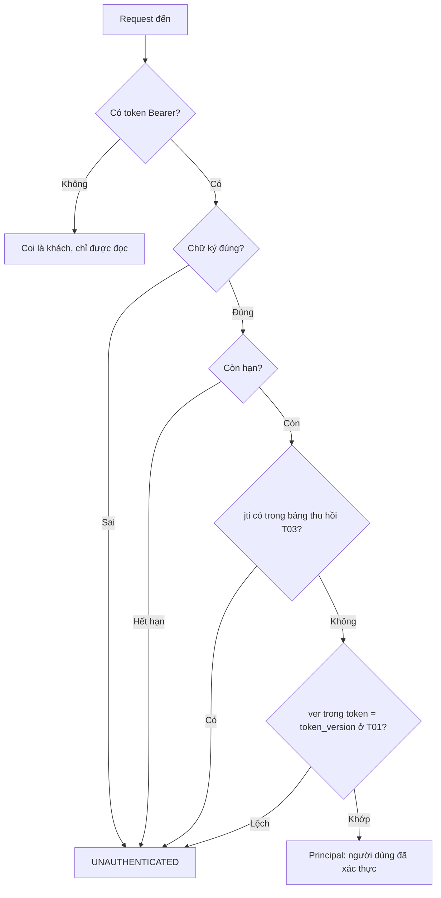
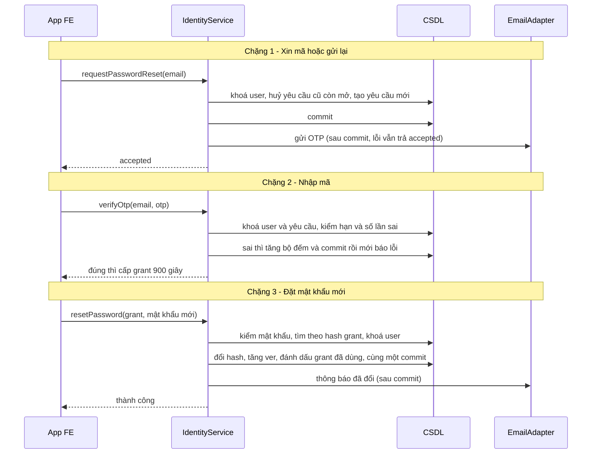
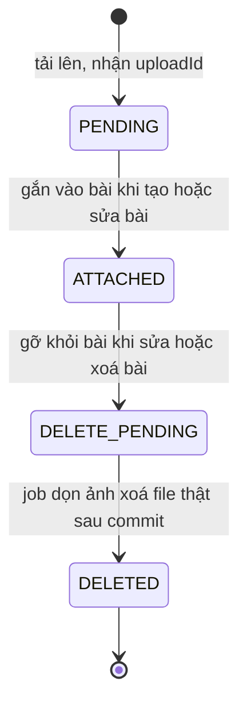
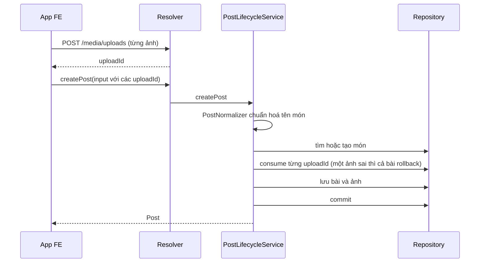
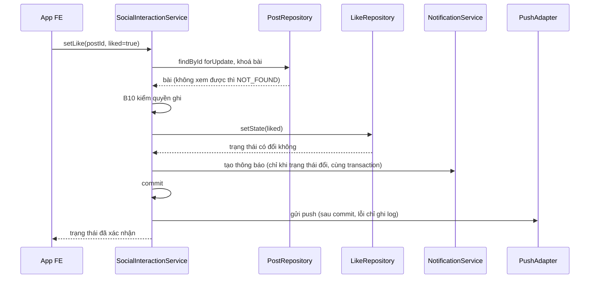
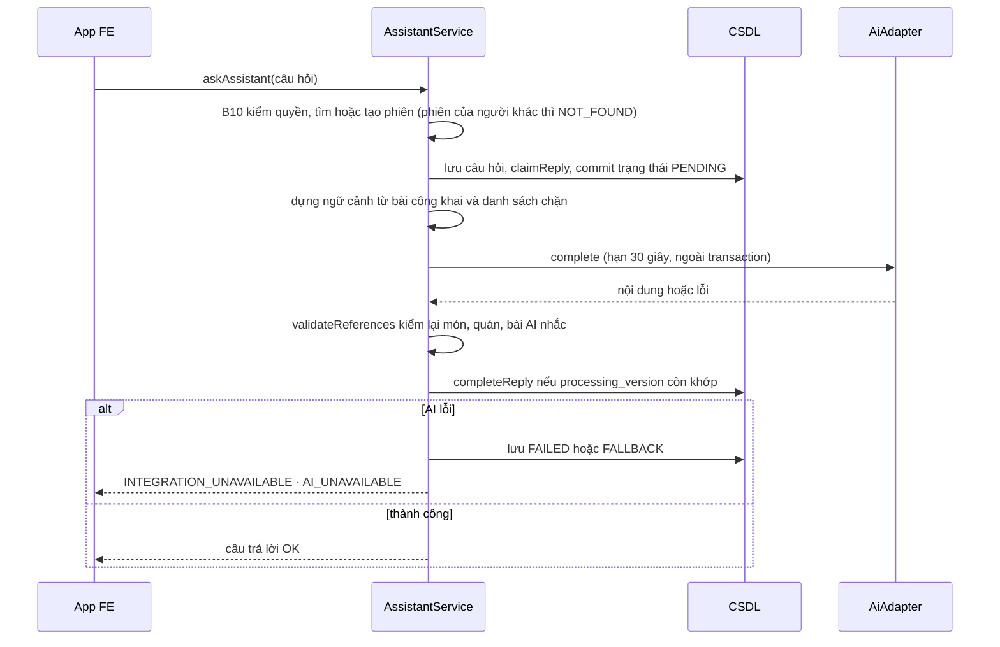

# Hướng dẫn cài đặt S8–S11 theo nhóm chức năng

| Thuộc tính | Nội dung |
|---|---|
| Dự án | ToMateTo |
| Owner | Lead |
| Người đọc | FE, BE, DB, Lead |
| Sprint | S8–S11 (giai đoạn cài đặt) |
| Ngày | 12/11/2026 |
| Căn cứ | DOC 5.1-A/B, 5.2-A, 5.3-A/B, 5.4-A (S4); DOC 6.1-A BE/FE, 6.2-A BE/FE, 6.4-A/B (S5); DOC 6.3-A/B, 7.1-A, 7.1-A.1, 7.2-A BE/FE (S6); DOC 7.3-A/C, 7.4-A/B, 7.5-B (S7) |

Tài liệu này trả lời bốn câu: ai làm phần nào, mỗi sprint làm gì, phải đọc và hiểu gì trong các tài liệu thiết kế trước khi code, làm việc theo trình tự nào. Nhóm vừa học vừa làm, nên mỗi phần đều ghi rõ **ý cốt lõi** và **luồng phải nắm**. Không hiểu những phần này thì chưa nên code.

---

## 1. Phân công: mỗi người một nhóm chức năng

Bốn nhóm lấy theo DOC 6.1-A BE mục 4 (sơ đồ lớp theo nhóm thành phần). Mỗi người làm trọn nhóm của mình theo chuỗi:

**giao diện (Flutter) → API (resolver, service) → dữ liệu (entity, repository) → kiểm thử → tự QA/QC**

| Nhóm (6.1-A §4) | Người làm | UC | Màn hình (6.3-A) | Bảng (5.3-B) | Thành phần |
|---|---|---|---|---|---|
| 4.1 Identity & Recovery | **FE** | UC-01 Đăng ký, UC-02 Đăng nhập, UC-03 Khôi phục mật khẩu, UC-04 Đăng xuất | MH-01, 02, 03, 05 | T01 users, T02 password_resets, T03 revoked_tokens, T04 user_devices | P1, B1, B2, D1, X2 (email) |
| 4.2 Content & Posts | **DB** | UC-05 Xem feed, UC-06 Chi tiết bài, UC-07 Tạo bài, UC-08 Sửa bài, UC-09 Xoá bài | MH-06, 07, 08, 09 | T05 media_assets, T06 dishes, T07 restaurants, T09 posts, T10 post_images, T24 media_cleanup_jobs (T08, T11 thẻ: hoãn ở v1) | P2, B3, B4, D2, X1 (lưu ảnh) |
| 4.3 Profile & Social | **Lead** | UC-10 Xem hồ sơ, UC-11 Cập nhật hồ sơ, UC-12 Công khai hồ sơ, UC-13 Thích/lưu, UC-14 Theo dõi và thông báo, UC-15 Báo cáo bài | MH-10, 11, 12, 13, 14 (nút Báo cáo nằm ở MH-07) | T12 likes, T13 follows, T14 collections, T15 collection_items, T16 reports, T17 notifications, T25 user_blocks | P3, B5, B6, B7, D3, X3 (push), B10 |
| 4.4 Discovery & Assistant | **BE** | UC-16 Quán gần, UC-17 Quay món, UC-18 Hỏi trợ lý, UC-19 Dùng bản nháp, UC-20 Tìm kiếm và xu hướng | MH-15, 16, 17, 18, 19 | T18 chat_sessions, T19 chat_messages, T20 trending_runs, T21–T23 snapshot xu hướng | P4, B8, B9, D4, X4 (AI) |

Ngoài nhóm của mình, mỗi vai giữ thêm **một khối nền dùng chung** (làm trong S8) và **soát chuyên môn** cho mọi PR. Khối nền là phần dựng sườn mà cả bốn nhóm đứng lên, chưa phải chức năng người dùng thấy. Chi tiết từng khối nằm ở mục "Phần của bạn trong hệ thống" của mỗi người (mục 5 đến 8).

| Vai | Khối nền dùng chung (S8) | Soát chuyên môn cho mọi PR |
|---|---|---|
| FE | **Khung ứng dụng Flutter:** giao diện theo token chung, điều hướng, kênh gọi API và các kiểu dùng chung cho lỗi, danh sách, thao tác ghi | Màn hình: đúng token, đủ trạng thái, vùng chạm ≥44 px |
| BE | **Khung xử lý yêu cầu ở backend:** một request đi vào, được xác thực, chạy trong transaction, lỗi đi ra thành mã thống nhất; cùng phần phân trang bằng con trỏ | Hợp đồng API: tên field, kiểu, mã lỗi khớp 5.2-A |
| DB | **CSDL cho cả dự án:** tạo đủ 25 bảng từ DDL 6.4-B bằng migration, dữ liệu kiểm (DOC 7.3-A mục 4), CSDL kiểm thử tách riêng | Mọi migration, chỉ mục và truy vấn |
| Lead | **Hạ tầng làm việc chung:** repo, `docker-compose`, mẫu cấu hình, CI lint và test; cùng quy tắc kiểm quyền ghi và bộ chạy job nền cho các nhóm dùng | Điều phối điểm nối giữa các nhóm (mục 4), release |

Bảng do DB tạo một lần cho cả 25 bảng trong S8. Sau đó mỗi người viết **entity và repository cho bảng của nhóm mình**. Đổi cột hay chỉ mục thì mở PR migration mới và nhờ DB review.

---

## 2. Lịch và mục tiêu từng sprint

Lịch theo DOC 7.5-B. Mỗi sprint kết thúc bằng buổi họp Chủ nhật: demo, viva, merge.

| Sprint | Thời gian | Mục tiêu chung | Kết quả đo được cuối sprint |
|---|---|---|---|
| S8 | 16–22/11 | Phần nền dùng chung chạy được; mỗi người có entity, repository và test repository của nhóm mình | `docker compose up` chạy trên máy sạch; CI xanh; mỗi nhóm có test repository chạy trên CSDL thật; app Flutter mở được và gọi được một query |
| S9 | 23–29/11 | Các UC mức **Must** của mỗi nhóm chạy hết từ màn hình tới CSDL | Luồng cốt lõi chạy được: đăng ký → đăng nhập → xem feed → đăng bài có ảnh → thích/lưu |
| S10 | 30/11–06/12 | UC mức Should/Could, job nền, chế độ lùi khi dịch vụ ngoài lỗi, đủ trạng thái màn hình | Đủ 20 UC; test mức U, I của mọi UC Must xanh; chốt bộ 20 câu hỏi trợ lý |
| S11 | 07–13/12 | QA/QC chéo, kiểm thử tổng hợp đo NFR, sửa lỗi, phát hành v1.0, báo cáo | Tiêu chí ra ở DOC 7.3-A mục 5 đạt; tag `v1.0`; báo cáo và slide từng nhóm |
| Đệm | 14–18/12 | Sửa lỗi còn lại, tập trình bày | Không mở việc mới |

Nếu trễ: cắt UC-17 (quay món) rồi UC-16 (quán gần) trước, vì đây là hai UC mức Could (DOC 7.5-C RK14).

---

## 3. Nền tảng ai cũng phải nắm (đọc trong ngày đầu S8)

Phần này là kiến thức chung của cả bốn người. Trước khi code, mỗi người phải trả lời được năm câu hỏi sau bằng lời của mình (đáp án nằm ở các mục 3.1 đến 3.4):

1. Một request `setLike` đi qua những lớp nào, transaction mở và đóng ở đâu?
2. Vì sao resolver không được tự kiểm quyền chủ bài?
3. `UNAUTHENTICATED` khác `FORBIDDEN` thế nào? Khi nào trả `NOT_FOUND` thay cho `FORBIDDEN`? (5.4-A ma trận quyền)
4. Gửi email OTP lỗi thì người dùng thấy gì, vì sao?
5. Vì sao FE không được tự gửi lại `createPost` khi mất phản hồi?


### 3.1 Một request đi qua những đâu

Hình dung một yêu cầu như một bưu kiện đi qua các quầy, mỗi quầy một việc và không làm hộ việc quầy khác. Giao diện gửi yêu cầu, một cổng xác định người gửi là ai, tầng API chỉ chuyển tiếp, tầng nghiệp vụ quyết định đúng sai và mở transaction, tầng dữ liệu chỉ đọc ghi bảng, và các cổng nối ra dịch vụ ngoài (email, ảnh, push, AI) chỉ được gọi sau khi dữ liệu đã chốt. Lỗi đi ngược lại thành một mã lỗi thống nhất để giao diện hiển thị.

```text
Flutter View ─► Controller ─► Repository (FE) ─► GraphQL /graphql (Bearer JWT)
                                                     │
ContextFactory: đọc Bearer → B1.verifySession → Principal (hoặc khách)
                                                     │
Resolver (P) ─► Service (B) ─► TransactionManager.run(callback)
                                 ├─► Repository (D) ─► PostgreSQL
                                 └─► (sau commit) Adapter (X) ─► dịch vụ ngoài
Service ném DomainError ─► Resolver bắt ─► ErrorMapper ─► errors[].extensions.code
FE đọc extensions.code (không đọc message) ─► hiển thị theo 7.2-A FE
```

Năm luật phân tầng (6.1-A BE §2.2). Vi phạm luật nào cũng bị trả PR:
1. **Resolver** chỉ đọc ngữ cảnh, gọi đúng một phương thức service, trả DTO. Không mở phiên CSDL, không viết truy vấn, không quyết định quyền.
2. **Service** giữ quy tắc nghiệp vụ và ranh giới transaction, gọi B10 trước mọi thao tác ghi. Service không biết GraphQL.
3. **Repository** chỉ đọc/ghi bảng. Không gọi service, không gọi adapter.
4. **Adapter** chỉ nói chuyện với dịch vụ ngoài, đổi lỗi nhà cung cấp thành `IntegrationError`.
5. **Không giữ transaction trong lúc chờ dịch vụ ngoài** (email, ảnh, push, AI): commit trước, gọi ngoài sau (6.2-A BE §1.4).

### 3.2 Hợp đồng API chung (5.2-A §2, §3, §6, §8)
- Tên field `camelCase`; thời gian ISO-8601 UTC; toạ độ WGS84.
- JWT 7 ngày mang `sub`, `jti`, `ver`. Không có refresh token. Đăng xuất thu hồi `jti`. Đổi mật khẩu tăng `ver`, nên mọi token cũ chết ngay.
- Quyền: khách đọc feed, chi tiết bài, tìm kiếm, xu hướng, quán gần. Mọi thao tác ghi cần JWT. Sửa/xoá chỉ chủ sở hữu. Email **không bao giờ** trả trong hồ sơ công khai.
- Lỗi: GraphQL vẫn trả HTTP 200 kèm `errors[]`. FE xử lý theo `extensions.code` (10 mã ở 5.2-A §6) và `fieldErrors`. Route upload dùng mã HTTP riêng (400/401/413/415/429/503).
- Danh sách dài dùng con trỏ: mặc định 10, tối đa 50. Không dùng offset.

### 3.3 Phân trang con trỏ (7.1-A §2): dùng ở feed, bài của tôi, bộ sưu tập, thông báo, lịch sử trợ lý
```text
first = 10 nếu thiếu; first ≤ 0 → VALIDATION_FAILED; first > 50 → 50
giải mã cursor (sai → VALIDATION_FAILED · CURSOR_INVALID)
lọc quyền và chặn TRƯỚC khi sắp xếp và LIMIT
sắp xếp (created_at DESC, id DESC); lấy first + 1 dòng
trả first dòng; hasNextPage = có dòng dư; endCursor = mã hoá dòng cuối thực trả
```
Phải hiểu được: vì sao lấy `first + 1`, vì sao khoá sắp xếp phải có `id`, vì sao lọc phải đứng trước LIMIT.

### 3.4 Lỗi (7.2-A BE §2, §5; 7.2-A FE)
`DomainError` → `ValidationError`, `BusinessRuleError`, `AuthorizationError`, `NotFoundError`, `IntegrationError`, `SystemError`. Mỗi tầng chỉ bắt lỗi khi xử lý được. Không trả stack trace. Không log mật khẩu, OTP, token, email đầy đủ (5.4-A: che dạng `n***a@domain`).
FE: mất phản hồi khi đang ghi thì **không tự gửi lại**. Đặt trạng thái `outcomeUnknown` rồi đối soát (ví dụ đọc `myPosts`).

### 3.5 Chuẩn và kiểm thử
- DOC 7.4-A: nhánh `feat/<fe|be|db|infra>-<mô tả>`, commit `<loại>(<phạm vi>): …` kèm dòng `Sprint:` và `DOC/WBS:`, PR theo mẫu 7.4-B. Lint: `ruff`, `mypy`, `flutter analyze`.
- DOC 7.3-A, 7.3-C: ID test `TC-<vai>-<UC><số>`. Mỗi UC Must có ít nhất một ca chính và một ca lỗi lấy từ 7.2-A. Ở giai đoạn này, `<vai>` là vai của người làm nhóm.

---

## 4. Điểm nối giữa các nhóm

Bốn nhóm không tách rời hoàn toàn. Một chức năng thật thường chạm vào phần của hai, ba người: ví dụ "Thích bài" (Lead) phải đọc và khoá bài của DB, còn feed (DB) phải biết bài nào đã được thích (Lead). Chỗ code của người này gọi code của người khác gọi là **điểm nối**. Sơ đồ dưới cho thấy ai cung cấp gì cho ai; bảng bên dưới là bản tra cứu đầy đủ 14 điểm. Mục "Phần của bạn trong hệ thống" của từng người đã gom sẵn phần bạn giao và phần bạn nhận.

Bảng dưới đọc theo hàng: **hàng là người cung cấp, cột là người dùng**. Mỗi ô nói người cung cấp đưa gì cho người dùng (số trong ngoặc là điểm nối ở bảng 14 điểm bên dưới).

| Cung cấp ↓ / Dùng → | FE | DB | Lead | BE |
|---|---|---|---|---|
| **FE** | | Tra tài khoản (2) | Tra tài khoản (2), thiết bị nhận push (10) | Cổng kiểm token (1) |
| **DB** | | | Khoá và đọc bài (7), tải ảnh đại diện và ảnh bìa (8), bài của một tác giả (9) | Màn tạo bài nhận bản nháp (12) |
| **Lead** | Bộ "Đã lưu" mặc định (5), quy tắc quyền ghi (3) | Trạng thái thích/lưu và danh sách chặn (6), xử lý báo cáo (14), quy tắc quyền ghi (3) | | Trạng thái thích/lưu và chặn (6), bảng thích và lưu (13), quy tắc quyền ghi (3) |
| **BE** | Phân trang, đổi lỗi, transaction (4) | Phân trang, đổi lỗi, transaction (4), xu hướng mới nhất (11) | Phân trang, đổi lỗi, transaction (4) | |

Nhìn theo hàng thấy gánh nặng: **Lead cung cấp cho cả ba người còn lại** và cũng nhận từ cả ba. Nhìn theo cột thấy mỗi người phụ thuộc ai: DB phụ thuộc cả FE, Lead và BE.


Lớp ở bảng dưới do một người viết nhưng nhóm khác gọi. Chữ ký phương thức đã có ở 6.1-A BE §5. **Người cung cấp** công bố chữ ký và một bản giả (fake) ngay đầu sprint cần dùng. **Người dùng** code theo bản giả, không chờ bản thật.

| # | Người cung cấp | Lớp / phương thức | Người dùng | Cần từ |
|---|---|---|---|---|
| 1 | FE (4.1) | `IdentityService.verifySession` → `Principal` | BE (`ContextFactory`), mọi nhóm | S8 |
| 2 | FE (4.1) | `AccountRepository.findById` | DB (tác giả bài), Lead (hồ sơ) | S8 |
| 3 | Lead | `WriteAuthorizationPolicy` (B10) | mọi thao tác ghi của cả 4 nhóm | S8 |
| 4 | BE | `CursorCodec`, `PageRequest`, `ErrorMapper`, `TransactionManager` | cả 4 nhóm | S8 |
| 5 | Lead (4.3) | `CollectionRepository.createDefault` | FE: đăng ký tạo bộ "Đã lưu" **cùng transaction** với user | S9 |
| 6 | Lead (4.3) | `LikeRepository`, `CollectionRepository` (trạng thái thích/lưu), `BlockRepository.listBlockedUserIds` | DB (feed, chi tiết bài), BE (tìm kiếm, trợ lý) | S9 |
| 7 | DB (4.2) | `PostRepository.findById(forUpdate)` | Lead (thích, lưu, báo cáo) | S9 |
| 8 | DB (4.2) | route `POST /media/uploads`, `MediaUploadRepository.consume` với purpose `AVATAR`/`COVER` | Lead (ảnh đại diện, ảnh bìa) | S10 |
| 9 | DB (4.2) | `FeedQueryService.listPostsByAuthor` | Lead (`profilePosts`, `myPosts`) | S10 |
| 10 | FE (4.1) | `DeviceRepository` (bảng T04) | Lead (`NotificationService` gửi push) | S10 |
| 11 | BE (4.4) | `TrendingSnapshotRepository.latestRun`, cursor TRENDING | DB (feed chế độ TRENDING) | S10 |
| 12 | DB (4.2) | `PostEditorController.startCreate(draft)` ở MH-08 | BE (UC-19 dùng bản nháp trợ lý) | S10 |
| 13 | Lead (4.3) | bảng T12 likes, T15 collection_items | BE (job tính xu hướng đọc lượt thích, lưu) | S10 |
| 14 | Lead (4.3) | `SocialInteractionService.reportPost` | DB (`PostMutationResolver.reportPost` chuyển tiếp, nút Báo cáo ở MH-07) | S10 |

Đổi chữ ký một lớp trong bảng này phải báo người dùng trước, ghi vào mô tả PR, và cả hai cùng review.

---

## 5. Nhóm 4.1 Identity & Recovery: FE

### 5.1 Phần của bạn trong hệ thống

Bạn giữ **cửa vào của cả hệ thống**: ai là ai, và họ còn được phép làm gì. Nhóm gồm bốn use case (đăng ký, đăng nhập, khôi phục mật khẩu, đăng xuất), bốn màn hình (MH-01, 02, 03, 05) và bốn bảng dữ liệu về tài khoản (T01–T04). Bạn làm trọn từ màn hình tới CSDL.

Ngoài nhóm, trong S8 bạn dựng **khung ứng dụng Flutter** mà mọi màn hình của cả bốn nhóm đứng lên: giao diện theo token chung, điều hướng, kênh gọi API và các kiểu dùng chung cho lỗi, danh sách, thao tác ghi. Với mọi PR, bạn là người soát màn hình: đúng token, đủ trạng thái, vùng chạm ≥44 px.

| Bạn giao cho người khác | Bạn nhận từ người khác |
|---|---|
| **Cổng kiểm token** cho BE gắn vào mọi request (điểm nối 1) | **Quy tắc kiểm quyền ghi** từ Lead (điểm nối 3) |
| **Tra tài khoản theo id** cho DB (tác giả bài) và Lead (hồ sơ) (điểm nối 2) | **Phân trang, đổi lỗi, ranh giới transaction** từ BE (điểm nối 4) |
| **Đăng ký thiết bị nhận thông báo đẩy** cho Lead (điểm nối 10) | **Bộ sưu tập "Đã lưu" mặc định** từ Lead, tạo cùng lúc đăng ký (điểm nối 5) |

### 5.2 Đọc theo thứ tự
| # | Tài liệu, mục | Đọc để biết |
|---|---|---|
| 1 | 5.2-A §3.1, §3.3, §12.2 | Hợp đồng `register`, `login`, `logout`, 4 thao tác khôi phục; mã lỗi từng thao tác |
| 2 | 5.4-A mục mật khẩu, JWT, OTP, phiên, chống dò tài khoản, lưu token phía client | Các con số bắt buộc và lý do |
| 3 | 5.3-B T01–T04 và bảng ranh giới transaction | Ràng buộc bảng; đăng ký = user + bộ "Đã lưu" cùng commit |
| 4 | 6.1-A BE §4.1, §5.2 (điều kiện trước/sau `login`, `logout`, `resetPassword`) | Lớp và phương thức phải viết |
| 5 | 6.2-A BE Hình 01 (đăng nhập), Hình 02 (khôi phục) | Thứ tự gọi, nhánh lỗi, chỗ commit |
| 6 | 6.1-A FE §3.1, §4.8–4.18, §4.43 (`AuthView`); 6.2-A FE FE-SQ01, 02, 06 | Lớp phía app, lưu phiên, quay lại ngữ cảnh sau đăng nhập |
| 7 | 6.3-A MH-01, 02, 03, 05; 7.2-A BE (mã `EMAIL_INVALID` … `EMAIL_UNAVAILABLE`), 7.2-A FE | Màn hình và thông điệp lỗi |

### 5.3 Cần nắm: tài khoản, phiên và khôi phục mật khẩu

Năm câu hỏi dưới đây là điều bạn phải trả lời được bằng lời của mình trước khi code. Mỗi câu có phần giải thích, rồi sơ đồ hoặc bảng cho chỗ cần chi tiết.

#### Câu 1. Hệ thống biết "bạn là ai" ở mỗi request bằng cách nào, và khi nào một token hết hiệu lực?

Mỗi request của người đã đăng nhập mang theo một token (JWT, sống 7 ngày, không có token làm mới). Phía server có một **cổng kiểm token** chạy trước mọi thao tác. Cổng này hỏi bốn điều: chữ ký có thật không, còn hạn không, token đã bị thu hồi chưa (đăng xuất ghi token vào danh sách thu hồi), và "số phiên bản" ghi trong token có còn khớp với số phiên bản hiện tại của tài khoản không. Đổi mật khẩu làm tăng số phiên bản, nên mọi token cũ ở các máy khác chết ngay mà không cần tìm từng cái để thu hồi.

Đây là chỗ nhạy nhất nhóm của bạn: cổng này sai thì cả bốn nhóm sai quyền.



#### Câu 2. Làm sao để người ngoài không dò ra email nào đã có tài khoản?

Nguyên tắc: **phản hồi không được tiết lộ sự thật về tài khoản**. Đăng nhập sai email hay sai mật khẩu đều trả đúng một lỗi (`LOGIN_FAILED`), người ngoài không phân biệt được hai trường hợp. Yêu cầu mã khôi phục và gửi lại mã luôn trả "đã nhận" giống nhau, kể cả khi email không tồn tại hoặc gửi thư lỗi. Mật khẩu, mã OTP và mã cấp quyền đặt lại chỉ được lưu dạng băm, không lưu bản gốc.

#### Câu 3. Khôi phục mật khẩu đi qua mấy chặng, và vì sao phải tách?

Ba chặng, mỗi chặng tự commit riêng, vì người dùng làm chúng ở ba thời điểm khác nhau (xin mã, nhập mã, nhập mật khẩu mới). Các con số: mã OTP 6 số sống 10 phút, sai 5 lần thì vô hiệu; sau khi nhập đúng mã, hệ thống cấp một "grant" sống 15 phút, dùng được một lần.

Hai điểm tinh tế cần hiểu lý do:
- **OTP nhập sai vẫn phải commit bộ đếm sai**, rồi mới trả lỗi. Nếu trả lỗi bằng rollback thì bộ đếm không bao giờ tăng, và kẻ xấu đoán mã thử vô hạn.
- **Bước đặt lại cuối cùng làm ba việc trong một commit:** đổi mật khẩu, tăng số phiên bản, đánh dấu grant đã dùng. Email thông báo chỉ gửi sau commit. Ba việc này không được lệch nhau: nếu đổi mật khẩu mà không đánh dấu grant thì grant dùng lại được.

Khi khoá nhiều bản ghi, luôn theo cùng một thứ tự: khoá tài khoản trước, rồi tới bản ghi yêu cầu khôi phục.



#### Câu 4. Đăng ký tài khoản gồm những bước nào, và vì sao phải tạo bộ "Đã lưu" cùng lúc?

Đăng ký không có hình tuần tự riêng trong tài liệu, bạn tự vẽ một sơ đồ ngắn trước khi code, theo 5.2-A §12.2 và 5.3-B. Các bước: kiểm email và mật khẩu (≥6 ký tự), tạo tài khoản, tạo bộ sưu tập mặc định "Đã lưu" (phần này do Lead cung cấp), commit, rồi phát token. Hai việc đầu phải nằm **trong cùng một commit**, để không bao giờ có tài khoản nào thiếu bộ "Đã lưu". Thiếu bộ này thì thao tác Lưu bài của người đó sẽ lỗi.

Chuỗi lớp cho đăng nhập (Hình 01), để bạn biết ai gọi ai:

| Bước | Lớp | Việc |
|---|---|---|
| 1 | `IdentityResolver.login` | Nhận yêu cầu GraphQL, gọi service |
| 2 | `IdentityService.login` | Giữ quy tắc đăng nhập và ranh giới transaction |
| 3 | `AccountRepository.findByEmail` | Tìm tài khoản; không thấy thì vẫn đi tiếp để cùng ra một lỗi |
| 4 | `PasswordPolicy.verify` | So mật khẩu bằng bcrypt (cost 12) |
| 5 | `SessionTokenService.issue` | Cấp token |
| 6 | `AuthPayload` | Trả token và thông tin tài khoản |

#### Câu 5. Phía app xử lý phiên và các tình huống "lỡ tay" thế nào?

- **Lưu token:** Android dùng kho bảo mật của máy. Web giữ token trong bộ nhớ, tải lại trang thì đăng nhập lại; không dùng localStorage hay cookie.
- **Khách bấm thao tác cần đăng nhập** (ví dụ Thích): chuyển tới MH-01, đăng nhập xong quay lại đúng bài cũ, nhưng **không tự thích hộ**; người dùng bấm lại (QD-01, QD-02). Luồng này là FE-SQ01.
- **Đăng xuất mà mất phản hồi:** app kết thúc phiên ở máy mình, nhưng không được báo "đã thu hồi" vì chưa xác nhận từ server (FE-SQ06).
- **Khôi phục mật khẩu** trên MH-03 và MH-05 là FE-SQ02.

### 5.4 Task theo sprint
| Sprint | Việc | Xong khi |
|---|---|---|
| S8 | Khung Flutter dùng chung (mục 1); entity `User`, `PasswordReset`, `RevokedToken`, `UserDevice`; `AccountRepository`, `PasswordResetRepository`, `SessionRepository`, `DeviceRepository`; `SessionTokenService`, `PasswordPolicy`, `OtpService`; `verifySession` | Test repository trên CSDL thật xanh; test `verifySession` đủ 5 nhánh (thiếu token, sai chữ ký, hết hạn, `jti` đã thu hồi, `ver` lệch); BE gắn được vào `ContextFactory` |
| S9 | UC-01, UC-02, UC-04 đủ ba tầng; MH-01, MH-02; `SessionStore` Android/web; FE-SQ01, FE-SQ06 | TC ca chính và ca lỗi của UC-01, 02, 04 đạt ở mức U, I, E; đăng xuất xong dùng lại token cũ thì bị từ chối |
| S10 | UC-03 đủ ba chặng; `EmailAdapter` (X2) kèm bản giả; MH-03, MH-05; job `purgeExpiredRevocations`, `purgeExpiredResetRequests`; `registerDevice`/`unregisterDevice` nếu O12 chốt dùng | Sai OTP 5 lần thì mã vô hiệu; grant dùng lần hai bị từ chối; email lỗi vẫn `accepted`; log không có OTP hay token |
| S11 | QA/QC chéo nhóm 4.2 (mục 9); sửa lỗi nhóm mình do BE báo; slide nhóm 4.1 | Lỗi mức Chặn và Nghiêm trọng của nhóm đã đóng |

### 5.5 Câu hỏi mở cần chốt trước khi code phần liên quan
O9 (có dùng username không), O10 (chính sách gửi lại OTP, thời gian chờ), O12 (có dùng đăng ký thiết bị push không), O14 (`is_active`). Chưa chốt thì làm đúng phần đã chốt và ghi "Giả thuyết" trong PR.

### 5.6 Câu viva
1. Token đã đăng xuất bị chặn ở dòng nào, kiểm bằng bảng nào?
2. Vì sao OTP sai vẫn phải commit?
3. Người dùng đổi mật khẩu trên máy A thì máy B bị đăng xuất bằng cơ chế gì?
4. Vì sao đăng ký phải tạo bộ "Đã lưu" trong cùng transaction với user?

---

## 6. Nhóm 4.2 Content & Posts: DB

### 6.1 Phần của bạn trong hệ thống

Bạn giữ **nội dung chính của app**: bài đăng, ảnh món, danh mục món và quán. Nhóm gồm năm use case (xem feed, chi tiết bài, tạo, sửa, xoá bài), bốn màn hình (MH-06, 07, 08, 09) và sáu bảng (ảnh, món, quán, bài, ảnh của bài, việc dọn ảnh). Bạn làm trọn từ màn hình tới CSDL.

Ngoài nhóm, trong S8 bạn là **người dựng CSDL cho cả dự án**: tạo đủ 25 bảng bằng migration, một CSDL kiểm thử tách riêng và bộ dữ liệu kiểm (200 bài, 100 món, 60 quán có toạ độ). Từ đó, đổi cột hay chỉ mục nào cũng phải mở PR migration và bạn review. Với mọi PR, bạn soát migration, chỉ mục và truy vấn.

| Bạn giao cho người khác | Bạn nhận từ người khác |
|---|---|
| **Đọc và khoá một bài** cho Lead khi thích, lưu, báo cáo (điểm nối 7) | **Tra tài khoản theo id** từ FE để hiện tác giả (điểm nối 2) |
| **Tải ảnh lên và gắn ảnh** cho Lead làm ảnh đại diện, ảnh bìa (điểm nối 8) | **Trạng thái thích/lưu và danh sách người bị chặn** từ Lead cho feed (điểm nối 6) |
| **Danh sách bài của một tác giả** cho Lead dựng hồ sơ (điểm nối 9) | **Xu hướng mới nhất** từ BE cho chế độ TRENDING của feed (điểm nối 11) |
| **Mở màn tạo bài với bản nháp điền sẵn** cho BE (điểm nối 12) | **Chuyển tiếp báo cáo bài** từ Lead: nút Báo cáo nằm ở MH-07 (điểm nối 14) |

### 6.2 Đọc theo thứ tự
| # | Tài liệu, mục | Đọc để biết |
|---|---|---|
| 1 | 5.2-A §4.4–4.5 (`feed`, `post`, `myPosts`, `createPost`, `updatePost`, `deletePost`), §5 (upload), §12.3, §12.8 | Hợp đồng và mã lỗi; một `uploadId` sai làm rollback cả bài |
| 2 | 5.3-B T05, T06, T07, T09, T10, T24 và bảng transaction tạo/sửa/xoá bài | Vòng đời ảnh, ràng buộc toạ độ và giá, cascade khi xoá |
| 3 | 7.1-A §2 (feed con trỏ), §8 (chuẩn hoá tên món); 7.1-A.1 Q01–Q04 | Thuật toán và truy vấn mẫu, chỉ mục `ix_posts_feed`, `ix_posts_author` |
| 4 | 6.1-A BE §4.2, §5.2–5.5 | `FeedQueryService`, `PostLifecycleService`, `PostNormalizer`, `PostFactory`, các repository, `MediaStorageAdapter` |
| 5 | 6.2-A BE Hình 03 (tạo bài), Hình 04 (sửa), Hình 05 (xoá) | Thứ tự gọi, chỗ khoá, chỗ commit, nhánh lỗi |
| 6 | 6.1-A FE §3.2, §4.19–4.27, §4.41 (`MediaAdapter`), §4.44 (`ContentView`); 6.2-A FE FE-SQ03, 04, 05 | `FeedController`, `PostEditorController`, upload từng ảnh, mất phản hồi |
| 7 | 6.3-A MH-06–MH-09; 5.4-A mục upload ảnh; 7.2-A BE/FE dòng ảnh, cursor, chủ bài | Màn hình, kiểm ảnh, thông điệp |

### 6.3 Cần nắm: bài đăng, ảnh và feed

Năm câu hỏi dưới đây là điều bạn phải trả lời được bằng lời của mình trước khi code.

#### Câu 1. Feed chia thành các trang như thế nào để không trùng, không sót và vẫn nhanh?

Feed dùng **phân trang bằng con trỏ** (mục 3.3), không dùng offset. Ý tưởng: thay vì nói "cho tôi trang 3", app nói "cho tôi 10 bài tiếp theo sau bài này". Bài được xếp theo thời gian mới nhất, và khi hai bài cùng thời điểm thì xếp theo id, để thứ tự luôn xác định. Server đọc dư một bài để biết còn trang sau hay không. Quan trọng: bài bị ẩn và bài của người bị chặn phải **bị loại trước khi cắt số lượng**, nếu loại sau thì trang có thể ra thiếu bài.

Số lượt thích mỗi bài không lưu thành cột. Nó được đếm theo lô cho cả trang trên bảng thích, để không có hai nguồn số liệu lệch nhau.

Phía app (FE-SQ03): tải thêm thì nối vào danh sách và không trùng id. Lỗi khi tải thêm thì giữ nguyên các bài đã có cùng con trỏ. Đổi chế độ hay đổi tài khoản giữa chừng thì bỏ phản hồi cũ.

#### Câu 2. Một tấm ảnh đi qua những trạng thái nào, từ lúc tải lên tới lúc bị xoá hẳn, và ai dọn?

Ảnh được tải lên **trước**, từng tấm một qua một đường riêng, rồi mới gắn vào bài. Mỗi tấm nhận một `uploadId` dùng được **một lần**, đúng chủ và đúng mục đích (ảnh bài, ảnh đại diện, ảnh bìa). File thật chỉ bị xoá **sau khi commit**, và việc xoá do một job dọn ảnh làm, không làm trong lúc xử lý yêu cầu. Lý do: nếu xoá file trong transaction rồi transaction hỏng thì mất file mà dữ liệu vẫn còn.



Ảnh đã tải lên mà người dùng bỏ ngang không đăng bài sẽ nằm ở trạng thái PENDING. Job dọn ảnh mồ côi (`cleanupOrphanMedia`, S10) chịu trách nhiệm xử lý loại ảnh này. Cách chuyển trạng thái chi tiết đọc ở 5.3-B T05 và T24, còn thời hạn chờ trước khi dọn là câu hỏi mở O5.

#### Câu 3. Tạo bài gồm những bước nào, và vì sao một ảnh sai thì cả bài phải bị huỷ?

Tạo bài là **một transaction duy nhất**: kiểm tên món, chuẩn hoá tên món, tiêu thụ từng ảnh đã tải lên, lưu bài cùng ảnh, rồi commit. Chuẩn hoá tên món nghĩa là bỏ dấu (kể cả chữ `đ`), đưa về chữ thường, gộp khoảng trắng, nên "Phở  bò" và "phở bò" ra cùng một món. Nếu một ảnh sai (hết hạn, của người khác, sai mục đích) thì cả bài rollback, hệ thống **không tự bỏ ảnh đó để đăng bài chỉ có chữ**, vì như vậy là đăng thứ người dùng không định đăng.



#### Câu 4. Sửa và xoá bài: ai được làm, khoá gì, và xoá lan sang đâu?

Chỉ chủ bài được sửa hoặc xoá; quyền này do quy tắc chung của Lead (B10) kiểm. Hệ thống **khoá bài trước rồi mới kiểm**, để hai thao tác cùng lúc không đè nhau.

- **Sửa:** ảnh cũ giữ theo `imageId`, ảnh mới tiêu thụ theo `uploadId`. Ảnh bị gỡ chuyển sang chờ xoá và xếp việc cho job dọn ảnh.
- **Xoá:** xoá bài đã không còn vẫn trả thành công (xoá lặp an toàn). Khi bài bị xoá, lượt thích và mục trong bộ sưu tập xoá theo; báo cáo và thông báo được **giữ lại** với bài gốc đặt thành rỗng, vì báo cáo là bằng chứng và thông báo đã gửi cho người khác.

| Thao tác | Khoá và quyền | Xử lý ảnh | Gửi lặp |
|---|---|---|---|
| Sửa bài | Khoá bài, chỉ chủ bài | Ảnh bị gỡ chuyển sang chờ xoá | Người khác sửa thì bị `FORBIDDEN` |
| Xoá bài | Khoá bài, chỉ chủ bài | Ảnh của bài chuyển sang chờ xoá | Xoá lại bài đã mất vẫn trả thành công |

#### Câu 5. Mất phản hồi giữa chừng khi đăng bài thì app làm gì?

App **không tự gửi lại**. Gửi lại có thể tạo hai bài giống nhau nếu lần đầu thật ra đã thành công. App chuyển sang trạng thái "chưa biết kết quả" và hiện "Kiểm tra bài của mình". Khi người dùng bấm, app đọc danh sách bài của chính họ để đối soát: có bài thì coi như thành công, không có thì cho gửi lại.

### 6.4 Task theo sprint
| Sprint | Việc | Xong khi |
|---|---|---|
| S8 | Alembic và migration 25 bảng từ 6.4-B; khung nạp dữ liệu kiểm (200 bài, 100 món, 60 quán có toạ độ: 7.3-A mục 4); entity `Post`, `PostImage`, `MediaUpload`, `Dish`, `Restaurant`, `CleanupJob`; `PostRepository`, `MediaUploadRepository`, `DishRepository`, `RestaurantRepository`, `MediaCleanupRepository` | `alembic upgrade` → `downgrade` → `upgrade` chạy sạch; nạp dữ liệu bằng một lệnh; test repository xanh; truy vấn feed dùng đúng chỉ mục (`EXPLAIN`) |
| S9 | UC-05, UC-06, UC-07 đủ ba tầng; route upload và `MediaStorageAdapter` (X1) kèm bản giả; MH-06, MH-07, MH-08 | Trang 1 và trang ≥10 của feed đều ≤2 giây; ảnh 10,1 MB bị từ chối; một `uploadId` sai làm rollback cả bài |
| S10 | UC-08, UC-09; MH-09; job `cleanupOrphanMedia`; feed chế độ TRENDING (dùng điểm nối số 11); `startCreate(draft)` cho BE (điểm nối số 12); nút Báo cáo ở MH-07 nối với Lead | Sửa bài người khác bị `FORBIDDEN`; xoá lặp vẫn thành công; ảnh bị gỡ chuyển `DELETE_PENDING` rồi `DELETED` |
| S11 | QA/QC chéo nhóm 4.3; đo NFR-01, NFR-02, NFR-05; dữ liệu đủ để demo; slide nhóm 4.2 | Số đo NFR ghi vào biên bản kiểm thử |

### 6.5 Câu hỏi mở
O3 (giá theo 4 khoảng), O5 (thời hạn `uploadId`, thời gian ân hạn trước khi dọn), O10 (khoá chống tạo trùng bài), O11 (caption và cảm nhận), O13 (ghép quán trùng tên); cách xoá giá, vị trí, công thức khi sửa bài chưa có trong hợp đồng.

### 6.6 Câu viva
1. Vì sao lấy `first + 1`? Nếu bỏ `id` khỏi khoá sắp xếp thì lỗi gì xảy ra?
2. Ảnh đã tải lên nhưng không đăng bài thì cuối cùng đi đâu, ai dọn?
3. Vì sao không xoá file ảnh trong transaction xoá bài?
4. Hai người cùng tạo món "Phở  bò" và "phở bò" cùng lúc thì DB đảm bảo chỉ một món bằng cách nào?

---

## 7. Nhóm 4.3 Profile & Social: Lead

### 7.1 Phần của bạn trong hệ thống

Bạn giữ **phần xã hội của app**: hồ sơ cá nhân, thích, lưu, theo dõi, thông báo, báo cáo. Nhóm gồm sáu use case (UC-10 đến UC-15), năm màn hình (MH-10 đến MH-14, cộng nút Báo cáo ở MH-07) và bảy bảng (thích, theo dõi, bộ sưu tập, mục trong bộ sưu tập, báo cáo, thông báo, chặn người dùng). Bạn làm trọn từ màn hình tới CSDL.

Ngoài nhóm, trong S8 bạn dựng **hạ tầng làm việc chung**: repo, `docker-compose`, mẫu cấu hình, CI chạy lint và test trên mọi PR. Bạn cũng viết hai thành phần mà nhóm khác phụ thuộc: **quy tắc kiểm quyền ghi** (ai được ghi gì, trả lỗi gì) và **bộ chạy job nền** (để các nhóm đặt việc định kỳ). Với mọi PR, bạn điều phối các điểm nối giữa nhóm (mục 4) và lo việc phát hành.

Nhóm của bạn đứng ở **cả hai đầu của nhiều điểm nối nhất**, nên trễ ở đây kéo theo nhóm khác.

| Bạn giao cho người khác | Bạn nhận từ người khác |
|---|---|
| **Quy tắc kiểm quyền ghi** cho mọi thao tác ghi của cả bốn nhóm (điểm nối 3) | **Cổng kiểm token** và **tra tài khoản theo id** từ FE (điểm nối 1, 2) |
| **Bộ sưu tập "Đã lưu" mặc định** cho FE khi đăng ký (điểm nối 5) | **Phân trang, đổi lỗi, transaction** từ BE (điểm nối 4) |
| **Trạng thái thích/lưu và danh sách chặn** cho DB và BE (điểm nối 6) | **Đọc và khoá một bài** từ DB (điểm nối 7) |
| **Bảng thích và bảng mục lưu** cho BE tính xu hướng (điểm nối 13) | **Tải ảnh đại diện, ảnh bìa** từ DB (điểm nối 8) |
| **Xử lý báo cáo bài** cho DB chuyển tiếp từ MH-07 (điểm nối 14) | **Danh sách bài của một tác giả** từ DB cho hồ sơ (điểm nối 9) |
| | **Đăng ký thiết bị nhận push** từ FE để gửi thông báo (điểm nối 10) |

### 7.2 Đọc theo thứ tự
| # | Tài liệu, mục | Đọc để biết |
|---|---|---|
| 1 | 5.2-A §4.4–4.5 (18 thao tác hồ sơ, thích, lưu, bộ sưu tập, theo dõi, thông báo, báo cáo), §12.4, §12.5, §12.10 | Hợp đồng; gửi lặp an toàn theo trạng thái đích |
| 2 | 5.3-B T01 (cột hồ sơ, `public_profile_fields`), T12–T17, T25 | Khoá chính đôi, một bộ mặc định, báo cáo bất biến, `read_at` |
| 3 | 5.4-A ma trận quyền, quy tắc `FORBIDDEN`/`NOT_FOUND`, che email | Ai được làm gì |
| 4 | 6.1-A BE §4.3, §4.5 (B10, J1), §5.2–5.4 | `ProfileService`, `SocialInteractionService`, `CollectionService`, `NotificationService`, các repository, `PushAdapter` |
| 5 | 6.2-A BE Hình 06 (thích/lưu) và §5.3 (quy tắc UC-10, 11, 12, 14, 15) | Luồng có thông báo trong cùng transaction, push sau commit |
| 6 | 6.1-A FE §3.3, §4.28–4.33, §4.45 (`SocialView`); 6.2-A FE FE-SQ07, FE-SQ08 | Controller khoá theo đối tượng, `unreadCount` |
| 7 | 7.1-A.1 Q04, Q05, Q23; 6.3-A MH-10–MH-14; 7.2-A BE/FE (`SELF_FOLLOW`, `OWNER_REQUIRED`, `RATE_LIMITED`) | Truy vấn, màn hình, thông điệp |

### 7.3 Cần nắm: tương tác xã hội, quyền và thông báo

Năm câu hỏi dưới đây là điều bạn phải trả lời được bằng lời của mình trước khi code.

#### Câu 1. Người dùng bấm Thích hai lần, hoặc mất mạng giữa chừng, thì hệ thống xử lý thế nào?

Nguyên tắc: app **gửi trạng thái muốn đạt tới**, không gửi lệnh "đảo". `setLike(postId, liked=true)` gửi hai lần vẫn chỉ ra một lượt thích, vì lần hai thấy trạng thái đã đúng nên không đổi gì. Nếu app mất phản hồi, nó giữ trạng thái đã được xác nhận gần nhất và không đoán. Cách này an toàn khi mạng chập chờn, vì gửi lại không bao giờ gây sai.

#### Câu 2. Thông báo được sinh ra lúc nào, và vì sao push không làm hỏng lượt thích?

Thông báo chỉ sinh khi trạng thái **thật sự đổi**: thích lần hai không sinh thông báo mới. Thông báo ghi trong **cùng transaction** với lượt thích hoặc lượt theo dõi, nên có lượt thích thì chắc chắn có thông báo, và ngược lại. Còn **push đến điện thoại gửi sau khi commit**: push là dịch vụ ngoài, có thể lỗi hoặc chậm, nên không được để nó cuốn lượt thích vào rollback. Push lỗi chỉ ghi log.



Phía app, thông báo và tổng chưa đọc (FE-SQ08): `unreadCount` tính trên **toàn hộp thư**, không theo từng trang. Mở một thông báo không tự đánh dấu đã đọc. Nếu bài thông báo trỏ tới đã mất, app báo "không khả dụng". Việc lưu bài rồi mở đúng bộ vừa lưu là FE-SQ07.

#### Câu 3. Ai được làm gì: ba mã lỗi UNAUTHENTICATED, FORBIDDEN và NOT_FOUND khác nhau thế nào?

Quy tắc kiểm quyền ghi (B10) bạn viết cho cả nhóm, nên bạn phải nói rõ được ba tình huống:

| Tình huống | Mã trả về | Vì sao |
|---|---|---|
| Không có token mà đòi ghi | `UNAUTHENTICATED` | Chưa biết bạn là ai |
| Có token nhưng không phải chủ tài nguyên | `FORBIDDEN` | Biết bạn là ai, bạn không có quyền |
| Người hỏi không được phép **thấy** tài nguyên | `NOT_FOUND` | Không để lộ rằng tài nguyên đó có tồn tại |

Trả `NOT_FOUND` thay vì `FORBIDDEN` khi tài nguyên bị ẩn hoặc bị chặn là để người ngoài không biết bài đó có thật. Ma trận quyền đầy đủ nằm ở 5.4-A.

#### Câu 4. Bộ sưu tập và hồ sơ công khai có những quy tắc gì cần giữ?

- **Bộ sưu tập:** mỗi người có **đúng một** bộ mặc định "Đã lưu" (CSDL chặn tạo thêm bộ mặc định thứ hai), tạo lúc đăng ký. Không cho xoá bộ mặc định. Tên bộ không trùng nhau trong cùng một chủ.
- **Hồ sơ công khai:** người khác chỉ thấy các trường nằm trong danh sách công khai mà chủ hồ sơ chọn. **Email không bao giờ lộ.** Sửa thông tin hồ sơ và sửa quyền công khai là hai thao tác riêng.
- **Theo dõi:** tự theo dõi bị từ chối (`SELF_FOLLOW`). Theo dõi, sửa hồ sơ và báo cáo không có hình tuần tự riêng. Bạn tự vẽ sơ đồ ngắn theo 6.2-A BE §5.3 trước khi code.

#### Câu 5. Báo cáo bài vi phạm lưu những gì, và vì sao bất biến?

Khi người dùng báo cáo một bài, hệ thống **chụp lại nội dung bài và mã bài gốc ngay lúc đó** rồi không sửa nữa. Nhờ vậy, dù chủ bài sửa hoặc xoá bài sau đó, bằng chứng vẫn còn. Báo cáo không tự ẩn bài. Mỗi người báo cáo tối đa **10 lần mỗi giờ**, lần thứ 11 bị `RATE_LIMITED`. Mã bài gốc được giữ như một giá trị thường, không là khoá ngoại, để xoá bài không kéo theo xoá báo cáo.

### 7.4 Task theo sprint
| Sprint | Việc | Xong khi |
|---|---|---|
| S8 | Repo, compose, CI; B10; J1 `BackgroundJobRunner`; entity và repository `Like`, `Follow`, `Collection`, `CollectionItem`, `Notification`, `Report`, `UserBlock`; `CollectionRepository.createDefault` cho FE | CI chạy lint và test trên PR; test B10 đủ ba nhánh; test repository xanh |
| S9 | UC-13 (thích, lưu), UC-10 (xem hồ sơ) đủ ba tầng; cung cấp trạng thái thích/lưu và danh sách bị chặn cho DB, BE (điểm nối số 6); MH-10, MH-12, MH-13 | Thích hai lần vẫn một lượt; thích tạo đúng một thông báo; hồ sơ công khai không có email |
| S10 | UC-14 (theo dõi, thông báo, push X3 kèm bản giả), UC-11, UC-12 (ảnh đại diện qua điểm nối số 8), UC-15; MH-11, MH-14 | Tự theo dõi bị `SELF_FOLLOW`; push lỗi vẫn giữ lượt thích; báo cáo thứ 11 trong một giờ bị `RATE_LIMITED`; `unreadCount` đúng sau "đánh dấu tất cả đã đọc" |
| S11 | QA/QC chéo nhóm 4.4; điều phối kiểm thử tổng hợp (7.3-A mục 5), NFR-08, NFR-11, NFR-15; tag `v1.0`; báo cáo tổng kết | Tiêu chí ra 7.3-A đạt |

### 7.5 Câu hỏi mở
O12 (chặn tự theo dõi ở CSDL, báo cáo trùng, thông báo `SAVE`, bỏ lưu khi thiếu `collectionId`), O4 (`displayName` công khai có thể rỗng), O2 (thời hạn giữ báo cáo), O6 (chặn một chiều hay hai chiều), nơi lưu hàng đợi push.

### 7.6 Câu viva
1. Vì sao `setLike` nhận `liked` chứ không phải `toggle`?
2. Push gửi lỗi thì lượt thích còn không? Chỉ ra chỗ commit.
3. Vì sao báo cáo giữ `original_post_id` mà không có FK?
4. Khi nào trả `NOT_FOUND` thay cho `FORBIDDEN`?

---

## 8. Nhóm 4.4 Discovery & Assistant: BE

### 8.1 Phần của bạn trong hệ thống

Bạn giữ **phần khám phá và trợ lý thông minh**: tìm kiếm, xu hướng, quán gần, quay món ngẫu nhiên và trợ lý AI. Nhóm gồm năm use case (UC-16 đến UC-20), năm màn hình (MH-15 đến MH-19) và sáu bảng (phiên chat, tin nhắn chat, lần tính xu hướng và các bảng kết quả xu hướng). Bạn làm trọn từ màn hình tới CSDL.

Ngoài nhóm, trong S8 bạn dựng **khung xử lý yêu cầu ở backend**: cách một request GraphQL đi vào, được xác thực, chạy trong transaction, và lỗi đi ra thành mã lỗi thống nhất; cùng phần phân trang bằng con trỏ. Cả bốn nhóm gọi vào khung này, nên đây là phần cần làm sớm và ổn định. Với mọi PR, bạn soát hợp đồng API: tên field, kiểu dữ liệu, mã lỗi khớp 5.2-A.

| Bạn giao cho người khác | Bạn nhận từ người khác |
|---|---|
| **Khung phân trang, đổi lỗi, transaction** cho cả bốn nhóm (điểm nối 4) | **Cổng kiểm token** từ FE (điểm nối 1) |
| **Xu hướng mới nhất và con trỏ TRENDING** cho DB làm chế độ TRENDING của feed (điểm nối 11) | **Quy tắc kiểm quyền ghi** từ Lead (điểm nối 3) |
| | **Trạng thái thích/lưu và danh sách chặn** từ Lead (điểm nối 6) |
| | **Màn tạo bài nhận bản nháp** từ DB cho UC-19 (điểm nối 12) |
| | **Bảng thích và mục lưu** từ Lead để tính xu hướng (điểm nối 13) |

### 8.2 Đọc theo thứ tự
| # | Tài liệu, mục | Đọc để biết |
|---|---|---|
| 1 | 5.2-A §4.4–4.5 (`search`, `trending`, `nearbyPlaces`, `randomDish`, `assistantSessions`, `assistantHistory`, `askAssistant`, `retryAssistant`, `useAssistantDraft`), §12.6, §12.7 | Hợp đồng, trạng thái `WAITING`, `usedDefaultLocation` |
| 2 | 7.1-A §3 (xu hướng), §4 (quán gần), §5 (quay món), §6 (trợ lý), §7 (tìm kiếm) | Năm thuật toán của nhóm |
| 3 | 7.1-A.1 Q06–Q22 | Truy vấn mẫu, khoá chống chạy trùng job, công bố nguyên tử |
| 4 | 5.3-B T18–T23 | `UNIQUE(reply_to_id)`, `processing_version`, run công bố một lần |
| 5 | 6.1-A BE §4.4, §5.7 (J1) | `DiscoveryService`, `AssistantService`, `SearchRepository`, `TrendingSnapshotRepository`, `AssistantConversationRepository`, `AiAdapter` |
| 6 | 6.2-A BE Hình 07 (hỏi trợ lý và thử lại), Hình 08 (dùng bản nháp) | Claim lượt xử lý, gọi AI ngoài transaction, chế độ lùi |
| 7 | 6.1-A FE §3.4, §4.34–4.38, §4.42 (`LocationAdapter`), §4.46 (`DiscoveryView`); 6.2-A FE FE-SQ09, FE-SQ10; 6.3-A MH-15–MH-19; 5.4-A mục trợ lý và vị trí; 7.2-A (`LOCATION_INVALID`, `AI_UNAVAILABLE`) | App, quyền vị trí, thông điệp |

### 8.3 Cần nắm: trợ lý AI, xu hướng và tìm kiếm

Năm câu hỏi dưới đây là điều bạn phải trả lời được bằng lời của mình trước khi code.

#### Câu 1. Gọi AI bên ngoài thế nào để một lần AI chậm hoặc chết không làm hỏng dữ liệu?

Nguyên tắc: **không giữ transaction trong lúc chờ AI**. Server ghi câu hỏi và một dòng phản hồi trạng thái `PENDING`, commit ngay, rồi mới gọi AI với hạn 30 giây. Khi AI trả lời, kết quả chỉ được ghi nếu số phiên bản xử lý (`processing_version`) vẫn khớp, để một lượt cũ trả lời muộn không đè lên lượt mới hơn.

Mỗi câu hỏi có **đúng một dòng phản hồi** (CSDL chặn tạo dòng thứ hai). Thử lại thì cập nhật chính dòng đó, không tạo câu hỏi mới. Các trạng thái: `PENDING`, `OK`, `FAILED`, `FALLBACK`.



Khi AI lỗi, app giữ nguyên hội thoại và chỉ cho "Thử lại" đúng phản hồi lỗi đó, **không tự gửi lại câu hỏi**. Nếu tiến trình chết lúc đang `PENDING` thì dòng đó còn nguyên, và lần thử lại cập nhật nó.

#### Câu 2. Vì sao không được tin nguyên văn lời AI, và kiểm lại những gì?

AI có thể bịa. Món, quán, bài mà AI nhắc tới phải được **kiểm lại trong CSDL**: còn tồn tại không, có bị ẩn không, người hỏi có bị chặn không. Cái nào không qua thì bị loại khỏi câu trả lời. Chiều ngược lại cũng quan trọng: ngữ cảnh gửi cho AI **không chứa email, token hay vị trí của người hỏi**. Tức là AI chỉ nhận dữ liệu công khai.

Dùng bản nháp do trợ lý đề xuất (UC-19, Hình 08): server kiểm chủ tin nhắn, đổi thành bản nháp, app mở màn tạo bài MH-08 điền sẵn. **Server không tạo bài.** Bài chỉ được tạo khi người dùng tự bấm đăng.

#### Câu 3. Xu hướng được tính thế nào, và vì sao không tính lúc người dùng mở trang?

Tính xu hướng nặng, nên **tính sẵn bằng job nền** chạy 15 phút một lần trên cửa sổ 7 ngày, không tính khi mở trang. Kết quả của mỗi lần tính (một "run" cùng các bảng kết quả) được **công bố trong một transaction ngắn**; lỗi giữa chừng thì giữ nguyên run cũ, người dùng không bao giờ thấy kết quả dở dang. Có khoá để hai job chạy trùng thì chỉ một job được công bố. Chưa có run nào thì trả trạng thái `WAITING`.

Khi người dùng lật qua nhiều trang xu hướng, **mọi trang của cùng một lần đọc dùng chung một run**. Lý do: nếu trang 1 lấy từ lần tính 10:00 và trang 2 từ lần tính 10:15 thì thứ hạng đã đổi, người dùng có thể thấy trùng hoặc sót bài.

#### Câu 4. Quán gần, quay món và tìm kiếm hoạt động thế nào?

| Chức năng | Cách hoạt động | Điểm cần giữ |
|---|---|---|
| **Quán gần** | Lọc thô bằng khung toạ độ, tính khoảng cách Haversine, giữ quán trong 5 km, sắp theo khoảng cách rồi id, lấy tối đa 50 | Lọc 5 km **trước** khi cắt 50, để 50 quán trả về đều nằm trong 5 km. Không có vị trí thì dùng trung tâm Hà Nội và bật `usedDefaultLocation`. **Không lưu vị trí người dùng** |
| **Quay món** | Chọn ngẫu nhiên từ một nhóm món theo tỷ lệ đã định (xem 7.1-A §5) | Tỷ lệ 70/30 và kích thước 40 món còn là câu hỏi mở |
| **Tìm kiếm** | Chuẩn hoá giống tên món (bỏ dấu, chữ thường), tối thiểu 2 ký tự, phân trang con trỏ | Không có kết quả thì trả danh sách rỗng, **không phải lỗi** |

Phía app khi người dùng từ chối quyền vị trí (FE-SQ09): app gọi `nearby(null)` chứ không bịa toạ độ, và hiện "Đang hiển thị quán gần trung tâm Hà Nội". Tìm kiếm, xu hướng và quay món không có sơ đồ tuần tự riêng. Bạn tự vẽ sơ đồ ngắn theo 7.1-A §3, §5, §7 trước khi code.

#### Câu 5. Nhóm của bạn phụ thuộc và được phụ thuộc vào ai?

Nhóm của bạn **đọc** dữ liệu của hai nhóm khác (lượt thích, lượt lưu của Lead để tính xu hướng; danh sách chặn của Lead để lọc) và **được đọc** bởi nhóm DB (xu hướng cho feed). Đừng viết lại truy vấn của nhóm khác. Gọi qua điểm nối ở mục 4, và nếu bản thật chưa xong thì code theo bản giả.

### 8.4 Task theo sprint
| Sprint | Việc | Xong khi |
|---|---|---|
| S8 | Khung backend dùng chung (mục 1): `ContextFactory`, `ErrorMapper`, `DomainError`, `TransactionManager`, `CursorCodec` (cả payload TRENDING `runId`, `score`); entity và repository `ChatSession`, `ChatMessage`, `TrendingRun`, snapshot; `SearchRepository` | Một query mẫu chạy qua đủ các tầng; lỗi mẫu ra đúng `extensions.code`; test repository xanh |
| S9 | UC-20 (tìm kiếm và xu hướng) đủ ba tầng; job `refreshTrendingSnapshot` trên J1; UC-18 phần lõi (lưu câu hỏi, claim, gọi AI, chế độ lùi) với `AiAdapter` (X4) kèm bản giả; MH-15, MH-16, MH-19 | Chưa có run thì trả `WAITING`; hai job chạy cùng lúc chỉ một job công bố; tắt AI thì app hiện chế độ lùi và vẫn dùng được feed |
| S10 | UC-19 (bản nháp nối MH-08), UC-16 (quán gần, MH-17), UC-17 (quay món, MH-18); kiểm tham chiếu AI; chốt bộ 20 câu hỏi trợ lý | Quán gần trả ≤50 quán, tăng dần theo khoảng cách; thử lại không nhân đôi câu hỏi; AI nhắc món không có trong CSDL thì bị loại |
| S11 | QA/QC chéo nhóm 4.1; đo NFR-03, NFR-04, NFR-15 (≥18/20 câu đúng); slide nhóm 4.4 | Số đo ghi vào biên bản kiểm thử |

### 8.5 Câu hỏi mở
O7 (công thức và trọng số xu hướng, thời gian giữ run), tỷ lệ 70/30 và kích thước 40 món của quay món, thứ tự xếp hạng kết quả tìm kiếm, số bài đưa vào ngữ cảnh AI (đề xuất 10, tối đa 20), giới hạn 20 lượt hỏi mỗi giờ, thử lại khi trạng thái là `FALLBACK`, O6 (chiều chặn).

### 8.6 Câu viva
1. Vì sao không gọi AI trong transaction? Nếu tiến trình chết lúc đang `PENDING` thì lần thử lại xử lý thế nào?
2. `processing_version` chặn tình huống nào?
3. Hai trang của feed xu hướng có thể lấy từ hai lần tính khác nhau không? Vì sao?
4. Vì sao lọc 5 km xong mới cắt 50, không làm ngược lại?

---

## 9. Cách làm việc hằng tuần

### 9.1 Trình tự cho mỗi UC
1. **Đọc và tóm tắt.** Đọc các mục ở bảng "Đọc theo thứ tự" của nhóm. Viết 5 dòng tóm tắt UC vào mô tả PR: đầu vào, đầu ra, quyền, transaction, lỗi.
2. **Viết test case trước khi code**, theo mẫu 7.3-A mục 7: ít nhất một ca chính và một ca lỗi.
3. **Code từ dưới lên:**
   1. entity, repository và test trên CSDL thật;
   2. service và test với repository giả;
   3. resolver và mapper;
   4. repository phía app, controller, view.
4. **Tự QA trước khi mở PR:**
   - Chạy `ruff`, `mypy`, `pytest`, `flutter analyze`, `flutter test`.
   - Chạy luồng thật trên `docker compose`.
   - Kiểm đủ trạng thái màn hình (đang tải, rỗng, lỗi có nút thử lại, khách bấm thao tác cần đăng nhập).
   - Chụp ảnh khổ 360×800: chữ đọc được, vùng chạm ≥44 px, ảnh không méo.
   - Đối chiếu thông điệp với 7.2-A FE.
5. **Mở PR** theo mẫu 7.4-B: ghi việc WBS, UC, cách kiểm và ảnh chụp. Mời người QA/QC chéo (mục 9.2) và người soát chuyên môn (mục 1) review.
6. **Họp Chủ nhật:** demo luồng, trả lời viva, merge khi reviewer đã đánh giá lại và đạt.

### 9.2 QA/QC
- **Tự QA (S8–S10):** người làm nhóm chạy toàn bộ test case của nhóm mình mỗi khi mở PR.
- **QA/QC chéo (mọi PR, và toàn bộ S11):** người kiểm khác người làm. Người kiểm chạy lại test case, thử ca biên và báo lỗi thành issue theo 7.3-A mục 9 (mức Chặn, Nghiêm trọng, Trung bình, Nhẹ).

| Người làm nhóm | Người QA/QC chéo |
|---|---|
| FE (4.1) | BE |
| DB (4.2) | FE |
| Lead (4.3) | DB |
| BE (4.4) | Lead |

### 9.3 Khi kẹt
- Không hiểu một mục tài liệu thì hỏi chủ tài liệu đó trên PR hoặc nhóm chat **trong ngày**, kèm DOC, mục và câu hỏi cụ thể.
- Điểm nối (mục 4) chưa có bản thật thì code theo bản giả, không ngồi chờ.
- Trễ hơn một ngày thì báo Lead kèm lý do và ngày mới (7.4-A mục 7).
- Câu hỏi mở chưa chốt thì làm theo đề xuất trong tài liệu, ghi "Giả thuyết" trong PR, và đưa vào chương trình họp Chủ nhật.

### 9.4 Định nghĩa xong cho một UC
- Test case ca chính và ca lỗi đạt ở các mức bắt buộc của 7.3-C.
- Lint, kiểm kiểu và test xanh.
- Đủ trạng thái màn hình.
- Người QA/QC chéo đã chạy lại và đạt.
- Người làm trả lời được câu viva của nhóm.
- Đã merge.
