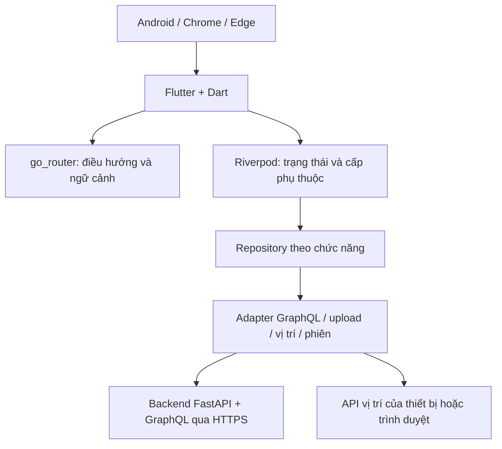

# Lựa chọn công nghệ frontend

| Dự án | Owner | Reviewer | Approver | Sprint | Ngày | Phiên bản | Trạng thái |
|---|---|---|---|---|---|---|---|
| ToMateTo | FE — hieun4759 | Lead; BE đối với hợp đồng tích hợp | Lead | S3 | 25/10/2026 | 0.2 | Đề nghị review |

**DOC:** 4.2-A — phần FE · **WBS:** 3.2.2

## 1. Phạm vi và căn cứ

Frontend phục vụ Android và web Chrome/Edge, dùng giao diện tiếng Việt. iOS, trang quản trị, thanh toán và nhắn tin giữa người dùng nằm ngoài v1. Tài liệu xác định lựa chọn FE để review; trạng thái phê duyệt được quản lý riêng với đề xuất kỹ thuật.

| Căn cứ | Ràng buộc cho FE |
|---|---|
| Vision mục 4–5; NFR-12, NFR-13 | Android + web; chi phí gần 0; Flutter là stack dự kiến; một vai trò FE |
| NFR-01, NFR-02 | Feed/tìm kiếm có mục tiêu phản hồi ≤2 giây ở p95 trong môi trường đo; cursor, mặc định ≤10 và tối đa 50 mục/trang |
| NFR-04, NFR-10 | Chat có ngưỡng 30 giây, phản hồi lùi và không làm hỏng chức năng cốt lõi |
| NFR-05 | Ảnh ≤10 MB/tệp; cạnh dài sau xử lý ≤1600 px; BE kiểm tra có thẩm quyền |
| NFR-06, NFR-07, NFR-08 | Mật khẩu ≥6 ký tự; JWT 7 ngày; quyền sở hữu; email riêng tư; HTTPS khi triển khai công khai |
| NFR-12 | Điện thoại 360–412 dp, web ≥1280 px; mục tiêu WCAG 2.1 AA; luồng lõi ≤3 thao tác và quay món ≤2 |
| NFR-14; REQ-FE-001…013 | Tách lớp, kiểm thử, phản hồi nhập liệu/tải/lỗi, bảo toàn ngữ cảnh, chống gửi lặp |

Đối chiếu [DOC 4.1-A Architecture Drivers](https://github.com/anqp5002/ToMateTo/blob/bcba7866/docs/thiet_ke/4.1-A_architecture_drivers.md), baseline nhánh Lead `bcba7866`, đang trình duyệt ở PR #12. Trạng thái tài liệu nguồn không đồng nghĩa các quyết định FE đã được chấp thuận. Chỉ số hiệu năng là yêu cầu cần kiểm chứng, không phải kết quả đo của framework.

### 1.1. Truy vết quyết định tới driver

| Quyết định FE | Driver | Đáp ứng ở mức thiết kế |
|---|---|---|
| Flutter Android/web và bố cục dùng chung | AD-12, AD-13, AD-16 | Một nền tảng FE; responsive và cách dựng môi trường có thể lặp lại |
| Controller + repository và Riverpod | AD-09, AD-15 | Tách trạng thái khỏi widget, thay phụ thuộc khi kiểm thử |
| Cursor và trạng thái danh sách | AD-01, AD-11 | Không tải toàn bộ; giữ dữ liệu cũ khi tải thêm lỗi |
| Router và kho phiên | AD-05, AD-10 | Kiểm ngữ cảnh nội bộ, không đưa bí mật vào URL; BE kiểm quyền và vô hiệu phiên |
| Adapter ảnh | AD-03, AD-04 | Giới hạn tệp, giữ form khi lỗi, tách nhà cung cấp |
| Vị trí và chat | AD-02, AD-04, AD-06, AD-07 | Nhãn fallback; chờ/lỗi; tham chiếu dữ liệu thật; draft do người dùng chọn |
| Lỗi và chẩn đoán | AD-14 | Phân loại lỗi, requestId nếu BE cung cấp; che token/OTP/mật khẩu |

## 2. Tổng quan stack đề xuất

BE sở hữu CSDL và khóa nhà cung cấp AI/ảnh. FE không kết nối PostgreSQL, không giữ khóa bí mật dịch vụ, không gọi nhà cung cấp AI trực tiếp. Sơ đồ thể hiện phạm vi client và điểm nối dự kiến; deployment toàn hệ thống thuộc DOC 4.3-A.

## 3. So sánh nền tảng

Thang điểm 1–5: 5 là phù hợp hơn với ràng buộc dự án. Điểm là đánh giá thiết kế, không phải benchmark. Giả thuyết: nhóm chưa cung cấp bằng chứng về mức thành thạo Flutter/React/Kotlin; tiêu chí kỹ năng chấm trung lập và phải xác nhận trước khi duyệt.

| Tiêu chí | Trọng số | Flutter/Dart | React web + React Native | Kotlin Android + React web |
|---|---:|---:|---:|---:|
| Phù hợp stack dự kiến của Vision/NFR-13 | 30% | 5 | 2 | 1 |
| Dùng chung triển khai cho Android/web | 25% | 5 | 3 | 1 |
| Khối lượng duy trì với một FE | 20% | 4 | 3 | 1 |
| Khả năng kiểm thử/tách lớp | 15% | 4 | 4 | 4 |
| Kinh nghiệm nhóm chưa được xác minh | 10% | 3 | 3 | 3 |
| Tổng có trọng số /5 | 100% | 4.45 | 2.85 | 1.65 |

**Đề xuất chọn Flutter/Dart.** Lý do chính là đáp ứng stack dự kiến và chia sẻ mã giữa Android/web trong phạm vi nhân lực nhỏ. React web + React Native cần kiểm soát khác biệt nền tảng và điều chỉnh ràng buộc stack; Kotlin + React tạo hai triển khai FE. Hai phương án vẫn hợp lệ nếu nhóm đổi ràng buộc và chứng minh được năng lực/thời gian tương ứng. Khả năng hỗ trợ đa nền tảng được mô tả trong [tài liệu Flutter](https://docs.flutter.dev/platform-integration).

## 4. Quyết định theo hạng mục

| Hạng mục | Đề xuất | Phương án cân nhắc | Lý do và truy vết |
|---|---|---|---|
| Framework/ngôn ngữ | Flutter stable và Dart đi kèm | React + React Native; Kotlin + React | Ma trận mục 3; NFR-12/13 |
| Trạng thái và phụ thuộc | flutter_riverpod, ưu tiên API không sinh mã ở giai đoạn đầu | Provider/ChangeNotifier; BLoC | Trạng thái bất đồng bộ theo chức năng, thay repository khi test; NFR-14, REQ-FE-003/008/012 |
| Điều hướng | go_router | Navigator trực tiếp | Route theo URL cho web, chuyển hướng và lưu ngữ cảnh; REQ-FE-004, DOC 3.3-B |
| Client dữ liệu | graphql_flutter sau khi xác nhận schema BE | Client HTTP tự dựng; Ferry | Tách query/mutation khỏi widget; xử lý lỗi GraphQL cùng HTTP; NFR-13/14 |
| Upload ảnh | Adapter upload dùng giao thức BE công bố | Multipart qua REST; GraphQL multipart; URL tải lên được cấp | Chưa chọn giao thức khi chưa có API; không suy diễn từ tên framework; REQ-010, NFR-05/08 |
| Phiên Android | Adapter kho phiên, flutter_secure_storage là ứng viên | Chỉ giữ RAM; lưu thường | Ưu tiên kho nền tảng cho token nếu hỗ trợ; cần thử nghiệm Android; NFR-06/08 |
| Phiên web | Giữ token trong RAM ở bản nền; xác thực lại sau tải lại trang | Cookie HttpOnly nếu BE hỗ trợ; lưu token bằng JS | Tránh mặc định lưu token dài hạn vào localStorage; trải nghiệm giữ phiên cần Lead/BE quyết định; NFR-06/08 |
| Ảnh/vị trí | Adapter thay thế được, thư viện được chọn sau thử Android/web | Gọi plugin trực tiếp từ mọi màn | Giữ khác biệt nền tảng ngoài UI; NFR-05/13 |
| Kiểm thử | flutter_test + integration_test; fake repository/client | Kiểm thủ công toàn bộ | Unit cho controller/repository, widget cho trạng thái, integration cho luồng lõi; NFR-11/14 |
| Phân tích tĩnh | flutter analyze + quy tắc lint thống nhất | Chỉ kiểm khi build | Phát hiện lỗi trước PR; NFR-14 |

[go_router](https://pub.dev/packages/go_router) cung cấp điều hướng khai báo theo URL. [Riverpod](https://docs-v2.riverpod.dev/docs/concepts/providers) hỗ trợ thay provider trong kiểm thử. [graphql_flutter](https://pub.dev/packages/graphql_flutter) là ứng viên client; việc chọn package không xác nhận API backend đã tồn tại. Khuyến nghị phân lớp và khả năng kiểm thử tham khảo [Flutter architecture recommendations](https://docs.flutter.dev/app-architecture/recommendations).

### 4.1. So sánh quản lý trạng thái

| Tiêu chí | Riverpod | Provider/ChangeNotifier | BLoC |
|---|---|---|---|
| Trạng thái tải/lỗi/dữ liệu | Có mô hình bất đồng bộ; cần quy ước state form/mutation riêng | Tự xây mô hình bất đồng bộ | Tự định nghĩa state/event theo luồng |
| Thay phụ thuộc khi test | Override provider/repository | Cấp fake qua constructor/provider | Cấp fake cho bloc và kiểm chuỗi state |
| Khối lượng thiết kế | Provider và vòng đời phải quy định rõ | Ít cơ chế ban đầu; dễ dồn vào notifier lớn | Nhiều kiểu event/state; luồng sự kiện rõ |
| Chi phí học | Giả thuyết: cần học vòng đời, invalidate và phạm vi state | Giả thuyết: dễ bắt đầu, vẫn cần học tách trách nhiệm | Giả thuyết: cần học event/state và xử lý đồng thời |
| Phù hợp đề xuất | Chọn: DI + async state cùng cơ chế, không bắt code generation | Không chọn ở baseline: nhóm phải tự chuẩn hóa async state nhiều hơn | Không chọn ở baseline: số cấu trúc bổ sung chưa cần thiết với phạm vi hiện tại |

Đánh giá trên là phân tích thiết kế, không phải số đo thời gian học của nhóm. FE phải xác nhận năng lực và trình ví dụ đọc feed + mutation với fake repository trước phê duyệt. Nếu kinh nghiệm nhóm nghiêng rõ sang phương án khác, Lead xem xét lại lựa chọn thay vì giữ điểm số cũ.

### 4.2. So sánh điều hướng

| Tiêu chí | go_router | Navigator quản lý trực tiếp |
|---|---|---|
| URL/deep link web | Có cơ chế route khai báo | Phải tự thiết kế ánh xạ URL và lịch sử theo Router/Navigator |
| Auth redirect/ngữ cảnh | Có redirect; vẫn phải tự lưu và kiểm đích nội bộ | Tự tổ chức guard, ngữ cảnh và back |
| Kiểm thử | Test guest/login, deep link, refresh và Back theo bảng route | Test cùng kịch bản nhưng nhiều logic route tự quản |
| Đánh đổi | Phụ thuộc package, cần kiểm redirect loop | Ít phụ thuộc package nhưng tăng code route và bảo trì |

Chọn go_router cho Android/web, truy vết AD-05/09/12. Việc dùng package không tự đáp ứng REQ-FE-004: phải kiểm không tự thực hiện thao tác sau login và không nhận URL ngoài làm đích.

### 4.3. Baseline phiên bản đề xuất

| Thành phần | Phiên bản đề xuất | Căn cứ | Trạng thái |
|---|---|---|---|
| Flutter | 3.47.7 stable | Metadata SDK hiện có trên máy FE | Chưa chạy build tương thích cho bộ đề xuất |
| Dart | 3.13.5, đi kèm Flutter trên | Metadata SDK | Không chọn độc lập với Flutter |
| flutter_riverpod | 3.4.3 | Trang package của nhà phát hành | Chưa giải dependency/thử Android-web |
| go_router | 18.1.1 | Trang package của Flutter | Chưa giải dependency/thử Android-web |
| graphql_flutter | 5.3.0 | Trang package nhà phát hành | Chờ schema và thử mapper |
| flutter_secure_storage | 11.2.0 | Trang package nhà phát hành | Chỉ ứng viên kho phiên Android, chưa kiểm plugin |
| flutter_test, integration_test | Theo Flutter SDK đề xuất | SDK Flutter | Chưa thực thi bộ test |

Nguồn package: [flutter_riverpod](https://pub.dev/packages/flutter_riverpod), [go_router](https://pub.dev/packages/go_router), [graphql_flutter](https://pub.dev/packages/graphql_flutter), [flutter_secure_storage](https://pub.dev/packages/flutter_secure_storage). Metadata SDK cục bộ chỉ xác nhận phiên bản được cài, không chứng minh package tương thích; có thể đối chiếu bản phát hành tại [Flutter SDK archive](https://docs.flutter.dev/install/archive).

Đây là tập phiên bản ứng viên có thể kiểm chứng, chưa phải baseline đã duyệt. Điều kiện đóng băng: giải dependency thành công; ghi phiên bản thực tế trong pubspec.lock; analyze; kiểm thử trạng thái; build web và Android trên cùng tập phiên bản. Nếu solver hoặc plugin không tương thích, cập nhật bảng cùng lý do và review lại. Chọn ảnh/vị trí và giao thức upload chưa gán package trước khi kiểm yêu cầu nền tảng/hợp đồng.

## 5. Phân lớp và tích hợp

View chỉ hiển thị và phát ý định. Controller nhận ý định, điều phối trạng thái và gọi repository. Repository là hợp đồng dữ liệu theo chức năng; adapter chịu HTTP/GraphQL, ánh xạ DTO và khác biệt thiết bị. Thành phần data không gọi UI hoặc điều hướng. UI không giả định một HTTP 200 là mutation thành công; cần kiểm lỗi GraphQL và dữ liệu kết quả.

Android đóng gói ứng dụng; web biên dịch thành tài nguyên tĩnh. BE/DB chạy Docker theo NFR-13/14; cách phục vụ web qua Docker do Lead xác định. Không cam kết chạy APK trong Docker hoặc dùng Docker thay Android SDK.

## 6. Rủi ro và kiểm chứng

| Rủi ro | Ảnh hưởng | Kiểm chứng/giảm thiểu | Người phụ trách |
|---|---|---|---|
| Kỹ năng nhóm chưa xác minh | Ước lượng sai thời gian | Xác nhận năng lực; spike form, gọi API giả và hai nền tảng | FE, Lead |
| Plugin không đồng nhất Android/web | Chọn ảnh/vị trí/phiên khác hành vi | Adapter và thử quyền bị từ chối, GPS lỗi, upload trên hai nền tảng | FE |
| Schema/API chưa có | Chọn client hoặc cache không phù hợp | Repository + fake; không đóng băng DTO hoặc tên operation trước review API | FE, BE |
| Cache giữ dữ liệu tài khoản trước | Lộ dữ liệu riêng tư | Clear cache/trạng thái riêng khi logout, đổi tài khoản hoặc phiên hết hạn | FE |
| Token web trong RAM mất khi tải lại | Người dùng phải đăng nhập lại | Chấp nhận tạm; đánh giá cookie với BE trước nghiệm thu giữ phiên | FE, BE, Lead |
| Thư viện/SDK không tương thích | Không build được | Chốt baseline sau spike; lock và kiểm build cả Android/web | FE |
| Chi phí dùng bản đồ/AI/ảnh | Vượt ngân sách | Không chọn nhà cung cấp từ client; tích hợp theo adapter và fallback | Lead, BE, FE |

### 6.1. Phiên và đăng xuất

AD-05 và REQ-006 yêu cầu vô hiệu phiên hiện tại phía server. FE gọi thao tác logout qua Account Repository; chỉ ghi nhận hoàn tất phía hệ thống khi BE xác nhận vô hiệu phiên. Sau xác nhận, FE xóa token, cache và state riêng. Khi mất phản hồi, FE có thể kết thúc truy cập cục bộ nhưng phải nêu chưa xác nhận kết thúc phiên server; không tuyên bố xóa token là đã revoke. Không giữ token để tự gửi lại sau khi đã xóa kho phiên; việc thử lại/revoke được xác định trong hợp đồng BE.

Baseline NFR-06 vẫn là JWT 7 ngày. Thiết kế access/refresh token trong tài liệu bảo mật nhánh DB là phương án cần Lead/BE thống nhất với NFR, chưa tự áp dụng vào FE. Lưu phiên web trong RAM và cookie HttpOnly tiếp tục là lựa chọn chờ chốt trải nghiệm/bảo mật.

## 7. Điều kiện duyệt

Lead xác nhận tính phù hợp với DOC 4.1-A; nhóm xác nhận giả thuyết năng lực; FE cung cấp baseline phiên bản và kết quả spike; BE xác nhận giao thức dữ liệu/upload/phiên. Phê duyệt công nghệ không đồng nghĩa đã đạt các chỉ tiêu NFR hoặc đã hoàn thành cài đặt.
