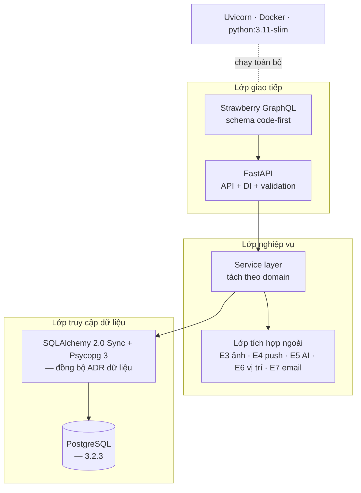

# DOC 4.2-A (phần BE) — Quyết định Công nghệ Kỹ thuật: Backend

> Owner: BE | Reviewer: Lead (WBS 3.2.4) | Approver: Lead | Sprint: S3 (19–25/10/2026)
> WBS: 3.2.1 — Lựa chọn + phương án bị loại: backend
> Phần FE (3.2.2) và dữ liệu (3.2.3) do thành viên khác; gộp thành DOC 4.2-A đầy đủ sau khi hoàn tất các phần FE, BE và dữ liệu.

## 1. Tổng quan Công nghệ Kỹ thuật (phía backend)

## 2. Quyết định Công nghệ theo Danh mục

### Ngôn ngữ & Khung làm việc

| Hạng mục | Chọn | Phiên bản | Lý do |
|---|---|---|---|
| Ngôn ngữ backend | **Python** | ≥ 3.11 | 3.11 là mức tối thiểu Strawberry cam kết hỗ trợ; typing + mypy phục vụ tách lớp (AD-09, NFR-14) |
| Khung máy chủ | **FastAPI** | ≥ 0.161 | Stack FastAPI + GraphQL theo NFR-13; resolver đồng bộ chạy trong threadpool, adapter ngoài dùng timeout (NFR-10/04); dependency injection là nơi gom một cửa kiểm quyền cho mọi thao tác ghi (NFR-07); validate bằng Pydantic. Hợp đồng được định nghĩa qua schema GraphQL (Strawberry), không dùng OpenAPI để mô tả schema GraphQL. |
| Thư viện GraphQL | **Strawberry GraphQL** | ≥ 0.336 | Code-first từ type hints giúp schema ít sai lệch FE/BE (NFR-14); DataLoader giúp tránh N+1. |
| Máy chủ ASGI | **Uvicorn** | ≥ 0.34; ghim bản vá trong lock file | Đi kèm FastAPI, chạy cục bộ bằng `docker compose` (NFR-13) |
| Xác thực | **PyJWT + bcrypt** | PyJWT ≥ 2.10; bcrypt ≥ 4.2; ghim bản vá trong lock file | NFR-06 quy định mật khẩu băm và chính sách phiên. DOC 5.2-A và DOC 5.4-A chốt một JWT 7 ngày; không phát refresh token trong v1. |

### Khung kiểm thử

| Công cụ | Dùng cho |
|---|---|
| pytest ≥ 8 | Test đơn vị service/resolver |
| httpx `Client` đồng bộ | Test tích hợp API GraphQL không cần chạy server thật |
| respx (hoặc `httpx.MockTransport`) | Giả lập lỗi/quá hạn dịch vụ ngoài để kiểm chế độ lùi (NFR-10) |
| coverage.py | Mức phủ khi merge |
| ruff + mypy | Lint + kiểm kiểu trước khi vào nhánh chính (NFR-14) |

### Các danh mục còn lại

Cơ sở dữ liệu, hạ tầng, DevOps thuộc WBS 3.2.3 (DB) và DOC 4.2-A gộp; phần backend chỉ xác nhận: mọi khoá bí mật nạp qua biến môi trường (NFR-08), đóng gói Docker (NFR-13), log ra stdout cho `docker compose logs` (NFR-09).

### Quyết định công nghệ theo luồng

| Luồng | Quyết định Backend | Căn cứ |
|---|---|---|
| Upload ảnh | Upload qua HTTP multipart riêng; adapter ảnh cô lập nhà cung cấp, kiểm MIME/kích thước, giữ ảnh chờ theo chủ sở hữu và mục đích, không tự bỏ ảnh khi lỗi transient. | DOC 5.2-A §1, §5; DOC 5.4-A §5.7; NFR-05 |
| Phiên web | Một JWT 7 ngày gửi bằng Bearer; web giữ token trong bộ nhớ và yêu cầu đăng nhập lại sau reload; không dùng cookie. Logout thu hồi `jti` ở server. | DOC 5.2-A §2; DOC 5.4-A §2; NFR-06 |
| Email OTP | Adapter X2 gửi OTP qua E7 với timeout; OTP và reset grant chỉ lưu dạng hash, giới hạn/thời hạn theo NFR-06. Nhà cung cấp cấu hình qua biến môi trường. | DOC 1.3-A; DOC 5.2-A §3; NFR-06, NFR-08 |
| Job định kỳ | APScheduler chạy trong tiến trình `worker` riêng, có khóa chống chạy trùng ở mức job; gồm tạo snapshot xu hướng, dọn ảnh mồ côi và gửi push đang chờ. | DOC 5.1-A/B §2.4; DOC 5.4-A §1.2, §6.1; NFR-09 |

## 3. Ma trận Quyết định

NFR-13 là cổng đạt/không đạt trước khi chấm điểm; không tính vào trọng số. Phương án không qua cổng bị loại. Bảng xếp hạng so sánh các phương án qua cổng theo mức phù hợp để nhóm triển khai, tích hợp và vận hành.

| Tiêu chí | Trọng số | FastAPI + Strawberry | Django + Graphene | Flask + Ariadne | NestJS + Apollo | Go + gqlgen | Spring + GraphQL |
|---|:---:|:---:|:---:|:---:|:---:|:---:|:---:|
| Khả năng triển khai và vận hành trong phạm vi nhóm | 35% | 5 (1.75) | 3 (1.05) | 3 (1.05) | 4 (1.40) | 5 (1.75) | 4 (1.40) |
| Hệ sinh thái tích hợp dịch vụ ngoài (E3–E7) | 30% | 5 (1.50) | 4 (1.20) | 3 (0.90) | 4 (1.20) | 2 (0.60) | 3 (0.90) |
| DI + khả năng gom kiểm quyền tại một điểm | 25% | 5 (1.25) | 3 (0.75) | 2 (0.50) | 4 (1.00) | 3 (0.75) | 4 (1.00) |
| Chi phí vận hành và triển khai cục bộ | 10% | 5 (0.50) | 4 (0.40) | 4 (0.40) | 3 (0.30) | 3 (0.30) | 2 (0.20) |
| **Tổng có trọng số (/5)** | 100% | **5.00** | **3.40** | **2.85** | **3.90** | **3.40** | **3.50** |

**Phương án bị loại** (một dòng mỗi loại):

- **Django + Graphene** — Không qua cổng stack FastAPI + GraphQL theo NFR-13.
- **Flask + Ariadne** — thiếu DI/validator tích hợp chặt chẽ, mỗi điểm ghi dễ tự kiểm quyền thay vì đi qua một cửa duy nhất; hướng SDL-first khó bảo đảm đồng bộ giữa schema và thực thi.
- **NestJS + Apollo** — đổi stack sang JS/TS trong khi FE là Dart, tạo hai hệ sinh thái khác nhau cho nhóm 4 người; thời gian học và tích hợp không phù hợp với tiến độ 10 tuần và ràng buộc nhân lực.
- **Go + gqlgen** — hiệu năng dư nhưng chi phí học cao với nhóm hiện tại, tích hợp dịch vụ ngoài cần viết tay nhiều hơn và không phù hợp với việc chia sẻ kiến thức trong thời gian ngắn.
- **Spring + GraphQL** — nặng, cấu hình phức tạp, thời gian thiết lập lớn, khó đáp ứng yêu cầu chạy cục bộ nhanh cho việc review chéo trong nhịp sprint.

**Lý do chọn:** **FastAPI + Strawberry GraphQL** đáp ứng stack NFR-13 và đạt điểm cao nhất trong các tiêu chí có trọng số, phù hợp để nhóm triển khai và vận hành, dễ áp dụng DI để gom kiểm quyền, code-first giúp giảm sai lệch schema FE-BE và thuận tiện cho DataLoader để tránh N+1.

## 4. Truy vết

| Quyết định | Driver / NFR |
|---|---|
| FastAPI + Python | NFR-13 (Cứng), AD-09 |
| Strawberry GraphQL | AD-09, AD-01 |
| SQLAlchemy Sync + httpx timeout | AD-04, AD-07, NFR-04, NFR-10 |
| Dependency injection FastAPI | AD-05, NFR-07, REQ-028 |
| PyJWT + bcrypt | NFR-06, AD-05 |
| Biến môi trường thay hardcode | AD-10, NFR-08 |
| Docker + Uvicorn cục bộ | AD-13, AD-16, NFR-13 |
| pytest + httpx + respx + ruff/mypy | AD-15, NFR-14 |

## 5. Rủi ro và Giảm thiểu

| Rủi ro | Ảnh hưởng | Giảm thiểu |
|---|---|---|
| Mức thành thạo Python/FastAPI của từng thành viên chưa được ghi nhận | Có thể cần thời gian làm quen | Lead xác nhận năng lực hiện tại và phân bổ hỗ trợ trước khi giao triển khai; không dùng giả định năng lực để chấm điểm |
| Strawberry còn bản 0.x, có breaking changes giữa bản | Phá schema khi nâng | Ghim phiên bản + lock file; nâng chỉ trong PR riêng có test xanh |
| GraphQL dễ sinh truy vấn N+1, feed chậm khi dữ liệu tăng | AD-01 | Sử dụng DataLoader + chỉ mục phù hợp cho phân trang con trỏ; đo p95 theo NFR-01 |
| Gọi AI tới 30 giây chiếm worker | AD-07, NFR-04 | Timeout 30 giây + trả trạng thái đang xử lý + cho bỏ qua; thiết kế gọi bất đồng bộ/không chặn luồng đọc nơi có thể |
| Upload ảnh lớn (≤10MB) và cần thu nhỏ ≤1600px | NFR-05, AD-03, REQ-010 | Xử lý resize/thumbnails tại lớp tích hợp ảnh, giới hạn MIME/size, từ chối nếu không hợp lệ; không chặn đăng bài text khi lỗi transient (luồng 3 lựa chọn: thử lại/bỏ ảnh và đăng bài text/hủy) |
| Giữ phiên web và vô hiệu JWT khi đăng xuất | NFR-06, REQ-006, AD-05 | DOC 5.2-A §2 và DOC 5.4-A §2 chốt Bearer token, RAM trên web và thu hồi `jti`; giữ nguyên các quyết định này |
| Gửi email OTP và giới hạn thử | REQ-003–REQ-005, NFR-06 | Lớp tích hợp email với giới hạn gửi lại, giới hạn nhập sai OTP/reset token, chỉ lưu dạng hash, thời hạn theo NFR-06 |
| Tác vụ nền (xu hướng/thông báo/dọn ảnh) | AD-01, AD-07, NFR-09 | Chạy APScheduler trong tiến trình `worker` riêng theo DOC 5.1-A/B; khóa chống chạy trùng ở mức job, không chiếm worker GraphQL |

## 6. Giả định

- Mức thành thạo Python/FastAPI của nhóm chưa được ghi nhận; Lead xác nhận trước khi giao triển khai, không xem đây là dữ kiện đã chốt.
- Chưa có tiền đề cấu trúc mã nguồn cố định trong tài liệu này. Việc tổ chức lớp sẽ tuân theo nguyên tắc phân tầng đã nêu trong ADR-BE, không dựa trên việc giả định đã có scaffold.
- Phiên bản ghim cụ thể khi dựng môi trường ở S8, đối chiếu CHANGELOG Strawberry.

## Ký duyệt

| Vai trò | Họ tên | Ngày | Chữ ký |
|---|---|---|---|
| Owner (BE) | | | |
| Reviewer (Lead) | | | |
| Approver (Lead) | | | |
