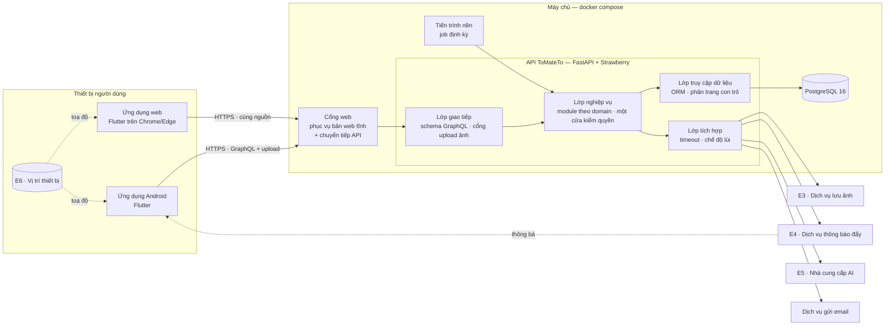
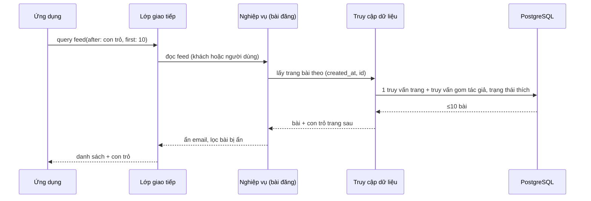
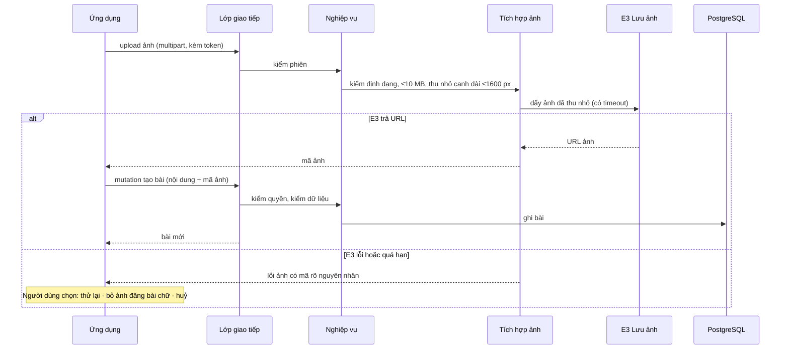

# DOC 4.3-A — Kiến trúc Hệ thống: ToMateTo

| Dự án | Owner | Reviewer | Approver | Sprint | Phiên bản | Trạng thái |
|---|---|---|---|---|---|---|
| ToMateTo | Lead | DB (WBS 3.3.2) | Lead | S3 | 0.1 | Bản nháp — đề nghị review |

**WBS:** 3.3.1 · **Đầu vào:** DOC 1.3-A, DOC 3.2-A (NFR), DOC 4.1-A (AD-01…AD-16), DOC 4.2 (phần FE, BE, dữ liệu) · **Quyết định đi kèm:** DOC 4.3-B (ADR-LEAD-001…005; ADR-FE, ADR-BE, ADR dữ liệu)

Tài liệu mô tả các khối chính của ToMateTo, trách nhiệm của từng khối, cách các khối gọi nhau trong các luồng chính và cách hệ thống chạy khi một dịch vụ ngoài lỗi. Công nghệ của từng khối lấy theo DOC 4.2; cách chia nhỏ bên trong mỗi khối để ở DOC 5.1 (component).

## 1. Tóm tắt kiến trúc

ToMateTo là hệ **client–server ba tầng**: một ứng dụng Flutter (chạy trên Android và trình duyệt) gọi **một API GraphQL duy nhất**; API là **một khối triển khai (monolith) chia module theo nghiệp vụ**, tự giữ toàn bộ quy tắc nghiệp vụ và kiểm quyền; dữ liệu nằm trong **một CSDL PostgreSQL**. Việc chạy định kỳ (tính xu hướng) tách sang **tiến trình nền** dùng chung mã với API. Mọi dịch vụ ngoài (ảnh, thông báo đẩy, AI, email) chỉ được gọi qua **lớp tích hợp** của API, mỗi dịch vụ có thời hạn chờ và chế độ lùi riêng. Toàn bộ hệ chạy bằng `docker compose` trên một máy.

Ba lựa chọn định hình kiến trúc:

| Lựa chọn | Driver chính | ADR |
|---|---|---|
| Một khối triển khai chia module, không tách microservice | AD-09, AD-13, AD-16 | ADR-LEAD-001 |
| Ảnh đi qua API để kiểm và thu nhỏ trước khi đẩy sang dịch vụ lưu ảnh | AD-03, AD-04 | ADR-LEAD-003 |
| Dịch vụ ngoài cách ly sau lớp tích hợp có chế độ lùi | AD-04, AD-07, AD-10 | ADR-BE-004 |

## 2. Sơ đồ khối

Đọc sơ đồ: mũi tên liền là lời gọi đồng bộ trong một request; nét đứt là dữ liệu đi ngoài luồng request. Ứng dụng không gọi thẳng dịch vụ ngoài nào ngoài E6 (vị trí trên chính thiết bị) và nhận thông báo E4.

## 3. Các khối và trách nhiệm

| Khối | Trách nhiệm | Không làm | Driver | Công nghệ (DOC 4.2) |
|---|---|---|---|---|
| Ứng dụng Flutter (Android + web) | Hiển thị, điều hướng, giữ phiên phía máy, lấy toạ độ, hiện trạng thái tải/rỗng/lỗi/chế độ lùi | Không chứa quy tắc nghiệp vụ, không giữ khoá dịch vụ ngoài | AD-07, AD-12 | Flutter, Riverpod, go_router, client GraphQL |
| Cổng web | Phục vụ bản build web tĩnh; chuyển tiếp `/graphql` và cổng upload tới API; kết thúc HTTPS khi triển khai công khai | Không xử lý nghiệp vụ | AD-10, AD-16 | ADR-LEAD-004 |
| Lớp giao tiếp | Schema GraphQL (query, mutation), cổng upload ảnh, đọc token, chuyển lỗi thành mã lỗi thống nhất | Không truy vấn CSDL trực tiếp | AD-09 | FastAPI, Strawberry |
| Lớp nghiệp vụ | Module: tài khoản, bài đăng, tương tác, bộ sưu tập, theo dõi, thông báo, tìm kiếm/khám phá, báo cáo, trợ lý. Một cửa kiểm quyền cho mọi thao tác ghi | Không gọi thẳng SDK dịch vụ ngoài | AD-05, AD-08, AD-09 | ADR-BE-001, ADR-BE-003 |
| Lớp tích hợp | Một adapter cho mỗi dịch vụ ngoài; timeout, bắt lỗi, trả kết quả lùi; ghi log sự kiện ngoài | Không quyết định nghiệp vụ | AD-04, AD-06, AD-07, AD-14 | ADR-BE-004 |
| Lớp truy cập dữ liệu | Truy vấn, gom truy vấn theo lô cho GraphQL, phân trang con trỏ, ràng buộc duy nhất | Không kiểm quyền | AD-01, AD-08, AD-11 | SQLAlchemy 2.0, Alembic |
| Tiến trình nền | Chạy job định kỳ: tính bảng xu hướng, dọn mã OTP, token đã thu hồi và ảnh không gắn bài đã quá hạn; ghi log kết quả job | Không phục vụ request người dùng | AD-01, AD-14 | ADR-LEAD-002 |
| PostgreSQL | Nguồn dữ liệu duy nhất; tìm kiếm tiếng Việt, truy vấn theo khung toạ độ | — | AD-01, AD-02, AD-08 | PostgreSQL 16, `pg_trgm`, `unaccent` |

## 4. Luồng chính

### 4.1 Đọc bảng tin (AD-01, AD-11)

Số truy vấn mỗi trang cố định, không tăng theo số bài (gom theo lô), nên trang sau không chậm dần. Khách đọc được mà không cần token.

### 4.2 Đăng bài có ảnh (AD-03, AD-04, AD-05)

### 4.3 Đăng xuất (AD-05, REQ-006)

Ứng dụng gọi mutation đăng xuất kèm token → lớp nghiệp vụ ghi mã định danh token vào danh sách đã thu hồi → mọi request sau đó mang token này bị từ chối ở bước đọc token → ứng dụng xoá token trên máy và về trạng thái khách. Chi tiết ở ADR-LEAD-005.

### 4.4 Hỏi trợ lý AI (AD-06, AD-07)

Ứng dụng gửi câu hỏi → nghiệp vụ trợ lý lấy ngữ cảnh từ CSDL → tích hợp AI gọi E5 với thời hạn 30 giây → nghiệp vụ đối chiếu món/quán trong câu trả lời với CSDL, bỏ thực thể không tồn tại → trả lời. Quá hạn hoặc lỗi: trả kết quả lùi (gợi ý theo luật từ dữ liệu sẵn có) kèm thông báo rõ nguyên nhân.

## 5. Chế độ lùi theo dịch vụ ngoài (AD-04, NFR-10)

| Dịch vụ | Khi lỗi / quá hạn / chưa cấu hình | Luồng vẫn chạy |
|---|---|---|
| E3 lưu ảnh | Báo lỗi ảnh; người dùng thử lại, bỏ ảnh hoặc huỷ | Xem feed, đăng bài chữ, tương tác |
| E4 thông báo đẩy | Ghi log, bỏ qua; thông báo vẫn lưu trong CSDL để xem trong ứng dụng | Thao tác gốc (thích, theo dõi) thành công |
| E5 AI | Trả gợi ý theo luật từ CSDL, báo rõ trợ lý đang không khả dụng | Mọi luồng khác |
| Email | Báo không gửi được mã, cho gửi lại sau; ghi log | Đăng nhập bằng mật khẩu hiện có |
| E6 vị trí | Dùng toạ độ mặc định trung tâm Hà Nội | Tìm quán gần theo toạ độ mặc định |

## 6. Triển khai

| Dịch vụ compose | Vai trò | Ghi chú |
|---|---|---|
| `web` | Cổng web: bản build web tĩnh + chuyển tiếp API | Một cổng duy nhất ra ngoài |
| `api` | API ToMateTo | Không mở cổng ra ngoài trực tiếp |
| `worker` | Tiến trình nền | Cùng image với `api`, khác lệnh chạy |
| `db` | PostgreSQL 16 | Ổ dữ liệu riêng; sao lưu thủ công theo ngày trong tuần demo (NFR-11) |

Khoá bí mật nạp từ tệp biến môi trường, repo chỉ chứa tệp mẫu không có giá trị thật (NFR-08). Log của cả bốn dịch vụ xem qua `docker compose logs` (NFR-09). Ứng dụng Android trỏ tới địa chỉ cổng `web`.

## 7. Truy vết driver

| Driver | Được đáp ứng ở |
|---|---|
| AD-01, AD-11 | Lớp truy cập dữ liệu (con trỏ, gom truy vấn) · luồng 4.1 · bảng xu hướng do tiến trình nền tính sẵn |
| AD-02 | PostgreSQL (khung toạ độ) · E6 + toạ độ mặc định |
| AD-03 | Cổng upload + tích hợp ảnh · luồng 4.2 · ADR-LEAD-003 |
| AD-04 | Lớp tích hợp · mục 5 |
| AD-05 | Một cửa kiểm quyền ở lớp nghiệp vụ · luồng 4.3 · ADR-LEAD-005 |
| AD-06, AD-07 | Luồng 4.4 · trạng thái chờ ở ứng dụng |
| AD-08 | Ràng buộc duy nhất ở CSDL |
| AD-09 | Bốn lớp của API · ADR-LEAD-001 |
| AD-10 | Tệp biến môi trường · cổng web kết thúc HTTPS |
| AD-12 | Ứng dụng Flutter (bố cục đáp ứng) |
| AD-13, AD-16 | Toàn bộ chạy bằng `docker compose` trên một máy · ADR-LEAD-004 |
| AD-14 | Log sự kiện ngoài và job định kỳ |
| AD-15 | Kiểm thử tự động theo lớp, mock lớp tích hợp |

## 8. Điểm cần đồng bộ giữa các phần

| # | Điểm | Hiện trạng | Đề xuất của kiến trúc | Ai sửa |
|---|---|---|---|---|
| D1 | Mô hình phiên | Ba tài liệu ba hướng (một token / access + refresh / cookie hay RAM) | ADR-LEAD-005 | BE, DB, FE |
| D2 | ORM đồng bộ hay bất đồng bộ | Phần BE ghi bất đồng bộ, phần dữ liệu ghi đồng bộ | Bất đồng bộ, để luồng gọi dịch vụ ngoài và luồng đọc không chặn nhau | DB |
| D3 | Giao thức upload ảnh | Chưa chọn | ADR-LEAD-003 | BE, FE |
| D4 | Xoá bài: vật lý hay mềm (Q8 ở DOC 4.1-A) | Lược đồ đang xoá vật lý, kéo theo báo cáo | Chờ BE và DB chốt; nếu xoá vật lý thì báo cáo phải giữ được nội dung đủ để đối chiếu | BE, DB |

## Ký duyệt

| Vai trò | Họ tên | Ngày | Chữ ký |
|---|---|---|---|
| Owner (Lead) | | | |
| Reviewer (DB) | | | |
| Approver (Lead) | | | |
