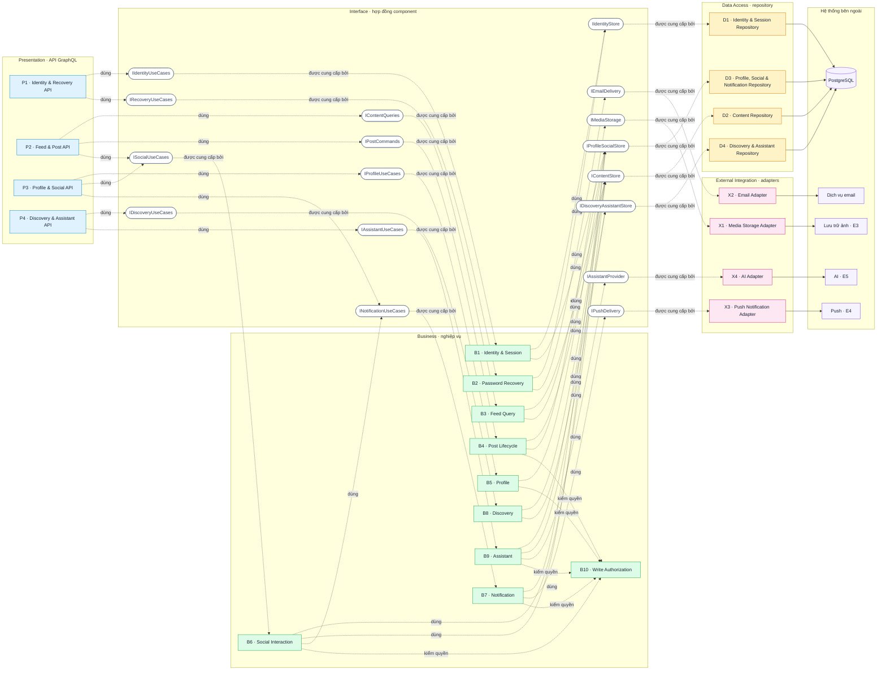

# DOC 5.1-A/B — Thiết kế thành phần Backend

| Dự án | Owner | Reviewer | Approver | Sprint | Phiên bản | Trạng thái |
|---|---|---|---|---|---|---|
| ToMateTo | BE | Lead; FE với hợp đồng GraphQL; DB với truy cập dữ liệu | Lead | S4 | 0.5 | Đề nghị review |

**WBS:** 4.1.1 · **Phạm vi:** phần backend của DOC 5.1-A/B

## 1. Phạm vi và giới hạn

Tài liệu phân rã backend theo các lớp Presentation, Business, Data Access và External Integration; xác định trách nhiệm, giao diện, phụ thuộc, công nghệ và truy vết tới DOC 3.1-A. Wireframe được dùng để chỉ ra màn hình cần API backend, không phải để suy diễn thêm yêu cầu nghiệp vụ.

| Đầu vào | Ghi chú |
|---|---|
| DOC 3.1-A Functional Requirements (28 REQ-001…REQ-028) | Danh sách việc hệ thống phải làm; dùng để kiểm tra không bỏ sót chức năng backend. |
| DOC 3.3-A Wireframe (MH-01…MH-19) | Bản phác thảo màn hình; giúp biết màn nào cần gọi backend, không dùng để tự đặt thêm quy tắc nghiệp vụ. |
| DOC 4.3-A/B System Architecture + ADR backend | [ADR backend](./4.3-A_adr_backend.md); xác định cách tổ chức backend và các nguyên tắc thiết kế, không phải sơ đồ component chi tiết. |
| DOC 4.2-A Technology Decision — Backend | Căn cứ để nêu công nghệ dự kiến cho các lớp và thành phần backend. |
| DOC 4.3-B.4 — ADR dữ liệu (nhánh DB S3) | Quyết định dữ liệu mới nhất: PostgreSQL 16, SQLAlchemy 2.0 Sync + Psycopg 3, transaction theo use case, keyset pagination, snapshot xu hướng. |
| DOC 5.3-A — Physical ERD & Schema (nhánh DB S4) | Baseline 18 bảng vật lý dùng để đối chiếu repository và quyền lọc nội dung. |
| DOC 5.1-A Component — Frontend | Dùng để phối hợp hợp đồng FE-BE và xem tổng số thành phần khi ghép hai phần; không dùng để suy ngược thiết kế backend. |

**Cách sử dụng DOC 4.3-A/B:** ADR backend xác định bốn lớp Presentation, Business, Data Access và External Integration (ADR-BE-001); GraphQL code-first và resolver mỏng (ADR-BE-002); kiểm quyền tại lớp Business (ADR-BE-001/003); adapter cho dịch vụ ngoài (ADR-BE-004); truy cập PostgreSQL và cursor (ADR-BE-005); xử lý lỗi/log (ADR-BE-006). File này là ADR backend, không có sơ đồ component tổng thể riêng để phân rã trực tiếp. Vì vậy, hierarchy theo domain trong tài liệu này là đề xuất chi tiết hóa từ các quyết định kiến trúc và phạm vi chức năng; cần Lead/FE/DB review các nhóm domain và ranh giới trước khi xem là phân rã đã được duyệt.

**Đồng bộ với ADR dữ liệu (bắt buộc):** DOC 4.3-B.4 chọn **SQLAlchemy 2.0 Sync + Psycopg 3** sau Repository Layer. Vì vậy mọi repository trong tài liệu này dùng sync; resolver chạy trong threadpool của GraphQL server. Adapter ngoài dùng `httpx` sync cho v1. DOC 4.2-A hiện vẫn mô tả async nên cần cập nhật. Nếu Lead/DB đổi lại async, phải sửa đồng thời DOC 4.2-A, ADR-BE-005, DOC 5.1-A và DOC 5.2-A; không trộn sync/async trong cùng luồng request.

Phạm vi tài liệu này có **22 thành phần backend**; không bao gồm thành phần UI/platform phía FE. Bản DOC 5.1-A frontend đang đề nghị review liệt kê 26 thành phần; nếu cộng nguyên trạng hai phần thì vượt giới hạn 15–30 thành phần toàn hệ thống của DOC 5.1. Đây là điểm cần Lead/FE/BE hợp nhất khi review, không tự ý gộp hay xóa thành phần của phần FE trong tài liệu backend này.

> **Quyết định cần Lead chốt:** giữ 22 thành phần logic và xin waiver cho giới hạn 15–30, hoặc gộp thêm (ví dụ P1–P4 thành 2 API, D1–D4 thành 2 repository, X2–X3 thành adapter messaging) để tổng ≤30. Tài liệu này không tự cắt thành phần vì làm vậy sẽ mất truy vết REQ.

## 2. DOC 5.1-A — Component Diagram

### 2.1 Component Hierarchy

```mermaid
flowchart TD
    BE["Backend"]

    subgraph IDENTITY["Identity & Recovery · 5 thành phần"]
        P1["P1 · Identity & Recovery GraphQL API<br/>Presentation"]
        B1["B1 · Identity & Session Service<br/>Business"]
        B2["B2 · Password Recovery Service<br/>Business"]
        D1["D1 · Identity & Session Repository<br/>Data Access"]
        X2["X2 · Email Adapter<br/>External Integration"]
    end

    subgraph CONTENT["Content & Posts · 5 thành phần"]
        P2["P2 · Feed & Post GraphQL API<br/>Presentation"]
        B3["B3 · Feed Query Service<br/>Business"]
        B4["B4 · Post Lifecycle Service<br/>Business"]
        D2["D2 · Content Repository<br/>Data Access"]
        X1["X1 · Media Storage Adapter<br/>External Integration"]
    end

    subgraph SOCIAL["Profile & Social · 6 thành phần"]
        P3["P3 · Profile & Social GraphQL API<br/>Presentation"]
        B5["B5 · Profile Service<br/>Business"]
        B6["B6 · Social Interaction Service<br/>Business"]
        B7["B7 · Notification Service<br/>Business"]
        D3["D3 · Profile, Social & Notification Repository<br/>Data Access"]
        X3["X3 · Push Notification Adapter<br/>External Integration"]
    end

    subgraph DISCOVERY["Discovery & Assistant · 5 thành phần"]
        P4["P4 · Discovery & Assistant GraphQL API<br/>Presentation"]
        B8["B8 · Discovery Service<br/>Business"]
        B9["B9 · Assistant Service<br/>Business"]
        D4["D4 · Discovery & Assistant Repository<br/>Data Access"]
        X4["X4 · AI Adapter<br/>External Integration"]
    end

    B10["B10 · Write Authorization Policy<br/>Chính sách nghiệp vụ dùng chung"]

    BE --> P1
    BE --> P2
    BE --> P3
    BE --> P4
    BE --> B10

    classDef presentation fill:#e0f2fe,stroke:#0284c7,color:#172033
    classDef business fill:#dcfce7,stroke:#16a34a,color:#172033
    classDef data fill:#fef3c7,stroke:#d97706,color:#172033
    classDef external fill:#fce7f3,stroke:#db2777,color:#172033
    class P1,P2,P3,P4 presentation
    class B1,B2,B3,B4,B5,B6,B7,B8,B9,B10 business
    class D1,D2,D3,D4 data
    class X1,X2,X3,X4 external
```



<details>
<summary>Mã cây phân rã dạng văn bản</summary>

```text
Backend
├── Identity & Recovery (5)
│   ├── P1 Identity & Recovery GraphQL API [Presentation]
│   ├── B1 Identity & Session Service [Business]
│   ├── B2 Password Recovery Service [Business]
│   ├── D1 Identity & Session Repository [Data Access]
│   └── X2 Email Adapter [External Integration]
├── Content & Posts (5)
│   ├── P2 Feed & Post GraphQL API [Presentation]
│   ├── B3 Feed Query Service [Business]
│   ├── B4 Post Lifecycle Service [Business]
│   ├── D2 Content Repository [Data Access]
│   └── X1 Media Storage Adapter [External Integration]
├── Profile & Social (6)
│   ├── P3 Profile & Social GraphQL API [Presentation]
│   ├── B5 Profile Service [Business]
│   ├── B6 Social Interaction Service [Business]
│   ├── B7 Notification Service [Business]
│   ├── D3 Profile, Social & Notification Repository [Data Access]
│   └── X3 Push Notification Adapter [External Integration]
├── Discovery & Assistant (5)
│   ├── P4 Discovery & Assistant GraphQL API [Presentation]
│   ├── B8 Discovery Service [Business]
│   ├── B9 Assistant Service [Business]
│   ├── D4 Discovery & Assistant Repository [Data Access]
│   └── X4 AI Adapter [External Integration]
└── Cross-cutting Business Policy
    └── B10 Write Authorization Policy (được gọi bởi các luồng ghi)
```

</details>

**Ghi chú đọc cây phân rã:**

- Các nhóm `Identity & Recovery`, `Content & Posts`, `Profile & Social`, `Discovery & Assistant` là nhóm chức năng để dễ trình bày; chúng không khẳng định backend phải tách thành từng ứng dụng hoặc dịch vụ chạy riêng.
- Ký tự đầu của mã cho biết loại thành phần: `P` = API tiếp nhận (Presentation), `B` = xử lý nghiệp vụ (Business), `D` = truy cập dữ liệu (Data Access), `X` = kết nối dịch vụ ngoài (External Integration).
- Số trong ngoặc sau tên domain là số thành phần được liệt kê trong nhóm đó. `B10` là chính sách kiểm quyền dùng chung nên đứng ngoài các nhóm, không cộng vào số lượng domain.
- Ví dụ luồng tạo bài: `P2` nhận thao tác từ FE → `B4` kiểm tra quy tắc và quyền qua `B10` → `D2` lưu bài; nếu có ảnh thì `B4` gọi `X1`.
- **E6 không phải adapter.** E6 trong DOC 1.3 là GPS thiết bị + logic bbox/Haversine phía server, không phải dịch vụ ngoài. B8 nhận `lat/lng` từ request (hoặc fallback Hà Nội) và truy vấn bảng `restaurants` qua D4/D2; không có adapter địa lý để gọi.

### 2.2 UML Component Diagram

**Cách đọc sơ đồ:** mỗi khung là một component; các khung được gom theo lớp Presentation, Business, Data Access và External Integration. `I...` là giao diện/hợp đồng component cung cấp. Đường nối nét đứt có mũi tên (`..>`) biểu thị component đang sử dụng giao diện hoặc phụ thuộc vào component khác; đầu mũi tên chỉ về phía được gọi. Đường liền từ component tới giao diện (`-`) biểu thị component cung cấp giao diện đó. Mỗi giao diện chỉ có một component cung cấp.

**Ví dụ:** `P2 ..> IPostCommands` và `B4 - IPostCommands` nghĩa là API bài đăng P2 gọi hợp đồng xử lý lệnh do B4 cung cấp. `B4 ..> IX1` và `X1 - IX1` nghĩa là nghiệp vụ bài đăng phụ thuộc hợp đồng lưu ảnh do adapter X1 cung cấp. `X1 --> E3` thể hiện adapter kết nối ra dịch vụ lưu ảnh bên ngoài. Các mũi tên từ repository tới PostgreSQL biểu thị nơi dữ liệu được lưu/truy vấn.

**Nguyên tắc phụ thuộc:** Presentation gọi Business; Business gọi Data Access hoặc External Integration. Tầng dưới không gọi ngược lên tầng trên; adapter không quyết định quy tắc nghiệp vụ. B10 là chính sách kiểm quyền dùng chung cho các luồng ghi cần xác thực/ủy quyền; đăng ký, đăng nhập và khôi phục mật khẩu tuân theo ngoại lệ đã nêu trong ADR-BE-003.



<details>
<summary>Mã PlantUML gốc của sơ đồ component</summary>



</details>

```plantuml
@startuml
skinparam componentStyle uml2
top to bottom direction

package "Presentation" {
  component "Identity & Recovery\nGraphQL API" as P1
  component "Feed & Post\nGraphQL API" as P2
  component "Profile & Social\nGraphQL API" as P3
  component "Discovery & Assistant\nGraphQL API" as P4
}

package "Business" {
  component "Identity & Session\nService" as B1
  component "Password Recovery\nService" as B2
  component "Feed Query\nService" as B3
  component "Post Lifecycle\nService" as B4
  component "Profile\nService" as B5
  component "Social Interaction\nService" as B6
  component "Notification\nService" as B7
  component "Discovery\nService" as B8
  component "Assistant\nService" as B9
  component "Write Authorization\nPolicy" as B10
}

package "Data Access" {
  component "Identity & Session\nRepository" as D1
  component "Content\nRepository" as D2
  component "Profile, Social & Notification\nRepository" as D3
  component "Discovery & Assistant\nRepository" as D4
}

package "External Integration" {
  component "Media Storage\nAdapter" as X1
  component "Email\nAdapter" as X2
  component "Push Notification\nAdapter" as X3
  component "AI\nAdapter" as X4
}

interface "IIdentityUseCases" as I1
interface "IRecoveryUseCases" as I2
interface "IContentQueries" as I3
interface "IPostCommands" as I4
interface "IProfileUseCases" as IProfile
interface "ISocialUseCases" as ISocial
interface "INotificationUseCases" as INotification
interface "IDiscoveryUseCases" as I6
interface "IAssistantUseCases" as IAssistant
interface "IIdentityStore" as ID1
interface "IContentStore" as ID2
interface "IProfileSocialStore" as ID3
interface "IDiscoveryAssistantStore" as ID4
interface "IMediaStorage" as IX1
interface "IEmailDelivery" as IX2
interface "IPushDelivery" as IX3
interface "IAssistantProvider" as IX4

P1 ..> I1
B1 - I1
P1 ..> I2
B2 - I2
P2 ..> I3
B3 - I3
P2 ..> I4
B4 - I4
P2 ..> ISocial
P3 ..> IProfile
B5 - IProfile
P3 ..> ISocial
B6 - ISocial
P3 ..> INotification
B7 - INotification
P4 ..> I6
B8 - I6
P4 ..> IAssistant
B9 - IAssistant

B1 ..> ID1
B2 ..> ID1
D1 - ID1
B3 ..> ID2
B4 ..> ID2
B6 ..> ID2
B8 ..> ID2
B9 ..> ID2
D2 - ID2
B1 ..> ID3
B3 ..> ID3
B5 ..> ID3
B6 ..> ID3
B7 ..> ID3
D3 - ID3
B8 ..> ID4
B9 ..> ID4
D4 - ID4

B6 ..> INotification

B4 ..> IX1
X1 - IX1
B2 ..> IX2
X2 - IX2
B7 ..> IX3
X3 - IX3
B9 ..> IX4
X4 - IX4

B4 ..> B10
B5 ..> B10
B6 ..> B10
B7 ..> B10
B9 ..> B10

database "PostgreSQL" as PG
D1 --> PG
D2 --> PG
D3 --> PG
D4 --> PG

cloud "Image storage provider (E3)" as E3
cloud "Email delivery provider" as EMAIL
cloud "Push provider (E4)" as E4
cloud "AI provider (E5)" as E5
X1 --> E3
X2 --> EMAIL
X3 --> E4
X4 --> E5
@enduml
```

**Ghi chú:** Strawberry GraphQL là bề mặt giao tiếp chính theo DOC 4.2-A. Ảnh, email, push và AI được gọi qua adapter; vị trí là dữ liệu client gửi trong request, không phải adapter. Hệ ngoài gồm E3 Cloudinary, E4 FCM, E5 FreeLLM `:3001` và dịch vụ email chưa có trong E3–E6; không giả định queue hay payload vendor khi chưa chốt. Mermaid thể hiện interface dưới dạng nút hợp đồng để dễ xem trực tiếp trong Markdown; đây là biểu diễn trực quan của sơ đồ thiết kế, không thay đổi ý nghĩa các interface.

### 2.3 Component Catalog

| ID | Thành phần | Lớp | Trách nhiệm / màn hình | Giao diện công khai | Phụ thuộc | Công nghệ |
|---|---|---|---|---|---|---|
| P1 | Identity & Recovery GraphQL API | Presentation | Đăng ký, đăng nhập, phiên, thiết bị, khôi phục mật khẩu; MH-01/02/03/05 | `register`, `login`, `refreshSession`, `logout`, `requestPasswordReset`, `verifyPasswordResetOtp`, `resetPassword`, `registerDevice`, `unregisterDevice` | B1, B2 | FastAPI, Strawberry GraphQL |
| P2 | Feed & Post GraphQL API | Presentation | Feed/chi tiết; tạo, sửa, xóa, báo cáo bài; nhận HTTP upload ảnh dùng chung cho bài/hồ sơ; MH-06/07/08/09/11 | `feed`, `post`, `createPost`, `updatePost`, `deletePost`, `reportPost`, `uploadMedia` (HTTP) | B3, B4, B6 | FastAPI, Strawberry GraphQL |
| P3 | Profile & Social GraphQL API | Presentation | Hồ sơ, tương tác, bộ sưu tập, thông báo; MH-07/10/11/12/13/14 | `profile`, `profilePosts`, `myProfile`, `myPosts`, `updateProfile`, `setProfileVisibility`, `setLike`, `savePost`, `removeSavedPost`, `myCollections`, `collectionItems`, `createCollection`, `renameCollection`, `deleteCollection`, `setFollow`, `notifications`, `markNotificationRead`, `markAllNotificationsRead` | B5, B6, B7 | FastAPI, Strawberry GraphQL |
| P4 | Discovery & Assistant GraphQL API | Presentation | Tìm kiếm, xu hướng, quán gần, quay món, trợ lý; MH-15/16/17/18/19 | `search`, `trending`, `nearbyPlaces`, `randomDish`, `askAssistant`, `retryAssistant`, `assistantSessions`, `assistantHistory`, `useAssistantDraft` | B8, B9 | FastAPI, Strawberry GraphQL |
| B1 | Identity & Session Service | Business | Tài khoản, xác thực, cấp/làm mới/kết thúc phiên, thiết bị push; tạo collection "Đã lưu" mặc định khi đăng ký (REQ-001) | `register`, `authenticate`, `createSession`, `refreshSession`, `revokeSession`, `registerDevice`, `unregisterDevice`, `createDefaultCollection` | D1, D3 | Python; PyJWT, bcrypt |
| B2 | Password Recovery Service | Business | OTP, reset grant, đặt lại mật khẩu; thu hồi phiên cũ | `requestReset`, `verifyOtp`, `resetPassword` | D1, X2 | Python; PyJWT, bcrypt |
| B3 | Feed Query Service | Business | Feed/chi tiết theo quyền xem; cursor; trạng thái like/save | `listFeed`, `getPost` | D2, D3 | SQLAlchemy 2.0 Sync + Psycopg 3 |
| B4 | Post Lifecycle Service | Business | Tạo/sửa/xóa bài; pipeline media dùng chung; chuẩn hóa món/thẻ; job dọn media định kỳ (mục 2.4) | `createPost`, `updatePost`, `deletePost`, `uploadMedia`, `normalizePost`, `cleanupOrphanMedia` | B10, D2, X1 | SQLAlchemy 2.0 Sync + Psycopg 3; httpx sync |
| B5 | Profile Service | Business | Hồ sơ, avatar/cover, quyền công khai từng trường; object ảnh cũ do job của B4 dọn, không gọi X1 | `getProfile`, `updateProfile`, `setProfileVisibility`, `consumeMediaUploads` (purpose AVATAR/COVER) | B10, D2, D3 | SQLAlchemy 2.0 Sync + Psycopg 3 |
| B6 | Social Interaction Service | Business | Like/save/follow/report; kiểm quyền và tạo thông báo | `setLike`, `setSave`, `setFollow`, `reportPost` | B10, D2, D3, B7 | SQLAlchemy 2.0 Sync + Psycopg 3 |
| B7 | Notification Service | Business | Tạo/đọc/đánh dấu thông báo; gắn actor/post; gửi push không chặn thao tác gốc | `createNotification`, `listNotifications`, `markRead`, `markAllRead`, `requestPush`, `hydrateTarget` | B10, D2, D3, X3 | SQLAlchemy 2.0 Sync + Psycopg 3; httpx sync |
| B8 | Discovery Service | Business | Tìm kiếm, xu hướng, quán gần, quay món; lọc nội dung bị chặn; sinh snapshot xu hướng định kỳ (mục 2.4) | `search`, `getTrending`, `getNearbyRestaurants`, `chooseRandomDish`, `refreshTrendingSnapshot` | D2, D3, D4 | SQLAlchemy 2.0 Sync + Psycopg 3 |
| B9 | Assistant Service | Business | Hỏi đáp, phiên/lịch sử, retry, kiểm tra tham chiếu; chỉ dùng ngữ cảnh công khai; mỗi lượt ≤30 giây (NFR-04) | `ask`, `retry`, `listSessions`, `getHistory`, `createPostDraft`, `validateReferences` | B10, D2, D4, X4 | SQLAlchemy 2.0 Sync + Psycopg 3; httpx sync; timeout 30 s |
| B10 | Write Authorization Policy | Business | Kiểm tra phiên, vai trò, quyền sở hữu trước mọi mutation | `authorizeWrite(principal, action, resource)` | Principal từ luồng xác thực | Python; không truy cập DB trực tiếp |
| D1 | Identity & Session Repository | Data Access | Tài khoản, credential hash, OTP/reset, refresh token, revoked token, thiết bị | `findAccount`, `saveAccount`, `saveRefreshToken`, `revokeToken`, `isTokenRevoked`, `bumpTokenVersion`, `saveResetRequest`, `consumeResetGrant`, `saveDevice`, `removeDevice` | PostgreSQL | SQLAlchemy 2.0 Sync + Psycopg 3 |
| D2 | Content Repository | Data Access | Feed/bài/quán, media, report, món/thẻ; cursor và ràng buộc unique; liệt kê media mồ côi cho job dọn | `listFeed`, `getPost`, `savePost`, `deletePost`, `saveReport`, `listPostsByRestaurant`, `createMediaUpload`, `consumeMediaUploads`, `upsertTags`, `savePostImages`, `listOrphanMedia` | PostgreSQL | SQLAlchemy 2.0 Sync + Psycopg 3 |
| D3 | Profile, Social & Notification Repository | Data Access | Hồ sơ/quyền hiển thị, tương tác, collection (gồm "Đã lưu" mặc định), thông báo, danh sách block | `getProfile`, `saveProfile`, `setInteraction`, `saveCollection`, `createDefaultCollection`, `removeCollectionItem`, `listNotifications`, `markRead`, `markAllRead`, `listBlockedUserIds` | PostgreSQL | SQLAlchemy 2.0 Sync + Psycopg 3 |
| D4 | Discovery & Assistant Repository | Data Access | Dữ liệu khám phá, quán gần, phiên/lịch sử trợ lý, snapshot xu hướng | `search`, `getTrendingDishes`, `getTrendingTags`, `findNearbyRestaurants`, `saveConversation`, `getConversation`, `listSessions`, `saveTrendingSnapshot` | PostgreSQL | SQLAlchemy 2.0 Sync + Psycopg 3 |
| X1 | Media Storage Adapter | External Integration | validate MIME/kích thước, resize, store/remove object; ≤10 MB, cạnh dài ≤1600 px | `validateImage`, `resizeImage`, `storeImage`, `removeImage` | E3 · Cloudinary | Python; httpx sync; secret chỉ ở backend |
| X2 | Email Adapter | External Integration | Gửi OTP/reset; chuẩn hóa timeout/lỗi | `sendResetCode` | Dịch vụ email — chưa có trong E3–E6 | Python; httpx sync; provider/owner chưa chốt |
| X3 | Push Notification Adapter | External Integration | Gửi push một chiều; lỗi không làm hỏng thao tác gốc | `sendPush` | E4 · FCM | Python; FCM HTTP v1 hoặc Admin SDK; retry chưa chốt |
| X4 | AI Adapter | External Integration | Gọi AI với timeout ≤30 giây (NFR-04), dữ liệu tối thiểu, chuẩn hóa lỗi/fallback | `complete` | E5 · FreeLLM `:3001` | Python; httpx sync; timeout 30 s; schema vendor chưa chốt |

Tên operation ở trên là **hợp đồng logic ở mức component**, không phải tên field GraphQL. DOC 5.2-A đặt tên field theo góc nhìn client nên một số tên khác đi; bảng dưới là ánh xạ cho các trường hợp dễ nhầm, các tên còn lại trùng hoặc chỉ khác tiền tố `get`. Resolver chỉ ánh xạ và ủy quyền, không chứa quy tắc nghiệp vụ.

| Thành phần | Tên logic trong DOC 5.1-A/B | Field/operation trong DOC 5.2-A |
|---|---|---|
| B2 | `requestReset`, `verifyOtp` | `requestPasswordReset`, `verifyPasswordResetOtp` |
| B3 | `listFeed`, `getPost` | `feed`, `post` |
| B6 | `setSave` | `savePost` / `removeSavedPost` |
| B8 | `getTrending` | `trending` |
| B8 | `getNearbyRestaurants`, `chooseRandomDish` | `nearbyPlaces`, `randomDish` |
| B9 | `ask`, `retry`, `listSessions`, `getHistory` | `askAssistant`, `retryAssistant`, `assistantSessions`, `assistantHistory` |
| B9 | `createPostDraft` | `useAssistantDraft` |

### 2.4 Công việc chạy nền

Hai job dưới đây không đi qua GraphQL nên không có thành phần Presentation; chúng được gọi bởi scheduler trong tiến trình API (APScheduler) hoặc cron ngoài container — cơ chế cụ thể còn mở (xem mục 4). Mỗi job phải idempotent và có khóa để không chạy trùng khi chạy nhiều instance.

| Job | Chủ sở hữu | Kích hoạt | Dữ liệu/adapter | Hành vi khi lỗi |
|---|---|---|---|---|
| `refreshTrendingSnapshot` — tổng hợp xu hướng món/thẻ vào bảng snapshot để B8 đọc | B8 + D4 | Định kỳ (ví dụ 15 phút/lần — chưa chốt) | D4: đọc aggregate, `saveTrendingSnapshot` | Giữ snapshot cũ, ghi log theo NFR-09; không xóa snapshot đang phục vụ |
| `cleanupOrphanMedia` — dọn object không còn tham chiếu (ảnh bài bị xóa/sửa, avatar/cover bị thay) | B4 + D2 + X1 | Định kỳ hằng ngày | D2: `listOrphanMedia`; X1: `removeImage` | Retry theo lô, bỏ qua object còn trong thời gian ân hạn; lỗi xóa không chặn luồng người dùng |

- **Vì sao B8 chỉ đọc snapshot:** job tổng hợp là đường ghi duy nhất vào bảng snapshot; `getTrending` chỉ đọc để giữ truy vấn đọc ≤2 giây (NFR-01) và tránh aggregate nặng trên mỗi request.
- **Vì sao B5 không gọi X1:** khi người dùng đổi avatar/cover, B5 ghi URL mới qua D3; object cũ trở thành mồ côi và được `cleanupOrphanMedia` của B4 dọn theo cùng cơ chế. Nhờ vậy B5 không phụ thuộc adapter ảnh và luồng cập nhật hồ sơ không bị chặn khi E3 lỗi (NFR-10).
- **Ảnh của bài bị xóa:** B4 xóa vật lý bài và cascade `post_images` trong cùng transaction; object trên E3 được dọn sau commit, phần sót lại do `cleanupOrphanMedia` xử lý. Vì v1 xóa vật lý (không có tombstone), bài đã xóa không khôi phục được — caveat này đã ghi ở DOC 5.2-A §5.4.

## 3. DOC 5.1-B — Component Responsibility Matrix

### 3.1 Requirements Coverage Matrix

`P` = chịu trách nhiệm chính; `S` = hỗ trợ/điều phối/truy cập dữ liệu. `—` = không truy vết trực tiếp. Mỗi REQ-001…REQ-028 có ít nhất một thành phần Business chịu trách nhiệm chính. REQ-028 là yêu cầu xuyên suốt: mọi mutation ghi phải gọi B10; các thành phần đọc và repository phải áp dụng lọc nội dung bị chặn/ẩn, D1 phục vụ cổng đăng nhập, nên tất cả được đánh `S` tại REQ-028.

**Cách đọc nhanh:** tìm mã thành phần ở cột đầu, sau đó đọc ngang tới mã REQ. Chẳng hạn `P` ở ô B4/REQ-009 nghĩa là B4 trực tiếp xử lý yêu cầu tạo bài; `S` ở P2/REQ-009 nghĩa là API P2 nhận request và chuyển tiếp, còn nghiệp vụ chính thuộc B4. Ghi chú tiếng Việt giải thích từng mã thành phần nằm ở cột cuối của Component Catalog phía trên.

| Nhóm thành phần | Mã trong ma trận | Ghi chú tiếng Việt |
|---|---|---|
| API tiếp nhận (P1–P4) | P | Nhận lời gọi từ ứng dụng FE và chuyển tiếp; không phải nơi quyết định quy tắc nghiệp vụ. |
| Dịch vụ nghiệp vụ (B1–B9) | P/S | Xử lý các luồng chức năng cụ thể; ô `P` đánh dấu nơi chịu trách nhiệm chính, `S` thể hiện có phối hợp hỗ trợ. |
| Chính sách kiểm quyền (B10) | P/S | `P` tại REQ-028 vì B10 chịu trách nhiệm chính cho quy tắc kiểm quyền; các `S` đánh dấu luồng ghi phải gọi chính sách này. |
| Kho dữ liệu (D1–D4) | S | Đọc/ghi dữ liệu cho yêu cầu; repository hỗ trợ nghiệp vụ nhưng không tự quyết định kết quả nghiệp vụ. |
| Tích hợp ngoài (X1–X4) | S | Gọi dịch vụ ảnh/email/push/AI; chỉ hỗ trợ các REQ liên quan, không chịu trách nhiệm chính về quy tắc của sản phẩm. |

| Thành phần | REQ-001 | REQ-002 | REQ-003 | REQ-004 | REQ-005 | REQ-006 | REQ-007 | REQ-008 | REQ-009 | REQ-010 | REQ-011 | REQ-012 | REQ-013 | REQ-014 | REQ-015 | REQ-016 | REQ-017 | REQ-018 | REQ-019 | REQ-020 | REQ-021 | REQ-022 | REQ-023 | REQ-024 | REQ-025 | REQ-026 | REQ-027 | REQ-028 |
|---|---|---|---|---|---|---|---|---|---|---|---|---|---|---|---|---|---|---|---|---|---|---|---|---|---|---|---|---|
| P1 Identity & Recovery API | S | S | S | S | S | S | — | — | — | — | — | — | — | — | — | — | — | — | — | — | — | — | — | — | — | — | — | — |
| P2 Feed & Post API | — | — | — | — | — | — | S | S | S | S | S | S | — | — | — | — | — | — | — | S | — | — | — | — | — | — | S | S |
| P3 Profile & Social API | — | — | — | — | — | — | — | — | — | — | — | — | S | S | S | S | S | S | S | — | — | — | — | — | — | — | — | S |
| P4 Discovery & Assistant API | — | — | — | — | — | — | — | — | — | — | — | — | — | — | — | — | — | — | — | — | S | S | S | S | S | S | — | S |
| B1 Identity & Session Service | P | P | — | — | — | P | — | — | — | — | — | — | — | — | — | — | — | — | — | — | — | — | — | — | — | — | — | S |
| B2 Password Recovery Service | — | — | P | P | P | — | — | — | — | — | — | — | — | — | — | — | — | — | — | — | — | — | — | — | — | — | — | — |
| B3 Feed Query Service | — | — | — | — | — | — | P | P | — | — | — | — | — | — | — | — | — | — | — | — | — | — | — | — | — | — | — | S |
| B4 Post Lifecycle Service | — | — | — | — | — | — | — | S | P | P | P | P | — | — | — | — | — | — | — | — | — | — | — | — | — | — | P | S |
| B5 Profile Service | — | — | — | — | — | — | — | — | — | — | — | — | P | P | P | — | — | — | — | — | — | — | — | — | — | — | — | S |
| B6 Social Interaction Service | — | — | — | — | — | — | — | — | — | — | — | — | — | — | — | P | P | P | — | P | — | — | — | — | — | — | — | S |
| B7 Notification Service | — | — | — | — | — | — | — | — | — | — | — | — | — | — | — | S | — | S | P | — | — | — | — | — | — | — | — | S |
| B8 Discovery Service | — | — | — | — | — | — | — | — | — | — | — | — | — | — | — | — | — | — | — | — | P | P | P | P | — | — | — | S |
| B9 Assistant Service | — | — | — | — | — | — | — | — | — | — | — | — | — | — | — | — | — | — | — | — | — | — | — | — | P | P | — | S |
| B10 Write Authorization Policy | — | — | — | — | — | — | — | — | S | S | S | S | — | S | S | S | S | S | S | S | — | — | — | — | S | S | S | P |
| D1 Identity & Session Repository | S | S | S | S | S | S | — | — | — | — | — | — | — | — | — | — | — | — | — | — | — | — | — | — | — | — | — | S |
| D2 Content Repository | — | — | — | — | — | — | S | S | S | S | S | S | — | — | — | — | — | — | — | S | — | — | — | — | — | — | S | S |
| D3 Profile, Social & Notification Repository | S | — | — | — | — | — | — | — | — | — | — | — | S | S | S | S | S | S | S | — | — | — | — | — | — | — | — | S |
| D4 Discovery & Assistant Repository | — | — | — | — | — | — | — | — | — | — | — | — | — | — | — | — | — | — | — | — | S | S | S | S | S | S | — | S |
| X1 Media Storage Adapter | — | — | — | — | — | — | — | — | S | S | S | S | — | S | — | — | — | — | — | — | — | — | — | — | — | — | — | — |
| X2 Email Adapter | — | — | S | S | S | — | — | — | — | — | — | — | — | — | — | — | — | — | — | — | — | — | — | — | — | — | — | — |
| X3 Push Notification Adapter | — | — | — | — | — | — | — | — | — | — | — | — | — | — | — | S | — | S | S | — | — | — | — | — | — | — | — | — |
| X4 AI Adapter | — | — | — | — | — | — | — | — | — | — | — | — | — | — | — | — | — | — | — | — | — | — | — | — | S | S | — | — |

### 3.2 Component Complexity Analysis

Độ phức tạp được xếp theo số REQ chịu trách nhiệm chính (`P`), không cộng các REQ mà API/repository/adapter chỉ hỗ trợ. Ngưỡng cảnh báo là trên 20% của 28 REQ, tức từ 6 REQ/component. Nói cách khác, bảng giúp nhóm biết thành phần nào đang gánh nhiều chức năng để ưu tiên review và chia nhỏ nếu cần.

| Hạng | Thành phần Business | REQ chính | Số REQ | Đánh giá / ghi chú tiếng Việt |
|---:|---|---|---:|---|
| 1 | B4 Post Lifecycle Service | REQ-009, 010, 011, 012, 027 | 5 | Nhiều việc nhất: tạo/sửa/xóa bài, xử lý ảnh và chuẩn hóa nội dung; nên review kỹ ranh giới trách nhiệm. |
| 2 | B6 Social Interaction Service | REQ-016, 017, 018, 020 | 4 | Xử lý thích/lưu/theo dõi/báo cáo; báo cáo bài nằm ở đây để tránh trùng với B4. |
| 2 | B8 Discovery Service | REQ-021, 022, 023, 024 | 4 | Bao phủ tìm kiếm, xu hướng, vị trí và quay món; cần lưu ý yêu cầu hiệu năng/vị trí. |
| 3 | B1 Identity & Session Service | REQ-001, 002, 006 | 3 | Đăng ký, đăng nhập và kết thúc phiên; số REQ vừa phải. |
| 3 | B2 Password Recovery Service | REQ-003, 004, 005 | 3 | Khôi phục mật khẩu; cần tuân thủ thời hạn, số lần thử và mã dùng một lần. |
| 3 | B5 Profile Service | REQ-013, 014, 015 | 3 | Xem, sửa hồ sơ và cài đặt quyền hiển thị. |
| 4 | B3 Feed Query Service | REQ-007, 008 | 2 | Đọc feed và chi tiết bài; chú ý quyền hiển thị và phân trang. |
| 4 | B9 Assistant Service | REQ-025, 026 | 2 | Trợ lý và bản nháp; chú ý giới hạn thời gian phản hồi và kiểm tra dữ liệu AI. |
| 5 | B7 Notification Service | REQ-019 | 1 | Quản lý thông báo; tách riêng vì push có thể lỗi mà không được làm hỏng thao tác gốc. |
| 5 | B10 Write Authorization Policy | REQ-028 | 1 | Một quy tắc dùng chung cho mọi thao tác ghi; số REQ riêng ít nhưng phạm vi ảnh hưởng rộng. |

Không thành phần Business nào chịu trách nhiệm chính cho hơn 5/28 REQ; không vượt ngưỡng 20%. Tổng số ô `P` của 10 thành phần Business là 28, đúng bằng số REQ, nên không có REQ nào bị bỏ trống hoặc bị hai thành phần Business cùng nhận `P`.

### 3.3 Completeness Check

- **Bao phủ chức năng:** REQ-001…REQ-028 đều được gán một thành phần Business chịu trách nhiệm chính; không còn REQ chưa bao phủ và không còn `reportPost` bị B4/B6 cùng nhận.
- **Phân tầng:** Presentation chỉ nhận/ánh xạ request; Business quyết định nghiệp vụ và quyền ghi; Data Access truy cập PostgreSQL; External Integration cô lập nhà cung cấp.
- **Giao diện/phụ thuộc:** catalog định nghĩa public interface và dependency cho 22 thành phần; diagram cho thấy chiều phụ thuộc một chiều, không có vòng. `IProfile`, `ISocial`, `INotification`, `IDiscoveryUseCases`, `IAssistantUseCases` tách riêng vì mỗi interface chỉ có một component cung cấp (B5, B6, B7, B8, B9).
- **UI mapping:** API backend được liên kết với các MH tương ứng của DOC 3.3-A trong Component Catalog.
- **External dependencies:** PostgreSQL, lưu trữ ảnh E3, email, push E4 và AI E5 được thể hiện riêng; E6 là GPS thiết bị + logic server, không phải adapter ngoài. Không giả định vendor hoặc message queue chưa được chọn.
- **Lọc nội dung bị chặn (REQ-028):** các thành phần đọc feed/chi tiết/hồ sơ/tìm kiếm/bản đồ/thông báo nhận `S` tại REQ-028; bảng `blocks` và hành vi lọc được đặc tả trong DOC 5.2-A.
- **Job chạy nền:** hai job ở mục 2.4 có chủ sở hữu, dữ liệu và hành vi lỗi rõ; không job nào phụ thuộc GraphQL hay chặn request người dùng.
- **Giới hạn cần đóng:** DOC 4.3-A/B hiện có là ADR backend, không có sơ đồ component tổng thể làm căn cứ phân rã major component; cần Lead/FE/DB xác nhận các domain đề xuất ở mục 2.1. Ngoài ra, cần Lead/FE/BE xử lý tổng số component toàn hệ thống (22 BE + 26 FE ở bản FE đang review vượt 30) trước khi xác nhận DOC 5.1-A/B hoàn chỉnh.

### 3.4 NFR Traceability

Bảng nối các ràng buộc phi chức năng của DOC 3.2-A với thành phần chịu trách nhiệm, để không chỉ REQ được truy vết.

| NFR | Ràng buộc chính | Thành phần chịu trách nhiệm | Ghi chú |
|---|---|---|---|
| NFR-01 | Feed và tìm kiếm ≤2 giây | B3, B8, D2, D4 | Cursor + index; snapshot xu hướng ở mục 2.4 |
| NFR-02 | Phân trang con trỏ, mặc định ≤10, tối đa 50 mục/trang | P2–P4, B3, B7, B8, B9 | Cursor do D2–D4 trả về |
| NFR-03 | Quán gần ≤50 kết quả trong 5 km, ≤2 giây | B8, D4 | Lọc và sắp xếp khoảng cách phía server |
| NFR-04 | Trợ lý AI trả lời ≤30 giây/lượt | B9, X4 | Vượt ngưỡng chuyển NFR-10; xung đột timeout cần chốt ở mục 4 |
| NFR-05 | Ảnh ≤10 MB/tệp, cạnh dài ≤1600 px | X1, B4, B5 | Validate MIME/kích thước trước khi store |
| NFR-06 | Mật khẩu ≥6 ký tự, bcrypt, JWT 7 ngày, OTP 6 chữ số | B1, B2, D1, X2 | OTP dùng một lần, có hạn và giới hạn số lần thử |
| NFR-07 | Ba mức quyền; chủ bài được sửa/xóa | B10, B1, B4, B5, B6, B7, B9 | Một cửa kiểm quyền cho mọi mutation |
| NFR-08 | Khoá bí mật nạp qua biến môi trường | X1–X4, D1–D4 | Không hard-code secret trong mã nguồn |
| NFR-09 | Log push lỗi, AI lỗi/quá hạn, kết quả job định kỳ, cấp OTP | B2, B7, B9, X2–X4, job mục 2.4 | Không log OTP hay token |
| NFR-10 | Chế độ lùi khi E3/E4/E5 lỗi hoặc chưa cấu hình | B4, B5, B7, B9, X1–X4 | Không chặn luồng cốt lõi O1 |
| NFR-11 | 100% luồng cốt lõi chạy được trong demo S7 | P1–P4, B1–B9 | Kiểm thử tích hợp trước demo |
| NFR-12 | Android + web, bố cục 360–412 dp / ≥1280 px | (FE) | Backend không thêm ràng buộc |
| NFR-13 | FastAPI + GraphQL + PostgreSQL + Docker | P1–P4, D1–D4 | Thể hiện ở cột công nghệ của catalog |
| NFR-14 | Tách lớp, PR review chéo | Toàn bộ 22 thành phần | Ranh giới lớp ở mục 1–3 |
| NFR-15 | ≥18/20 câu trả lời đúng dữ liệu thật | B9, X4, D2, D4 | `validateReferences` kiểm tra món/quán/bài trước khi trả |

## 4. Quyết định công nghệ và câu hỏi mở

| Nhóm | Công nghệ/ranh giới theo tài liệu ToMateTo | Ghi chú tiếng Việt dễ hiểu |
|---|---|---|
| API | Python ≥3.11, FastAPI ≥0.161, Strawberry GraphQL ≥0.336, Uvicorn | Bộ công cụ nhận và xử lý request API; FE trao đổi với backend qua GraphQL. |
| Nghiệp vụ | Python; kiểm quyền tại lớp Business; `PyJWT` + `bcrypt` cho xác thực/mật khẩu theo ADR | Quy tắc “được phép hay không” nằm ở nghiệp vụ; mật khẩu được băm, JWT dùng cho phiên đăng nhập. |
| Truy cập dữ liệu | **SQLAlchemy 2.0 Sync + Psycopg 3** và PostgreSQL 16; chi tiết phiên bản DB theo quyết định của DB | Đồng bộ với ADR-DATA-002. Resolver chạy trong threadpool; không dùng async session. |
| Tích hợp ngoài | Adapter Python, `httpx` sync; E3 Cloudinary, E4 FCM, E5 FreeLLM `:3001`; X2 email chưa có provider trong E3–E6 | Adapter che giấu cách gọi dịch vụ ngoài để dễ thay nhà cung cấp và kiểm thử giả lập. |
| Chưa quyết định | Provider email; payload/retry FCM và cơ chế chạy nền push; endpoint/schema FreeLLM; giới hạn component toàn hệ thống | Đây là các lựa chọn còn mở; tài liệu không tự chọn công nghệ thay nhóm. |
| Chưa quyết định (vận hành) | Scheduler cho job mục 2.4 (APScheduler trong tiến trình API hay cron ngoài); khóa chống chạy trùng; thời gian ân hạn trước khi xóa media | Ảnh hưởng NFR-09 (log job) và chi phí E3; cần chốt cùng DOC 5.2-A. |
| Xung đột cần chốt | Timeout AI 30 giây (NFR-04) so với cấu hình FreeLLM 150s/120s ở DOC 1.3; phiên/token theo ADR-BE-003 hiện chưa được cập nhật mô tả dual-token | NFR-04 là ràng buộc hợp đồng: phải hạ timeout cấu hình hoặc sửa NFR. ADR-BE-003 cần đồng bộ trước khi chốt B1/D1. Với AI, trong lúc chờ, 30 giây là ngưỡng trả lỗi `AI_TIMEOUT`. |

Các câu hỏi này không làm thay đổi ranh giới component, nhưng phải được chốt trong DOC 5.2-A/5.4-A trước khi triển khai hợp đồng cuối cùng.
