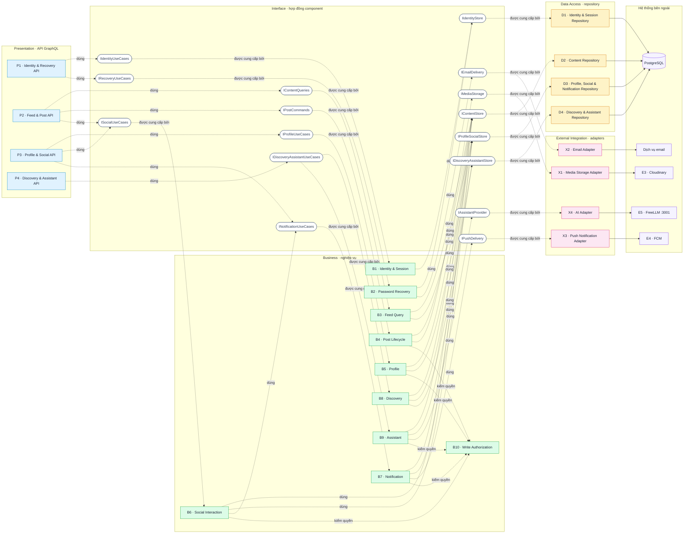

# DOC 5.1-A/B — Thiết kế thành phần Backend

| Dự án | Owner | Reviewer | Approver | Sprint | Phiên bản | Trạng thái |
|---|---|---|---|---|---|---|
| ToMateTo | BE | Lead; FE với hợp đồng GraphQL; DB với truy cập dữ liệu | Lead | S4 | 0.4 | Đề nghị review |

**WBS:** 4.1.1 · **Phạm vi:** thành phần backend của DOC 5.1-A/B.

## 1. Phạm vi và căn cứ

Tài liệu phân rã backend thành bốn lớp: Presentation, Business, Data Access và External Integration. Nội dung gồm trách nhiệm, giao diện, phụ thuộc, công nghệ và truy vết tới REQ-001…REQ-028.

| Đầu vào | Dùng để |
|---|---|
| DOC 3.1-A — Functional Requirements | Đối chiếu đủ 28 REQ và quy tắc nghiệp vụ. |
| DOC 3.3-A — Wireframe MH-01…MH-19 | Xác định màn hình cần API; không tự thêm yêu cầu. |
| DOC 4.3-A/B — ADR backend | Bốn lớp, GraphQL, kiểm quyền tại Business, adapter, cursor, lỗi. |
| DOC 4.3-B.4 và DOC 5.3-A | PostgreSQL 16, SQLAlchemy 2.0 Sync + Psycopg 3, schema vật lý 18 bảng. |
| DOC 5.1-A — Component Frontend | Phối hợp hợp đồng FE–BE và kiểm tra tổng số thành phần. |

**Ràng buộc kỹ thuật:** mọi repository dùng **SQLAlchemy 2.0 Sync + Psycopg 3**; resolver chạy trong threadpool; adapter ngoài dùng `httpx` sync cho v1. Không trộn sync/async trong cùng luồng request. DOC 4.2-A hiện còn mô tả async và cần cập nhật.

**Quy mô:** 22 thành phần backend. DOC 5.1-A frontend đang có 26 thành phần; tổng 48 vượt giới hạn 15–30 của DOC 5.1. Lead/FE/BE cần chốt giữ 22 và xin waiver, hoặc gộp thành phần trước khi coi DOC 5.1-A/B hoàn chỉnh.

## 2. DOC 5.1-A — Component Diagram

**Cách đọc:** nét đứt `..>` là component dùng interface; nét liền `-` là component cung cấp interface; mũi tên tới PostgreSQL/E3–E5 là kết nối ra ngoài. Mỗi interface chỉ có một component cung cấp.

**Nguyên tắc:** Presentation chỉ nhận/ánh xạ request; Business quyết định nghiệp vụ và quyền ghi; Data Access đọc/ghi PostgreSQL; External Integration cô lập nhà cung cấp. Tầng dưới không gọi ngược lên. B10 là chính sách dùng chung cho mutation; register/login/refresh/recovery là ngoại lệ theo ADR-BE-003.

**Vị trí:** E6 là GPS thiết bị + logic bbox/Haversine phía server, không phải adapter. B8 nhận `lat/lng` trong request và truy vấn `restaurants` qua D2/D4.

## 3. Component Catalog

| ID | Thành phần | Lớp | Trách nhiệm / màn hình | Giao diện công khai | Phụ thuộc | Công nghệ |
|---|---|---|---|---|---|---|
| P1 | Identity & Recovery GraphQL API | Presentation | Đăng ký, đăng nhập, phiên, thiết bị, khôi phục mật khẩu; MH-01/02/03/05 | `register`, `login`, `refreshSession`, `logout`, `requestPasswordReset`, `verifyPasswordResetOtp`, `resetPassword`, `registerDevice`, `unregisterDevice` | B1, B2 | FastAPI, Strawberry GraphQL |
| P2 | Feed & Post GraphQL API | Presentation | Feed/chi tiết; tạo, sửa, xóa, báo cáo bài; nhận HTTP upload ảnh dùng chung cho bài/hồ sơ; MH-06/07/08/09/11 | `feed`, `post`, `createPost`, `updatePost`, `deletePost`, `reportPost`, `uploadMedia` (HTTP) | B3, B4, B6 | FastAPI, Strawberry GraphQL |
| P3 | Profile & Social GraphQL API | Presentation | Hồ sơ, tương tác, bộ sưu tập, thông báo; MH-07/10/11/12/13/14 | `profile`, `profilePosts`, `myProfile`, `myPosts`, `updateProfile`, `setProfileVisibility`, `setLike`, `savePost`, `removeSavedPost`, `myCollections`, `collectionItems`, `createCollection`, `renameCollection`, `deleteCollection`, `setFollow`, `notifications`, `markNotificationRead`, `markAllNotificationsRead` | B5, B6, B7 | FastAPI, Strawberry GraphQL |
| P4 | Discovery & Assistant GraphQL API | Presentation | Tìm kiếm, xu hướng, quán gần, quay món, trợ lý; MH-15/16/17/18/19 | `search`, `trending`, `nearbyPlaces`, `randomDish`, `askAssistant`, `retryAssistant`, `assistantSessions`, `assistantHistory`, `useAssistantDraft` | B8, B9 | FastAPI, Strawberry GraphQL |
| B1 | Identity & Session Service | Business | Tài khoản, xác thực, cấp/làm mới/kết thúc phiên, thiết bị push | `register`, `authenticate`, `createSession`, `refreshSession`, `revokeSession`, `registerDevice`, `unregisterDevice` | D1 | Python; PyJWT, bcrypt |
| B2 | Password Recovery Service | Business | OTP, reset grant, đặt lại mật khẩu; thu hồi phiên cũ | `requestReset`, `verifyOtp`, `resetPassword` | D1, X2 | Python; PyJWT, bcrypt |
| B3 | Feed Query Service | Business | Feed/chi tiết theo quyền xem; cursor; trạng thái like/save | `listFeed`, `getPost` | D2, D3 | SQLAlchemy 2.0 Sync + Psycopg 3 |
| B4 | Post Lifecycle Service | Business | Tạo/sửa/xóa bài; pipeline media dùng chung; chuẩn hóa món/thẻ; job dọn media | `createPost`, `updatePost`, `deletePost`, `uploadMedia`, `normalizePost` | B10, D2, X1 | SQLAlchemy 2.0 Sync + Psycopg 3; httpx sync |
| B5 | Profile Service | Business | Hồ sơ, avatar/cover, quyền công khai từng trường | `getProfile`, `updateProfile`, `setProfileVisibility`, `consumeMediaUploads` (purpose AVATAR/COVER) | B10, D2, D3 | SQLAlchemy 2.0 Sync + Psycopg 3 |
| B6 | Social Interaction Service | Business | Like/save/follow/report; kiểm quyền và tạo thông báo | `setLike`, `setSave`, `setFollow`, `reportPost` | B10, D2, D3, B7 | SQLAlchemy 2.0 Sync + Psycopg 3 |
| B7 | Notification Service | Business | Tạo/đọc/đánh dấu thông báo; gắn actor/post; gửi push không chặn thao tác gốc | `createNotification`, `listNotifications`, `markRead`, `markAllRead`, `requestPush`, `hydrateTarget` | B10, D2, D3, X3 | SQLAlchemy 2.0 Sync + Psycopg 3; httpx sync |
| B8 | Discovery Service | Business | Tìm kiếm, xu hướng, quán gần, quay món; lọc nội dung bị chặn | `search`, `getTrending`, `getNearbyRestaurants`, `chooseRandomDish` | D2, D3, D4 | SQLAlchemy 2.0 Sync + Psycopg 3 |
| B9 | Assistant Service | Business | Hỏi đáp, phiên/lịch sử, retry, kiểm tra tham chiếu; chỉ dùng ngữ cảnh công khai | `ask`, `retry`, `listSessions`, `getHistory`, `createPostDraft`, `validateReferences` | B10, D2, D4, X4 | SQLAlchemy 2.0 Sync + Psycopg 3; httpx sync |
| B10 | Write Authorization Policy | Business | Kiểm tra phiên, vai trò, quyền sở hữu trước mọi mutation | `authorizeWrite(principal, action, resource)` | Principal từ luồng xác thực | Python; không truy cập DB trực tiếp |
| D1 | Identity & Session Repository | Data Access | Tài khoản, credential hash, OTP/reset, refresh token, revoked token, thiết bị | `findAccount`, `saveAccount`, `saveRefreshToken`, `revokeToken`, `isTokenRevoked`, `bumpTokenVersion`, `saveResetRequest`, `consumeResetGrant`, `saveDevice`, `removeDevice` | PostgreSQL | SQLAlchemy 2.0 Sync + Psycopg 3 |
| D2 | Content Repository | Data Access | Feed/bài/quán, media, report, món/thẻ; cursor và ràng buộc unique | `listFeed`, `getPost`, `savePost`, `deletePost`, `saveReport`, `listPostsByRestaurant`, `createMediaUpload`, `consumeMediaUploads`, `upsertTags`, `savePostImages` | PostgreSQL | SQLAlchemy 2.0 Sync + Psycopg 3 |
| D3 | Profile, Social & Notification Repository | Data Access | Hồ sơ/quyền hiển thị, tương tác, collection, thông báo, danh sách block | `getProfile`, `saveProfile`, `setInteraction`, `saveCollection`, `removeCollectionItem`, `listNotifications`, `markRead`, `markAllRead`, `listBlockedUserIds` | PostgreSQL | SQLAlchemy 2.0 Sync + Psycopg 3 |
| D4 | Discovery & Assistant Repository | Data Access | Dữ liệu khám phá, quán gần, phiên/lịch sử trợ lý | `search`, `getTrendingDishes`, `getTrendingTags`, `findNearbyRestaurants`, `saveConversation`, `getConversation`, `listSessions` | PostgreSQL | SQLAlchemy 2.0 Sync + Psycopg 3 |
| X1 | Media Storage Adapter | External Integration | validate MIME/kích thước, resize, store/remove object; ≤10 MB, cạnh dài ≤1600 px | `validateImage`, `resizeImage`, `storeImage`, `removeImage` | E3 · Cloudinary | Python; httpx sync; secret chỉ ở backend |
| X2 | Email Adapter | External Integration | Gửi OTP/reset; chuẩn hóa timeout/lỗi | `sendResetCode` | Dịch vụ email — chưa có trong E3–E6 | Python; httpx sync; provider/owner chưa chốt |
| X3 | Push Notification Adapter | External Integration | Gửi push một chiều; lỗi không làm hỏng thao tác gốc | `sendPush` | E4 · FCM | Python; FCM HTTP v1 hoặc Admin SDK; retry chưa chốt |
| X4 | AI Adapter | External Integration | Gọi AI với timeout, dữ liệu tối thiểu, chuẩn hóa lỗi/fallback | `complete` | E5 · FreeLLM `:3001` | Python; httpx sync; schema vendor chưa chốt |

Tên operation là hợp đồng logic ở mức component; schema, field, lỗi và cursor cuối cùng nằm trong DOC 5.2-A. Resolver chỉ ánh xạ và ủy quyền, không chứa quy tắc nghiệp vụ.

## 4. DOC 5.1-B — Component Responsibility Matrix

`P` = chịu trách nhiệm chính; `S` = hỗ trợ/điều phối/truy cập dữ liệu; `—` = không truy vết trực tiếp. Mỗi REQ có đúng một thành phần Business nhận `P`. REQ-028 là yêu cầu xuyên suốt: mutation ghi gọi B10; các luồng đọc áp dụng lọc chặn/ẩn.

| Thành phần | REQ-001 | REQ-002 | REQ-003 | REQ-004 | REQ-005 | REQ-006 | REQ-007 | REQ-008 | REQ-009 | REQ-010 | REQ-011 | REQ-012 | REQ-013 | REQ-014 | REQ-015 | REQ-016 | REQ-017 | REQ-018 | REQ-019 | REQ-020 | REQ-021 | REQ-022 | REQ-023 | REQ-024 | REQ-025 | REQ-026 | REQ-027 | REQ-028 |
|---|---|---|---|---|---|---|---|---|---|---|---|---|---|---|---|---|---|---|---|---|---|---|---|---|---|---|---|---|
| P1 Identity & Recovery API | S | S | S | S | S | S | — | — | — | — | — | — | — | — | — | — | — | — | — | — | — | — | — | — | — | — | — | — |
| P2 Feed & Post API | — | — | — | — | — | — | S | S | S | S | S | S | — | — | — | — | — | — | — | S | — | — | — | — | — | — | S | S |
| P3 Profile & Social API | — | — | — | — | — | — | — | — | — | — | — | — | S | S | S | S | S | S | S | — | — | — | — | — | — | — | — | S |
| P4 Discovery & Assistant API | — | — | — | — | — | — | — | — | — | — | — | — | — | — | — | — | — | — | — | — | S | S | S | S | S | S | — | S |
| B1 Identity & Session Service | P | P | — | — | — | P | — | — | — | — | — | — | — | — | — | — | — | — | — | — | — | — | — | — | — | — | — | S |
| B2 Password Recovery Service | — | — | P | P | P | — | — | — | — | — | — | — | — | — | — | — | — | — | — | — | — | — | — | — | — | — | — | — |
| B3 Feed Query Service | — | — | — | — | — | — | P | P | — | — | — | — | — | — | — | — | — | — | — | — | — | — | — | — | — | — | — | S |
| B4 Post Lifecycle Service | — | — | — | — | — | — | — | S | P | P | P | P | — | — | — | — | — | — | — | — | — | — | — | — | — | — | P | S |
| B5 Profile Service | — | — | — | — | — | — | — | — | — | — | — | — | P | P | P | — | — | — | — | — | — | — | — | — | — | — | — | S |
| B6 Social Interaction Service | — | — | — | — | — | — | — | — | — | — | — | — | — | — | — | P | P | P | — | P | — | — | — | — | — | — | — | S |
| B7 Notification Service | — | — | — | — | — | — | — | — | — | — | — | — | — | — | — | S | — | S | P | — | — | — | — | — | — | — | — | S |
| B8 Discovery Service | — | — | — | — | — | — | — | — | — | — | — | — | — | — | — | — | — | — | — | — | P | P | P | P | — | — | — | S |
| B9 Assistant Service | — | — | — | — | — | — | — | — | — | — | — | — | — | — | — | — | — | — | — | — | — | — | — | — | P | P | — | S |
| B10 Write Authorization Policy | — | — | — | — | — | — | — | — | S | S | S | S | — | S | S | S | S | S | S | S | — | — | — | — | S | — | — | P |
| D1 Identity & Session Repository | S | S | S | S | S | S | — | — | — | — | — | — | — | — | — | — | — | — | — | — | — | — | — | — | — | — | — | — |
| D2 Content Repository | — | — | — | — | — | — | S | S | S | S | S | S | — | — | — | — | — | — | — | S | — | — | — | — | — | — | S | — |
| D3 Profile, Social & Notification Repository | — | — | — | — | — | — | — | — | — | — | — | — | S | S | S | S | S | S | S | — | — | — | — | — | — | — | — | — |
| D4 Discovery & Assistant Repository | — | — | — | — | — | — | — | — | — | — | — | — | — | — | — | — | — | — | — | — | S | S | S | S | S | S | — | — |
| X1 Media Storage Adapter | — | — | — | — | — | — | — | — | S | S | S | — | — | — | — | — | — | — | — | — | — | — | — | — | — | — | — | — |
| X2 Email Adapter | — | — | S | S | S | — | — | — | — | — | — | — | — | — | — | — | — | — | — | — | — | — | — | — | — | — | — | — |
| X3 Push Notification Adapter | — | — | — | — | — | — | — | — | — | — | — | — | — | — | — | S | — | S | S | — | — | — | — | — | — | — | — | — |
| X4 AI Adapter | — | — | — | — | — | — | — | — | — | — | — | — | — | — | — | — | — | — | — | — | — | — | — | — | S | S | — | — |

**Cân bằng tải:** B4 có 5 REQ chính; B6 và B8 có 4; B1, B2, B5 có 3. Không thành phần nào vượt 5/28 REQ. Tổng số ô `P` của 10 thành phần Business là 28, khớp đủ REQ-001…REQ-028.

## 5. Công nghệ và câu hỏi mở

| Nhóm | Quyết định |
|---|---|
| API | Python ≥3.11, FastAPI ≥0.161, Strawberry GraphQL ≥0.336, Uvicorn |
| Nghiệp vụ | Python; `PyJWT` + `bcrypt`; kiểm quyền tại Business |
| Dữ liệu | PostgreSQL 16; SQLAlchemy 2.0 Sync + Psycopg 3; resolver trong threadpool |
| Tích hợp ngoài | Adapter Python, `httpx` sync; E3 Cloudinary, E4 FCM, E5 FreeLLM; X2 email chưa có provider |

**Cần chốt:** provider email X2; payload/retry FCM và cơ chế chạy nền push; endpoint/schema FreeLLM; giới hạn 15–30 thành phần toàn hệ thống. Các mục này không đổi ranh giới component nhưng phải được xác nhận trước khi triển khai hợp đồng cuối.
