# DOC 5.1-A/B — Thiết kế thành phần Backend

| Dự án | Owner | Reviewer | Approver | Sprint | Phiên bản | Trạng thái |
|---|---|---|---|---|---|---|
| ToMateTo | BE | Lead; FE với hợp đồng GraphQL; DB với truy cập dữ liệu | Lead | S4 | 0.6 | Đề nghị review |

**WBS:** 4.1.1 · **Phạm vi:** phần backend của DOC 5.1-A/B

## 1. Phạm vi và đầu vào

Tài liệu phân rã backend thành các thành phần theo lớp Presentation, Business, Data Access, External Integration và tiến trình nền; xác định trách nhiệm, giao diện, phụ thuộc, công nghệ và truy vết tới DOC 3.1-A, DOC 3.2-A. Wireframe chỉ dùng để biết màn hình nào cần API backend, không dùng để đặt thêm quy tắc nghiệp vụ.

| Đầu vào | Dùng để |
|---|---|
| DOC 3.1-A Functional Requirements (REQ-001…REQ-028) | Kiểm tra mọi chức năng có thành phần chịu trách nhiệm chính |
| DOC 3.2-A Non-functional Requirements (NFR-01…NFR-15) | Gán ràng buộc phi chức năng cho thành phần (mục 3.4) |
| DOC 3.3-A Wireframe (MH-01…MH-19) | Liên kết API với màn hình |
| DOC 4.3-A System Architecture | Các lớp của API, tiến trình nền `worker`, cổng upload ảnh, chế độ lùi theo dịch vụ ngoài |
| DOC 4.3-B — ADR quản lý/hạ tầng (ADR-LEAD-001…005), ADR backend (ADR-BE-001…006) | Module theo nghiệp vụ, việc nền, upload ảnh, mô hình phiên, kiểm quyền ở lớp Business, adapter cho dịch vụ ngoài |
| DOC 4.3-B.4 — ADR dữ liệu | SQLAlchemy 2.0 Sync + Psycopg 3, transaction theo use case, phân trang con trỏ, bảng xu hướng tính sẵn |
| DOC 4.2-A Technology Decision — Backend | Công nghệ của từng lớp |
| DOC 5.2-A API Specification | Tên operation GraphQL và cổng upload (bảng ánh xạ ở mục 2.3) |
| DOC 5.3-A Physical ERD & Schema | Đối chiếu dữ liệu của từng repository |
| DOC 5.1-A Component — Frontend | Ranh giới FE–BE; điểm nối của E6 nằm ở phía FE |

**Cách phân rã:** mỗi lớp của API trong DOC 4.3-A được chia thành thành phần theo module nghiệp vụ (ADR-LEAD-001). Tiến trình nền `worker` của DOC 4.3-A là thành phần J1. Truy cập dữ liệu dùng SQLAlchemy 2.0 Sync + Psycopg 3 theo DOC 4.3-B.4; resolver chạy trong threadpool của GraphQL server, adapter dùng `httpx` sync; một luồng request không trộn sync và async.

Phạm vi tài liệu: **23 thành phần backend** (4 Presentation, 1 tiến trình nền, 10 Business, 4 Data Access, 4 External Integration). Thành phần giao diện và nền tảng phía ứng dụng thuộc DOC 5.1-A Frontend.

## 2. DOC 5.1-A — Component Diagram

### 2.1 Component Hierarchy

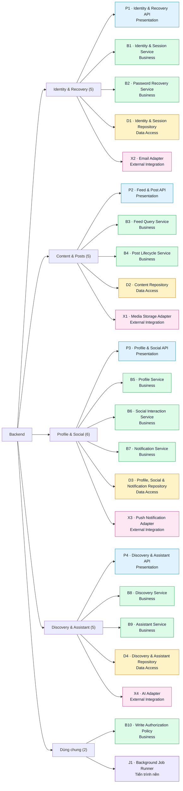

**Ghi chú đọc cây phân rã:**

- Bốn nhóm `Identity & Recovery`, `Content & Posts`, `Profile & Social`, `Discovery & Assistant` là module nghiệp vụ trong cùng một khối triển khai (ADR-LEAD-001), không phải dịch vụ chạy riêng. Nhóm `Dùng chung` gồm B10 (được mọi luồng ghi gọi) và J1 (chạy trong tiến trình `worker`).
- Chữ cái đầu của mã cho biết loại thành phần: `P` = Presentation (API tiếp nhận), `J` = tiến trình nền, `B` = Business (nghiệp vụ), `D` = Data Access (truy cập dữ liệu), `X` = External Integration (kết nối dịch vụ ngoài).
- Số trong ngoặc là số thành phần của nhóm; tổng 5 + 5 + 6 + 5 + 2 = 23.
- Ví dụ luồng tạo bài có ảnh: ứng dụng gửi ảnh qua cổng upload của P2 → B4 kiểm định dạng, thu nhỏ và gọi X1 → trả mã ảnh; ứng dụng gọi `createPost` kèm mã ảnh → P2 → B4 gọi B10 kiểm quyền → D2 lưu bài.
- **E6 (định vị thiết bị) chạy trên thiết bị.** Ứng dụng lấy toạ độ và gửi trong request; điểm nối thay thế được của E6 nằm ở phần FE (DOC 5.1-A Frontend). Backend không gọi E6 nên không có adapter X cho E6. B8 dùng toạ độ trong request, hoặc toạ độ mặc định trung tâm Hà Nội khi người dùng không cấp quyền (DOC 4.3-A mục 5).

### 2.2 UML Component Diagram

**Ký hiệu (UML 2):**

| Ký hiệu | Nghĩa |
|---|---|
| Khung có biểu tượng component | Một thành phần |
| Khung chữ nhật có tên lớp | Lớp chứa các thành phần |
| Vòng tròn nối với component bằng đường liền | Giao diện do component đó **cung cấp**. Mỗi giao diện có đúng một component cung cấp |
| Mũi tên nét đứt từ component tới vòng tròn | Component **cần** giao diện đó (gọi qua giao diện) |
| Mũi tên liền tới cơ sở dữ liệu hoặc đám mây | Repository đọc/ghi PostgreSQL; adapter gọi dịch vụ ngoài |

**Nguyên tắc phụ thuộc:**

- Presentation và J1 gọi Business; Business gọi Data Access và External Integration. Tầng dưới không gọi ngược lên tầng trên; adapter và repository không quyết định quy tắc nghiệp vụ.
- Business chỉ gọi một Business khác qua giao diện của nó. Có hai trường hợp: B6 gọi `INotificationUseCases` (B7) để tạo thông báo; B1, B4, B5, B6, B7, B9 gọi `IWriteAuthorization` (B10) trước mỗi thao tác ghi.
- **Xác thực mỗi request:** P1–P4 đọc Bearer token và gọi `ISessionVerification` của B1. B1 kiểm chữ ký, hạn, `jti` chưa bị thu hồi và `ver` khớp tài khoản (qua D1), rồi trả principal. Request không có token được xử lý như khách.
- **Kiểm quyền ghi:** B10 nhận principal, hành động và tài nguyên, trả cho phép hoặc lỗi. Mọi thao tác ghi đều qua B10, trừ đăng ký, đăng nhập và khôi phục mật khẩu (UC-01, UC-02, UC-03 theo REQ-028).

Sơ đồ được chia thành một hình tổng quan và bốn hình theo nhóm nghiệp vụ để mỗi đường nối đều lần theo được. Mỗi hình sinh từ đoạn mã PlantUML ngay bên dưới.

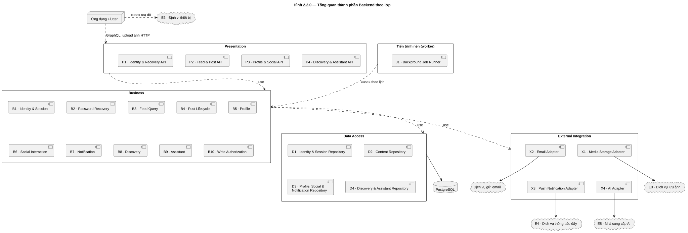

Mã PlantUML của Hình 2.2.0

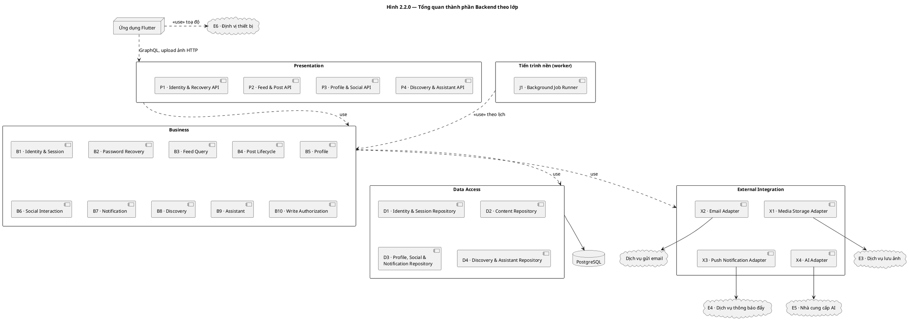

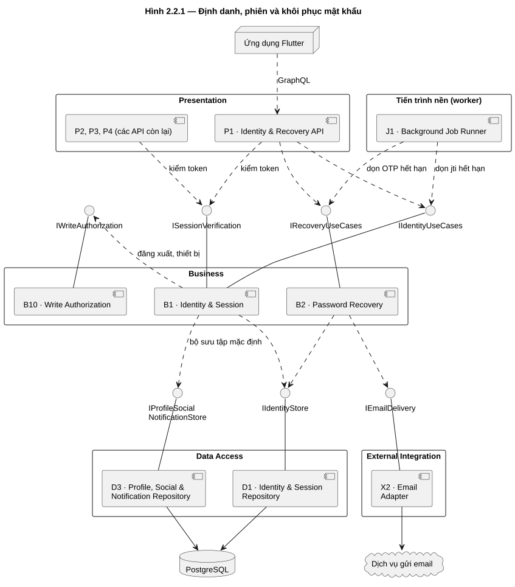

Mã PlantUML của Hình 2.2.1

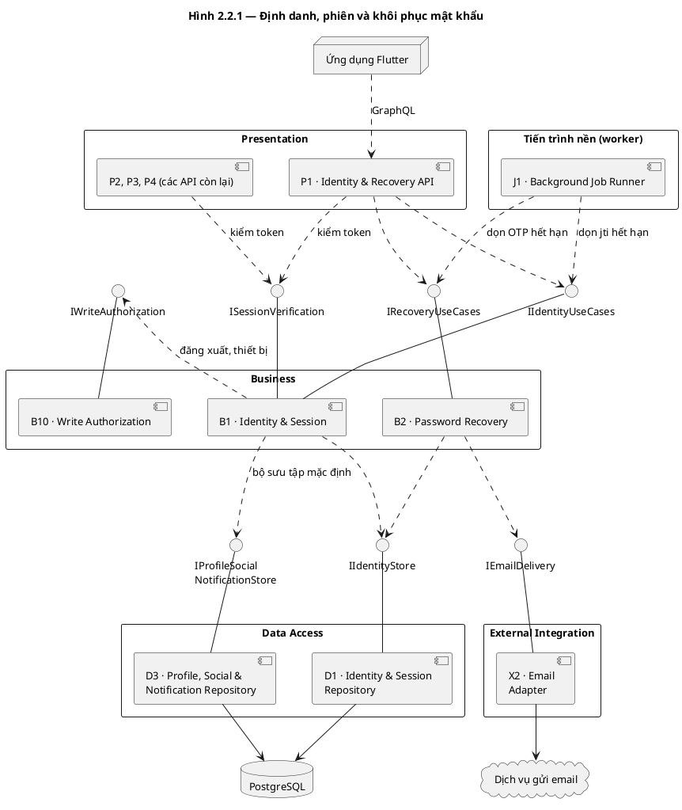

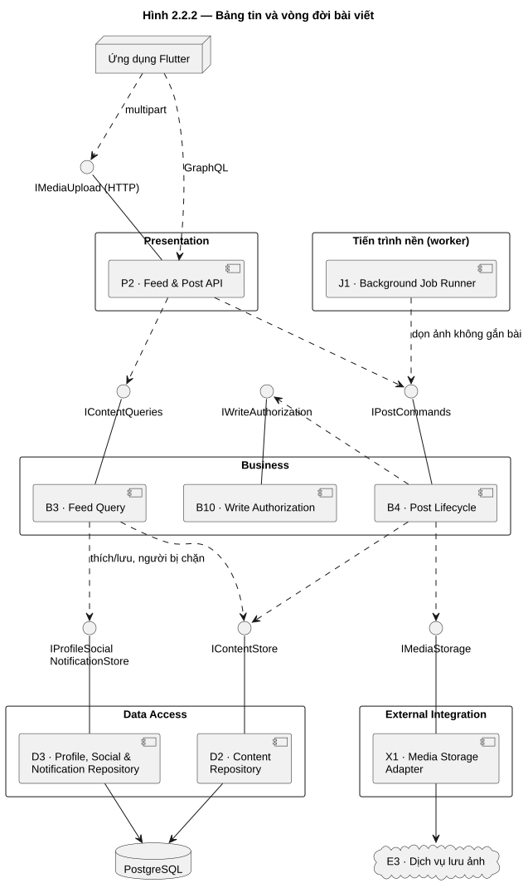

Mã PlantUML của Hình 2.2.2

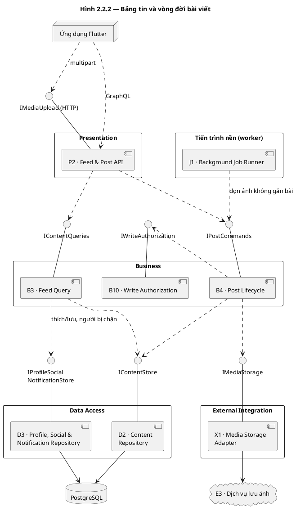

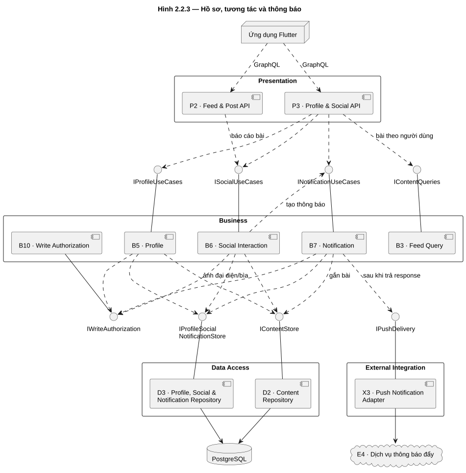

Mã PlantUML của Hình 2.2.3

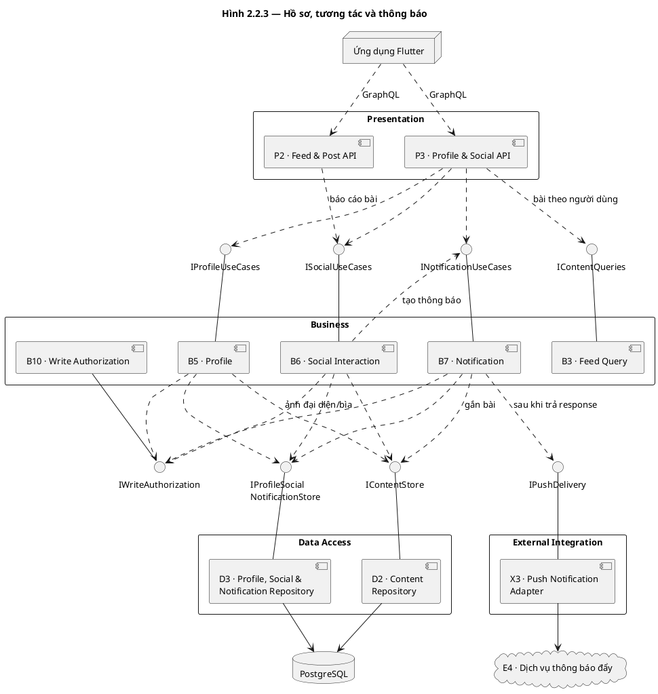

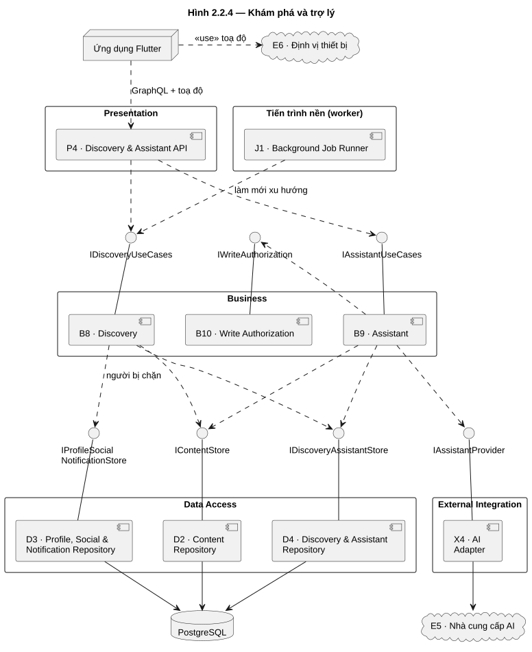

Mã PlantUML của Hình 2.2.4

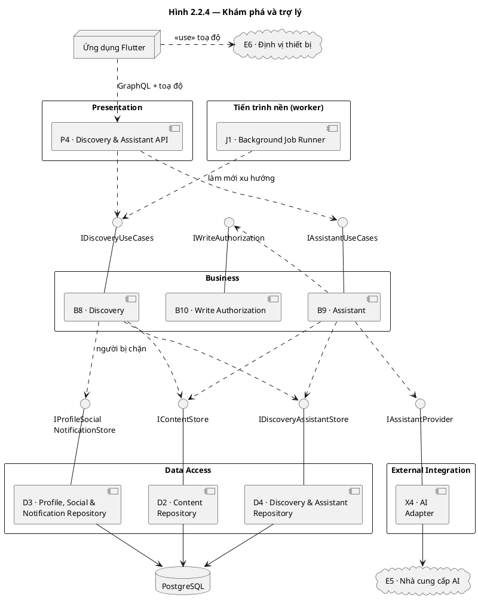

**Ghi chú:** API là một schema GraphQL (Strawberry) cộng một cổng upload ảnh HTTP do P2 cung cấp (`IMediaUpload`, ADR-LEAD-003). Ảnh, email, push và AI chỉ được gọi qua adapter X1–X4; khoá dịch vụ nằm ở backend (NFR-08). Push do B7 gửi sau khi trả response trong tiến trình API; lỗi push chỉ ghi log, thông báo vẫn nằm trong CSDL (ADR-LEAD-002).

### 2.3 Component Catalog

| ID | Thành phần | Lớp | Trách nhiệm / màn hình | Giao diện cung cấp và thao tác | Phụ thuộc | Công nghệ |
|---|---|---|---|---|---|---|
| P1 | Identity & Recovery API | Presentation | Đăng ký, đăng nhập, đăng xuất, thiết bị nhận push, khôi phục mật khẩu; đọc token và gọi `ISessionVerification`; MH-01/02/03/05 | GraphQL: `register`, `login`, `logout`, `requestPasswordReset`, `resendResetOtp`, `verifyPasswordResetOtp`, `resetPassword`, `registerDevice`, `unregisterDevice` | B1, B2 | FastAPI, Strawberry GraphQL |
| P2 | Feed & Post API | Presentation | Feed, chi tiết; tạo, sửa, xoá, báo cáo bài; cổng upload ảnh dùng chung cho bài, ảnh đại diện, ảnh bìa; MH-06/07/08/09/11 | GraphQL: `feed`, `post`, `createPost`, `updatePost`, `deletePost`, `reportPost`; `IMediaUpload` (HTTP multipart): `uploadMedia` | B1, B3, B4, B6 | FastAPI, Strawberry GraphQL |
| P3 | Profile & Social API | Presentation | Hồ sơ, bài theo người dùng, tương tác, bộ sưu tập, thông báo; MH-07/10/11/12/13/14 | GraphQL: `profile`, `myProfile`, `profilePosts`, `myPosts`, `updateProfile`, `setProfileVisibility`, `setLike`, `savePost`, `removeSavedPost`, `myCollections`, `collectionItems`, `createCollection`, `renameCollection`, `deleteCollection`, `setFollow`, `notifications`, `markNotificationRead`, `markAllNotificationsRead` | B1, B3, B5, B6, B7 | FastAPI, Strawberry GraphQL |
| P4 | Discovery & Assistant API | Presentation | Tìm kiếm, xu hướng, quán gần, quay món, trợ lý; MH-15/16/17/18/19 | GraphQL: `search`, `trending`, `nearbyPlaces`, `randomDish`, `askAssistant`, `retryAssistant`, `assistantSessions`, `assistantHistory`, `useAssistantDraft` | B1, B8, B9 | FastAPI, Strawberry GraphQL |
| J1 | Background Job Runner | Tiến trình nền | Chạy bốn job định kỳ ở mục 2.4 trong tiến trình `worker` (cùng image với API); khoá chống chạy trùng; ghi log kết quả job (NFR-09) | `runScheduledJob(name)` (theo lịch, không có giao diện cho ứng dụng) | B1, B2, B4, B8 | Python; thư viện lập lịch theo mục 4 |
| B1 | Identity & Session Service | Business | Tài khoản, xác thực, cấp phiên (một JWT 7 ngày mang `jti`, `ver`), kiểm token mỗi request, đăng xuất ghi `jti` vào danh sách thu hồi (ADR-LEAD-005), thiết bị push; tạo bộ sưu tập "Đã lưu" khi đăng ký (REQ-001) | `IIdentityUseCases`: `register`, `authenticate`, `createSession`, `revokeSession`, `registerDevice`, `unregisterDevice`, `purgeExpiredRevocations`; `ISessionVerification`: `verifySession` | B10, D1, D3 | Python; PyJWT, bcrypt |
| B2 | Password Recovery Service | Business | OTP, gửi lại OTP, quyền đặt lại dùng một lần, đặt lại mật khẩu; tăng `ver` để thu hồi mọi phiên của tài khoản đó | `IRecoveryUseCases`: `requestReset`, `resendOtp`, `verifyOtp`, `resetPassword`, `purgeExpiredResetRequests` | D1, X2 | Python; PyJWT, bcrypt |
| B3 | Feed Query Service | Business | Feed, chi tiết, bài theo người dùng theo quyền xem; con trỏ; trạng thái thích/lưu; lấy danh sách người bị chặn từ D3 và truyền làm điều kiện truy vấn cho D2 (REQ-028) | `IContentQueries`: `listFeed`, `getPost`, `listPostsByAuthor` | D2, D3 | SQLAlchemy 2.0 Sync + Psycopg 3 |
| B4 | Post Lifecycle Service | Business | Tạo, sửa, xoá bài; nhận ảnh từ cổng upload (kiểm, thu nhỏ, lưu qua X1); chuẩn hoá món và thẻ (REQ-027); dọn ảnh không gắn bài khi J1 gọi | `IPostCommands`: `createPost`, `updatePost`, `deletePost`, `uploadMedia`, `normalizePost`, `cleanupOrphanMedia` | B10, D2, X1 | SQLAlchemy 2.0 Sync + Psycopg 3; httpx sync |
| B5 | Profile Service | Business | Hồ sơ, ảnh đại diện/bìa (dùng mã ảnh từ cổng upload), quyền công khai từng trường; ảnh cũ do `cleanupOrphanMedia` của B4 dọn, B5 không gọi X1 | `IProfileUseCases`: `getProfile`, `updateProfile`, `setProfileVisibility` | B10, D2, D3 | SQLAlchemy 2.0 Sync + Psycopg 3 |
| B6 | Social Interaction Service | Business | Thích, lưu, theo dõi, báo cáo; bộ sưu tập; tạo thông báo khi thích và khi theo dõi (REQ-016, REQ-018) qua B7 | `ISocialUseCases`: `setLike`, `setSave`, `setFollow`, `reportPost`, `listCollections`, `listCollectionItems`, `createCollection`, `renameCollection`, `deleteCollection` | B7, B10, D2, D3 | SQLAlchemy 2.0 Sync + Psycopg 3 |
| B7 | Notification Service | Business | Tạo, đọc, đánh dấu thông báo; gắn người tạo và bài; gửi push qua X3 sau khi trả response, lỗi push không làm hỏng thao tác gốc | `INotificationUseCases`: `createNotification`, `listNotifications`, `markRead`, `markAllRead` | B10, D2, D3, X3 | SQLAlchemy 2.0 Sync + Psycopg 3; httpx sync |
| B8 | Discovery Service | Business | Tìm kiếm, xu hướng, quán gần, quay món; loại bài của người bị chặn (danh sách từ D3); toạ độ từ request hoặc toạ độ mặc định; làm mới bảng xu hướng khi J1 gọi | `IDiscoveryUseCases`: `search`, `getTrending`, `getNearbyRestaurants`, `chooseRandomDish`, `refreshTrendingSnapshot` | D2, D3, D4 | SQLAlchemy 2.0 Sync + Psycopg 3 |
| B9 | Assistant Service | Business | Hỏi đáp, phiên và lịch sử, thử lại, bản nháp bài; chỉ dùng ngữ cảnh công khai; mỗi lượt ≤30 giây (NFR-04), quá hạn hoặc lỗi trả gợi ý theo luật và mã `INTEGRATION_UNAVAILABLE`; kiểm món/quán/bài trong câu trả lời với CSDL | `IAssistantUseCases`: `ask`, `retry`, `listSessions`, `getHistory`, `createPostDraft`, `validateReferences` | B10, D2, D4, X4 | SQLAlchemy 2.0 Sync + Psycopg 3; httpx sync |
| B10 | Write Authorization Policy | Business | Quyết định cho phép mỗi thao tác ghi từ principal đã xác minh, hành động và tài nguyên: bắt buộc đăng nhập, quyền chủ sở hữu (REQ-028, NFR-07) | `IWriteAuthorization`: `authorizeWrite(principal, action, resource)` | Không (nhận đủ dữ liệu từ nơi gọi) | Python; không truy cập CSDL |
| D1 | Identity & Session Repository | Data Access | Tài khoản, hash mật khẩu, `ver` theo tài khoản, danh sách `jti` đã thu hồi, yêu cầu đặt lại và OTP, thiết bị | `IIdentityStore`: `findAccount`, `saveAccount`, `getTokenVersion`, `bumpTokenVersion`, `revokeToken`, `isTokenRevoked`, `purgeExpiredRevocations`, `saveResetRequest`, `consumeResetGrant`, `purgeExpiredResetRequests`, `saveDevice`, `removeDevice` | PostgreSQL | SQLAlchemy 2.0 Sync + Psycopg 3 |
| D2 | Content Repository | Data Access | Bài, quán, ảnh, báo cáo, món, thẻ; con trỏ và ràng buộc duy nhất; nhận danh sách người bị chặn làm tham số truy vấn; liệt kê ảnh không gắn bài | `IContentStore`: `listFeed`, `getPost`, `listPostsByAuthor`, `savePost`, `deletePost`, `saveReport`, `listPostsByRestaurant`, `createMediaUpload`, `consumeMediaUploads`, `upsertTags`, `savePostImages`, `listOrphanMedia` | PostgreSQL | SQLAlchemy 2.0 Sync + Psycopg 3 |
| D3 | Profile, Social & Notification Repository | Data Access | Hồ sơ và quyền hiển thị, thích, lưu, theo dõi, bộ sưu tập (gồm "Đã lưu" mặc định), thông báo, danh sách người bị chặn | `IProfileSocialNotificationStore`: `getProfile`, `saveProfile`, `setInteraction`, `listCollections`, `listCollectionItems`, `saveCollection`, `renameCollection`, `deleteCollection`, `createDefaultCollection`, `removeCollectionItem`, `saveNotification`, `listNotifications`, `markRead`, `markAllRead`, `listBlockedUserIds` | PostgreSQL | SQLAlchemy 2.0 Sync + Psycopg 3 |
| D4 | Discovery & Assistant Repository | Data Access | Dữ liệu khám phá, quán gần, phiên và lịch sử trợ lý, bảng xu hướng | `IDiscoveryAssistantStore`: `search`, `getTrendingDishes`, `getTrendingTags`, `findNearbyRestaurants`, `saveConversation`, `getConversation`, `listSessions`, `saveTrendingSnapshot` | PostgreSQL | SQLAlchemy 2.0 Sync + Psycopg 3 |
| X1 | Media Storage Adapter | External Integration | Kiểm MIME và kích thước, thu nhỏ, lưu và xoá ảnh; ≤10 MB, cạnh dài ≤1600 px (NFR-05) | `IMediaStorage`: `validateImage`, `resizeImage`, `storeImage`, `removeImage` | E3 · Dịch vụ lưu ảnh | Python; httpx sync; khoá chỉ ở backend |
| X2 | Email Adapter | External Integration | Gửi mã đặt lại mật khẩu; chuẩn hoá timeout và lỗi | `IEmailDelivery`: `sendResetCode` | Dịch vụ gửi email | Python; httpx sync |
| X3 | Push Notification Adapter | External Integration | Gửi push một chiều; lỗi chỉ ghi log | `IPushDelivery`: `sendPush` | E4 · Dịch vụ thông báo đẩy | Python; httpx sync |
| X4 | AI Adapter | External Integration | Gọi AI với timeout 30 giây (NFR-04), gửi dữ liệu tối thiểu, chuẩn hoá lỗi | `IAssistantProvider`: `complete` | E5 · Nhà cung cấp AI | Python; httpx sync; timeout 30 s |

Tên thao tác trong bảng trên là **hợp đồng logic ở mức thành phần**, không phải tên field GraphQL. Bảng dưới ánh xạ các tên khác với DOC 5.2-A; các tên còn lại trùng hoặc chỉ khác tiền tố `get`. Resolver chỉ ánh xạ và ủy quyền, không chứa quy tắc nghiệp vụ.

| Thành phần | Tên logic trong DOC 5.1-A/B | Field/operation trong DOC 5.2-A |
|---|---|---|
| B1 | `authenticate` + `createSession` | `login` |
| B1 | `revokeSession` | `logout` |
| B2 | `requestReset`, `resendOtp`, `verifyOtp` | `requestPasswordReset`, `resendResetOtp`, `verifyPasswordResetOtp` |
| B3 | `listFeed`, `getPost` | `feed`, `post` |
| B3 | `listPostsByAuthor` | `profilePosts`, `myPosts` |
| B6 | `setSave` | `savePost`, `removeSavedPost` |
| B6 | `listCollections`, `listCollectionItems` | `myCollections`, `collectionItems` |
| B7 | `markRead`, `markAllRead` | `markNotificationRead`, `markAllNotificationsRead` |
| B8 | `getTrending` | `trending` |
| B8 | `getNearbyRestaurants`, `chooseRandomDish` | `nearbyPlaces`, `randomDish` |
| B9 | `ask`, `retry`, `listSessions`, `getHistory` | `askAssistant`, `retryAssistant`, `assistantSessions`, `assistantHistory` |
| B9 | `createPostDraft` | `useAssistantDraft` |

### 2.4 Công việc chạy nền

J1 chạy trong tiến trình `worker`, cùng image với API (DOC 4.3-A mục 6, ADR-LEAD-002). Các job không đi qua GraphQL và không phục vụ request người dùng. Mỗi job idempotent, có khoá để không chạy trùng, ghi log kết quả (NFR-09).

| Job | Gọi tới | Kích hoạt | Dữ liệu/adapter | Khi lỗi |
|---|---|---|---|---|
| `refreshTrendingSnapshot`: tổng hợp xu hướng món và thẻ vào bảng xu hướng | B8 | Định kỳ (chu kỳ ở mục 4) | D4: đọc tổng hợp, `saveTrendingSnapshot` | Giữ bảng gần nhất; bảng tin vẫn đọc được |
| `cleanupOrphanMedia`: xoá ảnh không còn gắn bài hoặc hồ sơ sau thời hạn ân hạn | B4 | Hằng ngày | D2: `listOrphanMedia`; X1: `removeImage` | Thử lại theo lô; lỗi xoá không ảnh hưởng người dùng |
| `purgeExpiredResetRequests`: xoá yêu cầu đặt lại và OTP đã hết hạn | B2 | Hằng ngày | D1: `purgeExpiredResetRequests` | Chạy lại ở lần sau |
| `purgeExpiredRevocations`: xoá `jti` đã thu hồi của token đã quá 7 ngày | B1 | Hằng ngày | D1: `purgeExpiredRevocations` | Chạy lại ở lần sau; token quá hạn vẫn bị từ chối vì hết hạn |

- **B8 chỉ đọc bảng xu hướng:** job là đường ghi duy nhất vào bảng này; `getTrending` chỉ đọc nên truy vấn giữ được ≤2 giây (NFR-01).
- **B5 không gọi X1:** khi đổi ảnh đại diện hoặc ảnh bìa, B5 ghi mã ảnh mới qua D3; ảnh cũ thành ảnh không gắn và được `cleanupOrphanMedia` dọn. Cập nhật hồ sơ vì vậy không bị chặn khi E3 lỗi (NFR-10).
- **Ảnh của bài bị xoá:** theo DOC 5.2-A (`deletePost`), B4 xoá bài cùng `post_images` trong một transaction; ảnh trên E3 được xoá sau commit, phần còn sót do `cleanupOrphanMedia` dọn.
- **Push không phải job:** B7 gửi push sau khi trả response trong tiến trình API (ADR-LEAD-002). Push có thể mất nếu API khởi động lại giữa chừng; thông báo trong ứng dụng vẫn còn.

## 3. DOC 5.1-B — Component Responsibility Matrix

### 3.1 Requirements Coverage Matrix

`C` = chịu trách nhiệm chính; `H` = hỗ trợ (tiếp nhận request, điều phối, truy cập dữ liệu, gọi dịch vụ ngoài); `—` = không truy vết trực tiếp. Mỗi REQ-001…REQ-028 có đúng một thành phần Business mang `C`. Dòng đầu của bảng là UC nguồn của từng REQ theo DOC 3.1-A.

REQ-028 có hai phần. Phần chặn ghi khi chưa đăng nhập: P1–P4 đọc token, B1 xác minh, B10 quyết định, mọi thành phần Business có thao tác ghi gọi B10. Phần lọc nội dung của người bị chặn: B3 và B8 lấy danh sách từ D3 và truyền làm điều kiện truy vấn cho D2, D4. Repository chỉ thực thi truy vấn, không tự quyết định lọc.

**Cách đọc:** tìm mã thành phần ở cột đầu, đọc ngang tới REQ. Ví dụ: `C` ở ô B4/REQ-009 nghĩa là B4 xử lý chính yêu cầu tạo bài; `H` ở ô P2/REQ-009 nghĩa là P2 nhận request và chuyển cho B4.

| Nhóm thành phần | Ký hiệu được dùng | Ghi chú |
|---|---|---|
| API tiếp nhận (P1–P4) | `H` | Nhận lời gọi từ ứng dụng và chuyển tiếp; không quyết định quy tắc nghiệp vụ |
| Tiến trình nền (J1) | `H` | Kích hoạt job tính xu hướng và dọn ảnh theo lịch |
| Dịch vụ nghiệp vụ (B1–B9) | `C`, `H` | `C` ở REQ xử lý chính, `H` ở REQ có phối hợp |
| Chính sách kiểm quyền (B10) | `C`, `H` | `C` tại REQ-028; `H` ở các REQ có thao tác ghi phải qua B10 |
| Kho dữ liệu (D1–D4) | `H` | Đọc/ghi dữ liệu; không quyết định kết quả nghiệp vụ |
| Tích hợp ngoài (X1–X4) | `H` | Gọi dịch vụ ảnh, email, push, AI |

| Thành phần | REQ-001 | REQ-002 | REQ-003 | REQ-004 | REQ-005 | REQ-006 | REQ-007 | REQ-008 | REQ-009 | REQ-010 | REQ-011 | REQ-012 | REQ-013 | REQ-014 | REQ-015 | REQ-016 | REQ-017 | REQ-018 | REQ-019 | REQ-020 | REQ-021 | REQ-022 | REQ-023 | REQ-024 | REQ-025 | REQ-026 | REQ-027 | REQ-028 |
|---|---|---|---|---|---|---|---|---|---|---|---|---|---|---|---|---|---|---|---|---|---|---|---|---|---|---|---|---|
| UC nguồn | UC-01 | UC-02 | UC-03 | UC-03 | UC-03 | UC-04 | UC-05 | UC-06 | UC-07 | UC-07, UC-19 | UC-08 | UC-09 | UC-10 | UC-11 | UC-12 | UC-13 | UC-13 | UC-14 | UC-14 | UC-15 | UC-16 | UC-17 | UC-20 | UC-20, UC-05 | UC-18 | UC-19 | UC-07, UC-19 | UC ghi (trừ UC-01/02/03) |
| P1 Identity & Recovery API | H | H | H | H | H | H | — | — | — | — | — | — | — | — | — | — | — | — | — | — | — | — | — | — | — | — | — | H |
| P2 Feed & Post API | — | — | — | — | — | — | H | H | H | H | H | H | — | — | — | — | — | — | — | H | — | — | — | — | — | — | H | H |
| P3 Profile & Social API | — | — | — | — | — | — | — | — | — | — | — | — | H | H | H | H | H | H | H | — | — | — | — | — | — | — | — | H |
| P4 Discovery & Assistant API | — | — | — | — | — | — | — | — | — | — | — | — | — | — | — | — | — | — | — | — | H | H | H | H | H | H | — | H |
| J1 Background Job Runner | — | — | — | — | — | — | — | — | — | — | — | H | — | — | — | — | — | — | — | — | — | — | — | H | — | — | — | — |
| B1 Identity & Session Service | C | C | — | — | — | C | — | — | — | — | — | — | — | — | — | — | — | — | — | — | — | — | — | — | — | — | — | H |
| B2 Password Recovery Service | — | — | C | C | C | — | — | — | — | — | — | — | — | — | — | — | — | — | — | — | — | — | — | — | — | — | — | — |
| B3 Feed Query Service | — | — | — | — | — | — | C | C | — | — | — | — | H | — | — | — | — | — | — | — | — | — | — | — | — | — | — | H |
| B4 Post Lifecycle Service | — | — | — | — | — | — | — | H | C | C | C | C | — | — | — | — | — | — | — | — | — | — | — | — | — | — | C | H |
| B5 Profile Service | — | — | — | — | — | — | — | — | — | — | — | — | C | C | C | — | — | — | — | — | — | — | — | — | — | — | — | H |
| B6 Social Interaction Service | — | — | — | — | — | — | — | — | — | — | — | — | — | — | — | C | C | C | — | C | — | — | — | — | — | — | — | H |
| B7 Notification Service | — | — | — | — | — | — | — | — | — | — | — | — | — | — | — | H | — | H | C | — | — | — | — | — | — | — | — | H |
| B8 Discovery Service | — | — | — | — | — | — | — | — | — | — | — | — | — | — | — | — | — | — | — | — | C | C | C | C | — | — | — | H |
| B9 Assistant Service | — | — | — | — | — | — | — | — | — | — | — | — | — | — | — | — | — | — | — | — | — | — | — | — | C | C | — | H |
| B10 Write Authorization Policy | — | — | — | — | — | H | — | — | H | H | H | H | — | H | H | H | H | H | H | H | — | — | — | — | H | H | H | C |
| D1 Identity & Session Repository | H | H | H | H | H | H | — | — | — | — | — | — | — | — | — | — | — | — | — | — | — | — | — | — | — | — | — | H |
| D2 Content Repository | — | — | — | — | — | — | H | H | H | H | H | H | — | — | — | — | — | — | — | H | — | — | — | — | — | — | H | H |
| D3 Profile, Social & Notification Repository | H | — | — | — | — | — | — | — | — | — | — | — | H | H | H | H | H | H | H | — | — | — | — | — | — | — | — | H |
| D4 Discovery & Assistant Repository | — | — | — | — | — | — | — | — | — | — | — | — | — | — | — | — | — | — | — | — | H | H | H | H | H | H | — | H |
| X1 Media Storage Adapter | — | — | — | — | — | — | — | — | H | H | H | H | — | H | — | — | — | — | — | — | — | — | — | — | — | — | — | — |
| X2 Email Adapter | — | — | H | H | H | — | — | — | — | — | — | — | — | — | — | — | — | — | — | — | — | — | — | — | — | — | — | — |
| X3 Push Notification Adapter | — | — | — | — | — | — | — | — | — | — | — | — | — | — | — | H | — | H | H | — | — | — | — | — | — | — | — | — |
| X4 AI Adapter | — | — | — | — | — | — | — | — | — | — | — | — | — | — | — | — | — | — | — | — | — | — | — | — | H | H | — | — |

### 3.2 Component Complexity Analysis

Độ phức tạp xếp theo số REQ mà thành phần Business mang `C`, không tính các ô `H`. Ngưỡng cảnh báo là trên 20% của 28 REQ, tức từ 6 REQ trở lên.

| Hạng | Thành phần Business | REQ chính | Số REQ | Đánh giá |
|---:|---|---|---:|---|
| 1 | B4 Post Lifecycle Service | REQ-009, 010, 011, 012, 027 | 5 | Nhiều việc nhất: tạo, sửa, xoá bài, xử lý ảnh và chuẩn hoá món/thẻ; ưu tiên review ranh giới trách nhiệm |
| 2 | B6 Social Interaction Service | REQ-016, 017, 018, 020 | 4 | Thích, lưu và bộ sưu tập, theo dõi, báo cáo; báo cáo nằm ở đây để không trùng với B4 |
| 2 | B8 Discovery Service | REQ-021, 022, 023, 024 | 4 | Tìm kiếm, xu hướng, quán gần, quay món; chú ý yêu cầu hiệu năng và vị trí |
| 3 | B1 Identity & Session Service | REQ-001, 002, 006 | 3 | Đăng ký, đăng nhập, đăng xuất; đồng thời xác minh token cho mọi request |
| 3 | B2 Password Recovery Service | REQ-003, 004, 005 | 3 | Khôi phục mật khẩu; thời hạn, số lần thử, mã dùng một lần |
| 3 | B5 Profile Service | REQ-013, 014, 015 | 3 | Xem, sửa hồ sơ, quyền hiển thị |
| 4 | B3 Feed Query Service | REQ-007, 008 | 2 | Đọc feed, chi tiết và bài theo người dùng; quyền xem và phân trang |
| 4 | B9 Assistant Service | REQ-025, 026 | 2 | Trợ lý và bản nháp; giới hạn thời gian và kiểm dữ liệu AI |
| 5 | B7 Notification Service | REQ-019 | 1 | Tách riêng để lỗi push không làm hỏng thao tác gốc |
| 5 | B10 Write Authorization Policy | REQ-028 | 1 | Một quy tắc cho mọi thao tác ghi; ít REQ riêng nhưng ảnh hưởng rộng |

Không thành phần Business nào mang `C` ở quá 5/28 REQ, nên không vượt ngưỡng 20%. Tổng số ô `C` của 10 thành phần Business là 28, bằng số REQ: không REQ nào bị bỏ trống hay có hai thành phần cùng mang `C`.

### 3.3 Completeness Check

- **Bao phủ chức năng:** REQ-001…REQ-028 đều có một thành phần Business mang `C`; `reportPost` chỉ thuộc B6.
- **Phân tầng:** Presentation chỉ nhận và ánh xạ request; Business quyết định nghiệp vụ và quyền ghi; Data Access truy cập PostgreSQL; External Integration cô lập nhà cung cấp; J1 chỉ kích hoạt job.
- **Giao diện và phụ thuộc:** catalog nêu giao diện và phụ thuộc của 23 thành phần; mọi phụ thuộc trong cột "Phụ thuộc" đều có đường nối trong các hình 2.2.1–2.2.4 và ngược lại. Phụ thuộc chỉ đi một chiều, không có vòng. Mỗi giao diện (`IProfileUseCases`, `ISocialUseCases`, `INotificationUseCases`, `IDiscoveryUseCases`, `IAssistantUseCases`…) có đúng một thành phần cung cấp.
- **UI mapping:** API được liên kết với các MH của DOC 3.3-A trong Component Catalog.
- **Dịch vụ ngoài:** PostgreSQL, E3, dịch vụ email, E4, E5 nằm sau repository hoặc adapter. E6 chạy trên thiết bị; điểm nối của E6 ở phần FE.
- **Lọc nội dung bị chặn (REQ-028):** B3 và B8 áp dụng lọc cho feed, chi tiết, tìm kiếm và bản đồ bằng danh sách của D3.
- **Job chạy nền:** bốn job ở mục 2.4 có thành phần gọi tới, dữ liệu và hành vi khi lỗi; không job nào chặn request người dùng.

### 3.4 NFR Traceability

| NFR | Ràng buộc chính | Thành phần chịu trách nhiệm | Ghi chú |
|---|---|---|---|
| NFR-01 | Feed và tìm kiếm ≤2 giây | B3, B8, D2, D4, J1 | Con trỏ và index; bảng xu hướng tính sẵn (mục 2.4) |
| NFR-02 | Phân trang con trỏ, mặc định ≤10, tối đa 50 mục/trang | P2–P4, B3, B6, B7, B8, B9 | Con trỏ do D2–D4 trả về |
| NFR-03 | Quán gần ≤50 kết quả trong 5 km, ≤2 giây | B8, D4 | Lọc và sắp xếp khoảng cách phía server |
| NFR-04 | Trợ lý AI ≤30 giây/lượt | B9, X4 | Quá 30 giây trả gợi ý theo luật kèm `INTEGRATION_UNAVAILABLE` |
| NFR-05 | Ảnh ≤10 MB/tệp, cạnh dài ≤1600 px | P2, B4, X1 | Cổng upload kiểm MIME và kích thước trước khi lưu |
| NFR-06 | Mật khẩu ≥6 ký tự, bcrypt, JWT 7 ngày, OTP 6 chữ số | B1, B2, D1, X2 | Một token, danh sách thu hồi theo `jti` (ADR-LEAD-005); OTP dùng một lần, có hạn và giới hạn số lần thử |
| NFR-07 | Ba mức quyền; chủ bài được sửa/xoá | P1–P4, B1, B10, B4, B5, B6, B7, B9 | Token xác minh ở B1; một cửa kiểm quyền ghi ở B10 |
| NFR-08 | Khoá bí mật nạp qua biến môi trường | X1–X4, D1–D4, B1 | Không ghi cứng khoá trong mã nguồn; khoá ký JWT ở B1 |
| NFR-09 | Log push lỗi, AI lỗi/quá hạn, kết quả job định kỳ, cấp OTP | B2, B7, B9, X2–X4, J1 | Không log OTP hay token |
| NFR-10 | Chế độ lùi khi dịch vụ ngoài lỗi hoặc chưa cấu hình | B4, B7, B8, B9, X1–X4 | E3: báo lỗi ảnh, cho đăng bài chữ; E4: chỉ ghi log; E5: gợi ý theo luật; E6: toạ độ mặc định |
| NFR-11 | 100% luồng cốt lõi chạy được trong demo S7 | P1–P4, B1–B10, J1 | Kiểm thử tích hợp trước demo |
| NFR-12 | Android + web, bố cục 360–412 dp / ≥1280 px | (FE) | Backend không thêm ràng buộc |
| NFR-13 | FastAPI + GraphQL + PostgreSQL + Docker; bốn dịch vụ ngoài qua điểm nối thay thế được | P1–P4, D1–D4, J1, X1, X3, X4 | X1 (E3), X3 (E4), X4 (E5) là điểm nối phía backend: đổi nhà cung cấp chỉ đổi adapter và cấu hình. E6 có điểm nối ở phía FE; backend chỉ nhận toạ độ |
| NFR-14 | Tách lớp, PR review chéo | Toàn bộ 23 thành phần | Ranh giới lớp ở mục 2.2 |
| NFR-15 | ≥18/20 câu trả lời đúng dữ liệu thật | B9, X4, D2, D4 | `validateReferences` kiểm món/quán/bài trước khi trả |

## 4. Quyết định công nghệ và câu hỏi mở

| Nhóm | Công nghệ/ranh giới | Ghi chú |
|---|---|---|
| API | Python ≥3.11, FastAPI ≥0.161, Strawberry GraphQL ≥0.336, Uvicorn | Một schema GraphQL và một cổng upload ảnh HTTP |
| Phiên | Một JWT 7 ngày mang `jti` và `ver`; đăng xuất ghi `jti` vào danh sách thu hồi; đặt lại mật khẩu tăng `ver` của tài khoản để thu hồi mọi phiên của tài khoản đó (ADR-LEAD-005) | Bản web giữ token trong bộ nhớ; Android giữ trong kho bảo mật của nền tảng |
| Nghiệp vụ | Python; kiểm quyền ghi tại B10; PyJWT, bcrypt | Mật khẩu được băm; quy tắc "được phép hay không" chỉ nằm ở lớp Business |
| Truy cập dữ liệu | SQLAlchemy 2.0 Sync + Psycopg 3, PostgreSQL 16 | Theo DOC 4.3-B.4; resolver chạy trong threadpool |
| Tích hợp ngoài | Adapter Python, `httpx` sync; khoá nạp từ biến môi trường | Đổi nhà cung cấp chỉ đổi adapter và cấu hình |
| Tiến trình nền | J1 trong dịch vụ compose `worker`, cùng image với `api` | Theo DOC 4.3-A mục 6 |

| Câu hỏi mở | Ảnh hưởng | Thành phần |
|---|---|---|
| Nhà cung cấp dịch vụ email | Cấu hình X2 | X2 |
| Thư viện lập lịch của J1; chu kỳ làm mới bảng xu hướng; thời hạn ân hạn trước khi xoá ảnh không gắn bài | Log job (NFR-09), chi phí lưu ảnh | J1, B4, B8 |
| Thử lại khi gửi push lỗi (hiện chỉ ghi log) | Tỉ lệ push đến được | B7, X3 |
| Đồng bộ hay bất đồng bộ: DOC 4.3-A mục 8 (D2) đề xuất bất đồng bộ, DOC 4.3-B.4 chọn đồng bộ | Cột công nghệ của B3–B9, D1–D4, X1–X4 | Data Access, External Integration |
| Xoá bài vật lý hay xoá mềm (DOC 4.3-A mục 8, D4) | `deletePost`, giữ nội dung đủ để đối chiếu báo cáo | B4, B6, D2 |
| Tổng số thành phần khi ghép với DOC 5.1-A Frontend phải nằm trong 15–30 | Cách ghép hai phần của DOC 5.1 | Toàn bộ |

Các câu hỏi trên không làm thay đổi ranh giới thành phần; khi chốt chỉ cập nhật cột công nghệ hoặc hành vi trong DOC 5.2-A, DOC 5.4-A.

## Ký duyệt

| Vai trò | Họ tên | Ngày | Chữ ký |
|---|---|---|---|
| Owner (BE) | | | |
| Reviewer (Lead) | | | |
| Reviewer (FE) | | | |
| Reviewer (DB) | | | |
| Approver (Lead) | | | |
