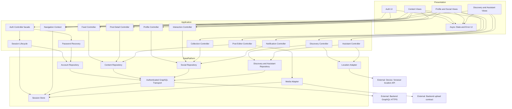

# Component Diagram và Catalog — Frontend

| Dự án | Owner | Reviewer | Approver | Sprint | Ngày | Phiên bản | Trạng thái |
|---|---|---|---|---|---|---|---|
| ToMateTo | FE — hieun4759 | Lead; BE đối với hợp đồng tích hợp | Lead | S4 | 25/10/2026 | 0.2 | Đề nghị review |

**DOC:** 5.1-A — phần FE · **WBS:** 4.1.2

## 1. Phạm vi và phân rã

Thiết kế là phần FE của kiến trúc hệ thống. Trạng thái đề xuất phải được đối chiếu DOC 4.3-A trước duyệt. Công nghệ và hướng phụ thuộc theo DOC 4.2-A, ADR-FE-001…003. Không bao gồm component BE, CSDL hoặc triển khai nhà cung cấp AI.

```text
ToMateTo Frontend
├── Presentation: Auth UI; Content Views; Profile and Social Views;
│   Discovery and Assistant Views; Async State and Error UI
├── Application: Auth facade; Session Lifecycle; Password Recovery; Feed; Post Detail; Post Editor; Profile;
│   Interaction; Collection; Notification; Discovery; Assistant Controllers;
│   Navigation Context
└── Data/platform: Account; Content; Social; Discovery and Assistant Repositories;
    Authenticated GraphQL Transport; Session Store; Media Adapter; Location Adapter
```

Các View theo chức năng gồm bố cục, thành phần nhập và phản hồi dùng lại. Controller quản lý một nhóm ý định nghiệp vụ; repository cung cấp hợp đồng, transport không quyết định nghiệp vụ. 26 component dưới đây là đơn vị thiết kế, không yêu cầu mỗi component tương ứng đúng một class.

## 2. Sơ đồ phụ thuộc



Mũi tên biểu diễn phụ thuộc sử dụng. Bản UML component với interface cung cấp và dependency yêu cầu được lưu tại [Component UML](5.1-A_component_frontend.puml); catalog và hợp đồng dưới đây xác định ý nghĩa từng interface. Mermaid dùng để xem nhanh quan hệ phụ thuộc.

## 3. Catalog và giao diện cung cấp

Tên operation sau là giao diện nội bộ đề xuất; không phải tên endpoint hoặc field GraphQL đã công bố. Kiểu dữ liệu trao đổi tối thiểu: định danh tài nguyên, input có trường tùy chọn, Page với cursor và OperationResult có trạng thái/lỗi. Không trả token qua state công khai của View.

| ID | Component | Lớp | Màn | Trách nhiệm | Interface cung cấp | Phụ thuộc yêu cầu |
|---|---|---|---|---|---|---|
| C01 | Auth UI | Presentation | MH-01/02/03/05 | Nhập tài khoản, OTP và hiển thị phản hồi | `submitAuth, cancelAuth` | C02, C15, C16 |
| C02 | Auth Controller | Application | MH-01/02/03/05 | Facade chuyển ý định tài khoản tới hai luồng độc lập | `register, login, requestOtp, verifyOtp, resetPassword, logout` | C25, C26 |
| C03 | Feed Controller | Application | MH-06 | Tải feed/cursor và giữ ngữ cảnh danh sách | `loadFeed, loadMore, retry` | C19 |
| C04 | Post Detail Controller | Application | MH-07 | Tải bài, xóa theo quyền và gửi báo cáo | `loadPost, deleteOwnPost, reportPost` | C19 |
| C05 | Post Editor Controller | Application | MH-08/09 | Kiểm form và điều phối tạo/sửa cùng ảnh | `createPost, updateOwnPost, cancelEdit` | C19, C23 |
| C06 | Profile Controller | Application | MH-10/11 | Hồ sơ công khai, sửa và công khai độc lập | `loadProfile, saveProfile, saveVisibility` | C20 |
| C07 | Interaction Controller | Application | MH-06/07/10 | Thích/lưu/theo dõi và trạng thái xác nhận | `setLike, savePost, removeSavedPost, setFollow` | C20 |
| C08 | Collection Controller | Application | MH-12/13 | Danh sách nhóm và quản lý nhóm riêng | `loadCollections, loadItems, createGroup, renameGroup, deleteGroup` | C20 |
| C09 | Notification Controller | Application | MH-14 | Thông báo, số chưa đọc và đích nội dung | `loadNotifications, markRead, resolveTarget` | C20 |
| C10 | Discovery Controller | Application | MH-15/16/17/18 | Tìm kiếm, xu hướng, quán gần và quay món | `search, trending, nearby, randomDish` | C21, C24 |
| C11 | Assistant Controller | Application | MH-19 và MH-08 | Hội thoại và chuyển bản nháp có chủ ý | `sendMessage, loadHistory, useDraft` | C21, C24 |
| C12 | Content Views | Presentation | MH-06/07/08/09 | Bố cục nội dung và form bài, không gọi mạng | `renderFeed, renderDetail, renderEditor` | C03, C04, C05, C07, C15, C16 |
| C13 | Profile and Social Views | Presentation | MH-10/11/12/13/14 | Hồ sơ, nhóm và thông báo | `renderProfile, renderGroups, renderNotifications` | C06, C07, C08, C09, C15, C16 |
| C14 | Discovery and Assistant Views | Presentation | MH-15/16/17/18/19 | Kết quả khám phá và hội thoại | `renderSearch, renderNearby, renderChat` | C10, C11, C15, C16 |
| C15 | Navigation Context | Application | 18 màn | Route nội bộ, back, guard và ngữ cảnh | `open, back, rememberContext, resumeContext` | C22 |
| C16 | Async State and Error UI | Presentation | 18 màn | Trạng thái tải/rỗng/lỗi/không xác định và form | `renderState, renderFieldErrors, confirmDiscard` | Không phụ thuộc thành phần chức năng |
| C17 | Authenticated GraphQL Transport | Data adapter | Không phải màn | Gửi query/mutation, parse lỗi và DTO | `executeQuery, executeMutation` | C22; BE GraphQL qua HTTPS |
| C18 | Account Repository | Data contract + adapter | Không phải màn | Hợp đồng tài khoản và khôi phục | `IAccountSession; IPasswordRecovery` | C17 |
| C19 | Content Repository | Data contract + adapter | Không phải màn | Feed, bài và report; chuyển dữ liệu chuẩn hóa từ BE | `IFeedRead; IPostRead; IPostWrite; IReportWrite` | C17 |
| C20 | Social Repository | Data contract + adapter | Không phải màn | Hồ sơ, tương tác, nhóm và thông báo | `IProfile; IInteraction; ICollection; INotification` | C17 |
| C21 | Discovery and Assistant Repository | Data contract + adapter | Không phải màn | Dữ liệu khám phá, AI và draft | `IDiscovery; IAssistant` | C17 |
| C22 | Session Store | Data/platform | Không phải màn | Phiên và trạng thái tài khoản hiện tại | `readSession, setSession, clearSession` | Kho nền tảng Android hoặc RAM web |
| C23 | Media Adapter | Data/platform | MH-08/09 | Chọn/kiểm tệp và upload theo hợp đồng | `pickImages, validateFile, upload` | C22; chọn tệp nền tảng; BE upload |
| C24 | Location Adapter | Data/platform | MH-17/19 | Quyền vị trí, tọa độ và nhãn fallback | `getPosition, useFallback` | API vị trí thiết bị/trình duyệt |
| C25 | Session Lifecycle | Application | MH-01/02/10 | Đăng ký, đăng nhập và kết thúc phiên server/cục bộ | `register, login, logout` | C18, C22 |
| C26 | Password Recovery | Application | MH-03/05 | Điều phối email/OTP và quyền reset dùng một lần | `requestOtp, verifyOtp, resetPassword` | C18 |

**Công nghệ:** C01/C12/C13/C14/C16 dùng Flutter widgets; các controller và C15 dùng Dart/Riverpod/go_router theo DOC 4.2-A; repository dùng Dart interface + adapter; C17 ứng viên graphql_flutter; C22/C23/C24 có triển khai riêng cho Android/web. Package và baseline phiên bản được duyệt trong DOC 4.2-A, không gán phiên bản chưa thử nghiệm.

### 3.1. Interface nghiệp vụ và dữ liệu trao đổi

| Interface / thành phần cung cấp | Thành phần yêu cầu | Operation nội bộ | Input | Output |
|---|---|---|---|---|
| IAccountSession / C18 | C25 | register; login; logoutCurrentSession | RegistrationInput; Credentials; SessionCredential | AccountSession; SessionRevocationResult |
| IPasswordRecovery / C18 | C26 | requestOtp; verifyOtp; resetPassword | Email; OtpInput(email, code, requestContext); ResetInput | RecoveryAcknowledgement; ResetGrant; ResetResult |
| IFeedRead / C19 | C03 | fetchFeed | FeedMode, PageRequest | Page<PostSummary> |
| IPostRead / C19 | C04 | fetchPost | PostId | PostDetail hoặc NotAvailable |
| IPostWrite / C19 | C05, C04 | createPost; updateOwnPost; deleteOwnPost | PostInput; PostId + PostPatch; PostId | SavedPost; DeleteResult |
| IReportWrite / C19 | C04 | submitReport | PostId, Reason | ReportReceipt, không đồng nghĩa bài đã ẩn |
| IProfile / C20 | C06 | getPublicProfile; getOwnProfile; updateProfile; updateVisibility | UserId; ProfilePatch; VisibilityPatch | PublicProfile không email; OwnProfile; VisibilityResult |
| IInteraction / C20 | C07 | setLike; savePost; removeSavedPost; setFollow | TargetId, trạng thái đích hoặc groupId tùy thao tác | ConfirmedInteraction có trạng thái cuối/số lượng |
| ICollection / C20 | C08 | listGroups; listItems; createGroup; renameGroup; deleteGroup | PageRequest; CollectionId; Name | Collection/Page; GroupMutationResult |
| INotification / C20 | C09 | listNotifications; markRead | PageRequest; NotificationId | Page<Notification>; ReadResult + UnreadCount |
| IDiscovery / C21 | C10 | search; trending; nearby; randomDish | SearchCriteria/PageRequest; Location/Radius; RandomCriteria tùy chọn | Page<SearchItem>; TrendList; NearbyList; DishSuggestion |
| IAssistant / C21 | C11 | sendMessage; loadHistory | ChatInput và SessionId nếu có; PageRequest | AssistantReply có tham chiếu/draft; Page<ChatMessage> |
| ISessionStore / C22 | C25, C15, C17, C23 | readSession; setSession; clearSession | SessionCredential nội bộ hoặc không có | SessionSnapshot; LocalClearResult |
| IMedia / C23 | C05 | pickImages; validateFile; upload | FileSelection; FileMetadata; SelectedFile | SelectedFiles; ValidationResult; UploadedMedia |
| ILocation / C24 | C10, C11 | getPosition; useFallback | Yêu cầu quyền hoặc khu vực fallback | LocationContext có tọa độ, nguồn và nhãn |
| IGraphQLTransport / C17 | C18/C19/C20/C21 | executeQuery; executeMutation | Document/Variables + AuthPolicy | TransportResult có data, GraphQL errors và lỗi HTTP |

Đây là kiểu hợp đồng nội bộ đề xuất; schema BE sẽ quyết định kiểu scalar, trường cụ thể và nullability. Mọi repository trả Result<T> gồm success(T), validation(fieldErrors), unauthenticated, forbidden, notAvailable, serviceUnavailable hoặc outcomeUnknown; input không hợp lệ phía FE không thay kiểm tra BE. PageRequest chứa cursor và limit; Page<T> chứa items, nextCursor, hasMore. Không tự bổ sung refresh token hay operation realtime.

Các nhóm IFeedRead/IPostRead/IPostWrite/IReportWrite có thể được cùng adapter C19 triển khai nhưng caller chỉ phụ thuộc interface mình dùng. Tương tự C20 cung cấp bốn interface, C21 cung cấp hai; không truyền một repository đa năng vào mọi controller. C02 chỉ chuyển lệnh và tổng hợp trạng thái hiển thị, C25/C26 sở hữu vòng đời tương ứng; không dồn logic trở lại facade.

### 3.2. Truy vết driver

| Driver | Component đáp ứng |
|---|---|
| AD-01/11: đọc và cursor | C03, C10, C19, C21 |
| AD-03/04: ảnh và chịu lỗi | C05, C16, C23; repository và controller xử lý kết quả lùi |
| AD-05/10: quyền, bí mật, truyền tải | C15, C17, C22, C25; BE vẫn kiểm quyền/revoke |
| AD-02/06/07: vị trí, dữ liệu AI và chờ | C10, C11, C21, C24 |
| AD-08: tương tác nhất quán | C07, C08, C09, C20; ràng buộc duy nhất phía BE/DB |
| AD-09/12/14/15 | Tách interface; C01/C12/C13/C14/C16 responsive; C17 phân loại lỗi; fake repository khi kiểm thử |

Nguồn: DOC 4.1-A baseline Lead bcba7866, PR #12; driver vẫn ở trạng thái trình duyệt. AD-13/16 về chi phí/dựng môi trường được phối hợp với Lead tại DOC 4.2-A và deployment DOC 4.3-A.

## 4. Quy tắc dữ liệu và ranh giới

- Page nội bộ có items, nextCursor và hasMore; giữ danh sách cũ khi tải thêm lỗi. Kích thước mặc định ≤10 và tối đa 50 theo NFR-02. Refresh đặt lại cursor, không append trùng định danh.
- OperationResult phân biệt lỗi form, xác thực, quyền, không khả dụng, lỗi dịch vụ và kết quả chưa xác định. Transport kiểm HTTP lẫn GraphQL errors; mapping sang lỗi nghiệp vụ thuộc adapter/repository.
- Tạo bài chỉ bắt buộc tên món. Quán, giá, địa chỉ, cảm nhận, công thức, thẻ, vị trí và ảnh tùy chọn. BE chịu chuẩn hóa món/thẻ (REQ-027); FE không sinh định danh Dish/Tag có thẩm quyền.
- Ảnh ≤10 MB/tệp; BE kiểm loại/kích thước và xử lý cạnh dài ≤1600 px. Upload lỗi giữ form; chỉ đăng không ảnh khi người dùng chọn. Số ảnh và xử lý upload thành công một phần thuộc hợp đồng BE.
- C06 tách saveProfile khỏi saveVisibility; email không công khai. Kiểm quyền trong UI không thay kiểm quyền BE.
- C07 tuần tự hóa yêu cầu tương tác. Bấm lại sau kết quả đã xác nhận là bỏ trạng thái tương ứng; mất phản hồi không tự toggle lại.
- C09 trả đích thông báo dưới dạng loại + định danh; C15 quyết định route hợp lệ. Follow mở MH-10 của người vừa theo dõi; bài mở MH-07; đích mất thì phản hồi và giữ đường quay lại.
- C11 xuất draft dưới dạng dữ liệu soạn bài. View gọi C15 mở MH-08 với draft khi người dùng chọn; C11 không gọi C05 và không tự đăng bài.
- C22 quản lý token, không chứa nghiệp vụ hồ sơ hoặc router. C25 gọi IAccountSession.logoutCurrentSession để BE vô hiệu phiên. BE xác nhận thì C25 clearSession và invalidation state/cache riêng qua cơ chế cấp phụ thuộc. Khi mất phản hồi, nếu kết thúc truy cập cục bộ thì phản hồi chưa xác nhận revoke server; không ghi thành công hệ thống. C22 chỉ quản lý kho cục bộ, không gọi ngược controller. Hợp đồng BE phải xác định cách xử lý kết quả logout không xác định.
- C24 chỉ trả vị trí thật hoặc fallback có nhãn; mặc định trung tâm Hà Nội theo yêu cầu. C11/C10 không yêu cầu quyền lặp vô hạn khi đã bị từ chối.

## 5. Phụ thuộc ngoài và bảo mật

FE chỉ truy cập Backend qua HTTPS khi public và API thiết bị cho vị trí/chọn tệp. PostgreSQL, khóa lưu trữ ảnh, khóa mô hình AI và khóa ký JWT nằm phía server. Không bổ sung push SDK, map provider hoặc dịch vụ analytics khi chưa được nhóm duyệt. Nếu BE trả URL ảnh, FE dùng URL được cho phép; không nhúng khóa nhà cung cấp trong URL phía client.

## 6. Kịch bản kiểm chứng thiết kế

| Kịch bản | Thành phần chính | Kết quả mong đợi |
|---|---|---|
| Guest thích rồi login | C12, C07, C15, C02, C22 | Về bài cũ, chưa tự thích |
| Gửi ảnh lỗi rồi hủy đăng | C12, C05, C23, C16 | Giữ form và ảnh chọn, chưa tạo bài |
| Tải trang feed sau lỗi | C03, C19, C17, C16 | Giữ bài cũ, retry đúng cursor |
| Đổi email khôi phục | C01, C02, C18 | Xóa OTP cũ; xác minh gắn email mới |
| AI quá 30 giây | C14, C11, C21, C16 | Phản hồi lỗi/lùi, giữ lịch sử, không tự đăng |
| Đăng xuất thành công | C02, C25, C18, C17, C22 | Phiên bị BE vô hiệu; token cũ không được ghi; state riêng đã xóa |
| Logout mất phản hồi | C25, C16, C22 | Phân biệt kết thúc cục bộ với revoke chưa xác nhận |
| Đổi tài khoản | C25, C22, các state riêng | Không hiện bộ sưu tập/thông báo tài khoản cũ |

Đây là kịch bản xác minh thiết kế, chưa phải báo cáo test đã chạy. Kiểm dependency không vòng được đối chiếu với sơ đồ và catalog; kiểm chất lượng thực thi thực hiện khi có code.
