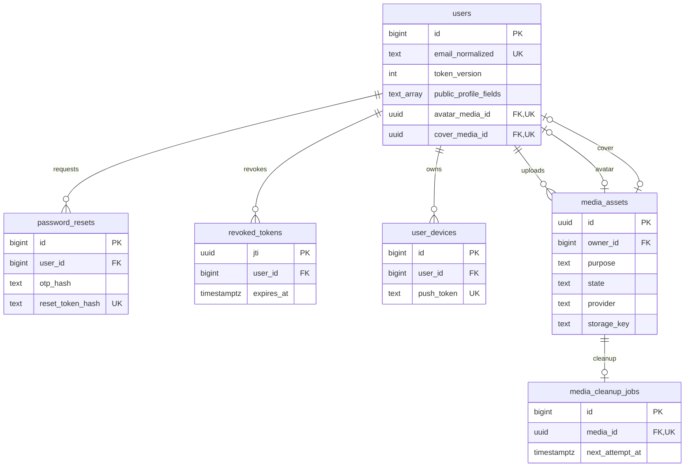
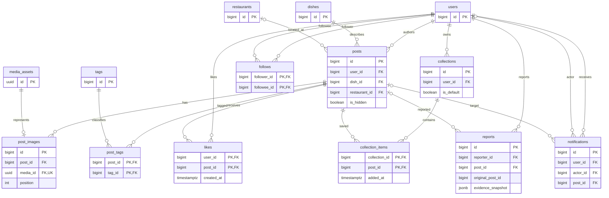
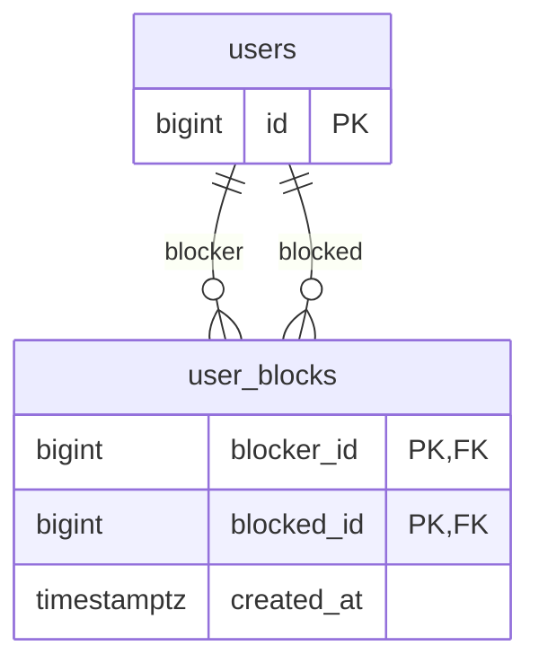
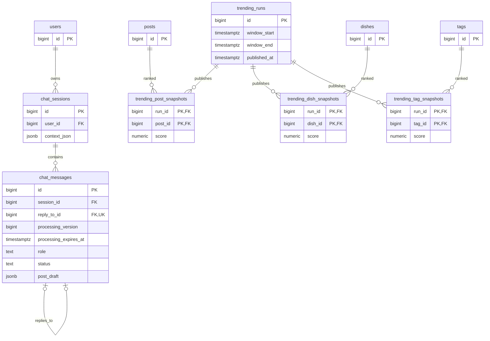

# DOC 5.3-A — Physical ERD: ToMateTo

| Thuộc tính | Nội dung |
|---|---|
| Owner / Reviewer / Approver | DB / BE (WBS 4.3.2) / Lead |
| Sprint / WBS | S4 / 4.3.1 — Physical ERD + Schema Specification |
| Phiên bản / Ngày | 2.1 / 31/10/2026 |
| Trạng thái | Đề nghị review; chưa phải baseline HLD được duyệt |
| Tài liệu đi kèm | [DOC 5.3-B — Schema](5.3-B_schema_specification.md), [Hướng dẫn trình bày](5.3_huong_dan_trinh_bay_db.md) |

## 1. Phạm vi và căn cứ

S4 xác định bảng, khóa, quan hệ, ràng buộc, chỉ mục và trách nhiệm bảo vệ dữ liệu. Data dictionary chi tiết và DDL thuộc S5 (WBS 5.3.1); migration thực thi thuộc giai đoạn cài đặt. Các cấu trúc dưới đây là thiết kế, chưa phải kết quả chạy PostgreSQL.

| Nguồn | Phiên bản đối chiếu | Vai trò |
|---|---|---|
| WBS, Vision, UC Catalog, FR, NFR, wireframe và Conceptual ERD | `origin/main@393268f` | Baseline yêu cầu đã được team duyệt theo xác nhận của chủ dự án |
| DOC 4.3-A và ADR-LEAD | Đã có trên nhánh hiện tại, nguồn `7903a9f` | Hướng kiến trúc S3 đang review |
| ADR-DATA-001…008 | `0c263f2` | Hướng dữ liệu S3 đang review |
| DOC 5.2-A API v0.7 | `origin/docs/be-s4-api-spec@d64503f` | Hợp đồng BE mới nhất đã đọc, chưa merge main |
| DOC 5.4-A Security v1.2 | `origin/docs/be-s4-security-design@3d55c66` | Bản BE đang review; khác bản security cũ trong cây làm việc |
| DOC 5.1 FE/BE | Nhánh FE `df5ef6e`, BE `10890d1` | Phân lớp và trách nhiệm, không thay yêu cầu nghiệp vụ |

Lệnh xem nguồn ngoài nhánh: `git show origin/docs/be-s4-api-spec:docs/thiet_ke/5.2-A_api_specification_backend.md`. Không cần merge nguồn để đọc.

Ưu tiên yêu cầu trên main; một quyết định mới trong API hoặc ADR chưa tự trở thành quyết định đã duyệt. Những lựa chọn thiết kế DB và chênh lệch nguồn cần xác nhận nằm ở mục 5. Không diễn giải chữ “đã ký” của bản cũ thành bằng chứng phê duyệt.

## 2. Cách đọc mô hình

- PK định danh một dòng; FK buộc dòng tham chiếu tồn tại; UNIQUE chặn trùng; CHECK giới hạn giá trị.
- Quan hệ `||--o{`: một bản ghi cha có từ 0 đến nhiều bản ghi con, mỗi con bắt buộc có một cha.
- Quan hệ `|o--o{`: con có thể không còn cha, ví dụ báo cáo giữ lại khi bài gốc bị xóa.
- Nullability, điều kiện UNIQUE và ON DELETE chính xác nằm trong DOC 5.3-B. Sơ đồ chỉ hiển thị cột nhận diện và liên kết để dễ đọc.
- Dữ liệu quan hệ dùng FK; JSONB/ARRAY chỉ dành cho khối nội dung không cần FK đến từng phần tử. Bản nháp AI không phải bài đã đăng.
- Thiết kế gồm 25 bảng, bao gồm `user_blocks` để đọc dữ liệu chặn nạp sẵn theo REQ-028. Không bổ sung chức năng tạo block trong v1. Số bảng không đại diện cho số chức năng.

### 2.1 Tài khoản, phiên và ảnh

Avatar và cover là hai FK tùy chọn, mỗi quan hệ tối đa một bản ghi ở mỗi phía. Mỗi FK UNIQUE khi khác NULL. Service kiểm purpose và chủ sở hữu, ngăn cùng asset dùng sai mục đích giữa các quan hệ. Khóa duy nhất của kho ảnh là cặp `(provider, storage_key)`, không phải riêng storage_key; quy định đầy đủ ở DOC 5.3-B.

### 2.2 Nội dung, tương tác và báo cáo

### 2.3 Dữ liệu chặn nạp sẵn

Đây là dữ liệu đọc phục vụ REQ-028 và ghi chú CRUD số 7 trong FR trên main. Nguồn nạp là seed/fixture được team review; không có mutation tạo block. Quy tắc lọc đề xuất ở T25, cần BE/Lead xác nhận O6.

### 2.4 Trợ lý và snapshot xu hướng

Ba bảng snapshot phân biệt bài hot, món và thẻ; không lấy tổng like mọi thời điểm để gọi là xu hướng 7 ngày. Snapshot chứa điểm theo một lần tính; thuật toán và trọng số do BE chốt ở S6. Khi đọc luôn kiểm lại bài còn hiển thị.

## 3. Truy vết yêu cầu → dữ liệu

| Yêu cầu | Bảng / kiểm soát chính |
|---|---|
| REQ-001…006 | users, collections, password_resets, revoked_tokens; phiên bản token |
| REQ-007…012 | posts, dishes, restaurants, post_images, media_assets; xóa phụ thuộc và dọn ảnh |
| REQ-013…015 | users.public_profile_fields; email luôn ngoài output công khai |
| REQ-016…019 | likes, follows, collections, collection_items, notifications, user_devices |
| REQ-020 | reports; lưu bằng chứng, không tự đặt ngưỡng ẩn |
| REQ-021…024 | restaurants, dishes, tags, posts, bốn bảng trending |
| REQ-025…026 | chat_sessions, chat_messages; draft là JSONB, đăng qua createPost |
| REQ-027 | tên chuẩn hóa của dishes/tags; UNIQUE và xử lý tranh chấp khi tạo |
| REQ-028 | quyền ở service, bộ lọc ở repository; user_blocks lưu dữ liệu nạp sẵn; chiều lọc cần xác nhận O6 |
| NFR-01…03 | index và cursor; kế hoạch đo tại DOC 5.3-B |
| NFR-05…07 | metadata ảnh, OTP, thu hồi phiên, FK và ràng buộc chủ sở hữu |
| NFR-09…11 | không lưu bí mật vào log; push sau commit; backup/restore cần kiểm chứng |
| ADR-DATA-001…008 | một PostgreSQL, transaction, lọc trước phân trang, snapshot, Alembic ở bước sau |

## 4. Thay đổi so với bản 1.2

| Bản trước | Bản 2.0 và lý do |
|---|---|
| Một file gộp khái niệm, schema, migration | A là ERD; B là schema; phần cài đặt để S5/S8 |
| Số bảng công bố không khớp danh mục | Liệt kê 25 bảng, bao gồm dữ liệu block nạp sẵn, cùng khóa/FK ở B |
| is_private chỉ có hai trạng thái | public_profile_fields biểu diễn công khai từng trường theo REQ-015 |
| Thu hồi refresh token | Thu hồi token phiên qua jti, thêm token_version theo API/BE security mới |
| Chưa có nơi lưu uploadId | media_assets có chủ, purpose, hạn, trạng thái tiêu thụ và dọn dẹp |
| Reports bị cascade mất khi xóa bài | SET NULL + snapshot bằng chứng, là đề xuất cần BE/Lead duyệt |
| Thiếu đặc tả ảnh, follow và message đầy đủ | B có các bảng tương ứng và quan hệ rõ |
| Hot dựa likes_count tích lũy | Snapshot theo cửa sổ; chưa chốt công thức khi thiếu DOC 7.1 |
| Khẳng định truy vấn vài mili giây | Chỉ ghi mục tiêu NFR và phép đo cần thực hiện |
| Chữ ký “đã ký” không có xác nhận | Trạng thái đề nghị review; bảng phê duyệt để trống |

## 5. Quyết định cần phối hợp trước khi đóng HLD

| Mã | Đề xuất của DB / điều còn thiếu | Ai quyết / tác động |
|---|---|---|
| O1 | JWT phiên 7 ngày, token_version theo API d64503f; security cũ trong nhánh DB còn dual-token | BE/Lead đồng bộ DOC 5.4 và ADR |
| O2 | Xóa vật lý theo API; giữ reports snapshot và thông báo không còn target. Thời hạn lưu bằng chứng chưa có | BE/Lead duyệt vòng đời và quyền truy cập bằng chứng |
| O3 | Bốn phân khúc giá theo API khác năm mức ERD S1; chưa chốt biên 200k | FE/BE/Lead chốt enum và nhãn; không suy ra tiền chính xác |
| O4 | Giữ quyền ẩn từng trường theo REQ-015; đề xuất Profile.displayName nullable khi xem công khai, do API hiện khai báo String!; mặc định allowlist rỗng | FE/BE/Lead duyệt projection và sửa hợp đồng API trước khi đóng HLD; không tự trả tên bị ẩn |
| O5 | Upload dùng một lần; 24 giờ mới là đề xuất; cần lịch dọn và hợp đồng khi nhà cung cấp lỗi | BE/Lead chốt TTL, grace period, worker |
| O6 | user_blocks nằm trong schema để đọc dữ liệu seed theo FR; đề xuất lọc chiều viewer→author trước phân trang và truy cập trực tiếp | BE/Lead xác nhận chiều lọc, phạm vi và dữ liệu mẫu; không thêm API tạo block |
| O7 | Định nghĩa hot, cửa sổ, trọng số, lịch cập nhật và thời gian giữ snapshot | BE chốt DOC 7.1; cấu trúc lưu chuẩn bị ở B |
| O8 | ORM sync ở ADR-DATA khác async ở kiến trúc/BE | BE/DB/Lead thống nhất; schema vật lý không phụ thuộc lựa chọn này |
| O9 | API register không có username trong khi ERD S1 bắt buộc; B đề xuất username nullable | FE/BE/Lead xác nhận trước khi duyệt schema |
| O10 | Giới hạn gửi lại OTP, xung đột sửa bài, idempotency createPost chưa có hợp đồng đủ | BE/FE chốt; không tự cam kết exactly-once bằng UNIQUE |
| O11 | API update quy định null giữ nguyên nhưng chưa có cách xóa enum/FK/tọa độ; caption/feeling còn chờ chốt | BE/FE bổ sung cách clear và ý nghĩa trường; DB nullable không tự giải quyết hợp đồng |
| O12 | Báo cáo trùng, bỏ lưu không có collectionId và thông báo save còn chưa thống nhất đủ | BE/FE duyệt các đề xuất trong B |
| O13 | Tìm quán gần trả quán chuẩn hóa; địa điểm nhập tự do không có restaurant_id sẽ chưa vào tập quán | BE/FE chốt tạo/ghép quán và kỳ vọng tìm kiếm |
| O14 | Chính sách vô hiệu tài khoản và nguồn thay đổi trạng thái chưa có UC v1 | Lead/BE xác nhận users.is_active chỉ là dữ liệu vận hành, không thêm API admin |

## 6. Review WBS 4.3.2

- [ ] BE đối chiếu từng operation với bảng, trường và transaction trong B.
- [ ] FE xác nhận dữ liệu công khai, giá và ảnh phù hợp màn hình.
- [ ] BE/DB giải quyết các điểm ảnh hưởng schema trong mục 5.
- [ ] Reviewer kiểm quan hệ, khóa ngoại, xóa và không lộ dữ liệu riêng.
- [ ] Lead ghi quyết định HLD tại WBS 4.5.1; merge theo quy trình team.

| Vai trò | Người / Ngày | Kết luận |
|---|---|---|
| DB — người soạn | Chưa ghi nhận | Đã chuẩn bị bản đề nghị review |
| BE — reviewer | | |
| Lead — approver | | |

Có tài liệu không đồng nghĩa task đã được duyệt. Bản này chưa chứng minh hiệu năng và chưa có kết quả chạy migration.

## 7. Bổ sung sau review bản 2.0

Bản 2.1 sửa bội số và khóa unique của ERD; đưa dữ liệu block nạp sẵn vào schema; bổ sung trạng thái OTP, nhận diện lượt gọi AI và bất biến báo cáo. Quyền ẩn tên hồ sơ được giữ theo yêu cầu; thay đổi nullability của API là đề xuất chờ FE/BE duyệt O4. Các phép kiểm chứng bổ sung nằm trong DOC B, chưa phải kết quả chạy hệ thống.
