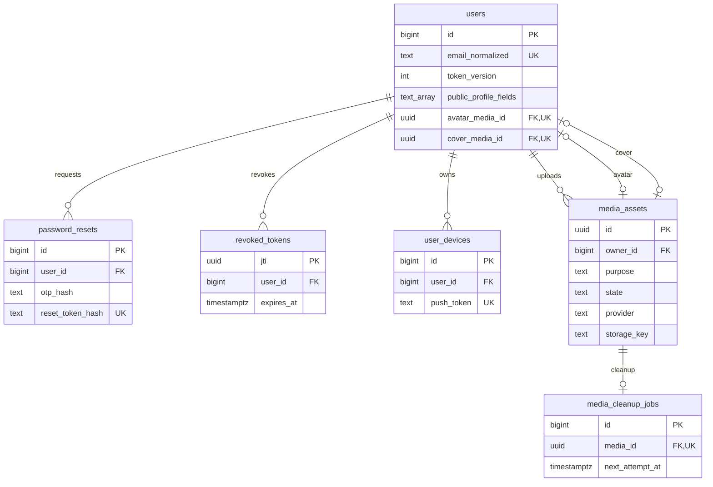
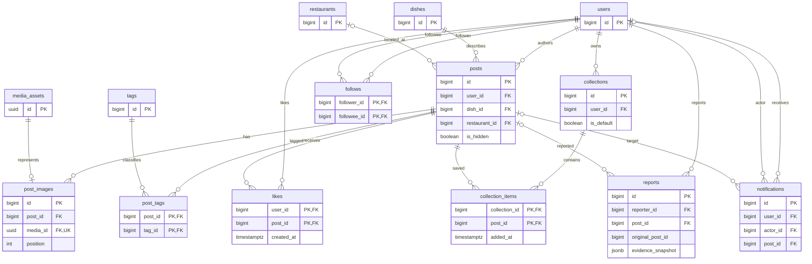
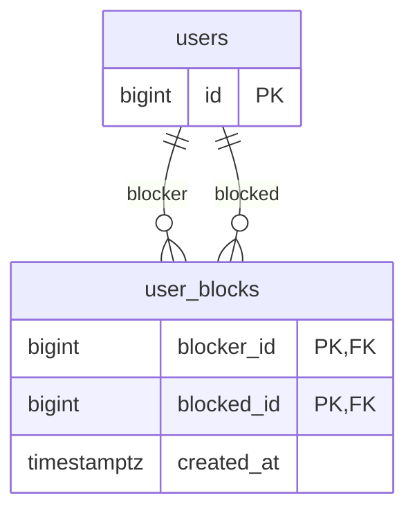
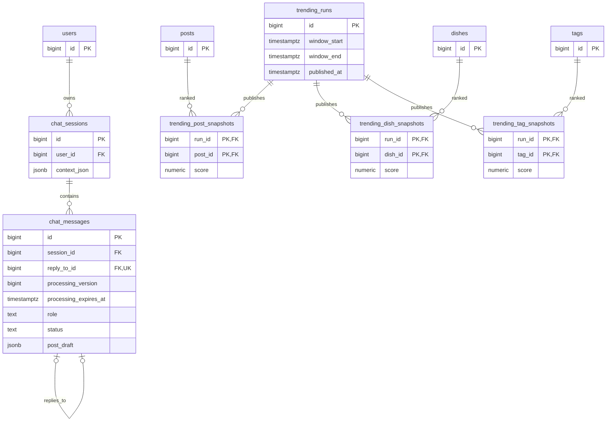

# DOC 5.3-A — Physical ERD: ToMateTo

| Thuộc tính | Nội dung |
|---|---|
| Owner / Reviewer / Approver | DB / BE (WBS 4.3.2) / Lead |
| Sprint / WBS | S4 / 4.3.1 — Physical ERD + Schema Specification |
| Phiên bản / Ngày | 2.3 / 12/11/2026 |
| Trạng thái | Đề nghị review; chưa phải baseline HLD được duyệt |
| Tài liệu đi kèm | [DOC 5.3-B — Schema](5.3-B_schema_specification.md) |

## 1. Phạm vi và căn cứ

S4 xác định bảng, khóa, quan hệ, ràng buộc, chỉ mục và trách nhiệm bảo vệ dữ liệu. Data dictionary chi tiết và DDL thuộc S5 (WBS 5.3.1); migration thực thi thuộc giai đoạn cài đặt. Các cấu trúc dưới đây là thiết kế, chưa phải kết quả chạy PostgreSQL.

| Nguồn | Phiên bản đối chiếu | Vai trò |
|---|---|---|
| WBS, Vision, UC Catalog, FR, NFR, wireframe và Conceptual ERD | `origin/main@393268f` | Baseline yêu cầu đã được team duyệt theo xác nhận của chủ dự án |
| [DOC 4.3-A tại nguồn S3](https://github.com/anqp5002/ToMateTo/blob/7903a9f464787c07d0afdd9a0243cffc975b39c9/docs/thiet_ke/4.3-A_kien_truc_he_thong.md) và [ADR-LEAD](https://github.com/anqp5002/ToMateTo/blob/7903a9f464787c07d0afdd9a0243cffc975b39c9/docs/thiet_ke/4.3-B_adr_quan_ly_ha_tang.md) | Commit `7903a9f`; đọc ngoài nhánh review S4 | Hướng kiến trúc S3 đang review, không khẳng định file có trong gói PR này |
| ADR-DATA-001…008 | `0c263f2` | Hướng dữ liệu S3 đang review |
| [DOC 5.2-A API v0.8](https://github.com/anqp5002/ToMateTo/blob/2880c340e9941ad92bd370e7ccde6c43223d0dbb/docs/thiet_ke/5.2-A_api_specification_backend.md) | `2880c34`, nguồn đọc ngày12/11; v0.7 tại d64503f là lịch sử | Contract đang review: Tag ngoài v1; còn xung đột ảnh công khai và fallback cần phối hợp O4/O5 |
| DOC 5.4-A Security v1.2 | `origin/docs/be-s4-security-design@3d55c66` | Bản BE đang review; khác bản security cũ trong cây làm việc |
| DOC 5.1 FE/BE | Nhánh FE `df5ef6e`, BE `10890d1` | Phân lớp và trách nhiệm, không thay yêu cầu nghiệp vụ |
| [DOC 6.2-A BE v1.7](https://github.com/anqp5002/ToMateTo/blob/afa70db0e66d87b940d5557348075fb604454d2e/docs/thiet_ke/6.2-A_sequence_diagrams_backend.md) | `afa70db`, nguồn đối chiếu bổ sung sau review | Ownership, transaction và retry; vị trí retry chưa đủ input trong API, không lấy vị trí của lượt khác |

Lệnh xem nguồn ngoài nhánh: `git show origin/docs/be-s4-api-spec-pr:docs/thiet_ke/5.2-A_api_specification_backend.md`. Không cần merge nguồn để đọc. Tài liệu trình bày nội bộ không thuộc gói bàn giao PR29 và không được dùng làm liên kết bắt buộc.

Ưu tiên yêu cầu trên main; một quyết định mới trong API hoặc ADR chưa tự trở thành quyết định đã duyệt. Những lựa chọn thiết kế DB và chênh lệch nguồn cần xác nhận nằm ở mục 5. Không diễn giải chữ “đã ký” của bản cũ thành bằng chứng phê duyệt.

## 2. Cách đọc mô hình

- PK định danh một dòng; FK buộc dòng tham chiếu tồn tại; UNIQUE chặn trùng; CHECK giới hạn giá trị.
- Quan hệ `||--o{`: một bản ghi cha có từ 0 đến nhiều bản ghi con, mỗi con bắt buộc có một cha.
- Quan hệ `|o--o{`: con có thể không còn cha, ví dụ báo cáo giữ lại khi bài gốc bị xóa.
- Nullability, điều kiện UNIQUE và ON DELETE chính xác nằm trong DOC 5.3-B. Sơ đồ chỉ hiển thị cột nhận diện và liên kết để dễ đọc.
- Dữ liệu quan hệ dùng FK; JSONB/ARRAY chỉ dành cho khối nội dung không cần FK đến từng phần tử. Bản nháp AI không phải bài đã đăng.
- Thiết kế gồm 25 bảng, bao gồm `user_blocks` để đọc dữ liệu chặn nạp sẵn theo REQ-028. Không bổ sung chức năng tạo block trong v1. Số bảng không đại diện cho số chức năng.

### 2.1 Tài khoản, phiên và ảnh

Avatar và cover là hai FK tùy chọn, mỗi quan hệ tối đa một bản ghi ở mỗi phía. Mỗi FK UNIQUE khi khác NULL. Service kiểm purpose và chủ sở hữu, ngăn cùng asset dùng sai mục đích giữa các quan hệ. Khóa duy nhất của kho ảnh là cặp `(provider, storage_key)`, không phải riêng storage_key; quy định đầy đủ ở DOC 5.3-B.

### 2.2 Nội dung, tương tác và báo cáo

### 2.3 Dữ liệu chặn nạp sẵn

Đây là dữ liệu đọc phục vụ REQ-028 và ghi chú CRUD số 7 trong FR trên main. Nguồn nạp là seed/fixture được team review; không có mutation tạo block. Lọc bắt buộc hai chiều ở T25/O6 theo REQ-028; chiều lọc không còn là lựa chọn cần đề xuất lại.

### 2.4 Trợ lý và snapshot xu hướng

Ba bảng snapshot phân biệt bài hot, món và thẻ; không lấy tổng like mọi thời điểm để gọi là xu hướng 7 ngày. Snapshot chứa điểm theo một lần tính; thuật toán và trọng số do BE chốt ở S6. Khi đọc luôn kiểm lại bài còn hiển thị. Trending tag là cấu trúc dự phòng, không công bố ở v1 theo phạm vi bên dưới.

### 2.5 Phạm vi Tag của bản thiết kế v1

| Hành vi | Phạm vi theo API v0.8 đang review | Bảng liên quan / yêu cầu triển khai |
|---|---|---|
| Gắn thẻ khi đăng/sửa bài | Không nhận input Tag trong createPost/updatePost v1 | T08 tags/T11 post_tags giữ trong thiết kế, không ghi từ mutation v1 |
| Tìm kiếm theo thẻ | Không có SearchType.TAG hoặc filter tag trong API v1 | Không đưa tags/post_tags vào nhánh kết quả search v1 |
| Xu hướng thẻ | Không trả bảng xếp hạng Tag trong API v1 | T23 trending_tag_snapshots giữ dự phòng; job v1 chỉ công bố nhóm bài/món |

Giữ đủ25bảng theo xác nhận trước của người yêu cầu để truy vết thiết kế; không tự kích hoạt Tag và không tự xóa ba bảng chỉ vì API chưa dùng. Phạm vi ba hành vi trên cần Lead/BE ghi nhận khi duyệt HLD do FR có dấu HOÃN nhưng còn tham chiếu Tag. Nếu team đổi phạm vi, phải cập nhật FR/API/HLD rồi dictionary/DDL/migration cùng lần; O7 theo dõi cả phần phạm vi này và thuật toán.

## 3. Truy vết yêu cầu → dữ liệu

| Yêu cầu | Bảng / kiểm soát chính |
|---|---|
| REQ-001…006 | users, collections, password_resets, revoked_tokens; phiên bản token |
| REQ-007…012 | posts, dishes, restaurants, post_images, media_assets; xóa phụ thuộc và dọn ảnh |
| REQ-013…015 | users.public_profile_fields; email luôn ngoài output công khai |
| REQ-016…019 | likes, follows, collections, collection_items, notifications, user_devices |
| REQ-020 | reports; lưu bằng chứng, không tự đặt ngưỡng ẩn |
| REQ-021…024 | restaurants, dishes, posts, trending_runs và snapshot bài/món v1; Tag/T23 chỉ giữ thiết kế, xem §2.5 |
| REQ-025…026 | chat_sessions, chat_messages; draft là JSONB, đăng qua createPost |
| REQ-027 | tên chuẩn hóa của dishes; UNIQUE và xử lý tranh chấp khi tạo; Tag chưa kích hoạt trong v1 |
| REQ-028 | user_blocks nạp sẵn; lọc hai chiều bài/hồ sơ trước phân trang và truy cập trực tiếp theo O6/T25 |
| NFR-01…03 | index và cursor; kế hoạch đo tại DOC 5.3-B |
| NFR-05…07 | metadata ảnh, OTP, thu hồi phiên, FK và ràng buộc chủ sở hữu |
| NFR-09…11 | không lưu bí mật vào log; push sau commit; backup/restore cần kiểm chứng |
| ADR-DATA-001…008 | một PostgreSQL, transaction, lọc trước phân trang, snapshot, Alembic ở bước sau |

## 4. Thay đổi so với bản 1.2

| Bản trước | Bản 2.0 và lý do |
|---|---|
| Một file gộp khái niệm, schema, migration | A là ERD; B là schema; phần cài đặt để S5/S8 |
| Số bảng công bố không khớp danh mục | Liệt kê 25 bảng, bao gồm dữ liệu block nạp sẵn, cùng khóa/FK ở B |
| is_private chỉ có hai trạng thái | public_profile_fields biểu diễn công khai từng trường theo REQ-015 |
| Thu hồi refresh token | Thu hồi token phiên qua jti, thêm token_version theo API/BE security mới |
| Chưa có nơi lưu uploadId | media_assets có chủ, purpose, hạn, trạng thái tiêu thụ và dọn dẹp |
| Reports bị cascade mất khi xóa bài | SET NULL + snapshot bằng chứng, là đề xuất cần BE/Lead duyệt |
| Thiếu đặc tả ảnh, follow và message đầy đủ | B có các bảng tương ứng và quan hệ rõ |
| Hot dựa likes_count tích lũy | Snapshot theo cửa sổ; chưa chốt công thức khi thiếu DOC 7.1 |
| Khẳng định truy vấn vài mili giây | Chỉ ghi mục tiêu NFR và phép đo cần thực hiện |
| Chữ ký “đã ký” không có xác nhận | Trạng thái đề nghị review; bảng phê duyệt để trống |

## 5. Quyết định cần phối hợp trước khi đóng HLD

| Mã | Đề xuất của DB / điều còn thiếu | Ai quyết / tác động |
|---|---|---|
| O1 | JWT phiên 7 ngày, token_version theo API d64503f; security cũ trong nhánh DB còn dual-token | BE/Lead đồng bộ DOC 5.4 và ADR |
| O2 | Xóa vật lý theo API; giữ reports snapshot và thông báo không còn target. Thời hạn lưu bằng chứng chưa có | BE/Lead duyệt vòng đời và quyền truy cập bằng chứng |
| O3 | Bốn phân khúc giá theo API khác năm mức ERD S1; chưa chốt biên 200k | FE/BE/Lead chốt enum và nhãn; không suy ra tiền chính xác |
| O4 | Giữ quyền ẩn từng trường theoREQ-015. Đề xuất PublicUser.displayName nullable cho Notification.actor và projection công khai; Profile.displayName cũng nullable. DB display_name vẫn NOTNULL. Người yêu cầu chọn kho private/local-private và route ứng dụng kiểm quyền mỗi lần đọc avatar/cover; URL cũ bị chặn ở request mới sau khi tắt công khai | FE/BE/Lead duyệt SDL/route/adapter và cache; không chỉ sửa Profile rồi để actor dùng User.displayName:String!; không trả raw provider URL. Không hứa thu hồi ảnh đã tải hoặc request đang truyền |
| O5 | Upload dùng một lần;24giờ vẫn là TTL đề xuất. Bổ sung PENDING hết hạn→DELETE_PENDING+job nguyên tử, khóa/kiểm lại để không đụng attach. BámNFR-10: đề xuất kho cục bộ bền vững làm fallback, cùng quyền/vòng đời | BE/Lead chốt TTL/lịch chạy/cấu hình kho và cập nhật API/kiến trúc. Không tự bỏ tiêu chí ảnh cục bộ của NFR-10 chỉ vì API nói retry/bỏ ảnh/hủy |
| O6 | Đã sửa theoREQ-028: cặp A chặn B ngăn A đọc bài/hồ sơ B và B đọc bài/hồ sơ A; lọc trước phân trang và truy cập trực tiếp. Guest theo chính sách công khai, không mượn block của tài khoản khác | BE/DB kiểm ma trận A/B/Guest ở B; không thêm API tạo block và không coi chiều lọc là quyết định còn mở |
| O7 | TheoAPI v0.8: gắn Tag khi tạo/sửa, tìm theo Tag và xu hướng Tag đều chưa kích hoạt v1; giữT08/T11/T23 dự phòng. Công thức/cửa sổ/lịch/retention xu hướng bài/món doBE chốtS6 | Lead/BE ghi nhận ba phạm vi tại§2.5; nếu đổi phải đồng bộFR/API/HLD/dictionary/DDL, không chỉ đổi danh mục bảng |
| O8 | ORM sync ở ADR-DATA khác async ở kiến trúc/BE | BE/DB/Lead thống nhất; schema vật lý không phụ thuộc lựa chọn này |
| O9 | API register không có username trong khi ERD S1 bắt buộc; B đề xuất username nullable | FE/BE/Lead xác nhận trước khi duyệt schema |
| O10 | Giới hạn resend OTP, xung đột sửa bài và idempotency createPost còn cần chốt. Vị trí retry: người yêu cầu chọn thêm location tùy chọn theo từng retry, thiếu dùng mặc định và thông báo; không lấy vị trí lượt khác trong phiên, chi tiếtT19 | BE/FE sửa AssistantRetryInput và bổ sung usedDefaultLocation cho AssistantReply; không thêm cột location hoặc giả định UNIQUE bảo đảm exactly-once |
| O11 | API update quy định null giữ nguyên nhưng chưa có cách xóa enum/FK/tọa độ; caption/feeling còn chờ chốt | BE/FE bổ sung cách clear và ý nghĩa trường; DB nullable không tự giải quyết hợp đồng |
| O12 | Báo cáo trùng, bỏ lưu không có collectionId và thông báo save còn chưa thống nhất đủ | BE/FE duyệt các đề xuất trong B |
| O13 | Tìm quán gần trả quán chuẩn hóa; địa điểm nhập tự do không có restaurant_id sẽ chưa vào tập quán | BE/FE chốt tạo/ghép quán và kỳ vọng tìm kiếm |
| O14 | Chính sách vô hiệu tài khoản và nguồn thay đổi trạng thái chưa có UC v1 | Lead/BE xác nhận users.is_active chỉ là dữ liệu vận hành, không thêm API admin |

## 6. Review WBS 4.3.2

- [ ] BE đối chiếu từng operation với bảng, trường và transaction trong B.
- [ ] FE xác nhận dữ liệu công khai, giá và ảnh phù hợp màn hình.
- [ ] BE/DB giải quyết các điểm ảnh hưởng schema trong mục 5.
- [ ] Reviewer kiểm quan hệ, khóa ngoại, xóa và không lộ dữ liệu riêng.
- [ ] Lead ghi quyết định HLD tại WBS 4.5.1; merge theo quy trình team.

| Vai trò | Người / Ngày | Kết luận |
|---|---|---|
| DB — người soạn | Chưa ghi nhận | Đã chuẩn bị bản đề nghị review |
| BE — reviewer | Góp ý PR29 do người yêu cầu cung cấp ngày12/11 | Đã xử lý ở bản2.3; chưa có approve sau sửa |
| Lead — approver | | |

Có tài liệu không đồng nghĩa task đã được duyệt. Bản này chưa chứng minh hiệu năng và chưa có kết quả chạy migration.

## 7. Bổ sung sau review bản 2.0

Bản 2.1 sửa bội số và khóa unique của ERD; đưa dữ liệu block nạp sẵn vào schema; bổ sung trạng thái OTP, nhận diện lượt gọi AI và bất biến báo cáo. Quyền ẩn tên hồ sơ được giữ theo yêu cầu; thay đổi nullability của API là đề xuất chờ FE/BE duyệt O4. Các phép kiểm chứng bổ sung nằm trong DOC B, chưa phải kết quả chạy hệ thống.

## 8. Xử lý góp ý PR29 ngày12/11/2026

| Điểm review | Nội dung bản2.3 | Trạng thái / lý do phối hợp |
|---|---|---|
| 1 — chặn hai chiều | SửaO6/T25, cả bài/hồ sơ, list/direct và trước pagination; ca A/B/Guest ở B | Sửa lỗi diễn giải baseline; không yêu cầu duyệt lại chiều chặn và không thêm mutation |
| 2 — actor ẩn tên | Đề xuất PublicUser.displayName nullable, actor.id còn khi chỉ ẩn tên; cập nhậtProfile và output tác giả công khai | DB display_name không cần nullable. BE/FE phải sửa SDL, không chỉ sửa mô tảDB |
| 3 — URL ảnh hồ sơ | Người yêu cầu chọn route ứng dụng, private storage, kiểm quyền mỗi request, no-store; URL cũ bị chặn ở lần mở mới | API còn nói provider trả public URL; cần BE/Lead sửa adapter/route và quyền kho. Không thu hồi được bản ảnh đã tải |
| 4 — vị trí retry | Người yêu cầu chọn location tùy chọn của từng retry, không dùng vị trí phiên/lượt khác; thiếu dùng mặc định và flag/UI thông báo | API hiện chỉ có messageId; cần BE/FE mở rộng input/output, không âm thầm lưu tọa độ vàoDB |
| 5 — upload bỏ dở | Worker quét PENDING quá hạn, khóa/kiểm lại, DELETE_PENDING+job nguyên tử; không xóa ATTACHED | Làm rõ lifecycle đã có; ca attach/cleanup tranh khóa được đặc tả ở B; lịch/TTL còn cần BE/Lead xác nhận |
| 6 — Tag | Gắn khi tạo/sửa, search Tag, trending Tag đều chưa bật v1 theoAPI; giữ3bảng thiết kế | Giữ cấu trúc theo yêu cầu trước; Lead/BE ghi nhận hoặc thay phạm vi qua FR/API/HLD trước, không xóa schema một phía |
| 7 — tham chiếu | Bỏ link hướng dẫn nội bộ; DOC4.3-A/ADR-LEAD trỏ commit nguồn | Không khẳng định tài liệu S3 có trong nhánh review chỉ chứa2fileS4 |
| 8 — kho ảnh lỗi | Người yêu cầu chọn bámNFR-10: fallback local-private trên volume bền vững, cùng kiểm quyền/vòng đời | Retry/bỏ ảnh/hủy là lựa chọn khi không lưu được, không thay thế tiêu chí lưu ảnh cục bộ đã được duyệt; BE/Lead đồng bộNFR/API/kiến trúc |

Các xác nhận của người yêu cầu là căn cứ soạn đề xuất, không thay approve BE/FE/Lead. Bản này không sửa nội dung nguồn của các vai trò khác. Sau duyệt cần đồng bộ dictionary/DDL S5, query/test S6 và hợp đồng triển khai, không coi downstream đã tự cập nhật theo lần sửa S4.
