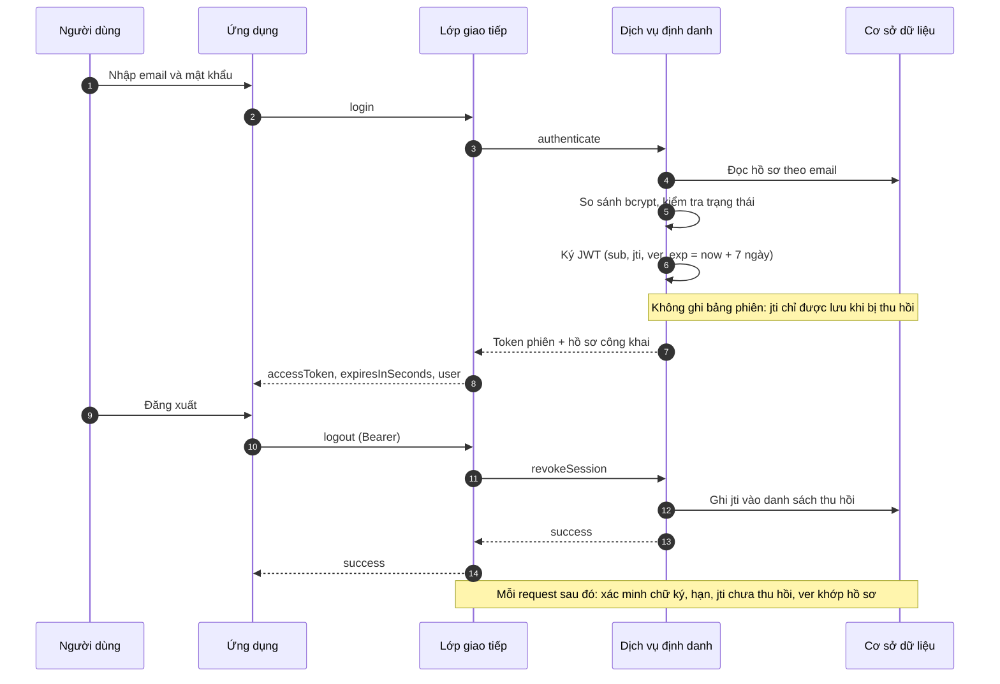
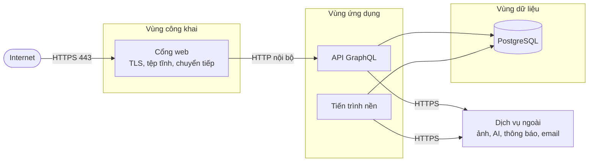

# DOC 5.4-A — Thiết kế Bảo mật Hệ thống ToMateTo

| Dự án | Owner | Reviewer | Approver | Sprint | Phiên bản | Trạng thái |
|---|---|---|---|---|---|---|
| ToMateTo | BE | Lead; DB với lược đồ dữ liệu; FE với lưu trữ token | Lead | S4 | 1.3 | Đề nghị review |

**WBS:** 4.4.1 · **Phạm vi:** cơ chế xác thực, phân quyền, bảo vệ dữ liệu, kiểm soát tấn công và ứng phó sự cố cho backend ToMateTo v1.0.
**Đầu vào:** DOC 1.3-A System Context, DOC 3.1-A Functional Requirements, DOC 3.2-A NFR, DOC 4.1-A Architecture Drivers, DOC 4.3-A Kiến trúc hệ thống, DOC 4.3-C ADR backend, DOC 5.1-A/B Component Backend, DOC 5.2-A API Backend.

## 1. Mục tiêu, căn cứ và phạm vi

### 1.1 Mục tiêu

Tài liệu xác định cách hệ thống chứng minh danh tính, quyết định quyền truy cập, bảo vệ dữ liệu nhạy cảm, chống các tấn công phổ biến và phản ứng khi có sự cố. Mỗi kiểm soát phải truy vết được tới một yêu cầu phi chức năng hoặc yêu cầu chức năng, và phải triển khai được trong phạm vi bốn người, mười tuần, hạ tầng một máy.

### 1.2 Phạm vi và giả định

- **Trong phạm vi:** backend GraphQL, hợp đồng upload ảnh, tiến trình nền, kết nối tới dịch vụ ngoài, dữ liệu trong PostgreSQL, log và cấu hình triển khai.
- **Ngoài phạm vi:** bảo mật thiết bị người dùng, bảo mật nhà cung cấp AI/lưu trữ/thông báo (chỉ kiểm soát phần tích hợp), vận hành trung tâm dữ liệu, chứng nhận tuân thủ chính thức.
- **Giả định:** một khối triển khai sau một cổng web; `api`, `worker`, `db` không mở cổng ra Internet; không có vai trò quản trị trong v1.0.
- **Không có trong yêu cầu:** MFA, KMS/Vault, SIEM, chứng nhận GDPR/PCI-DSS/HIPAA. Các mục này được nêu rõ là không bắt buộc hoặc là giới hạn đã biết, không giả định đã có.

### 1.3 Input

| Input | Nội dung áp dụng |
|---|---|
| DOC 3.2-A — Yêu cầu phi chức năng | NFR-05…NFR-11: ảnh, xác thực, phân quyền, khoá bí mật, log, chế độ lùi, sao lưu |
| DOC 4.3-A — Kiến trúc hệ thống; DOC 4.3-C — ADR backend | Ba tiến trình `api`/`worker`/`db` sau một cổng web; HTTPS kết thúc tại cổng; quyết định phiên và xóa dữ liệu |
| DOC 5.1-A/B — Thiết kế thành phần Backend | P0 xác minh phiên, B1/B2 xác thực và khôi phục, B10 kiểm quyền, D1 lưu `jti` thu hồi và `ver`, X1–X5 tích hợp ngoài |
| DOC 5.2-A — Đặc tả API Backend | 42 operation, bảng quyền, OTP, mã lỗi, quy tắc upload và các quyết định còn mở |

### 1.4 Threat model tóm tắt

| Bề mặt | Tài sản cần bảo vệ | Mối đe doạ chính | Kiểm soát chính | Mục |
|---|---|---|---|---|
| Đăng ký, đăng nhập | Mật khẩu, phiên | Dò mật khẩu, credential stuffing, dò tài khoản | Bcrypt, rate limit, phản hồi chung, OTP có hạn | §2, §5.6 |
| Token phiên | JWT, mã định danh phiên | Đánh cắp token, phát lại token cũ | HTTPS, lưu trữ an toàn, thu hồi theo phiên, đánh dấu phiên | §2, §4 |
| GraphQL | Bài đăng, hồ sơ, thông báo | Truy cập trái quyền, liệt kê dữ liệu, truy vấn quá nặng | Kiểm quyền tập trung, lọc theo chủ sở hữu, giới hạn độ sâu | §3, §5.1 |
| Upload ảnh | Tệp, kho ảnh | Mã độc trong ảnh, path traversal, lấp đầy dung lượng | Magic bytes, giải mã và nén lại, giới hạn kích thước, tên ngẫu nhiên | §5.7 |
| Trợ lý AI | Prompt, dữ liệu người dùng | Rò rỉ ngữ cảnh, prompt injection, bịa dữ liệu | Ngữ cảnh tối thiểu, không gửi bí mật, kiểm tra tham chiếu | §5.8 |
| Thông báo, email | Token thiết bị, OTP | Lộ token, lạm dụng gửi OTP | Không ghi log token/OTP, giới hạn tần suất | §5.6, §9 |
| Cơ sở dữ liệu | PII, hash mật khẩu | SQL injection, truy cập trực tiếp | Truy vấn tham số hoá, mạng nội bộ, quyền DB tối thiểu | §5.2, §8 |
| Log và lỗi | PII, bí mật | Rò rỉ qua log hoặc thông báo lỗi | Che giấu dữ liệu, danh sách cấm ghi | §4.4, §6 |

### 1.5 Yêu cầu bảo mật bắt buộc

| Yêu cầu | Điều khoản | Nơi đáp ứng |
|---|---|---|
| NFR-05 | Ảnh ≤10 MB, cạnh dài ≤1600 px, từ chối tệp không phải ảnh | §5.7 |
| NFR-06 | Bcrypt, mật khẩu ≥6 ký tự, phiên JWT 7 ngày, OTP 6 số/10 phút/5 lần, reset 15 phút dùng một lần | §2 |
| NFR-07 | Ba mức Khách/Người dùng/Chủ sở hữu; email luôn riêng tư; xoá bài xử lý dữ liệu phụ thuộc | §3, §4.6 |
| NFR-08 | Khoá bí mật qua biến môi trường, không có giá trị thật trong mã nguồn; HTTPS tại reverse proxy | §4.2, §8, §9 |
| NFR-09 | Ghi log sự kiện bắt buộc; log trong luồng container; không ghi PII/bí mật | §6, §7 |
| NFR-10 | Dịch vụ ngoài lỗi không chặn luồng chính | §5.8 |
| NFR-11 | RTO ≤1 giờ, RPO ≤24 giờ từ bản sao lưu thủ công | §4.3, §10 |

## 2. Thiết kế xác thực

### 2.1 Cơ chế và lựa chọn

| Phương án | Ưu điểm | Hạn chế | Kết luận |
|---|---|---|---|
| Một token phiên 7 ngày + danh sách thu hồi | Đúng NFR-06, ít mã ở FE/BE, đăng xuất có hiệu lực ngay | Token lộ dùng được tới khi bị thu hồi; mỗi request phải tra danh sách thu hồi | **Chọn** |
| Access token ngắn + refresh token 7 ngày | Token lộ chỉ dùng được thời gian ngắn | Phải sửa NFR-06, thêm luồng làm mới ở cả FE và BE | Không chọn cho v1.0 |
| Phiên lưu máy chủ + cookie | Thu hồi tự nhiên | Không phù hợp ứng dụng Android gọi GraphQL, lệch hướng JWT của NFR-06 | Không chọn |

**Quyết định:** dùng JWT ký HS256, hiệu lực **7 ngày**, mang mã định danh phiên. Đăng xuất ghi mã này vào danh sách thu hồi; bước xác thực ở lớp giao tiếp từ chối token đã thu hồi. Không cấp refresh token trong v1.0, nên operation làm mới phiên trong hợp đồng API **không được bật**.

### 2.2 Định dạng token phiên

| Thành phần | Nội dung | Ghi chú |
|---|---|---|
| Thuật toán | HS256 | Khoá ký ≥256 bit, nạp từ biến môi trường |
| `sub` | Mã người dùng | Không chứa email hay tên hiển thị |
| `jti` | UUIDv4 | Dùng để thu hồi đúng một phiên |
| `ver` | Số phiên bản của tài khoản | Tăng khi đổi/đặt lại mật khẩu để vô hiệu mọi token cũ |
| `iat`, `exp` | Thời điểm cấp, hết hạn | `exp = iat + 7 ngày` |
| Kích thước | Dưới 1 KB | Không nhét quyền vào token; quyền suy ra từ chủ sở hữu tài nguyên |

Token không chứa dữ liệu cá nhân, không chứa danh sách quyền. Mọi quyết định quyền dựa trên dữ liệu hiện tại, không dựa vào nội dung token.

### 2.3 Luồng đăng nhập, đăng xuất và thu hồi



### 2.4 Chính sách mật khẩu

| Quy tắc | Giá trị | Căn cứ |
|---|---|---|
| Độ dài tối thiểu | 6 ký tự | NFR-06 |
| Độ dài tối đa | 72 byte (giới hạn bcrypt) | Ràng buộc kỹ thuật |
| Lưu trữ | Bcrypt, cost 12, salt riêng mỗi bản ghi | NFR-06 |
| Thành phần bắt buộc | Không áp đặt hoa/thường/số/ký tự đặc biệt | Tránh quy tắc làm giảm entropy thực tế |
| Hết hạn định kỳ | Không | Không có yêu cầu; đổi khi người dùng chủ động hoặc khi nghi lộ |
| So sánh | Hàm so sánh của thư viện bcrypt, không so sánh chuỗi thường | Chống tấn công thời gian |

Mật khẩu thô chỉ tồn tại trong bộ nhớ trong lúc băm; không ghi log, không trả lại trong bất kỳ response nào, không đưa vào thông báo lỗi.

### 2.5 Khôi phục mật khẩu và OTP

| Tham số | Giá trị | Căn cứ |
|---|---|---|
| Định dạng OTP | 6 chữ số | NFR-06 |
| Hiệu lực OTP | 10 phút | NFR-06 |
| Số lần nhập sai | Tối đa 5, vượt thì vô hiệu mã | NFR-06 |
| Lưu OTP | Chỉ lưu hash kèm khoá phụ của máy chủ; không lưu bản rõ | Chống đọc trộm cơ sở dữ liệu |
| Mã đặt lại | Chuỗi ngẫu nhiên dùng một lần, hiệu lực 15 phút, lưu dạng hash | NFR-06 |
| Phản hồi khi yêu cầu | Luôn giống nhau, không tiết lộ email có tài khoản hay không | REQ-003 |
| Sau khi đổi mật khẩu | Tăng `ver` của tài khoản, thu hồi toàn bộ phiên cũ | REQ-005 |

OTP và mã đặt lại được tạo bằng nguồn ngẫu nhiên an toàn, so sánh theo thời gian hằng, và bị vô hiệu ngay sau khi dùng thành công.

### 2.6 Quản lý phiên

| Tình huống | Hành vi |
|---|---|
| Hạn tuyệt đối | 7 ngày kể từ lúc đăng nhập; không tự gia hạn |
| Đăng nhập nhiều thiết bị | Mỗi lần đăng nhập một `jti` riêng; đăng xuất một thiết bị không ảnh hưởng thiết bị khác |
| Đăng xuất | Thu hồi đúng `jti` đang dùng |
| Đổi hoặc đặt lại mật khẩu | Tăng `ver`, mọi token cũ bị từ chối ở request kế tiếp |
| Tài khoản bị vô hiệu hoá | Từ chối mọi request, không phụ thuộc hạn token |
| Dọn danh sách thu hồi | Tiến trình nền xoá bản ghi đã quá `exp`; không giữ vô hạn |
| Kiểm tra mỗi request | Chữ ký, hạn, `jti` chưa thu hồi, `ver` khớp hồ sơ |

### 2.7 Lưu trữ token phía client

| Nền tảng | Nơi lưu | Quy tắc |
|---|---|---|
| Android | Kho bảo mật của nền tảng | Không lưu trong tệp thường, không ghi log, xoá khi đăng xuất |
| Web | Bộ nhớ của trang | Tải lại trang phải đăng nhập lại; không dùng `localStorage`/`sessionStorage` |
| Chung | Không đưa token vào URL, không đưa vào tham số phân tích | Tránh lộ qua lịch sử trình duyệt và log truy cập |

### 2.8 MFA

NFR-06 không yêu cầu yếu tố thứ hai và v1.0 không có vai trò quản trị. MFA **không bắt buộc**. Nếu sau này bổ sung vai trò quản trị hoặc thao tác nhạy cảm, MFA là điều kiện tiên quyết trước khi mở vai trò đó; không thiết kế sẵn trong v1.0 để tránh phức tạp không có căn cứ.

### 2.9 Chống dò tài khoản và dò mật khẩu

- Phản hồi đăng nhập sai luôn cùng một thông điệp, cùng mã lỗi, không phân biệt email tồn tại hay sai mật khẩu.
- Đăng ký trùng email: trả `ALREADY_EXISTS` để FE chuyển sang đăng nhập (đăng ký buộc phải cho biết email đã dùng, nếu không sẽ không có đường hoàn tất luồng); bù lại bằng rate limit đăng ký theo IP ở §5.6. Không áp dụng thông điệp trung tính cho đăng ký; thông điệp trung tính chỉ dùng cho yêu cầu/gửi lại OTP khôi phục.
- Đếm cả số lần thất bại theo tài khoản và theo địa chỉ IP; vượt ngưỡng trả `RATE_LIMITED` (bảng ngưỡng ở §5.6).
- Không khoá vĩnh viễn tài khoản theo số lần sai để tránh tấn công từ chối dịch vụ; chỉ giãn thời gian chờ.
- Ghi log sự kiện thất bại nhưng che giấu định danh theo §4.4.

## 3. Thiết kế phân quyền

### 3.1 Mô hình

| Mô hình | Phù hợp | Hạn chế trong dự án |
|---|---|---|
| RBAC thuần | Hệ thống nhiều vai trò nghiệp vụ | Dự án chỉ có hai vai trò, không có quản trị |
| ABAC đầy đủ | Nhiều thuộc tính, chính sách phức tạp | Quá mức cần thiết, khó kiểm thử với bốn người |
| RBAC tối giản + chủ sở hữu tài nguyên | Đúng NFR-07: Khách, Người dùng, Chủ sở hữu | Phải kiểm tra chủ sở hữu ở từng tài nguyên | 

**Quyết định:** dùng RBAC tối giản kết hợp kiểm tra chủ sở hữu. Vai trò quyết định *loại thao tác được phép*; chủ sở hữu quyết định *đối tượng cụ thể*. Không có vai trò quản trị, không có quyền "xem tất cả".

### 3.2 Vai trò

| Vai trò | Cách xác định | Quyền hạn |
|---|---|---|
| Khách | Không có token hợp lệ | Chỉ đọc nội dung công khai |
| Người dùng | Token hợp lệ, chưa bị thu hồi | Thực hiện thao tác ghi trong phạm vi tài khoản mình |
| Chủ sở hữu | Người dùng trùng mã chủ của tài nguyên | Sửa, xoá, quản lý tài nguyên của mình |

### 3.3 Ma trận operation → quyền

| Nhóm | Operation | Khách | Người dùng | Chủ sở hữu | Ghi chú |
|---|---|---|---|---|---|
| Đọc công khai | `feed`, `post`, `profile`, `profilePosts`, `search`, `trending`, `nearbyPlaces`, `randomDish` | Có | Có | Có | Chỉ trường công khai; email luôn ẩn |
| Đọc của mình | `myProfile`, `myPosts`, `myCollections`, `collectionItems`, `notifications`, `assistantSessions`, `assistantHistory` | Không | Có | Có | Dữ liệu lọc theo người dùng hiện tại |
| Tài khoản | `register`, `login`, `requestPasswordReset`, `resendResetOtp`, `verifyPasswordResetOtp`, `resetPassword` | Có | Có | — | Có rate limit riêng |
| Phiên | `logout`, `registerDevice`, `unregisterDevice` | Không | Có | Có | Chỉ tác động phiên/thiết bị của mình |
| Nội dung | `createPost` | Không | Có | Có | Gọi B10 trước khi ghi |
| Nội dung | `updatePost`, `deletePost` | Không | Không | Có | Bài hiển thị được với người gọi nhưng không phải của họ → `FORBIDDEN`; bài không hiển thị (riêng tư/bị chặn/không tồn tại) → `NOT_FOUND` |
| Hồ sơ | `updateProfile`, `setProfileVisibility` | Không | Có | Có | Chỉ hồ sơ của mình |
| Tương tác | `setLike`, `savePost`, `removeSavedPost`, `setFollow` | Không | Có | Có | Trạng thái đích, gửi lặp an toàn |
| Bộ sưu tập | `createCollection`, `renameCollection`, `deleteCollection` | Không | Có | Có | Không xoá bộ mặc định |
| Thông báo | `markNotificationRead`, `markAllNotificationsRead` | Không | Có | Có | Chỉ thông báo của mình |
| Báo cáo | `reportPost` | Không | Có | — | Một báo cáo/bài/người; gửi lặp idempotent |
| Trợ lý | `askAssistant`, `retryAssistant`, `useAssistantDraft` | Không | Có | Có | Chỉ phiên/tin nhắn của mình |

Bảng trên phủ 42 operation GraphQL. Upload ảnh là route HTTP riêng, không nằm trong con số này; route đó vẫn bắt buộc token và chỉ thao tác trên ảnh của chính người gọi (§5.7).

### 3.4 Điểm thực thi

| Lớp | Trách nhiệm | Thành phần |
|---|---|---|
| Cổng web | Kết thúc TLS, giới hạn kích thước request, gắn header an ninh, chặn origin lạ | Cổng web |
| Lớp giao tiếp (P0) | Middleware dùng chung cho P1–P4 và route upload: đọc Bearer, xác minh chữ ký/hạn/thu hồi/phiên bản (qua `B1.verifySession`), gắn danh tính vào ngữ cảnh; từ chối request thiếu token | P0 |
| Nghiệp vụ (B10) | Quyết định được phép hay không cho mọi mutation; kiểm tra chủ sở hữu; ghi log từ chối | B10 |
| Truy cập dữ liệu (D1–D4) | Truy vấn theo điều kiện do lớp nghiệp vụ truyền xuống (ví dụ `listBlockedUserIds`); **không chứa quy tắc lọc/ẩn hay chọn trường**, để không lấn sang quy tắc nghiệp vụ (ADR-BE-001) | D1–D4 |
| Nghiệp vụ (B3, B5, B6, B7, B8) | Áp bộ lọc nội dung bị chặn/ẩn và chọn trường được trả trước khi trả kết quả | B3, B5, B6, B7, B8 |
| Ứng dụng | Không phải ranh giới bảo mật; chỉ hiển thị theo dữ liệu nhận được | FE |

Nguyên tắc: **từ chối mặc định**. Một operation chỉ được thực hiện khi có quy tắc cho phép rõ ràng; không dựa vào việc FE ẩn nút hay ẩn trường.

### 3.5 Quy tắc quyết định

1. Thiếu token hoặc token không hợp lệ → `UNAUTHENTICATED`.
2. Token hợp lệ nhưng không đủ vai trò → `FORBIDDEN`.
3. **Một quy tắc duy nhất cho sửa/xoá:** nếu tài nguyên **hiển thị được** với người gọi nhưng không phải của họ → `FORBIDDEN`; nếu tài nguyên **không hiển thị được** (riêng tư, bị chặn, đã xoá, không tồn tại) → `NOT_FOUND`, không kèm dữ liệu. Trường hợp đã xoá lặp lại của chính chủ được xử lý idempotent ở tầng API (`deletePost` trả `success: true`), không dùng `NOT_FOUND`.
4. Mọi mutation ghi đều phải đi qua B10, kể cả khi resolver đã kiểm tra sơ bộ.
5. Kiểm tra quyền phải dựa trên dữ liệu đọc tại thời điểm xử lý, không dựa vào dữ liệu client gửi lên.
6. Khi từ chối, ghi log sự kiện `AUTHZ_DENIED` kèm operation và mã tài nguyên, không ghi nội dung nhạy cảm.

### 3.6 Giao tiếp giữa các thành phần

- **Trong cùng khối triển khai:** các lớp gọi nhau trong tiến trình, không qua mạng, không cần xác thực service-to-service.
- **Cổng web → API:** chỉ trong mạng nội bộ của hệ thống triển khai; API không mở cổng công khai.
- **API → dịch vụ ngoài:** xác thực bằng khoá của nhà cung cấp, gửi qua HTTPS, khoá nạp từ biến môi trường; không có khoá trong mã nguồn hay response.
- **Nếu tách thành nhiều dịch vụ sau này:** bắt buộc bổ sung xác thực giữa dịch vụ (mTLS hoặc client credentials) trước khi tách; v1.0 không làm vì không có nhu cầu.

## 4. Bảo vệ dữ liệu

### 4.1 Phân loại dữ liệu

| Mức | Dữ liệu | Quy tắc xử lý |
|---|---|---|
| Công khai | Bài đăng công khai, tên quán/món, địa chỉ và phân khúc giá của bài, ảnh công khai | Được trả cho khách; vẫn lọc nội dung bị chặn. Thẻ không thuộc v1 (DOC 3.1-A `[HOÃN]`) |
| Nội bộ | Mã kỹ thuật, số liệu vận hành, log không chứa PII | Chỉ người vận hành xem |
| Cá nhân | Email, hồ sơ riêng, vị trí, danh sách theo dõi, thông báo, lịch sử trợ lý | Chỉ chủ sở hữu; email không bao giờ trả công khai |
| Bí mật | Mật khẩu, hash OTP, mã đặt lại, token phiên, khoá ký, khoá nhà cung cấp | Không trả ra ngoài, không ghi log, chỉ lưu dạng băm hoặc trong biến môi trường |

### 4.2 Mã hoá khi truyền

- Toàn bộ lưu lượng từ client tới cổng web dùng HTTPS, tối thiểu TLS 1.2, ưu tiên TLS 1.3.
- Cổng web chuyển hướng mọi request HTTP sang HTTPS và gắn HSTS.
- Kết nối từ API tới dịch vụ ngoài dùng HTTPS; không chấp nhận chứng chỉ tự ký ở môi trường công khai.
- Kết nối API → cơ sở dữ liệu chỉ trong mạng nội bộ; nếu chạy khác máy thì bắt buộc TLS.

### 4.3 Mã hoá khi lưu trữ

| Thành phần | Hiện trạng | Yêu cầu |
|---|---|---|
| Cơ sở dữ liệu | Volume riêng trên máy chủ | Bật mã hoá ổ đĩa của máy chủ; không lưu bản sao ngoài ổ chưa mã hoá |
| Bản sao lưu | Sao lưu thủ công hằng ngày trong tuần demo | Mã hoá tệp sao lưu trước khi lưu ra ngoài máy; kiểm tra khôi phục định kỳ |
| Ảnh | Nhà cung cấp lưu trữ | Dùng kênh HTTPS, kho riêng tư, URL có thời hạn khi cần |
| Mật khẩu, OTP, mã đặt lại | Chỉ lưu hash | Không thể khôi phục bản rõ từ cơ sở dữ liệu |
| Email, nội dung trò chuyện | Lưu bản rõ trong cơ sở dữ liệu | Chưa mã hoá cấp trường trong v1.0; bù bằng quyền truy cập tối thiểu và che giấu khi ghi log |
| Toạ độ của bài đăng | Lưu bản rõ cùng bài (`posts.lat/lng`) vì là nội dung công khai của bài | Không dùng để suy ra lịch sử vị trí người dùng |
| Toạ độ dùng cho tìm quán gần | Chỉ trong bộ nhớ của request | Không ghi cơ sở dữ liệu, không ghi log; bỏ sau khi trả kết quả |

Mã hoá cấp trường cho email/vị trí **không có trong yêu cầu** và không làm trong v1.0; đây là giới hạn đã biết, được ghi ở §11.3.

### 4.4 Che giấu dữ liệu trong log

| Dữ liệu | Quy tắc |
|---|---|
| Mật khẩu | Không bao giờ ghi, kể cả khi lỗi |
| OTP, mã đặt lại | Không bao giờ ghi; chỉ ghi sự kiện cấp/kiểm tra thành công hay thất bại |
| Token phiên, `jti` | Không ghi toàn bộ; nếu cần đối chiếu thì chỉ 6 ký tự đầu và 4 ký tự cuối |
| Email | Che giấu dạng `n***a@domain` |
| Toạ độ | Không ghi log; chỉ dùng trong bộ nhớ khi tính khoảng cách |
| Nội dung bài/chat | Không ghi mặc định; nếu cần điều tra thì chỉ ghi mã bản ghi |
| Khoá bí mật | Không ghi; kiểu bí mật của thư viện cấu hình phải che giá trị khi in |

### 4.5 Quản lý khoá

Chi tiết danh mục, nơi lưu và luân chuyển ở §9. Nguyên tắc ở mức thiết kế:

- Khoá ký token tách biệt hoàn toàn với khoá nhà cung cấp.
- Khoá chỉ tồn tại trong biến môi trường của tiến trình cần dùng; không có trong mã nguồn, ảnh chứa mã nguồn, tệp log hay response.
- Không dùng chung một khoá cho nhiều mục đích.
- Khi nghi lộ, việc thu hồi và thay khoá được thực hiện trước khi điều tra nguyên nhân.

### 4.6 Dữ liệu nhạy cảm đặc thù

- **Email:** không xuất hiện trong bất kỳ kiểu hồ sơ công khai nào; chỉ trả cho chủ tài khoản.
- **Vị trí:** chỉ dùng khi người dùng cấp quyền; từ chối quyền thì dùng vị trí mặc định; không lưu lịch sử vị trí.
- **Địa chỉ trong bài:** là nội dung công khai do người dùng tự nhập, không phải dữ liệu tài khoản; không dùng để suy ra hoặc lưu lịch sử vị trí, và vẫn qua bộ lọc nội dung như mọi nội dung công khai.
- **Ảnh:** tẩy EXIF, đặc biệt toạ độ, trước khi lưu; không giữ tệp gốc chứa metadata.
- **Trò chuyện trợ lý:** chỉ chủ phiên đọc được; nội dung gửi cho nhà cung cấp AI ở mức tối thiểu cần thiết.
- **Xoá bài:** xoá bài và toàn bộ dữ liệu phụ thuộc trong cùng giao dịch — `post_images`, `likes`, `collection_items`, `reports`, `notifications` liên quan — theo mô hình thực thể của DOC 2.3-A và NFR-07; ảnh được dọn sau khi giao dịch thành công, không để lại đường dẫn truy cập. v1 xoá vật lý (ADR-BE-005), không có tombstone và không khôi phục.

## 5. Kiểm soát an ninh

### 5.1 Kiểm tra đầu vào

| Lớp kiểm tra | Quy tắc |
|---|---|
| Kiểu dữ liệu | Schema GraphQL quy định kiểu; từ chối giá trị sai kiểu trước khi vào nghiệp vụ |
| Chuỗi | Giới hạn độ dài theo trường; chuẩn hoá khoảng trắng; không chấp nhận ký tự điều khiển |
| Định danh | Kiểm tra định dạng trước khi truy vấn; không ghép chuỗi vào câu lệnh |
| Phân trang | Con trỏ không rõ ràng; số mục mặc định 10, tối đa 50 |
| Truy vấn GraphQL | Giới hạn độ sâu và độ phức tạp; từ chối truy vấn vượt ngưỡng trước khi thực thi |
| Tệp | Kiểm tra kích thước, magic bytes, giải mã và nén lại |
| Đầu vào từ dịch vụ ngoài | Không tin dữ liệu trả về; kiểm tra kiểu và giới hạn trước khi lưu hoặc trả cho người dùng |

### 5.2 Chống injection

- Mọi truy vấn cơ sở dữ liệu đi qua tầng truy cập dữ liệu dùng tham số hoá; không nối chuỗi SQL, không dựng câu lệnh từ đầu vào người dùng.
- Sắp xếp và lọc chỉ nhận giá trị trong danh sách cho phép, không nhận tên cột từ client.
- Truy vấn thô nếu buộc phải dùng thì phải có tham số và được review riêng.
- Lỗi cơ sở dữ liệu không trả nguyên văn cho client; chỉ trả mã lỗi chung và ghi log nội bộ.

### 5.3 XSS và mã hoá đầu ra

- API chỉ trả JSON/GraphQL, không trả HTML do người dùng tạo.
- Ứng dụng phía client chịu trách nhiệm mã hoá hiển thị; backend không trả chuỗi đã chứa HTML.
- Cổng web gắn Content-Security-Policy chặt, không cho phép script nội tuyến từ nguồn lạ.
- Nội dung do người dùng nhập không được đưa vào thông báo hệ thống, email hay log dưới dạng HTML.

### 5.4 Header an ninh

| Header | Giá trị | Mục đích |
|---|---|---|
| `Strict-Transport-Security` | `max-age=31536000; includeSubDomains` | Buộc HTTPS |
| `Content-Security-Policy` | `default-src 'self'` và mở rộng tối thiểu theo nhu cầu | Chống chèn script |
| `X-Content-Type-Options` | `nosniff` | Chống đoán kiểu tệp |
| `X-Frame-Options` | `DENY` | Chống nhúng khung |
| `Referrer-Policy` | `no-referrer` | Không lộ đường dẫn |
| `Permissions-Policy` | Tắt tính năng không dùng | Giảm bề mặt tấn công |
| `Cache-Control` | `no-store` cho response xác thực | Không lưu token/response nhạy cảm |

### 5.5 CSRF

Token phiên được gửi trong header `Authorization`, không phải cookie, nên trình duyệt không tự gắn vào request của trang khác; **CSRF không áp dụng cho thiết kế hiện tại**. Nếu sau này chuyển sang cookie, bắt buộc dùng `SameSite=Strict`, `Secure`, `HttpOnly` và thêm cơ chế chống CSRF trước khi phát hành.

### 5.6 Rate limiting

Chưa có ngưỡng nào trong yêu cầu. Bảng dưới là **một lựa chọn** để nhóm thảo luận, không phải baseline đã duyệt.

| Tác vụ | Ngưỡng đề xuất | Phạm vi |
|---|---|---|
| Đăng nhập | 10 lần/phút và 5 lần/15 phút | Theo IP và theo tài khoản |
| Yêu cầu OTP | 3 lần/giờ | Theo email và theo IP |
| Kiểm tra OTP | 5 lần cho mỗi mã | Theo mã, khớp NFR-06 |
| GraphQL chung | 120 request/phút | Theo người dùng hoặc IP |
| Upload ảnh | 20 ảnh/giờ | Theo người dùng |
| Báo cáo | 10 báo cáo/giờ | Theo người dùng |
| Trợ lý AI | 20 lượt/giờ | Theo người dùng |

Khi vượt ngưỡng, trả `RATE_LIMITED` kèm thời gian chờ nếu xác định được. Bộ đếm đặt trong tiến trình API vì v1.0 chạy một instance; nếu chạy nhiều instance phải chuyển sang kho đếm dùng chung trước khi mở rộng.

### 5.7 Upload ảnh

1. Giới hạn kích thước tệp ≤10 MB và một tệp cho mỗi request.
2. Kiểm tra magic bytes; chỉ nhận JPEG, PNG, WebP; không tin phần mở rộng hay MIME do client khai.
3. Giải mã và nén lại ảnh, đưa cạnh dài về ≤1600 px; quá trình này loại bỏ mã nhúng và metadata.
4. Tẩy EXIF, đặc biệt toạ độ, trước khi lưu.
5. Sinh tên tệp ngẫu nhiên; không dùng tên do client gửi; không cho phép thực thi tệp trong thư mục lưu.
6. Ảnh mới ở trạng thái chờ, thuộc người tải lên; chỉ chủ sở hữu được gắn vào bài/hồ sơ. Ảnh cũ giữ lại khi sửa bài phải thuộc chính bài đang sửa; gửi mã ảnh của bài khác bị từ chối theo §3.5 và không xác nhận ảnh có tồn tại.
7. Mỗi ảnh chờ gắn đúng một mục đích (`POST`, `AVATAR`, `COVER`) và chỉ tiêu thụ được một lần; dùng sai mục đích hoặc dùng lại đều bị từ chối. Hai kiểm soát này chặn việc tái sử dụng một ảnh cho nhiều bài và việc lách hạn mức theo loại ảnh.
8. Ảnh chờ không được dùng sẽ hết hạn sau **24 giờ** — một lựa chọn đang chờ nhóm chốt — và bị job dọn ảnh mồ côi xoá; không để lại đường dẫn truy cập sau khi xoá.
9. Từ chối bằng mã lỗi rõ ràng; không trả đường dẫn nội bộ hay thông tin hạ tầng.

### 5.8 Tích hợp ngoài

- **AI:** chỉ gửi ngữ cảnh tối thiểu, không gửi email, token hay khoá; timeout 30 giây theo NFR-04; lỗi nhà cung cấp được ghi log và trả trạng thái thất bại có thể thử lại, không làm mất lịch sử.
- **Lưu trữ ảnh:** gọi qua HTTPS bằng khoá phía máy chủ; không trả khoá cho client; lỗi tạm thời không tự bỏ ảnh của người dùng.
- **Thông báo đẩy:** payload không chứa email hay nội dung riêng tư; lỗi gửi chỉ ghi log, không rollback thao tác gốc.
- **Email OTP:** không ghi OTP vào log; giới hạn tần suất gửi; phản hồi chung để chống dò tài khoản.
- **Nguyên tắc chung:** mọi lỗi dịch vụ ngoài đều có chế độ lùi theo NFR-10; không đưa chi tiết lỗi nhà cung cấp ra client.

### 5.9 Phụ thuộc và lỗ hổng

- Ghim phiên bản thư viện; không tự động nâng cấp ngoài kế hoạch.
- Kiểm tra lỗ hổng đã biết trước mỗi lần phát hành demo; ưu tiên lỗi mức cao.
- Không thêm thư viện không rõ nguồn gốc; mọi thư viện mới phải qua review pull request.
- Bật chế độ chạy không đặc quyền trong container; không chạy tiến trình API bằng tài khoản root.

## 6. Audit logging

### 6.1 Sự kiện bắt buộc

| Nhóm | Sự kiện | Trường bắt buộc |
|---|---|---|
| Xác thực | Đăng nhập thành công/thất bại, đăng xuất, thu hồi phiên | Thời gian, IP, mã người dùng nếu có, kết quả |
| Khôi phục | Yêu cầu OTP, gửi lại, kiểm tra thất bại, đổi mật khẩu thành công | Thời gian, email đã che, kết quả |
| Phân quyền | Từ chối truy cập, sai chủ sở hữu | Operation, mã tài nguyên, mã người dùng |
| Nội dung | Xoá bài, xoá bộ sưu tập, báo cáo | Mã bản ghi, người thực hiện |
| Tệp | Từ chối upload, xoá tệp mồ côi | Lý do, kích thước, mã người dùng |
| Tích hợp | Lỗi/quá hạn AI, lỗi gửi thông báo, lỗi gửi email | Nhà cung cấp, mã lỗi, thời gian |
| Nền | Kết quả job định kỳ | Tên job, số bản ghi, thời lượng, kết quả |
| Giới hạn | Vượt ngưỡng tần suất | Tác vụ, phạm vi, ngưỡng |

### 6.2 Định dạng bản ghi

```json
{
  "timestamp": "2026-10-28T08:30:15.120Z",
  "level": "WARNING",
  "event": "AUTH_FAILED",
  "requestId": "req_7f3a",
  "userId": null,
  "clientIp": "203.0.113.24",
  "operation": "login",
  "outcome": "DENIED",
  "errorCode": "UNAUTHENTICATED",
  "message": "Đăng nhập thất bại"
}
```

Log dạng JSON một dòng, thời gian UTC, không xuống dòng trong một bản ghi để dễ đọc bằng công cụ dòng lệnh. Mã `requestId` lấy từ header nếu client gửi, ngược lại do hệ thống sinh.

### 6.3 Lưu trữ, truy cập và chống sửa

- Log ghi ra luồng chuẩn của container; xem qua công cụ log của môi trường triển khai trong thời gian demo, đúng NFR-09.
- Không có kho log tập trung, không có SIEM trong v1.0; thời gian lưu phụ thuộc cấu hình log của máy chủ.
- Chỉ người vận hành có quyền truy cập máy chủ mới đọc được log; không có endpoint API trả log.
- Ứng dụng chỉ ghi thêm, không sửa hay xoá bản ghi; việc xoay vòng log do hạ tầng đảm nhiệm.
- Không đưa log vào response, không trả log cho client dưới bất kỳ hình thức nào.

### 6.4 Điều không được ghi

Mật khẩu, OTP, mã đặt lại, token đầy đủ, khoá bí mật, nội dung bài/chat, toạ độ, email đầy đủ, dữ liệu thẻ thanh toán (không có trong phạm vi). Bản ghi vi phạm quy tắc này bị coi là lỗi bảo mật và phải sửa trước khi phát hành.

## 7. Giám sát an ninh

### 7.1 Tín hiệu và ngưỡng

| Tín hiệu | Ngưỡng đề xuất | Ý nghĩa |
|---|---|---|
| Đăng nhập thất bại | >10 lần/5 phút theo IP hoặc >5 lần/15 phút theo tài khoản | Dò mật khẩu |
| Kiểm tra OTP thất bại | >5 lần cho cùng một mã | Dò OTP |
| Tỷ lệ từ chối | >5% request ghi bị `FORBIDDEN` trong 10 phút | Dò quyền hoặc lỗi phân quyền |
| Lỗi máy chủ | >1% request trả lỗi 5xx trong 5 phút | Sự cố chức năng |
| Dịch vụ ngoài | ≥3 lỗi liên tiếp tới cùng nhà cung cấp | Nhà cung cấp hoặc khoá có vấn đề |
| Job nền | Job thất bại 2 lần liên tiếp | Dữ liệu xu hướng/dọn ảnh bị trễ |
| Dung lượng | Ảnh hoặc CSDL vượt 80% hạn mức | Nguy cơ gián đoạn |

Các ngưỡng này là **đề xuất**, chưa được duyệt; chúng dùng để kiểm tra thủ công, không phải quy tắc tự động chặn.

### 7.2 Kênh và quy trình

- Người vận hành xem log theo lịch trong tuần demo và ngay khi có báo cáo bất thường.
- Cảnh báo được chuyển cho Lead; Lead quyết định có mở sự cố theo §10 hay không.
- Không có hệ thống cảnh báo tự động, không có trực 24/7 trong phạm vi đồ án.

### 7.3 Giới hạn phạm vi

Không có metrics, dashboard, SIEM hay lưu log dài hạn. Nếu triển khai thật, cần bổ sung thu thập log tập trung, cảnh báo tự động và lưu trữ theo thời hạn được duyệt; các phần đó nằm ngoài v1.0 và không được giả định là đã có.

## 8. An ninh mạng

### 8.1 Phân vùng



### 8.2 Luồng được phép

| Nguồn | Đích | Giao thức | Ghi chú |
|---|---|---|---|
| Internet | Cổng web | HTTPS 443 | Luồng công khai duy nhất |
| Internet | Cổng web | HTTP 80 | Chỉ để chuyển hướng sang HTTPS |
| Cổng web | API | HTTP nội bộ | Không đi ra Internet |
| API, tiến trình nền | Cơ sở dữ liệu | PostgreSQL | Chỉ trong mạng nội bộ |
| API, tiến trình nền | Dịch vụ ngoài | HTTPS | Ra ngoài có kiểm soát |
| Internet | API, cơ sở dữ liệu | — | **Bị chặn hoàn toàn** |

### 8.3 Quy tắc biên

- Chỉ cổng web công bố cổng ra ngoài; API và cơ sở dữ liệu không công bố cổng.
- Tường lửa của máy chủ chỉ mở 80/443; các cổng nội bộ chỉ trong mạng của hệ thống triển khai.
- Môi trường phát triển dùng cấu hình riêng, không dùng khoá hay dữ liệu thật của môi trường công khai.
- CORS là kiểm soát của trình duyệt, không thay thế tường lửa hay xác thực; danh sách origin cụ thể do môi trường cấu hình và chưa chốt.

### 8.4 Môi trường phát triển và demo

- Dữ liệu demo là dữ liệu mẫu, không dùng dữ liệu cá nhân thật.
- Khoá ở môi trường phát triển là khoá riêng, không dùng lại khoá công khai.
- Máy chủ demo đặt sau cổng web có HTTPS; nếu demo qua mạng công cộng mà chưa có chứng chỉ, phải ghi rõ trong biên bản và không dùng tài khoản thật.

## 9. Quản lý khoá bí mật

### 9.1 Danh mục

| Khoá | Dùng cho | Nơi lưu | Đối tượng đọc |
|---|---|---|---|
| Khoá ký token | Ký và xác minh JWT | Biến môi trường của API | Tiến trình API |
| Mật khẩu cơ sở dữ liệu | Kết nối PostgreSQL | Biến môi trường của API và tiến trình nền | API, tiến trình nền |
| Khoá lưu trữ ảnh | Gọi dịch vụ ảnh | Biến môi trường | API |
| Khoá nhà cung cấp AI | Gọi mô hình | Biến môi trường | API |
| Khoá thông báo đẩy | Gửi FCM | Biến môi trường | API, tiến trình nền |
| Khoá gửi email | Gửi OTP | Biến môi trường | API |
| Khoá phụ OTP | Băm OTP và mã đặt lại | Biến môi trường | API |

### 9.2 Lưu trữ và truy cập

- Chỉ tệp biến môi trường trên máy chủ chứa giá trị thật; tệp này không được đưa vào kho mã nguồn. `.gitignore` phải liệt kê `.env`, `.env.*` (trừ `.env.example`) và mọi tệp cấu hình cục bộ, để `git status` không bao giờ hiện tệp bí mật.
- Kho mã nguồn chỉ chứa tệp mẫu với giá trị rỗng và mô tả, không chứa giá trị thật.
- Ứng dụng đọc khoá qua lớp cấu hình dùng kiểu bí mật để tránh in giá trị khi gỡ lỗi.
- Khoá được truyền vào tiến trình lúc khởi động; không ghi ra tệp, không gửi qua tham số dòng lệnh.
- Khoá cơ sở dữ liệu dùng tài khoản tối thiểu quyền, không dùng tài khoản quản trị cho ứng dụng.

### 9.3 Luân chuyển

| Trường hợp | Hành động |
|---|---|
| Định kỳ | Luân chuyển khoá nhà cung cấp và khoá gửi email theo kế hoạch của nhóm; khoá ký token đổi khi cần |
| Nghi lộ khoá | Thu hồi và cấp khoá mới ngay; tăng `ver` **của từng tài khoản bị ảnh hưởng** (hoặc toàn bộ tài khoản nếu không xác định được phạm vi) để vô hiệu token cũ; kiểm tra log để xác định phạm vi |
| Đổi khoá ký token | Toàn bộ phiên cũ mất hiệu lực; thông báo để người dùng đăng nhập lại |
| Nhân sự rời nhóm | Đổi mọi khoá mà người đó từng biết |

Không có KMS/Vault trong v1.0, nên luân chuyển là thao tác thủ công có kiểm soát: cập nhật biến môi trường, khởi động lại tiến trình, xác nhận dịch vụ hoạt động. Đây là **giới hạn đã biết**, không phải giải pháp đầy đủ cho môi trường công khai quy mô lớn.

### 9.4 Kiểm soát bổ sung

- Không đưa khoá vào ảnh container, tệp cấu hình công khai, tài liệu hay thông báo lỗi.
- Không ghi khoá vào log, kể cả khi gỡ lỗi.
- Kiểm tra tự động trước khi gộp mã để phát hiện chuỗi giống khoá bị commit. Phạm vi quét gồm **toàn bộ tệp trong repo — kể cả tài liệu `.md` và ảnh chụp màn hình** — vì tài liệu thiết kế cũng có thể vô tình chứa URL nội bộ, khoá mẫu hoặc token thật; kết quả quét phải rỗng trước khi mở PR.
- Chỉ người vận hành được cấp quyền đọc biến môi trường trên máy chủ.

## 10. Ứng phó sự cố

### 10.1 Phân loại

| Mức | Ví dụ | Mục tiêu xử lý |
|---|---|---|
| Nghiêm trọng | Lộ khoá ký, lộ khoá nhà cung cấp, lộ dữ liệu người dùng | Xử lý ngay, báo Lead trong cùng ngày |
| Cao | Dò mật khẩu quy mô lớn, lỗi phân quyền cho phép ghi sai chủ | Khoanh vùng trong vài giờ |
| Trung bình | Lỗi cấu hình header, log chứa dữ liệu chưa che | Sửa trong tuần |
| Thấp | Cảnh báo lỗi đơn lẻ, không ảnh hưởng dữ liệu | Theo dõi, gộp vào lần sửa kế tiếp |

### 10.2 Quy trình

1. **Phát hiện:** từ log, báo cáo người dùng hoặc kiểm tra thủ công.
2. **Khoanh vùng:** xác định thành phần, thời điểm, phạm vi dữ liệu bị ảnh hưởng.
3. **Ngăn chặn:** thu hồi khoá, tăng `ver` của tài khoản bị ảnh hưởng để vô hiệu phiên, tạm chặn IP, tắt tích hợp bị lỗi.
4. **Khắc phục:** sửa nguyên nhân, bổ sung kiểm thử, phát hành bản vá.
5. **Phục hồi:** xác nhận dịch vụ hoạt động, khôi phục dữ liệu từ bản sao lưu nếu cần.
6. **Rút kinh nghiệm:** ghi lại nguyên nhân, kiểm soát đã bổ sung, cập nhật tài liệu này.

### 10.3 Playbook

| Tình huống | Bước xử lý chính |
|---|---|
| Nghi lộ token phiên | Thu hồi `jti` liên quan, tăng `ver` của tài khoản đó nếu nghi lộ nhiều phiên, kiểm tra log truy cập bất thường, yêu cầu đăng nhập lại |
| Nghi lộ khoá nhà cung cấp | Thu hồi khoá tại nhà cung cấp, cấp khoá mới, kiểm tra hoá đơn và log gọi dịch vụ |
| Lộ dữ liệu qua log | Dừng ghi trường vi phạm, xoay vòng tệp log, xác định phạm vi, thông báo Lead |
| Dò mật khẩu | Tăng cường giới hạn tần suất, chặn IP nguồn, thông báo người dùng bị nhắm tới nếu cần |
| Tệp độc hại | Từ chối và xoá tệp, kiểm tra các tệp cùng nguồn, rà lại quy tắc kiểm tra tệp |
| Sai phân quyền | Tắt đường ghi bị ảnh hưởng, sửa quy tắc, rà lại các operation cùng nhóm |

### 10.4 Vai trò và truyền thông

- **BE:** người phát hiện và xử lý kỹ thuật đầu tiên.
- **Lead:** quyết định mức sự cố, phê duyệt việc tạm dừng dịch vụ, liên hệ bên ngoài.
- **DB:** hỗ trợ kiểm tra và khôi phục dữ liệu khi sự cố liên quan cơ sở dữ liệu.
- **Truyền thông:** nội bộ qua kênh nhóm; chỉ thông báo ra ngoài khi có dữ liệu cá nhân bị ảnh hưởng và do Lead quyết định.

## 11. Đối chiếu tuân thủ

### 11.1 Chuẩn áp dụng

Yêu cầu của dự án không có chứng nhận bắt buộc nào: GDPR, PCI-DSS và HIPAA **không áp dụng** vì hệ thống không xử lý dữ liệu thanh toán, dữ liệu sức khoẻ và không phục vụ người dùng ở phạm vi các chuẩn đó. Căn cứ đối chiếu là **NFR-05…NFR-11**, trong đó NFR-09 ghi nhận **Nghị định 13/2023/NĐ-CP về bảo vệ dữ liệu cá nhân ở mức nhận biết**: thu thập tối thiểu, dùng đúng mục đích, hạn chế truy cập và không để lộ dữ liệu qua log.

### 11.2 Nguyên tắc dữ liệu cá nhân

| Nguyên tắc | Cách đáp ứng | Căn cứ |
|---|---|---|
| Tối thiểu dữ liệu | Chỉ thu email, tên hiển thị, nội dung người dùng chủ động nhập, vị trí khi người dùng cấp quyền, token thiết bị khi bật push; IP chỉ xuất hiện trong log vận hành | NFR-09 |
| Mục đích rõ ràng | Dữ liệu chỉ dùng cho chức năng đã mô tả, không dùng cho mục đích khác | NFR-07 |
| Hạn chế truy cập | Email chỉ chủ tài khoản; vị trí chỉ khi được cấp quyền | NFR-07, NFR-09 |
| Che giấu khi ghi log | Theo §4.4 | NFR-09 |
| Xoá theo yêu cầu nghiệp vụ | Xoá bài xử lý dữ liệu phụ thuộc; chưa có yêu cầu xoá tài khoản trong v1.0 | NFR-07 |

### 11.3 Khoảng trống đã biết

- Không có KMS/Vault; khoá lưu trong biến môi trường và luân chuyển thủ công.
- Không mã hoá cấp trường cho email, vị trí, nội dung trò chuyện.
- Bản sao lưu chưa có quy trình mã hoá và kiểm thử khôi phục tự động.
- Không có lưu log dài hạn, không có SIEM, không có cảnh báo tự động.
- Không có yêu cầu xoá tài khoản, xuất dữ liệu cá nhân hoặc thời hạn lưu lịch sử trò chuyện.
- Chưa có MFA; nếu bổ sung vai trò quản trị phải làm trước khi mở vai trò đó.

## 12. Ma trận truy vết và câu hỏi mở

### 12.1 NFR → kiểm soát

| NFR | Kiểm soát | Mục |
|---|---|---|
| NFR-05 | Kiểm tra kích thước, magic bytes, nén lại, tẩy EXIF | §5.7 |
| NFR-06 | Bcrypt, token 7 ngày, OTP 6/10/5, mã đặt lại 15 phút | §2 |
| NFR-07 | Ba mức quyền, kiểm tra chủ sở hữu, email riêng tư | §3, §4.6 |
| NFR-08 | HTTPS, khoá qua biến môi trường, không có khoá trong mã | §4.2, §8, §9 |
| NFR-09 | Sự kiện bắt buộc, định dạng JSON, che giấu dữ liệu | §4.4, §6 |
| NFR-10 | Chế độ lùi khi dịch vụ ngoài lỗi | §5.8 |
| NFR-11 | Sao lưu hằng ngày, mục tiêu khôi phục | §4.3, §10 |

### 12.2 REQ → kiểm soát

| Nhóm REQ | Kiểm soát chính | Mục |
|---|---|---|
| REQ-001…REQ-006 | Đăng ký, đăng nhập, OTP, đặt lại, đăng xuất | §2 |
| REQ-007…REQ-012 | Đọc feed, tạo/sửa/xoá bài, upload | §3.3, §5.7 |
| REQ-013…REQ-015 | Hồ sơ và quyền công khai từng trường | §3.3, §4.6 |
| REQ-016…REQ-020 | Tương tác, bộ sưu tập, theo dõi, thông báo, báo cáo | §3.3 |
| REQ-021…REQ-024 | Tìm kiếm, quán gần, xu hướng | §3.3, §5.1 |
| REQ-025…REQ-027 | Trợ lý, chuẩn hoá dữ liệu | §3.3, §5.8 |
| REQ-028 | Lọc nội dung bị chặn, kiểm quyền xuyên suốt | §3.4, §3.5 |

### 12.3 Câu hỏi mở

1. Bộ ngưỡng rate limit ở §5.6 có được chấp nhận làm baseline hay cần chỉnh?
2. Có cần mã hoá tệp sao lưu bằng công cụ riêng trước khi lưu ra ngoài máy chủ không?
3. Khoá ký token có cần luân chuyển định kỳ trong thời gian đồ án hay chỉ khi nghi lộ?
4. (Đã chốt) Trường `ver` **có** trong lược đồ ngay từ đầu — xem §2.2, §2.6 và DOC 5.3-A (`users.token_version`).
5. Mức giám sát nào là đủ cho buổi demo: chỉ xem log thủ công hay cần một bảng theo dõi?
6. Có cần chính sách xoá tài khoản và xuất dữ liệu cá nhân trong v1.0 không?
7. Nhà cung cấp email nào được dùng cho OTP, và ai duyệt trước khi bật?
8. (Đã chốt) Giới hạn độ sâu/độ phức tạp GraphQL **áp dụng ngay trong v1.0** — xem §5.1; chỉ còn mở việc chọn con số cụ thể sau khi đo tải.
9. Hạn dùng của ảnh chờ (đề xuất 24 giờ ở §5.7) chốt ở mức nào, và job dọn ảnh chạy bao lâu một lần?

## 13. Tài liệu liên quan

- DOC 3.2-A — Yêu cầu phi chức năng
- DOC 4.3-A — Kiến trúc hệ thống; DOC 4.3-C — ADR backend
- DOC 5.1-A/B — Thiết kế thành phần Backend (v0.6)
- DOC 5.2-A — Đặc tả API Backend
- DOC 5.3-A — Physical ERD & Schema

## 14. Ký duyệt

| Vai trò | Họ tên | Ngày | Chữ ký |
|---|---|---|---|
| Owner (BE) | | | |
| Reviewer (Lead) | | | |
| Reviewer (DB) | | | |
| Reviewer (FE, lưu trữ token) | | | |
| Approver (Lead) | | | |
