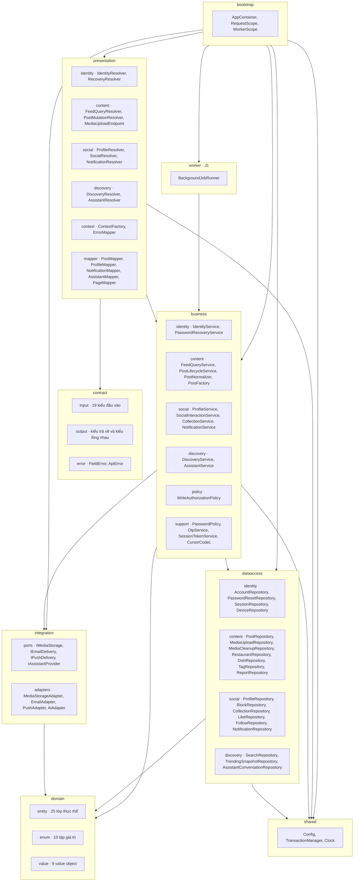
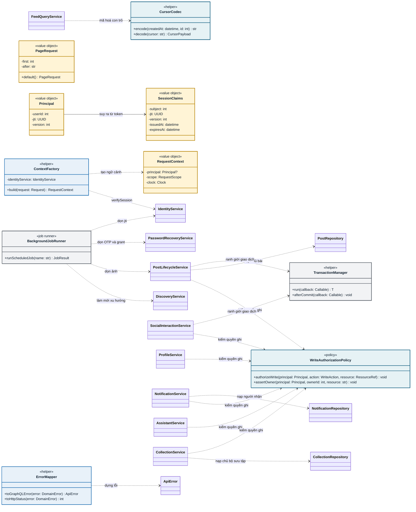

# DOC 6.1-A — Thiết kế lớp Backend

| Dự án | Owner | Reviewer | Approver | Sprint | Phiên bản | Trạng thái |
|---|---|---|---|---|---|---|
| ToMateTo | BE | Lead; DB với ánh xạ thực thể–bảng; FE với kiểu dữ liệu vào/ra | Lead | S5 | 1.1 | Đề nghị review |

**WBS:** 5.1.1 · **Phạm vi:** cấu trúc lớp backend ToMateTo v1.0 — thực thể, lớp nghiệp vụ, lớp truy cập dữ liệu, adapter ngoài, DTO và quan hệ giữa chúng. Không gồm lớp phía ứng dụng khách.

## 1. Mục tiêu, căn cứ và phạm vi

### 1.1 Mục tiêu

Tài liệu chuyển 23 thành phần backend, 42 operation GraphQL và 25 bảng dữ liệu thành các lớp cụ thể mà lập trình viên có thể viết ngay: mỗi lớp có thuộc tính, phương thức, quan hệ và điều kiện sử dụng rõ ràng. Mỗi quyết định trong tài liệu phải lần ngược được tới một thành phần ở DOC 5.1-A/B, một operation ở DOC 5.2-A hoặc một bảng ở DOC 5.3-A; không có lớp nào xuất hiện mà không có nguồn.

### 1.2 Phạm vi và giả định

- **Trong phạm vi:** bốn lớp kiến trúc Presentation, Business, Data Access, External Integration; thực thể ánh xạ lược đồ vật lý; value object và enum dùng chung; DTO cho hợp đồng GraphQL và route upload; cấu hình tiêm phụ thuộc và lớp chạy nền J1.
- **Ngoài phạm vi:** lớp và provider phía ứng dụng khách (WBS 5.1.2), sơ đồ tuần tự (DOC 6.2-A), từ điển dữ liệu và DDL chi tiết (DOC 6.4-A/B), cấu hình hạ tầng.
- **Giả định kỹ thuật:** Python 3.12, Strawberry GraphQL, SQLAlchemy 2.0 **sync** với Psycopg 3, PostgreSQL 16, PyJWT, bcrypt, httpx sync. API dùng một phiên đồng bộ theo request. Worker mở phiên riêng cho từng lần chạy job.
- **Giả định nghiệp vụ:** một người dùng có nhiều phiên; nội dung công khai đọc được bởi khách; mọi thao tác ghi đều qua chính sách kiểm quyền dùng chung.

### 1.3 Input

| Input | Nội dung áp dụng | Dùng ở mục |
|---|---|---|
| DOC 2.3-A — Conceptual ERD | 12 thực thể cốt lõi, quan hệ 1–N, quy tắc xoá dây chuyền | §5.5, §7 |
| DOC 5.1-A/B — Thiết kế thành phần Backend | 23 thành phần P1–P4, J1, B1–B10, D1–D4, X1–X4, cùng hợp đồng và bốn job định kỳ | §3, §4, §5, §9 |
| DOC 5.2-A — Đặc tả API Backend | 42 operation, kiểu đầu vào/đầu ra, mã lỗi, quy tắc upload ảnh và phân quyền theo operation | §4, §5.1, §8 |
| DOC 5.3-A/B — Lược đồ vật lý và đặc tả schema | 25 bảng, kiểu cột, khóa, tập giá trị, quan hệ và ràng buộc | §4, §5.5, §7, §8 |
| DOC 6.2-A — Sơ đồ tuần tự Backend | Đối chiếu chữ ký và phụ thuộc khi đồng bộ luồng đã thiết kế (§5.2.2, §5.3–§5.4) | §4, §5, §9, §10 |

Các quyết định công nghệ (SQLAlchemy 2.0 sync, resolver mỏng, kiểm quyền tại lớp Business) và ràng buộc phi chức năng đã được DOC 5.1-A/B và 5.2-A tiếp nhận; tài liệu này chỉ nhắc lại khi cần truy vết, không mở lại.

### 1.4 Cách đọc tài liệu

- **Ký hiệu thành viên:** `+` công khai, `-` riêng tư, `#` dùng trong lớp kế thừa. Python không có từ khoá truy cập, nên quy ước đặt tiền tố `_` cho thuộc tính riêng tư và chỉ mở qua property.
- **Nhãn lớp:** `<<resolver>>` lớp nhận GraphQL, `<<endpoint>>` route HTTP, `<<service>>` nghiệp vụ, `<<policy>>` quy tắc quyết định dùng chung, `<<repository>>` truy cập dữ liệu, `<<adapter>>` tích hợp ngoài, `<<entity>>` ánh xạ bảng, `<<value object>>` bất biến, `<<enum>>` tập giá trị đóng, `<<mapper>>` chuyển đổi giữa thực thể và DTO, `<<helper>>` lớp hỗ trợ, `<<job runner>>` bộ chạy job theo lịch.
  - `<<enum>>` và `<<mapper>>` **không được vẽ** trong sơ đồ §4; chúng chỉ xuất hiện ở bảng đặc tả §5.6 và §5.1 nên người đọc không tìm hai nhãn này trong hình.
  - `<<policy>>` chỉ dùng ở sơ đồ §4.5 cho `WriteAuthorizationPolicy`.
- **Quan hệ:** `*--` thành phần (sở hữu, xoá theo), `-->` liên kết (tham chiếu), `..>` phụ thuộc (gọi), `..|>` hiện thực giao diện. Bội số ghi ở hai đầu đường nối.
  - Trong §4, phần lớn đường nối là `..>` (gọi) vì hầu hết quan hệ giữa lớp là lời gọi; `-->` và `*--` chiếm phần nhỏ. `..|>` **chưa xuất hiện** trong sơ đồ nào của §4: bốn cổng ngoài được gộp thành một node ở sơ đồ §3, còn quan hệ hiện thực giao diện được nêu ở §2.2 mục 7.
- **Màu trong sơ đồ lớp:** mỗi nhóm vai trò một màu để phân biệt tầng khi nhiều đường nối chồng nhau — Presentation xanh dương, Business xanh mòng két, Data Access cam, Domain/Entity xanh lá, External Integration tím, Value object vàng, worker và hạ tầng xám.
- **Ba loại lớp dữ liệu, không trộn:** thực thể (`<<entity>>`) ánh xạ đúng một bảng, không ra khỏi lớp nghiệp vụ; DTO là kiểu GraphQL ở biên, không chứa quy tắc nghiệp vụ; value object bất biến, tự kiểm tra khi khởi tạo.
- **Mã định danh:** PK số dùng BIGINT (Python `int`); `media_assets.id` và `revoked_tokens.jti` dùng UUID. Biên API chuyển ID sang chuỗi, repository chuyển UUID khi nhận chuỗi từ hợp đồng nội bộ.

## 2. Quy ước thiết kế lớp

### 2.1 Đặt tên

| Hậu tố | Ý nghĩa | Ví dụ |
|---|---|---|
| `Resolver` | Nhận một nhóm operation GraphQL, chuyển input thành lời gọi nghiệp vụ | `PostMutationResolver` |
| `Endpoint` | Nhận route HTTP ngoài GraphQL | `MediaUploadEndpoint` |
| `Service` | Nghiệp vụ của một thành phần B | `PostLifecycleService` |
| `Policy` | Quy tắc quyết định dùng chung | `WriteAuthorizationPolicy` |
| `Repository` | Truy cập một nhóm bảng của một aggregate | `PostRepository` |
| `Adapter` | Cài đặt một cổng tích hợp ngoài | `MediaStorageAdapter` |
| `Mapper` | Chuyển thực thể ↔ DTO, không truy vấn | `PostMapper` |
| `Factory` | Dựng thực thể phức tạp từ dữ liệu đã kiểm | `PostFactory` |
| `Strategy` | Thuật toán thay thế được | `TrendingFeedStrategy` |
| `Input` / `Payload` | DTO vào / DTO ra của hợp đồng | `CreatePostInput`, `AuthPayload` |

Tên lớp dùng danh từ số ít, tiếng Anh; tên phương thức dùng động từ. Enum đặt `UPPER_SNAKE_CASE`, value object đặt theo khái niệm nghiệp vụ (`Location`, `Recipe`, `PageRequest`).

### 2.2 Phân lớp và chiều phụ thuộc

1. Resolver chỉ đọc ngữ cảnh, kiểm tra sự hiện diện của token, gọi đúng một phương thức nghiệp vụ và trả DTO. Resolver **không** mở phiên cơ sở dữ liệu, không dựng câu truy vấn, không quyết định quyền.
2. Service sở hữu quy tắc nghiệp vụ, ranh giới giao dịch và gọi chính sách kiểm quyền trước mọi thao tác ghi. Service không biết GraphQL.
3. Repository chỉ đọc/ghi bảng, nhận và trả thực thể hoặc giá trị đơn giản; không gọi service, không gọi adapter.
4. Adapter chỉ nói chuyện với dịch vụ ngoài, chuyển lỗi nhà cung cấp thành lỗi nội bộ có mã; không quyết định nghiệp vụ.
5. Presentation và worker gọi business. Business gọi data access và các cổng tích hợp. ContextFactory thuộc presentation và gọi B1 để xác thực phiên. Shared chỉ chứa hạ tầng cấp thấp.
6. Service sở hữu giao dịch. Việc tháo ảnh ghi job dọn cùng giao dịch, worker gọi nhà cung cấp sau commit. Push do B7 gửi sau response theo DOC 6.2-A.
7. Chín hợp đồng `I...UseCases` và bốn `I...Store` ở mức thành phần được hiện thực bằng chính lớp service và repository tương ứng, nên tài liệu không vẽ lại: mỗi hợp đồng chỉ có một hiện thực và Python không cần khai báo giao diện để gọi. Bốn cổng ngoài `IMediaStorage`, `IEmailDelivery`, `IPushDelivery`, `IAssistantProvider` vẫn là giao diện thật vì mỗi cổng có ít nhất hai hiện thực: nhà cung cấp thật và bản giả lập khi kiểm thử.

### 2.3 Ánh xạ dữ liệu

| Tình huống | Quy tắc |
|---|---|
| Tên cột khác tên trường API | Thực thể giữ tên cột; mapper đổi sang tên trường hợp đồng (`location_address` → `address`, `location_name` → `restaurantName`, COUNT trên `likes` → `likeCount`) |
| Enum có khác cách viết giữa hai tầng | Chuyển tại biên đọc/ghi. Riêng `PriceRange` dùng cùng mã chữ hoa ở API và DB |
| Cột `NULL` | Value object hoặc trường tùy chọn ở DTO; không thay bằng chuỗi rỗng để tránh lẫn "không có" với "rỗng" |
| Bảng liên kết không có mã riêng | Mô hình hoá thành thực thể liên kết (`PostTag`, `Like`, `CollectionItem`, `Follow`); không dùng danh sách mã trong thực thể cha |
| Dữ liệu JSONB | Bọc trong value object (`SocialLinks`, `PostDraftData`), không truyền `dict` thô qua tầng nghiệp vụ |
| Trường hợp đồng chưa có cột | Ghi ở §10, không tự thêm cột; DTO vẫn nhận trường nhưng tầng lưu không cam kết |

## 3. Sơ đồ gói

| Gói | Nội dung | Số lớp |
|---|---|---|
| `presentation` | 9 resolver, 1 endpoint HTTP, 5 mapper, ContextFactory và ErrorMapper | 17 |
| `contract` | 19 kiểu đầu vào, kiểu trả về trực tiếp và kiểu lồng nhau, 2 kiểu lỗi | xem §8 |
| `business` | 10 service (B1–B9, B6 tách hai lớp), 1 factory, 1 policy, 1 normalizer, 4 lớp hỗ trợ | 17 |
| `dataaccess` | Repository theo nhóm D1–D4 | 20 |
| `integration` | 4 cổng, 4 adapter | 8 |
| `domain` | 25 thực thể, 10 enum, 9 value object | 44 |
| `shared` | Config, TransactionManager, Clock | 3 |
| `worker` | BackgroundJobRunner (J1) | 1 |
| `bootstrap` | AppContainer, RequestScope, WorkerScope | 3 |

Gói con đặt theo domain chứ không theo tầng kỹ thuật, để một thay đổi nghiệp vụ chỉ chạm một nhánh thư mục. `contract` tách khỏi `domain` để thực thể không bị ràng buộc bởi hình dạng GraphQL.

## 4. Sơ đồ lớp theo nhóm thành phần

Năm sơ đồ bám bốn nhóm thành phần và phần dùng chung B10/J1 của DOC 5.1-A/B. Sơ đồ chọn các thuộc tính cần để đọc quan hệ và hành vi. Danh sách cột đầy đủ ở §5.5, DTO ở §8.

### 4.1 Identity & Recovery — P1, B1, B2, D1, X2

```mermaid
classDiagram
    direction LR

    class IdentityResolver {
        <<resolver>>
        -identityService: IdentityService
        +register(input: RegisterInput) AuthPayload
        +login(input: LoginInput) AuthPayload
        +logout() SuccessPayload
        +registerDevice(input: RegisterDeviceInput) SuccessPayload
        +unregisterDevice(input: UnregisterDeviceInput) SuccessPayload
    }

    class RecoveryResolver {
        <<resolver>>
        -recoveryService: PasswordRecoveryService
        +requestPasswordReset(input: RequestPasswordResetInput) AcceptedPayload
        +resendResetOtp(input: ResendResetOtpInput) AcceptedPayload
        +verifyPasswordResetOtp(input: VerifyPasswordResetOtpInput) ResetGrant
        +resetPassword(input: ResetPasswordInput) SuccessPayload
    }

    class IdentityService {
        <<service>>
        +register(input: RegisterInput) AuthResult
        +login(email: str, password: str) AuthResult
        +verifySession(rawToken: str) Principal
        +purgeExpiredRevocations(now: datetime) int
        +logout(principal: Principal) void
        +registerDevice(principal: Principal, token: str, platform: DevicePlatform) void
        +unregisterDevice(principal: Principal, token: str) void
        +createDefaultCollection(userId: int) Collection
    }

    class PasswordRecoveryService {
        <<service>>
        +requestReset(email: str) AcceptedResult
        +resendOtp(email: str) AcceptedResult
        +verifyOtp(email: str, code: str) ResetGrantResult
        +resetPassword(token: str, newPassword: str, confirm: str) void
        +purgeExpiredResetRequests(now: datetime) int
    }

    class SessionTokenService {
        <<helper>>
        +issue(user: User) SessionToken
        +parse(raw: str) SessionClaims
    }

    class OtpService {
        <<helper>>
        +generate() str
        +hash(code: str) str
        +verify(code: str, stored: str) bool
    }

    class AccountRepository {
        <<repository>>
        +findById(userId: int, forUpdate: bool=false) User?
        +findByEmail(email: str) User?
        +getTokenVersion(userId: int) int
        +bumpTokenVersion(userId: int) int
        +save(user: User) User
        +updatePassword(userId: int, passwordHash: str) void
    }

    class PasswordResetRepository {
        <<repository>>
        +create(request: PasswordReset) PasswordReset
        +findLatestByEmail(email: str, forUpdate: bool=false) PasswordReset?
        +findByGrantHash(hash: str) PasswordReset?
        +invalidateOpenForUser(userId: int) int
        +purgeExpired(now: datetime) int
        +save(request: PasswordReset) void
        +consume(requestId: int, grantHash: str, now: datetime) bool
    }

    class SessionRepository {
        <<repository>>
        +revoke(jti: UUID, userId: int, expiresAt: datetime) void
        +isRevoked(jti: UUID) bool
        +prune(now: datetime) int
    }

    class DeviceRepository {
        <<repository>>
        +save(device: UserDevice) UserDevice
        +remove(userId: int, token: str) void
        +listByUser(userId: int) UserDevice[]
    }

    class EmailAdapter {
        <<adapter>>
        +sendResetCode(email: str, code: str) void
    }

    class User {
        <<entity>>
        -id: int
        -email: str
        -emailNormalized: str
        -username: str?
        -usernameNormalized: str?
        -passwordHash: str
        -displayName: str
        -publicProfileFields: str[]
        -avatarMediaId: UUID?
        -coverMediaId: UUID?
        -tokenVersion: int
        -isActive: bool
        -updatedAt: datetime
        +changePassword(passwordHash: str) void
    }

    class PasswordReset {
        <<entity>>
        -id: int
        -userId: int
        -otpHash: str
        -failedAttempts: int
        -otpExpiresAt: datetime
        -verifiedAt: datetime?
        -invalidatedAt: datetime?
        -resetTokenHash: str?
        -resetExpiresAt: datetime?
        -consumedAt: datetime?
        +registerFailedAttempt() void
        +isOtpValid(now: datetime) bool
        +consume(now: datetime) void
    }

    class RevokedToken {
        <<entity>>
        -jti: UUID
        -userId: int
        -expiresAt: datetime
        -revokedAt: datetime
        +isActive(now: datetime) bool
    }

    class UserDevice {
        <<entity>>
        -id: int
        -userId: int
        -pushToken: str
        -platform: DevicePlatform
        -lastActiveAt: datetime
        +belongsTo(userId: int) bool
        +touch(now: datetime) void
    }

    IdentityResolver ..> IdentityService : gọi
    RecoveryResolver ..> PasswordRecoveryService : gọi
    IdentityService ..> TransactionManager : đăng ký trong giao dịch
    IdentityService ..> CollectionRepository : tạo bộ mặc định
    IdentityService ..> AccountRepository : đọc/ghi tài khoản
    IdentityService ..> SessionRepository : thu hồi phiên
    IdentityService ..> DeviceRepository : thiết bị
    IdentityService ..> SessionTokenService : cấp và đọc token
    IdentityService ..> PasswordPolicy : kiểm mật khẩu
    PasswordRecoveryService ..> PasswordResetRepository : OTP và grant
    PasswordRecoveryService ..> AccountRepository : đổi mật khẩu
    PasswordRecoveryService ..> EmailAdapter : gửi mã
    PasswordRecoveryService ..> OtpService : sinh/kiểm mã
    AccountRepository ..> User : ánh xạ
    PasswordResetRepository ..> PasswordReset : ánh xạ
    SessionRepository ..> RevokedToken : ánh xạ
    DeviceRepository ..> UserDevice : ánh xạ
    User "1" --> "0..*" PasswordReset : yêu cầu theo user_id
    User "1" --> "0..*" RevokedToken : thu hồi
    User "1" --> "0..*" UserDevice : đăng ký
    %% Mau theo nhom vai tro — xem §1.4
    class IdentityResolver:::pres
    class RecoveryResolver:::pres
    class IdentityService:::bus
    class PasswordRecoveryService:::bus
    class SessionTokenService:::bus
    class OtpService:::bus
    class AccountRepository:::data
    class PasswordResetRepository:::data
    class SessionRepository:::data
    class DeviceRepository:::data
    class User:::dom
    class PasswordReset:::dom
    class RevokedToken:::dom
    class UserDevice:::dom
    class EmailAdapter:::ext
    classDef pres fill:#E8F1F9,stroke:#1F6FB2,stroke-width:2px,color:#101F2E
    classDef bus fill:#E6F2F5,stroke:#156082,stroke-width:2px,color:#101F2E
    classDef data fill:#FDEEE6,stroke:#E97132,stroke-width:2px,color:#101F2E
    classDef dom fill:#E8F3E9,stroke:#196B24,stroke-width:2px,color:#101F2E
    classDef ext fill:#F0EBF7,stroke:#7B4FA8,stroke-width:2px,color:#101F2E
```

`PasswordReset` liên kết với `User` qua email chứ không qua khoá ngoại, đúng như bảng `password_resets`; repository phải chuẩn hoá email trước khi so khớp. `SessionTokenService` là nơi duy nhất đọc/ghi nội dung token, không lớp nào khác giải mã JWT.

### 4.2 Content & Posts — P2, B3, B4, D2, X1

```mermaid
classDiagram
    direction LR

    class FeedQueryResolver {
        <<resolver>>
        -feedService: FeedQueryService
        +feed(mode: FeedMode, page: PageInput) PostConnection
        +post(id: ID) Post
    }

    class PostMutationResolver {
        <<resolver>>
        -postService: PostLifecycleService
        -socialService: SocialInteractionService
        +createPost(input: CreatePostInput) Post
        +updatePost(id: ID, input: UpdatePostInput) Post
        +deletePost(id: ID) SuccessPayload
        +reportPost(postId: ID, reason: str) ReportReceipt
    }

    class MediaUploadEndpoint {
        <<endpoint>>
        -postService: PostLifecycleService
        +upload(file: UploadFile, purpose: UploadPurpose) MediaUploadPayload
    }

    class FeedQueryService {
        <<service>>
        +listFeed(mode: FeedMode, page: PageRequest, viewer: Principal?) PageResult
        +getPost(postId: int, viewer: Principal) Post
        +listPostsByAuthor(authorId: int, page: PageRequest, viewer: Principal) PageResult
    }

    class PostLifecycleService {
        <<service>>
        +createPost(input: CreatePostInput, principal: Principal) Post
        +updatePost(postId: int, input: UpdatePostInput, principal: Principal) Post
        +deletePost(postId: int, principal: Principal) void
        +uploadMedia(file: UploadFile, purpose: UploadPurpose, principal: Principal) MediaUpload
        +cleanupOrphanMedia(now: datetime) int
    }

    class PostNormalizer {
        <<helper>>
        +resolveDish(rawName: str) Dish
        +resolveRestaurant(name: str, address: str) Restaurant
        +buildRecipe(input: RecipeInput) Recipe
    }

    class PostFactory {
        <<helper>>
        +create(input: CreatePostInput, author: User, dish: Dish) Post
    }

    class PostRepository {
        <<repository>>
        +save(post: Post) Post
        +update(post: Post) Post
        +delete(postId: int) void
        +findById(postId: int, forUpdate: bool=false) Post?
        +listFeed(mode: FeedMode, page: PageRequest, viewerId: int?, blockedUserIds: int[]) PageResult
        +listByAuthor(authorId: int, page: PageRequest, viewerId: int) PageResult
        +replaceImages(postId: int, images: PostImage[]) void
        +findImage(postId: int, imageId: int) PostImage?
    }

    class MediaUploadRepository {
        <<repository>>
        +create(upload: MediaUpload) MediaUpload
        +findById(uploadId: str) MediaUpload?
        +consume(uploadId: str, ownerId: int, purpose: UploadPurpose, now: datetime) MediaUpload
        +markDeleted(assetId: UUID, now: datetime) void
        +listExpired(now: datetime) MediaUpload[]
    }

    class MediaCleanupRepository {
        <<repository>>
        +enqueue(assetIds: str[]) CleanupJob[]
        +listDue(now: datetime, limit: int) CleanupJob[]
        +markCompleted(jobId: int, now: datetime) void
        +recordFailure(jobId: int, nextAttemptAt: datetime, errorCode: str) void
    }

    class RestaurantRepository {
        <<repository>>
        +findById(restaurantId: int) Restaurant
        +findByNameNormalized(name: str) Restaurant?
        +upsert(name: str, address: str) Restaurant
    }

    class DishRepository {
        <<repository>>
        +findByNameNormalized(name: str) Dish?
        +findById(dishId: int) Dish?
        +upsert(name: str) Dish
    }

    class TagRepository {
        <<repository>>
        +findOrCreateMany(names: str[]) Tag[]
        +listByPost(postId: int) Tag[]
    }

    class ReportRepository {
        <<repository>>
        +save(report: Report) Report
        +exists(reporterId: int, originalPostId: int) bool
    }

    class MediaStorageAdapter {
        <<adapter>>
        +validate(file: UploadFile) void
        +store(file: UploadFile, purpose: UploadPurpose) StoredMedia
        +remove(storageKey: str) void
    }

    class Post {
        <<entity>>
        -id: int
        -userId: int
        -dishId: int
        -caption: str?
        -feeling: str?
        -priceRange: PriceRange?
        -isHidden: bool
        +assertEditableBy(principal: Principal) void
        +applyRecipe(recipe: Recipe) void
        +hide() void
    }

    class PostImage {
        <<entity>>
        -id: int
        -postId: int
        -mediaId: UUID
        -position: int
    }

    class Report {
        <<entity>>
        -id: int
        -reporterId: int
        -postId: int?
        -originalPostId: int
        -reason: str
        -evidenceSnapshot: dict
    }

    class CleanupJob {
        <<entity>>
        -id: int
        -mediaId: UUID
        -nextAttemptAt: datetime
        -attempts: int
        -completedAt: datetime?
        -lastErrorCode: str?
    }

    class PostTag {
        <<entity>>
        -postId: int
        -tagId: int
    }

    class MediaUpload {
        <<entity>>
        -id: UUID
        -ownerId: int
        -purpose: UploadPurpose
        -state: MediaState
        -provider: str
        -storageKey: str
        -url: str
        -inputSizeBytes: int
        -storedSizeBytes: int
        -mimeType: str
        -expiresAt: datetime
        -consumedAt: datetime?
        -deletedAt: datetime?
        +isExpired(now: datetime) bool
        +consume(ownerId: int, purpose: UploadPurpose, now: datetime) void
    }

    FeedQueryResolver ..> FeedQueryService : gọi
    PostMutationResolver ..> PostLifecycleService : tạo/sửa/xóa
    PostMutationResolver ..> SocialInteractionService : báo cáo bài (B6, xem §4.3)
    MediaUploadEndpoint ..> PostLifecycleService : gọi
    FeedQueryService ..> PostRepository : đọc bài
    FeedQueryService ..> LikeRepository : đọc lượt thích
    FeedQueryService ..> CollectionRepository : đọc trạng thái lưu
    FeedQueryService ..> BlockRepository : lọc bài theo viewer
    PostLifecycleService ..> PostRepository : ghi
    PostLifecycleService ..> MediaUploadRepository : tiêu thụ upload
    PostLifecycleService ..> MediaCleanupRepository : xếp hàng dọn ảnh
    PostLifecycleService ..> AccountRepository : nạp tác giả
    PostLifecycleService ..> PostFactory : dựng thực thể
    PostLifecycleService ..> PostNormalizer : chuẩn hoá món và quán
    PostLifecycleService ..> MediaStorageAdapter : lưu/xoá ảnh
    PostLifecycleService ..> WriteAuthorizationPolicy : kiểm quyền
    PostNormalizer ..> DishRepository : tra cứu món
    PostNormalizer ..> RestaurantRepository : tra cứu quán
    PostRepository ..> Post : ánh xạ
    PostRepository ..> PostImage : quản lý ảnh
    PostRepository ..> PostTag : quản lý thẻ
    MediaUploadRepository ..> MediaUpload : ánh xạ
    MediaCleanupRepository ..> CleanupJob : ánh xạ
    ReportRepository ..> Report : ánh xạ
    PostImage "0..1" --> "1" MediaUpload : media_id
    CleanupJob "0..1" --> "1" MediaUpload : media_id
    Report "0..*" --> "0..1" Post : post_id
    Post "1" *-- "0..*" PostImage : chứa ảnh
    Post "1" *-- "0..*" PostTag : gắn thẻ
    Post --> Dish : thuộc một món
    Post --> Restaurant : gắn quán tùy chọn
    %% Mau theo nhom vai tro — xem §1.4
    class FeedQueryResolver:::pres
    class PostMutationResolver:::pres
    class MediaUploadEndpoint:::pres
    class FeedQueryService:::bus
    class PostLifecycleService:::bus
    class SocialInteractionService:::bus
    class PostNormalizer:::bus
    class PostFactory:::bus
    class PostRepository:::data
    class MediaUploadRepository:::data
    class MediaCleanupRepository:::data
    class RestaurantRepository:::data
    class DishRepository:::data
    class TagRepository:::data
    class ReportRepository:::data
    class Post:::dom
    class PostImage:::dom
    class Report:::dom
    class CleanupJob:::dom
    class PostTag:::dom
    class MediaUpload:::dom
    class MediaStorageAdapter:::ext
    classDef pres fill:#E8F1F9,stroke:#1F6FB2,stroke-width:2px,color:#101F2E
    classDef bus fill:#E6F2F5,stroke:#156082,stroke-width:2px,color:#101F2E
    classDef data fill:#FDEEE6,stroke:#E97132,stroke-width:2px,color:#101F2E
    classDef dom fill:#E8F3E9,stroke:#196B24,stroke-width:2px,color:#101F2E
    classDef ext fill:#F0EBF7,stroke:#7B4FA8,stroke-width:2px,color:#101F2E
```

`PostTag` không có mã riêng: khoá chính là cặp `(post_id, tag_id)`, nên repository thao tác theo cặp và không trả về mã giả. `ReportRepository` phục vụ `reportPost` của P2 dù nghiệp vụ báo cáo thuộc B6; lớp nằm trong D2 vì cùng aggregate nội dung, còn quyết định quyền và chống trùng nằm ở B6.

### 4.3 Profile & Social — P3, B5, B6, B7, D3, X3

```mermaid
classDiagram
    direction LR

    class ProfileResolver {
        <<resolver>>
        -profileService: ProfileService
        +profile(userId: ID) Profile
        +myProfile() Profile
        +profilePosts(userId: ID, page: PageInput) PostConnection
        +myPosts(page: PageInput) PostConnection
        +updateProfile(input: UpdateProfileInput) Profile
        +setProfileVisibility(fields: str[]) VisibilityPayload
    }

    class SocialResolver {
        <<resolver>>
        -socialService: SocialInteractionService
        +setLike(postId: ID, liked: bool) LikeState
        +savePost(postId: ID, collectionId: ID?) SaveState
        +removeSavedPost(postId: ID, collectionId: ID?) SaveState
        +myCollections(page: PageInput) CollectionConnection
        +collectionItems(collectionId: ID, page: PageInput) PostConnection
        +createCollection(input: CollectionInput) Collection
        +renameCollection(input: RenameCollectionInput) Collection
        +deleteCollection(collectionId: ID) SuccessPayload
        +setFollow(userId: ID, followed: bool) FollowState
    }

    class NotificationResolver {
        <<resolver>>
        -notificationService: NotificationService
        +notifications(page: PageInput) NotificationConnection
        +markNotificationRead(id: ID) NotificationReadPayload
        +markAllNotificationsRead() NotificationReadPayload
    }

    class ProfileService {
        <<service>>
        +getProfile(userId: int, viewer: Principal) ProfileData
        +updateProfile(input: UpdateProfileInput, principal: Principal) User
        +setProfileVisibility(fields: str[], principal: Principal) str[]
    }

    class SocialInteractionService {
        <<service>>
        +setLike(postId: int, liked: bool, principal: Principal) LikeStateData
        +savePost(postId: int, collectionId: int?, principal: Principal) SaveStateData
        +removeSavedPost(postId: int, collectionId: int?, principal: Principal) SaveStateData
        +setFollow(userId: int, followed: bool, principal: Principal) FollowStateData
        +reportPost(postId: int, reason: str, principal: Principal) ReportReceiptData
    }

    class CollectionService {
        <<service>>
        +create(name: str, principal: Principal) Collection
        +rename(collectionId: int, name: str, principal: Principal) Collection
        +delete(collectionId: int, principal: Principal) void
        +addItem(collectionId: int, postId: int, principal: Principal) void
        +removeItem(collectionId: int, postId: int, principal: Principal) void
        +listCollections(principal: Principal, page: PageRequest) PageResult
        +listCollectionItems(collectionId: int, page: PageRequest, principal: Principal) PageResult
    }

    class NotificationService {
        <<service>>
        +listNotifications(userId: int, page: PageRequest) NotificationPage
        +markRead(notificationId: int, principal: Principal) int
        +markAllRead(principal: Principal) int
        +create(event: NotificationEvent) Notification
        +requestPush(notification: Notification) void
    }

    class ProfileRepository {
        <<repository>>
        +findById(userId: int) User
        +updateProfile(userId: int, changes: ProfileChanges) void
    }

    class CollectionRepository {
        <<repository>>
        +listByUser(userId: int, page: PageRequest) PageResult
        +listItems(collectionId: int, page: PageRequest, viewerId: int, blockedUserIds: int[]) PageResult
        +findOwnerId(collectionId: int) int?
        +findById(collectionId: int) Collection?
        +findDefault(userId: int) Collection
        +create(collection: Collection) Collection
        +rename(collectionId: int, name: str) void
        +delete(collectionId: int) void
        +addItem(collectionId: int, postId: int) void
        +removeItem(collectionId: int, postId: int) void
        +existsName(userId: int, name: str) bool
    }

    class LikeRepository {
        <<repository>>
        +setState(userId: int, postId: int, liked: bool) bool
        +isLiked(userId: int, postId: int) bool
        +countByPost(postId: int) int
    }

    class BlockRepository {
        <<repository>>
        +listBlockedUserIds(viewerId: int) int[]
    }

    class FollowRepository {
        <<repository>>
        +setState(followerId: int, followeeId: int, followed: bool) bool
        +isFollowing(followerId: int, followeeId: int) bool
    }

    class NotificationRepository {
        <<repository>>
        +listByUser(userId: int, page: PageRequest) PageResult
        +unreadCount(userId: int) int
        +findRecipientId(notificationId: int) int?
        +markRead(notificationId: int, userId: int) void
        +markAllRead(userId: int) int
        +save(notification: Notification) Notification
    }

    class PushAdapter {
        <<adapter>>
        +send(message: PushMessage) void
    }

    class Collection {
        <<entity>>
        -id: int
        -userId: int
        -name: str
        -nameNormalized: str
        -isDefault: bool
        +rename(name: str) void
        +assertDeletable() void
    }

    class CollectionItem {
        <<entity>>
        -collectionId: int
        -postId: int
        -addedAt: datetime
    }

    class Like {
        <<entity>>
        -userId: int
        -postId: int
        -createdAt: datetime
    }

    class UserBlock {
        <<entity>>
        -blockerId: int
        -blockedId: int
        -createdAt: datetime
    }

    class Follow {
        <<entity>>
        -followerId: int
        -followeeId: int
        +assertNotSelf() void
    }

    class Notification {
        <<entity>>
        -id: int
        -userId: int
        -actorId: int?
        -postId: int?
        -type: NotificationType
        -readAt: datetime?
        +markRead(now: datetime) void
    }

    ProfileResolver ..> ProfileService : gọi
    ProfileResolver ..> FeedQueryService : đọc bài của hồ sơ
    SocialResolver ..> SocialInteractionService : gọi
    SocialResolver ..> CollectionService : gọi
    NotificationResolver ..> NotificationService : gọi
    ProfileService ..> ProfileRepository : hồ sơ
    ProfileService ..> MediaUploadRepository : ảnh đại diện/bìa
    SocialInteractionService ..> LikeRepository : lượt thích
    SocialInteractionService ..> ProfileRepository : nạp tài khoản đích
    SocialInteractionService ..> FollowRepository : theo dõi
    SocialInteractionService ..> NotificationService : tạo thông báo
    SocialInteractionService ..> PostRepository : kiểm bài tồn tại
    SocialInteractionService ..> CollectionRepository : chọn bộ lưu
    SocialInteractionService ..> ReportRepository : ghi báo cáo
    CollectionService ..> CollectionRepository : bộ sưu tập và mục đã lưu
    CollectionService ..> BlockRepository : lọc trước phân trang
    NotificationService ..> NotificationRepository : thông báo
    NotificationService ..> DeviceRepository : đọc thiết bị
    NotificationService ..> PushAdapter : đẩy thiết bị
    ProfileRepository ..> User : hồ sơ
    CollectionRepository ..> Collection : ánh xạ
    CollectionRepository ..> CollectionItem : mục lưu
    LikeRepository ..> Like : ánh xạ
    FollowRepository ..> Follow : ánh xạ
    NotificationRepository ..> Notification : ánh xạ
    User "1" --> "0..*" Collection : sở hữu
    Collection "1" *-- "0..*" CollectionItem : chứa
    User "1" --> "0..*" Like : thực hiện
    User "1" --> "0..*" Follow : theo dõi
    User "1" --> "0..*" Notification : nhận
    BlockRepository ..> UserBlock : ánh xạ
    User "1" --> "0..*" UserBlock : blocker hoặc blocked
    %% Mau theo nhom vai tro — xem §1.4
    class ProfileResolver:::pres
    class SocialResolver:::pres
    class NotificationResolver:::pres
    class ProfileService:::bus
    class SocialInteractionService:::bus
    class CollectionService:::bus
    class NotificationService:::bus
    class ProfileRepository:::data
    class CollectionRepository:::data
    class LikeRepository:::data
    class BlockRepository:::data
    class FollowRepository:::data
    class NotificationRepository:::data
    class Collection:::dom
    class CollectionItem:::dom
    class Like:::dom
    class UserBlock:::dom
    class Follow:::dom
    class Notification:::dom
    class PushAdapter:::ext
    classDef pres fill:#E8F1F9,stroke:#1F6FB2,stroke-width:2px,color:#101F2E
    classDef bus fill:#E6F2F5,stroke:#156082,stroke-width:2px,color:#101F2E
    classDef data fill:#FDEEE6,stroke:#E97132,stroke-width:2px,color:#101F2E
    classDef dom fill:#E8F3E9,stroke:#196B24,stroke-width:2px,color:#101F2E
    classDef ext fill:#F0EBF7,stroke:#7B4FA8,stroke-width:2px,color:#101F2E
```

`CollectionService` tách khỏi `SocialInteractionService` vì bộ sưu tập có vòng đời riêng (tạo, đổi tên, xoá, thêm/bớt mục) và giới hạn "không xoá bộ mặc định" chỉ áp dụng cho nhóm này. Cả hai đều thuộc P3/B6.

### 4.4 Discovery & Assistant — P4, B8, B9, D4, X4

```mermaid
classDiagram
    direction LR

    class DiscoveryResolver {
        <<resolver>>
        -discoveryService: DiscoveryService
        +search(query: str, type: SearchType, page: PageInput) SearchConnection
        +trending(page: PageInput) TrendingConnection
        +nearbyPlaces(location: LocationInput) NearbyPlacesResult
        +randomDish() DishSuggestion
    }

    class AssistantResolver {
        <<resolver>>
        -assistantService: AssistantService
        +askAssistant(input: AskAssistantInput) AssistantReply
        +retryAssistant(input: AssistantRetryInput) AssistantReply
        +assistantSessions(page: PageInput) AssistantSessionConnection
        +assistantHistory(sessionId: ID, page: PageInput) AssistantMessageConnection
        +useAssistantDraft(messageId: ID) AssistantDraft
    }

    class DiscoveryService {
        <<service>>
        +search(query: str, type: SearchType, page: PageRequest, viewer: Principal) SearchPage
        +getTrending(page: PageRequest, viewer: Principal) TrendingPage
        +getNearbyRestaurants(location: Location, viewer: Principal) NearbyResult
        +chooseRandomDish() DishSuggestionData
        +refreshTrendingSnapshot(now: datetime) int
    }

    class AssistantService {
        <<service>>
        +ask(input: AskAssistantInput, principal: Principal) AssistantReplyData
        +retry(messageId: int, principal: Principal) AssistantReplyData
        +listSessions(page: PageRequest, principal: Principal) PageResult
        +getHistory(sessionId: int, page: PageRequest, principal: Principal) PageResult
        +createPostDraft(messageId: int, principal: Principal) PostDraftData
        +validateReferences(candidate: AssistantReplyData, viewer: Principal) AssistantReplyData
        +buildFallback(context: PromptContext) AssistantReplyData
    }

    class SearchRepository {
        <<repository>>
        +searchDishes(query: str, page: PageRequest) PageResult
        +searchRestaurants(query: str, page: PageRequest) PageResult
        +searchPosts(query: str, page: PageRequest, viewerId: int) PageResult
        +findNearby(location: Location, radiusMeters: int) Restaurant[]
        +listTrendingDishes(limit: int) Dish[]
    }

    class TrendingSnapshotRepository {
        <<repository>>
        +latestRun() TrendingRun?
        +listDishes(runId: int, page: PageRequest) PageResult
        +publish(run: TrendingRun, posts: TrendingPostSnapshot[], dishes: TrendingDishSnapshot[], tags: TrendingTagSnapshot[]) TrendingRun
    }

    class AssistantConversationRepository {
        <<repository>>
        +createSession(userId: int, context: dict) ChatSession
        +findSession(sessionId: int, ownerId: int) ChatSession?
        +listSessions(userId: int, page: PageRequest) PageResult
        +saveMessage(message: ChatMessage) ChatMessage
        +listMessages(sessionId: int, page: PageRequest) PageResult
        +findMessage(messageId: int, ownerId: int) ChatMessage?
        +claimReply(userMessageId: int, now: datetime, leaseSeconds: int) ClaimResult
        +completeReply(replyId: int, processingVersion: int, result: AssistantReplyData, now: datetime) bool
    }

    class AiAdapter {
        <<adapter>>
        +complete(context: PromptContext) AiCompletion
    }

    class ChatSession {
        <<entity>>
        -id: int
        -userId: int
        -contextJson: dict
        -endedAt: datetime
        +isOwnedBy(userId: int) bool
        +close(now: datetime) void
    }

    class ChatMessage {
        <<entity>>
        -id: int
        -sessionId: int
        -replyToId: int?
        -role: ChatRole
        -content: str
        -status: ChatStatus
        -postDraft: PostDraftData?
        -processingVersion: int
        -processingExpiresAt: datetime?
        +toDraft() PostDraftData?
    }

    class TrendingRun {
        <<entity>>
        -id: int
        -windowStart: datetime
        -windowEnd: datetime
        -formulaVersion: str
        -publishedAt: datetime
    }

    class TrendingPostSnapshot {
        <<entity>>
        -runId: int
        -postId: int
        -score: Decimal
    }

    class TrendingTagSnapshot {
        <<entity>>
        -runId: int
        -tagId: int
        -score: Decimal
    }

    class TrendingDishSnapshot {
        <<entity>>
        -runId: int
        -dishId: int
        -score: Decimal
    }

    DiscoveryResolver ..> DiscoveryService : gọi
    AssistantResolver ..> AssistantService : gọi
    DiscoveryService ..> SearchRepository : tìm kiếm
    DiscoveryService ..> BlockRepository : lọc dữ liệu theo viewer
    DiscoveryService ..> TrendingSnapshotRepository : xu hướng
    AssistantService ..> AssistantConversationRepository : phiên/lịch sử
    AssistantService ..> AiAdapter : gọi mô hình
    AssistantService ..> BlockRepository : lọc dữ liệu theo viewer
    AssistantService ..> PostRepository : xác minh bài công khai
    AssistantService ..> DishRepository : xác minh món
    AssistantService ..> RestaurantRepository : xác minh quán
    AssistantService ..> WriteAuthorizationPolicy : kiểm quyền
    SearchRepository ..> Dish : đọc
    SearchRepository ..> Restaurant : đọc
    TrendingSnapshotRepository ..> TrendingRun : công bố
    TrendingRun "1" *-- "0..*" TrendingDishSnapshot : điểm món
    TrendingRun "1" *-- "0..*" TrendingPostSnapshot : điểm bài
    TrendingRun "1" *-- "0..*" TrendingTagSnapshot : điểm thẻ
    AssistantConversationRepository ..> ChatSession : ánh xạ
    AssistantConversationRepository ..> ChatMessage : ánh xạ
    ChatSession "1" *-- "0..*" ChatMessage : chứa
    User "1" --> "0..*" ChatSession : mở phiên
    Dish "1" --> "0..*" TrendingDishSnapshot : thống kê
    %% Mau theo nhom vai tro — xem §1.4
    class DiscoveryResolver:::pres
    class AssistantResolver:::pres
    class DiscoveryService:::bus
    class AssistantService:::bus
    class SearchRepository:::data
    class TrendingSnapshotRepository:::data
    class AssistantConversationRepository:::data
    class ChatSession:::dom
    class ChatMessage:::dom
    class TrendingRun:::dom
    class TrendingPostSnapshot:::dom
    class TrendingTagSnapshot:::dom
    class TrendingDishSnapshot:::dom
    class AiAdapter:::ext
    classDef pres fill:#E8F1F9,stroke:#1F6FB2,stroke-width:2px,color:#101F2E
    classDef bus fill:#E6F2F5,stroke:#156082,stroke-width:2px,color:#101F2E
    classDef data fill:#FDEEE6,stroke:#E97132,stroke-width:2px,color:#101F2E
    classDef dom fill:#E8F3E9,stroke:#196B24,stroke-width:2px,color:#101F2E
    classDef ext fill:#F0EBF7,stroke:#7B4FA8,stroke-width:2px,color:#101F2E
```

`SearchRepository` đọc chéo ba bảng nên không thuộc về một aggregate duy nhất; đây là repository chỉ đọc, không có phương thức ghi. `TrendingSnapshotRepository` chỉ đọc bản chụp mới nhất và ghi theo lô trong job, không cập nhật từng dòng.

### 4.5 Kiểm quyền, tiến trình nền và lớp hỗ trợ — B10, J1

B4, B6 và B7 nạp dữ liệu quyền từ `PostRepository`, `CollectionRepository` và `NotificationRepository` tương ứng. Service truyền `ResourceRef` và `Principal` đã xác thực để B10 quyết định. J1 chỉ gọi service nghiệp vụ theo lịch ở §9.

## 5. Đặc tả lớp

Các bảng dưới đây tóm tắt lớp, phương thức chính và phụ thuộc. Chữ ký chi tiết của các lớp chính nằm ở §4. Lớp thực thể mô tả thuộc tính và phương thức nghiệp vụ; DTO chỉ mô tả kiểu và mục đích, trường chi tiết giữ nguyên theo hợp đồng ở DOC 5.2-A và được ánh xạ ở §8.

### 5.1 Lớp giao tiếp (Presentation)

| Lớp | Thành phần | Phương thức | Dịch vụ gọi | Ghi chú |
|---|---|---|---|---|
| `IdentityResolver` | P1 | `+register`, `+login`, `+logout`, `+registerDevice`, `+unregisterDevice` | `IdentityService` | Không trả email của người khác; lỗi đăng nhập dùng chung một thông báo |
| `RecoveryResolver` | P1 | `+requestPasswordReset`, `+resendResetOtp`, `+verifyPasswordResetOtp`, `+resetPassword` | `PasswordRecoveryService` | Luôn trả `accepted` như nhau dù email tồn tại hay không |
| `FeedQueryResolver` | P2 | `+feed`, `+post` | `FeedQueryService` | `post` trả `null` khi không được xem, không tiết lộ lý do |
| `PostMutationResolver` | P2 | `+createPost`, `+updatePost`, `+deletePost`, `+reportPost` | `PostLifecycleService`, `SocialInteractionService` | `reportPost` chuyển tiếp sang B6 theo phân công của DOC 5.1-A/B |
| `MediaUploadEndpoint` | P2 | `+upload(file, purpose)` | `PostLifecycleService` | Route HTTP riêng ngoài GraphQL; bắt buộc token; một tệp mỗi request |
| `ProfileResolver` | P3 | `+profile`, `+myProfile`, `+profilePosts`, `+myPosts`, `+updateProfile`, `+setProfileVisibility` | `ProfileService`, `FeedQueryService` | Bài của hồ sơ đọc qua B3, không tự truy vấn |
| `SocialResolver` | P3 | `+setLike`, `+savePost`, `+removeSavedPost`, `+myCollections`, `+collectionItems`, `+createCollection`, `+renameCollection`, `+deleteCollection`, `+setFollow` | `SocialInteractionService`, `CollectionService` | Hai query bộ sưu tập gọi B6. Mutation thích/lưu nhận trạng thái đích |
| `NotificationResolver` | P3 | `+notifications`, `+markNotificationRead`, `+markAllNotificationsRead` | `NotificationService` | `notifications` trả kèm tổng chưa đọc |
| `DiscoveryResolver` | P4 | `+search`, `+trending`, `+nearbyPlaces`, `+randomDish` | `DiscoveryService` | `nearbyPlaces` dùng vị trí mặc định khi thiếu quyền |
| `AssistantResolver` | P4 | `+askAssistant`, `+retryAssistant`, `+assistantSessions`, `+assistantHistory`, `+useAssistantDraft` | `AssistantService` | Mỗi lượt có trần thời gian. Trả `FALLBACK` khi có kết quả dự phòng hợp lệ, `FAILED` khi thiếu kết quả |

Năm mapper không có bảng riêng vì không chứa quy tắc: `PostMapper` (thực thể → `Post`, gồm ảnh và cờ người xem), `ProfileMapper`, `NotificationMapper` (dùng `actorId`, `postId` và `readAt`), `AssistantMapper` (đọc `post_draft`, `toDraft(data: PostDraftData): AssistantDraft`), `PageMapper` (dựng connection và con trỏ).

### 5.2 Lớp nghiệp vụ (Business)

| Lớp | Thành phần | Phương thức chính | Phụ thuộc |
|---|---|---|---|
| `IdentityService` | B1 | `+register`, `+login`, `+logout`, `+verifySession(rawToken: str): Principal`, `+registerDevice`, `+unregisterDevice`, `+createDefaultCollection`, `+purgeExpiredRevocations(now: datetime): int` | `AccountRepository`, `SessionRepository`, `DeviceRepository`, `SessionTokenService`, `PasswordPolicy`, `CollectionRepository`, `TransactionManager` |
| `PasswordRecoveryService` | B2 | `+requestReset`, `+resendOtp`, `+verifyOtp`, `+resetPassword`, `+purgeExpiredResetRequests(now: datetime): int` | `PasswordResetRepository`, `AccountRepository`, `OtpService`, `PasswordPolicy`, `EmailAdapter`, `TransactionManager` |
| `FeedQueryService` | B3 | `+listFeed`, `+getPost`, `+listPostsByAuthor` | `PostRepository`, `LikeRepository`, `CollectionRepository`, `BlockRepository`, `CursorCodec` |
| `PostLifecycleService` | B4 | `+createPost`, `+updatePost`, `+deletePost`, `+uploadMedia`, `+cleanupOrphanMedia` | `PostRepository`, `MediaUploadRepository`, `MediaCleanupRepository`, `AccountRepository`, `PostFactory`, `PostNormalizer`, `MediaStorageAdapter`, `WriteAuthorizationPolicy`, `TransactionManager` |
| `ProfileService` | B5 | `+getProfile`, `+updateProfile`, `+setProfileVisibility` | `ProfileRepository`, `MediaUploadRepository`, `WriteAuthorizationPolicy` |
| `SocialInteractionService` | B6 | `+setLike`, `+savePost`, `+removeSavedPost`, `+setFollow`, `+reportPost` | `LikeRepository`, `CollectionRepository`, `FollowRepository`, `ProfileRepository`, `PostRepository`, `ReportRepository`, `NotificationService`, `WriteAuthorizationPolicy` |
| `CollectionService` | B6 | `+create`, `+rename`, `+delete`, `+addItem`, `+removeItem`, `+listCollections(principal, page): PageResult`, `+listCollectionItems(collectionId, page, principal): PageResult` | `CollectionRepository`, `BlockRepository`, `WriteAuthorizationPolicy` |
| `NotificationService` | B7 | `+listNotifications`, `+markRead`, `+markAllRead`, `+create`, `+requestPush` | `NotificationRepository`, `UserDevice` qua `DeviceRepository`, `PushAdapter`, `WriteAuthorizationPolicy` |
| `DiscoveryService` | B8 | `+search`, `+getTrending`, `+getNearbyRestaurants`, `+chooseRandomDish`, `+refreshTrendingSnapshot` | `SearchRepository`, `TrendingSnapshotRepository`, `BlockRepository` |
| `AssistantService` | B9 | `+ask`, `+retry`, `+listSessions`, `+getHistory`, `+createPostDraft`, `+validateReferences(candidate: AssistantReplyData, viewer: Principal): AssistantReplyData`, `+buildFallback(context: PromptContext): AssistantReplyData` | `AssistantConversationRepository`, `BlockRepository`, `PostRepository`, `DishRepository`, `RestaurantRepository`, `AiAdapter`, `WriteAuthorizationPolicy` |
| `WriteAuthorizationPolicy` | B10 | `+authorizeWrite`, `+assertOwner` | Nhận `Principal` và `ResourceRef` do service nạp. Dùng cùng quy tắc cho chủ bài, chủ bộ sưu tập và người nhận thông báo |

Sáu lớp còn lại của tầng nghiệp vụ là lớp hỗ trợ, không được resolver gọi trực tiếp:

| Lớp | Thành phần | Phương thức chính | Bất biến / phụ thuộc |
|---|---|---|---|
| `PostFactory` | B4 | `+create(input, author, dish) Post` | Không dựng bài thiếu món hoặc thiếu tác giả; lấy thời điểm từ `Clock` |
| `PostNormalizer` | B4 | `+resolveDish`, `+resolveRestaurant`, `+buildRecipe` | Chuẩn hoá tên trước khi tra. Dữ liệu thẻ không được nhập qua API v1 |
| `PasswordPolicy` | B1, B2 | `+validate(raw)`, `+hash(raw)`, `+verify(raw, hash)` | Tối thiểu 6 ký tự; băm bằng bcrypt; không ghi chuỗi thô vào log |
| `OtpService` | B2 | `+generate()`, `+hash(code)`, `+verify(code, stored)` | Sinh mã 6 chữ số; chỉ so sánh trên hash; hạn dùng do `PasswordReset` giữ |
| `SessionTokenService` | B1 | `+issue(user: User): SessionToken`, `+parse(raw: str): SessionClaims` | Ký JWT với `ver = user.tokenVersion` và đọc claims sau kiểm chữ ký/hạn. B1 xác minh thu hồi, trạng thái tài khoản và phiên bản qua D1 |
| `CursorCodec` | B3, B8 | `+encode`, `+decode` | Con trỏ sai trả `VALIDATION_FAILED`; chuỗi không lộ nội dung bản ghi |

Điều kiện trước và sau của các phương thức có rủi ro cao:

| Phương thức | Điều kiện trước | Kết quả sau |
|---|---|---|
| `IdentityService.login` | Email và mật khẩu có mặt; tài khoản tồn tại | Phát một token 7 ngày mang `sub`, `jti`, `ver`; không tiết lộ email hay mật khẩu nào sai |
| `IdentityService.logout` | `Principal` có `jti` | Ghi `jti` vào sổ thu hồi; request sau dùng lại token bị từ chối; gọi lặp vẫn thành công |
| `PasswordRecoveryService.resetPassword` | Grant còn hạn, chưa dùng, mật khẩu mới khớp xác nhận | B2 khóa account rồi khóa/kiểm lại grant. Đổi hash, gọi AccountRepository.bumpTokenVersion và tiêu thụ grant trong cùng giao dịch. JWT cũ sai ver bị từ chối |
| `PostLifecycleService.createPost` | Có `Principal`; tên món không rỗng; mỗi ảnh gửi đúng một trong `imageId`/`uploadId` | Bài và ảnh được ghi trong một giao dịch. Upload được tiêu thụ đúng một lần. Lỗi ảnh không tạo bài |
| `PostLifecycleService.updatePost` | Bài tồn tại và thuộc người gọi; `imageId` thuộc chính bài đó | Chỉ trường được gửi thay đổi; danh sách ảnh là danh sách cuối cùng; ảnh bị bỏ dọn sau commit |
| `PostLifecycleService.deletePost` | Bài tồn tại và thuộc người gọi | Bài và các dòng con CASCADE bị xóa. Báo cáo giữ bằng chứng và mất FK bài. Ghi job dọn ảnh trong giao dịch. Gọi lặp vẫn thành công |
| `PostLifecycleService.uploadMedia` | Có `Principal`; tệp là ảnh hợp lệ; `purpose` hợp lệ | Tạo bản ghi chờ thuộc người tải, có hạn dùng; vé chỉ dùng một lần |
| `SocialInteractionService.setLike` | Bài đang hiển thị với người xem | Trạng thái thích đạt đúng giá trị yêu cầu. Đếm từ likes. Chỉ tạo thông báo khi chuyển trạng thái tương ứng, gửi push sau response |
| `CollectionService.delete` | Bộ sưu tập thuộc người gọi và không phải bộ mặc định | Xóa bộ sưu tập và các mục qua CASCADE. Bài gốc vẫn thuộc tác giả |
| `AssistantService.ask` | Có `Principal`; phiên (nếu có) thuộc người gọi | Lưu câu hỏi một lần. Giữ một reply logic, ghi `OK`, `FALLBACK` hoặc `FAILED` theo kết quả. Chỉ ghi kết quả nếu phiên bản xử lý và hạn vẫn hợp lệ |

### 5.3 Lớp truy cập dữ liệu

| Lớp | Thành phần | Bảng | Phương thức chính |
|---|---|---|---|
| `AccountRepository` | D1 | `users` | `findById(userId: int, forUpdate: bool=false): User?`, `findByEmail(email: str): User?`, `save`, `updatePassword`, `getTokenVersion(userId: int): int`, `bumpTokenVersion(userId: int): int`. Lookup xác thực kiểm tài khoản còn hoạt động |
| `PasswordResetRepository` | D1 | `password_resets` | `create`, `findLatestByEmail(email: str, forUpdate: bool=false): PasswordReset?`, `save`, `findByGrantHash(hash: str): PasswordReset?`, `invalidateOpenForUser(userId: int): int`, `consume(requestId: int, grantHash: str, now: datetime): bool`, `purgeExpired`. Email được chuẩn hóa và tra qua users |
| `SessionRepository` | D1 | `revoked_tokens` | `revoke`, `isRevoked`, `prune` |
| `DeviceRepository` | D1 | `user_devices` | `save`, `remove`, `listByUser` |
| `PostRepository` | D2 | `posts`, `post_images`, `post_tags` | `save`, `update`, `delete`, `findById`, `listFeed`, `listByAuthor`, `replaceImages`, `findImage`. Nạp trước ảnh và asset cho luồng đọc/sửa/xóa |
| `MediaUploadRepository` | D2 | `media_assets` | `create`, `findById`, `consume(uploadId: str, ownerId: int, purpose: UploadPurpose, now: datetime): MediaUpload`, `listExpired`, `markDeleted`. Chuyển chuỗi uploadId thành UUID ở repository |
| `MediaCleanupRepository` | D2 | `media_cleanup_jobs`, `media_assets` | `enqueue(assetIds: str[]): CleanupJob[]`, `listDue`, `markCompleted`, `recordFailure`. Enqueue và đổi DELETE_PENDING trong cùng giao dịch |
| `RestaurantRepository` | D2 | `restaurants` | `findById`, `findByNameNormalized`, `upsert` |
| `DishRepository` | D2 | `dishes` | `findById`, `findByNameNormalized`, `upsert` |
| `TagRepository` | D2 | `tags` | `findOrCreateMany`, `listByPost` |
| `ReportRepository` | D2 | `reports` | `save`, `exists` |
| `ProfileRepository` | D3 | `users` (chiếu hồ sơ) | `findById`, `updateProfile` |
| `CollectionRepository` | D3 | `collections`, `collection_items` | `listByUser`, `listItems`, `findById`, `findOwnerId`, `findDefault`, `create`, `rename`, `delete`, `addItem`, `removeItem`, `existsName` |
| `LikeRepository` | D3 | `likes` | `setState`, `isLiked`, `countByPost` |
| `FollowRepository` | D3 | `follows` | `setState`, `isFollowing` |
| `BlockRepository` | D3 | `user_blocks` | `listBlockedUserIds(viewerId: int): int[]`. Danh sách dùng để lọc trước LIMIT |
| `NotificationRepository` | D3 | `notifications` | `listByUser`, `unreadCount`, `findRecipientId`, `markRead`, `markAllRead`, `save` |
| `SearchRepository` | D4 | `dishes`, `restaurants`, `posts` | `searchDishes`, `searchRestaurants`, `searchPosts`, `findNearby`, `listTrendingDishes` |
| `TrendingSnapshotRepository` | D4 | `trending_runs`, `trending_post_snapshots`, `trending_dish_snapshots`, `trending_tag_snapshots` | `latestRun`, `listDishes`, `publish`. Một transaction công bố run và ba nhóm snapshot |
| `AssistantConversationRepository` | D4 | `chat_sessions`, `chat_messages` | `createSession`, `findSession(sessionId, ownerId): ChatSession?`, `listSessions`, `saveMessage`, `listMessages`, `findMessage(messageId, ownerId): ChatMessage?`, `claimReply(userMessageId: int, now: datetime, leaseSeconds: int): ClaimResult`, `completeReply(replyId: int, processingVersion: int, result: AssistantReplyData, now: datetime): bool` |

B2 tra candidate theo hash grant trước khi khóa, rồi khóa User và kiểm lại dòng reset trong giao dịch. B9 chỉ hoàn tất reply đang PENDING khi phiên bản và hạn xử lý còn khớp. ClaimResult là kiểu nội bộ gồm state (CLAIMED/BUSY/COMPLETED), replyId, processingVersion và currentReply. Trạng thái retry FALLBACK và phạm vi chiều block cần đối chiếu ở §10.

Repository không trả DTO và không ném lỗi nghiệp vụ; ngoại lệ cơ sở dữ liệu được chuyển thành lỗi hạ tầng ở một chỗ duy nhất trước khi lên service.

### 5.4 Lớp tích hợp ngoài

| Lớp | Thành phần | Cổng | Phương thức | Xử lý lỗi |
|---|---|---|---|---|
| `MediaStorageAdapter` | X1 | `IMediaStorage` | `+validate`, `+store`, `+remove` | Tệp sai định dạng trả `VALIDATION_FAILED`; lỗi nhà cung cấp trả `INTEGRATION_UNAVAILABLE` |
| `EmailAdapter` | X2 | `IEmailDelivery` | `+sendResetCode` | Không tiết lộ email có tồn tại; lỗi gửi không đổi phản hồi `accepted` |
| `PushAdapter` | X3 | `IPushDelivery` | `+send` | Lỗi được ghi log, không làm hỏng thao tác gốc |
| `AiAdapter` | X4 | `IAssistantProvider` | `+complete` | Vượt trần thời gian được chuyển thành lỗi tích hợp nội bộ để B9 chọn FALLBACK hoặc FAILED. Không gửi email, token hay khoá |

Bốn cổng là giao diện nhỏ, mỗi cổng một trách nhiệm, để thay nhà cung cấp bằng cấu hình mà không sửa nghiệp vụ. Adapter nhận khoá qua cấu hình, không nhận từ client, không trả khoá trong phản hồi.

### 5.5 Lớp thực thể

Mỗi lớp ánh xạ một bảng T01–T25 của DOC 5.3-A/B. Tên thuộc tính camelCase tương ứng tên cột snake_case. Dấu `?` chỉ cột nullable. Giá trị sau `=` là mặc định lưu ở DB (`IDENTITY` là DB sinh mã). Đặc tả giá trị và ràng buộc chi tiết giữ theo DOC 5.3-B.

| Lớp (bảng) | Thuộc tính | Phương thức nghiệp vụ | Quan hệ |
|---|---|---|---|
| `User` (`users`) | `-id: int = IDENTITY`, `-email: str`, `-emailNormalized: str`, `-username: str?`, `-usernameNormalized: str?`, `-passwordHash: str`, `-displayName: str`, `-bio: str?`, `-city: str?`, `-socialLinks: SocialLinks = '{}'`, `-publicProfileFields: str[] = '{}'`, `-avatarMediaId: UUID?`, `-coverMediaId: UUID?`, `-tokenVersion: int = 0`, `-isActive: bool = true`, `-createdAt: datetime = now()`, `-updatedAt: datetime = now()` | `changePassword(hash)` | Tài khoản sở hữu hồ sơ, bài, phiên và thiết bị. Ảnh đại diện/bìa liên kết MediaUpload. |
| `PasswordReset` (`password_resets`) | `-id: int = IDENTITY`, `-userId: int`, `-otpHash: str`, `-failedAttempts: int = 0`, `-createdAt: datetime = now()`, `-otpExpiresAt: datetime`, `-verifiedAt: datetime?`, `-invalidatedAt: datetime?`, `-resetTokenHash: str?`, `-resetExpiresAt: datetime?`, `-consumedAt: datetime?` | `registerFailedAttempt(), isOtpValid(now), consume(now)` | Thuộc User qua userId. Grant lưu hash, hạn và dấu đã dùng. |
| `RevokedToken` (`revoked_tokens`) | `-jti: UUID`, `-userId: int`, `-expiresAt: datetime`, `-revokedAt: datetime = now()` | `isActive(now)` | Thuộc User. jti là định danh phiên bị thu hồi. |
| `UserDevice` (`user_devices`) | `-id: int = IDENTITY`, `-userId: int`, `-pushToken: str`, `-platform: DevicePlatform`, `-createdAt: datetime = now()`, `-lastActiveAt: datetime = now()` | `belongsTo(userId), touch(now)` | Thuộc User. pushToken dùng để gửi thông báo. |
| `MediaUpload` (`media_assets`) | `-id: UUID`, `-ownerId: int`, `-purpose: UploadPurpose`, `-state: MediaState = 'PENDING'`, `-provider: str`, `-storageKey: str`, `-url: str`, `-inputSizeBytes: int`, `-storedSizeBytes: int`, `-mimeType: str`, `-width: int`, `-height: int`, `-createdAt: datetime = now()`, `-expiresAt: datetime`, `-consumedAt: datetime?`, `-deletedAt: datetime?` | `isExpired(now), consume(ownerId, purpose, now)` | Thuộc User. Đại diện asset cả trước và sau khi gắn. Có thể được PostImage hoặc ảnh hồ sơ tham chiếu. |
| `Dish` (`dishes`) | `-id: int = IDENTITY`, `-name: str`, `-nameNormalized: str`, `-isSeed: bool = false`, `-createdAt: datetime = now()` | `normalize()` | Được Post và TrendingDishSnapshot tham chiếu. |
| `Restaurant` (`restaurants`) | `-id: int = IDENTITY`, `-name: str`, `-nameNormalized: str`, `-address: str?`, `-latitude: float?`, `-longitude: float?`, `-createdAt: datetime = now()` | `distanceTo(location), matches(normalizedName)` | Post có thể tham chiếu một quán. |
| `Tag` (`tags`) | `-id: int = IDENTITY`, `-name: str`, `-nameNormalized: str`, `-createdAt: datetime = now()` | `normalize()` | Quan hệ nhiều–nhiều với Post qua PostTag. Schema giữ bảng cho phần thẻ đã hoãn ở API v1. |
| `Post` (`posts`) | `-id: int = IDENTITY`, `-userId: int`, `-dishId: int`, `-restaurantId: int?`, `-caption: str?`, `-feeling: str?`, `-locationName: str?`, `-locationAddress: str?`, `-latitude: float?`, `-longitude: float?`, `-priceRange: PriceRange?`, `-recipeIngredients: str[] = '{}'`, `-recipeSteps: str[] = '{}'`, `-isHidden: bool = false`, `-createdAt: datetime = now()`, `-updatedAt: datetime = now()` | `assertEditableBy(principal), applyRecipe(recipe), replaceImages(images), hide()` | Thuộc User và Dish. Restaurant tùy chọn. Có nhiều PostImage, PostTag và lượt thích. |
| `PostImage` (`post_images`) | `-id: int = IDENTITY`, `-postId: int`, `-mediaId: UUID`, `-position: int` | — | Thuộc Post, tham chiếu MediaUpload. URL lấy từ asset. |
| `PostTag` (`post_tags`) | `-postId: int`, `-tagId: int` | — | Thuộc Post và Tag, khóa ghép. |
| `Like` (`likes`) | `-userId: int`, `-postId: int`, `-createdAt: datetime = now()` | — | Thuộc User và Post, khóa ghép. |
| `Follow` (`follows`) | `-followerId: int`, `-followeeId: int`, `-createdAt: datetime = now()` | `assertNotSelf()` | Tham chiếu hai User, khóa ghép. |
| `Collection` (`collections`) | `-id: int = IDENTITY`, `-userId: int`, `-name: str`, `-nameNormalized: str`, `-isDefault: bool = false`, `-createdAt: datetime = now()` | `rename(name), assertDeletable()` | Thuộc User, chứa nhiều CollectionItem. |
| `CollectionItem` (`collection_items`) | `-collectionId: int`, `-postId: int`, `-addedAt: datetime = now()` | — | Thuộc Collection và Post, khóa ghép. |
| `Report` (`reports`) | `-id: int = IDENTITY`, `-reporterId: int`, `-postId: int?`, `-originalPostId: int`, `-reason: str`, `-evidenceSnapshot: dict`, `-createdAt: datetime = now()` | — | Thuộc User báo cáo. Post có thể đã bị xóa. Snapshot và mã bài gốc bất biến. |
| `Notification` (`notifications`) | `-id: int = IDENTITY`, `-userId: int`, `-actorId: int?`, `-postId: int?`, `-type: NotificationType`, `-readAt: datetime?`, `-createdAt: datetime = now()` | `markRead(now)` | Thuộc User nhận. Actor và Post tùy chọn. |
| `ChatSession` (`chat_sessions`) | `-id: int = IDENTITY`, `-userId: int`, `-contextJson: dict = '{}'`, `-createdAt: datetime = now()`, `-endedAt: datetime?` | `isOwnedBy(userId), close(now)` | Thuộc User, chứa nhiều ChatMessage. |
| `ChatMessage` (`chat_messages`) | `-id: int = IDENTITY`, `-sessionId: int`, `-replyToId: int?`, `-role: ChatRole`, `-content: str`, `-status: ChatStatus`, `-postDraft: PostDraftData?`, `-processingVersion: int = 0`, `-processingExpiresAt: datetime?`, `-createdAt: datetime = now()`, `-updatedAt: datetime = now()` | `toDraft()` | Thuộc ChatSession. Assistant reply tham chiếu câu hỏi gốc trong cùng phiên. |
| `TrendingRun` (`trending_runs`) | `-id: int = IDENTITY`, `-windowStart: datetime`, `-windowEnd: datetime`, `-formulaVersion: str`, `-publishedAt: datetime = now()` | — | Sở hữu ba nhóm snapshot của cùng một lần công bố. |
| `TrendingPostSnapshot` (`trending_post_snapshots`) | `-runId: int`, `-postId: int`, `-score: Decimal` | — | Thuộc TrendingRun và Post. |
| `TrendingDishSnapshot` (`trending_dish_snapshots`) | `-runId: int`, `-dishId: int`, `-score: Decimal` | — | Thuộc TrendingRun và Dish. |
| `TrendingTagSnapshot` (`trending_tag_snapshots`) | `-runId: int`, `-tagId: int`, `-score: Decimal` | — | Thuộc TrendingRun và Tag. |
| `CleanupJob` (`media_cleanup_jobs`) | `-id: int = IDENTITY`, `-mediaId: UUID`, `-createdAt: datetime = now()`, `-nextAttemptAt: datetime = now()`, `-attempts: int = 0`, `-completedAt: datetime?`, `-lastErrorCode: str?` | — | Mỗi MediaUpload có tối đa một job dọn. |
| `UserBlock` (`user_blocks`) | `-blockerId: int`, `-blockedId: int`, `-createdAt: datetime = now()` | — | Tham chiếu hai User. Chỉ đọc dữ liệu nạp sẵn trong v1. |

### 5.6 Value object và enum

Value object không có mã định danh, so sánh theo giá trị và tự chặn dữ liệu sai ngay khi khởi tạo; không lớp nào được dựng value object ở trạng thái nửa hợp lệ.

| Value object | Trường | Bất biến khi khởi tạo | Dùng ở |
|---|---|---|---|
| `Location` | `latitude: float`; `longitude: float` | Vĩ độ −90…90, kinh độ −180…180; cả hai cùng có hoặc cùng không | `NearbyPlaces`, `Post` |
| `Recipe` | `ingredients: str[]`; `instructions: str[]` | Mỗi phần tử sau khi cắt khoảng trắng phải khác rỗng; hai danh sách rỗng nghĩa là không có công thức | `RecipeInput`, `Post.applyRecipe` |
| `SocialLinks` | `platform → url` | Chỉ nhận khoá thuộc danh mục đã biết; URL phải là `http`/`https` | `User.socialLinks` |
| `ResourceRef` | `resourceId: int?`, `ownerId: int?` | Dữ liệu quyền do service nạp trước. Policy so sánh với principal theo hành động | `WriteAuthorizationPolicy` |
| `PostDraftData` | `dishName: str`; `caption: str`; `recipe: Recipe`; `restaurantName: str` | `dishName` khác rỗng mới được coi là bản nháp dùng được | `ChatMessage.postDraft` |
| `PageRequest` | `first: int`; `after: str` | `first` trong 1…50, mặc định 10; `after` giải mã được hoặc rỗng | Mọi query danh sách |
| `Principal` | `userId: int`, `jti: UUID`; `version: int` | Chỉ dựng từ token đã xác thực, không bao giờ từ tham số client | Policy, service, resolver |
| `SessionClaims` | `subject: int`, `jti: UUID`; `version: int`; `issuedAt`; `expiresAt` | Chữ ký hợp lệ, `exp` chưa qua, `jti` không rỗng | `SessionTokenService.parse` |
| `RequestContext` | `principal: Principal?`; `scope: RequestScope`; `clock: Clock` | Một thể hiện cho mỗi request; `principal` rỗng với khách | `ContextFactory`, resolver |

| Enum | Giá trị | Ánh xạ / ghi chú |
|---|---|---|
| `FeedMode` | `LATEST`, `TRENDING` | Trùng tên với enum hợp đồng; `TRENDING` dùng thứ tự đã tính sẵn ở tầng đọc, không aggregate tại chỗ. `trending` của nhóm khám phá mới đọc bảng chụp món |
| `PriceRange` | `UNDER_50K`, `FROM_50K_TO_100K`, `FROM_100K_TO_200K`, `ABOVE_200K` | Lưu đúng mã chữ hoa theo CHECK T09. Biên tiền chờ O3 |
| `SearchType` | `DISH`, `RESTAURANT`, `POST` | Bỏ trống nghĩa là tìm cả ba nhóm |
| `UploadPurpose` | `POST`, `AVATAR`, `COVER` | Quyết định nơi tiêu thụ vé: bài hay hồ sơ |
| `DevicePlatform` | `ANDROID`, `WEB` | API và DB dùng `android`/`web` |
| `NotificationType` | `LIKE`, `SAVE`, `FOLLOW` | Lưu đúng mã T17. Việc phát sự kiện `SAVE` chờ O12 |
| `ChatRole` | `USER`, `ASSISTANT` | Lưu `user`, `assistant` theo ràng buộc kiểm của bảng |
| `WriteAction` | `CREATE_POST`, `UPDATE_POST`, `DELETE_POST`, `UPDATE_PROFILE`, `SET_VISIBILITY`, `LIKE`, `SAVE`, `FOLLOW`, `REPORT`, `COLLECTION`, `NOTIFICATION`, `ASSISTANT` | Đầu vào của `WriteAuthorizationPolicy`; mỗi hành động ứng với một nhóm quy tắc |
| `ChatStatus` | `PENDING`, `OK`, `FAILED`, `FALLBACK` | T19. Trạng thái lưu trực tiếp ở dòng tin nhắn |
| `MediaState` | `PENDING`, `ATTACHED`, `DELETE_PENDING`, `DELETED` | T05. Trạng thái asset do B4 quản lý |

### 5.7 Lớp hỗ trợ, lắp ghép và chạy nền

| Lớp | Trách nhiệm | Phương thức / thuộc tính |
|---|---|---|
| `Config` | Đọc biến môi trường một lần, kiểm đủ khoá bắt buộc trước khi ứng dụng nhận request | `databaseUrl`, `jwtSecret`, `jwtTtl`, `media`, `email`, `push`, `ai`, `pagination` |
| `AppContainer` | Gốc lắp ghép, dựng thành phần dùng chung và tạo scope tại hai điểm vào | `newScope(session): RequestScope`, `newWorkerScope(session): WorkerScope` |
| `RequestScope` | Giữ phiên cơ sở dữ liệu và các repository/service của một request | Thuộc tính là repository, service, mapper |
| `WorkerScope` | Giữ phiên riêng cùng B1, B2, B4, B8 cho một lần chạy job | Bốn service được tiêm qua constructor |
| `BackgroundJobRunner` | Điều phối bốn job J1 trong tiến trình worker | `+runScheduledJob(name: str): JobResult`. Kết quả gồm trạng thái và số bản ghi xử lý (xem §9) |
| `ContextFactory` | Lớp presentation. Dùng B1.verifySession cho Bearer và dựng `RequestContext` từ kết quả xác thực. Khách chỉ truy cập operation công khai | `+build(request): RequestContext` |
| `TransactionManager` | Mở/commit/rollback quanh một khối nghiệp vụ; đăng ký việc chạy sau commit | `+run(callback): T`; `+afterCommit(callback): void` |
| `Clock` | Nguồn thời gian duy nhất, thay được khi kiểm thử | `+now(): datetime`; `+today(): date` |
| `ErrorMapper` | Lớp presentation. Đổi lỗi miền thành mã lỗi hợp đồng và HTTP status tương ứng | `+toGraphQLError(error): ApiError`; `+toHttpStatus(error): int` |

Mã lỗi dùng xuyên suốt tài liệu, lấy đúng bộ ở hợp đồng API:

| Mã | Lớp ném | HTTP | Ghi chú |
|---|---|---|---|
| `VALIDATION_FAILED` | `PasswordPolicy`, `PostFactory`, `PostLifecycleService`, `MediaStorageAdapter` | 200 GraphQL, 400 upload | Kèm `fieldErrors` khi lỗi thuộc một trường |
| `UNAUTHENTICATED` | `ContextFactory`, `SessionTokenService` | 200 GraphQL, 401 upload | Token thiếu, sai, hết hạn hoặc đã thu hồi |
| `FORBIDDEN` | `WriteAuthorizationPolicy` | 200 GraphQL, 403 upload | Đã xác thực nhưng không sở hữu tài nguyên |
| `NOT_FOUND` | Repository, service đọc | 200 GraphQL, 404 upload | Không phân biệt "không có" với "không được xem" ở tài nguyên riêng tư |
| `NOT_AVAILABLE` | `FeedQueryService`, `ProfileService` | 200 | Bài bị ẩn hoặc hồ sơ riêng tư |
| `ALREADY_EXISTS` | `CollectionService`, `IdentityService` | 200 | Trùng tên bộ sưu tập hoặc email |
| `CONFLICT` | `PostLifecycleService` | 200 | Chỉ dùng khi cơ chế phát hiện sửa đồng thời được chốt |
| `RATE_LIMITED` | `PasswordRecoveryService` | 200 | Kèm thời gian chờ nếu có |
| `INTEGRATION_UNAVAILABLE` | `MediaStorageAdapter`, `AiAdapter`, `EmailAdapter` | 502/503 upload | Đã áp chế độ lùi theo từng adapter |
| `INTERNAL_ERROR` | `ErrorMapper` | 500 | Không trả ngăn xếp hay bí mật |

**Phân trang.** `PageRequest` nhận `first` và `after`; `CursorCodec` mã hoá cặp `(createdAt, id)` thành chuỗi đục, nên con trỏ không tiết lộ số trang và không lệch khi có bản ghi mới. `PageMapper` dựng `edges` và `pageInfo.hasNextPage` bằng cách đọc dư một bản ghi. Repository trả `PageResult` gồm `items`, `nextCursor`, `hasNext`; không lớp nào tự ghép chuỗi con trỏ.

## 6. Mẫu thiết kế

Sáu mẫu dưới đây không phải trang trí: mỗi mẫu giải một vấn đề đã xuất hiện ở §4 và được giới hạn phạm vi để không kéo thêm tầng.

| Mẫu | Lớp áp dụng | Vấn đề giải quyết | Hệ quả chấp nhận |
|---|---|---|---|
| Repository | 20 lớp `*Repository` | Cô lập câu truy vấn khỏi nghiệp vụ; service không biết SQLAlchemy | Thêm một lớp cho mỗi aggregate; truy vấn đọc chéo nằm ở `SearchRepository` |
| Ports & Adapters | `IMediaStorage`, `IEmailDelivery`, `IPushDelivery`, `IAssistantProvider` và bốn adapter | Thay nhà cung cấp và giả lập khi kiểm thử mà không sửa nghiệp vụ | Cần ánh xạ lỗi nhà cung cấp sang mã nội bộ ở đúng một chỗ |
| Factory Method | `PostFactory` | Dựng `Post` từ input đã kiểm, gán món/quán/giá mặc định và thời điểm | Không cho phép dựng `Post` rỗi ở nơi khác |
| Policy (Strategy) | `WriteAuthorizationPolicy` với `WriteAction` | Gom toàn bộ quy tắc "ai được ghi gì" vào một điểm thay vì rải trong resolver | Service nạp dữ liệu từ repository rồi truyền ResourceRef vào policy, nên kiểm quyền dùng được trong cùng transaction |
| Unit of Work | `TransactionManager` | Một ranh giới giao dịch cho một use case, kể cả khi ghi nhiều bảng | Việc sau commit phải đăng ký rõ, không được lẫn vào giao dịch |
| Mapper | `PostMapper`, `ProfileMapper`, `NotificationMapper`, `AssistantMapper`, `PageMapper` | Tách hình dạng GraphQL khỏi thực thể và che cột nội bộ | Mapper không truy vấn; dữ liệu thiếu phải do service nạp trước |

Hai quyết định đi kèm các mẫu trên:

- **Không dùng Active Record.** Thực thể không tự lưu; mọi thao tác ghi đi qua repository để giữ nguyên tắc giao dịch ở service.
- **Không dùng Null Object cho toàn bộ dịch vụ ngoài.** Chỉ chế độ lùi cục bộ được phép: đẩy thông báo lỗi thì bỏ qua, vị trí thiếu thì dùng mặc định, AI lỗi thì trả trạng thái lỗi; lưu ảnh lỗi thì **không** được tạo bài.

## 7. Ánh xạ thực thể – bảng

25 lớp ánh xạ 25 bảng theo DOC 5.3-A/B. Khóa ngoại theo mặc định RESTRICT, trừ khi cột ghi rõ CASCADE hoặc SET NULL.

| Mã | Lớp | Bảng | Khóa chính | Khóa ngoại | Ghi chú ánh xạ |
|---|---|---|---|---|---|
| T01 | `User` | `users` | `id` | `avatar_media_id` → `media_assets.id`, `cover_media_id` → `media_assets.id` | Handle nullable theo cặp. UNIQUE(email_normalized) và UNIQUE(username_normalized). Avatar/cover có UNIQUE riêng. |
| T02 | `PasswordReset` | `password_resets` | `id` | `user_id` → `users.id` | Tối đa một yêu cầu mở mỗi user. Reset đổi mật khẩu, tăng phiên bản và dùng grant cùng transaction. |
| T03 | `RevokedToken` | `revoked_tokens` | `jti` | `user_id` → `users.id` | jti UUID. Dọn theo expires_at. |
| T04 | `UserDevice` | `user_devices` | `id` | `user_id` → `users.id` | UNIQUE(push_token) toàn bảng. Platform lưu android hoặc web. |
| T05 | `MediaUpload` | `media_assets` | `id` | `owner_id` → `users.id` | UUID do BE sinh. UNIQUE(provider, storage_key). Quản lý vòng đời PENDING → ATTACHED hoặc DELETE_PENDING → DELETED. |
| T06 | `Dish` | `dishes` | `id` | — | UNIQUE(name_normalized). |
| T07 | `Restaurant` | `restaurants` | `id` | — | Tên chuẩn hóa phục vụ tìm kiếm. Quy tắc gộp quán chờ O13. |
| T08 | `Tag` | `tags` | `id` | — | UNIQUE(name_normalized). Hợp đồng ghi thẻ v1 đang hoãn. |
| T09 | `Post` | `posts` | `id` | `user_id` → `users.id`, `dish_id` → `dishes.id`, `restaurant_id` → `restaurants.id` (SET NULL) | Giá dùng mã chữ hoa. likeCount đọc từ COUNT/batch bảng likes. feeling lưu trực tiếp. |
| T10 | `PostImage` | `post_images` | `id` | `post_id` → `posts.id` (CASCADE), `media_id` → `media_assets.id` | UNIQUE(media_id) và UNIQUE(post_id, position). URL lấy từ media_assets. |
| T11 | `PostTag` | `post_tags` | `post_id, tag_id` | `post_id` → `posts.id` (CASCADE), `tag_id` → `tags.id` | Chỉ có hai cột khóa. |
| T12 | `Like` | `likes` | `user_id, post_id` | `user_id` → `users.id`, `post_id` → `posts.id` (CASCADE) | Có dòng là đã thích. |
| T13 | `Follow` | `follows` | `follower_id, followee_id` | `follower_id` → `users.id`, `followee_id` → `users.id` | Hai đầu tham chiếu users. Chặn tự theo dõi theo O12. |
| T14 | `Collection` | `collections` | `id` | `user_id` → `users.id` | UNIQUE(user_id, name_normalized) theo đề xuất. Tối đa một bộ mặc định mỗi người. |
| T15 | `CollectionItem` | `collection_items` | `collection_id, post_id` | `collection_id` → `collections.id` (CASCADE), `post_id` → `posts.id` (CASCADE) | added_at dùng cho con trỏ. Chỉ chủ bộ sưu tập được truy cập. |
| T16 | `Report` | `reports` | `id` | `reporter_id` → `users.id`, `post_id` → `posts.id` (SET NULL) | UNIQUE(reporter_id, original_post_id) theo đề xuất. original_post_id giữ lịch sử và không đặt FK. |
| T17 | `Notification` | `notifications` | `id` | `user_id` → `users.id`, `actor_id` → `users.id` (SET NULL), `post_id` → `posts.id` (SET NULL) | read_at NULL là chưa đọc. Loại T17 là LIKE, SAVE, FOLLOW. Phát sự kiện SAVE chờ O12. |
| T18 | `ChatSession` | `chat_sessions` | `id` | `user_id` → `users.id` | context_json lưu ngữ cảnh đã làm sạch. |
| T19 | `ChatMessage` | `chat_messages` | `id` | `session_id` → `chat_sessions.id` (CASCADE), `reply_to_id` → `chat_messages.id` | UNIQUE(reply_to_id) khi có giá trị. Cập nhật reply theo phiên bản và hạn xử lý. |
| T20 | `TrendingRun` | `trending_runs` | `id` | — | Công bố một run cùng ba nhóm snapshot trong một transaction. |
| T21 | `TrendingPostSnapshot` | `trending_post_snapshots` | `run_id, post_id` | `run_id` → `trending_runs.id` (CASCADE), `post_id` → `posts.id` (CASCADE) | Điểm Decimal. Feed TRENDING lọc bài trước LIMIT và con trỏ gắn run_id. |
| T22 | `TrendingDishSnapshot` | `trending_dish_snapshots` | `run_id, dish_id` | `run_id` → `trending_runs.id` (CASCADE), `dish_id` → `dishes.id` | Điểm Decimal. Không lưu bộ đếm hoặc ngày chụp ở từng dòng. |
| T23 | `TrendingTagSnapshot` | `trending_tag_snapshots` | `run_id, tag_id` | `run_id` → `trending_runs.id` (CASCADE), `tag_id` → `tags.id` | Điểm Decimal. Công bố cùng T21 và T22. |
| T24 | `CleanupJob` | `media_cleanup_jobs` | `id` | `media_id` → `media_assets.id` | UNIQUE(media_id). completed_at NULL là còn việc. Dùng storage_key của asset khi dọn. |
| T25 | `UserBlock` | `user_blocks` | `blocker_id, blocked_id` | `blocker_id` → `users.id`, `blocked_id` → `users.id` | Dữ liệu seed. Phạm vi và chiều lọc cần chốt tại O6. |

## 8. Ánh xạ DTO – API

### 8.1 Kiểu đầu vào

Mười chín kiểu input dưới đây là toàn bộ kiểu input dạng đối tượng; các operation còn lại nhận tham số vô hướng. `PageInput` dùng chung cho mọi query danh sách; `RecipeInput` và `PostImageInput` là kiểu lồng nhau, không phải operation.

| DTO | Trường | Operation dùng | Lớp nhận | Ghi chú |
|---|---|---|---|---|
| `RegisterInput` | `email`, `password`, `displayName` | `register` | `IdentityService` | Đăng ký để trống `username` và `username_normalized` theo T01 |
| `LoginInput` | `email`, `password` | `login` | `IdentityService` | Sai một trong hai trả cùng một lỗi |
| `RegisterDeviceInput` | `pushToken`, `platform` | `registerDevice` | `IdentityService` | `platform` nhận `android`/`web` và được chuyển sang `DevicePlatform` |
| `UnregisterDeviceInput` | `pushToken` | `unregisterDevice` | `IdentityService` | Chỉ gỡ thiết bị thuộc người gọi |
| `RequestPasswordResetInput` | `email` | `requestPasswordReset` | `PasswordRecoveryService` | Luôn trả `accepted` |
| `ResendResetOtpInput` | `email` | `resendResetOtp` | `PasswordRecoveryService` | Áp chính sách gửi lại |
| `VerifyPasswordResetOtpInput` | `email`, `otp` | `verifyPasswordResetOtp` | `PasswordRecoveryService` | Trả grant dùng một lần |
| `ResetPasswordInput` | `resetToken`, `newPassword`, `confirmPassword` | `resetPassword` | `PasswordRecoveryService` | Kiểm độ dài và khớp xác nhận ở `PasswordPolicy` |
| `PostImageInput` | `imageId`, `uploadId`, `position` | `createPost`, `updatePost` | `PostFactory` | Đúng một trong hai mã; `position` không trùng |
| `CreatePostInput` | `dishName`, `caption`, `images`, `restaurantId`, `restaurantName`, `address`, `latitude`, `longitude`, `priceRange`, `feeling`, `recipe` | `createPost` | `PostLifecycleService` | `dishName` bắt buộc. Lưu `feeling` vào `posts.feeling` |
| `UpdatePostInput` | như trên, tất cả tùy chọn | `updatePost` | `PostLifecycleService` | Không gửi = giữ nguyên; `images` là danh sách cuối cùng |
| `UpdateProfileInput` | `displayName`, `bio`, `avatarUploadId`, `coverUploadId` | `updateProfile` | `ProfileService` | Hai mã ảnh phải đúng purpose |
| `LocationInput` | `latitude`, `longitude` | `nearbyPlaces`, `askAssistant` | `DiscoveryService`, `AssistantService` | Thiếu thì dùng vị trí mặc định |
| `AskAssistantInput` | `sessionId`, `message`, `location` | `askAssistant` | `AssistantService` | `message` khác rỗng |
| `AssistantRetryInput` | `messageId` | `retryAssistant` | `AssistantService` | Không nhân đôi tin nhắn người dùng |
| `CollectionInput` | `name` | `createCollection` | `CollectionService` | Tên duy nhất trong phạm vi người dùng |
| `RenameCollectionInput` | `collectionId`, `name` | `renameCollection` | `CollectionService` | Không đổi bộ mặc định thành tên khác |
| `RecipeInput` | `ingredients`, `instructions` | lồng trong `CreatePostInput`, `UpdatePostInput` | `PostNormalizer` | Dựng `Recipe` |
| `PageInput` | `first`, `after` | mọi query danh sách | `CursorCodec` | `first` 1…50, mặc định 10 |

### 8.2 Operation

Khi `collectionId` vắng hoặc `null`, thao tác lưu dùng bộ “Đã lưu”. Bỏ lưu không kèm ID cũng chỉ áp dụng cho bộ mặc định theo đề xuất O12 của DOC 5.3-B. Với `collectionItems`, B6 kiểm chủ bộ sưu tập và repository lọc bài bị ẩn/chặn trước phân trang.

Bốn mươi hai operation được chia theo resolver ở §5.1. Cột Output là kiểu API. Resolver chuyển kết quả service `AuthResult` → `AuthPayload`, `ResetGrantResult` → `ResetGrant`, `LikeStateData` → `LikeState`, `SaveStateData` → `SaveState`, và `AssistantReplyData` → `AssistantReply`. B1 giữ `SessionTokenService.issue(user: User)`, với `User` là thực thể T01.

| Operation | Loại | Input | Output | Resolver → Service |
|---|---|---|---|---|
| `feed` | Query | `FeedMode!`, `PageInput` | `PostConnection!` | `FeedQueryResolver` → `FeedQueryService` |
| `post` | Query | `ID!` | `Post` | `FeedQueryResolver` → `FeedQueryService` |
| `myPosts` | Query | `PageInput` | `PostConnection!` | `ProfileResolver` → `FeedQueryService` |
| `profile` | Query | `ID!` | `Profile` | `ProfileResolver` → `ProfileService` |
| `myProfile` | Query | — | `Profile` | `ProfileResolver` → `ProfileService` |
| `profilePosts` | Query | `ID!`, `PageInput` | `PostConnection!` | `ProfileResolver` → `FeedQueryService` |
| `search` | Query | `String!`, `SearchType`, `PageInput` | `SearchConnection!` | `DiscoveryResolver` → `DiscoveryService` |
| `trending` | Query | `PageInput` | `TrendingConnection!` | `DiscoveryResolver` → `DiscoveryService` |
| `nearbyPlaces` | Query | `LocationInput` | `NearbyPlacesResult!` | `DiscoveryResolver` → `DiscoveryService` |
| `randomDish` | Query | — | `DishSuggestion` | `DiscoveryResolver` → `DiscoveryService` |
| `myCollections` | Query | `PageInput` | `CollectionConnection!` | `SocialResolver` → `CollectionService.listCollections` |
| `collectionItems` | Query | `ID!`, `PageInput` | `PostConnection!` | `SocialResolver` → `CollectionService.listCollectionItems` |
| `notifications` | Query | `PageInput` | `NotificationConnection!` | `NotificationResolver` → `NotificationService` |
| `assistantSessions` | Query | `PageInput` | `AssistantSessionConnection!` | `AssistantResolver` → `AssistantService` |
| `assistantHistory` | Query | `ID`, `PageInput` | `AssistantMessageConnection!` | `AssistantResolver` → `AssistantService` |
| `register` | Mutation | `RegisterInput!` | `AuthPayload!` | `IdentityResolver` → `IdentityService` |
| `login` | Mutation | `LoginInput!` | `AuthPayload!` | `IdentityResolver` → `IdentityService` |
| `logout` | Mutation | — | `SuccessPayload!` | `IdentityResolver` → `IdentityService` |
| `registerDevice` | Mutation | `RegisterDeviceInput!` | `SuccessPayload!` | `IdentityResolver` → `IdentityService` |
| `unregisterDevice` | Mutation | `UnregisterDeviceInput!` | `SuccessPayload!` | `IdentityResolver` → `IdentityService` |
| `requestPasswordReset` | Mutation | `RequestPasswordResetInput!` | `AcceptedPayload!` | `RecoveryResolver` → `PasswordRecoveryService` |
| `resendResetOtp` | Mutation | `ResendResetOtpInput!` | `AcceptedPayload!` | `RecoveryResolver` → `PasswordRecoveryService` |
| `verifyPasswordResetOtp` | Mutation | `VerifyPasswordResetOtpInput!` | `ResetGrant!` | `RecoveryResolver` → `PasswordRecoveryService` |
| `resetPassword` | Mutation | `ResetPasswordInput!` | `SuccessPayload!` | `RecoveryResolver` → `PasswordRecoveryService` |
| `createPost` | Mutation | `CreatePostInput!` | `Post!` | `PostMutationResolver` → `PostLifecycleService` |
| `updatePost` | Mutation | `ID!`, `UpdatePostInput!` | `Post!` | `PostMutationResolver` → `PostLifecycleService` |
| `deletePost` | Mutation | `ID!` | `SuccessPayload!` | `PostMutationResolver` → `PostLifecycleService` |
| `reportPost` | Mutation | `ID!`, `String!` | `ReportReceipt!` | `PostMutationResolver` → `SocialInteractionService` |
| `updateProfile` | Mutation | `UpdateProfileInput!` | `Profile!` | `ProfileResolver` → `ProfileService` |
| `setProfileVisibility` | Mutation | `[String!]!` | `VisibilityPayload!` | `ProfileResolver` → `ProfileService` |
| `setLike` | Mutation | `ID!`, `Boolean!` | `LikeState!` | `SocialResolver` → `SocialInteractionService` |
| `savePost` | Mutation | `ID!`, `ID` | `SaveState!` | `SocialResolver` → `SocialInteractionService` |
| `removeSavedPost` | Mutation | `ID!`, `ID` | `SaveState!` | `SocialResolver` → `SocialInteractionService` |
| `createCollection` | Mutation | `CollectionInput!` | `Collection!` | `SocialResolver` → `CollectionService` |
| `renameCollection` | Mutation | `RenameCollectionInput!` | `Collection!` | `SocialResolver` → `CollectionService` |
| `deleteCollection` | Mutation | `ID!` | `SuccessPayload!` | `SocialResolver` → `CollectionService` |
| `setFollow` | Mutation | `ID!`, `Boolean!` | `FollowState!` | `SocialResolver` → `SocialInteractionService` |
| `markNotificationRead` | Mutation | `ID!` | `NotificationReadPayload!` | `NotificationResolver` → `NotificationService` |
| `markAllNotificationsRead` | Mutation | — | `NotificationReadPayload!` | `NotificationResolver` → `NotificationService` |
| `askAssistant` | Mutation | `AskAssistantInput!` | `AssistantReply!` | `AssistantResolver` → `AssistantService` |
| `retryAssistant` | Mutation | `AssistantRetryInput!` | `AssistantReply!` | `AssistantResolver` → `AssistantService` |
| `useAssistantDraft` | Mutation | `ID!` | `AssistantDraft!` | `AssistantResolver` → `AssistantService` |
| `POST` route tải ảnh | HTTP | `file`, `purpose` | `MediaUploadPayload` | `MediaUploadEndpoint` → `PostLifecycleService` |

Dòng cuối là route HTTP ngoài GraphQL, không tính vào bốn mươi hai operation; nó nằm trong bảng để không mất dấu DTO `MediaUploadPayload` (`uploadId`, `url`, `purpose`, `width`, `height`, `expiresAt`).

### 8.3 Quy tắc chuyển đổi

| Cột / dữ liệu lưu | Trường hợp đồng | Nơi chuyển |
|---|---|---|
| `dishes.name` | `Post.dishName` | `PostMapper` (join sẵn ở repository) |
| `posts.location_address` | `Post.address` | `PostMapper` |
| `restaurants.name`, dự phòng `posts.location_name` | `Post.restaurantName` | `PostMapper` |
| `posts.price_range` | `Post.priceRange` | `PostMapper` giữ nguyên mã chữ hoa |
| `posts.feeling` | `Post.feeling` | `PostMapper` |
| `post_images.media_id` → `media_assets.url` | `PostImage.url` | `PostMapper` trên dữ liệu repository nạp sẵn |
| Đếm `likes` theo `post_id` | `Post.likeCount` | `PostMapper` trên kết quả đếm theo lô |
| `posts.is_hidden` | không có trường; bài bị ẩn trả `null` | `FeedQueryService` |
| `likes` (có/không dòng) | `Post.isLikedByViewer` | `FeedQueryService` |
| `collections` + đếm `collection_items` | `Collection.itemCount` | `CollectionRepository` |
| `notifications.actor_id`, `post_id`, `read_at` | `Notification.actor`, `postId`, `isRead` | `NotificationMapper`. `isRead = read_at != null` |
| `users.public_profile_fields`, `avatar_media_id`, `cover_media_id` | Hồ sơ công khai và URL ảnh | `ProfileMapper` dùng projection đã áp allowlist và asset đã nạp |
| `chat_messages.post_draft` | `AssistantMessage.draft` | `AssistantMapper` |
| `id` số nguyên hoặc UUID | `ID` chuỗi | Mọi mapper, một chiều khi ra biên |

Ba quy tắc bắt buộc: mapper không truy vấn (dữ liệu phải được nạp trước), mapper không ném lỗi nghiệp vụ (dữ liệu thiếu trả `null` có chủ đích), và không có trường hợp đồng nào được ghi ngược vào cột không tồn tại — trường hợp đó nằm ở §10.

## 9. Cấu hình tiêm phụ thuộc

AppContainer tạo thành phần dùng chung lúc khởi động. Mỗi request API có RequestScope riêng. Mỗi lượt job có WorkerScope riêng. Cả hai scope tạo repository và service theo phiên đồng bộ của mình.

Mọi phụ thuộc được tiêm qua **hàm khởi tạo**; không dùng setter, không dùng service locator, không đọc container từ bên trong lớp nghiệp vụ. Resolver nhận `RequestContext` qua ngữ cảnh của GraphQL, không nhận container toàn cục.

| Thành phần | Vòng đời | Cách tiêm | Khởi tạo từ | Ghi chú |
|---|---|---|---|---|
| `Config`, `Clock` | Ứng dụng | Constructor của `AppContainer` | Biến môi trường | Kiểm khoá bắt buộc lúc khởi động, lỗi thì dừng |
| Bốn adapter | Ứng dụng | Constructor | `Config` + `httpx` client | Client giữ kết nối; không giữ trạng thái người dùng |
| `SessionTokenService`, `OtpService`, `PasswordPolicy` | Ứng dụng | Constructor | `Config`, `Clock` | Không đọc cơ sở dữ liệu |
| `WriteAuthorizationPolicy` | Ứng dụng | Constructor không tham số | — | Nhận ResourceRef theo từng lời gọi và không giữ phiên |
| `ErrorMapper` | Ứng dụng | Constructor | — | Ánh xạ thuần, không I/O |
| `Session` (SQLAlchemy) | Request hoặc job | Tham số của `RequestScope` hoặc `WorkerScope` | `session_factory` | Đóng khi kết thúc scope, kể cả khi lỗi |
| 20 repository | Request hoặc job | Constructor, nhận `Session` và `Clock` | `Session`, `Clock` | Các repository trong cùng scope dùng chung một phiên |
| Service và lớp hỗ trợ có I/O | Request hoặc job | Constructor, nhận repository/adapter/policy | Repository + adapter + policy | Mỗi scope giữ phiên riêng |
| `BackgroundJobRunner` | Worker | Constructor | Bộ lập lịch, khóa job, factory tạo WorkerScope và logger | Tạo WorkerScope riêng mỗi lần chạy |
| 5 mapper | Request | Constructor | `Clock` khi cần | Không trạng thái |
| 9 resolver, 1 endpoint | Request | Truy cập qua ngữ cảnh request | `RequestContext` | Chỉ chuyển tiếp, không chứa quy tắc |

`AppContainer` dựng một lần khi khởi động và chỉ chứa thành phần không giữ trạng thái request. `RequestScope` dựng lại mỗi request, giữ phiên cơ sở dữ liệu cùng repository, service và mapper; nhờ vậy không có phiên nào bị chia sẻ giữa hai request. `ContextFactory` dựng `RequestContext` từ header và phiên, dùng chung cho cả GraphQL và route tải ảnh, nên hai cửa vào không có cách lắp ghép riêng.

J1 chạy trong tiến trình worker, cùng image với API. `BackgroundJobRunner.runScheduledJob(name: str): JobResult` nhận một tên đã đăng ký, lấy khóa theo tên job rồi mở `WorkerScope` riêng. Bỏ qua nếu khóa đã được giữ. Kết thúc thì đóng scope, nhả khóa và log kết quả `SUCCESS`, `SKIPPED` hoặc `FAILED` cùng số bản ghi xử lý, không ghi bí mật. Mỗi job chạy lặp an toàn.

| Job định kỳ | Lớp gọi | Dữ liệu / kết quả |
|---|---|---|
| `refreshTrendingSnapshot` | B8 `DiscoveryService` | Lịch theo cấu hình. Công bố T20–T23 nguyên tử, giữ run cũ nếu thất bại |
| `cleanupOrphanMedia` | B4 `PostLifecycleService` | Hằng ngày. Dọn asset PENDING hết hạn và xử lý job đến hạn. Kiểm asset chưa gắn trước khi xóa theo storage key ngoài transaction. Cập nhật lần thử hoặc hoàn tất sau khi provider phản hồi |
| `purgeExpiredResetRequests` | B2 `PasswordRecoveryService` | Hằng ngày. Dọn OTP và grant hết hạn theo hạn riêng và chính sách lưu |
| `purgeExpiredRevocations` | B1 `IdentityService` | Hằng ngày. Dọn jti đã hết hạn. JWT hết hạn vẫn bị từ chối khi parse |

B7 gửi push sau response theo DOC 6.2-A. Lịch J1 chỉ gồm bốn job trong bảng.

## 10. Điểm lệch và câu hỏi mở

### 10.1 Điểm lệch đã xử lý trong tài liệu

| Nguồn | Cách xử lý trong 6.1-A |
|---|---|
| DOC 5.2-A §7 dùng P0, B11, X5 và dispatchPendingPush | Dùng 23 thành phần theo DOC 5.1-A/B. Xác thực chung ở ContextFactory → B1, job ở J1, push do B7 sau response. Quán gần dùng tọa độ FE hoặc mặc định, tra dữ liệu D4. |
| DOC 5.2-A hoãn Tag/PostTag, trong khi DOC 5.3-A/B giữ bảng thẻ | DTO tạo/sửa bài không nhận thẻ. Vẫn mô hình hóa T08, T11 và T23 theo schema. |
| DOC 5.3-A/B có sẵn cột và ràng buộc vật lý | Lưu allowlist, feeling, phiên bản token, trạng thái AI và metadata ảnh theo §5.5 và §7. Username tùy chọn, không phát sinh handle khi đăng ký. |
| DOC 6.2-A §5.2.2 mở rộng từ 6.1-A | Bổ sung lớp D2/D3, chữ ký B1/B2/B9, vòng đời AI và runner J1. B10 kiểm quyền trên ResourceRef do service nạp theo A16. |
| DOC 5.1-A/B và DOC 5.2-A cần đối chiếu với T17 | Dùng LIKE, SAVE, FOLLOW theo T17. Phát thông báo LIKE/FOLLOW theo hợp đồng hiện tại. Phát SAVE chờ O12, NEW_POST_FROM_FOLLOWING cần mở rộng hợp đồng và CHECK trước khi dùng. |

### 10.2 Câu hỏi mở

1. **Dữ liệu công khai (O4).** DB bắt buộc `display_name` khi lưu. Cần BE/FE chốt đổi nullable cho tên trong projection công khai khi allowlist ẩn trường, kể cả tác giả bài và actor của thông báo.
2. **Token thiết bị (O12).** Đồng bộ tên trong SDL, §12.2 và ví dụ DOC 5.2-A. Cần chốt việc dùng ở v1 và quy tắc chuyển chủ token khi đổi tài khoản.
3. **Thời hạn ảnh và xu hướng (O5, O7).** TTL upload 24 giờ là đề xuất. Chu kỳ, công thức và thời gian giữ run theo quyết định của nhóm.
4. **Chặn (O6) và retry AI (T19).** DOC 6.2-A mô tả block hai chiều và cho retry FALLBACK do lỗi provider. DOC 5.3-B đang đề xuất lọc theo chiều viewer chặn author và xem FALLBACK là kết quả có sẵn. Dùng chữ ký từ 6.2-A, giữ hai quy tắc này để BE/DB/Lead chốt trước triển khai.
5. **Quán và báo cáo (O13, O12).** Chốt quy tắc nhận diện cùng quán, cách trả báo cáo lặp và quyết định về UNIQUE trên mã bài lịch sử.
6. **Bộ mặc định (O12).** Chốt bỏ lưu khi thiếu collectionId chỉ tác động bộ “Đã lưu” và có phát sự kiện SAVE hay không.

## 11. Truy vết yêu cầu

| Yêu cầu | Thành phần | Lớp chính |
|---|---|---|
| REQ-001 Đăng ký | P1, B1, D1, D3 | `IdentityResolver`, `IdentityService`, `AccountRepository`, `CollectionRepository` |
| REQ-002 Đăng nhập | P1, B1, D1 | `IdentityService`, `SessionTokenService`, `AccountRepository` |
| REQ-003 Yêu cầu OTP | P1, B2, D1, X2 | `RecoveryResolver`, `PasswordRecoveryService`, `EmailAdapter` |
| REQ-004 Xác minh OTP | P1, B2, D1 | `PasswordRecoveryService`, `PasswordReset`, `OtpService` |
| REQ-005 Đặt lại mật khẩu | P1, B2, B1, D1 | `PasswordRecoveryService`, `PasswordResetRepository`, `AccountRepository` |
| REQ-006 Đăng xuất | P1, B1, D1 | `IdentityService.logout`, `SessionRepository` |
| REQ-007 Feed | P2, B3, D2, D3 | `FeedQueryService`, `PostRepository`, `CursorCodec` |
| REQ-008 Chi tiết bài | P2, B3, D2, D3 | `FeedQueryService.getPost`, `LikeRepository`, `CollectionRepository` |
| REQ-009 Tạo bài | P2, B4, D2 | `PostMutationResolver`, `PostLifecycleService`, `PostFactory` |
| REQ-010 Ảnh khi đăng bài | P2, B4, D2, X1 | `MediaUploadEndpoint`, `MediaStorageAdapter`, `MediaUploadRepository` |
| REQ-011 Sửa bài | P2, B4, B10, D2 | `PostLifecycleService.updatePost`, `WriteAuthorizationPolicy` |
| REQ-012 Xoá bài | P2, B4, B10, D2 | `PostLifecycleService.deletePost`, `PostRepository` |
| REQ-013 Xem hồ sơ | P3, B5, B3, D3 | `ProfileService.getProfile`, `ProfileRepository`, `FeedQueryService` |
| REQ-014 Cập nhật hồ sơ | P3, B5, B10, D2, D3 | `ProfileService.updateProfile`, `MediaUploadRepository` |
| REQ-015 Trường công khai | P3, B5, D3 | `ProfileService.setProfileVisibility`, `ProfileRepository` |
| REQ-016 Thích và thông báo | P3, B6, B7, D3 | `SocialInteractionService.setLike`, `LikeRepository`, `NotificationService` |
| REQ-017 Lưu bài | P3, B6, D3 | `CollectionService`, `CollectionRepository` |
| REQ-018 Theo dõi | P3, B6, B7, D3 | `SocialInteractionService.setFollow`, `FollowRepository` |
| REQ-019 Thông báo | P3, B7, D3, X3 | `NotificationResolver`, `NotificationService`, `PushAdapter` |
| REQ-020 Báo cáo bài | P2, B6, D2, D3 | `SocialInteractionService.reportPost`, `ReportRepository` |
| REQ-021 Quán gần | P4, B8, D4 | `DiscoveryService.getNearbyRestaurants`, `SearchRepository.findNearby` |
| REQ-022 Món ngẫu nhiên | P4, B8, D4 | `DiscoveryService.chooseRandomDish`, `SearchRepository` |
| REQ-023 Tìm kiếm | P4, B8, D4 | `DiscoveryService.search`, `SearchRepository` |
| REQ-024 Xu hướng | P4, B8, D4 | `DiscoveryService.getTrending`, `TrendingSnapshotRepository` |
| REQ-025 Hỏi trợ lý | P4, B9, D4, X4 | `AssistantResolver`, `AssistantService`, `AiAdapter` |
| REQ-026 Dùng bản nháp | P4, B9, B4, D4 | `AssistantService.createPostDraft`, `PostDraftData` |
| REQ-027 Chuẩn hoá món (thẻ hoãn ở v1) | B4, D2 | `PostNormalizer`, `DishRepository` |
| REQ-028 Chặn ghi khi chưa đăng nhập | B10, B3, P1, P2, P3, P4 | `WriteAuthorizationPolicy`, `ContextFactory`, `ErrorMapper` |

Ràng buộc phi chức năng được bảo đảm bằng cấu trúc lớp, không bằng kiểm tra rải rác: NFR-01 và NFR-02 nhờ `PageRequest`/`CursorCodec` và chỉ mục con trỏ; NFR-03 nhờ giới hạn 50 kết quả trong `SearchRepository.findNearby`; NFR-04 nhờ trần 30 giây ở `AiAdapter`; NFR-05 ở `MediaStorageAdapter.validate`; NFR-06 ở `PasswordPolicy` và `SessionTokenService`; NFR-07 ở `WriteAuthorizationPolicy` và `ProfileService`; NFR-08 ở `Config`; NFR-09 ở log của bốn adapter và `ErrorMapper`; NFR-10 ở chế độ lùi cục bộ; NFR-14 ở chiều phụ thuộc một chiều giữa bốn lớp.

## 12. Tài liệu liên quan

- **DOC 6.2-A — Sơ đồ tuần tự:** dùng các lớp và phương thức ở §5 làm đường đời; mỗi thông điệp phải khớp một phương thức đã đặc tả.
- **DOC 5.3-A/B và DOC 6.4-A/B — Lược đồ, từ điển dữ liệu và DDL:** đối chiếu bảng T01–T25, kiểu cột, khóa và ràng buộc của các thực thể ở §5.5 và §7.
- **DOC 6.1-A, phần sơ đồ lớp phía ứng dụng khách (WBS 5.1.2):** đối chiếu kiểu dữ liệu vào/ra ở §8 để hai phía dùng cùng tên trường và cùng cách hiểu giá trị rỗng.
