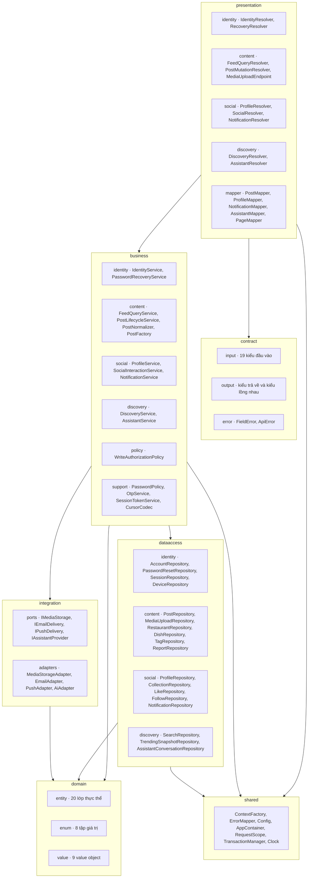
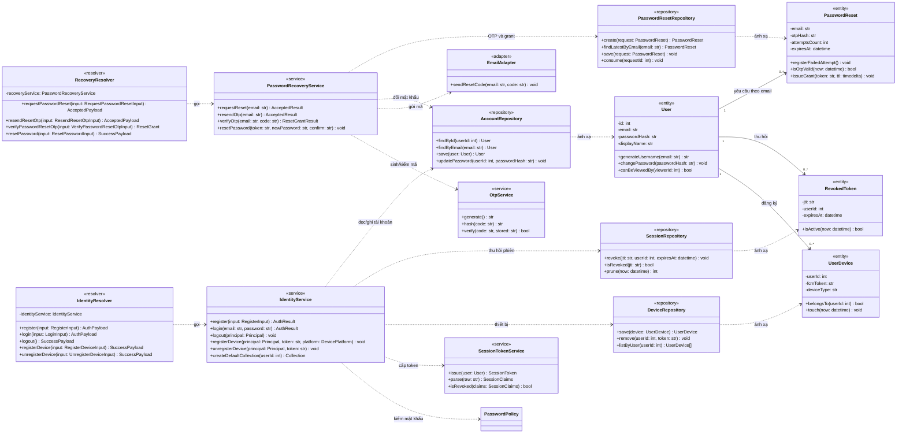
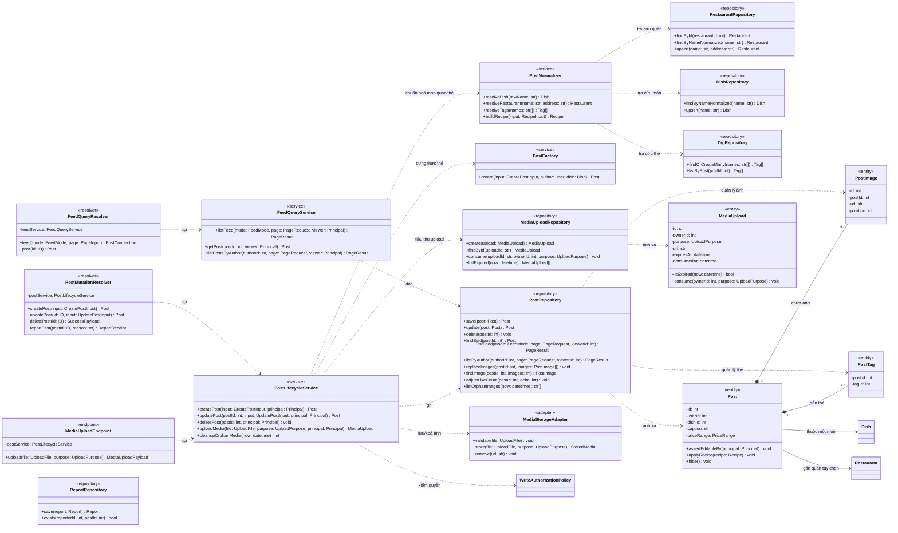
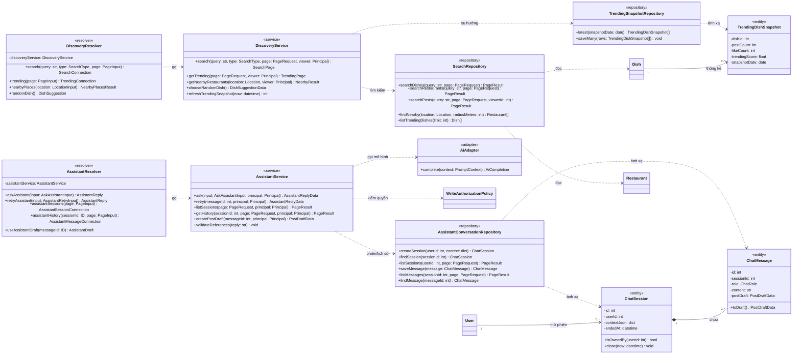
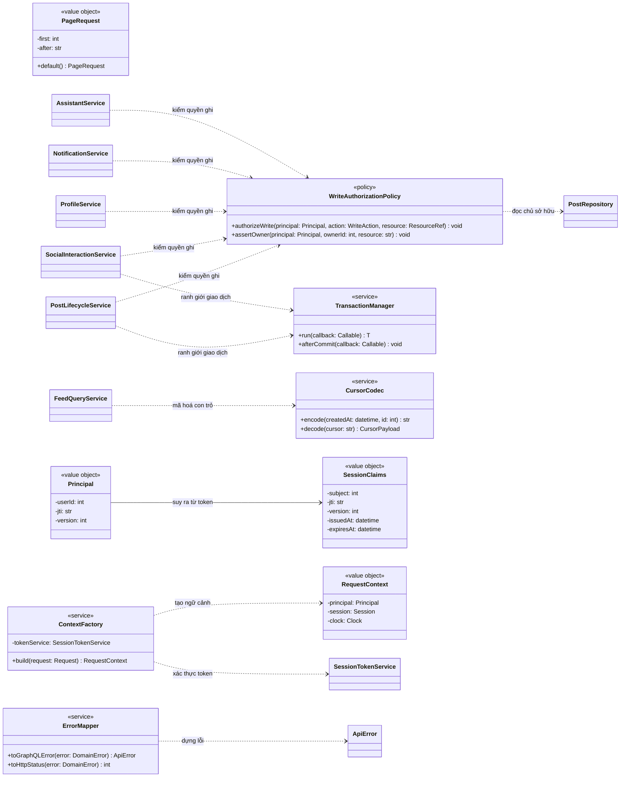

# DOC 6.1-A — Thiết kế lớp Backend

| Dự án | Owner | Reviewer | Approver | Sprint | Phiên bản | Trạng thái |
|---|---|---|---|---|---|---|
| ToMateTo | BE | Lead; DB với ánh xạ thực thể–bảng; FE với kiểu dữ liệu vào/ra | Lead | S5 | 1.0 | Đề nghị review |

**WBS:** 5.1.1 · **Phạm vi:** cấu trúc lớp backend ToMateTo v1.0 — thực thể, lớp nghiệp vụ, lớp truy cập dữ liệu, adapter ngoài, DTO và quan hệ giữa chúng. Không gồm lớp phía ứng dụng khách.

## 1. Mục tiêu, căn cứ và phạm vi

### 1.1 Mục tiêu

Tài liệu chuyển 22 thành phần backend, 42 operation và 19 bảng dữ liệu thành các lớp cụ thể mà lập trình viên có thể viết ngay: mỗi lớp có thuộc tính, phương thức, quan hệ và điều kiện sử dụng rõ ràng. Mỗi quyết định trong tài liệu phải lần ngược được tới một thành phần ở DOC 5.1-A/B, một operation ở DOC 5.2-A hoặc một bảng ở DOC 5.3-A; không có lớp nào xuất hiện mà không có nguồn.

### 1.2 Phạm vi và giả định

- **Trong phạm vi:** bốn lớp kiến trúc Presentation, Business, Data Access, External Integration; thực thể ánh xạ lược đồ vật lý; value object và enum dùng chung; DTO cho hợp đồng GraphQL và route upload; cấu hình tiêm phụ thuộc.
- **Ngoài phạm vi:** lớp và provider phía ứng dụng khách (WBS 5.1.2), sơ đồ tuần tự (DOC 6.2-A), từ điển dữ liệu và DDL chi tiết (DOC 6.4-A/B), cấu hình hạ tầng.
- **Giả định kỹ thuật:** Python 3.12, Strawberry GraphQL, SQLAlchemy 2.0 **sync** với Psycopg 3, PostgreSQL 16, PyJWT, bcrypt, httpx sync. Toàn bộ lời gọi cơ sở dữ liệu nằm trong một phiên đồng bộ theo request; không trộn sync và async trong cùng luồng.
- **Giả định nghiệp vụ:** một người dùng có nhiều phiên; nội dung công khai đọc được bởi khách; mọi thao tác ghi đều qua chính sách kiểm quyền dùng chung.

### 1.3 Input

| Input | Nội dung áp dụng | Dùng ở mục |
|---|---|---|
| DOC 2.3-A — Conceptual ERD | 12 thực thể cốt lõi, quan hệ 1–N, quy tắc xoá dây chuyền | §5.5, §7 |
| DOC 5.1-A/B — Thiết kế thành phần Backend | 22 thành phần P1–P4, B1–B10, D1–D4, X1–X4; giao diện use case, store và bốn cổng tích hợp; chiều phụ thuộc; hai job nền; công nghệ từng thành phần | §3, §4, §5, §9 |
| DOC 5.2-A — Đặc tả API Backend | 42 operation, kiểu đầu vào/đầu ra, mã lỗi, quy tắc upload ảnh và phân quyền theo operation | §4, §5.1, §8 |
| DOC 5.3-A — Lược đồ vật lý | 19 bảng, cột, kiểu dữ liệu, khoá, enum và index | §5.5, §7 |

Các quyết định công nghệ (SQLAlchemy 2.0 sync, resolver mỏng, kiểm quyền tại lớp Business) và ràng buộc phi chức năng đã được DOC 5.1-A/B và 5.2-A tiếp nhận; tài liệu này chỉ nhắc lại khi cần truy vết, không mở lại.

### 1.4 Cách đọc tài liệu

- **Ký hiệu thành viên:** `+` công khai, `-` riêng tư, `#` dùng trong lớp kế thừa. Python không có từ khoá truy cập, nên quy ước đặt tiền tố `_` cho thuộc tính riêng tư và chỉ mở qua property.
- **Nhãn lớp:** `<<resolver>>` lớp nhận GraphQL, `<<endpoint>>` route HTTP, `<<service>>` nghiệp vụ, `<<repository>>` truy cập dữ liệu, `<<adapter>>` tích hợp ngoài, `<<entity>>` ánh xạ bảng, `<<value object>>` bất biến, `<<enum>>` tập giá trị đóng, `<<mapper>>` chuyển đổi giữa thực thể và DTO.
- **Quan hệ:** `*--` thành phần (sở hữu, xoá theo), `-->` liên kết (tham chiếu), `..>` phụ thuộc (gọi), `..|>` hiện thực giao diện. Bội số ghi ở hai đầu đường nối.
- **Ba loại lớp dữ liệu, không trộn:** thực thể (`<<entity>>`) ánh xạ đúng một bảng, không ra khỏi lớp nghiệp vụ; DTO là kiểu GraphQL ở biên, không chứa quy tắc nghiệp vụ; value object bất biến, tự kiểm tra khi khởi tạo.
- **Mã định danh:** cơ sở dữ liệu dùng số nguyên, hợp đồng API dùng `ID` dạng chuỗi; mapper chuyển đổi ở biên, không đổi kiểu trong thực thể.

## 2. Quy ước thiết kế lớp

### 2.1 Đặt tên

| Hậu tố | Ý nghĩa | Ví dụ |
|---|---|---|
| `Resolver` | Nhận một nhóm operation GraphQL, chuyển input thành lời gọi nghiệp vụ | `PostMutationResolver` |
| `Endpoint` | Nhận route HTTP ngoài GraphQL | `MediaUploadEndpoint` |
| `Service` | Nghiệp vụ của một thành phần B | `PostLifecycleService` |
| `Policy` | Quy tắc quyết định dùng chung | `WriteAuthorizationPolicy` |
| `Repository` | Truy cập một nhóm bảng của một aggregate | `PostRepository` |
| `Adapter` | Cài đặt một cổng tích hợp ngoài | `MediaStorageAdapter` |
| `Mapper` | Chuyển thực thể ↔ DTO, không truy vấn | `PostMapper` |
| `Factory` | Dựng thực thể phức tạp từ dữ liệu đã kiểm | `PostFactory` |
| `Strategy` | Thuật toán thay thế được | `TrendingFeedStrategy` |
| `Input` / `Payload` | DTO vào / DTO ra của hợp đồng | `CreatePostInput`, `AuthPayload` |

Tên lớp dùng danh từ số ít, tiếng Anh; tên phương thức dùng động từ. Enum đặt `UPPER_SNAKE_CASE`, value object đặt theo khái niệm nghiệp vụ (`Location`, `Recipe`, `PageRequest`).

### 2.2 Phân lớp và chiều phụ thuộc

1. Resolver chỉ đọc ngữ cảnh, kiểm tra sự hiện diện của token, gọi đúng một phương thức nghiệp vụ và trả DTO. Resolver **không** mở phiên cơ sở dữ liệu, không dựng câu truy vấn, không quyết định quyền.
2. Service sở hữu quy tắc nghiệp vụ, ranh giới giao dịch và gọi chính sách kiểm quyền trước mọi thao tác ghi. Service không biết GraphQL.
3. Repository chỉ đọc/ghi bảng, nhận và trả thực thể hoặc giá trị đơn giản; không gọi service, không gọi adapter.
4. Adapter chỉ nói chuyện với dịch vụ ngoài, chuyển lỗi nhà cung cấp thành lỗi nội bộ có mã; không quyết định nghiệp vụ.
5. Chiều phụ thuộc một chiều: presentation → business → data access, và business → integration. Không có lời gọi ngược từ tầng dưới lên tầng trên.
6. Giao dịch mở ở service, đóng trước khi trả DTO. Việc dọn ảnh và gửi push chạy sau khi giao dịch đã commit, không làm hỏng thao tác chính.
7. Chín hợp đồng `I...UseCases` và bốn `I...Store` ở mức thành phần được hiện thực bằng chính lớp service và repository tương ứng, nên tài liệu không vẽ lại: mỗi hợp đồng chỉ có một hiện thực và Python không cần khai báo giao diện để gọi. Bốn cổng ngoài `IMediaStorage`, `IEmailDelivery`, `IPushDelivery`, `IAssistantProvider` vẫn là giao diện thật vì mỗi cổng có ít nhất hai hiện thực: nhà cung cấp thật và bản giả lập khi kiểm thử.

### 2.3 Ánh xạ dữ liệu

| Tình huống | Quy tắc |
|---|---|
| Tên cột khác tên trường API | Thực thể giữ tên cột; mapper đổi sang tên trường hợp đồng (`location_address` → `address`, `location_name` → `restaurantName`, `likes_count` → `likeCount`) |
| Enum lưu chữ thường, API dùng chữ hoa | Enum nghiệp vụ giữ một giá trị chuẩn, có hàm chuyển hai chiều (`under_50k` ↔ `UNDER_50K`) |
| Cột `NULL` | Value object hoặc trường tùy chọn ở DTO; không thay bằng chuỗi rỗng để tránh lẫn "không có" với "rỗng" |
| Bảng liên kết không có mã riêng | Mô hình hoá thành thực thể liên kết (`PostTag`, `Like`, `CollectionItem`, `Follow`); không dùng danh sách mã trong thực thể cha |
| Dữ liệu JSONB | Bọc trong value object (`SocialLinks`, `NotificationPayload`, `PostDraftData`), không truyền `dict` thô qua tầng nghiệp vụ |
| Trường hợp đồng chưa có cột | Ghi ở §10, không tự thêm cột; DTO vẫn nhận trường nhưng tầng lưu không cam kết |

## 3. Sơ đồ gói

| Gói | Nội dung | Số lớp |
|---|---|---|
| `presentation` | 9 resolver, 1 endpoint HTTP, 5 mapper | 15 |
| `contract` | 19 kiểu đầu vào, kiểu trả về trực tiếp và kiểu lồng nhau, 2 kiểu lỗi | xem §8 |
| `business` | 10 service, 1 factory, 1 policy, 1 normalizer, 4 lớp hỗ trợ | 17 |
| `dataaccess` | 18 repository chia theo D1–D4 | 18 |
| `integration` | 4 cổng, 4 adapter | 8 |
| `domain` | 20 thực thể, 8 enum, 9 value object | 37 |
| `shared` | 7 lớp hạ tầng | 7 |

Gói con đặt theo domain chứ không theo tầng kỹ thuật, để một thay đổi nghiệp vụ chỉ chạm một nhánh thư mục. `contract` tách khỏi `domain` để thực thể không bị ràng buộc bởi hình dạng GraphQL.

## 4. Sơ đồ lớp theo nhóm thành phần

Năm sơ đồ dưới đây bám bốn nhóm thành phần của DOC 5.1-A/B cộng phần dùng chung. Mỗi lớp trong sơ đồ đều có mặt trong bảng đặc tả §5; lớp không có hành vi riêng (DTO) được liệt kê ở §8 thay vì vẽ.

### 4.1 Identity & Recovery — P1, B1, B2, D1, X2

`PasswordReset` liên kết với `User` qua email chứ không qua khoá ngoại, đúng như bảng `password_resets`; repository phải chuẩn hoá email trước khi so khớp. `SessionTokenService` là nơi duy nhất đọc/ghi nội dung token, không lớp nào khác giải mã JWT.

### 4.2 Content & Posts — P2, B3, B4, D2, X1

`PostTag` không có mã riêng: khoá chính là cặp `(post_id, tag_id)`, nên repository thao tác theo cặp và không trả về mã giả. `ReportRepository` phục vụ `reportPost` của P2 dù nghiệp vụ báo cáo thuộc B6; lớp nằm trong D2 vì cùng aggregate nội dung, còn quyết định quyền và chống trùng nằm ở B6.

### 4.3 Profile & Social — P3, B5, B6, B7, D3, X3

```mermaid
classDiagram
    direction LR

    class ProfileResolver {
        <<resolver>>
        -profileService: ProfileService
        +profile(userId: ID) Profile
        +myProfile() Profile
        +profilePosts(userId: ID, page: PageInput) PostConnection
        +myPosts(page: PageInput) PostConnection
        +updateProfile(input: UpdateProfileInput) Profile
        +setProfileVisibility(fields: str[]) VisibilityPayload
    }

    class SocialResolver {
        <<resolver>>
        -socialService: SocialInteractionService
        +setLike(postId: ID, liked: bool) LikeState
        +savePost(postId: ID, collectionId: ID) SaveState
        +removeSavedPost(postId: ID, collectionId: ID) SaveState
        +myCollections(page: PageInput) CollectionConnection
        +collectionItems(collectionId: ID, page: PageInput) PostConnection
        +createCollection(input: CollectionInput) Collection
        +renameCollection(input: RenameCollectionInput) Collection
        +deleteCollection(collectionId: ID) SuccessPayload
        +setFollow(userId: ID, followed: bool) FollowState
    }

    class NotificationResolver {
        <<resolver>>
        -notificationService: NotificationService
        +notifications(page: PageInput) NotificationConnection
        +markNotificationRead(id: ID) NotificationReadPayload
        +markAllNotificationsRead() NotificationReadPayload
    }

    class ProfileService {
        <<service>>
        +getProfile(userId: int, viewer: Principal) ProfileData
        +updateProfile(input: UpdateProfileInput, principal: Principal) User
        +setProfileVisibility(fields: str[], principal: Principal) str[]
    }

    class SocialInteractionService {
        <<service>>
        +setLike(postId: int, liked: bool, principal: Principal) LikeStateData
        +savePost(postId: int, collectionId: int, principal: Principal) SaveStateData
        +removeSavedPost(postId: int, collectionId: int, principal: Principal) SaveStateData
        +setFollow(userId: int, followed: bool, principal: Principal) FollowStateData
        +reportPost(postId: int, reason: str, principal: Principal) ReportReceiptData
    }

    class CollectionService {
        <<service>>
        +create(name: str, principal: Principal) Collection
        +rename(collectionId: int, name: str, principal: Principal) Collection
        +delete(collectionId: int, principal: Principal) void
        +addItem(collectionId: int, postId: int, principal: Principal) void
        +removeItem(collectionId: int, postId: int, principal: Principal) void
        +listItems(collectionId: int, page: PageRequest, viewer: Principal) PageResult
    }

    class NotificationService {
        <<service>>
        +listNotifications(userId: int, page: PageRequest) NotificationPage
        +markRead(notificationId: int, principal: Principal) int
        +markAllRead(principal: Principal) int
        +create(event: NotificationEvent) Notification
        +requestPush(notification: Notification) void
    }

    class ProfileRepository {
        <<repository>>
        +findById(userId: int) User
        +updateProfile(userId: int, changes: ProfileChanges) void
    }

    class CollectionRepository {
        <<repository>>
        +listByUser(userId: int, page: PageRequest) PageResult
        +findById(collectionId: int) Collection
        +findDefault(userId: int) Collection
        +create(collection: Collection) Collection
        +rename(collectionId: int, name: str) void
        +delete(collectionId: int) void
        +addItem(collectionId: int, postId: int) void
        +removeItem(collectionId: int, postId: int) void
        +existsName(userId: int, name: str) bool
    }

    class LikeRepository {
        <<repository>>
        +setState(userId: int, postId: int, liked: bool) bool
        +isLiked(userId: int, postId: int) bool
        +countByPost(postId: int) int
    }

    class FollowRepository {
        <<repository>>
        +setState(followerId: int, followeeId: int, followed: bool) bool
        +isFollowing(followerId: int, followeeId: int) bool
    }

    class NotificationRepository {
        <<repository>>
        +listByUser(userId: int, page: PageRequest) PageResult
        +unreadCount(userId: int) int
        +markRead(notificationId: int, userId: int) void
        +markAllRead(userId: int) int
        +save(notification: Notification) Notification
    }

    class PushAdapter {
        <<adapter>>
        +send(message: PushMessage) void
    }

    class Collection {
        <<entity>>
        -id: int
        -userId: int
        -name: str
        -isDefault: bool
        +rename(name: str) void
        +assertDeletable() void
    }

    class CollectionItem {
        <<entity>>
        -collectionId: int
        -postId: int
        -addedAt: datetime
    }

    class Like {
        <<entity>>
        -userId: int
        -postId: int
        -createdAt: datetime
    }

    class Follow {
        <<entity>>
        -followerId: int
        -followeeId: int
        +assertNotSelf() void
    }

    class Notification {
        <<entity>>
        -id: int
        -userId: int
        -type: NotificationType
        -payload: NotificationPayload
        -read: bool
        +markRead() void
        +targetPostId() int
    }

    ProfileResolver ..> ProfileService : gọi
    ProfileResolver ..> FeedQueryService : đọc bài của hồ sơ
    SocialResolver ..> SocialInteractionService : gọi
    SocialResolver ..> CollectionService : gọi
    SocialResolver ..> FeedQueryService : đọc bài trong bộ sưu tập
    NotificationResolver ..> NotificationService : gọi
    ProfileService ..> ProfileRepository : hồ sơ
    ProfileService ..> MediaUploadRepository : ảnh đại diện/bìa
    SocialInteractionService ..> LikeRepository : lượt thích
    SocialInteractionService ..> FollowRepository : theo dõi
    SocialInteractionService ..> NotificationService : tạo thông báo
    SocialInteractionService ..> PostRepository : kiểm bài tồn tại
    CollectionService ..> CollectionRepository : bộ sưu tập
    NotificationService ..> NotificationRepository : thông báo
    NotificationService ..> PushAdapter : đẩy thiết bị
    ProfileRepository ..> User : hồ sơ
    CollectionRepository ..> Collection : ánh xạ
    CollectionRepository ..> CollectionItem : mục lưu
    LikeRepository ..> Like : ánh xạ
    FollowRepository ..> Follow : ánh xạ
    NotificationRepository ..> Notification : ánh xạ
    User "1" --> "0..*" Collection : sở hữu
    Collection "1" *-- "0..*" CollectionItem : chứa
    User "1" --> "0..*" Like : thực hiện
    User "1" --> "0..*" Follow : theo dõi
    User "1" --> "0..*" Notification : nhận
```

`CollectionService` tách khỏi `SocialInteractionService` vì bộ sưu tập có vòng đời riêng (tạo, đổi tên, xoá, thêm/bớt mục) và giới hạn "không xoá bộ mặc định" chỉ áp dụng cho nhóm này. Cả hai đều thuộc P3/B6.

### 4.4 Discovery & Assistant — P4, B8, B9, D4, X4

`SearchRepository` đọc chéo ba bảng nên không thuộc về một aggregate duy nhất; đây là repository chỉ đọc, không có phương thức ghi. `TrendingSnapshotRepository` chỉ đọc bản chụp mới nhất và ghi theo lô trong job, không cập nhật từng dòng.

### 4.5 Kiểm quyền và lớp dùng chung — B10

Chính sách kiểm quyền nhận `Principal` đã xác thực, không tự đọc token. Nhờ vậy mọi service kiểm quyền theo cùng một cách và có thể kiểm thử mà không cần dựng HTTP request.

## 5. Đặc tả lớp

Mỗi lớp có hành vi được đặc tả đầy đủ dưới đây. Lớp thực thể mô tả thuộc tính và phương thức nghiệp vụ; DTO chỉ mô tả kiểu và mục đích, trường chi tiết giữ nguyên theo hợp đồng ở DOC 5.2-A và được ánh xạ ở §8.

### 5.1 Lớp giao tiếp (Presentation)

| Lớp | Thành phần | Phương thức | Dịch vụ gọi | Ghi chú |
|---|---|---|---|---|
| `IdentityResolver` | P1 | `+register`, `+login`, `+logout`, `+registerDevice`, `+unregisterDevice` | `IdentityService` | Không trả email của người khác; lỗi đăng nhập dùng chung một thông báo |
| `RecoveryResolver` | P1 | `+requestPasswordReset`, `+resendResetOtp`, `+verifyPasswordResetOtp`, `+resetPassword` | `PasswordRecoveryService` | Luôn trả `accepted` như nhau dù email tồn tại hay không |
| `FeedQueryResolver` | P2 | `+feed`, `+post` | `FeedQueryService` | `post` trả `null` khi không được xem, không tiết lộ lý do |
| `PostMutationResolver` | P2 | `+createPost`, `+updatePost`, `+deletePost`, `+reportPost` | `PostLifecycleService`, `SocialInteractionService` | `reportPost` chuyển tiếp sang B6 theo phân công của DOC 5.1-A/B |
| `MediaUploadEndpoint` | P2 | `+upload(file, purpose)` | `PostLifecycleService` | Route HTTP riêng ngoài GraphQL; bắt buộc token; một tệp mỗi request |
| `ProfileResolver` | P3 | `+profile`, `+myProfile`, `+profilePosts`, `+myPosts`, `+updateProfile`, `+setProfileVisibility` | `ProfileService`, `FeedQueryService` | Bài của hồ sơ đọc qua B3, không tự truy vấn |
| `SocialResolver` | P3 | `+setLike`, `+savePost`, `+removeSavedPost`, `+myCollections`, `+collectionItems`, `+createCollection`, `+renameCollection`, `+deleteCollection`, `+setFollow` | `SocialInteractionService`, `CollectionService`, `FeedQueryService` | Trạng thái đích, gửi lặp không đổi kết quả |
| `NotificationResolver` | P3 | `+notifications`, `+markNotificationRead`, `+markAllNotificationsRead` | `NotificationService` | `notifications` trả kèm tổng chưa đọc |
| `DiscoveryResolver` | P4 | `+search`, `+trending`, `+nearbyPlaces`, `+randomDish` | `DiscoveryService` | `nearbyPlaces` dùng vị trí mặc định khi thiếu quyền |
| `AssistantResolver` | P4 | `+askAssistant`, `+retryAssistant`, `+assistantSessions`, `+assistantHistory`, `+useAssistantDraft` | `AssistantService` | Mỗi lượt có trần thời gian; lỗi nhà cung cấp trả mã tích hợp |

Năm mapper không có bảng riêng vì không chứa quy tắc: `PostMapper` (thực thể → `Post`, gồm ảnh và cờ người xem), `ProfileMapper`, `NotificationMapper` (bóc `payload` JSONB), `AssistantMapper` (bóc `post_draft`), `PageMapper` (dựng connection và con trỏ).

### 5.2 Lớp nghiệp vụ (Business)

| Lớp | Thành phần | Phương thức chính | Phụ thuộc |
|---|---|---|---|
| `IdentityService` | B1 | `+register`, `+login`, `+logout`, `+registerDevice`, `+unregisterDevice`, `+createDefaultCollection` | `AccountRepository`, `SessionRepository`, `DeviceRepository`, `SessionTokenService`, `PasswordPolicy`, `CollectionRepository` |
| `PasswordRecoveryService` | B2 | `+requestReset`, `+resendOtp`, `+verifyOtp`, `+resetPassword` | `PasswordResetRepository`, `AccountRepository`, `OtpService`, `EmailAdapter` |
| `FeedQueryService` | B3 | `+listFeed`, `+getPost`, `+listPostsByAuthor` | `PostRepository`, `LikeRepository`, `CollectionRepository`, `CursorCodec` |
| `PostLifecycleService` | B4 | `+createPost`, `+updatePost`, `+deletePost`, `+uploadMedia`, `+cleanupOrphanMedia` | `PostRepository`, `MediaUploadRepository`, `PostFactory`, `PostNormalizer`, `MediaStorageAdapter`, `WriteAuthorizationPolicy`, `TransactionManager` |
| `ProfileService` | B5 | `+getProfile`, `+updateProfile`, `+setProfileVisibility` | `ProfileRepository`, `MediaUploadRepository`, `WriteAuthorizationPolicy` |
| `SocialInteractionService` | B6 | `+setLike`, `+savePost`, `+removeSavedPost`, `+setFollow`, `+reportPost` | `LikeRepository`, `CollectionRepository`, `FollowRepository`, `PostRepository`, `NotificationService`, `WriteAuthorizationPolicy` |
| `CollectionService` | B6 | `+create`, `+rename`, `+delete`, `+addItem`, `+removeItem`, `+listItems` | `CollectionRepository`, `PostRepository`, `WriteAuthorizationPolicy` |
| `NotificationService` | B7 | `+listNotifications`, `+markRead`, `+markAllRead`, `+create`, `+requestPush` | `NotificationRepository`, `UserDevice` qua `DeviceRepository`, `PushAdapter`, `WriteAuthorizationPolicy` |
| `DiscoveryService` | B8 | `+search`, `+getTrending`, `+getNearbyRestaurants`, `+chooseRandomDish`, `+refreshTrendingSnapshot` | `SearchRepository`, `TrendingSnapshotRepository` |
| `AssistantService` | B9 | `+ask`, `+retry`, `+listSessions`, `+getHistory`, `+createPostDraft`, `+validateReferences` | `AssistantConversationRepository`, `AiAdapter`, `WriteAuthorizationPolicy` |
| `WriteAuthorizationPolicy` | B10 | `+authorizeWrite`, `+assertOwner` | `PostRepository`, `CollectionRepository`, `NotificationRepository` |

Sáu lớp còn lại của tầng nghiệp vụ là lớp hỗ trợ, không được resolver gọi trực tiếp:

| Lớp | Thành phần | Phương thức chính | Bất biến / phụ thuộc |
|---|---|---|---|
| `PostFactory` | B4 | `+create(input, author, dish) Post` | Không dựng bài thiếu món hoặc thiếu tác giả; lấy thời điểm từ `Clock` |
| `PostNormalizer` | B4 | `+resolveDish`, `+resolveRestaurant`, `+resolveTags`, `+buildRecipe` | Chuẩn hoá tên trước khi tra; không tạo món, quán hoặc thẻ rỗng |
| `PasswordPolicy` | B1, B2 | `+validate(raw)`, `+hash(raw)`, `+verify(raw, hash)` | Tối thiểu 6 ký tự; băm bằng bcrypt; không ghi chuỗi thô vào log |
| `OtpService` | B2 | `+generate()`, `+hash(code)`, `+verify(code, stored)` | Sinh mã 6 chữ số; chỉ so sánh trên hash; hạn dùng do `PasswordReset` giữ |
| `SessionTokenService` | B1 | `+issue`, `+parse`, `+isRevoked` | Ký và giải mã token; không lớp nào khác đọc nội dung JWT |
| `CursorCodec` | B3, B8 | `+encode`, `+decode` | Con trỏ sai trả `VALIDATION_FAILED`; chuỗi không lộ nội dung bản ghi |

Điều kiện trước và sau của các phương thức có rủi ro cao:

| Phương thức | Điều kiện trước | Kết quả sau |
|---|---|---|
| `IdentityService.login` | Email và mật khẩu có mặt; tài khoản tồn tại | Phát một token 7 ngày mang `sub`, `jti`, `ver`; không tiết lộ email hay mật khẩu nào sai |
| `IdentityService.logout` | `Principal` có `jti` | Ghi `jti` vào sổ thu hồi; request sau dùng lại token bị từ chối; gọi lặp vẫn thành công |
| `PasswordRecoveryService.resetPassword` | Grant còn hạn, chưa dùng, mật khẩu mới khớp xác nhận | Cập nhật hash, tăng phiên bản phiên, đánh dấu grant đã dùng, mọi token cũ mất hiệu lực |
| `PostLifecycleService.createPost` | Có `Principal`; tên món không rỗng; mỗi ảnh gửi đúng một trong `imageId`/`uploadId` | Bài, ảnh, thẻ được ghi trong một giao dịch; upload được tiêu thụ đúng một lần; lỗi ảnh không tạo bài |
| `PostLifecycleService.updatePost` | Bài tồn tại và thuộc người gọi; `imageId` thuộc chính bài đó | Chỉ trường được gửi thay đổi; danh sách ảnh là danh sách cuối cùng; ảnh bị bỏ dọn sau commit |
| `PostLifecycleService.deletePost` | Bài tồn tại và thuộc người gọi | Bản ghi và dữ liệu phụ thuộc bị xoá; ảnh dọn sau commit; gọi lặp vẫn thành công |
| `PostLifecycleService.uploadMedia` | Có `Principal`; tệp là ảnh hợp lệ; `purpose` hợp lệ | Tạo bản ghi chờ thuộc người tải, có hạn dùng; vé chỉ dùng một lần |
| `SocialInteractionService.setLike` | Bài đang hiển thị với người xem | Trạng thái thích đạt đúng giá trị yêu cầu; bộ đếm cập nhật; thông báo tạo sau commit |
| `CollectionService.delete` | Bộ sưu tập thuộc người gọi và không phải bộ mặc định | Bộ sưu tập và mục bên trong bị xoá; bài gốc không đổi |
| `AssistantService.ask` | Có `Principal`; phiên (nếu có) thuộc người gọi | Lưu tin nhắn người dùng và trả lời; lỗi nhà cung cấp trả `INTEGRATION_UNAVAILABLE`, không lưu bản nháp rỗng |

### 5.3 Lớp truy cập dữ liệu

| Lớp | Thành phần | Bảng | Phương thức chính |
|---|---|---|---|
| `AccountRepository` | D1 | `users` | `findById`, `findByEmail`, `save`, `updatePassword` |
| `PasswordResetRepository` | D1 | `password_resets` | `create`, `findLatestByEmail`, `save`, `consume` |
| `SessionRepository` | D1 | `revoked_tokens` | `revoke`, `isRevoked`, `prune` |
| `DeviceRepository` | D1 | `user_devices` | `save`, `remove`, `listByUser` |
| `PostRepository` | D2 | `posts`, `post_images`, `post_tags` | `save`, `update`, `delete`, `findById`, `listFeed`, `listByAuthor`, `replaceImages`, `findImage`, `adjustLikeCount`, `listOrphanImages` |
| `MediaUploadRepository` | D2 | chờ lược đồ (xem §10) | `create`, `findById`, `consume`, `listExpired` |
| `RestaurantRepository` | D2 | `restaurants` | `findById`, `findByNameNormalized`, `upsert` |
| `DishRepository` | D2 | `dishes` | `findByNameNormalized`, `upsert` |
| `TagRepository` | D2 | `tags` | `findOrCreateMany`, `listByPost` |
| `ReportRepository` | D2 | `reports` | `save`, `exists` |
| `ProfileRepository` | D3 | `users` (chiếu hồ sơ) | `findById`, `updateProfile` |
| `CollectionRepository` | D3 | `collections`, `collection_items` | `listByUser`, `findById`, `findDefault`, `create`, `rename`, `delete`, `addItem`, `removeItem`, `existsName` |
| `LikeRepository` | D3 | `likes` | `setState`, `isLiked`, `countByPost` |
| `FollowRepository` | D3 | `follows` | `setState`, `isFollowing` |
| `NotificationRepository` | D3 | `notifications` | `listByUser`, `unreadCount`, `markRead`, `markAllRead`, `save` |
| `SearchRepository` | D4 | `dishes`, `restaurants`, `posts` | `searchDishes`, `searchRestaurants`, `searchPosts`, `findNearby`, `listTrendingDishes` |
| `TrendingSnapshotRepository` | D4 | `trending_dish_snapshots` | `latest`, `saveMany` |
| `AssistantConversationRepository` | D4 | `chat_sessions`, `chat_messages` | `createSession`, `findSession`, `listSessions`, `saveMessage`, `listMessages`, `findMessage` |

Repository không trả DTO và không ném lỗi nghiệp vụ; ngoại lệ cơ sở dữ liệu được chuyển thành lỗi hạ tầng ở một chỗ duy nhất trước khi lên service.

### 5.4 Lớp tích hợp ngoài

| Lớp | Thành phần | Cổng | Phương thức | Xử lý lỗi |
|---|---|---|---|---|
| `MediaStorageAdapter` | X1 | `IMediaStorage` | `+validate`, `+store`, `+remove` | Tệp sai định dạng trả `VALIDATION_FAILED`; lỗi nhà cung cấp trả `INTEGRATION_UNAVAILABLE` |
| `EmailAdapter` | X2 | `IEmailDelivery` | `+sendResetCode` | Không tiết lộ email có tồn tại; lỗi gửi không đổi phản hồi `accepted` |
| `PushAdapter` | X3 | `IPushDelivery` | `+send` | Lỗi được ghi log, không làm hỏng thao tác gốc |
| `AiAdapter` | X4 | `IAssistantProvider` | `+complete` | Vượt trần thời gian trả `INTEGRATION_UNAVAILABLE`; không gửi email, token hay khoá |

Bốn cổng là giao diện nhỏ, mỗi cổng một trách nhiệm, để thay nhà cung cấp bằng cấu hình mà không sửa nghiệp vụ. Adapter nhận khoá qua cấu hình, không nhận từ client, không trả khoá trong phản hồi.

### 5.5 Lớp thực thể

Mỗi lớp ánh xạ đúng một bảng ở DOC 5.3-A. Thuộc tính ghi theo cột; quan hệ ghi theo bảng đích.

| Lớp (bảng) | Thuộc tính | Phương thức nghiệp vụ | Quan hệ |
|---|---|---|---|
| `User` (`users`) | `-id: int`; `-username: str`; `-email: str`; `-passwordHash: str`; `-displayName: str`; `-avatarUrl: str`; `-coverUrl: str`; `-bio: str`; `-city: str`; `-socialLinks: SocialLinks`; `-isPrivate: bool`; `-createdAt: datetime` | `+generateUsername(email): str`; `+changePassword(hash): void`; `+canBeViewedBy(viewerId): bool` | 1 → 0..* `Post`, `Collection`, `Notification`, `ChatSession`, `UserDevice`, `RevokedToken` |
| `Restaurant` (`restaurants`) | `-id: int`; `-name: str`; `-nameNormalized: str`; `-address: str`; `-lat: float`; `-lng: float`; `-createdAt: datetime` | `+distanceTo(location: Location): float`; `+matches(normalizedName): bool` | 1 → 0..* `Post` |
| `Dish` (`dishes`) | `-id: int`; `-name: str`; `-nameNormalized: str`; `-isSeed: bool`; `-createdAt: datetime` | `+normalize(): str` | 1 → 0..* `Post`, `TrendingDishSnapshot` |
| `Tag` (`tags`) | `-id: int`; `-name: str`; `-nameNormalized: str`; `-createdAt: datetime` | `+normalize(): str` | 0..* ↔ 0..* `Post` qua `PostTag` |
| `Post` (`posts`) | `-id: int`; `-userId: int`; `-dishId: int`; `-restaurantId: int`; `-caption: str`; `-priceRange: PriceRange`; `-locationName: str`; `-locationAddress: str`; `-lat: float`; `-lng: float`; `-recipeIngredients: str[]`; `-recipeSteps: str[]`; `-cookTimeMinutes: int`; `-servings: int`; `-likesCount: int`; `-isHidden: bool`; `-createdAt: datetime`; `-updatedAt: datetime` | `+assertEditableBy(principal): void`; `+applyRecipe(recipe): void`; `+replaceImages(images): void`; `+replaceTags(tags): void`; `+hide(): void`; `+adjustLikeCount(delta): void` | 1 → 0..* `PostImage`, `PostTag`, `Like`, `CollectionItem`, `Report`; 0..1 → `Restaurant`; 1 → `Dish` |
| `PostImage` (`post_images`) | `-id: int`; `-postId: int`; `-url: str`; `-position: int` | — | thuộc `Post` |
| `PostTag` (`post_tags`) | `-postId: int`; `-tagId: int`; `-createdAt: datetime` | — | thuộc `Post` và `Tag` |
| `Like` (`likes`) | `-userId: int`; `-postId: int`; `-createdAt: datetime` | — | thuộc `User` và `Post` |
| `Collection` (`collections`) | `-id: int`; `-userId: int`; `-name: str`; `-isDefault: bool`; `-createdAt: datetime` | `+rename(name): void`; `+assertDeletable(): void` | 1 → 0..* `CollectionItem` |
| `CollectionItem` (`collection_items`) | `-collectionId: int`; `-postId: int`; `-addedAt: datetime` | — | thuộc `Collection` và `Post` |
| `Follow` (`follows`) | `-followerId: int`; `-followeeId: int`; `-createdAt: datetime` | `+assertNotSelf(): void` | thuộc hai `User` |
| `Report` (`reports`) | `-id: int`; `-reporterId: int`; `-postId: int`; `-reason: str`; `-createdAt: datetime` | — | thuộc `User` và `Post` |
| `Notification` (`notifications`) | `-id: int`; `-userId: int`; `-type: NotificationType`; `-payload: NotificationPayload`; `-read: bool`; `-createdAt: datetime` | `+markRead(): void`; `+targetPostId(): int` | thuộc `User` |
| `ChatSession` (`chat_sessions`) | `-id: int`; `-userId: int`; `-contextJson: dict`; `-createdAt: datetime`; `-endedAt: datetime` | `+isOwnedBy(userId): bool`; `+close(now): void` | 1 → 0..* `ChatMessage` |
| `ChatMessage` (`chat_messages`) | `-id: int`; `-sessionId: int`; `-role: ChatRole`; `-content: str`; `-imageUrl: str`; `-postDraft: PostDraftData`; `-createdAt: datetime` | `+toDraft(): PostDraftData` | thuộc `ChatSession` |
| `UserDevice` (`user_devices`) | `-id: int`; `-userId: int`; `-fcmToken: str`; `-deviceType: str`; `-lastActiveAt: datetime`; `-createdAt: datetime` | `+belongsTo(userId): bool`; `+touch(now): void` | thuộc `User` |
| `PasswordReset` (`password_resets`) | `-id: int`; `-email: str`; `-otpHash: str`; `-attemptsCount: int`; `-expiresAt: datetime`; `-resetToken: str`; `-resetTokenExpiresAt: datetime`; `-isUsed: bool`; `-createdAt: datetime` | `+registerFailedAttempt(): void`; `+isOtpValid(now): bool`; `+issueGrant(token, ttl): void`; `+consume(): void` | liên kết `User` qua email |
| `RevokedToken` (`revoked_tokens`) | `-id: int`; `-userId: int`; `-jti: str`; `-expiresAt: datetime`; `-revokedAt: datetime` | `+isActive(now): bool` | thuộc `User` |
| `TrendingDishSnapshot` (`trending_dish_snapshots`) | `-id: int`; `-dishId: int`; `-postCount: int`; `-likeCount: int`; `-trendingScore: float`; `-snapshotDate: date`; `-createdAt: datetime` | — | thuộc `Dish` |
| `MediaUpload` (chờ lược đồ) | `-id: str`; `-ownerId: int`; `-purpose: UploadPurpose`; `-url: str`; `-width: int`; `-height: int`; `-expiresAt: datetime`; `-consumedAt: datetime` | `+isExpired(now): bool`; `+consume(ownerId, purpose): void` | 0..1 → `PostImage` sau khi tiêu thụ |

Thực thể không có setter công khai. Thay đổi trạng thái đi qua phương thức nghiệp vụ để giữ bất biến (ví dụ `Post.replaceImages` kiểm thứ tự và số lượng, `Collection.assertDeletable` chặn xoá bộ mặc định).

### 5.6 Value object và enum

Value object không có mã định danh, so sánh theo giá trị và tự chặn dữ liệu sai ngay khi khởi tạo; không lớp nào được dựng value object ở trạng thái nửa hợp lệ.

| Value object | Trường | Bất biến khi khởi tạo | Dùng ở |
|---|---|---|---|
| `Location` | `latitude: float`; `longitude: float` | Vĩ độ −90…90, kinh độ −180…180; cả hai cùng có hoặc cùng không | `NearbyPlaces`, `Post` |
| `Recipe` | `ingredients: str[]`; `instructions: str[]` | Mỗi phần tử sau khi cắt khoảng trắng phải khác rỗng; hai danh sách rỗng nghĩa là không có công thức | `RecipeInput`, `Post.applyRecipe` |
| `SocialLinks` | `platform → url` | Chỉ nhận khoá thuộc danh mục đã biết; URL phải là `http`/`https` | `User.socialLinks` |
| `NotificationPayload` | `actorId: int`; `postId: int`; `preview: str` | Chỉ đọc qua phương thức; không lộ `dict` thô ra DTO | `Notification.payload` |
| `PostDraftData` | `dishName: str`; `caption: str`; `recipe: Recipe`; `restaurantName: str` | `dishName` khác rỗng mới được coi là bản nháp dùng được | `ChatMessage.postDraft` |
| `PageRequest` | `first: int`; `after: str` | `first` trong 1…50, mặc định 10; `after` giải mã được hoặc rỗng | Mọi query danh sách |
| `Principal` | `userId: int`; `jti: str`; `version: int` | Chỉ dựng từ token đã xác thực, không bao giờ từ tham số client | Policy, service, resolver |
| `SessionClaims` | `subject: int`; `jti: str`; `version: int`; `issuedAt`; `expiresAt` | Chữ ký hợp lệ, `exp` chưa qua, `jti` không rỗng | `SessionTokenService.parse` |
| `RequestContext` | `principal: Principal`; `scope: RequestScope`; `clock: Clock` | Một thể hiện cho mỗi request; `principal` rỗng với khách | `ContextFactory`, resolver |

| Enum | Giá trị | Ánh xạ / ghi chú |
|---|---|---|
| `FeedMode` | `LATEST`, `TRENDING` | Trùng tên với enum hợp đồng; `TRENDING` dùng thứ tự đã tính sẵn ở tầng đọc, không aggregate tại chỗ. `trending` của nhóm khám phá mới đọc bảng chụp món |
| `PriceRange` | `UNDER_50K`, `FROM_50K_TO_100K`, `FROM_100K_TO_200K`, `ABOVE_200K` | Lưu `under_50k`, `50k_100k`, `100k_200k`, `above_200k`; đúng bốn mức, không chia ba mức thô |
| `SearchType` | `DISH`, `RESTAURANT`, `POST` | Bỏ trống nghĩa là tìm cả ba nhóm |
| `UploadPurpose` | `POST`, `AVATAR`, `COVER` | Quyết định nơi tiêu thụ vé: bài hay hồ sơ |
| `DevicePlatform` | `IOS`, `ANDROID`, `WEB` | Hợp đồng còn là `String`; enum chỉ dùng nội bộ để kiểm giá trị |
| `NotificationType` | `LIKE`, `FOLLOW`, `NEW_POST_FROM_FOLLOWING` | Lưu chữ thường `like`, `follow`, `new_post_from_following` |
| `ChatRole` | `USER`, `ASSISTANT` | Lưu `user`, `assistant` theo ràng buộc kiểm của bảng |
| `WriteAction` | `CREATE_POST`, `UPDATE_POST`, `DELETE_POST`, `UPDATE_PROFILE`, `SET_VISIBILITY`, `LIKE`, `SAVE`, `FOLLOW`, `REPORT`, `COLLECTION`, `NOTIFICATION`, `ASSISTANT` | Đầu vào của `WriteAuthorizationPolicy`; mỗi hành động ứng với một nhóm quy tắc |

Enum giá là điểm dễ sai nhất khi ánh xạ: tầng lưu dùng chữ thường có dấu gạch dưới, hợp đồng dùng chữ hoa; hàm chuyển đổi nằm trong `PostMapper`, không nằm trong resolver.

### 5.7 Lớp dùng chung

| Lớp | Trách nhiệm | Phương thức / thuộc tính |
|---|---|---|
| `Config` | Đọc biến môi trường một lần, kiểm đủ khoá bắt buộc trước khi ứng dụng nhận request | `databaseUrl`, `jwtSecret`, `jwtTtl`, `media`, `email`, `push`, `ai`, `pagination` |
| `AppContainer` | Dựng các thành phần không giữ trạng thái request; là gốc lắp ghép duy nhất | `newScope(session): RequestScope` |
| `RequestScope` | Giữ phiên cơ sở dữ liệu và các repository/service của một request | thuộc tính là repository, service, mapper |
| `ContextFactory` | Dựng `RequestContext` từ header và phiên, không ném lỗi khi khách chưa đăng nhập | `+build(request): RequestContext` |
| `TransactionManager` | Mở/commit/rollback quanh một khối nghiệp vụ; đăng ký việc chạy sau commit | `+run(callback): T`; `+afterCommit(callback): void` |
| `Clock` | Nguồn thời gian duy nhất, thay được khi kiểm thử | `+now(): datetime`; `+today(): date` |
| `ErrorMapper` | Đổi lỗi miền thành mã lỗi hợp đồng và HTTP status tương ứng | `+toGraphQLError(error): ApiError`; `+toHttpStatus(error): int` |

Mã lỗi dùng xuyên suốt tài liệu, lấy đúng bộ ở hợp đồng API:

| Mã | Lớp ném | HTTP | Ghi chú |
|---|---|---|---|
| `VALIDATION_FAILED` | `PasswordPolicy`, `PostFactory`, `PostLifecycleService`, `MediaStorageAdapter` | 200 GraphQL, 400 upload | Kèm `fieldErrors` khi lỗi thuộc một trường |
| `UNAUTHENTICATED` | `ContextFactory`, `SessionTokenService` | 200 GraphQL, 401 upload | Token thiếu, sai, hết hạn hoặc đã thu hồi |
| `FORBIDDEN` | `WriteAuthorizationPolicy` | 200 GraphQL, 403 upload | Đã xác thực nhưng không sở hữu tài nguyên |
| `NOT_FOUND` | Repository, service đọc | 200 GraphQL, 404 upload | Không phân biệt "không có" với "không được xem" ở tài nguyên riêng tư |
| `NOT_AVAILABLE` | `FeedQueryService`, `ProfileService` | 200 | Bài bị ẩn hoặc hồ sơ riêng tư |
| `ALREADY_EXISTS` | `CollectionService`, `IdentityService` | 200 | Trùng tên bộ sưu tập hoặc email |
| `CONFLICT` | `PostLifecycleService` | 200 | Chỉ dùng khi cơ chế phát hiện sửa đồng thời được chốt |
| `RATE_LIMITED` | `PasswordRecoveryService` | 200 | Kèm thời gian chờ nếu có |
| `INTEGRATION_UNAVAILABLE` | `MediaStorageAdapter`, `AiAdapter`, `EmailAdapter` | 502/503 upload | Đã áp chế độ lùi theo từng adapter |
| `INTERNAL_ERROR` | `ErrorMapper` | 500 | Không trả ngăn xếp hay bí mật |

**Phân trang.** `PageRequest` nhận `first` và `after`; `CursorCodec` mã hoá cặp `(createdAt, id)` thành chuỗi đục, nên con trỏ không tiết lộ số trang và không lệch khi có bản ghi mới. `PageMapper` dựng `edges` và `pageInfo.hasNextPage` bằng cách đọc dư một bản ghi. Repository trả `PageResult` gồm `items`, `nextCursor`, `hasNext`; không lớp nào tự ghép chuỗi con trỏ.

## 6. Mẫu thiết kế

Sáu mẫu dưới đây không phải trang trí: mỗi mẫu giải một vấn đề đã xuất hiện ở §4 và được giới hạn phạm vi để không kéo thêm tầng.

| Mẫu | Lớp áp dụng | Vấn đề giải quyết | Hệ quả chấp nhận |
|---|---|---|---|
| Repository | 18 lớp `*Repository` | Cô lập câu truy vấn khỏi nghiệp vụ; service không biết SQLAlchemy | Thêm một lớp cho mỗi aggregate; truy vấn đọc chéo nằm ở `SearchRepository` |
| Ports & Adapters | `IMediaStorage`, `IEmailDelivery`, `IPushDelivery`, `IAssistantProvider` và bốn adapter | Thay nhà cung cấp và giả lập khi kiểm thử mà không sửa nghiệp vụ | Cần ánh xạ lỗi nhà cung cấp sang mã nội bộ ở đúng một chỗ |
| Factory Method | `PostFactory` | Dựng `Post` từ input đã kiểm, gán món/quán/giá mặc định và thời điểm | Không cho phép dựng `Post` rỗi ở nơi khác |
| Policy (Strategy) | `WriteAuthorizationPolicy` với `WriteAction` | Gom toàn bộ quy tắc "ai được ghi gì" vào một điểm thay vì rải trong resolver | Policy cần đọc chủ sở hữu, nên phụ thuộc ba repository |
| Unit of Work | `TransactionManager` | Một ranh giới giao dịch cho một use case, kể cả khi ghi nhiều bảng | Việc sau commit phải đăng ký rõ, không được lẫn vào giao dịch |
| Mapper | `PostMapper`, `ProfileMapper`, `NotificationMapper`, `AssistantMapper`, `PageMapper` | Tách hình dạng GraphQL khỏi thực thể và che cột nội bộ | Mapper không truy vấn; dữ liệu thiếu phải do service nạp trước |

Hai quyết định đi kèm các mẫu trên:

- **Không dùng Active Record.** Thực thể không tự lưu; mọi thao tác ghi đi qua repository để giữ nguyên tắc giao dịch ở service.
- **Không dùng Null Object cho toàn bộ dịch vụ ngoài.** Chỉ chế độ lùi cục bộ được phép: đẩy thông báo lỗi thì bỏ qua, vị trí thiếu thì dùng mặc định, AI lỗi thì trả trạng thái lỗi; lưu ảnh lỗi thì **không** được tạo bài.

## 7. Ánh xạ thực thể – bảng

Hai mươi lớp thực thể ánh xạ mười chín bảng hiện có cộng một bảng chờ bổ sung cho vé tải ảnh. Khoá ngoại ghi theo hành vi xoá; cột `NULL` được phép ghi rõ.

| Lớp | Bảng | Khoá chính | Khoá ngoại | Ghi chú ánh xạ |
|---|---|---|---|---|
| `User` | `users` | `id` | — | `username` và `email` duy nhất; `social_links` bọc bằng `SocialLinks` |
| `Restaurant` | `restaurants` | `id` | — | Không có ràng buộc duy nhất trên `name_normalized` (xem §10) |
| `Dish` | `dishes` | `id` | — | `name_normalized` duy nhất; `is_seed` phân biệt món gốc |
| `Tag` | `tags` | `id` | — | `name_normalized` duy nhất |
| `Post` | `posts` | `id` | `user_id` → `users`; `dish_id` → `dishes`; `restaurant_id` → `restaurants` (cho phép `NULL`) | `likes_count` là bộ đếm dẫn xuất, cập nhật trong cùng giao dịch với `likes` |
| `PostImage` | `post_images` | `id` | `post_id` → `posts`, xoá theo | `position` do client gửi, kiểm không trùng trong danh sách |
| `PostTag` | `post_tags` | `(post_id, tag_id)` | cả hai cột xoá theo | Không có `id`; repository thao tác theo cặp |
| `Like` | `likes` | `(user_id, post_id)` | cả hai cột xoá theo | Trạng thái đích: có dòng là thích, không dòng là chưa |
| `Collection` | `collections` | `id` | `user_id` → `users` | Một bộ mặc định mỗi người; tên duy nhất trong phạm vi một người |
| `CollectionItem` | `collection_items` | `(collection_id, post_id)` | cả hai cột xoá theo | `added_at` dùng cho thứ tự mới nhất |
| `Follow` | `follows` | `(follower_id, followee_id)` | cả hai cột xoá theo | Ràng buộc kiểm chặn tự theo dõi |
| `Report` | `reports` | `id` | `reporter_id` → `users`; `post_id` → `posts`, xoá theo | Cặp `(reporter_id, post_id)` duy nhất, chống gửi lặp |
| `Notification` | `notifications` | `id` | `user_id` → `users`, xoá theo | `payload` JSONB bọc bằng `NotificationPayload` |
| `ChatSession` | `chat_sessions` | `id` (bigint) | `user_id` → `users`, xoá theo | `context_json` chứa ngữ cảnh công khai đã rút gọn |
| `ChatMessage` | `chat_messages` | `id` (bigint) | `session_id` → `chat_sessions`, xoá theo | `role` chỉ `user`/`assistant`; `post_draft` bọc bằng `PostDraftData` |
| `UserDevice` | `user_devices` | `id` | `user_id` → `users`, xoá theo | `(user_id, fcm_token)` duy nhất; token không ghi log |
| `PasswordReset` | `password_resets` | `id` | Không có khoá ngoại; liên kết `User` qua `email` | Email phải chuẩn hoá trước khi so khớp |
| `RevokedToken` | `revoked_tokens` | `id` | `user_id` → `users`, xoá theo | `jti` duy nhất; dòng hết hạn được dọn định kỳ |
| `TrendingDishSnapshot` | `trending_dish_snapshots` | `id` | `dish_id` → `dishes`, xoá theo | `(dish_id, snapshot_date)` duy nhất; chỉ job ghi |
| `MediaUpload` | chờ bổ sung | `id` (chuỗi) | `owner_id` → `users` | Chưa có bảng trong lược đồ hiện tại; xem §10 |

`Post` là aggregate lớn nhất: ảnh và thẻ thuộc trọn vòng đời bài, nên `PostRepository` ghi cả ba bảng trong một giao dịch. `Like`, `CollectionItem`, `Follow` là aggregate nhỏ, không có mã riêng, nên repository dùng khoá ghép và trả trạng thái đích thay vì đối tượng.

## 8. Ánh xạ DTO – API

### 8.1 Kiểu đầu vào

Mười chín kiểu input dưới đây là toàn bộ kiểu input dạng đối tượng; các operation còn lại nhận tham số vô hướng. `PageInput` dùng chung cho mọi query danh sách; `RecipeInput` và `PostImageInput` là kiểu lồng nhau, không phải operation.

| DTO | Trường | Operation dùng | Lớp nhận | Ghi chú |
|---|---|---|---|---|
| `RegisterInput` | `email`, `password`, `displayName` | `register` | `IdentityService` | Không có `username`; xem §10 |
| `LoginInput` | `email`, `password` | `login` | `IdentityService` | Sai một trong hai trả cùng một lỗi |
| `RegisterDeviceInput` | `fcmToken`, `platform` | `registerDevice` | `IdentityService` | `platform` chuyển sang `DevicePlatform` |
| `UnregisterDeviceInput` | `fcmToken` | `unregisterDevice` | `IdentityService` | Chỉ gỡ thiết bị thuộc người gọi |
| `RequestPasswordResetInput` | `email` | `requestPasswordReset` | `PasswordRecoveryService` | Luôn trả `accepted` |
| `ResendResetOtpInput` | `email` | `resendResetOtp` | `PasswordRecoveryService` | Áp chính sách gửi lại |
| `VerifyPasswordResetOtpInput` | `email`, `otp` | `verifyPasswordResetOtp` | `PasswordRecoveryService` | Trả grant dùng một lần |
| `ResetPasswordInput` | `resetToken`, `newPassword`, `confirmPassword` | `resetPassword` | `PasswordRecoveryService` | Kiểm độ dài và khớp xác nhận ở `PasswordPolicy` |
| `PostImageInput` | `imageId`, `uploadId`, `position` | `createPost`, `updatePost` | `PostFactory` | Đúng một trong hai mã; `position` không trùng |
| `CreatePostInput` | `dishName`, `caption`, `images`, `restaurantId`, `restaurantName`, `address`, `latitude`, `longitude`, `priceRange`, `feeling`, `recipe`, `tags` | `createPost` | `PostLifecycleService` | `dishName` bắt buộc; `feeling` chưa có nơi lưu |
| `UpdatePostInput` | như trên, tất cả tùy chọn | `updatePost` | `PostLifecycleService` | Không gửi = giữ nguyên; `images` là danh sách cuối cùng |
| `UpdateProfileInput` | `displayName`, `bio`, `avatarUploadId`, `coverUploadId` | `updateProfile` | `ProfileService` | Hai mã ảnh phải đúng purpose |
| `LocationInput` | `latitude`, `longitude` | `nearbyPlaces`, `askAssistant` | `DiscoveryService`, `AssistantService` | Thiếu thì dùng vị trí mặc định |
| `AskAssistantInput` | `sessionId`, `message`, `location` | `askAssistant` | `AssistantService` | `message` khác rỗng |
| `AssistantRetryInput` | `messageId` | `retryAssistant` | `AssistantService` | Không nhân đôi tin nhắn người dùng |
| `CollectionInput` | `name` | `createCollection` | `CollectionService` | Tên duy nhất trong phạm vi người dùng |
| `RenameCollectionInput` | `collectionId`, `name` | `renameCollection` | `CollectionService` | Không đổi bộ mặc định thành tên khác |
| `RecipeInput` | `ingredients`, `instructions` | lồng trong `CreatePostInput`, `UpdatePostInput` | `PostNormalizer` | Dựng `Recipe` |
| `PageInput` | `first`, `after` | mọi query danh sách | `CursorCodec` | `first` 1…50, mặc định 10 |

### 8.2 Operation

Bốn mươi hai operation được chia đúng theo resolver ở §5.1. Cột cuối ghi lớp nghiệp vụ nhận lời gọi, không phải nơi chứa quy tắc.

| Operation | Loại | Input | Output | Resolver → Service |
|---|---|---|---|---|
| `feed` | Query | `FeedMode!`, `PageInput` | `PostConnection!` | `FeedQueryResolver` → `FeedQueryService` |
| `post` | Query | `ID!` | `Post` | `FeedQueryResolver` → `FeedQueryService` |
| `myPosts` | Query | `PageInput` | `PostConnection!` | `ProfileResolver` → `FeedQueryService` |
| `profile` | Query | `ID!` | `Profile` | `ProfileResolver` → `ProfileService` |
| `myProfile` | Query | — | `Profile` | `ProfileResolver` → `ProfileService` |
| `profilePosts` | Query | `ID!`, `PageInput` | `PostConnection!` | `ProfileResolver` → `FeedQueryService` |
| `search` | Query | `String!`, `SearchType`, `PageInput` | `SearchConnection!` | `DiscoveryResolver` → `DiscoveryService` |
| `trending` | Query | `PageInput` | `TrendingConnection!` | `DiscoveryResolver` → `DiscoveryService` |
| `nearbyPlaces` | Query | `LocationInput` | `NearbyPlacesResult!` | `DiscoveryResolver` → `DiscoveryService` |
| `randomDish` | Query | — | `DishSuggestion` | `DiscoveryResolver` → `DiscoveryService` |
| `myCollections` | Query | `PageInput` | `CollectionConnection!` | `SocialResolver` → `CollectionService` |
| `collectionItems` | Query | `ID!`, `PageInput` | `PostConnection!` | `SocialResolver` → `FeedQueryService` |
| `notifications` | Query | `PageInput` | `NotificationConnection!` | `NotificationResolver` → `NotificationService` |
| `assistantSessions` | Query | `PageInput` | `AssistantSessionConnection!` | `AssistantResolver` → `AssistantService` |
| `assistantHistory` | Query | `ID`, `PageInput` | `AssistantMessageConnection!` | `AssistantResolver` → `AssistantService` |
| `register` | Mutation | `RegisterInput!` | `AuthPayload!` | `IdentityResolver` → `IdentityService` |
| `login` | Mutation | `LoginInput!` | `AuthPayload!` | `IdentityResolver` → `IdentityService` |
| `logout` | Mutation | — | `SuccessPayload!` | `IdentityResolver` → `IdentityService` |
| `registerDevice` | Mutation | `RegisterDeviceInput!` | `SuccessPayload!` | `IdentityResolver` → `IdentityService` |
| `unregisterDevice` | Mutation | `UnregisterDeviceInput!` | `SuccessPayload!` | `IdentityResolver` → `IdentityService` |
| `requestPasswordReset` | Mutation | `RequestPasswordResetInput!` | `AcceptedPayload!` | `RecoveryResolver` → `PasswordRecoveryService` |
| `resendResetOtp` | Mutation | `ResendResetOtpInput!` | `AcceptedPayload!` | `RecoveryResolver` → `PasswordRecoveryService` |
| `verifyPasswordResetOtp` | Mutation | `VerifyPasswordResetOtpInput!` | `ResetGrant!` | `RecoveryResolver` → `PasswordRecoveryService` |
| `resetPassword` | Mutation | `ResetPasswordInput!` | `SuccessPayload!` | `RecoveryResolver` → `PasswordRecoveryService` |
| `createPost` | Mutation | `CreatePostInput!` | `Post!` | `PostMutationResolver` → `PostLifecycleService` |
| `updatePost` | Mutation | `ID!`, `UpdatePostInput!` | `Post!` | `PostMutationResolver` → `PostLifecycleService` |
| `deletePost` | Mutation | `ID!` | `SuccessPayload!` | `PostMutationResolver` → `PostLifecycleService` |
| `reportPost` | Mutation | `ID!`, `String!` | `ReportReceipt!` | `PostMutationResolver` → `SocialInteractionService` |
| `updateProfile` | Mutation | `UpdateProfileInput!` | `Profile!` | `ProfileResolver` → `ProfileService` |
| `setProfileVisibility` | Mutation | `[String!]!` | `VisibilityPayload!` | `ProfileResolver` → `ProfileService` |
| `setLike` | Mutation | `ID!`, `Boolean!` | `LikeState!` | `SocialResolver` → `SocialInteractionService` |
| `savePost` | Mutation | `ID!`, `ID` | `SaveState!` | `SocialResolver` → `SocialInteractionService` |
| `removeSavedPost` | Mutation | `ID!`, `ID` | `SaveState!` | `SocialResolver` → `SocialInteractionService` |
| `createCollection` | Mutation | `CollectionInput!` | `Collection!` | `SocialResolver` → `CollectionService` |
| `renameCollection` | Mutation | `RenameCollectionInput!` | `Collection!` | `SocialResolver` → `CollectionService` |
| `deleteCollection` | Mutation | `ID!` | `SuccessPayload!` | `SocialResolver` → `CollectionService` |
| `setFollow` | Mutation | `ID!`, `Boolean!` | `FollowState!` | `SocialResolver` → `SocialInteractionService` |
| `markNotificationRead` | Mutation | `ID!` | `NotificationReadPayload!` | `NotificationResolver` → `NotificationService` |
| `markAllNotificationsRead` | Mutation | — | `NotificationReadPayload!` | `NotificationResolver` → `NotificationService` |
| `askAssistant` | Mutation | `AskAssistantInput!` | `AssistantReply!` | `AssistantResolver` → `AssistantService` |
| `retryAssistant` | Mutation | `AssistantRetryInput!` | `AssistantReply!` | `AssistantResolver` → `AssistantService` |
| `useAssistantDraft` | Mutation | `ID!` | `AssistantDraft!` | `AssistantResolver` → `AssistantService` |
| `POST` route tải ảnh | HTTP | `file`, `purpose` | `MediaUploadPayload` | `MediaUploadEndpoint` → `PostLifecycleService` |

Dòng cuối là route HTTP ngoài GraphQL, không tính vào bốn mươi hai operation; nó nằm trong bảng để không mất dấu DTO `MediaUploadPayload` (`uploadId`, `url`, `purpose`, `width`, `height`, `expiresAt`).

### 8.3 Quy tắc chuyển đổi

| Cột / dữ liệu lưu | Trường hợp đồng | Nơi chuyển |
|---|---|---|
| `dishes.name` | `Post.dishName` | `PostMapper` (join sẵn ở repository) |
| `posts.location_address` | `Post.address` | `PostMapper` |
| `restaurants.name`, dự phòng `posts.location_name` | `Post.restaurantName` | `PostMapper` |
| `posts.price_range` (chữ thường) | `Post.priceRange` (chữ hoa) | `PostMapper` |
| `posts.likes_count` | `Post.likeCount` | `PostMapper` |
| `posts.is_hidden` | không có trường; bài bị ẩn trả `null` | `FeedQueryService` |
| `likes` (có/không dòng) | `Post.isLikedByViewer` | `FeedQueryService` |
| `collections` + đếm `collection_items` | `Collection.itemCount` | `CollectionRepository` |
| `notifications.payload` | `Notification.actor`, `postId` | `NotificationMapper` |
| `chat_messages.post_draft` | `AssistantMessage.draft` | `AssistantMapper` |
| `id` số nguyên | `ID` chuỗi | Mọi mapper, một chiều khi ra biên |

Ba quy tắc bắt buộc: mapper không truy vấn (dữ liệu phải được nạp trước), mapper không ném lỗi nghiệp vụ (dữ liệu thiếu trả `null` có chủ đích), và không có trường hợp đồng nào được ghi ngược vào cột không tồn tại — trường hợp đó nằm ở §10.

## 9. Cấu hình tiêm phụ thuộc

Một gốc lắp ghép duy nhất, hai vòng đời: thành phần không giữ trạng thái request dựng khi khởi động; phiên cơ sở dữ liệu, repository, service và mapper dựng lại cho mỗi request. Resolver không tự dựng đối tượng nào.

Mọi phụ thuộc được tiêm qua **hàm khởi tạo**; không dùng setter, không dùng service locator, không đọc container từ bên trong lớp nghiệp vụ. Resolver nhận `RequestContext` qua ngữ cảnh của GraphQL, không nhận container toàn cục.

| Thành phần | Vòng đời | Cách tiêm | Khởi tạo từ | Ghi chú |
|---|---|---|---|---|
| `Config`, `Clock` | Ứng dụng | Constructor của `AppContainer` | Biến môi trường | Kiểm khoá bắt buộc lúc khởi động, lỗi thì dừng |
| Bốn adapter | Ứng dụng | Constructor | `Config` + `httpx` client | Client giữ kết nối; không giữ trạng thái người dùng |
| `SessionTokenService`, `OtpService`, `PasswordPolicy` | Ứng dụng | Constructor | `Config`, `Clock` | Không đọc cơ sở dữ liệu |
| `WriteAuthorizationPolicy` | Ứng dụng | Constructor không tham số | — | Nhận repository theo từng lời gọi, không giữ phiên |
| `ErrorMapper` | Ứng dụng | Constructor | — | Ánh xạ thuần, không I/O |
| `Session` (SQLAlchemy) | Request | Tham số của `RequestScope` | `session_factory` | Đóng ở cuối request, kể cả khi lỗi |
| 18 repository | Request | Constructor, nhận `Session` và `Clock` | `Session`, `Clock` | Dùng chung một phiên trong request |
| 10 service, 1 factory, 1 normalizer, 4 hỗ trợ | Request | Constructor, nhận repository/adapter/policy | Repository + adapter + policy | Không dùng chung giữa hai request vì giữ phiên |
| 5 mapper | Request | Constructor | `Clock` khi cần | Không trạng thái |
| 9 resolver, 1 endpoint | Request | Truy cập qua ngữ cảnh request | `RequestContext` | Chỉ chuyển tiếp, không chứa quy tắc |

`AppContainer` dựng một lần khi khởi động và chỉ chứa thành phần không giữ trạng thái request. `RequestScope` dựng lại mỗi request, giữ phiên cơ sở dữ liệu cùng repository, service và mapper; nhờ vậy không có phiên nào bị chia sẻ giữa hai request. `ContextFactory` dựng `RequestContext` từ header và phiên, dùng chung cho cả GraphQL và route tải ảnh, nên hai cửa vào không có cách lắp ghép riêng.

Hai job nền dùng cùng `AppContainer` nhưng mở `RequestScope` riêng và không đi qua resolver; mỗi job tự lấy khoá để không chạy trùng khi có nhiều tiến trình.

## 10. Điểm lệch và câu hỏi mở

### 10.1 Điểm lệch đã xử lý trong tài liệu

| # | Nội dung lệch | Cách xử lý ở 6.1 | Cần chốt |
|---|---|---|---|
| L1 | Số bảng: thành phần ghi 18, lược đồ vật lý có 19 | Dùng 19 bảng; `trending_dish_snapshots` là bảng thứ 19 | Xác nhận con số ở tài liệu thành phần |
| L2 | Không có bảng lưu vé tải ảnh, nhưng hợp đồng yêu cầu `uploadId` dùng một lần, có hạn và theo purpose | Thêm lớp `MediaUpload` + `MediaUploadRepository`, đánh dấu chờ lược đồ | Bổ sung bảng `media_uploads` (mã, chủ, purpose, url, hạn, đã dùng) |
| L3 | `RegisterInput` không có `username`, cột `users.username` bắt buộc và duy nhất | `User.generateUsername(email)` sinh từ phần trước `@` + hậu tố chống trùng | Quy tắc sinh và có cho người dùng đổi hay không |
| L4 | Hợp đồng nói đặt lại mật khẩu làm phiên cũ mất hiệu lực, lược đồ không có cột phiên bản token | `SessionClaims` mang `ver`; thu hồi qua `revoked_tokens` | Thêm cột `token_version` hoặc chấp nhận chỉ thu hồi từng token |
| L5 | `setProfileVisibility` nhận danh sách trường, lược đồ chỉ có `is_private` | `ProfileService` trả lại danh sách nhưng chưa có nơi lưu bền vững | Thêm cột/bảng trường công khai, hoặc đổi hợp đồng thành một cờ |
| L6 | `CreatePostInput` có `feeling`, bảng `posts` không có cột | DTO vẫn nhận để không phá hợp đồng; giá trị không được lưu | Bổ sung cột hoặc bỏ trường khỏi hợp đồng |
| L7 | `AssistantMessage` trả `status`, `chat_messages` không có cột trạng thái | Suy ra từ việc có `post_draft` và kết quả gọi mô hình | Bổ sung cột hoặc chốt cách suy ra |
| L8 | Thành phần còn `refreshSession`/`saveRefreshToken`, hợp đồng không có operation làm mới | Không có lớp nào cho làm mới; token 7 ngày, hết hạn thì đăng nhập lại | Xác nhận bỏ làm mới hay bổ sung operation |
| L9 | `profilePosts`/`myPosts` thuộc nhóm hồ sơ nhưng đọc dữ liệu bài | Resolver hồ sơ gọi `FeedQueryService` | Cập nhật phụ thuộc của thành phần hồ sơ sang nhóm nội dung |
| L10 | `reportPost` nằm ở nhóm nội dung, nghiệp vụ báo cáo ở nhóm tương tác | Resolver nội dung gọi `SocialInteractionService` | Giữ nguyên hay chuyển operation sang nhóm tương tác |
| L11 | `restaurants.name_normalized` không duy nhất | `RestaurantRepository.upsert` đọc rồi ghi; hai request đồng thời có thể tạo trùng | Thêm ràng buộc duy nhất hoặc khoá theo tên chuẩn hoá |
| L12 | `password_resets` không có khoá ngoại tới người dùng | Liên kết qua email đã chuẩn hoá | Chấp nhận, hoặc thêm `user_id` để đổi email không mất liên kết |
| L13 | Ảnh đã lưu không có mã lưu trữ riêng, chỉ có URL | Dọn ảnh mồ côi dựa trên URL và thời gian ân hạn | Bổ sung cột khoá lưu trữ nếu cần xoá chính xác |
| L14 | Thành phần khai báo chín giao diện use case và bốn giao diện store | Hiện thực bằng lớp cụ thể, chỉ giữ bốn cổng ngoài là giao diện; lý do ở §2.2 | Chấp nhận, hoặc bổ sung Protocol nếu phía khách cần hợp đồng ổn định |

### 10.2 Câu hỏi mở

1. **Định nghĩa "đang hot".** `FeedMode.TRENDING` và `trending` đọc bảng chụp, nhưng công thức điểm và chu kỳ tổng hợp chưa chốt; chưa chốt thì chỉ trả trạng thái chờ.
2. **Thời hạn vé tải ảnh.** 24 giờ là đề xuất, chưa được duyệt; thay đổi giá trị này chỉ ảnh hưởng `MediaUpload.expiresAt` và job dọn.
3. **Trường công khai của hồ sơ.** Chọn giữa lưu danh sách trường (đúng hợp đồng) và một cờ riêng tư (đúng lược đồ hiện tại).
4. **Phiên bản token.** Cần cột `token_version` để đặt lại mật khẩu vô hiệu hoá mọi phiên cũ, thay vì chỉ thu hồi token đang dùng.
5. **Trần thời gian gọi mô hình.** Hợp đồng và ràng buộc phi chức năng yêu cầu 30 giây, cấu hình nhà cung cấp có thể cao hơn; adapter đang đặt trần 30 giây, cần hạ cấu hình cho khớp.
6. **Nhà cung cấp email.** Chưa có trong danh sách tích hợp; `EmailAdapter` giữ một cổng để thay mà không sửa nghiệp vụ.
7. **Quy tắc gộp quán.** Gộp theo tên chuẩn hoá hay theo cặp tên + địa chỉ; ảnh hưởng trực tiếp `RestaurantRepository.upsert`.
8. **Chống gửi báo cáo lặp.** Lược đồ đã có ràng buộc duy nhất; hợp đồng chưa nói phản hồi khi gửi lần hai là thành công hay `ALREADY_EXISTS`.

## 11. Truy vết yêu cầu

| Yêu cầu | Thành phần | Lớp chính |
|---|---|---|
| REQ-001 Đăng ký | P1, B1, D1, D3 | `IdentityResolver`, `IdentityService`, `AccountRepository`, `CollectionRepository` |
| REQ-002 Đăng nhập | P1, B1, D1 | `IdentityService`, `SessionTokenService`, `AccountRepository` |
| REQ-003 Yêu cầu OTP | P1, B2, D1, X2 | `RecoveryResolver`, `PasswordRecoveryService`, `EmailAdapter` |
| REQ-004 Xác minh OTP | P1, B2, D1 | `PasswordRecoveryService`, `PasswordReset`, `OtpService` |
| REQ-005 Đặt lại mật khẩu | P1, B2, B1, D1 | `PasswordRecoveryService`, `PasswordPolicy`, `SessionRepository` |
| REQ-006 Đăng xuất | P1, B1, D1 | `IdentityService.logout`, `SessionRepository` |
| REQ-007 Feed | P2, B3, D2, D3 | `FeedQueryService`, `PostRepository`, `CursorCodec` |
| REQ-008 Chi tiết bài | P2, B3, D2, D3 | `FeedQueryService.getPost`, `LikeRepository`, `CollectionRepository` |
| REQ-009 Tạo bài | P2, B4, D2 | `PostMutationResolver`, `PostLifecycleService`, `PostFactory` |
| REQ-010 Ảnh khi đăng bài | P2, B4, D2, X1 | `MediaUploadEndpoint`, `MediaStorageAdapter`, `MediaUploadRepository` |
| REQ-011 Sửa bài | P2, B4, B10, D2 | `PostLifecycleService.updatePost`, `WriteAuthorizationPolicy` |
| REQ-012 Xoá bài | P2, B4, B10, D2 | `PostLifecycleService.deletePost`, `PostRepository` |
| REQ-013 Xem hồ sơ | P3, B5, B3, D3 | `ProfileService.getProfile`, `ProfileRepository`, `FeedQueryService` |
| REQ-014 Cập nhật hồ sơ | P3, B5, B10, D2, D3 | `ProfileService.updateProfile`, `MediaUploadRepository` |
| REQ-015 Trường công khai | P3, B5, D3 | `ProfileService.setProfileVisibility`, `ProfileRepository` |
| REQ-016 Thích và thông báo | P3, B6, B7, D3 | `SocialInteractionService.setLike`, `LikeRepository`, `NotificationService` |
| REQ-017 Lưu bài | P3, B6, D3 | `CollectionService`, `CollectionRepository` |
| REQ-018 Theo dõi | P3, B6, B7, D3 | `SocialInteractionService.setFollow`, `FollowRepository` |
| REQ-019 Thông báo | P3, B7, D3, X3 | `NotificationResolver`, `NotificationService`, `PushAdapter` |
| REQ-020 Báo cáo bài | P2, B6, D2, D3 | `SocialInteractionService.reportPost`, `ReportRepository` |
| REQ-021 Quán gần | P4, B8, D4 | `DiscoveryService.getNearbyRestaurants`, `SearchRepository.findNearby` |
| REQ-022 Món ngẫu nhiên | P4, B8, D4 | `DiscoveryService.chooseRandomDish`, `SearchRepository` |
| REQ-023 Tìm kiếm | P4, B8, D4 | `DiscoveryService.search`, `SearchRepository` |
| REQ-024 Xu hướng | P4, B8, D4 | `DiscoveryService.getTrending`, `TrendingSnapshotRepository` |
| REQ-025 Hỏi trợ lý | P4, B9, D4, X4 | `AssistantResolver`, `AssistantService`, `AiAdapter` |
| REQ-026 Dùng bản nháp | P4, B9, B4, D4 | `AssistantService.createPostDraft`, `PostDraftData` |
| REQ-027 Chuẩn hoá món và thẻ | B4, D2 | `PostNormalizer`, `DishRepository`, `TagRepository` |
| REQ-028 Chặn ghi khi chưa đăng nhập | B10, B3, P1, P2, P3, P4 | `WriteAuthorizationPolicy`, `ContextFactory`, `ErrorMapper` |

Ràng buộc phi chức năng được bảo đảm bằng cấu trúc lớp, không bằng kiểm tra rải rác: NFR-01 và NFR-02 nhờ `PageRequest`/`CursorCodec` và chỉ mục con trỏ; NFR-03 nhờ giới hạn 50 kết quả trong `SearchRepository.findNearby`; NFR-04 nhờ trần 30 giây ở `AiAdapter`; NFR-05 ở `MediaStorageAdapter.validate`; NFR-06 ở `PasswordPolicy` và `SessionTokenService`; NFR-07 ở `WriteAuthorizationPolicy` và `ProfileService`; NFR-08 ở `Config`; NFR-09 ở log của bốn adapter và `ErrorMapper`; NFR-10 ở chế độ lùi cục bộ; NFR-14 ở chiều phụ thuộc một chiều giữa bốn lớp.

## 12. Tài liệu liên quan

- **DOC 6.2-A — Sơ đồ tuần tự:** dùng các lớp và phương thức ở §5 làm đường đời; mỗi thông điệp phải khớp một phương thức đã đặc tả.
- **DOC 6.4-A/B — Từ điển dữ liệu và DDL:** bổ sung bảng `media_uploads`, cột `token_version`, nơi lưu trường công khai và cột `feeling` nếu các câu hỏi ở §10 được chốt theo hướng mở rộng lược đồ.
- **DOC 6.1-A, phần sơ đồ lớp phía ứng dụng khách (WBS 5.1.2):** đối chiếu kiểu dữ liệu vào/ra ở §8 để hai phía dùng cùng tên trường và cùng cách hiểu giá trị rỗng.
