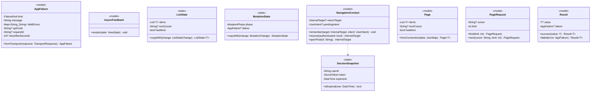

# Thiết kế class và provider Frontend

| Dự án | Owner | Reviewer | Approver | Sprint | Ngày | Phiên bản | Trạng thái |
|---|---|---|---|---|---|---|---|
| ToMateTo | FE — hieun4759 | Lead, BE ở điểm tích hợp | Lead | S5 | 01/11/2026 | 0.1 | Đề nghị review |

**DOC:** 6.1-A — phần FE · **WBS:** 5.1.2.

## Căn cứ và trạng thái
Đối chiếu bổ sung: [DOC 6.2-A BE S5](https://github.com/anqp5002/ToMateTo/blob/ed27b57/docs/thiet_ke/6.2-A_sequence_diagrams_backend.md), Hình 03 và Hình 07.

Thiết kế FE S5 dựa trên DOC 5.1-A/B FE phiên bản 0.4 ngày 01/11/2026, UC/FR/NFR và các màn S1/S2, API BE PR #20 commit `688cef5d`, component BE `c8cf0cd9`, bảo mật BE PR #21 `85c20a3c`, kiến trúc Lead `7903a9f4`. Class BE S5 `dbff79b5` và physical schema DB được dùng để đối chiếu, không dùng để ép FE triển khai ORM hoặc gọi DB.

Các PR liên quan còn mở tại ngày đối chiếu. Tên lớp, method và provider sau đây là thiết kế FE đề xuất, không khẳng định code đã có. API công khai giữ tên theo BE; các tên nội bộ được ánh xạ qua repository. Chưa chạy API hoặc build/test app.

## 1. Cách đọc và phạm vi

S4 chia các phần trách nhiệm, S5 xác định lớp nào giữ dữ liệu gì, gọi method nào và nhận kết quả ra sao. Component không nhất thiết bằng một class. View, state và API model là ba khái niệm khác nhau: View vẽ, state mô tả tình trạng màn, API model chứa dữ liệu contract.

Tên type theo Dart ở mức thiết kế. Future là kết quả bất đồng bộ, Result là success/failure nội bộ. Ký hiệu `-` là dữ liệu nội bộ, `+` là method/getter public. Các thuộc tính state/value object dưới đây được lưu private/final trong triển khai đề xuất, cung cấp getter chỉ đọc và copyWith tạo bản mới; không có public setter tùy ý. Constructor nhận dependency bắt buộc, validate invariant nêu ở từng lớp. Repository interface không có field state.

Thành viên có secret không được đưa vào toString/log. DTO public profile không mang email. Class/provider client không thay kiểm quyền hoặc transaction BE. Không thêm Service trung gian chỉ để chuyển tiếp khi Controller + Repository đã đủ.

## 2. Cấu trúc gói

```text
frontend/
  core/       result, failure, page, navigation, transport, mapper
  session/    session store và state phiên theo tài khoản
  features/
    auth/     view, facade, session/recovery controllers, repository
    content/  feed, detail, editor, form/media state, repository
    social/   profile, interaction, collection, notification
    discovery/ search, trending, nearby, random
    assistant/ chat/history/draft
  platform/   media, location, Android/web session adapters
```

## 3. Sơ đồ lớp theo nhóm

Các sơ đồ thể hiện lớp chính. Bảng đặc tả mục 4 bổ sung thuộc tính, default và chữ ký đầy đủ. Method public ở sequence phải có trong đặc tả này. Không biểu diễn chi tiết query DB vì BE là hệ ngoài đối với FE.

### 3.1. Tài khoản và phiên

```mermaid
classDiagram
  class AccountRepository {
    <<interface>>
    +register(input: RegisterInput) Future~Result~AuthPayload~~
    +login(input: LoginInput) Future~Result~AuthPayload~~
    +logout() Future~Result~SuccessPayload~~
  }
  class AndroidSessionStore {
    <<model>>
    -SecureStoragePort secureStorage
    +readSession() Future~SessionSnapshot?~
    +setSession(session: SessionSnapshot) Future~void~
    +clearSession() Future~void~
  }
  class ApiModelMapper {
    <<model>>
    +decode(operation: String, response: TransportResponse) Result~T~
    +encode(operation: String, input: ApiInput) Result~JsonMap~
  }
  class AsyncFeedback {
    <<model>>
    +render(state: ViewState) void
  }
  class AuthFacade {
    <<model>>
    -SessionController sessionController
    -RecoveryController recoveryController
    +login(input: LoginInput) Future~void~
    +register(input: RegisterInput) Future~void~
    +requestOtp(email: String) Future~void~
  }
  class AuthState {
    <<state>>
    -MutationPhase phase
    -UserSummary? currentUser
    -Map~String_String~ fieldErrors
    +copyWith(change: AuthStateChange) AuthState
  }
  class AuthView {
    <<model>>
    -ViewBinding binding
    -bool isMounted
    +render(state: ViewState) void
    +confirmDiscard() Future~bool~
    +confirmDelete() Future~bool~
  }
  class GraphQLAccountRepository {
    <<model>>
    -GraphQLTransport transport
    -ApiModelMapper mapper
    +register(input: RegisterInput) Future~Result~AuthPayload~~
    +login(input: LoginInput) Future~Result~AuthPayload~~
    +logout() Future~Result~SuccessPayload~~
  }
  class GraphQLTransport {
    <<interface>>
    -SessionStore sessions
    +query(operation: String, variables: JsonMap, auth: AuthPolicy) Future~TransportResponse~
    +mutate(operation: String, variables: JsonMap, auth: AuthPolicy) Future~TransportResponse~
  }
  class MemorySessionStore {
    <<model>>
    -SessionSnapshot? session
    +readSession() Future~SessionSnapshot?~
    +setSession(session: SessionSnapshot) Future~void~
    +clearSession() Future~void~
  }
  class NavigationContext {
    <<model>>
    -InternalTarget? returnTarget
    -UserIntent? pendingIntent
    +remember(target: InternalTarget, intent: UserIntent) void
    +resume(authenticated: bool) InternalTarget
    +openPost(id: String) InternalTarget
  }
  class RecoveryController {
    <<controller>>
    -AccountRepository accounts
    -RecoveryState state
    +requestOtp(email: String) Future~void~
    +resendOtp() Future~void~
    +verifyOtp(otp: String) Future~void~
  }
  class RecoveryState {
    <<state>>
    -RecoveryStage stage
    -String email
    -DateTime? retryAt
    +copyWith(change: RecoveryChange) RecoveryState
  }
  class SessionController {
    <<controller>>
    -AccountRepository accounts
    -SessionStore sessions
    -AuthState state
    +login(input: LoginInput) Future~void~
    +register(input: RegisterInput) Future~void~
    +logout() Future~void~
  }
  class SessionSnapshot {
    <<state>>
    -String userId
    -SecretToken token
    -DateTime expiresAt
    +isExpired(now: DateTime) bool
  }
  class SessionStore {
    <<interface>>
    +readSession() Future~SessionSnapshot?~
    +setSession(session: SessionSnapshot) Future~void~
    +clearSession() Future~void~
  }
  MemorySessionStore ..|> SessionStore
  AndroidSessionStore ..|> SessionStore
  GraphQLAccountRepository ..|> AccountRepository
  AuthFacade "1" --> "1" SessionController : uses
  AuthFacade "1" --> "1" RecoveryController : uses
  SessionController "1" --> "1" AccountRepository : uses
  SessionController "1" --> "1" SessionStore : uses
  SessionController "1" *-- "1" AuthState
  RecoveryController "1" --> "1" AccountRepository : uses
  RecoveryController "1" *-- "1" RecoveryState
  AuthView ..> AuthFacade
  AuthView ..> NavigationContext
  AuthView ..> AsyncFeedback
  GraphQLAccountRepository "1" --> "1" GraphQLTransport : uses
  GraphQLAccountRepository "1" --> "1" ApiModelMapper : uses
```



### 3.2. Nội dung và form bài

```mermaid
classDiagram
  class ApiModelMapper {
    <<model>>
    +decode(operation: String, response: TransportResponse) Result~T~
    +encode(operation: String, input: ApiInput) Result~JsonMap~
  }
  class AsyncFeedback {
    <<model>>
    +render(state: ViewState) void
  }
  class ContentRepository {
    <<interface>>
    +fetchFeed(mode: FeedMode, page: PageRequest) Future~Result~Page~PostSummary~~~
    +fetchPost(id: String) Future~Result~PostDetail~~
    +createPost(input: CreatePostInput) Future~Result~PostDetail~~
    +listMyPosts(page: PageRequest) Future~Result~Page~PostSummary~~~
    +listProfilePosts(userId: String, page: PageRequest) Future~Result~Page~PostSummary~~~
  }
  class ContentView {
    <<model>>
    -ViewBinding binding
    -bool isMounted
    +render(state: ViewState) void
    +confirmDiscard() Future~bool~
    +confirmDelete() Future~bool~
  }
  class EditorMedia {
    <<state>>
    -String localId
    -String? imageId
    -String? uploadId
    +toImageInput() PostImageInput
    +isUsable(now: DateTime) bool
  }
  class EditorState {
    <<state>>
    -PostForm form
    -PostDetail? original
    -List~EditorMedia~ media
    +copyWith(change: EditorChange) EditorState
  }
  class FeedController {
    <<controller>>
    -ContentRepository.IFeedRead content
    -ListState~PostSummary~ state
    -FeedMode mode
    +load(mode: FeedMode) Future~void~
    +loadMore() Future~void~
    +retry() Future~void~
  }
  class GraphQLContentRepository {
    <<model>>
    -GraphQLTransport transport
    -ApiModelMapper mapper
    +fetchFeed(mode: FeedMode, page: PageRequest) Future~Result~Page~PostSummary~~~
    +fetchPost(id: String) Future~Result~PostDetail~~
    +createPost(input: CreatePostInput) Future~Result~PostDetail~~
    +listMyPosts(page: PageRequest) Future~Result~Page~PostSummary~~~
    +listProfilePosts(userId: String, page: PageRequest) Future~Result~Page~PostSummary~~~
  }
  class GraphQLTransport {
    <<interface>>
    -SessionStore sessions
    +query(operation: String, variables: JsonMap, auth: AuthPolicy) Future~TransportResponse~
    +mutate(operation: String, variables: JsonMap, auth: AuthPolicy) Future~TransportResponse~
  }
  class InteractionController {
    <<controller>>
    -SocialRepository.IInteraction social
    -Map~TargetKey_MutationState~ stateByTarget
    +setLike(postId: String, liked: bool) Future~void~
    +save(postId: String, collectionId: String?) Future~void~
    +unsave(postId: String, collectionId: String?) Future~void~
  }
  class ListState {
    <<state>>
    -List~T~ items
    -String? nextCursor
    -bool hasMore
    +copyWith(change: ListStateChange) ListState~T~
  }
  class MediaAdapter {
    <<interface>>
    +pickImages() Future~List~SelectedFile~~
    +validate(file: SelectedFile) Result~FileMetadata~
    +upload(file: SelectedFile, purpose: MediaPurpose) Future~Result~UploadedMedia~~
  }
  class NavigationContext {
    <<model>>
    -InternalTarget? returnTarget
    -UserIntent? pendingIntent
    +remember(target: InternalTarget, intent: UserIntent) void
    +resume(authenticated: bool) InternalTarget
    +openPost(id: String) InternalTarget
  }
  class PostDetailController {
    <<controller>>
    -ContentRepository_read/write/report content
    -PostDetail? post
    -MutationState state
    +load(id: String) Future~void~
    +deletePost(id: String) Future~void~
    +reportPost(id: String, reason: String) Future~void~
  }
  class PostEditorController {
    <<controller>>
    -ContentRepository.IPostWrite content
    -ContentRepository.IMyPostsRead ownPosts
    -MediaAdapter mediaAdapter
    -EditorState state
    +startCreate(draft: AssistantDraft?) void
    +checkCreateOutcome() Future~void~
    +startEdit(post: PostDetail) void
    +changeForm(form: PostForm) void
  }
  class PostForm {
    <<model>>
    -String dishName
    -String? caption
    -String? feeling
    +validate() Map~String,String~
    +fromPost(post: PostDetail) PostForm
  }
  class PostPatch {
    <<model>>
    -Map~String_FieldChange~ changes
    -bool imagesChanged
    -List~PostImageInput~ images
    +buildInput() Result~UpdatePostInput~
  }
  GraphQLContentRepository ..|> ContentRepository
  FeedController "1" --> "1" ContentRepository : uses
  FeedController "1" *-- "1" ListState
  PostDetailController "1" --> "1" ContentRepository : uses
  PostEditorController "1" --> "1" ContentRepository : uses
  PostEditorController "1" --> "1" MediaAdapter : uses
  PostEditorController "1" *-- "1" EditorState
  EditorState "1" *-- "1" PostForm
  EditorState "1" *-- "0..*" EditorMedia
  PostPatch ..> PostForm
  PostEditorController ..> PostPatch
  ContentView ..> FeedController
  ContentView ..> PostDetailController
  ContentView ..> PostEditorController
  ContentView ..> InteractionController
  ContentView ..> NavigationContext
  ContentView ..> AsyncFeedback
  GraphQLContentRepository "1" --> "1" GraphQLTransport : uses
  GraphQLContentRepository "1" --> "1" ApiModelMapper : uses
```



### 3.3. Hồ sơ và tương tác

```mermaid
classDiagram
  class ApiModelMapper {
    <<model>>
    +decode(operation: String, response: TransportResponse) Result~T~
    +encode(operation: String, input: ApiInput) Result~JsonMap~
  }
  class AsyncFeedback {
    <<model>>
    +render(state: ViewState) void
  }
  class CollectionController {
    <<controller>>
    -SocialRepository.ICollection social
    -ListState~CollectionModel~ groups
    -ListState~PostSummary~ items
    +loadGroups() Future~void~
    +loadItems(collectionId: String) Future~void~
    +createGroup(name: String) Future~void~
  }
  class GraphQLSocialRepository {
    <<model>>
    -GraphQLTransport transport
    -ApiModelMapper mapper
    +getProfile(userId: String) Future~Result~PublicProfile~~
    +getOwnProfile() Future~Result~OwnProfile~~
    +updateProfile(input: UpdateProfileInput) Future~Result~OwnProfile~~
  }
  class GraphQLTransport {
    <<interface>>
    -SessionStore sessions
    +query(operation: String, variables: JsonMap, auth: AuthPolicy) Future~TransportResponse~
    +mutate(operation: String, variables: JsonMap, auth: AuthPolicy) Future~TransportResponse~
  }
  class InteractionController {
    <<controller>>
    -SocialRepository.IInteraction social
    -Map~TargetKey_MutationState~ stateByTarget
    +setLike(postId: String, liked: bool) Future~void~
    +save(postId: String, collectionId: String?) Future~void~
    +unsave(postId: String, collectionId: String?) Future~void~
  }
  class NavigationContext {
    <<model>>
    -InternalTarget? returnTarget
    -UserIntent? pendingIntent
    +remember(target: InternalTarget, intent: UserIntent) void
    +resume(authenticated: bool) InternalTarget
    +openPost(id: String) InternalTarget
  }
  class NotificationController {
    <<controller>>
    -SocialRepository.INotification social
    -ListState~NotificationModel~ state
    -int unreadCount
    +load() Future~void~
    +markRead(id: String) Future~void~
    +target(item: NotificationModel) Result~InternalTarget~
  }
  class ProfileController {
    <<controller>>
    -SocialRepository.IProfile social
    -ContentRepository.IProfilePostsRead posts
    -ListState~PostSummary~ postsState
    -PublicProfile? profile
    -MutationState mutation
    +load(userId: String) Future~void~
    +saveProfile(input: UpdateProfileInput) Future~void~
    +saveVisibility(fields: List~String~) Future~void~
  }
  class ContentRepository {
    <<interface>>
    +listProfilePosts(userId: String, page: PageRequest) Future~Result~Page~PostSummary~~~
  }
  ProfileController ..> ContentRepository : IProfilePostsRead
  class SocialRepository {
    <<interface>>
    +getProfile(userId: String) Future~Result~PublicProfile~~
    +getOwnProfile() Future~Result~OwnProfile~~
    +updateProfile(input: UpdateProfileInput) Future~Result~OwnProfile~~
  }
  class SocialView {
    <<model>>
    -ViewBinding binding
    -bool isMounted
    +render(state: ViewState) void
    +confirmDiscard() Future~bool~
    +confirmDelete() Future~bool~
  }
  GraphQLSocialRepository ..|> SocialRepository
  ProfileController "1" --> "1" SocialRepository : uses
  InteractionController "1" --> "1" SocialRepository : uses
  CollectionController "1" --> "1" SocialRepository : uses
  NotificationController "1" --> "1" SocialRepository : uses
  SocialView ..> ProfileController
  SocialView ..> InteractionController
  SocialView ..> CollectionController
  SocialView ..> NotificationController
  SocialView ..> NavigationContext
  SocialView ..> AsyncFeedback
  GraphQLSocialRepository "1" --> "1" GraphQLTransport : uses
  GraphQLSocialRepository "1" --> "1" ApiModelMapper : uses
```



### 3.4. Khám phá và trợ lý

```mermaid
classDiagram
  class ApiModelMapper {
    <<model>>
    +decode(operation: String, response: TransportResponse) Result~T~
    +encode(operation: String, input: ApiInput) Result~JsonMap~
  }
  class AssistantController {
    <<controller>>
    -DiscoveryRepository.IAssistant assistant
    -LocationAdapter location
    -ChatState state
    +loadHistory(sessionId: String?) Future~void~
    +reconcileTurn() Future~void~
    +send(text: String) Future~void~
    +retry(failedReplyId: String) Future~void~
  }
  class AsyncFeedback {
    <<model>>
    +render(state: ViewState) void
  }
  class ChatState {
    <<state>>
    -String? sessionId
    -List~ChatMessage~ messages
    -MutationPhase phase
    +copyWith(change: ChatChange) ChatState
  }
  class DiscoveryController {
    <<controller>>
    -DiscoveryRepository.IDiscovery discovery
    -LocationAdapter location
    -ListState~SearchItem~ state
    +search(query: String, type: SearchType?) Future~void~
    +loadTrending() Future~void~
    +loadNearby() Future~void~
  }
  class DiscoveryRepository {
    <<interface>>
    +search(query: String, type: SearchType?, page: PageRequest) Future~Result~Page~SearchItem~~~
    +trending(page: PageRequest) Future~Result~TrendingPage~~
    +nearby(location: GeoPoint?) Future~Result~NearbyResult~~
  }
  class DiscoveryView {
    <<model>>
    -ViewBinding binding
    -bool isMounted
    +render(state: ViewState) void
    +confirmDiscard() Future~bool~
    +confirmDelete() Future~bool~
  }
  class GraphQLDiscoveryRepository {
    <<model>>
    -GraphQLTransport transport
    -ApiModelMapper mapper
    +search(query: String, type: SearchType?, page: PageRequest) Future~Result~Page~SearchItem~~~
    +trending(page: PageRequest) Future~Result~TrendingPage~~
    +nearby(location: GeoPoint?) Future~Result~NearbyResult~~
  }
  class GraphQLTransport {
    <<interface>>
    -SessionStore sessions
    +query(operation: String, variables: JsonMap, auth: AuthPolicy) Future~TransportResponse~
    +mutate(operation: String, variables: JsonMap, auth: AuthPolicy) Future~TransportResponse~
  }
  class LocationAdapter {
    <<interface>>
    +getPosition() Future~LocationContext~
  }
  class NavigationContext {
    <<model>>
    -InternalTarget? returnTarget
    -UserIntent? pendingIntent
    +remember(target: InternalTarget, intent: UserIntent) void
    +resume(authenticated: bool) InternalTarget
    +openPost(id: String) InternalTarget
  }
  GraphQLDiscoveryRepository ..|> DiscoveryRepository
  DiscoveryController "1" --> "1" DiscoveryRepository : uses
  DiscoveryController "1" --> "1" LocationAdapter : uses
  AssistantController "1" --> "1" DiscoveryRepository : uses
  AssistantController "1" --> "1" LocationAdapter : uses
  AssistantController "1" *-- "1" ChatState
  DiscoveryView ..> DiscoveryController
  DiscoveryView ..> AssistantController
  DiscoveryView ..> NavigationContext
  DiscoveryView ..> AsyncFeedback
  GraphQLDiscoveryRepository "1" --> "1" GraphQLTransport : uses
  GraphQLDiscoveryRepository "1" --> "1" ApiModelMapper : uses
```



### 3.5. Kiểu chung và điều hướng



## 4. Đặc tả lớp

### 4.1. AppFailure

**Loại:** value object. **Component:** C16/C17. **Mục đích:** Lỗi thống nhất cho UI/repository.

| Thuộc tính nội bộ | Kiểu | Default / cách cấp |
|---|---|---|
| -kind | `FailureKind` | Bắt buộc |
| -message | `String` | Bắt buộc, không chứa bí mật |
| -fieldErrors | `Map<String,String>` | {} |
| -requestId | `String?` | null |
| -apiCode | `String?` | null nếu lỗi client, giữ mã API khi có |
| -retryAfterSeconds | `int?` | null, thời gian chờ do BE cung cấp |

| Method public | Tiền điều kiện | Hậu điều kiện / kết quả |
|---|---|---|
| `+fromTransport(response: TransportResponse): AppFailure` | Input hợp lệ theo kiểu và quyền của luồng | Trả kết quả xác định hoặc lỗi có phân loại |

**Constructor và invariant:** Bất biến. FailureKind gồm validation, unauthenticated, forbidden, notFound, notAvailable, alreadyExists, conflict, rateLimited, serviceUnavailable, internalError, outcomeUnknown. Mapper giữ mã API gốc trong apiCode, ánh xạ RATE_LIMITED thành rateLimited và đọc retryAfterSeconds từ metadata lỗi nếu BE cung cấp số hợp lệ. AcceptedPayload giữ trường này riêng cho phản hồi tiếp nhận. RecoveryController tính retryAt từ thời điểm nhận phản hồi cộng thời gian chờ. Thiếu metadata thì chỉ báo bị giới hạn, không tự tạo bộ đếm. Không suy ra thời gian chờ khi server chưa cung cấp. HTTP 200 có errors chưa phải thành công.

### 4.2. Result

**Loại:** sealed result. **Component:** Dùng chung. **Mục đích:** Một trong Success<T> hoặc Failure<T>.

| Thuộc tính nội bộ | Kiểu | Default / cách cấp |
|---|---|---|
| -value | `T?` | Chỉ có trong Success |
| -failure | `AppFailure?` | Chỉ có trong Failure |

| Method public | Tiền điều kiện | Hậu điều kiện / kết quả |
|---|---|---|
| `+success(value: T): Result<T>` | Input hợp lệ theo kiểu và quyền của luồng | Trả kết quả xác định hoặc lỗi có phân loại |
| `+failed(error: AppFailure): Result<T>` | Input hợp lệ theo kiểu và quyền của luồng | Trả kết quả xác định hoặc lỗi có phân loại |

**Constructor và invariant:** Hai nhánh loại trừ nhau; không đồng thời có dữ liệu thành công và lỗi toàn bộ thao tác. Với partial GraphQL data, mapper quyết định theo field/operation trước khi tạo Result.

### 4.3. PageRequest

**Loại:** value object. **Component:** C03/C08/C09/C10/C11. **Mục đích:** Tham số trang nội bộ.

| Thuộc tính nội bộ | Kiểu | Default / cách cấp |
|---|---|---|
| -cursor | `String?` | null |
| -limit | `int` | 10 |

| Method public | Tiền điều kiện | Hậu điều kiện / kết quả |
|---|---|---|
| `+first(limit: int): PageRequest` | Input hợp lệ theo kiểu và quyền của luồng | Trả kết quả xác định hoặc lỗi có phân loại |
| `+next(cursor: String, limit: int): PageRequest` | Input hợp lệ theo kiểu và quyền của luồng | Trả kết quả xác định hoặc lỗi có phân loại |

**Constructor và invariant:** Constructor kiểm limit 1..50; cursor opaque, không tự giải mã/sinh. Đổi bộ lọc/mode thì dùng trang đầu.

### 4.4. Page

**Loại:** value object. **Component:** Repository FE. **Mục đích:** Trang dữ liệu đã ánh xạ từ connection.

| Thuộc tính nội bộ | Kiểu | Default / cách cấp |
|---|---|---|
| -items | `List<T>` | [] |
| -nextCursor | `String?` | null |
| -hasMore | `bool` | false |

| Method public | Tiền điều kiện | Hậu điều kiện / kết quả |
|---|---|---|
| `+fromConnection(data: JsonMap): Page<T>` | Input hợp lệ theo kiểu và quyền của luồng | Trả kết quả xác định hoặc lỗi có phân loại |

**Constructor và invariant:** Bất biến; edges.node thành items, pageInfo.endCursor thành nextCursor. hasMore=true cần cursor sử dụng được theo schema; phản hồi không nhất quán thành lỗi mapping, không lặp vô hạn.

### 4.5. ListState

**Loại:** immutable state. **Component:** C03/C08/C09/C10. **Mục đích:** Danh sách và trạng thái tải.

| Thuộc tính nội bộ | Kiểu | Default / cách cấp |
|---|---|---|
| -items | `List<T>` | [] |
| -nextCursor | `String?` | null |
| -hasMore | `bool` | false |
| -phase | `ListPhase` | idle |
| -failure | `AppFailure?` | null |
| -generation | `int` | 0 |

| Method public | Tiền điều kiện | Hậu điều kiện / kết quả |
|---|---|---|
| `+copyWith(change: ListStateChange): ListState<T>` | Input hợp lệ theo kiểu và quyền của luồng | Trả kết quả xác định hoặc lỗi có phân loại |

**Constructor và invariant:** phase: idle/loading/ready/empty/loadingMore/error. Lỗi tải thêm giữ items và cursor trước request. generation giúp bỏ kết quả thuộc bộ lọc/phiên cũ.

### 4.6. MutationState

**Loại:** immutable state. **Component:** Controller ghi dữ liệu. **Mục đích:** Trạng thái ghi một đối tượng.

| Thuộc tính nội bộ | Kiểu | Default / cách cấp |
|---|---|---|
| -phase | `MutationPhase` | idle |
| -failure | `AppFailure?` | null |

| Method public | Tiền điều kiện | Hậu điều kiện / kết quả |
|---|---|---|
| `+copyWith(change: MutationChange): MutationState` | Input hợp lệ theo kiểu và quyền của luồng | Trả kết quả xác định hoặc lỗi có phân loại |

**Constructor và invariant:** phase: idle/submitting/succeeded/failed/outcomeUnknown. Chặn thao tác cùng đối tượng khi submitting; outcomeUnknown không tự retry createPost.

### 4.7. NavigationContext

**Loại:** application. **Component:** C15. **Mục đích:** Route nội bộ và ngữ cảnh quay lại.

| Thuộc tính nội bộ | Kiểu | Default / cách cấp |
|---|---|---|
| -returnTarget | `InternalTarget?` | null |
| -pendingIntent | `UserIntent?` | null |

| Method public | Tiền điều kiện | Hậu điều kiện / kết quả |
|---|---|---|
| `+remember(target: InternalTarget, intent: UserIntent): void` | Input hợp lệ theo kiểu và quyền của luồng | Trả kết quả xác định hoặc lỗi có phân loại |
| `+resume(authenticated: bool): InternalTarget` | Input hợp lệ theo kiểu và quyền của luồng | Trả kết quả xác định hoặc lỗi có phân loại |
| `+openPost(id: String): InternalTarget` | Input hợp lệ theo kiểu và quyền của luồng | Trả kết quả xác định hoặc lỗi có phân loại |
| `+openCollection(id: String): InternalTarget` | Input hợp lệ theo kiểu và quyền của luồng | Trả kết quả xác định hoặc lỗi có phân loại |
| `+openProfile(id: String): InternalTarget` | Input hợp lệ theo kiểu và quyền của luồng | Trả kết quả xác định hoặc lỗi có phân loại |
| `+back(): InternalTarget` | Input hợp lệ theo kiểu và quyền của luồng | Trả kết quả xác định hoặc lỗi có phân loại |

**Constructor và invariant:** Chỉ nhận route nội bộ; thiếu lịch sử về Feed. resume không thực thi pendingIntent. Khôi phục mật khẩu hủy về Login. Không giữ token/OTP trong URL.

### 4.8. SessionSnapshot

**Loại:** immutable state. **Component:** C22. **Mục đích:** Thông tin phiên dùng nội bộ.

| Thuộc tính nội bộ | Kiểu | Default / cách cấp |
|---|---|---|
| -userId | `String` | Bắt buộc |
| -token | `SecretToken` | Bắt buộc, không ghi log |
| -expiresAt | `DateTime` | Bắt buộc, UTC |

| Method public | Tiền điều kiện | Hậu điều kiện / kết quả |
|---|---|---|
| `+isExpired(now: DateTime): bool` | Input hợp lệ theo kiểu và quyền của luồng | Trả kết quả xác định hoặc lỗi có phân loại |

**Constructor và invariant:** Không expose token qua state hiển thị. expiresAt client chỉ hỗ trợ UX, BE mới xác minh chữ ký/jti/ver. Không có refreshToken.

### 4.9. SessionStore

**Loại:** interface. **Component:** C22. **Mục đích:** Kho phiên có thể thay theo nền tảng.

| Method public | Tiền điều kiện | Hậu điều kiện / kết quả |
|---|---|---|
| `+readSession(): Future<SessionSnapshot?>` | Input hợp lệ theo kiểu và quyền của luồng | Trả kết quả xác định hoặc lỗi có phân loại |
| `+setSession(session: SessionSnapshot): Future<void>` | Input hợp lệ theo kiểu và quyền của luồng | Trả kết quả xác định hoặc lỗi có phân loại |
| `+clearSession(): Future<void>` | Input hợp lệ theo kiểu và quyền của luồng | Trả kết quả xác định hoặc lỗi có phân loại |

**Constructor và invariant:** Cung cấp tín hiệu thay đổi userId/phiên đã loại token cho provider; không gọi controller hoặc router ngược lại.

### 4.10. MemorySessionStore

**Loại:** adapter. **Component:** C22. **Mục đích:** Kho RAM cho web.

| Thuộc tính nội bộ | Kiểu | Default / cách cấp |
|---|---|---|
| -session | `SessionSnapshot?` | null |

| Method public | Tiền điều kiện | Hậu điều kiện / kết quả |
|---|---|---|
| `+readSession(): Future<SessionSnapshot?>` | Input hợp lệ theo kiểu và quyền của luồng | Trả kết quả xác định hoặc lỗi có phân loại |
| `+setSession(session: SessionSnapshot): Future<void>` | Input hợp lệ theo kiểu và quyền của luồng | Trả kết quả xác định hoặc lỗi có phân loại |
| `+clearSession(): Future<void>` | Input hợp lệ theo kiểu và quyền của luồng | Trả kết quả xác định hoặc lỗi có phân loại |

**Constructor và invariant:** Tải lại trang mất phiên; không tự chuyển sang cookie/localStorage.

### 4.11. AndroidSessionStore

**Loại:** adapter. **Component:** C22. **Mục đích:** Kho phiên Android.

| Thuộc tính nội bộ | Kiểu | Default / cách cấp |
|---|---|---|
| -secureStorage | `SecureStoragePort` | Inject |

| Method public | Tiền điều kiện | Hậu điều kiện / kết quả |
|---|---|---|
| `+readSession(): Future<SessionSnapshot?>` | Input hợp lệ theo kiểu và quyền của luồng | Trả kết quả xác định hoặc lỗi có phân loại |
| `+setSession(session: SessionSnapshot): Future<void>` | Input hợp lệ theo kiểu và quyền của luồng | Trả kết quả xác định hoặc lỗi có phân loại |
| `+clearSession(): Future<void>` | Input hợp lệ theo kiểu và quyền của luồng | Trả kết quả xác định hoặc lỗi có phân loại |

**Constructor và invariant:** Dùng adapter kho bảo mật nền tảng theo công nghệ S3 đề xuất, chưa khẳng định plugin đã được thử. Lỗi ghi/xóa kho không được giả báo hoàn tất cục bộ.

### 4.12. AccountRepository

**Loại:** interface. **Component:** C18. **Mục đích:** Hợp đồng tài khoản/khôi phục.

| Method public | Tiền điều kiện | Hậu điều kiện / kết quả |
|---|---|---|
| `+register(input: RegisterInput): Future<Result<AuthPayload>>` | Input hợp lệ theo kiểu và quyền của luồng | Trả kết quả xác định hoặc lỗi có phân loại |
| `+login(input: LoginInput): Future<Result<AuthPayload>>` | Input hợp lệ theo kiểu và quyền của luồng | Trả kết quả xác định hoặc lỗi có phân loại |
| `+logout(): Future<Result<SuccessPayload>>` | Input hợp lệ theo kiểu và quyền của luồng | Trả kết quả xác định hoặc lỗi có phân loại |
| `+requestOtp(email: String): Future<Result<AcceptedPayload>>` | Input hợp lệ theo kiểu và quyền của luồng | Trả kết quả xác định hoặc lỗi có phân loại |
| `+resendOtp(email: String): Future<Result<AcceptedPayload>>` | Input hợp lệ theo kiểu và quyền của luồng | Trả kết quả xác định hoặc lỗi có phân loại |
| `+verifyOtp(email: String, otp: String): Future<Result<ResetGrant>>` | Input hợp lệ theo kiểu và quyền của luồng | Trả kết quả xác định hoặc lỗi có phân loại |
| `+resetPassword(input: ResetPasswordInput): Future<Result<SuccessPayload>>` | Input hợp lệ theo kiểu và quyền của luồng | Trả kết quả xác định hoặc lỗi có phân loại |

**Constructor và invariant:** Tách identity/recovery ở consumer nếu cần; các tên nội bộ requestOtp/resendOtp/verifyOtp ánh xạ tên BE ở bảng DTO. Không tự đổi policy OTP hoặc thêm refresh.

### 4.13. GraphQLAccountRepository

**Loại:** repository adapter. **Component:** C18. **Mục đích:** Triển khai AccountRepository qua GraphQL.

| Thuộc tính nội bộ | Kiểu | Default / cách cấp |
|---|---|---|
| -transport | `GraphQLTransport` | Inject |
| -mapper | `ApiModelMapper` | Inject |

| Method public | Tiền điều kiện | Hậu điều kiện / kết quả |
|---|---|---|
| `+register(input: RegisterInput): Future<Result<AuthPayload>>` | Input hợp lệ theo kiểu và quyền của luồng | Trả kết quả xác định hoặc lỗi có phân loại |
| `+login(input: LoginInput): Future<Result<AuthPayload>>` | Input hợp lệ theo kiểu và quyền của luồng | Trả kết quả xác định hoặc lỗi có phân loại |
| `+logout(): Future<Result<SuccessPayload>>` | Input hợp lệ theo kiểu và quyền của luồng | Trả kết quả xác định hoặc lỗi có phân loại |
| `+requestOtp(email: String): Future<Result<AcceptedPayload>>` | Input hợp lệ theo kiểu và quyền của luồng | Trả kết quả xác định hoặc lỗi có phân loại |
| `+resendOtp(email: String): Future<Result<AcceptedPayload>>` | Input hợp lệ theo kiểu và quyền của luồng | Trả kết quả xác định hoặc lỗi có phân loại |
| `+verifyOtp(email: String, otp: String): Future<Result<ResetGrant>>` | Input hợp lệ theo kiểu và quyền của luồng | Trả kết quả xác định hoặc lỗi có phân loại |
| `+resetPassword(input: ResetPasswordInput): Future<Result<SuccessPayload>>` | Input hợp lệ theo kiểu và quyền của luồng | Trả kết quả xác định hoặc lỗi có phân loại |

**Constructor và invariant:** Không tự lưu phiên hoặc điều hướng; SessionController sở hữu việc ghi kho và phản hồi UX.

### 4.14. AuthState

**Loại:** immutable state. **Component:** C02/C25. **Mục đích:** Trạng thái form đăng nhập/đăng ký.

| Thuộc tính nội bộ | Kiểu | Default / cách cấp |
|---|---|---|
| -phase | `MutationPhase` | idle |
| -currentUser | `UserSummary?` | null |
| -fieldErrors | `Map<String,String>` | {} |
| -failure | `AppFailure?` | null |

| Method public | Tiền điều kiện | Hậu điều kiện / kết quả |
|---|---|---|
| `+copyWith(change: AuthStateChange): AuthState` | Input hợp lệ theo kiểu và quyền của luồng | Trả kết quả xác định hoặc lỗi có phân loại |

**Constructor và invariant:** Không chứa password/token; giá trị password ở form ngắn hạn, xóa khi rời phù hợp; API login sai trả lỗi chung.

### 4.15. RecoveryState

**Loại:** immutable state. **Component:** C26. **Mục đích:** Email/OTP cùng màn và quyền reset.

| Thuộc tính nội bộ | Kiểu | Default / cách cấp |
|---|---|---|
| -stage | `RecoveryStage` | email |
| -email | `String` | rỗng |
| -retryAt | `DateTime?` | null |
| -phase | `MutationPhase` | idle |
| -resetGrant | `ResetGrant?` | null |
| -failure | `AppFailure?` | null |

| Method public | Tiền điều kiện | Hậu điều kiện / kết quả |
|---|---|---|
| `+copyWith(change: RecoveryChange): RecoveryState` | Input hợp lệ theo kiểu và quyền của luồng | Trả kết quả xác định hoặc lỗi có phân loại |

**Constructor và invariant:** stage=email/otp/newPassword/done; resetGrant là bí mật ngắn hạn, không log/persist/URL. Đổi email hoặc hủy thì xóa OTP/grant. retryAt từ metadata, không tự đặt quota.

### 4.16. SessionController

**Loại:** controller. **Component:** C25. **Mục đích:** Đăng ký/login/logout.

| Thuộc tính nội bộ | Kiểu | Default / cách cấp |
|---|---|---|
| -accounts | `AccountRepository` | Inject |
| -sessions | `SessionStore` | Inject |
| -state | `AuthState` | idle |

| Method public | Tiền điều kiện | Hậu điều kiện / kết quả |
|---|---|---|
| `+login(input: LoginInput): Future<void>` | Input hợp lệ theo kiểu và quyền của luồng | Trả kết quả xác định hoặc lỗi có phân loại |
| `+register(input: RegisterInput): Future<void>` | Input hợp lệ theo kiểu và quyền của luồng | Trả kết quả xác định hoặc lỗi có phân loại |
| `+logout(): Future<void>` | Input hợp lệ theo kiểu và quyền của luồng | Trả kết quả xác định hoặc lỗi có phân loại |
| `+endLocalSession(): Future<void>` | Input hợp lệ theo kiểu và quyền của luồng | Trả kết quả xác định hoặc lỗi có phân loại |

**Constructor và invariant:** Login thành công mới ghi kho; nếu cấp phiên/ghi kho lỗi sau register, không tự đăng ký lại. Logout gọi BE trước clear; outcomeUnknown không nói đã revoke. State theo tài khoản được scope theo session identity.

### 4.17. RecoveryController

**Loại:** controller. **Component:** C26. **Mục đích:** Điều phối OTP và reset.

| Thuộc tính nội bộ | Kiểu | Default / cách cấp |
|---|---|---|
| -accounts | `AccountRepository` | Inject |
| -state | `RecoveryState` | email/idle |

| Method public | Tiền điều kiện | Hậu điều kiện / kết quả |
|---|---|---|
| `+requestOtp(email: String): Future<void>` | Input hợp lệ theo kiểu và quyền của luồng | Trả kết quả xác định hoặc lỗi có phân loại |
| `+resendOtp(): Future<void>` | Input hợp lệ theo kiểu và quyền của luồng | Trả kết quả xác định hoặc lỗi có phân loại |
| `+verifyOtp(otp: String): Future<void>` | Input hợp lệ theo kiểu và quyền của luồng | Trả kết quả xác định hoặc lỗi có phân loại |
| `+changeEmail(): void` | Input hợp lệ theo kiểu và quyền của luồng | Trả kết quả xác định hoặc lỗi có phân loại |
| `+resetPassword(input: ResetPasswordInput): Future<void>` | Input hợp lệ theo kiểu và quyền của luồng | Trả kết quả xác định hoặc lỗi có phân loại |
| `+cancel(): void` | Input hợp lệ theo kiểu và quyền của luồng | Trả kết quả xác định hoặc lỗi có phân loại |

**Constructor và invariant:** Mật khẩu ≥6; OTP 6 số, hiệu lực 10 phút, tối đa 5 lần sai phía BE. Grant 15 phút một lần. Hủy không rollback request đã gửi. Tránh old response sau changeEmail/cancel bằng generation/request identity.

### 4.18. AuthFacade

**Loại:** application facade. **Component:** C02. **Mục đích:** Cổng chuyển ý định auth cho View.

| Thuộc tính nội bộ | Kiểu | Default / cách cấp |
|---|---|---|
| -sessionController | `SessionController` | Inject |
| -recoveryController | `RecoveryController` | Inject |

| Method public | Tiền điều kiện | Hậu điều kiện / kết quả |
|---|---|---|
| `+login(input: LoginInput): Future<void>` | Input hợp lệ theo kiểu và quyền của luồng | Trả kết quả xác định hoặc lỗi có phân loại |
| `+register(input: RegisterInput): Future<void>` | Input hợp lệ theo kiểu và quyền của luồng | Trả kết quả xác định hoặc lỗi có phân loại |
| `+requestOtp(email: String): Future<void>` | Input hợp lệ theo kiểu và quyền của luồng | Trả kết quả xác định hoặc lỗi có phân loại |
| `+resendOtp(): Future<void>` | Đang ở bước OTP của email hiện tại | Ủy quyền C26 gửi lại mã và cập nhật thời gian chờ nếu có |
| `+changeEmail(): void` | Đang khôi phục mật khẩu | Ủy quyền C26 về bước email và vô hiệu phản hồi cũ |
| `+cancel(): void` | Đang khôi phục mật khẩu | Ủy quyền C26 dọn dữ liệu nhạy cảm và kết thúc luồng |
| `+verifyOtp(otp: String): Future<void>` | Input hợp lệ theo kiểu và quyền của luồng | Trả kết quả xác định hoặc lỗi có phân loại |
| `+resetPassword(input: ResetPasswordInput): Future<void>` | Input hợp lệ theo kiểu và quyền của luồng | Trả kết quả xác định hoặc lỗi có phân loại |
| `+logout(): Future<void>` | Input hợp lệ theo kiểu và quyền của luồng | Trả kết quả xác định hoặc lỗi có phân loại |

**Constructor và invariant:** Ủy quyền tương ứng tới C25/C26, không sở hữu password hoặc thuật toán OTP riêng. Expose trạng thái chỉ đọc của controller nguồn để AuthView quan sát. Facade không nhân đôi state và dùng cùng RecoveryController trong MH-03 đến MH-05.

### 4.19. ContentRepository

**Loại:** interface. **Component:** C19. **Mục đích:** IFeedRead/IPostRead/IPostWrite/IReportWrite/IMyPostsRead/IProfilePostsRead.

| Method public | Tiền điều kiện | Hậu điều kiện / kết quả |
|---|---|---|
| `+fetchFeed(mode: FeedMode, page: PageRequest): Future<Result<Page<PostSummary>>>` | Input hợp lệ theo kiểu và quyền của luồng | Trả kết quả xác định hoặc lỗi có phân loại |
| `+fetchPost(id: String): Future<Result<PostDetail>>` | Input hợp lệ theo kiểu và quyền của luồng | Trả kết quả xác định hoặc lỗi có phân loại |
| `+createPost(input: CreatePostInput): Future<Result<PostDetail>>` | Input hợp lệ theo kiểu và quyền của luồng | Trả kết quả xác định hoặc lỗi có phân loại |
| `+listMyPosts(page: PageRequest): Future<Result<Page<PostSummary>>>` | Phiên hợp lệ | Gọi `myPosts(page)`, trả trang bài của tài khoản hiện tại để đối soát |
| `+listProfilePosts(userId: String, page: PageRequest): Future<Result<Page<PostSummary>>>` | Có ID hồ sơ và PageRequest hợp lệ | Gọi `profilePosts(userId, page)` và ánh xạ trang bài theo quyền hiển thị |
| `+updatePost(id: String, input: UpdatePostInput): Future<Result<PostDetail>>` | Input hợp lệ theo kiểu và quyền của luồng | Trả kết quả xác định hoặc lỗi có phân loại |
| `+deletePost(id: String): Future<Result<SuccessPayload>>` | Input hợp lệ theo kiểu và quyền của luồng | Trả kết quả xác định hoặc lỗi có phân loại |
| `+reportPost(id: String, reason: String): Future<Result<ReportReceipt>>` | Input hợp lệ theo kiểu và quyền của luồng | Trả kết quả xác định hoặc lỗi có phân loại |

**Constructor và invariant:** Consumer chỉ nhận nhóm interface cần dùng. Chuẩn hóa món và quyền chủ sở hữu do BE; không có tags trong API v1.

### 4.20. GraphQLContentRepository

**Loại:** repository adapter. **Component:** C19. **Mục đích:** Ánh xạ các nhóm API nội dung.

| Thuộc tính nội bộ | Kiểu | Default / cách cấp |
|---|---|---|
| -transport | `GraphQLTransport` | Inject |
| -mapper | `ApiModelMapper` | Inject |

| Method public | Tiền điều kiện | Hậu điều kiện / kết quả |
|---|---|---|
| `+fetchFeed(mode: FeedMode, page: PageRequest): Future<Result<Page<PostSummary>>>` | Input hợp lệ theo kiểu và quyền của luồng | Trả kết quả xác định hoặc lỗi có phân loại |
| `+fetchPost(id: String): Future<Result<PostDetail>>` | Input hợp lệ theo kiểu và quyền của luồng | Trả kết quả xác định hoặc lỗi có phân loại |
| `+createPost(input: CreatePostInput): Future<Result<PostDetail>>` | Input hợp lệ theo kiểu và quyền của luồng | Trả kết quả xác định hoặc lỗi có phân loại |
| `+listMyPosts(page: PageRequest): Future<Result<Page<PostSummary>>>` | Phiên hợp lệ | Gọi `myPosts(page)`, trả trang bài của tài khoản hiện tại để đối soát |
| `+listProfilePosts(userId: String, page: PageRequest): Future<Result<Page<PostSummary>>>` | Có ID hồ sơ và PageRequest hợp lệ | Gọi `profilePosts(userId, page)` và ánh xạ trang bài theo quyền hiển thị |
| `+updatePost(id: String, input: UpdatePostInput): Future<Result<PostDetail>>` | Input hợp lệ theo kiểu và quyền của luồng | Trả kết quả xác định hoặc lỗi có phân loại |
| `+deletePost(id: String): Future<Result<SuccessPayload>>` | Input hợp lệ theo kiểu và quyền của luồng | Trả kết quả xác định hoặc lỗi có phân loại |
| `+reportPost(id: String, reason: String): Future<Result<ReportReceipt>>` | Input hợp lệ theo kiểu và quyền của luồng | Trả kết quả xác định hoặc lỗi có phân loại |

**Constructor và invariant:** Mapper lấy Post trực tiếp từ data.createPost/updatePost, không bọc thêm post. Public/optional auth khác required auth.

### 4.21. FeedController

**Loại:** controller. **Component:** C03. **Mục đích:** Feed và tải thêm.

| Thuộc tính nội bộ | Kiểu | Default / cách cấp |
|---|---|---|
| -content | `ContentRepository.IFeedRead` | Inject |
| -state | `ListState<PostSummary>` | idle |
| -mode | `FeedMode` | LATEST |

| Method public | Tiền điều kiện | Hậu điều kiện / kết quả |
|---|---|---|
| `+load(mode: FeedMode): Future<void>` | Input hợp lệ theo kiểu và quyền của luồng | Trả kết quả xác định hoặc lỗi có phân loại |
| `+loadMore(): Future<void>` | Input hợp lệ theo kiểu và quyền của luồng | Trả kết quả xác định hoặc lỗi có phân loại |
| `+retry(): Future<void>` | Input hợp lệ theo kiểu và quyền của luồng | Trả kết quả xác định hoặc lỗi có phân loại |

**Constructor và invariant:** Một request cho cùng cursor; mode thay đổi tăng generation, bỏ phản hồi cũ. Loại trùng Post.id; preserve list khi loadMore lỗi.

### 4.22. PostDetailController

**Loại:** controller. **Component:** C04. **Mục đích:** Chi tiết, xóa và báo cáo.

| Thuộc tính nội bộ | Kiểu | Default / cách cấp |
|---|---|---|
| -content | `ContentRepository read/write/report` | Inject |
| -post | `PostDetail?` | null |
| -state | `MutationState` | idle |

| Method public | Tiền điều kiện | Hậu điều kiện / kết quả |
|---|---|---|
| `+load(id: String): Future<void>` | Input hợp lệ theo kiểu và quyền của luồng | Trả kết quả xác định hoặc lỗi có phân loại |
| `+deletePost(id: String): Future<void>` | Input hợp lệ theo kiểu và quyền của luồng | Trả kết quả xác định hoặc lỗi có phân loại |
| `+reportPost(id: String, reason: String): Future<void>` | Input hợp lệ theo kiểu và quyền của luồng | Trả kết quả xác định hoặc lỗi có phân loại |

**Constructor và invariant:** View kiểm xác nhận xóa trước gọi method. Khi BE xác nhận xóa mới quay danh sách; notAvailable giữ đường Back. Report accepted không đồng nghĩa bài bị ẩn.

### 4.23. PostForm

**Loại:** immutable form. **Component:** C05. **Mục đích:** Nội dung đang soạn.

| Thuộc tính nội bộ | Kiểu | Default / cách cấp |
|---|---|---|
| -dishName | `String` | rỗng |
| -caption | `String?` | null |
| -feeling | `String?` | null |
| -restaurantId | `String?` | null |
| -restaurantName | `String?` | null |
| -address | `String?` | null |
| -priceRange | `PriceRange?` | null |
| -latitude | `double?` | null |
| -longitude | `double?` | null |
| -recipe | `RecipeModel?` | null |

| Method public | Tiền điều kiện | Hậu điều kiện / kết quả |
|---|---|---|
| `+validate(): Map<String,String>` | Input hợp lệ theo kiểu và quyền của luồng | Trả kết quả xác định hoặc lỗi có phân loại |
| `+fromPost(post: PostDetail): PostForm` | Input hợp lệ theo kiểu và quyền của luồng | Trả kết quả xác định hoặc lỗi có phân loại |

**Constructor và invariant:** Tạo chỉ bắt buộc dishName.trim không rỗng. Giá là enum bốn mức, không tiền chính xác. Không tags. Mapping caption/feeling và ghép quán cần review chung.

### 4.24. EditorMedia

**Loại:** immutable state. **Component:** C05/C23. **Mục đích:** Ảnh cũ/chọn/upload và lỗi riêng từng tệp.

| Thuộc tính nội bộ | Kiểu | Default / cách cấp |
|---|---|---|
| -localId | `String` | Bắt buộc |
| -imageId | `String?` | null, cho ảnh cũ |
| -uploadId | `String?` | null, cho ảnh mới upload |
| -file | `SelectedFile?` | null |
| -url | `String?` | null |
| -position | `int` | 0 |
| -phase | `MediaPhase` | selected |
| -expiresAt | `DateTime?` | null |
| -failure | `AppFailure?` | null |

| Method public | Tiền điều kiện | Hậu điều kiện / kết quả |
|---|---|---|
| `+toImageInput(): PostImageInput` | Input hợp lệ theo kiểu và quyền của luồng | Trả kết quả xác định hoặc lỗi có phân loại |
| `+isUsable(now: DateTime): bool` | Input hợp lệ theo kiểu và quyền của luồng | Trả kết quả xác định hoặc lỗi có phân loại |

**Constructor và invariant:** Một phần tử khi gửi chỉ có imageId hoặc uploadId. Chưa upload/ảnh lỗi/hết hạn không tự biến thành không ảnh. expiresAt từ BE, 24h chưa hardcode.

### 4.25. EditorState

**Loại:** immutable state. **Component:** C05. **Mục đích:** State tạo/sửa bài.

| Thuộc tính nội bộ | Kiểu | Default / cách cấp |
|---|---|---|
| -form | `PostForm` | empty |
| -original | `PostDetail?` | null |
| -media | `List<EditorMedia>` | [] |
| -isDirty | `bool` | false |
| -phase | `MutationPhase` | idle |
| -fieldErrors | `Map<String,String>` | {} |
| -failure | `AppFailure?` | null |

| Method public | Tiền điều kiện | Hậu điều kiện / kết quả |
|---|---|---|
| `+copyWith(change: EditorChange): EditorState` | Input hợp lệ theo kiểu và quyền của luồng | Trả kết quả xác định hoặc lỗi có phân loại |

**Constructor và invariant:** Snapshot gốc dùng so sánh dirty/ảnh; immutable state không chia sẻ list có thể sửa tại chỗ. Không giữ cache form tài khoản cũ sau logout.

### 4.26. PostPatch

**Loại:** value object. **Component:** C05/C19. **Mục đích:** Ý định sửa tách khỏi payload chưa chốt.

| Thuộc tính nội bộ | Kiểu | Default / cách cấp |
|---|---|---|
| -changes | `Map<String,FieldChange>` | {} |
| -imagesChanged | `bool` | false |
| -images | `List<PostImageInput>` | [] |

| Method public | Tiền điều kiện | Hậu điều kiện / kết quả |
|---|---|---|
| `+buildInput(): Result<UpdatePostInput>` | Input hợp lệ theo kiểu và quyền của luồng | Trả kết quả xác định hoặc lỗi có phân loại |

**Constructor và invariant:** FieldChange=unchanged/set(value)/clear. Chỉ serialize trường kiểu String có policy clear xác định. Clear PriceRange/Float/Recipe chưa có contract thì trả validation nội bộ, không gửi chuỗi rỗng/null sai ý định. imagesChanged=false omit; true+[]=xóa hết.

### 4.27. PostEditorController

**Loại:** controller. **Component:** C05. **Mục đích:** Soạn/sửa và điều phối ảnh.

| Thuộc tính nội bộ | Kiểu | Default / cách cấp |
|---|---|---|
| -content | `ContentRepository.IPostWrite` | Inject |
| -ownPosts | `ContentRepository.IMyPostsRead` | Inject từ cùng repository |
| -mediaAdapter | `MediaAdapter` | Inject |
| -state | `EditorState` | empty |

| Method public | Tiền điều kiện | Hậu điều kiện / kết quả |
|---|---|---|
| `+startCreate(draft: AssistantDraft?): void` | Input hợp lệ theo kiểu và quyền của luồng | Trả kết quả xác định hoặc lỗi có phân loại |
| `+startEdit(post: PostDetail): void` | Input hợp lệ theo kiểu và quyền của luồng | Trả kết quả xác định hoặc lỗi có phân loại |
| `+changeForm(form: PostForm): void` | Input hợp lệ theo kiểu và quyền của luồng | Trả kết quả xác định hoặc lỗi có phân loại |
| `+selectImages(): Future<void>` | Input hợp lệ theo kiểu và quyền của luồng | Trả kết quả xác định hoặc lỗi có phân loại |
| `+uploadPending(): Future<void>` | Input hợp lệ theo kiểu và quyền của luồng | Trả kết quả xác định hoặc lỗi có phân loại |
| `+retryMedia(localId: String): Future<void>` | Input hợp lệ theo kiểu và quyền của luồng | Trả kết quả xác định hoặc lỗi có phân loại |
| `+removeMedia(localId: String): void` | Input hợp lệ theo kiểu và quyền của luồng | Trả kết quả xác định hoặc lỗi có phân loại |
| `+submitCreate(): Future<void>` | Input hợp lệ theo kiểu và quyền của luồng | Trả kết quả xác định hoặc lỗi có phân loại |
| `+checkCreateOutcome(): Future<void>` | Lần tạo bài có kết quả chưa rõ, phiên hiện tại còn hợp lệ | Tải bài của mình và hiển thị ứng viên để người dùng kiểm tra. Giữ form; không tự gửi lại |
| `+submitUpdate(): Future<void>` | Input hợp lệ theo kiểu và quyền của luồng | Trả kết quả xác định hoặc lỗi có phân loại |
| `+discard(): void` | Input hợp lệ theo kiểu và quyền của luồng | Trả kết quả xác định hoặc lỗi có phân loại |

**Constructor và invariant:** submit tự kiểm pending ảnh và validate; controller giữ C23/C19 theo S4. Chặn lặp khi submitting. Bỏ ảnh do người dùng chọn mới sửa list; discard chỉ trước request hoặc sau cảnh báo kết quả chưa rõ, không rollback server.

### 4.28. SocialRepository

**Loại:** interface. **Component:** C20. **Mục đích:** IProfile/IInteraction/ICollection/INotification.

| Method public | Tiền điều kiện | Hậu điều kiện / kết quả |
|---|---|---|
| `+getProfile(userId: String): Future<Result<PublicProfile>>` | Input hợp lệ theo kiểu và quyền của luồng | Trả kết quả xác định hoặc lỗi có phân loại |
| `+getOwnProfile(): Future<Result<OwnProfile>>` | Input hợp lệ theo kiểu và quyền của luồng | Trả kết quả xác định hoặc lỗi có phân loại |
| `+updateProfile(input: UpdateProfileInput): Future<Result<OwnProfile>>` | Input hợp lệ theo kiểu và quyền của luồng | Trả kết quả xác định hoặc lỗi có phân loại |
| `+setVisibility(fields: List<String>): Future<Result<VisibilityPayload>>` | Input hợp lệ theo kiểu và quyền của luồng | Trả kết quả xác định hoặc lỗi có phân loại |
| `+setLike(postId: String, liked: bool): Future<Result<LikeState>>` | Input hợp lệ theo kiểu và quyền của luồng | Trả kết quả xác định hoặc lỗi có phân loại |
| `+savePost(postId: String, collectionId: String?): Future<Result<SaveState>>` | Input hợp lệ theo kiểu và quyền của luồng | Trả kết quả xác định hoặc lỗi có phân loại |
| `+removeSavedPost(postId: String, collectionId: String?): Future<Result<SaveState>>` | Input hợp lệ theo kiểu và quyền của luồng | Trả kết quả xác định hoặc lỗi có phân loại |
| `+setFollow(userId: String, followed: bool): Future<Result<FollowState>>` | Input hợp lệ theo kiểu và quyền của luồng | Trả kết quả xác định hoặc lỗi có phân loại |
| `+listCollections(page: PageRequest): Future<Result<Page<CollectionModel>>>` | Input hợp lệ theo kiểu và quyền của luồng | Trả kết quả xác định hoặc lỗi có phân loại |
| `+listItems(collectionId: String, page: PageRequest): Future<Result<Page<PostSummary>>>` | Input hợp lệ theo kiểu và quyền của luồng | Trả kết quả xác định hoặc lỗi có phân loại |
| `+createCollection(name: String): Future<Result<CollectionModel>>` | Input hợp lệ theo kiểu và quyền của luồng | Trả kết quả xác định hoặc lỗi có phân loại |
| `+renameCollection(id: String, name: String): Future<Result<CollectionModel>>` | Input hợp lệ theo kiểu và quyền của luồng | Trả kết quả xác định hoặc lỗi có phân loại |
| `+deleteCollection(id: String): Future<Result<SuccessPayload>>` | Input hợp lệ theo kiểu và quyền của luồng | Trả kết quả xác định hoặc lỗi có phân loại |
| `+listNotifications(page: PageRequest): Future<Result<NotificationPage>>` | Input hợp lệ theo kiểu và quyền của luồng | Trả kết quả xác định hoặc lỗi có phân loại |
| `+markRead(id: String): Future<Result<NotificationReadPayload>>` | Input hợp lệ theo kiểu và quyền của luồng | Trả kết quả xác định hoặc lỗi có phân loại |

**Constructor và invariant:** Tên nội bộ list* ánh xạ query myCollections/collectionItems/notifications. Public DTO không email. Mỗi consumer nhận hẹp một interface, không nhận mọi operation.

### 4.29. GraphQLSocialRepository

**Loại:** repository adapter. **Component:** C20. **Mục đích:** Triển khai hợp đồng social.

| Thuộc tính nội bộ | Kiểu | Default / cách cấp |
|---|---|---|
| -transport | `GraphQLTransport` | Inject |
| -mapper | `ApiModelMapper` | Inject |

| Method public | Tiền điều kiện | Hậu điều kiện / kết quả |
|---|---|---|
| `+getProfile(userId: String): Future<Result<PublicProfile>>` | Input hợp lệ theo kiểu và quyền của luồng | Trả kết quả xác định hoặc lỗi có phân loại |
| `+getOwnProfile(): Future<Result<OwnProfile>>` | Input hợp lệ theo kiểu và quyền của luồng | Trả kết quả xác định hoặc lỗi có phân loại |
| `+updateProfile(input: UpdateProfileInput): Future<Result<OwnProfile>>` | Input hợp lệ theo kiểu và quyền của luồng | Trả kết quả xác định hoặc lỗi có phân loại |
| `+setVisibility(fields: List<String>): Future<Result<VisibilityPayload>>` | Input hợp lệ theo kiểu và quyền của luồng | Trả kết quả xác định hoặc lỗi có phân loại |
| `+setLike(postId: String, liked: bool): Future<Result<LikeState>>` | Input hợp lệ theo kiểu và quyền của luồng | Trả kết quả xác định hoặc lỗi có phân loại |
| `+savePost(postId: String, collectionId: String?): Future<Result<SaveState>>` | Input hợp lệ theo kiểu và quyền của luồng | Trả kết quả xác định hoặc lỗi có phân loại |
| `+removeSavedPost(postId: String, collectionId: String?): Future<Result<SaveState>>` | Input hợp lệ theo kiểu và quyền của luồng | Trả kết quả xác định hoặc lỗi có phân loại |
| `+setFollow(userId: String, followed: bool): Future<Result<FollowState>>` | Input hợp lệ theo kiểu và quyền của luồng | Trả kết quả xác định hoặc lỗi có phân loại |
| `+listCollections(page: PageRequest): Future<Result<Page<CollectionModel>>>` | Input hợp lệ theo kiểu và quyền của luồng | Trả kết quả xác định hoặc lỗi có phân loại |
| `+listItems(collectionId: String, page: PageRequest): Future<Result<Page<PostSummary>>>` | Input hợp lệ theo kiểu và quyền của luồng | Trả kết quả xác định hoặc lỗi có phân loại |
| `+createCollection(name: String): Future<Result<CollectionModel>>` | Input hợp lệ theo kiểu và quyền của luồng | Trả kết quả xác định hoặc lỗi có phân loại |
| `+renameCollection(id: String, name: String): Future<Result<CollectionModel>>` | Input hợp lệ theo kiểu và quyền của luồng | Trả kết quả xác định hoặc lỗi có phân loại |
| `+deleteCollection(id: String): Future<Result<SuccessPayload>>` | Input hợp lệ theo kiểu và quyền của luồng | Trả kết quả xác định hoặc lỗi có phân loại |
| `+listNotifications(page: PageRequest): Future<Result<NotificationPage>>` | Input hợp lệ theo kiểu và quyền của luồng | Trả kết quả xác định hoặc lỗi có phân loại |
| `+markRead(id: String): Future<Result<NotificationReadPayload>>` | Input hợp lệ theo kiểu và quyền của luồng | Trả kết quả xác định hoặc lỗi có phân loại |

**Constructor và invariant:** ListNotifications trả Page cộng unreadCount toàn tài khoản; không suy ra tổng từ một trang. Schema Profile dùng public/own type nội bộ tách quyền.

### 4.30. ProfileController

**Loại:** controller. **Component:** C06. **Mục đích:** Đọc/sửa hồ sơ và lựa chọn công khai.

| Thuộc tính nội bộ | Kiểu | Default / cách cấp |
|---|---|---|
| -social | `SocialRepository.IProfile` | Inject |
| -posts | `ContentRepository.IProfilePostsRead` | Inject |
| -postsState | `ListState<PostSummary>` | idle |
| -profile | `PublicProfile?` | null |
| -mutation | `MutationState` | idle |

| Method public | Tiền điều kiện | Hậu điều kiện / kết quả |
|---|---|---|
| `+load(userId: String): Future<void>` | Input hợp lệ theo kiểu và quyền của luồng | Trả kết quả xác định hoặc lỗi có phân loại |
| `+loadPosts(userId: String): Future<void>` | Đã xác định hồ sơ đang mở | Lấy trang đầu, cập nhật danh sách riêng của hồ sơ |
| `+loadMorePosts(): Future<void>` | Có cursor, còn trang và chưa tải tiếp | Gọi repository với cursor tiếp theo, giữ mục cũ nếu lỗi |
| `+saveProfile(input: UpdateProfileInput): Future<void>` | Input hợp lệ theo kiểu và quyền của luồng | Trả kết quả xác định hoặc lỗi có phân loại |
| `+saveVisibility(fields: List<String>): Future<void>` | Input hợp lệ theo kiểu và quyền của luồng | Trả kết quả xác định hoặc lỗi có phân loại |

**Constructor và invariant:** C06 bổ sung phụ thuộc đọc bài từ C19 so với DOC 5.1-A, giữ C20 cho dữ liệu hồ sơ. Đổi userId hoặc viewer generation thì bỏ phản hồi bài của ngữ cảnh cũ. Hai lệnh lưu độc lập; email không có lựa chọn public. Ảnh hồ sơ chỉ thêm nếu scope/form đã được nhóm chốt; không tự mở UI cover vì API có field.

### 4.31. InteractionController

**Loại:** controller. **Component:** C07. **Mục đích:** Thích/lưu/follow theo đối tượng.

| Thuộc tính nội bộ | Kiểu | Default / cách cấp |
|---|---|---|
| -social | `SocialRepository.IInteraction` | Inject |
| -stateByTarget | `Map<TargetKey,MutationState>` | {} |

| Method public | Tiền điều kiện | Hậu điều kiện / kết quả |
|---|---|---|
| `+setLike(postId: String, liked: bool): Future<void>` | Input hợp lệ theo kiểu và quyền của luồng | Trả kết quả xác định hoặc lỗi có phân loại |
| `+save(postId: String, collectionId: String?): Future<void>` | Input hợp lệ theo kiểu và quyền của luồng | Trả kết quả xác định hoặc lỗi có phân loại |
| `+unsave(postId: String, collectionId: String?): Future<void>` | Input hợp lệ theo kiểu và quyền của luồng | Trả kết quả xác định hoặc lỗi có phân loại |
| `+setFollow(userId: String, followed: bool): Future<void>` | Input hợp lệ theo kiểu và quyền của luồng | Trả kết quả xác định hoặc lỗi có phân loại |

**Constructor và invariant:** Khóa theo target trong khi chờ, dùng counter/state server xác nhận. Kết quả saved cung cấp collectionId cho View; không tự chuyển màn.

### 4.32. CollectionController

**Loại:** controller. **Component:** C08. **Mục đích:** Danh sách nhóm và bài lưu.

| Thuộc tính nội bộ | Kiểu | Default / cách cấp |
|---|---|---|
| -social | `SocialRepository.ICollection` | Inject |
| -groups | `ListState<CollectionModel>` | idle |
| -items | `ListState<PostSummary>` | idle |
| -mutation | `MutationState` | idle |

| Method public | Tiền điều kiện | Hậu điều kiện / kết quả |
|---|---|---|
| `+loadGroups(): Future<void>` | Input hợp lệ theo kiểu và quyền của luồng | Trả kết quả xác định hoặc lỗi có phân loại |
| `+loadItems(collectionId: String): Future<void>` | Input hợp lệ theo kiểu và quyền của luồng | Trả kết quả xác định hoặc lỗi có phân loại |
| `+createGroup(name: String): Future<void>` | Input hợp lệ theo kiểu và quyền của luồng | Trả kết quả xác định hoặc lỗi có phân loại |
| `+renameGroup(id: String, name: String): Future<void>` | Input hợp lệ theo kiểu và quyền của luồng | Trả kết quả xác định hoặc lỗi có phân loại |
| `+deleteGroup(id: String): Future<void>` | Input hợp lệ theo kiểu và quyền của luồng | Trả kết quả xác định hoặc lỗi có phân loại |

**Constructor và invariant:** Không cho xóa Đã lưu; BE vẫn kiểm quyền/default. Xóa nhóm không xóa bài gốc. Hủy hộp xác nhận không gọi deleteGroup.

### 4.33. NotificationController

**Loại:** controller. **Component:** C09. **Mục đích:** Thông báo, tổng chưa đọc và đích nội dung.

| Thuộc tính nội bộ | Kiểu | Default / cách cấp |
|---|---|---|
| -social | `SocialRepository.INotification` | Inject |
| -state | `ListState<NotificationModel>` | idle |
| -unreadCount | `int` | 0, chỉ hiển thị xác nhận sau load |

| Method public | Tiền điều kiện | Hậu điều kiện / kết quả |
|---|---|---|
| `+load(): Future<void>` | Input hợp lệ theo kiểu và quyền của luồng | Trả kết quả xác định hoặc lỗi có phân loại |
| `+markRead(id: String): Future<void>` | Input hợp lệ theo kiểu và quyền của luồng | Trả kết quả xác định hoặc lỗi có phân loại |
| `+target(item: NotificationModel): Result<InternalTarget>` | Input hợp lệ theo kiểu và quyền của luồng | Trả kết quả xác định hoặc lỗi có phân loại |

**Constructor và invariant:** Không tự markRead chỉ vì mở nếu chưa có rule. actor null/post mất thì trả notAvailable; markRead lỗi giữ trạng thái xác nhận gần nhất.

### 4.34. DiscoveryRepository

**Loại:** interface. **Component:** C21. **Mục đích:** IDiscovery/IAssistant.

| Method public | Tiền điều kiện | Hậu điều kiện / kết quả |
|---|---|---|
| `+search(query: String, type: SearchType?, page: PageRequest): Future<Result<Page<SearchItem>>>` | Input hợp lệ theo kiểu và quyền của luồng | Trả kết quả xác định hoặc lỗi có phân loại |
| `+trending(page: PageRequest): Future<Result<TrendingPage>>` | Input hợp lệ theo kiểu và quyền của luồng | Trả kết quả xác định hoặc lỗi có phân loại |
| `+nearby(location: GeoPoint?): Future<Result<NearbyResult>>` | Input hợp lệ theo kiểu và quyền của luồng | Trả kết quả xác định hoặc lỗi có phân loại |
| `+randomDish(): Future<Result<DishSuggestion>>` | Input hợp lệ theo kiểu và quyền của luồng | Trả kết quả xác định hoặc lỗi có phân loại |
| `+ask(input: AskAssistantInput): Future<Result<AssistantReply>>` | Input hợp lệ theo kiểu và quyền của luồng | Trả kết quả xác định hoặc lỗi có phân loại |
| `+retry(failedReplyId: String): Future<Result<AssistantReply>>` | Input hợp lệ theo kiểu và quyền của luồng | Trả kết quả xác định hoặc lỗi có phân loại |
| `+history(sessionId: String?, page: PageRequest): Future<Result<Page<ChatMessage>>>` | Input hợp lệ theo kiểu và quyền của luồng | Trả kết quả xác định hoặc lỗi có phân loại |
| `+listAssistantSessions(page: PageRequest): Future<Result<Page<AssistantSessionSummary>>>` | Phiên hợp lệ | Gọi `assistantSessions(page)` để hỗ trợ tìm lại hội thoại khi chưa có sessionId |
| `+draft(draftReplyId: String): Future<Result<AssistantDraft>>` | Input hợp lệ theo kiểu và quyền của luồng | Trả kết quả xác định hoặc lỗi có phân loại |

**Constructor và invariant:** SearchType theo API; không tags v1. randomDish chưa thêm filter bắt buộc. draft không tạo Post.

### 4.35. GraphQLDiscoveryRepository

**Loại:** repository adapter. **Component:** C21. **Mục đích:** Ánh xạ query khám phá và hội thoại.

| Thuộc tính nội bộ | Kiểu | Default / cách cấp |
|---|---|---|
| -transport | `GraphQLTransport` | Inject |
| -mapper | `ApiModelMapper` | Inject |

| Method public | Tiền điều kiện | Hậu điều kiện / kết quả |
|---|---|---|
| `+search(query: String, type: SearchType?, page: PageRequest): Future<Result<Page<SearchItem>>>` | Input hợp lệ theo kiểu và quyền của luồng | Trả kết quả xác định hoặc lỗi có phân loại |
| `+trending(page: PageRequest): Future<Result<TrendingPage>>` | Input hợp lệ theo kiểu và quyền của luồng | Trả kết quả xác định hoặc lỗi có phân loại |
| `+nearby(location: GeoPoint?): Future<Result<NearbyResult>>` | Input hợp lệ theo kiểu và quyền của luồng | Trả kết quả xác định hoặc lỗi có phân loại |
| `+randomDish(): Future<Result<DishSuggestion>>` | Input hợp lệ theo kiểu và quyền của luồng | Trả kết quả xác định hoặc lỗi có phân loại |
| `+ask(input: AskAssistantInput): Future<Result<AssistantReply>>` | Input hợp lệ theo kiểu và quyền của luồng | Trả kết quả xác định hoặc lỗi có phân loại |
| `+retry(failedReplyId: String): Future<Result<AssistantReply>>` | Input hợp lệ theo kiểu và quyền của luồng | Trả kết quả xác định hoặc lỗi có phân loại |
| `+history(sessionId: String?, page: PageRequest): Future<Result<Page<ChatMessage>>>` | Input hợp lệ theo kiểu và quyền của luồng | Trả kết quả xác định hoặc lỗi có phân loại |
| `+listAssistantSessions(page: PageRequest): Future<Result<Page<AssistantSessionSummary>>>` | Phiên hợp lệ | Gọi `assistantSessions(page)` để hỗ trợ tìm lại hội thoại khi chưa có sessionId |
| `+draft(draftReplyId: String): Future<Result<AssistantDraft>>` | Input hợp lệ theo kiểu và quyền của luồng | Trả kết quả xác định hoặc lỗi có phân loại |

**Constructor và invariant:** nearby nội bộ ánh xạ nearbyPlaces; ask/retry/history/draft ánh xạ askAssistant/retryAssistant/assistantHistory/useAssistantDraft.

### 4.36. DiscoveryController

**Loại:** controller. **Component:** C10. **Mục đích:** Tìm kiếm/xu hướng/gần/quay món.

| Thuộc tính nội bộ | Kiểu | Default / cách cấp |
|---|---|---|
| -discovery | `DiscoveryRepository.IDiscovery` | Inject |
| -location | `LocationAdapter` | Inject |
| -state | `ListState<SearchItem>` | idle |
| -locationContext | `LocationContext?` | null |

| Method public | Tiền điều kiện | Hậu điều kiện / kết quả |
|---|---|---|
| `+search(query: String, type: SearchType?): Future<void>` | Input hợp lệ theo kiểu và quyền của luồng | Trả kết quả xác định hoặc lỗi có phân loại |
| `+loadTrending(): Future<void>` | Input hợp lệ theo kiểu và quyền của luồng | Trả kết quả xác định hoặc lỗi có phân loại |
| `+loadNearby(): Future<void>` | Input hợp lệ theo kiểu và quyền của luồng | Trả kết quả xác định hoặc lỗi có phân loại |
| `+randomDish(): Future<void>` | Input hợp lệ theo kiểu và quyền của luồng | Trả kết quả xác định hoặc lỗi có phân loại |

**Constructor và invariant:** Query ≥2 ký tự; đổi tiêu chí tăng generation. Không có GPS thì gửi location null/omit, BE chọn fallback và trả usedDefaultLocation. Chọn mục bài mở detail, món/quán mở kết quả liên quan.

### 4.37. ChatState

**Loại:** immutable state. **Component:** C11. **Mục đích:** Lịch sử hội thoại và lượt đang chờ.

| Thuộc tính nội bộ | Kiểu | Default / cách cấp |
|---|---|---|
| -sessionId | `String?` | null |
| -messages | `List<ChatMessage>` | [] |
| -phase | `MutationPhase` | idle |
| -failedReplyId | `String?` | null |
| -failure | `AppFailure?` | null |

| Method public | Tiền điều kiện | Hậu điều kiện / kết quả |
|---|---|---|
| `+copyWith(change: ChatChange): ChatState` | Input hợp lệ theo kiểu và quyền của luồng | Trả kết quả xác định hoặc lỗi có phân loại |

**Constructor và invariant:** failedReplyId là ID của phản hồi trợ lý bị lỗi (FAILED hoặc FALLBACK nếu đủ điều kiện retry). Khi chưa xác định đúng phản hồi của lượt hỏi, giữ trạng thái chưa rõ và tắt Thử lại. Chặn chèn phản hồi vào tài khoản/session khác. Chỉ dùng draftReplyId của phản hồi có bản nháp khi gọi useAssistantDraft.

### 4.38. AssistantController

**Loại:** controller. **Component:** C11. **Mục đích:** Hỏi đáp, retry và draft.

| Thuộc tính nội bộ | Kiểu | Default / cách cấp |
|---|---|---|
| -assistant | `DiscoveryRepository.IAssistant` | Inject |
| -location | `LocationAdapter` | Inject |
| -state | `ChatState` | idle |

| Method public | Tiền điều kiện | Hậu điều kiện / kết quả |
|---|---|---|
| `+loadHistory(sessionId: String?): Future<void>` | Input hợp lệ theo kiểu và quyền của luồng | Trả kết quả xác định hoặc lỗi có phân loại |
| `+reconcileTurn(): Future<void>` | Lượt hỏi đang thiếu ID phản hồi | Đọc lịch sử của phiên đã biết hoặc tải danh sách phiên để người dùng xác định. Chỉ bật thử lại khi xác định đúng phản hồi lỗi |
| `+send(text: String): Future<void>` | Input hợp lệ theo kiểu và quyền của luồng | Trả kết quả xác định hoặc lỗi có phân loại |
| `+retry(failedReplyId: String): Future<void>` | Input hợp lệ theo kiểu và quyền của luồng | Trả kết quả xác định hoặc lỗi có phân loại |
| `+useDraft(draftReplyId: String): Future<Result<AssistantDraft>>` | Input hợp lệ theo kiểu và quyền của luồng | Trả kết quả xác định hoặc lỗi có phân loại |

**Constructor và invariant:** Ngân sách AI 30 giây phía contract; FE hết chờ không chứng minh server hủy. Giữ câu hỏi/lịch sử; draft chỉ trả prefill để View mở editor, không gọi createPost.

### 4.39. GraphQLTransport

**Loại:** transport interface. **Component:** C17. **Mục đích:** Gửi JSON và trả lỗi kỹ thuật.

| Thuộc tính nội bộ | Kiểu | Default / cách cấp |
|---|---|---|
| -sessions | `SessionStore` | Inject |

| Method public | Tiền điều kiện | Hậu điều kiện / kết quả |
|---|---|---|
| `+query(operation: String, variables: JsonMap, auth: AuthPolicy): Future<TransportResponse>` | Input hợp lệ theo kiểu và quyền của luồng | Trả kết quả xác định hoặc lỗi có phân loại |
| `+mutate(operation: String, variables: JsonMap, auth: AuthPolicy): Future<TransportResponse>` | Input hợp lệ theo kiểu và quyền của luồng | Trả kết quả xác định hoặc lỗi có phân loại |

**Constructor và invariant:** AuthPolicy=public/optional/required. Public auth/recovery không yêu cầu phiên cũ. Không tự refresh/retry mutation. Logout phải gửi token hiện tại trước clear; đã revoked có ngoại lệ idempotent theo BE.

### 4.40. ApiModelMapper

**Loại:** mapper/factory. **Component:** C17/C18/C19/C20/C21. **Mục đích:** Đổi DTO JSON sang kiểu app.

| Method public | Tiền điều kiện | Hậu điều kiện / kết quả |
|---|---|---|
| `+decode(operation: String, response: TransportResponse): Result<T>` | Input hợp lệ theo kiểu và quyền của luồng | Trả kết quả xác định hoặc lỗi có phân loại |
| `+encode(operation: String, input: ApiInput): Result<JsonMap>` | Input hợp lệ theo kiểu và quyền của luồng | Trả kết quả xác định hoặc lỗi có phân loại |

**Constructor và invariant:** Operation là khóa mapping ổn định, không reflection tùy ý. Chuẩn hóa ID thành String, DateTime UTC; không ép null thành false với viewer state guest. Không parse tất cả DTO thành một god-model.

### 4.41. MediaAdapter

**Loại:** adapter interface. **Component:** C23. **Mục đích:** Chọn ảnh và upload qua BE.

| Method public | Tiền điều kiện | Hậu điều kiện / kết quả |
|---|---|---|
| `+pickImages(): Future<List<SelectedFile>>` | Input hợp lệ theo kiểu và quyền của luồng | Trả kết quả xác định hoặc lỗi có phân loại |
| `+validate(file: SelectedFile): Result<FileMetadata>` | Input hợp lệ theo kiểu và quyền của luồng | Trả kết quả xác định hoặc lỗi có phân loại |
| `+upload(file: SelectedFile, purpose: MediaPurpose): Future<Result<UploadedMedia>>` | Input hợp lệ theo kiểu và quyền của luồng | Trả kết quả xác định hoặc lỗi có phân loại |

**Constructor và invariant:** Cancel picker trả [], không tạo lỗi upload. Multipart file/purpose + Bearer. BE kiểm file có thẩm quyền; FE không gọi Cloudinary bằng secret.

### 4.42. LocationAdapter

**Loại:** adapter interface. **Component:** C24. **Mục đích:** Tọa độ thiết bị hoặc trạng thái unavailable.

| Method public | Tiền điều kiện | Hậu điều kiện / kết quả |
|---|---|---|
| `+getPosition(): Future<LocationContext>` | Input hợp lệ theo kiểu và quyền của luồng | Trả kết quả xác định hoặc lỗi có phân loại |

**Constructor và invariant:** Android/web có adapter riêng, không lặp xin quyền vô hạn. Unavailable không tạo GPS giả, không tự gọi backend để tìm quán.

### 4.43. AuthView

**Loại:** view contract. **Component:** C01. **Mục đích:** Nhóm màn presentation theo S4.

| Thuộc tính nội bộ | Kiểu | Default / cách cấp |
|---|---|---|
| -binding | `ViewBinding` | Inject qua provider |
| -isMounted | `bool` | true trong vòng đời màn |

| Method public | Tiền điều kiện | Hậu điều kiện / kết quả |
|---|---|---|
| `+render(state: ViewState): void` | Input hợp lệ theo kiểu và quyền của luồng | Trả kết quả xác định hoặc lỗi có phân loại |
| `+confirmDiscard(): Future<bool>` | Input hợp lệ theo kiểu và quyền của luồng | Trả kết quả xác định hoặc lỗi có phân loại |
| `+confirmDelete(): Future<bool>` | Input hợp lệ theo kiểu và quyền của luồng | Trả kết quả xác định hoặc lỗi có phân loại |

**Constructor và invariant:** AuthView chỉ nhận trạng thái và gửi ý định qua AuthFacade (C02). Các method View là ký pháp tương tác UML, không bắt buộc là method của Flutter Widget có cùng tên. View không gọi API trực tiếp; chặn cập nhật UI khi đã unmount.

### 4.44. ContentView

**Loại:** view contract. **Component:** C12. **Mục đích:** Nhóm màn presentation theo S4.

| Thuộc tính nội bộ | Kiểu | Default / cách cấp |
|---|---|---|
| -binding | `ViewBinding` | Inject qua provider |
| -isMounted | `bool` | true trong vòng đời màn |

| Method public | Tiền điều kiện | Hậu điều kiện / kết quả |
|---|---|---|
| `+render(state: ViewState): void` | Input hợp lệ theo kiểu và quyền của luồng | Trả kết quả xác định hoặc lỗi có phân loại |
| `+confirmDiscard(): Future<bool>` | Input hợp lệ theo kiểu và quyền của luồng | Trả kết quả xác định hoặc lỗi có phân loại |
| `+confirmDelete(): Future<bool>` | Input hợp lệ theo kiểu và quyền của luồng | Trả kết quả xác định hoặc lỗi có phân loại |

**Constructor và invariant:** Consumer state từ FeedController/PostDetailController/PostEditorController; ý định chuyển qua method tương ứng. Các method View là ký pháp tương tác UML, không bắt buộc là method của Flutter Widget có cùng tên. View không gọi API trực tiếp; chặn cập nhật UI khi đã unmount.

### 4.45. SocialView

**Loại:** view contract. **Component:** C13. **Mục đích:** Nhóm màn presentation theo S4.

| Thuộc tính nội bộ | Kiểu | Default / cách cấp |
|---|---|---|
| -binding | `ViewBinding` | Inject qua provider |
| -isMounted | `bool` | true trong vòng đời màn |

| Method public | Tiền điều kiện | Hậu điều kiện / kết quả |
|---|---|---|
| `+render(state: ViewState): void` | Input hợp lệ theo kiểu và quyền của luồng | Trả kết quả xác định hoặc lỗi có phân loại |
| `+confirmDiscard(): Future<bool>` | Input hợp lệ theo kiểu và quyền của luồng | Trả kết quả xác định hoặc lỗi có phân loại |
| `+confirmDelete(): Future<bool>` | Input hợp lệ theo kiểu và quyền của luồng | Trả kết quả xác định hoặc lỗi có phân loại |

**Constructor và invariant:** Consumer state từ Profile/Interaction/Collection/NotificationController; ý định chuyển qua method tương ứng. Các method View là ký pháp tương tác UML, không bắt buộc là method của Flutter Widget có cùng tên. View không gọi API trực tiếp; chặn cập nhật UI khi đã unmount.

### 4.46. DiscoveryView

**Loại:** view contract. **Component:** C14. **Mục đích:** Nhóm màn presentation theo S4.

| Thuộc tính nội bộ | Kiểu | Default / cách cấp |
|---|---|---|
| -binding | `ViewBinding` | Inject qua provider |
| -isMounted | `bool` | true trong vòng đời màn |

| Method public | Tiền điều kiện | Hậu điều kiện / kết quả |
|---|---|---|
| `+render(state: ViewState): void` | Input hợp lệ theo kiểu và quyền của luồng | Trả kết quả xác định hoặc lỗi có phân loại |
| `+confirmDiscard(): Future<bool>` | Input hợp lệ theo kiểu và quyền của luồng | Trả kết quả xác định hoặc lỗi có phân loại |
| `+confirmDelete(): Future<bool>` | Input hợp lệ theo kiểu và quyền của luồng | Trả kết quả xác định hoặc lỗi có phân loại |

**Constructor và invariant:** Consumer state từ DiscoveryController/AssistantController; ý định chuyển qua method tương ứng. Các method View là ký pháp tương tác UML, không bắt buộc là method của Flutter Widget có cùng tên. View không gọi API trực tiếp; chặn cập nhật UI khi đã unmount.

### 4.47. AsyncFeedback

**Loại:** presentation helper. **Component:** C16. **Mục đích:** Phản hồi tải/rỗng/lỗi và xác nhận.

| Method public | Tiền điều kiện | Hậu điều kiện / kết quả |
|---|---|---|
| `+render(state: ViewState): void` | Input hợp lệ theo kiểu và quyền của luồng | Trả kết quả xác định hoặc lỗi có phân loại |

**Constructor và invariant:** Không nhận token; không biến notAvailable thành danh sách rỗng hoặc lỗi mạng thành sai mật khẩu.

## 5. Model/DTO và mapping API

Các model FE là bất biến, private/final + getter, constructor/fromJson kiểm field bắt buộc/kiểu dữ liệu; field tùy chọn default null, list không có dữ liệu theo schema default [] khi hợp lệ. Không biến field bắt buộc bị thiếu thành giá trị rỗng để che lỗi. `?` là nullable; mỗi tên trường giữ kiểu theo schema BE; bảng mô tả theo nhóm, không tạo cột DB phía client.

| Model/DTO | Thuộc tính | Operation/nguồn | Ràng buộc |
|---|---|---|---|
| UserSummary | id, displayName, avatarUrl? | User output | ID là String opaque; không email |
| AuthPayload | accessToken, expiresInSeconds, user | register/login | Token chuyển SessionStore, không state UI |
| RegisterInput | email, password, displayName | register | Mật khẩu ≥6; không log password |
| LoginInput | email, password | login | Public operation không đòi phiên cũ |
| AcceptedPayload | accepted, retryAfterSeconds? | requestPasswordReset/resendResetOtp | Phản hồi chung, quota không tự đặt |
| ResetGrant | resetToken, expiresInSeconds | verifyPasswordResetOtp | 15 phút, một lần; không URL/persist |
| ResetPasswordInput | resetToken, newPassword, confirmPassword | resetPassword | Nhập lại trùng; grant không dùng lại |
| PostSummary | id, dishName, author, images, likeCount, isLikedByViewer?, isSavedByViewer?, createdAt | feed/myPosts/profilePosts/collectionItems | Viewer state null của guest không suy ra quyền ghi |
| PostDetail | PostSummary + caption?, address?, priceRange?, restaurant?, recipe?, feeling?, latitude?, longitude?, updatedAt | post/createPost/updatePost | Không tags theo contract v1 |
| PostImage | id, url, position | Post.images | id dùng imageId khi sửa; không URL làm khóa |
| PostImageInput | imageId? hoặc uploadId?, position | CreatePostInput/UpdatePostInput | Đúng một mã; position không âm và duy nhất |
| CreatePostInput | dishName bắt buộc; caption?, images?, restaurantId?, restaurantName?, address?, latitude?, longitude?, priceRange?, feeling?, recipe? | createPost | Không principal userId, không tags |
| UpdatePostInput | Các trường patch theo kiểu; images? | updatePost | Omit/null giữ nguyên scalar theo contract; clear kiểu chưa rõ bị chặn ở mapper |
| RecipeModel | ingredients?, instructions? là danh sách String | Recipe/RecipeInput | Cách xóa object chưa chốt |
| UploadedMedia | uploadId, url, width, height, purpose, expiresAt | HTTP upload | Owner/use-once do BE; expiry24h là đề xuất |
| PublicProfile | id, displayName, bio?, avatarUrl?, visibleFields | profile | Không email |
| OwnProfile | Các trường owner API cho phép | myProfile/updateProfile | Không tự thêm email vào public schema |
| UpdateProfileInput | displayName?, bio?, avatarUploadId?, coverUploadId? | updateProfile | Cover/avatar UI chỉ trong scope đã chốt |
| VisibilityPayload | success, visibleFields | setProfileVisibility | Không public email |
| CollectionModel | id, name, isDefault, itemCount | myCollections/createCollection/renameCollection | Tên/uniqueness theo rule BE |
| SaveState | saved, collectionId? | savePost/removeSavedPost | collectionId cần khi mở nhóm vừa lưu |
| LikeState | postId, liked, likeCount | setLike | Dùng counter đã xác nhận |
| FollowState | followed | setFollow | Không tự theo dõi mình theo rule |
| NotificationModel | id, type, actor?, postId?, isRead, createdAt | notifications | actor null/đích mất có xử lý |
| NotificationPage | Page<NotificationModel> + unreadCount | NotificationConnection | Tổng toàn tài khoản |
| NotificationReadPayload | success, unreadCount | markNotificationRead | Không tự trừ số khi request lỗi |
| LocationContext | point?, source, permissionStatus | LocationAdapter nội bộ | source device/unavailable, fallback từ BE có nhãn |
| GeoPoint | latitude, longitude | LocationInput | Latitude -90..90, longitude -180..180 |
| NearbyResult | usedDefaultLocation, places | nearbyPlaces | 50 kết quả/5km do BE; không fake GPS |
| SearchItem | type, dish?, restaurant?, post? | search | Dispatch đúng loại khi mở |
| TrendingPage | state, edges, pageInfo | trending | WAITING khác lỗi; thẻ hoãn |
| DishSuggestion | dish?, reason?, state | randomDish | Không kết quả là empty, không HTTP lỗi giả |
| AskAssistantInput | sessionId?, message, location? | askAssistant | Nội dung không rỗng; permission vị trí |
| AssistantReply | sessionId, message | askAssistant/retryAssistant | Không giả sinh server messageId |
| ChatMessage | id, role, content, status, createdAt, draft? | assistantHistory/AssistantReply | Retry dùng ID phản hồi trợ lý bị lỗi, không dùng ID câu hỏi |
| AssistantSessionSummary | id, createdAt, lastMessageAt? | assistantSessions | Dùng để mở đúng hội thoại khi chưa có sessionId |
| AssistantDraft | dishName?, caption?, recipe?, restaurantName? | useAssistantDraft | Trả trực tiếp; prefill chưa tạo bài |
| SuccessPayload | success | logout/deletePost/resetPassword/deleteCollection | Ý nghĩa success theo operation |
| ReportReceipt | accepted | reportPost | Không đồng nghĩa đã ẩn bài |

**Quan hệ model:** PostDetail có 1 UserSummary author và 0..* PostImage; 0..1 Restaurant/Recipe; Page<T> có 0..* T; NotificationModel có 0..1 actor và 0..1 postId; AssistantReply có 1 ChatMessage, ChatMessage có 0..1 AssistantDraft. Đây là composition/association client projection, không là cascade delete DB. FeedState giữ list PostSummary, EditorState giữ 1 PostForm và 0..* EditorMedia, ChatState giữ 0..* ChatMessage.

**Enum:** PriceRange={UNDER_50K, FROM_50K_TO_100K, FROM_100K_TO_200K, ABOVE_200K}; FeedMode={LATEST,TRENDING}; SearchType={DISH,RESTAURANT,POST}; MediaPurpose={POST,AVATAR,COVER}. Không tự tạo Tag/RefreshToken ở v1.

**Liên hệ dữ liệu DB:** UserSummary/PublicProfile là projection của User, PostSummary/PostDetail là projection bài/quán/món/ảnh, CollectionModel/NotificationModel/ChatMessage tương ứng dữ liệu domain server. FE chỉ nhận DTO qua API, không có DAO, SQL hoặc mapping ORM. ID từ GraphQL ID dùng String trong client dù DB có thể dùng số; mapper không yêu cầu đổi DB type.

## 6. Provider và vòng đời state

| Provider đề xuất | Tạo/cung cấp | Scope và tham số | Khi hủy/làm mới |
|---|---|---|---|
| sessionStoreProvider | SessionStore theo Android/web | App singleton | clearSession khi logout; không clear app config |
| sessionIdentityProvider | userId + generation, không token | App quan sát kho phiên | Thay khi login/logout/đổi tài khoản/reset hết hiệu lực |
| transportProvider | GraphQLTransport | App + SessionStore | Đọc token hiện tại từng request, không khóa token cũ trong closure |
| accountRepositoryProvider | GraphQLAccountRepository | App | Không cache thông tin mật khẩu/OTP |
| content/social/discoveryRepositoryProvider | Các adapter repository | App; cache riêng có khóa user/generation | Clear cache riêng khi sessionIdentity thay đổi |
| sessionControllerProvider | SessionController | App dùng cho auth | State UI không token; clear form riêng đúng lúc |
| recoveryControllerProvider | RecoveryController | Luồng khôi phục, dispose khi rời | Dispose xóa grant/OTP, tăng generation bỏ late response |
| authFacadeProvider | AuthFacade | Auth flow, dùng chung RecoveryController qua MH-03/MH-05 | Giải phóng sau khi hoàn tất hoặc rời toàn bộ luồng |
| feedProvider(mode, viewerGeneration) | FeedController | Route Feed, giữ khi mở/Back chi tiết | Reload khi đổi mode/phiên; không dispose ngay chỉ vì mở detail |
| postDetailProvider(postId, viewerGeneration) | PostDetailController | Route + postId | Sau delete báo invalidation; Back phục hồi list |
| editorProvider(editorKey, userGeneration) | PostEditorController | Một phiên soạn/sửa | Chỉ dispose sau xác nhận bỏ hoặc đã xác định kết quả, không persist secret |
| profileProvider(userId, viewerGeneration) | ProfileController | Route hồ sơ | Làm mới khi lưu/profile policy đổi |
| interactionProvider(userGeneration) | InteractionController | Theo tài khoản + map target | Clear toàn bộ khi logout, cập nhật/invalidate list/detail cùng target |
| collections/notificationsProvider(userGeneration) | Controller tương ứng | Chỉ tài khoản có phiên | Không tái dùng state user A cho B |
| discoveryProvider(criteria, viewerGeneration) | DiscoveryController | Route khám phá | Đổi criteria tăng generation; Back giữ criteria hợp lệ |
| assistantProvider(sessionId, userGeneration) | AssistantController | Theo tài khoản + hội thoại | Rời route có thể giữ lịch sử đã nhận trong session; logout phải clear |
| navigationContextProvider | NavigationContext | App, route nội bộ | Xóa đích nhạy cảm/tài khoản cũ khi cần; không gọi mutation |
| media/locationAdapterProvider | Adapter theo nền tảng | App, không chứa form/global coords | Tọa độ chỉ dùng khi được phép, không log |

Các tên provider là thiết kế phụ thuộc, không cú pháp Riverpod đã biên dịch. Đề xuất constructor injection, repository/interface được override khi test. Query completion và callback phải so sánh generation trước cập nhật state. Future không hủy được ở client không đồng nghĩa request BE dừng; discard/dispose không rollback server.

### 6.1. Các kiểu hỗ trợ nội bộ

JsonMap là Map<String,Object?>; ApiInput là input DTO đã được validate; TransportResponse giữ data/errors, HTTP status và requestId, không phải success mặc định. SecretToken là wrapper không log/toString bản rõ. InternalTarget là route nội bộ + resourceId/tiêu chí, không chứa credential. UserIntent là ý định chưa thực hiện sau login. TargetKey gồm loại đối tượng, id và userGeneration để tránh lẫn tương tác giữa tài khoản.

ViewState/ViewBinding là ký pháp nhóm state và provider mà View quan sát; khi cài đặt mỗi View nhận state cụ thể, không truyền một kiểu dynamic cho mọi màn. AuthStateChange/RecoveryChange/EditorChange/ChatChange/ListStateChange/MutationChange là dữ liệu copyWith theo các field của state tương ứng, không phải API input. SelectedFile/FileMetadata/SecureStoragePort là port thiết bị được adapter triển khai, không yêu cầu FE tạo dịch vụ ngoài mới.

Các trường model bắt buộc không có default giả. String/ID kiểm rỗng theo nghiệp vụ; enum parse theo tập giá trị API; DateTime chuyển UTC; danh sách bất biến. Mapper lỗi thì trả AppFailure thích hợp, không tự thêm public field của server hoặc biến DTO lỗi thành model rỗng.

## 7. Mẫu thiết kế và lý do

| Pattern | Lớp liên quan | Vấn đề giải quyết | Đánh đổi |
|---|---|---|---|
| Repository + interface segregation | Bốn repository FE và các interface con S4 | Controller không biết schema/HTTP, không nhận interface đa năng không cần thiết | Thêm mapper và contract test |
| Adapter/Strategy | SessionStore, MediaAdapter, LocationAdapter | Khác Android/web được chọn tại composition root | Phải kiểm hành vi từng nền tảng |
| Factory/Mapper | ApiModelMapper, PostForm.fromPost, Page.fromConnection | Kiểm kiểu/nullability và projection trước khi hiển thị | Không được che lỗi schema bằng default tùy ý |
| Observer với immutable state | Controller/state và provider | View cập nhật từ state, không gọi API trực tiếp | Phải quy định vòng đời và bỏ late response |
| Facade | AuthFacade | View có cổng ý định chung trong khi identity/recovery tách trách nhiệm | Không để facade trở thành god-controller |

Không thêm kế thừa không có quan hệ is-a. Ưu tiên composition qua constructor. Kho dữ liệu và transport không gọi ngược View/Controller, dependency logic không vòng. State dùng copyWith + getter tránh chỉnh list tràn sang màn khác.

## 8. Điểm cần nhóm xác nhận trước đóng băng

- Cách biểu đạt clear với PriceRange/Float/Recipe: FE giữ ý định ở PostPatch nhưng chưa serialize sai kiểu.
- Mapping caption/feeling và tạo/ghép quán; bố cục recipe nhiều dòng là đề xuất.
- Giá bốn enum và hoãn tags cần đồng bộ wireframe/MoSCoW; S5 không tự sửa tài liệu S2.
- expiresAt là dữ liệu BE, upload TTL 24 giờ/rate limit/OTP resend còn đề xuất; không hardcode ở state.
- Scope push device chưa chốt, không tự tạo provider SDK push bắt buộc.

## 9. Nguồn tham chiếu

- [API BE PR #20](https://github.com/anqp5002/ToMateTo/pull/20) — 688cef5d.
- [Component BE](https://github.com/anqp5002/ToMateTo/blob/c8cf0cd9/docs/thiet_ke/5.1-A_B_component_backend.md).
- [Bảo mật BE PR #21](https://github.com/anqp5002/ToMateTo/pull/21) — 85c20a3c.
- DOC 5.1-A/B FE và DOC 5.1-C FE — phiên bản 0.4, ngày 01/11/2026.
