# DOC 6.2-A — Sơ đồ tuần tự Backend

| Thuộc tính | Nội dung |
|---|---|
| Dự án / Owner | ToMateTo / BE |
| Reviewer / Approver | FE, DB phối hợp review / Lead |
| Sprint / WBS | S5 — LLD 1/2 / 5.2.1 |
| Ngày / Phiên bản | 12/11/2026 / 1.7 |
| Trạng thái | Hoàn chỉnh nội dung để trình review |
| Phạm vi | 11 use case Backend được chọn; các thao tác liên quan được dẫn chiếu ở §5 |

## 1. Mục đích, đầu vào và quy ước

### 1.1 Mục đích

Tài liệu mô tả thứ tự gọi giữa resolver, service, policy, repository và adapter để thực hiện các use case có rủi ro cao. Mỗi sơ đồ có luồng thành công, nhánh lỗi, dữ liệu trả về và ranh giới transaction; dùng để đối chiếu DOC 6.1 trước khi cài đặt.

### 1.2 Input

| Mã | Tài liệu
|---|---
| I01 | DOC 2.1-B — UC Catalog
| I01a | Đặc tả UC chi tiết FE, phần của DOC 2.1-B
| I01b | Đặc tả UC chi tiết BE, mã cũ ánh xạ theo I01
| I02 | DOC 2.2-A — Process Flows BE
| I03 | DOC 5.1-A/B — Component Backend
| I04 | DOC 5.2-A — API Backend
| I05 | DOC 6.1-A — Class Backend
| I06 | DOC 5.3-A/B và DOC 6.4-A/B — Schema, Dictionary, DDL
| I07 | ADR-LEAD-002/003/005
| I08 | FR, NFR, WBS
| I09 | DOC 6.2-A — Sequence FE, phối hợp

Đã kiểm đầu nhánh GitHub ngày 02/11/2026. Đây là snapshot mới nhất của các nhánh đầu vào tại lần kiểm, không phải xác nhận tất cả đã merge main. Liên kết tới đúng file/commit nằm ở §6.

### 1.3 Cách xử lý khác biệt giữa các nguồn

Áp dụng yêu cầu và phạm vi v1. Hợp đồng API quyết định input/output. Schema S5 quyết định tên bảng/cột và ràng buộc vật lý. Quyết định kiến trúc cắt ngang theo ADR Lead và component. Tên lớp theo I05; tên logic ở component được ánh xạ tới method của lớp, không buộc tên field GraphQL phải trùng tên method. Các method cần bổ sung vào I05 được đặc tả tại §5.2 theo yêu cầu bước 6.2.3.

| Nội dung | Quyết định dùng trong DOC 6.2 | Căn cứ |
|---|---|---|
| Phiên | Một JWT 7 ngày, có jti/ver; không refresh. Reset tăng users.token_version trong transaction. | I04 §4.5, I07 ADR-LEAD-005, I06 T01–T03 |
| Xác thực | ContextFactory là helper của Presentation; P1–P4 gọi B1.verifySession qua ISessionVerification. Không thêm component P0. | I03 §2.3, I05 shared |
| Worker và push | Worker J1 chạy bốn job định kỳ. Push do B7 gửi sau response trong tiến trình API; không polling pending push trong worker. | I07 ADR-LEAD-002, I03 §2.4 |
| Media | MediaUploadRepository ánh xạ media_assets; uploadId là media_assets.id, imageId là post_images.id. | I06 T05/T10, I04 §5 |
| TTL ảnh | Dùng cấu hình uploadTtlHours, giá trị mặc định thiết kế 24 giờ theo đề xuất I04. Không hardcode vào DB; expires_at được service tính khi tạo asset. | I04 §5.1, I06 T05 |
| Thẻ | Phạm vi API v1 không nhận Tag/PostTag. Việc DB giữ bảng thẻ không kích hoạt tính năng; không gọi resolveTags trong các sequence. | I04 §4.3/4.5, FR ma trận CRUD có HOÃN |
| Hồ sơ | Lưu public_profile_fields; projection công khai chỉ chứa trường cho phép, luôn loại email. DTO công khai cho phép displayName rỗng khi chủ hồ sơ ẩn tên. | I01 QD-07, I06 T01 và C04 |
| Block | Lọc cả hai chiều theo REQ-028. Service xác định điều kiện, repository áp trước ORDER BY/LIMIT. Guest chỉ áp quyền công khai, không mượn block list của người khác. | I08 REQ-028, I06 C02 |
| Retry trợ lý | Trạng thái PENDING/OK/FAILED/FALLBACK; processing_version và processing_expires_at chống kết quả cũ ghi đè. Không có trạng thái RETRYABLE. | I06 T19 |
| Xóa bài | Xóa vật lý bài và quan hệ phụ thuộc; report giữ evidence_snapshot/original_post_id, report.post_id và notification.post_id thành NULL. | I06 T16/T17 và vòng đời xóa |
| Quyền review | Các lựa chọn trên là thiết kế áp dụng cho bản 6.2 này; không tự ghi rằng các file nguồn đã được nhóm sửa hoặc ký duyệt. | Quy trình review dự án |

### 1.4 Ký pháp và ranh giới xử lý

- Actor Client là FE. Mỗi lifeline là một lớp hoặc đối tượng cụ thể, có component trong nhãn.
- Mũi tên liền là lời gọi; nét đứt là giá trị trả về hoặc exception. alt chọn nhánh, opt là tùy chọn, loop là vòng lặp. activate/deactivate đánh dấu thời gian service điều phối đang xử lý.
- Principal do ContextFactory lấy từ Bearer và B1.verifySession, không lấy userId do client gửi. Với thao tác cần đăng nhập, token thiếu/sai bị trả UNAUTHENTICATED trước service. Đăng nhập và khôi phục mật khẩu là operation công khai.
- B1.verifySession gọi SessionTokenService.parse, kiểm chữ ký/hạn rồi SessionRepository.isRevoked và AccountRepository.getTokenVersion. Principal chỉ được tạo khi ver khớp và tài khoản hợp lệ. Logout lặp với token đã thu hồi vẫn trả success theo I04.
- Service sở hữu TransactionManager.run(callback). Mọi lời gọi repository giữa run và kết quả committed trong hình nằm trong callback, dùng cùng tx/session. Exception làm rollback toàn callback. TransactionManager không tự gọi service nghiệp vụ.
- HTTP upload, email, AI và push không giữ transaction DB trong lúc chờ nhà cung cấp.
- Service ném DomainError; resolver/endpoint catch và dùng ErrorMapper.toGraphQLError hoặc toHttpStatus. GraphQL có thể trả HTTP 200 kèm errors; upload dùng HTTP status riêng. Dữ liệu nhạy cảm và stack trace không trả cho FE.
- DomainError thoát khỏi callback và bỏ qua các lời gọi thành công phía sau; TransactionManager rollback rồi resolver catch. Các bước sau một lời gọi có thể ném lỗi chỉ tiếp tục ở trường hợp lời gọi đó thành công.
- Method mới so với I05 được đánh dấu trong bảng §5.2. Đây là phần bổ sung thiết kế lớp được phát hiện bởi sequence, không phải khai báo đã tồn tại trong mã nguồn.

### 1.5 Entity, kết quả service và DTO API

User trong các lời gọi là entity User của I05, không có entity Account thứ hai. Principal chỉ mang danh tính phiên; service nạp User khi một method yêu cầu author: User. GraphQL User và Post là DTO công khai, dù trùng tên với entity.

| Lời gọi service | Kiểu nội bộ theo I05 | Kiểu resolver trả I04 | Nơi chuyển đổi |
|---|---|---|---|
| IdentityService.register(input) | AuthResult, chứa User và SessionToken | AuthPayload | IdentityResolver dựng response sau khi cấp phiên |
| IdentityService.login(email, password) | AuthResult, chứa User và SessionToken | AuthPayload | IdentityResolver dựng accessToken/expiresInSeconds/user |
| SessionTokenService.issue(user) | SessionToken | Không trả trực tiếp qua field GraphQL | IdentityService đưa vào AuthResult |
| PasswordRecoveryService.requestReset/resendOtp | AcceptedResult | AcceptedPayload | RecoveryResolver |
| PasswordRecoveryService.verifyOtp | ResetGrantResult | ResetGrant | RecoveryResolver, không trả grantHash |
| PasswordRecoveryService.resetPassword | void | SuccessPayload | RecoveryResolver dựng success=true sau commit |
| PostLifecycleService.createPost/updatePost | Post entity | Post DTO | PostMutationResolver dùng PostMapper; không lộ cột nội bộ |
| PostLifecycleService.deletePost | void | SuccessPayload | PostMutationResolver sau commit hoặc nhánh idempotent |
| FeedQueryService.listFeed | PageResult | PostConnection | PostMapper và PageMapper |
| SocialInteractionService.setFollow | FollowStateData | FollowState | SocialResolver |
| SocialInteractionService.setLike | LikeStateData | LikeState | SocialResolver |
| SocialInteractionService.savePost/removeSavedPost | SaveStateData | SaveState | SocialResolver; không dùng tên SavedState |
| AssistantService.ask/retry | AssistantReplyData hoặc DomainError | AssistantReply hoặc GraphQL errors | AssistantResolver/AssistantMapper và ErrorMapper |
| AssistantService.createPostDraft | PostDraftData | AssistantDraft | AssistantMapper.toDraft ở Presentation |

Status PENDING/OK/FAILED/FALLBACK thuộc ChatMessage lưu DB. INTEGRATION_UNAVAILABLE là mã lỗi API. Khi provider timeout/lỗi, service lưu trạng thái và lịch sử trong transaction riêng trước khi ném DomainError(INTEGRATION_UNAVAILABLE); resolver trả lỗi đúng I04 §12.7. Nội dung fallback nếu có được lưu cho lịch sử, không biến timeout thành một lần gọi AI thành công. FE truy vấn assistantSessions/assistantHistory để đối soát messageId nếu response lỗi không chứa đủ ngữ cảnh retry.

## 2. Chọn use case và truy vết

Chọn 11 UC, mỗi UC một sơ đồ chính. Ưu tiên luồng có quyền ghi, transaction, media, thao tác lặp và dịch vụ ngoài. Không yêu cầu mọi operation có một sơ đồ riêng. Upload là bước con của UC-07, không tạo mã UC mới.

| Hình / UC | Lý do chọn | Kịch bản chính và thay thế | REQ / luật | DOC 2.2-A / API |
|---|---|---|---|---|
| 01 / UC-02 — Đăng nhập | Xác thực và cấp phiên | Đúng/sai thông tin, cấp phiên lỗi | REQ-002, NFR-06, QD-02 | I01a UC-02 main 2–4, E1/E2; I04 §12.2 |
| 02 / UC-03 — Khôi phục mật khẩu | OTP, grant và vô hiệu phiên | Xin/gửi lại mã, OTP sai, grant đã dùng, reset thành công | REQ-003–005, NFR-06, QD-04 | I01a UC-03 main 2–8, 3a/4a, E1–E3; I04 §12.2 |
| 03 / UC-07 — Tạo bài | Chuẩn hóa, upload và transaction | Đăng chữ/ảnh, ticket sai, rollback | REQ-009/010/027, BR-04/06/07 | Luồng 1; I04 §5 và §12.3/12.8 |
| 04 / UC-08 — Sửa bài | Owner và danh sách ảnh cuối | Giữ/thay/bỏ ảnh, sai owner/ticket | REQ-011, BR-03 | I01 UC-08, chi tiết FE; I04 §12.3 |
| 05 / UC-09 — Xóa bài | FK, bằng chứng và cleanup | Không phải chủ, đã xóa, storage lỗi | REQ-012, BR-03 | I01 UC-09; I04 §12.3 |
| 06 / UC-13 — Thích/lưu bài | Idempotency và thông báo | Đổi trạng thái, giữ nguyên, bộ mặc định | REQ-016/017/019, BR-05, QD-08 | Luồng 2; I04 §12.5 |
| 07 / UC-18 — Hỏi trợ lý | Timeout, fallback và retry cạnh tranh | AI thành công/lỗi, retry, response cũ | REQ-025, NFR-04/15, BR-08 | Luồng 5; I04 §12.7 |
| 08 / UC-19 — Dùng draft | Owner và include UC-07 | Lấy draft, không có draft, xác nhận đăng | REQ-026, REQ-009/010 qua include | Luồng 5 → Luồng 1; I04 §12.7/12.3 |
| 09 / UC-01 — Đăng ký | Must, khởi tạo tài khoản và phiên | Email trùng, rollback, lỗi cấp phiên sau commit | REQ-001, NFR-06, QD-03 | I01a UC-01; I04 §12.2 |
| 10 / UC-05 — Xem feed | Must, đọc công khai và keyset | LATEST/TRENDING, trang rỗng, cursor sai, tải tiếp | REQ-007, REQ-028, NFR-01/02, QD-01/09 | I01a UC-05; I04 §4.2, §12.3 |
| 11 / UC-14 — Theo dõi/bỏ theo dõi | Must, trạng thái đích và thông báo | Tự theo dõi, lặp thao tác, push lỗi | REQ-018, BR-05/07, QD-01/09 | I02 Luồng 3; I04 §12.5 |

Mã UC lấy từ I01: UC-16 là xem bản đồ quán gần; UC-17 là quay món; UC-20 là tìm kiếm/xu hướng. Không gán lại UC-16 cho search hoặc UC-20 cho random dish.

### 2.1 Truy vết tới bước và nhánh cụ thể

I01 là catalog, không có luồng đánh số cho từng UC. Bảng này dùng đặc tả chi tiết I01a/I01b cùng commit với I01 và các mã nút có thật trong I02. Giữ nhãn 1a, 2a, E1… đúng nguồn; không tự đặt AF-1 hoặc số bước mới.

| Hình / UC theo catalog | Bước/nhánh DOC 2.1-B chi tiết | Nút DOC 2.2-A | Phần thể hiện ở sequence |
|---|---|---|---|
| 01 / UC-02 | I01a, UC-02: Luồng chính 2–4; E1, E2. Bước 5, 1a, 2a/2b là điều hướng FE được dẫn ở chú thích. | Không có flow Auth trong I02 | Kiểm User/mật khẩu, cấp token, lỗi xác thực/ký token; FE không tự thực hiện thao tác sau login |
| 02 / UC-03 | I01a, UC-03: Luồng chính 2–8; thay thế 3a, 4a; ngoại lệ E1, E2, E3 | Không có flow recovery trong I02 | Xin/gửi lại OTP, verify, mật khẩu mới, grant một lần, lỗi email và kết quả chưa xác định |
| 03 / UC-07 | I01a, UC-07: Luồng chính 3–6; thay thế 2a, 2b; E1–E4 | Luồng 1: B1→E1 khi thiếu tên; B0→B2 hoặc B4; B2→V1/D_IMG/B4; B4→F1 | Validate, upload bước con, tiêu thụ ticket, tạo bài/ảnh, rollback; đối soát khi mất response |
| 04 / UC-08 | I01a, UC-08: Luồng chính 1, 3–5; thay thế 3b/3c; E1–E3 | I02 không có flow sửa riêng | Nạp bài, kiểm owner, sửa entity, images cuối, dữ liệu sai và rollback |
| 05 / UC-09 | I01a, UC-09: Luồng chính 3–5; thay thế 4a; E1/E2 | I02 không có flow xóa riêng | Sau xác nhận FE mới gọi mutation, kiểm owner, xóa/FK/cleanup, idempotent |
| 06 / UC-13 | I01b, mục “UC-07 Like / Save bài”: Main 1–3, Alt 1a, Exception mất mạng; mã cũ UC-07 ánh xạ về UC-13 theo I01 | Luồng 2: A1→B1; B1→P1/P2; P2→N1 | Trạng thái đích tương ứng toggle của FE, default collection, commit, push không chặn thao tác |
| 07 / UC-18 | I01b, mục “UC-10 + UC-11 Chat gợi ý → draft”: Main 1–4 và Exception chatbot timeout; mã cũ UC-10 ánh xạ UC-18 theo I01 | Luồng 5: U1→B1→U2→B2; B2→E1 hoặc F1 | Session/message, provider, quyền, xác minh tham chiếu, retry/version và lịch sử khi lỗi |
| 08 / UC-19 | I01b, cùng mục: Main 5, Alt 4a; I01 xác nhận UC-19 include UC-07 | Luồng 5: D1→B3→U4; include Luồng 1 | Không có draft thì không đăng; draft hợp lệ chỉ prefill, xác nhận mới gọi toàn bộ UC-07 |
| 09 / UC-01 | I01a UC-01, chính 2–4; 3a, 4a; E1/E2 | Không có flow đăng ký riêng trong I02 | Validate, tạo User và bộ mặc định trong cùng giao dịch, cấp JWT sau commit |
| 10 / UC-05 | I01a UC-05, chính 3–4; 3a/3b/4a; E1/E2 | Không có flow feed riêng trong I02 | Đọc trang đầu/trang tiếp, lọc theo viewer, connection rỗng, lỗi cursor và DB |
| 11 / UC-14 | I01b, mục Follow / Nhận notify (mã cũ UC-08) | Luồng 3: U1 → A1 → B1 → P1/P2 | Xác thực, setFollow theo trạng thái đích, commit quan hệ và thông báo, push sau response |

Các file đặc tả cũ có chỗ dùng mã UC/admin khác catalog. Bản này dẫn đúng mục/bước theo tên trong file để kiểm chứng, đồng thời dùng mã UC của I01 và phạm vi không Admin làm chuẩn. Không lấy các mã cũ của I01b để thay mã chính thức.

## 3. Sơ đồ tuần tự

### 3.1 Hình 01 — UC-02: Đăng nhập

**Actor:** Khách. **Đầu vào:** LoginInput. **Hậu điều kiện:** nhận JWT 7 ngày hoặc lỗi không tiết lộ email/mật khẩu nào sai. FE quay về ngữ cảnh trước đăng nhập; không tự thực hiện thao tác bị chặn.

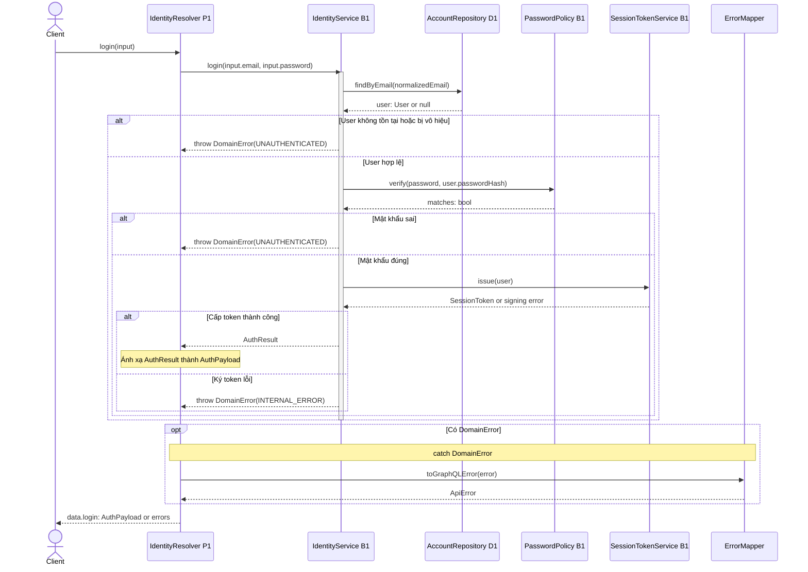

**Ánh xạ lớp:** I03.authenticate và createSession là hai trách nhiệm logic nằm trong IdentityService.login(email,password): AuthResult của I05. Hình chỉ gọi SessionTokenService.issue(user): SessionToken bên trong login, không có createSession trả payload rồi cấp token lần nữa. Token service đọc User.tokenVersion và tạo jti/hạn 7 ngày nội bộ; resolver mới dựng AuthPayload.

### 3.2 Hình 02 — UC-03: Khôi phục mật khẩu

**Actor:** Khách. **Kịch bản:** yêu cầu mã, gửi lại khi được phép, xác minh và reset. OTP có 6 số, hạn 10 phút, sai lần thứ 5 vô hiệu yêu cầu. Grant hạn 15 phút và dùng một lần.

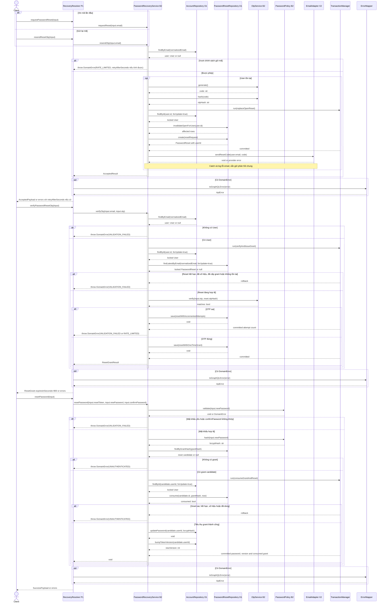

**Chú thích:** chỉ User tồn tại mới có password_resets.user_id. create/save nhận entity PasswordReset đã chứa userId, hash và thời hạn. Gửi lại mã vô hiệu cả grant cũ chưa dùng. Việc tăng bộ đếm sai phải commit trước khi trả lỗi, không rollback mất số lần thử. Các bước nạp/khóa account và reset được vẽ riêng: lookup không khóa để tìm User/candidate, AccountRepository.findById(forUpdate=true) trước khi PasswordResetRepository khóa/kiểm lại reset. consume chỉ trả bool; service quyết định UNAUTHENTICATED khi false. Chính sách gửi lại là cấu hình service, trả RATE_LIMITED và metadata tùy chọn `errors[].extensions.retryAfterSeconds` theo DOC 7.2-A BE. FE đếm lùi nếu có giá trị và hiển thị thông báo chung nếu thiếu; không gắn quota vào DDL.

### 3.3 Hình 03 — UC-07: Tạo bài

**Actor:** Người dùng. **Tiền điều kiện:** principal hợp lệ. **Luồng 1 của I02:** tên món bắt buộc; ảnh/quán/giá/cảm nhận tùy chọn. Sơ đồ chính bắt đầu sau bước upload và chỉ tạo bài khi người dùng xác nhận.

**Bước con upload:** Client → MediaUploadEndpoint(P2).upload → PostLifecycleService(B4).uploadMedia → MediaStorageAdapter(X1).validate/store → MediaUploadRepository(D2).create. Backend kiểm file ≤10 MB, thu nhỏ cạnh dài ≤1600 px, không tin phần mở rộng hoặc MIME client. Bản ghi media_assets có state=PENDING, owner, purpose và expires_at. Nếu lưu object thành công nhưng tạo asset lỗi, gọi X1.remove để bù; cleanup xử lý phần sót. FE dùng uploadId trong mutation, không gửi khóa nhà cung cấp.

| Upload HTTP | Tình huống |
|---|---|
| 201 | Trả uploadId, url, purpose, width, height, expiresAt |
| 400 VALIDATION_FAILED | Purpose sai/thiếu, ảnh không hỗ trợ hoặc không giải mã được |
| 401 UNAUTHENTICATED | Token thiếu/sai/hết hạn |
| 413 PAYLOAD_TOO_LARGE | File vượt 10 MB |
| 415 UNSUPPORTED_MEDIA_TYPE | Request không phải multipart/form-data |
| 429 RATE_LIMITED | Vượt hạn mức cấu hình |
| 503 INTEGRATION_UNAVAILABLE | Dịch vụ ảnh lỗi/quá hạn |

Ảnh lỗi: người dùng chọn retry, bỏ ảnh để đăng chữ hoặc hủy. Backend không tự bỏ ảnh để tiếp tục tạo bài. File lớn về số pixel được resize khi hợp lệ; 413 áp cho dung lượng theo I04.

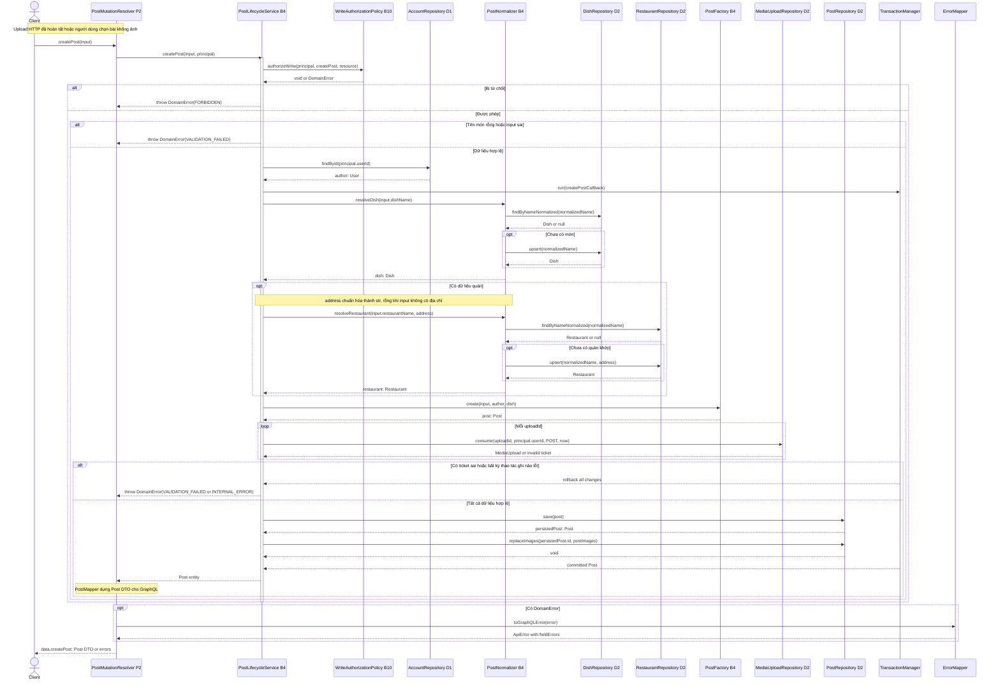

**Transaction:** chuẩn hóa có ghi món/quán mới, tiêu thụ media, tạo post và ảnh cùng một commit. consume dùng khóa/điều kiện state=PENDING, owner/purpose/hạn đúng; hai request không thể cùng tiêu thụ một asset. Một ticket sai làm rollback cả bài và các ticket khác.

**Mất response:** I04 §12.10 không bảo đảm idempotency createPost. FE kiểm tra kết quả qua myPosts trước khi người dùng quyết định gửi lại; không tự retry mutation và không tự thêm Idempotency-Key vào schema.

### 3.4 Hình 04 — UC-08: Sửa bài của mình

**Actor:** Chủ bài. **Kịch bản:** sửa trường được gửi, giữ/thêm/bỏ ảnh. images không gửi = giữ ảnh; images=[] = bỏ hết; danh sách có imageId để giữ ảnh cũ và uploadId để thêm ảnh mới. Mỗi phần tử chỉ có một trong hai ID.

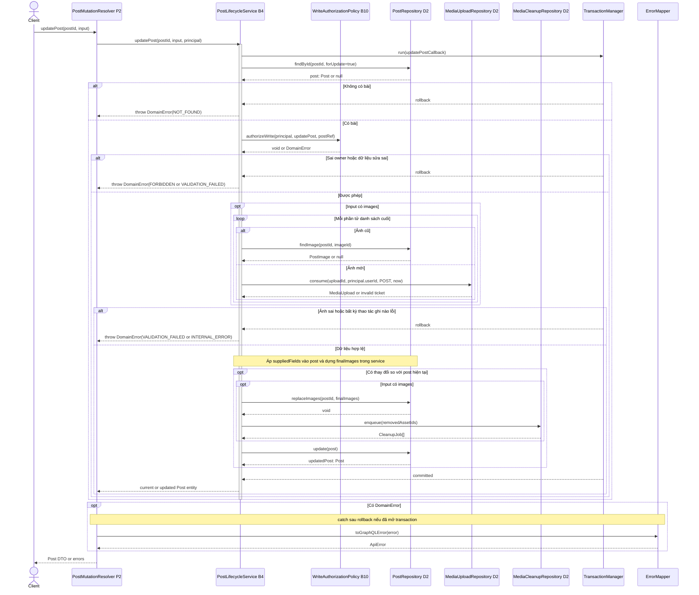

**Chú thích:** khóa dòng giữ việc sửa ảnh và bài nhất quán trong từng transaction; input không có expectedVersion nên không tự tuyên bố chống ghi đè từ form cũ. Ảnh bị bỏ được đánh dấu DELETE_PENDING và ghi media_cleanup_jobs cùng transaction; worker chỉ xóa provider sau commit. MediaCleanupRepository là lớp bổ sung từ schema S5, xem §5.2.

### 3.5 Hình 05 — UC-09: Xóa bài của mình

**Actor:** Chủ bài. **Kịch bản:** xóa vĩnh viễn bài, giữ dữ liệu bằng chứng độc lập. Không có quyền admin trong v1. Bài đã không còn trả success theo idempotency của API; không có dữ liệu nào bị xóa lại.

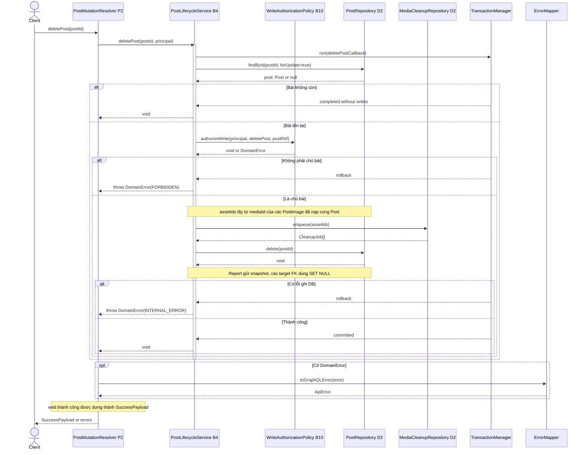

**Dữ liệu phụ thuộc:** post_images, like/save/tag/snapshot liên quan xử lý theo FK I06. Không xóa evidence_snapshot/original_post_id của report. Notification còn trong app nhưng đích bài có thể không còn. J1 gọi cleanupOrphanMedia để dọn provider; lỗi xóa ảnh được retry qua media_cleanup_jobs, không làm thất bại kết quả xóa bài đã commit.

### 3.6 Hình 06 — UC-13: Thích/lưu bài

**Actor:** Người dùng. **Kịch bản:** đặt trạng thái đích, không toggle mù khi retry. Like được tạo mới sinh notification cho chủ bài; thao tác bỏ like hoặc gửi lại cùng trạng thái không tạo thông báo trùng. Lưu không chỉ định collection dùng bộ mặc định “Đã lưu”; collection được chọn phải thuộc người gọi.

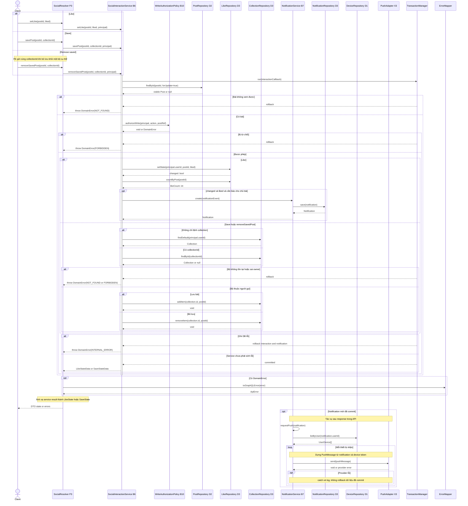

**Chú thích:** NotificationRepository.save dùng cùng tx với B6; gọi B7 không tự mở transaction thứ hai. Push là tác vụ sau response theo ADR-LEAD-002, không có listPendingPush/markPushSent hay bảng delivery state. API restart có thể làm mất push, đúng giới hạn được ADR nêu. Tạo notification khi SAVE chỉ được bật nếu chính sách v1 có quy định; bản này giữ like theo I03, không tự thêm notification cho mọi lần save.

### 3.7 Hình 07 — UC-18: Hỏi trợ lý và retry

**Actor:** Người dùng. **Kịch bản:** hỏi mới hoặc retry messageId của chính mình; timeout tối đa 30 giây. FE gửi tọa độ khi được cấp quyền, nếu thiếu dùng mặc định trung tâm Hà Nội. Không thêm LocationAdapter X5 ở Backend.

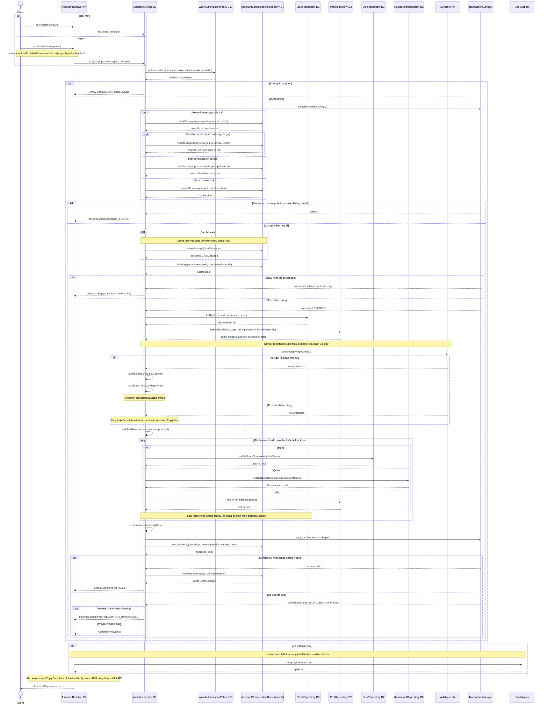

**Chú thích:** AssistantConversationRepository.createSession được gọi khi hỏi mới chưa có phiên. retry nhận messageId của assistant reply thất bại, nạp replyToId để lấy câu hỏi User gốc, không lưu lại câu hỏi. UNIQUE(reply_to_id) giữ một reply logic cho mỗi câu hỏi; claimReply tăng processing_version khi được retry, hoàn tất chỉ khi version/lease còn đúng. PENDING hết lease có thể nhận claim mới. FAILED hoặc FALLBACK phát sinh do provider lỗi cho phép retry cùng câu hỏi; FALLBACK lưu câu trả lời dự phòng, OK lưu kết quả provider đã xác minh. Không lưu draft không hợp lệ.

**Xác minh nội dung:** validateReferences tra món/quán/bài qua D2 và điều kiện quyền/block từ D3; thay hoặc loại tham chiếu không tồn tại, ẩn hoặc bị chặn trước khi trả. Đây là bước hỗ trợ NFR-15, không thay thế phép đo ≥18/20 câu ở giai đoạn kiểm thử. Provider không nhận email, mật khẩu, JWT hoặc secret.

### 3.8 Hình 08 — UC-19: Dùng draft để đăng bài

**Actor:** Người dùng sở hữu hội thoại. **Kịch bản:** lấy draft để điền form; chỉ tạo bài khi người dùng bấm xác nhận. UC-19 include UC-07 theo catalog và Luồng 5.

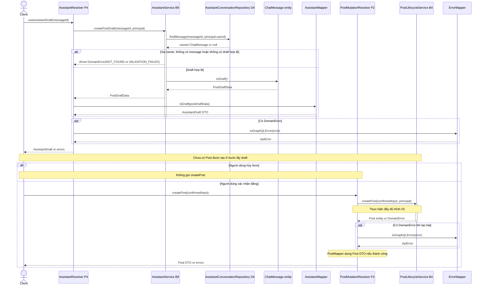

Draft chỉ chứa dữ liệu điền form. Không tin authorId, quyền hoặc dữ liệu nội bộ từ AI. Khi tạo bài vẫn kiểm tên món, principal, uploadId, owner/purpose/hạn và transaction UC-07; không ghi Post trực tiếp từ B9.

### 3.9 Hình 09 — UC-01: Đăng ký

Đăng ký công khai. Email được chuẩn hóa để kiểm trùng. Tài khoản và bộ “Đã lưu” mặc định được ghi cùng giao dịch. Chỉ cấp JWT sau commit.

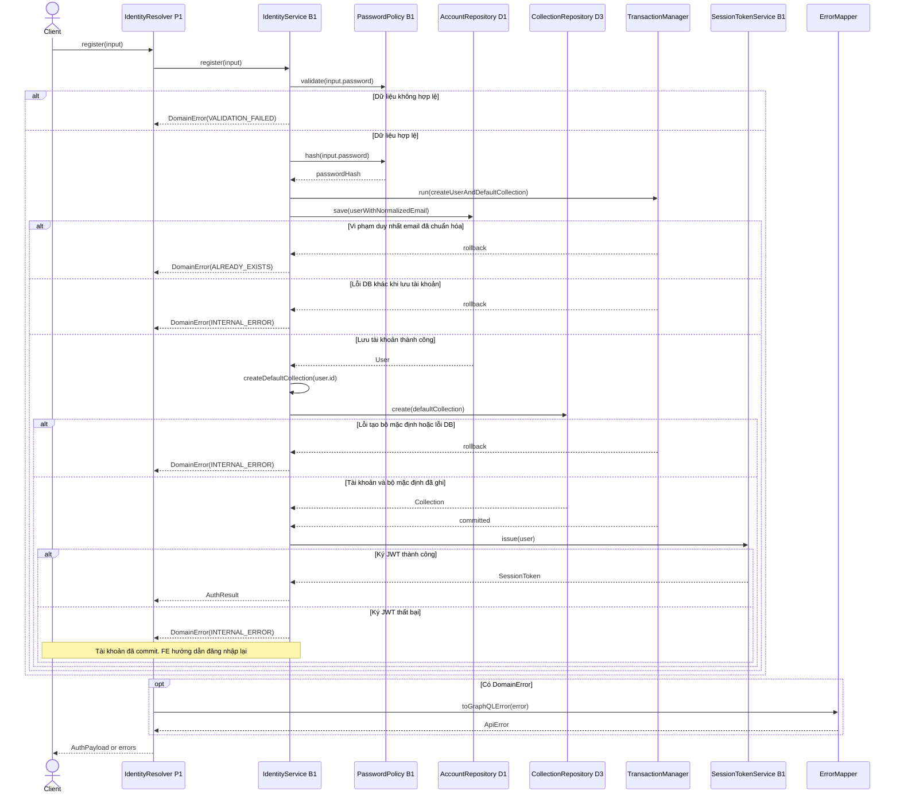

Nếu mất phản hồi, FE hướng dẫn kiểm tra bằng đăng nhập trước khi thử đăng ký lại. Ràng buộc duy nhất của DB phân xử hai request cùng email.

### 3.10 Hình 10 — UC-05: Xem feed

Khách và người dùng có phiên hợp lệ đọc được feed công khai. Khách không có block list hoặc trạng thái thích/lưu cá nhân. Mỗi lần tải tiếp dùng `endCursor` của trang trước trong cùng chế độ.

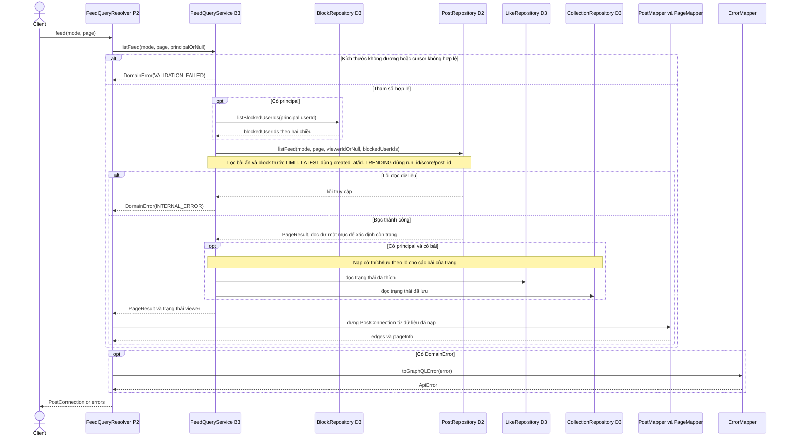

Nếu chưa có run TRENDING hoặc không còn bài, trả connection rỗng với `hasNextPage=false`. Khi tải thêm lỗi, FE giữ trang đã tải. Đổi chế độ thì bắt đầu từ trang đầu.

### 3.11 Hình 11 — UC-14: Theo dõi/bỏ theo dõi

FE gửi trạng thái đích `followed`. Lặp cùng trạng thái trả lại trạng thái hiện tại. Chỉ tạo thông báo khi chuyển từ chưa theo dõi sang theo dõi.

```mermaid
sequenceDiagram
    actor C as Client
    participant R as SocialResolver P3
    participant S as SocialInteractionService B6
    participant A as ProfileRepository D3
    participant P as WriteAuthorizationPolicy B10
    participant F as FollowRepository D3
    participant N as NotificationService B7
    participant Q as NotificationRepository D3
    participant X as PushAdapter X3
    participant TM as TransactionManager
    participant E as ErrorMapper
    C->>R: setFollow(userId, followed)
    alt Không có phiên hợp lệ
        R->>E: toGraphQLError(UNAUTHENTICATED)
    else Có principal
        R->>S: setFollow(userId, followed, principal)
        S->>A: findById(userId)
        A-->>S: Target profile or null
        opt Target tồn tại
            S->>P: authorizeWrite(principal, FOLLOW, targetRef)
            P-->>S: void or DomainError
        end
        alt Target không tồn tại, sai quyền hoặc tự theo dõi
            S-->>R: DomainError(NOT_FOUND, FORBIDDEN hoặc VALIDATION_FAILED)
            R->>E: toGraphQLError(error)
        else Target hợp lệ
            S->>TM: run(updateFollowAndNotification)
            S->>F: setState(principal.userId, userId, followed)
            F-->>S: changed
            opt changed và followed=true
                S->>N: create(notificationEvent)
                N->>Q: save(notification)
                Q-->>N: Notification
                N-->>S: Notification
            end
            alt Lỗi ghi dữ liệu
                TM-->>S: rollback
                S-->>R: DomainError(INTERNAL_ERROR)
                R->>E: toGraphQLError(error)
            else Đã commit
                TM-->>S: committed
                S-->>R: FollowStateData
            end
        end
    end
    R-->>C: FollowState or errors
    opt Có thông báo mới đã commit
        S->>N: requestPush(notification) sau response
        Note over N,X: Nạp thiết bị người nhận như Hình 06
        N->>X: send(pushMessage)
        X-->>N: kết quả gửi hoặc lỗi để ghi log
    end
```

Kết quả theo dõi đã commit vẫn được giữ nếu push thất bại. FE giữ trạng thái dựa trên phản hồi và không tự thực hiện thao tác bị chặn sau khi đăng nhập.

## 4. Ma trận UC → lớp → phương thức

Các chữ ký đầy đủ và thay đổi có chủ ý được kiểm ở §5.2. Entity/result nằm trong cột dưới; DTO trả client chỉ được dựng ở resolver như §1.5.

| UC | Presentation / Business | Repository / Adapter | Lời gọi lớp và kiểu service return |
|---|---|---|---|
| UC-02 | IdentityResolver → IdentityService | AccountRepository, PasswordPolicy, SessionTokenService | login(email,password): AuthResult; findByEmail(email): User?; verify(raw,hash): bool; issue(user:User): SessionToken |
| UC-03 | RecoveryResolver → PasswordRecoveryService | AccountRepository, PasswordResetRepository, OtpService, EmailAdapter | requestReset/resendOtp: AcceptedResult; verifyOtp: ResetGrantResult; resetPassword: void; findById trước reset lock, create(request), save(request), consume(requestId,hash,now), updatePassword và bumpTokenVersion |
| UC-07 | MediaUploadEndpoint, PostMutationResolver → PostLifecycleService | AccountRepository, DishRepository, RestaurantRepository, MediaUploadRepository, PostRepository, X1 | createPost(input,principal): Post; resolveDish(name), resolveRestaurant(name,address), PostFactory.create(input,author:User,dish), consume, save(Post), replaceImages(postId,PostImage[]) |
| UC-08 | PostMutationResolver → PostLifecycleService | PostRepository, MediaUploadRepository, MediaCleanupRepository | updatePost: Post; findById(postId,forUpdate), findImage(postId,imageId), consume, replaceImages, enqueue, update(post:Post): Post |
| UC-09 | PostMutationResolver → PostLifecycleService | PostRepository, MediaCleanupRepository | deletePost: void; findById(postId,forUpdate), enqueue, delete(postId): void |
| UC-13 | SocialResolver → SocialInteractionService, NotificationService | LikeRepository, CollectionRepository, NotificationRepository, DeviceRepository, PushAdapter | setLike: LikeStateData; savePost/removeSavedPost: SaveStateData; setState(userId,postId,liked), create(NotificationEvent), save(Notification), listByUser(recipientId), send(PushMessage) |
| UC-18 | AssistantResolver → AssistantService | AssistantConversationRepository, BlockRepository, PostRepository, DishRepository, RestaurantRepository, AiAdapter | ask/retry: AssistantReplyData; saveMessage(ChatMessage), claimReply/completeReply, complete(PromptContext): AiCompletion; validateReferences(candidate,viewer), query refs D2/D3, buildFallback |
| UC-19 | AssistantResolver → AssistantService; PostMutationResolver → B4 | AssistantConversationRepository, ChatMessage, AssistantMapper; repository UC-07 | createPostDraft: PostDraftData; findMessage(messageId,ownerId), ChatMessage.toDraft(): PostDraftData; Presentation toDraft(PostDraftData): AssistantDraft; createPost sau xác nhận: Post |
| UC-01 | IdentityResolver → IdentityService | AccountRepository, CollectionRepository, SessionTokenService | register(input): AuthResult; save(User), createDefaultCollection(userId), create(Collection), issue(User) |
| UC-05 | FeedQueryResolver → FeedQueryService | PostRepository, BlockRepository, LikeRepository, CollectionRepository | listFeed(mode,page,viewer): PageResult; listBlockedUserIds(viewerId), listFeed(mode,page,viewerId,blockedUserIds) |
| UC-14 | SocialResolver → SocialInteractionService → NotificationService | ProfileRepository, FollowRepository, NotificationRepository, DeviceRepository, PushAdapter | setFollow(userId,followed,principal): FollowStateData; findById, setState, create(notificationEvent), requestPush(notification) |

Repository không trả DTO; mapper không truy vấn DB. GraphQL ID được ánh xạ sang BIGINT hoặc UUID đúng I06; không ghi chuỗi ví dụ vào cột BIGINT. Service không tự ghép cursor từ chuỗi đầu vào.

## 5. Ghi chú thiết kế và đồng bộ lớp

### 5.1 Mẫu tương tác được áp dụng

- Resolver mỏng, service điều phối, B10 quyết định quyền từ principal/resource; B10 không tự truy vấn DB theo component mới.
- Transaction bao trọn thay đổi nghiệp vụ và dữ liệu phụ thuộc. Lỗi ảnh không để lại bài nửa chừng; lỗi cấp phiên sau đăng ký không tạo lại tài khoản.
- HTTP upload tách khỏi GraphQL, media được tiêu thụ theo owner/purpose/state/hạn. Cleanup là tác vụ có dữ liệu retry bền vững.
- Notification trong app cùng transaction với tương tác; push sau response không quyết định thành công của tương tác.
- AI chạy giữa các transaction ngắn; reply có version để response cũ không ghi đè; draft không tự đăng.
- ErrorMapper là điểm chuyển DomainError thành lỗi API. Không dùng HTTP 200 để kết luận nghiệp vụ GraphQL đã thành công.

### 5.2 Đối chiếu đầy đủ chữ ký với DOC 6.1

Phần 5.2.1 ghi các lời gọi đã đưa về đúng I05, không phải yêu cầu sửa chữ ký nguồn. Phần 5.2.2 ghi mọi mở rộng còn dùng trong sequence/pipeline; mỗi dòng có chữ ký trước, sau và lý do. “void” là hoàn tất không trả dữ liệu; mũi tên DomainError là exception, không phải kiểu trả về thay thế.

#### 5.2.1 Chữ ký giữ nguyên và sửa lại cho khớp I05

| Lớp / hình | Chữ ký I05 và chữ ký dùng trong bản này | Sửa so với v1.5 |
|---|---|---|
| IdentityService / 01 | login(email: str, password: str): AuthResult | Bỏ lời gọi authenticate(input) ở mức lớp. I03.authenticate + createSession là hai trách nhiệm logic được cài trong login; không vẽ thêm createSession trả AuthPayload. |
| SessionTokenService / 01 | issue(user: User): SessionToken; parse(raw: str): SessionClaims | Bỏ issue(sub,jti,ver,expiresIn). Token service đọc token_version của User, tạo jti và hạn 7 ngày bên trong. |
| PasswordPolicy / 01,02 | validate(raw: str): void; hash(raw: str): str; verify(raw: str, hash: str): bool | confirmPassword được service so khớp, không thêm tham số confirmation vào validate. |
| OtpService / 02 | generate(): str; hash(code: str): str; verify(code: str, stored: str): bool | Truyền hai đối số đúng I05; hạn/số lần là trạng thái reset do service kiểm. |
| PasswordRecoveryService / 02 | requestReset(email): AcceptedResult; resendOtp(email): AcceptedResult; verifyOtp(email,code): ResetGrantResult; resetPassword(token,newPassword,confirm): void | Không trả AcceptedPayload/ResetGrant/SuccessPayload trực tiếp từ service. |
| PasswordResetRepository / 02 | create(request: PasswordReset): PasswordReset; save(request: PasswordReset): void | Truyền entity đã dựng, không đổi thành create(userId,hash,expiresAt). Các mở rộng lock/consume xem A03. |
| AccountRepository / 02 | updatePassword(userId: int, passwordHash: str): void | Giữ tên/kiểu return, không thêm updatePasswordHash. Lookup và token version mở rộng xem A02. |
| PostNormalizer / 03 | resolveDish(rawName: str): Dish; resolveRestaurant(name: str,address: str): Restaurant | Truyền hai chuỗi name/address, chuẩn hóa địa chỉ thiếu thành chuỗi rỗng tại biên service; các repository được vẽ riêng. Không biến địa chỉ thành trường bắt buộc của API. |
| DishRepository / 03,07 | findByNameNormalized(name: str): Dish; upsert(name: str): Dish | Giữ thứ tự tham số, upsert chỉ khi cần tạo/chuẩn hóa. Quy ước lookup miss xem A06. |
| RestaurantRepository / 03,07 | findByNameNormalized(name: str): Restaurant; upsert(name: str,address: str): Restaurant | Giữ chữ ký, không truyền object restaurant thay cho name/address. |
| PostFactory / 03 | create(input: CreatePostInput, author: User, dish: Dish): Post | Service nạp author bằng AccountRepository; không truyền Principal vào vị trí User. |
| PostRepository / 03,04,05 | save(post: Post): Post; update(post: Post): Post; delete(postId: int): void; replaceImages(postId: int,images: PostImage[]): void; findImage(postId: int,imageId: int): PostImage | Bỏ update(postId,suppliedFields), bỏ return ImageChangeResult của replaceImages; findImage luôn có postId. Lookup miss/lock xem A06. |
| LikeRepository / 06 | setState(userId: int,postId: int,liked: bool): bool; countByPost(postId: int): int | Sửa đúng thứ tự userId trước postId. bool được dùng là changed; không trả LikeState DTO từ repository. |
| CollectionRepository / 06 | findDefault(userId: int): Collection; findById(collectionId: int): Collection; addItem(collectionId: int,postId: int): void; removeItem(collectionId: int,postId: int): void | add/remove chỉ trả void; service dựng SaveStateData. Lookup miss xem A06. |
| SocialInteractionService / 06 | setLike(postId: int,liked: bool,principal: Principal): LikeStateData; savePost(postId,collectionId,principal): SaveStateData; removeSavedPost(postId,collectionId,principal): SaveStateData | Dùng method của I05. setSave của I03 là tên logic ánh xạ sang savePost/removeSavedPost, không thêm class method setSave. |
| NotificationService / 06 | create(event: NotificationEvent): Notification; requestPush(notification: Notification): void | Bỏ chữ ký createNotification(actor,recipient,post); event được service dựng từ dữ liệu đã kiểm. |
| NotificationRepository / 06 | save(notification: Notification): Notification | Trả Notification, không trả notificationId hay DTO. Dùng cùng tx của B6. |
| DeviceRepository / 06 | listByUser(userId: int): UserDevice[] | Bổ sung lifeline/lời gọi có thật, giữ nguyên chữ ký I05. |
| PushAdapter / 06 | send(message: PushMessage): void | DeviceTargets được đóng vào từng PushMessage, không truyền hai đối số. |
| AssistantConversationRepository / 07 | createSession(userId: int,context: dict): ChatSession; saveMessage(message: ChatMessage): ChatMessage | status=OK là thuộc tính của entity userMessage, không phải tham số thứ hai của saveMessage. Các method owner/claim xem A08. |
| AiAdapter / 07 | complete(context: PromptContext): AiCompletion | Không thêm prompt/publicContext/timeout thành ba đối số. Adapter có timeout cấu hình 30s; PromptContext chứa prompt và ngữ cảnh công khai. |
| AssistantService / 07,08 | ask(input,principal): AssistantReplyData; retry(messageId,principal): AssistantReplyData; createPostDraft(messageId,principal): PostDraftData | Result service không phải DTO AssistantReply/AssistantDraft. validateReferences và buildFallback mở rộng xem A09. |
| ChatMessage / 08 | toDraft(): PostDraftData | Gọi method entity đã có, rồi resolver mới dùng mapper dựng DTO. |
| WriteAuthorizationPolicy / 03–07 | authorizeWrite(principal: Principal,action: WriteAction,resource: ResourceRef): void | Thành công là void, bị từ chối throw DomainError; không trả Decision/allowed Boolean. ResourceRef do service dựng từ dữ liệu đã nạp. |
| TransactionManager / 02–07 | run(callback: Callable): T | run trả kết quả callback hoặc rethrow sau rollback; không đổi thành begin/commit public trong hình. |
| ErrorMapper / 01–08 | toGraphQLError(error: DomainError): ApiError; toHttpStatus(error: DomainError): int | GraphQL dùng method đầu, endpoint upload dùng method sau. Cùng một quy ước catch cho mọi hình. |

#### 5.2.2 Mở rộng có chủ ý cần phản ánh vào I05

| ID / lớp | I05 hiện tại | Chữ ký/thuộc tính dùng trong 6.2 | Lý do / hình |
|---|---|---|---|
| A01 IdentityService | Không có verifySession ở class; component I03 có ISessionVerification | verifySession(rawToken: str): Principal | Helper Presentation gọi xác thực theo I03, pipeline §1.4. login và issue vẫn giữ I05. |
| A02 AccountRepository, User | findById(userId): User; findByEmail(email): User; chưa có version methods | findById(userId: int,forUpdate: bool=false): User?; findByEmail(email: str): User?; getTokenVersion(userId: int): int; bumpTokenVersion(userId: int): int; User.tokenVersion: int | Cho phép lookup miss, khóa account hiện rõ và đọc/tăng users.token_version; Hình 01–03, pipeline. Không có entity Account riêng. |
| A03 PasswordResetRepository | findLatestByEmail(email): PasswordReset; consume(requestId): void | findLatestByEmail(email: str,forUpdate: bool=false): PasswordReset?; findByGrantHash(hash: str): PasswordReset?; invalidateOpenForUser(userId: int): int; consume(requestId: int,grantHash: str,now: datetime): bool | consume khóa/kiểm lại reset sau account lock, chỉ trả true khi cập nhật một grant còn hợp lệ; lookup candidate không thay bước kiểm atomic; Hình 02. |
| A04 PasswordReset entity | Liên kết qua email, attemptsCount/expiresAt và grant cũ | userId FK, otpHash, failedAttempts, otpExpiresAt, verifiedAt, invalidatedAt, resetTokenHash, resetExpiresAt, consumedAt | Mapping S5 T02; create/save vẫn nhận entity, không truyền nhiều scalar tùy tiện; Hình 02. |
| A05 MediaUploadRepository, MediaUpload | create(upload): MediaUpload; consume(uploadId,ownerId,purpose): void; chưa ánh xạ bảng vật lý | create(upload: MediaUpload): MediaUpload giữ nguyên; consume(uploadId: str,ownerId: int,purpose: UploadPurpose,now: datetime): MediaUpload; entity ánh xạ media_assets, ID là UUID dạng chuỗi | Cố ý thêm now và trả entity để dựng PostImage sau khi tiêu thụ; kiểm owner/purpose/state/hạn trong cùng tx; Hình 03/04. |
| A06 PostRepository và lookup repository | findById(postId): Post; listFeed(mode,page,viewerId): PageResult; findImage(postId,imageId): PostImage; các find của Dish/Restaurant/Collection khai non-null | findById(postId: int,forUpdate: bool=false): Post?; listFeed(mode: FeedMode,page: PageRequest,viewerId: int,blockedUserIds: int[]): PageResult; findImage(postId:int,imageId:int): PostImage?; findByNameNormalized của Dish/Restaurant trả Dish?/Restaurant?; Collection.findById trả Collection? | Ghi rõ miss là null thay vì giả định luôn tìm thấy; khóa sửa/xóa và lọc block trước LIMIT; không đổi hai tham số findImage hay update(Post); Hình 03–07. |
| A07 MediaCleanupRepository — lớp mới D2 | Chưa có | enqueue(assetIds: str[]): CleanupJob[] | Ghi media_cleanup_jobs và DELETE_PENDING cùng tx; ID asset là UUID dạng chuỗi; Hình 04/05. |
| A08 AssistantConversationRepository | findSession(sessionId): ChatSession; findMessage(messageId): ChatMessage; chưa có claim/complete | findSession(sessionId:int,ownerId:int): ChatSession?; findMessage(messageId:int,ownerId:int): ChatMessage?; claimReply(userMessageId:int,now:datetime,leaseSeconds:int): ClaimResult; completeReply(replyId:int,processingVersion:int,result:AssistantReplyData,now:datetime): bool | Cố ý thêm owner, nullable và atomic version/lease; findMessage join session để kiểm owner. Retry lấy failed assistant reply rồi lần theo replyToId tới câu hỏi gốc; Hình 07/08. |
| A09 AssistantService | validateReferences(reply:str): void; không có buildFallback | validateReferences(candidate:AssistantReplyData,viewer:Principal): AssistantReplyData; buildFallback(context:PromptContext): AssistantReplyData | Cần kiểm quyền/block và trả candidate đã làm sạch cho cả provider/fallback; Hình 07. |
| A10 BlockRepository — lớp mới D3 | Không có repository cụ thể cho bảng block | listBlockedUserIds(viewerId:int): int[] | Thực hiện operation logic D3 của I03 trên user_blocks theo hai chiều; AssistantService phụ thuộc D3 để không lộ nội dung; Hình 07. |
| A11 AssistantMapper — bổ sung chữ ký | Có mapper nhưng chưa đặc tả method | toDraft(data:PostDraftData): AssistantDraft | Chỉ gọi ở Presentation, không đổi service result thành DTO trong B9; Hình 08. |
| A12 ChatMessage, ClaimResult | ChatMessage chưa có trạng thái/version/lease; ClaimResult chưa có | ChatMessage.status, replyToId, processingVersion, processingExpiresAt; ClaimResult gồm state(CLAIMED/BUSY/COMPLETED), replyId, processingVersion, currentReply | Mapping T19 và dữ liệu return cho claim; không phải trường GraphQL bổ sung. currentReply được dựng thành AssistantReplyData trong service; Hình 07. |
| A13 Notification, UserDevice | Notification.payload/read, UserDevice.fcmToken/deviceType theo schema cũ | Notification.actorId/postId/readAt theo T17; UserDevice.pushToken/platform theo T04; NotificationEvent và PushMessage ánh xạ các field vật lý tương ứng | Đổi model mapping theo S5, không đổi create(event), listByUser(userId), send(PushMessage); Hình 06. |
| A14 Post/DTO hồ sơ | Public User/Profile bắt buộc displayName ở API; mapper theo nguồn cũ | Public projection có thể không có displayName khi trường bị ẩn; không đổi NOT NULL users.display_name | Hệ quả privacy từ I01/I06. Cần cập nhật API DTO như §5.4, không tự nới quyền bằng việc trả tên thật. |
| A15 BackgroundJobRunner J1 — lớp mới | §1.3 nhắc hai job và chưa có runner class tương ứng | runScheduledJob(name: str): JobResult; WorkerScope gọi B1/B2/B4/B8 cho bốn job §5.3 | Bổ sung class/tiêm phụ thuộc theo component mới, không có worker dispatchPendingPush. |
| A16 WriteAuthorizationPolicy dependency | I05 cho policy phụ thuộc Post/Collection/NotificationRepository | Giữ authorizeWrite(...): void, nhưng service nạp dữ liệu rồi truyền ResourceRef; bỏ truy vấn DB khỏi policy | Theo I03 B10; các lời gọi repository được vẽ ở service trước policy. |
| A17 PostImage mapping | I05 mô tả ảnh bằng url/position, chưa có liên kết media asset của S5 | PostImage.mediaId ánh xạ post_images.media_id; PostRepository.findById nạp ảnh cần cho sửa/xóa. assetIds/removedAssetIds do service suy ra từ ảnh hiện tại và danh sách cuối | Không đổi chữ ký update(Post) hoặc thêm Post.mediaIds giả định; Hình 04/05 và I06 T05/T10. |

AssistantService thêm phụ thuộc BlockRepository, DishRepository, RestaurantRepository và PostRepository cho ngữ cảnh/xác minh; NotificationService dùng DeviceRepository cho push. PostLifecycleService dùng AccountRepository khi PostFactory cần author: User. Đây là cập nhật dependency của I05 cùng với các chữ ký ở trên.

Các kiểu service/result giữ tên I05 như §1.5; không dùng AuthPayload, ResetGrant, LikeState hoặc SaveState thay kiểu service return. Method không có ở hai bảng này không được tự thêm vào hình như một lời gọi “đã có”.

### 5.3 Tác vụ nền và các luồng còn lại

J1 chạy trong tiến trình worker, cùng image với API; không phục vụ request GraphQL. Job có khóa chống chạy trùng, idempotent và log không chứa secret.

| Job | Service được gọi | Dữ liệu / lỗi |
|---|---|---|
| refreshTrendingSnapshot | B8 DiscoveryService | Công bố trending_runs và snapshot nguyên tử; lỗi giữ run cũ; chu kỳ là cấu hình |
| cleanupOrphanMedia | B4 PostLifecycleService | media_cleanup_jobs/media_assets → X1.remove; retry theo attempts/next_attempt_at, không xóa asset còn gắn |
| purgeExpiredResetRequests | B2 PasswordRecoveryService | Dọn yêu cầu OTP/grant quá hạn theo chính sách lưu, không làm sống lại grant |
| purgeExpiredRevocations | B1 IdentityService | Dọn jti khi JWT đã hết hạn; token hết hạn vẫn bị từ chối bởi kiểm exp |

Lịch hằng ngày của các job dọn theo I03; không thêm worker gửi push. uploadTtlHours và thời gian ân hạn cleanup được nạp từ cấu hình, không là DEFAULT/CHECK của DB.

Các UC không chọn vẽ riêng vẫn giữ hợp đồng:
- UC-04 logout: thu hồi jti, lặp trả success. Không có refreshSession.
- UC-06/10: đọc công khai theo quyền và block. Quy tắc lọc feed trước LIMIT và phân trang theo run xem Hình 10.
- UC-11/12: profile dùng public_profile_fields; đổi avatar/cover chỉ consume media purpose đúng. B5 không gọi X1 để xóa ảnh cũ.
- Hộp thông báo: đọc và đánh dấu đã đọc kiểm recipient. Thao tác theo dõi và gửi push xem Hình 11.
- UC-15: report bài công khai, không kiểm ownership bài; report lặp theo (reporter, originalPostId) trả accepted; không tự ẩn bài.
- UC-16 quán gần: FE cung cấp tọa độ hoặc dùng trung tâm Hà Nội, bán kính 5 km. Lọc khoảng cách chính xác rồi lấy tối đa 50; không LIMIT ứng viên quá sớm.
- UC-17 quay món và UC-20 search/trending: dữ liệu hợp lệ/công khai, quyền/block được áp nhất quán.
- Collection CRUD, thiết bị push, assistantSessions/assistantHistory dùng đúng owner và các method I03/I04. Retry OTP đã nằm trong Hình 02. Không bổ sung API tạo block hoặc admin.

### 5.4 Các tài liệu nguồn cần cập nhật theo quyết định của 6.2

Bản này đã thể hiện lựa chọn thiết kế cụ thể; bảng dưới chỉ rõ phần nguồn phải phản ánh lại khi nhóm nhận thay đổi. Các file nguồn ở commit I03–I07 được giữ nguyên trong lượt sửa này; không tuyên bố chúng đã cùng được sửa hoặc duyệt.

| Tài liệu / vị trí | Nội dung nguồn hiện tại | Nội dung cần đồng bộ / lý do |
|---|---|---|
| DOC 5.2-A §7.1/7.2 và bảng component | Còn P0, B11, X5 và dispatchPendingPush/listPendingPush/markPushSent | Đồng bộ I03/I07: helper ContextFactory, B1.ISessionVerification, worker J1, push sau response trong API. Bỏ polling/delivery state khỏi thiết kế v1; ghi giới hạn có thể mất push khi API restart. |
| DOC 5.2-A §12.6 và X5 | nearbyPlaces còn mô tả adapter vị trí ở BE | FE truyền tọa độ, BE dùng tọa độ mặc định khi thiếu theo BR-08; không thêm X5 trong BE. Đổi bảng phụ thuộc và ví dụ luồng cho khớp component. |
| DOC 5.2-A §12.7 | Provider timeout trả INTEGRATION_UNAVAILABLE nhưng chưa tách rõ API error và status lưu chat | Giữ mã lỗi này. Bổ sung rằng FAILED/FALLBACK là trạng thái nội bộ/history; lưu trước khi trả lỗi, retry dùng messageId gốc và version/lease. Không thay INTEGRATION_UNAVAILABLE bằng HTTP 200 thành công chỉ vì có fallback. |
| DOC 5.2-A User/Profile và projection | displayName: String! nhưng cho phép chủ hồ sơ ẩn trường | Điều chỉnh public DTO/nullability hoặc projection tương ứng; các màn FE phải xử lý trường bị ẩn. Không đổi dữ liệu tên gốc thành NULL trong users. |
| DOC 6.1-A §1.3, shared, dependency graph | Hai job nền, thiếu runner class; các phần class dùng baseline cũ | Đồng bộ bốn job J1: refreshTrendingSnapshot, cleanupOrphanMedia, purgeExpiredResetRequests, purgeExpiredRevocations. Cập nhật WorkerScope, dependency và các dòng A01–A17 của §5.2. |
| DOC 6.1-A §4/§5/§8 | Chữ ký/kiểu cũ và mapper chưa đặc tả đủ | Giữ các chữ ký §5.2.1, chỉ mở rộng có chủ ý theo §5.2.2. Đặc tả result service khác DTO resolver như §1.5; dùng entity User. |
| DOC 6.1-A entity và mapping DB | media_uploads, reset/email, status chat và notification payload theo schema cũ | Mapping media_assets, reset.user_id FK, token_version, public_profile_fields, chat version/lease, notification target và read_at theo I06; không yêu cầu DB tạo thêm bảng trùng chức năng. |
| DOC 5.1-A/B và DOC 3.1-A, phần Tag | Component còn chuẩn hóa thẻ; CRUD/API đã ghi hoãn | Nhất quán phạm vi API v1 đang áp dụng: bỏ lời gọi Tag/PostTag khỏi sequence/API, điều chỉnh các AC/ma trận còn nói khác trong lần duyệt phạm vi. Bảng thẻ dự thảo không tự kích hoạt tính năng. |
| DOC 5.3-B, quy tắc block O6 | Còn mô tả một chiều trong khi FR/6.4 dùng hai chiều | Chỉnh mô tả truy vấn theo hai chiều REQ-028 và trước LIMIT; không cần đổi bảng user_blocks để thực hiện hai chiều. |

Các kết quả render và kiểm chữ ký chỉ xác nhận chất lượng DOC 6.2 tại bộ commit đã ghi. Việc phản ánh lại các nguồn là thay đổi liên tài liệu được liệt kê minh bạch, không phải ngầm sửa nội dung commit nguồn.

### 5.5 Phạm vi kiểm chứng

Đã hoàn tất nội dung thiết kế của 11 UC theo snapshot §1.2, gồm kịch bản, exception, transaction, ma trận và phần bổ sung class. Đầu vào còn khác nhau được giải quyết rõ tại §1.3/§5.2, thay cho danh sách câu hỏi bỏ ngỏ trong thân tài liệu.

Rà soát trước review: kiểm tên UC theo catalog; API theo I04; bảng/cột/FK theo I06; không còn P0/B11/X5 hoặc worker push; tên method chưa có ở I05 phải nằm trong §5.2. Kiểm cú pháp và bản render của cả 11 hình.

Kiểm thử cài đặt về hai request dùng chung upload/grant, retry AI, FK xóa, p95 và NFR-15 được thực hiện ở giai đoạn kiểm thử; tài liệu thiết kế không tuyên bố đã có các kết quả đó.
