# Sequence Diagram Frontend

| Dự án | Owner | Reviewer | Approver | Sprint | Ngày | Phiên bản | Trạng thái |
|---|---|---|---|---|---|---|---|
| ToMateTo | FE — hieun4759 | Lead, BE ở điểm tích hợp | Lead | S5 | 01/11/2026 | 0.1 | Đề nghị review |

**DOC:** 6.2-A — phần FE · **WBS:** 5.2.2.

## Căn cứ và trạng thái
Đối chiếu bổ sung: [DOC 6.2-A BE S5](https://github.com/anqp5002/ToMateTo/blob/ed27b57/docs/thiet_ke/6.2-A_sequence_diagrams_backend.md), Hình 03 và Hình 07.

Thiết kế FE S5 dựa trên DOC 5.1-A/B FE phiên bản 0.4 ngày 01/11/2026, UC/FR/NFR và các màn S1/S2, API BE PR #20 commit `688cef5d`, component BE `c8cf0cd9`, bảo mật BE PR #21 `85c20a3c`, kiến trúc Lead `7903a9f4`. Class BE S5 `dbff79b5` và physical schema DB được dùng để đối chiếu, không dùng để ép FE triển khai ORM hoặc gọi DB.

Các PR liên quan còn mở tại ngày đối chiếu. Tên lớp, method và provider sau đây là thiết kế FE đề xuất, không khẳng định code đã có. API công khai giữ tên theo BE; các tên nội bộ được ánh xạ qua repository. Chưa chạy API hoặc build/test app.

## 1. Phạm vi và cách đọc

Bộ gồm 12 sequence FE, tập trung vào các luồng có nhiều trạng thái và rủi ro tích hợp. Database/provider service nằm bên trong BE nên không vẽ FE truy cập DB trực tiếp.

Mũi tên liền là gọi, nét đứt là kết quả. activate/deactivate là khoảng xử lý; alt là lựa chọn loại trừ, opt là nhánh tùy chọn, loop là lặp. State update và thông báo là message mô tả, không yêu cầu có method trùng mọi câu chữ. Các lời gọi class/method có chữ ký trong DOC 6.1-A. View gồm contract trình bày, không phải API endpoint.

## 2. Danh mục và truy vết

| ID | Luồng | UC | Màn | Yêu cầu chính |
|---|---|---|---|---|
| FE-SQ01 | Login và quay lại ngữ cảnh | UC-02, UC-13 | MH-01, MH-07 | REQ-002; REQ-FE-004 |
| FE-SQ02 | OTP cùng MH-03 và đặt mật khẩu | UC-03 | MH-03, MH-05 | REQ-003/004/005; REQ-FE-010 |
| FE-SQ03 | Feed, tải thêm và query cũ | UC-05 | MH-06 | REQ-007; NFR-02; REQ-FE-003 |
| FE-SQ04 | Tạo bài, upload một phần lỗi và mất phản hồi | UC-07 | MH-08 | REQ-009/010; REQ-FE-005/006 |
| FE-SQ05 | Sửa bài với ảnh cũ/mới và hủy form | UC-08 | MH-09 | REQ-011; REQ-FE-002/005 |
| FE-SQ06 | Logout, thu hồi server và kết thúc cục bộ | UC-04 | MH-10, MH-06 | REQ-006; REQ-FE-007 |
| FE-SQ07 | Lưu bài và chủ động mở nhóm vừa lưu | UC-13 | MH-06/07, MH-13 | REQ-017; REQ-FE-008/009 |
| FE-SQ08 | Thông báo, tổng chưa đọc và đích hồ sơ/bài | UC-14, UC-10, UC-06 | MH-14, MH-10/07 | REQ-019; REQ-FE-013 |
| FE-SQ09 | Vị trí bị từ chối vẫn xem quán gần | UC-16 | MH-17 | REQ-021; REQ-FE-011 |
| FE-SQ10 | Chat, retry và dùng draft để soạn bài | UC-18, UC-19, UC-07 | MH-19, MH-08 | REQ-025/026; REQ-FE-012 |
| FE-SQ11 | Đăng ký tài khoản | UC-01 | MH-02 | REQ-001 |
| FE-SQ12 | Thích và bỏ thích bài | UC-13 | MH-06, MH-07 | REQ-016 |

## 3. FE-SQ01 — Login và quay lại ngữ cảnh

**Tiền điều kiện:** Đúng ngữ cảnh màn và dữ liệu/định danh hợp lệ; luồng công khai cho phép guest.

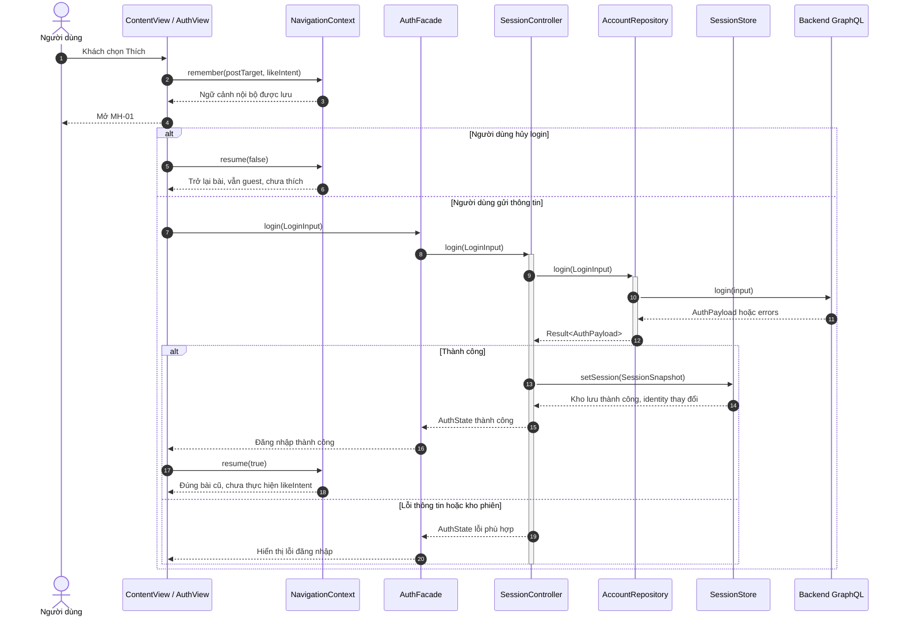

**Diễn giải và nhánh cần lưu ý:** Login không tự like; lỗi ghi kho không coi phiên client đã sẵn sàng. View caller kiểm mounted; identity đổi làm cache riêng đời trước hết hiệu lực.

**Class/method đối chiếu:** `AuthFacade.login`, `NavigationContext.remember`, `NavigationContext.resume`, `SessionController.login`, `AccountRepository.login`, `SessionStore.setSession`.

## 4. FE-SQ02 — OTP cùng MH-03 và đặt mật khẩu

**Tiền điều kiện:** Đúng ngữ cảnh màn và dữ liệu/định danh hợp lệ; luồng công khai cho phép guest.

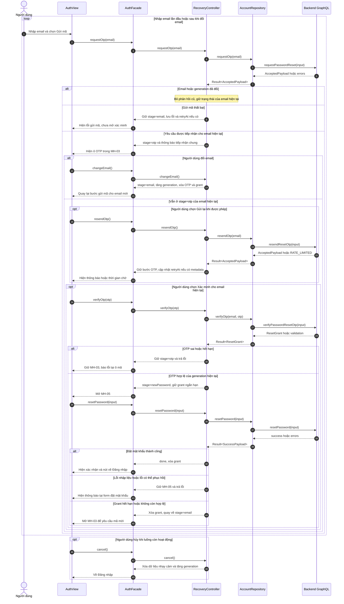

**Diễn giải và nhánh cần lưu ý:** BE kiểm mã 6 số/10 phút/5 lần và grant 15 phút một lần. Mỗi phản hồi gửi mã, gửi lại và xác minh phải khớp email và generation trước khi đổi state. Chặn xác minh ở stage=email. Hủy sau khi request đã gửi chỉ kết thúc luồng ở client.

**Class/method đối chiếu:** `AuthFacade.requestOtp`, `AuthFacade.changeEmail`, `AuthFacade.resendOtp`, `AuthFacade.verifyOtp`, `AuthFacade.resetPassword`, `AuthFacade.cancel`, `RecoveryController.requestOtp`, `RecoveryController.changeEmail`, `RecoveryController.resendOtp`, `RecoveryController.verifyOtp`, `RecoveryController.resetPassword`, `RecoveryController.cancel`, `AccountRepository.requestOtp`, `AccountRepository.resendOtp`, `AccountRepository.verifyOtp`, `AccountRepository.resetPassword`.

## 5. FE-SQ03 — Feed, tải thêm và query cũ

**Tiền điều kiện:** Đúng ngữ cảnh màn và dữ liệu/định danh hợp lệ; luồng công khai cho phép guest.

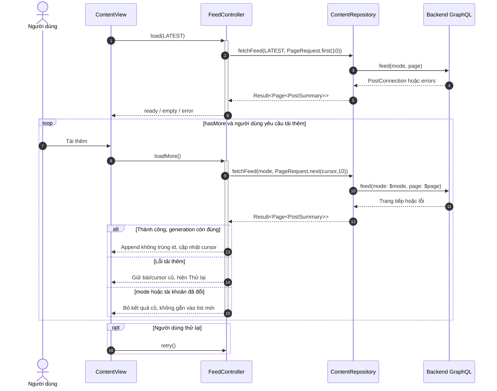

**Diễn giải và nhánh cần lưu ý:** Khi tải thêm, variables gồm `$mode` đang chọn và `$page = {first: 10, after: cursor}`. Lấy cursor từ `pageInfo.endCursor` và dừng khi `hasNextPage=false`. generation là xử lý nội bộ controller; không gọi API mới ngoài feed. Chỉ render empty nếu query thành công không có bài; không đổi lỗi thành empty.

**Class/method đối chiếu:** `FeedController.load`, `FeedController.loadMore`, `FeedController.retry`, `ContentRepository.fetchFeed`.

## 6. FE-SQ04 — Tạo bài, upload một phần lỗi và mất phản hồi

**Tiền điều kiện:** Phiên hợp lệ cho thao tác cá nhân; actor đúng chủ sở hữu khi sửa.

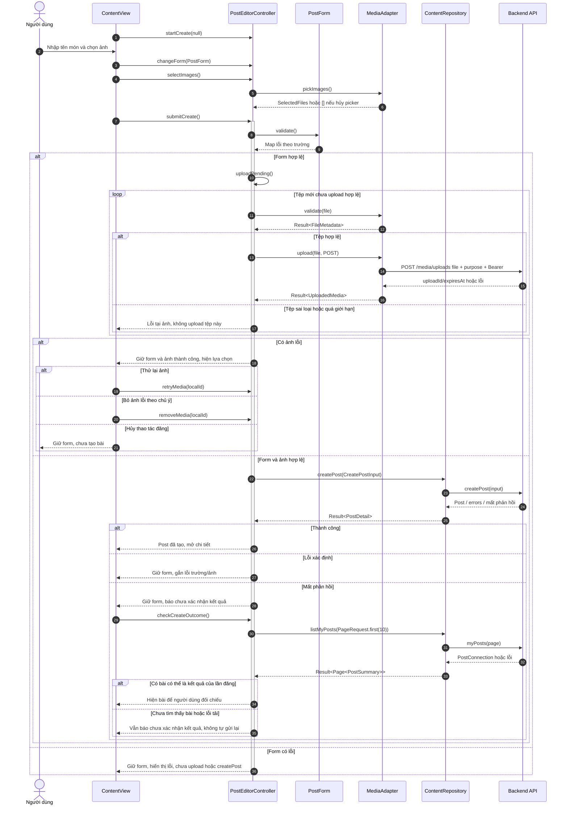

**Diễn giải và nhánh cần lưu ý:** Diagram rút gọn self-call điều phối. Nhánh validation lỗi không được tiếp tục upload tệp đó; một ảnh lỗi không xóa upload thành công. Sau sửa ảnh lỗi người dùng gửi lại từ đầu quy trình nhưng không upload lại tệp usable. Chỉ tên món bắt buộc. Không thấy bài trong trang đã tải chưa chứng minh lần đăng thất bại. Chỉ gửi lại khi người dùng chủ động quyết định sau khi được báo nguy cơ đăng trùng.

**Class/method đối chiếu:** `PostEditorController.startCreate`, `PostEditorController.changeForm`, `PostEditorController.selectImages`, `PostEditorController.submitCreate`, `PostEditorController.uploadPending`, `PostEditorController.retryMedia`, `PostEditorController.removeMedia`, `PostForm.validate`, `MediaAdapter.pickImages`, `MediaAdapter.validate`, `MediaAdapter.upload`, `ContentRepository.createPost`, `PostEditorController.checkCreateOutcome`, `ContentRepository.listMyPosts`.

## 7. FE-SQ05 — Sửa bài với ảnh cũ/mới và hủy form

**Tiền điều kiện:** Phiên hợp lệ cho thao tác cá nhân; actor đúng chủ sở hữu khi sửa.

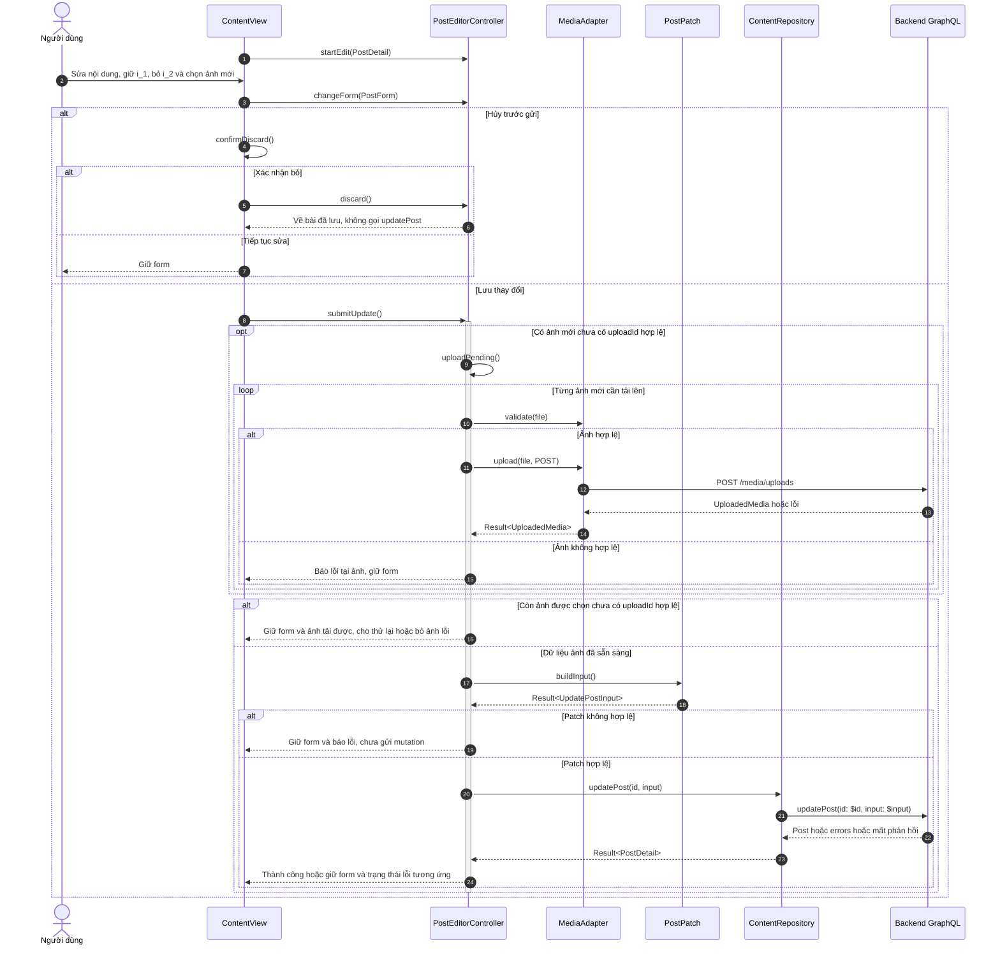

**Diễn giải và nhánh cần lưu ý:** Payload ví dụ là `{"id":"p_1","input":{"images":[{"imageId":"i_1","position":0},{"uploadId":"up_9","position":1}]}}`. Ví dụ i_1/up_9 là ID minh họa. Chỉ dùng up_9 đã upload; images=[] xóa hết, omit giữ ảnh. Không gửi null để xóa enum/object vì contract hiện chưa có cách clear hợp lệ.

**Class/method đối chiếu:** `PostEditorController.startEdit`, `PostEditorController.changeForm`, `PostEditorController.discard`, `PostEditorController.submitUpdate`, `PostEditorController.uploadPending`, `MediaAdapter.validate`, `MediaAdapter.upload`, `PostPatch.buildInput`, `ContentRepository.updatePost`, `ContentView.confirmDiscard`.

## 8. FE-SQ06 — Logout, thu hồi server và kết thúc cục bộ

**Tiền điều kiện:** Phiên hợp lệ cho thao tác cá nhân; actor đúng chủ sở hữu khi sửa.

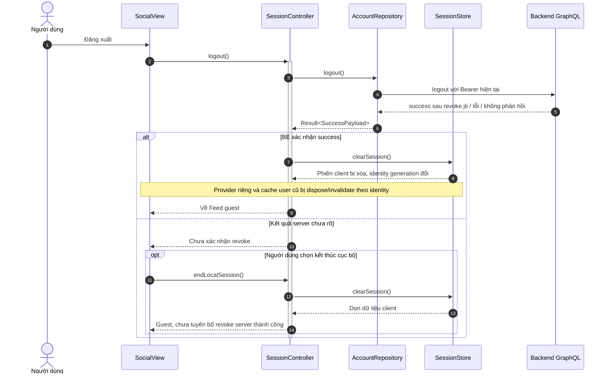

**Diễn giải và nhánh cần lưu ý:** BE thu hồi jti, reset mật khẩu tăng ver; FE không tự sửa chúng. Lỗi xóa kho nền tảng cần phản hồi đúng, không nhận định đã clear. Không giả lập bảng revoked token trong client.

**Class/method đối chiếu:** `SessionController.logout`, `SessionController.endLocalSession`, `AccountRepository.logout`, `SessionStore.clearSession`.

## 9. FE-SQ07 — Lưu bài và chủ động mở nhóm vừa lưu

**Tiền điều kiện:** Phiên hợp lệ cho thao tác cá nhân; actor đúng chủ sở hữu khi sửa.

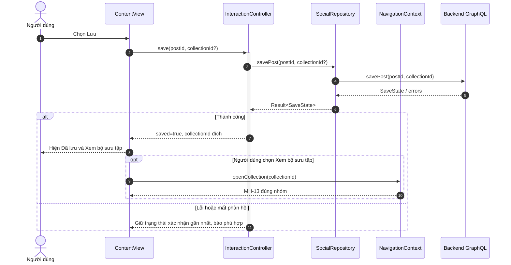

**Diễn giải và nhánh cần lưu ý:** Không tự chuyển nhóm ngay khi saved=true. Nếu không chỉ định nhóm, dùng collectionId BE trả cho Đã lưu. SaveState thiếu collectionId cần phản hồi/đọc lại theo contract, không tạo ID mặc định giả.

**Class/method đối chiếu:** `InteractionController.save`, `SocialRepository.savePost`, `NavigationContext.openCollection`.

## 10. FE-SQ08 — Thông báo, tổng chưa đọc và đích hồ sơ/bài

**Tiền điều kiện:** Phiên hợp lệ cho thao tác cá nhân; actor đúng chủ sở hữu khi sửa.

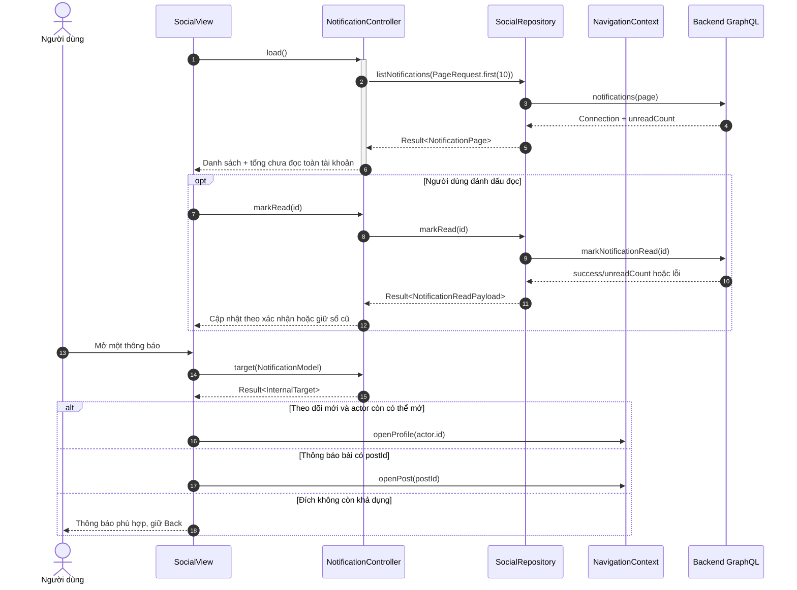

**Diễn giải và nhánh cần lưu ý:** Đích profile/post có thể mất sau khi target được tính; màn đích vẫn cần xử lý notAvailable. Mở mục không tự markRead nếu chưa chốt chính sách.

**Class/method đối chiếu:** `NotificationController.load`, `NotificationController.markRead`, `NotificationController.target`, `SocialRepository.listNotifications`, `SocialRepository.markRead`, `NavigationContext.openProfile`, `NavigationContext.openPost`.

## 11. FE-SQ09 — Vị trí bị từ chối vẫn xem quán gần

**Tiền điều kiện:** Đúng ngữ cảnh màn và dữ liệu/định danh hợp lệ; luồng công khai cho phép guest.

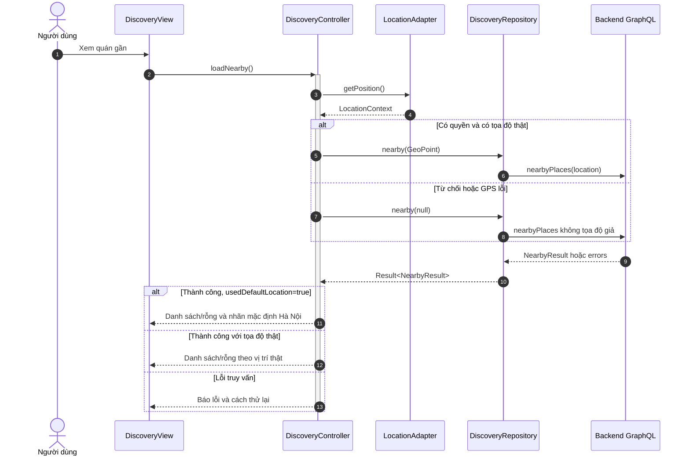

**Diễn giải và nhánh cần lưu ý:** Giới hạn 5km/≤50/quy tắc sort do BE. FE không dùng GPS từ chối làm lý do chặn đọc feed, không ép người dùng bật quyền bằng vòng lặp.

**Class/method đối chiếu:** `DiscoveryController.loadNearby`, `LocationAdapter.getPosition`, `DiscoveryRepository.nearby`.

## 12. FE-SQ10 — Chat, retry và dùng draft để soạn bài

**Tiền điều kiện:** Phiên hợp lệ cho thao tác cá nhân; actor đúng chủ sở hữu khi sửa.

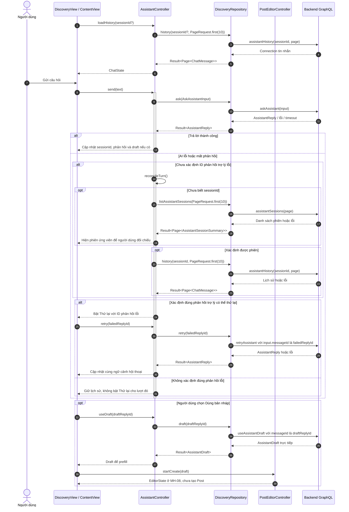

**Diễn giải và nhánh cần lưu ý:** Sau startCreate cần người dùng gửi bài theo FE-SQ04. Hủy form có dữ liệu hỏi xác nhận rồi về chat; không tự rollback câu hỏi đã lưu. Không chèn kết quả sau logout hoặc sang session khác. Khi đọc lại lịch sử, chỉ dùng ID của phản hồi trợ lý FAILED hoặc FALLBACK đủ điều kiện của đúng lượt hỏi. Nếu dữ liệu chưa đủ để ghép lượt, không lấy tin lỗi gần nhất theo suy đoán. Không tự gửi lại câu hỏi. DOC 6.2-A BE, Hình 07, xác định `retryAssistant` nhận ID phản hồi trợ lý lỗi. BE dùng `replyToId` nội bộ để tìm câu hỏi gốc. FE dùng `failedReplyId` cho retry và `draftReplyId` cho phản hồi có bản nháp. Nếu schema lịch sử chưa có đủ dữ liệu ghép đúng lượt thì giữ trạng thái chưa xác định.

**Class/method đối chiếu:** `AssistantController.loadHistory`, `AssistantController.reconcileTurn`, `DiscoveryRepository.listAssistantSessions`, `AssistantController.send`, `AssistantController.retry`, `AssistantController.useDraft`, `DiscoveryRepository.history`, `DiscoveryRepository.ask`, `DiscoveryRepository.retry`, `DiscoveryRepository.draft`, `PostEditorController.startCreate`.

## 13. FE-SQ11 — Đăng ký tài khoản

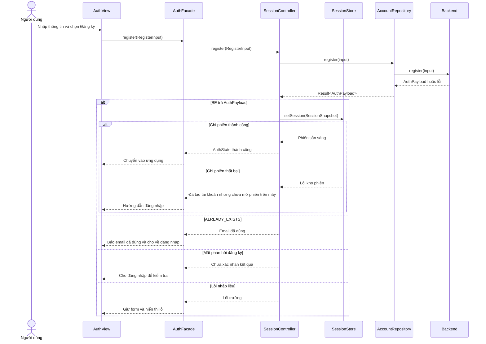

## 14. FE-SQ12 — Thích và bỏ thích bài

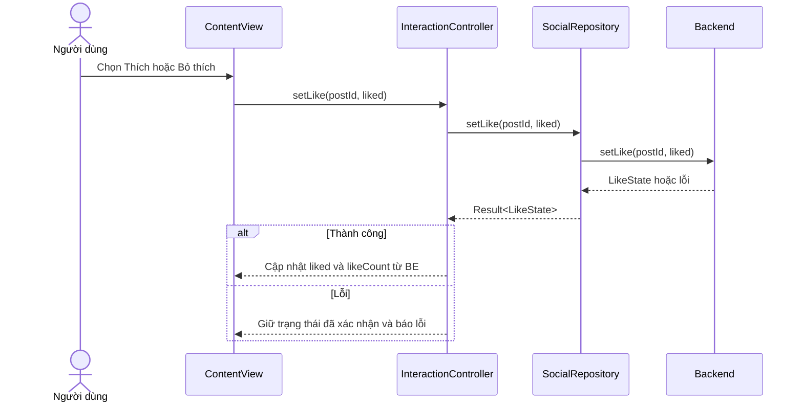

## 15. Những chức năng còn lại dùng lại thiết kế nào?

- Xóa bài/báo cáo dùng PostDetailController và IPostWrite/IReportWrite. View xác nhận xóa, hủy không gọi BE; success delete mới về danh sách. Report chỉ accepted, chưa kết luận ẩn bài.
- Sửa hồ sơ và công khai dùng ProfileController.saveProfile/saveVisibility độc lập, cùng lỗi form/mutation, không public email.
- Tạo/đổi tên/xóa nhóm dùng CollectionController; nhóm mặc định không xóa, bài gốc không xóa. Cùng xác nhận hủy/lỗi/mất phản hồi.
- Theo dõi dùng InteractionController.setFollow với trạng thái đích, cùng mô hình chặn lặp như lưu bài, nhưng không có bước mở collection.
- Search/trending/random dùng DiscoveryController tương ứng, query/state như Feed; phân biệt WAITING/empty/error, mở đúng kiểu kết quả và giữ tiêu chí khi Back.

Đây là giải thích tái sử dụng và phạm vi sơ đồ được chọn, không coi sequence cho các nhánh này đã được vẽ riêng. Nếu nhóm cần thêm theo phân công tổng, mở rộng bằng các method đã có.

## 16. Điều kiện kiểm lại

So khớp tên method/tham số và kiểu trả giữa DOC 6.1-A, DTO/API và các sơ đồ; kiểm mỗi request có kết quả/nhánh lỗi phù hợp; kiểm scope user/session và late response; walkthrough cùng BE. Các điểm API còn mở tiếp tục giữ tại PostPatch, không tự làm rõ thay bằng payload không có căn cứ. Đây là tài liệu thiết kế, chưa có kết quả chạy test hoặc phê duyệt.
