# DOC 6.3-A — Mockup UI hi-fi Frontend

| Dự án | Owner | Reviewer | Approver | Sprint | Ngày | Trạng thái |
|---|---|---|---|---|---|---|
| ToMateTo | FE — hieun4759 | Lead | Lead | S6 | 06/11/2026 | Đề nghị review |

**WBS:** 6.1.1. **Đầu ra:** [Bộ ảnh hi-fi](#bộ-ảnh-svg) · [Design system](6.3-B_design_system_fe.md) · [Đặc tả lỗi FE](7.2-A_xu_ly_loi_frontend.md).

Bộ mockup gồm 18 màn hình. Mỗi màn có ảnh hi-fi ở trạng thái mặc định và mô tả các trạng thái bổ sung.

## Bố cục và hành vi theo màn hình

| Màn | Bố cục hi-fi | Trạng thái và hành động chính |
|---|---|---|
| MH-01 Đăng nhập | Form một cột, nút chính bên dưới ô mật khẩu | Báo sai thông tin trong form, khóa nút khi đang gửi. Có đường vào đăng ký và quên mật khẩu |
| MH-02 Đăng ký | Tên hiển thị, email, mật khẩu | Báo email đã dùng và cho về đăng nhập |
| MH-03 Khôi phục | Email và OTP trên cùng màn | Sau tiếp nhận mới hiện OTP. Đổi email xóa mã cũ. Hủy về đăng nhập |
| MH-05 Đặt mật khẩu | Hai ô mật khẩu, một hành động chính | Grant hết hạn về MH-03, thành công về MH-01 |
| MH-06 Bảng tin | Thẻ bài 2 cột trên web, 1 cột trên mobile | Hiện tải, rỗng hoặc lỗi. Tải thêm lỗi giữ bài đã có |
| MH-07 Chi tiết bài | Ảnh, thông tin bài, hành động và công thức | Bài không khả dụng có đường về. Chỉ hiện Sửa/Xóa cho chủ bài trong app |
| MH-08 Tạo bài | Form, vùng ảnh và metadata tùy chọn | Đang gửi, lỗi từng ảnh, mất phản hồi và kiểm tra bài của mình |
| MH-09 Chỉnh sửa bài | Dùng chung form và phân biệt ảnh hiện tại | Đang lưu, giữ giá cũ nếu chưa có hợp đồng bỏ giá |
| MH-10 Hồ sơ | Giới thiệu, nút theo quyền và danh sách bài | Chủ hồ sơ thấy chỉnh sửa. Khách chỉ thấy trường công khai và thao tác theo dõi khi đủ điều kiện |
| MH-11 Chỉnh sửa hồ sơ | Hai khối thông tin và quyền công khai | Lưu độc lập. Lỗi giữ dữ liệu khối vừa gửi |
| MH-12 Bộ sưu tập | Danh sách nhóm và số bài | Mở nhóm, tạo nhóm. Bộ “Đã lưu” được hệ thống tạo mặc định |
| MH-13 Chi tiết bộ sưu tập | Thẻ bài trong nhóm đã chọn | Trạng thái rỗng dẫn sang bảng tin |
| MH-14 Thông báo | Danh sách có nhãn chưa đọc | Theo dõi mở hồ sơ. Tương tác mở bài. Cập nhật tổng chưa đọc sau xác nhận |
| MH-15 Tìm kiếm | Ô từ khóa, bộ lọc loại, thẻ kết quả | Tối thiểu 2 ký tự theo hợp đồng. Rỗng khác lỗi tải |
| MH-16 Xu hướng | Danh sách mục xu hướng | Snapshot chưa có thì hiện đang tổng hợp. Nếu mục là bài, mở chi tiết bài khi contract có ID |
| MH-17 Quán gần | Danh sách quán và khoảng cách | Khi thiếu vị trí, ghi rõ đang dùng khu vực mặc định. Rỗng khác lỗi tải |
| MH-18 Quay món | Một thẻ gợi ý và nút quay lại | Có gợi ý, rỗng hoặc lỗi |
| MH-19 Trợ lý | Hội thoại, vùng soạn và hành động theo phản hồi | Đang chờ, đối soát lịch sử, thử lại đúng phản hồi lỗi, điền form từ bản nháp |

## Ghi chú bàn giao

- Web dùng khung tối đa 1120 px, cột danh mục 220 px, khoảng cách 24 px. Ở chiều rộng 720 px trở xuống, bố cục chuyển sang một cột và danh sách chọn màn hình. Thiết kế lấy 390 px làm kích thước tham chiếu mobile.
- Tên món là trường bắt buộc. Giá dùng bốn phân khúc theo API 5.2-A. Thẻ đang hoãn trong v1. Cách hiển thị khoảng giá và bỏ giá cần đồng bộ với nghiệp vụ trước khi triển khai.
- Vùng ảnh dùng hình minh họa. JPEG, PNG hoặc WebP tối đa 10 MB mỗi tệp. Cạnh dài sau xử lý không quá 1600 px.
- Luồng tạo/sửa giữ dữ liệu khi gặp lỗi. Khi người dùng rời form có thay đổi, app cần xác nhận trước khi bỏ. Thông báo lỗi và quy tắc thử lại nằm trong DOC 7.2-A.
- Các nút trong ảnh minh họa bố cục. Hành vi khi đăng nhập, kiểm quyền và tải ảnh được mô tả theo từng màn.

Căn cứ: [Wireframe S2](https://github.com/anqp5002/ToMateTo/blob/393268f6/docs/yeu_cau/3.3_wireframes_fe.md), [API BE 5.2-A](https://github.com/anqp5002/ToMateTo/blob/688cef5d/docs/thiet_ke/5.2-A_api_specification_backend.md), [Sequence BE S5](https://github.com/anqp5002/ToMateTo/blob/ed27b57/docs/thiet_ke/6.2-A_sequence_diagrams_backend.md).

## Bộ ảnh SVG

Các ảnh dùng bố cục mobile rộng 390 px. Những trạng thái khác được mô tả dưới từng ảnh và trong DOC 7.2-A.

### MH-01 Đăng nhập

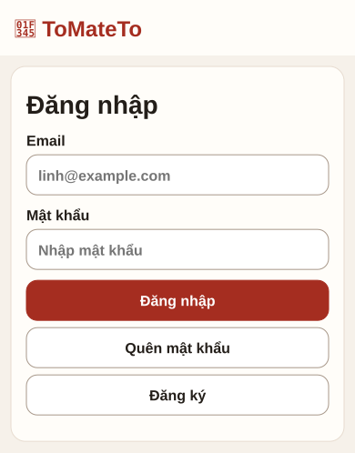

- **Mục đích.** Đăng nhập để tiếp tục thao tác cần tài khoản, chẳng hạn lưu bài hoặc theo dõi.
- **Cách sử dụng.** Nhập email và mật khẩu. Nếu vào đây từ một màn khác, đăng nhập thành công sẽ quay lại ngữ cảnh trước đó.
- **Điểm cần chú ý.** Khi thông tin sai, giữ email và báo lỗi trong form. Trong lúc gửi, khóa nút Đăng nhập.

### MH-02 Đăng ký

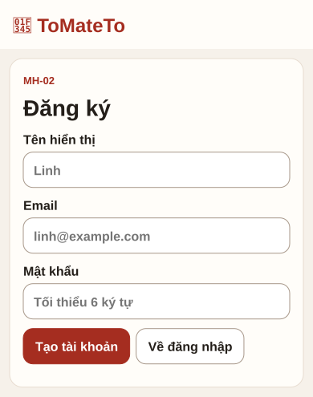

- **Mục đích.** Tạo tài khoản mới cho người lần đầu sử dụng ToMateTo.
- **Cách sử dụng.** Nhập tên hiển thị, email và mật khẩu tối thiểu 6 ký tự. Nếu đã có tài khoản, chọn Về đăng nhập.
- **Điểm cần chú ý.** Nếu email đã được dùng, hướng người dùng về đăng nhập để tiếp tục.

### MH-03 Khôi phục

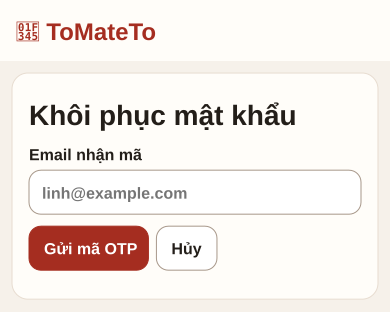

- **Mục đích.** Yêu cầu mã xác minh và nhập OTP ngay trên cùng một màn.
- **Cách sử dụng.** Nhập email, chọn Gửi mã OTP. Sau khi yêu cầu được tiếp nhận, màn hiện ô nhập mã. Xác minh thành công sẽ sang MH-05.
- **Điểm cần chú ý.** OTP có 6 chữ số và hiệu lực 10 phút. Đổi email sẽ bỏ mã đang nhập. Thông báo gửi mã dùng cùng một nội dung để tránh tiết lộ email có tài khoản hay không.

### MH-05 Đặt mật khẩu

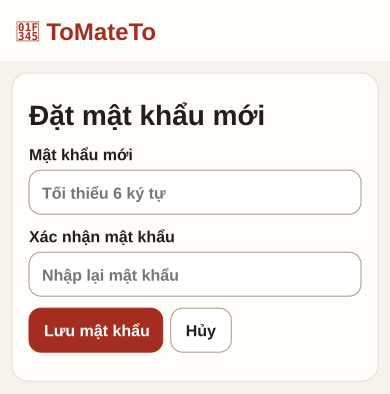

- **Mục đích.** Đặt mật khẩu mới sau khi xác minh OTP thành công.
- **Cách sử dụng.** Nhập và xác nhận mật khẩu mới. Lưu thành công thì màn hiện xác nhận và nút về đăng nhập.
- **Điểm cần chú ý.** Nếu quyền đặt lại đã hết hạn hoặc đã dùng, quay về MH-03 để yêu cầu mã mới.

### MH-06 Bảng tin

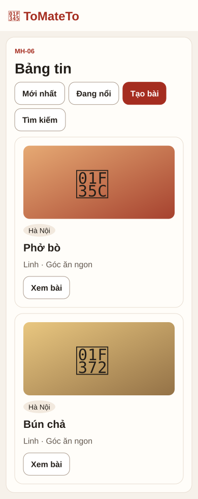

- **Mục đích.** Duyệt các bài về món ăn và mở chi tiết bài quan tâm.
- **Cách sử dụng.** Chọn một thẻ bài để sang MH-07 hoặc dùng lối tắt Tìm kiếm, Xu hướng và Tạo bài.
- **Điểm cần chú ý.** Phân biệt đang tải, chưa có bài và tải lỗi. Nếu chỉ lỗi ở lần tải thêm, giữ các bài đã hiện.

### MH-07 Chi tiết bài

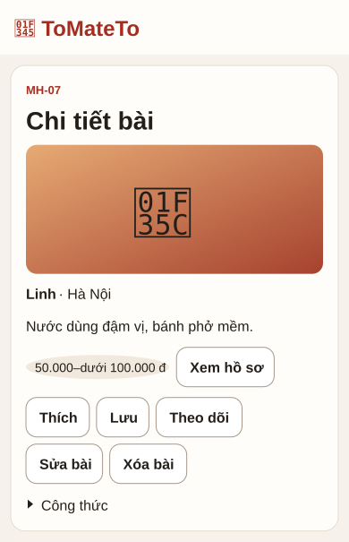

- **Mục đích.** Đọc nội dung bài, ảnh và thông tin món trước khi tương tác.
- **Cách sử dụng.** Có thể thích, lưu hoặc theo dõi. Sau khi lưu, người dùng có thể chủ động mở bộ sưu tập vừa lưu.
- **Điểm cần chú ý.** Ảnh mặc định minh họa cả nút Sửa và Xóa. Khi triển khai, chỉ chủ bài thấy hai nút này. Nếu bài không còn khả dụng, hiện thông báo và đường quay về.

### MH-08 Tạo bài

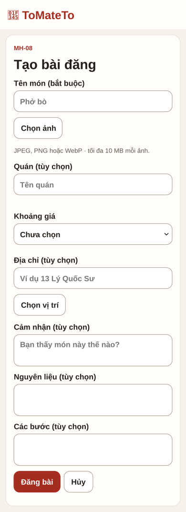

- **Mục đích.** Tạo bài mới từ form trống hoặc từ bản nháp do trợ lý điền sẵn.
- **Cách sử dụng.** Tên món bắt buộc. Ảnh, quán, khoảng giá, địa chỉ, vị trí, cảm nhận và công thức là tùy chọn. Người dùng kiểm tra form rồi bấm Đăng bài.
- **Điểm cần chú ý.** Nếu một ảnh lỗi, giữ các ảnh đã tải được và cho thử lại hoặc bỏ ảnh lỗi. Nếu mất phản hồi lúc đăng, giữ form và cho kiểm tra bài của mình. Chưa thấy bài vẫn là chưa xác nhận kết quả.

### MH-09 Chỉnh sửa bài

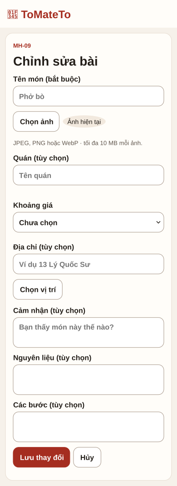

- **Mục đích.** Chỉnh sửa bài của mình, gồm cả nội dung và danh sách ảnh.
- **Cách sử dụng.** Form mở với dữ liệu hiện tại. Người dùng có thể giữ, bỏ ảnh cũ hoặc thêm ảnh mới rồi lưu thay đổi.
- **Điểm cần chú ý.** Nếu form đã sửa mà người dùng bấm Hủy, bản triển khai cần hỏi có bỏ thay đổi không. Cách bỏ khoảng giá và một số trường tùy chọn còn phụ thuộc hợp đồng API.

### MH-10 Hồ sơ

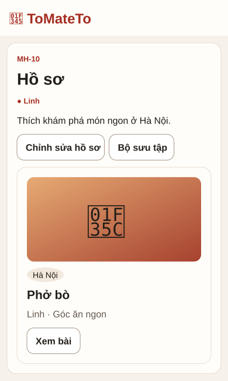

- **Mục đích.** Xem thông tin hồ sơ và các bài viết của một người.
- **Cách sử dụng.** Chủ hồ sơ có thể mở Chỉnh sửa hồ sơ hoặc Bộ sưu tập. Người xem hồ sơ của người khác thấy thông tin được công khai và nút Theo dõi khi phù hợp.
- **Điểm cần chú ý.** Ảnh mặc định là góc nhìn của chủ hồ sơ. Email luôn được giữ riêng tư.

### MH-11 Chỉnh sửa hồ sơ

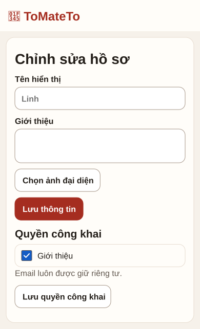

- **Mục đích.** Sửa thông tin cá nhân và chọn trường được công khai.
- **Cách sử dụng.** Khối thông tin và khối quyền công khai có nút lưu riêng. Sửa giới thiệu hoặc ảnh đại diện không tự thay đổi quyền công khai.
- **Điểm cần chú ý.** Khi lưu lỗi, giữ dữ liệu người dùng vừa nhập để họ sửa hoặc thử lại.

### MH-12 Bộ sưu tập

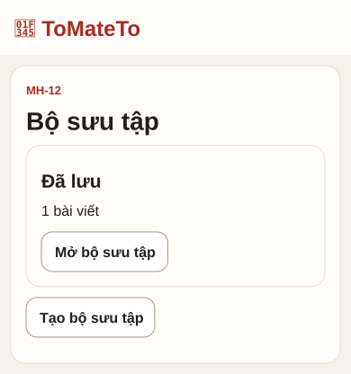

- **Mục đích.** Xem các bộ sưu tập do người dùng quản lý.
- **Cách sử dụng.** Chọn một nhóm để mở MH-13 hoặc chọn Tạo bộ sưu tập. Bộ Đã lưu là nhóm mặc định.
- **Điểm cần chú ý.** Số bài trên thẻ cho người dùng biết nhóm có nội dung trước khi mở.

### MH-13 Chi tiết bộ sưu tập

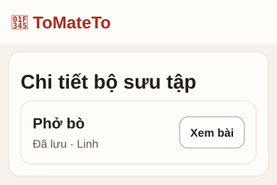

- **Mục đích.** Xem các bài đã lưu trong bộ sưu tập đang mở.
- **Cách sử dụng.** Chọn một thẻ để mở chi tiết bài. Khi quay lại, trở về đúng bộ sưu tập.
- **Điểm cần chú ý.** Nếu bộ sưu tập trống, giải thích chưa có bài và cho sang bảng tin để tìm bài.

### MH-14 Thông báo

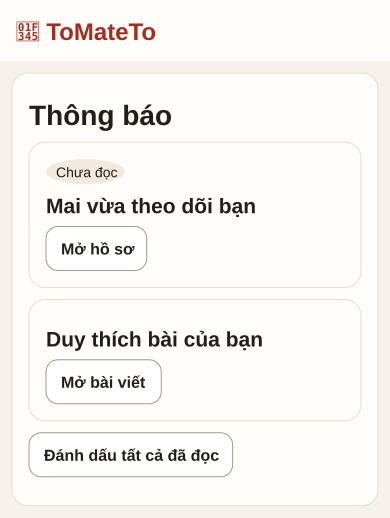

- **Mục đích.** Xem các hoạt động liên quan tới tài khoản và nhận biết mục chưa đọc.
- **Cách sử dụng.** Thông báo theo dõi mở hồ sơ người vừa theo dõi. Thông báo tương tác mở bài liên quan.
- **Điểm cần chú ý.** Cập nhật trạng thái đọc và tổng chưa đọc sau khi BE xác nhận. Nếu đích không còn, hiện thông báo và cho quay lại.

### MH-15 Tìm kiếm

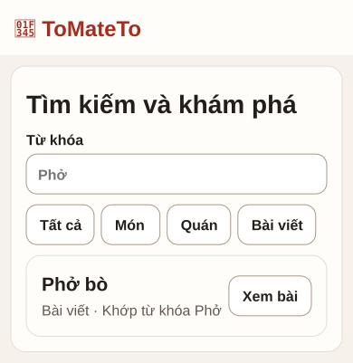

- **Mục đích.** Tìm nội dung theo từ khóa và theo loại kết quả.
- **Cách sử dụng.** Nhập từ khóa từ 2 ký tự, chọn loại Món, Quán hoặc Bài viết. Kết quả là bài có thể mở trực tiếp vào chi tiết.
- **Điểm cần chú ý.** Kết quả rỗng gợi ý thử từ khóa khác. Lỗi tải cho phép thử lại và giữ từ khóa.

### MH-16 Xu hướng

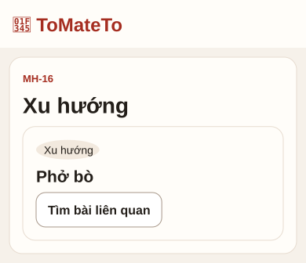

- **Mục đích.** Xem các món đang được quan tâm để khám phá thêm bài liên quan.
- **Cách sử dụng.** Chọn một mục món để tìm các bài tương ứng. Nếu mục là bài và API có ID, mở chi tiết bài.
- **Điểm cần chú ý.** Nếu hệ thống chưa có dữ liệu xu hướng, hiện Đang tổng hợp. Lỗi tải có hành động Thử lại.

### MH-17 Quán gần

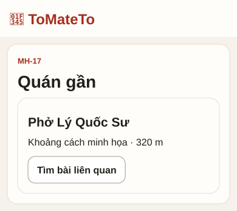

- **Mục đích.** Tìm quán theo khu vực và xem khoảng cách khi có dữ liệu.
- **Cách sử dụng.** Xem danh sách quán hoặc mở bài liên quan. Nếu người dùng không cấp vị trí, API có thể dùng khu vực mặc định.
- **Điểm cần chú ý.** Khi dùng vị trí mặc định, ghi rõ đang hiển thị quanh trung tâm Hà Nội. Phân biệt không tìm thấy quán với lỗi tải.

### MH-18 Quay món

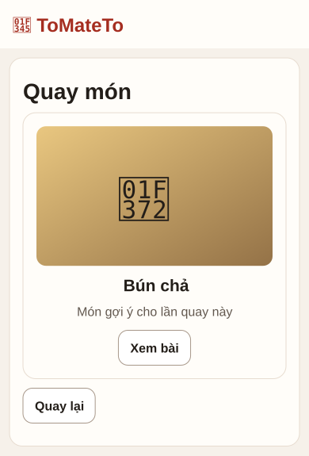

- **Mục đích.** Nhận gợi ý món khi người dùng chưa biết chọn gì.
- **Cách sử dụng.** Xem món được gợi ý, mở bài liên quan hoặc quay để lấy gợi ý khác.
- **Điểm cần chú ý.** Nếu không có món phù hợp, hiện trạng thái rỗng. Nếu lỗi tải, cho thử lại.

### MH-19 Trợ lý

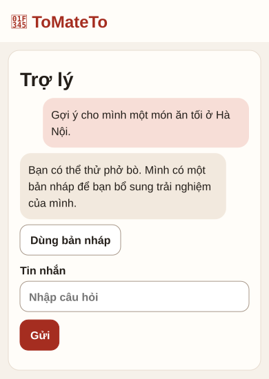

- **Mục đích.** Hỏi trợ lý về món ăn và dùng gợi ý để soạn bài.
- **Cách sử dụng.** Gửi câu hỏi, chờ phản hồi. Nếu có bản nháp, chọn Dùng bản nháp để điền form MH-08. Bài chỉ được tạo khi người dùng chủ động đăng.
- **Điểm cần chú ý.** Khi thiếu ID phản hồi lỗi, cho kiểm tra lịch sử. Chỉ bật Thử lại khi xác định được đúng phản hồi trợ lý bị lỗi.
