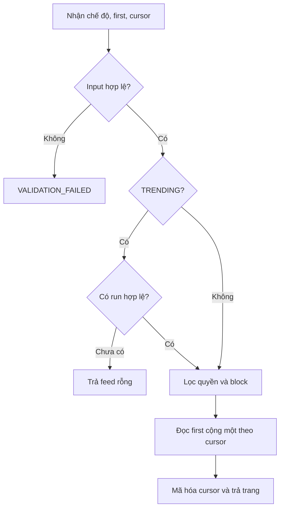
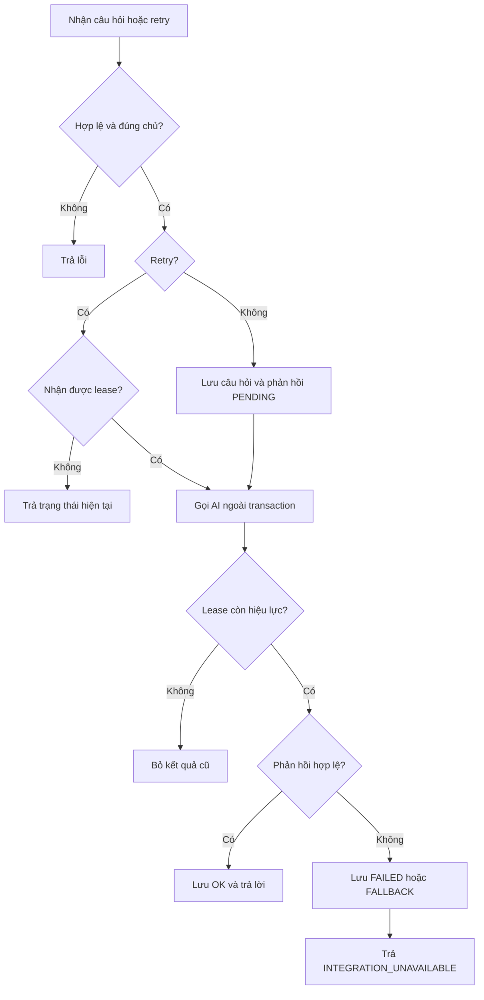

# DOC 7.1-A — Đặc tả thuật toán Backend

| Thuộc tính | Nội dung |
|---|---|
| Dự án | ToMateTo |
| Owner | Backend |
| Reviewer | Lead; DB phối hợp phần truy vấn và chỉ mục |
| Approver | Lead |
| Sprint / WBS | S6 / 6.2.1 |
| Trạng thái | Đề nghị review |
| Ngày cập nhật / Phiên bản | 07/11/2026 / 1.3 |

## 1. Phạm vi

Tài liệu đặc tả các thuật toán xử lý feed, xu hướng, quán gần, quay món, trợ lý, tìm kiếm và chuẩn hóa tên món. Phân trang dùng con trỏ, mặc định 10 và tối đa 50 mục. Quyền đọc và chặn hai chiều được áp dụng trước khi giới hạn kết quả. Thẻ chưa thuộc API v1.

**Tài liệu đầu vào**

| DOC | Nội dung sử dụng |
|---|---|
| DOC 2.1-B — Đặc tả use case | Luồng nghiệp vụ và trường hợp thay thế |
| DOC 3.1-A — Yêu cầu chức năng | Phạm vi và mã REQ của thuật toán |
| DOC 3.2-A — Yêu cầu phi chức năng | Giới hạn phân trang và mục tiêu hiệu năng |
| DOC 5.2-A — Đặc tả API Backend | Đầu vào, đầu ra và lỗi của operation |
| DOC 6.1-A — Thiết kế lớp Backend | Lớp và phương thức liên quan |
| DOC 6.2-A — Sơ đồ tuần tự Backend | Thứ tự xử lý, quyền và giao dịch |
| DOC 5.3-A/B, 6.4-A/B — Thiết kế dữ liệu | Cấu trúc dữ liệu, snapshot và ràng buộc |

| Thuật toán | Mục đích | Yêu cầu | Lớp / phương thức | Độ phức tạp | Ưu tiên |
|---|---|---|---|---|---|
| Feed theo con trỏ | Trả trang bài theo chế độ và quyền | REQ-007, REQ-028 | FeedQueryService.listFeed, PostRepository.listFeed | Xấu nhất O(n log n), bộ nhớ trang O(k) | Cao |
| Tính và đọc xu hướng | Tính và công bố điểm bài, món | REQ-024 | DiscoveryService.refreshTrendingSnapshot, TrendingSnapshotRepository | O(n + m log m), bộ nhớ O(m) | Cao |
| Tìm quán gần | Chọn quán trong bán kính | REQ-021 | DiscoveryService.getNearbyRestaurants, SearchRepository.findNearby | O(n log n), bộ nhớ O(n) | Cao |
| Quay món | Chọn món ngẫu nhiên hợp lệ | REQ-022 | DiscoveryService.chooseRandomDish | O(n) thời gian và bộ nhớ | Trung bình |
| Gợi ý trợ lý | Tạo và kiểm tra gợi ý | REQ-025, REQ-026 | AssistantService.ask/retry, AiAdapter.complete | O(n + r), ngoài truy vấn và AI | Cao |
| Tìm kiếm | Tìm món, quán và bài phù hợp | REQ-023, REQ-028 | DiscoveryService.search, SearchRepository | Xấu nhất O(n log n), bộ nhớ O(n) | Cao |
| Chuẩn hóa tên món | Nhận diện món trùng tên | REQ-027 | PostNormalizer.resolveDish, DishRepository | O(L) chuẩn hóa; tra cứu tùy chỉ mục | Trung bình |

## 2. Feed theo con trỏ

**Đầu vào:** chế độ LATEST hoặc TRENDING, first, after tùy chọn và người xem. **Đầu ra:** danh sách bài, endCursor và hasNextPage. Người xem có thể là khách.

```text
NẾU first không được cung cấp: dùng 10
NẾU first ≤ 0: trả VALIDATION_FAILED; NẾU first > 50: giới hạn first về 50
KIỂM TRA cursor hợp lệ cho chế độ
NẾU TRENDING: xác định run từ cursor hoặc run mới nhất đã công bố
NẾU chưa có run: trả PostConnection rỗng, hasNextPage=false
LỌC bài công khai, còn khả dụng và phù hợp quyền của người xem
NẾU đã đăng nhập: loại bài theo điều kiện chặn hai chiều
SẮP XẾP LATEST theo (created_at, id) giảm dần
HOẶC TRENDING theo (score, id) giảm dần trong run
LẤY các dòng sau cursor, tối đa first + 1
TRẢ tối đa first dòng, hasNextPage = có dòng dư
DÙNG CursorCodec mã hóa endCursor từ dòng cuối; TRENDING kèm run_id và score
```

**Sau xử lý:** các trang cùng cursor xu hướng đọc cùng run. Cursor sai hoặc run không còn được trả lỗi hợp lệ để client tải lại từ đầu. Danh sách rỗng là kết quả thành công. Ví dụ first=2, truy vấn được 3 bài thì trả 2 bài và hasNextPage=true.

Khi chưa có run, feed TRENDING trả connection rỗng; query `trending` trả trạng thái WAITING. Quy tắc giới hạn first về 50 theo NFR-02 cần đồng bộ với DOC 6.1-A đang mô tả miền 1..50 và DOC 5.2-A về xử lý giá trị không hợp lệ.

Danh sách thông báo, lịch sử trợ lý và bài của tôi dùng cùng cơ chế con trỏ, đọc dư một dòng để xác định hasNextPage. Repository lọc owner hoặc quyền tương ứng trước phân trang và sắp xếp ổn định theo (created_at, id) giảm dần; cursor gắn với danh sách và điều kiện truy vấn.

**Độ phức tạp:** bộ nhớ xử lý trang O(k), với k ≤ 51. Chi phí truy vấn phụ thuộc chỉ mục, điều kiện lọc và kế hoạch DB. DB đối chiếu truy vấn tại WBS 6.2.2.

CursorCodec.decode kiểm tra cursor trước truy vấn. Thiết kế 6.1 hiện khai báo encode(createdAt, id), cần mở rộng payload và chữ ký cho TRENDING gồm runId, score và id; không dùng chữ ký cũ để mã hóa thiếu thông tin. Trong trường hợp quét n bản ghi và sắp xếp không có chỉ mục phù hợp, thời gian có thể tới O(n log n); không suy O(k) cho toàn truy vấn.



## 3. Tính và đọc xu hướng

**Mục đích:** tính sẵn điểm trong 7 ngày, tránh tính tổng hợp khi mở feed. Job chạy mỗi 15 phút. **Đầu vào:** thời điểm tính, bài và tương tác trong cửa sổ. **Đầu ra:** run cùng snapshot bài và món.

```text
XÁC ĐỊNH cửa sổ [thời điểm tính - 7 ngày, thời điểm tính)
LOẠI bài đã ẩn hoặc không còn khả dụng
VỚI mỗi bài: điểm = số lượt thích + số lượt lưu trong cửa sổ
VỚI mỗi món: điểm = số bài mới + lượt thích + lượt lưu của các bài thuộc món trong cửa sổ
SẮP XẾP điểm giảm dần; điểm bằng nhau dùng id giảm dần
GHI run và hai nhóm snapshot trong cùng transaction
NẾU thành công: công bố run mới; NẾU lỗi: rollback và tiếp tục dùng run trước
```

Mỗi sự kiện có trọng số 1. Khi đọc phải kiểm lại bài còn hiển thị và quyền người xem. Ví dụ món có 2 bài mới, 3 lượt thích và 1 lượt lưu có điểm 6.

Lượt thích và lưu được tính từ các quan hệ còn tồn tại có thời điểm tạo trong cửa sổ. Lượt đã hủy hoặc gỡ lưu không còn trong tập tính điểm. Nếu cần tính cả lịch sử tương tác đã hủy, cần bổ sung nguồn sự kiện trước khi triển khai.

**Độ phức tạp:** với n sự kiện và m đối tượng được chấm, tổng hợp O(n), sắp xếp O(m log m), bộ nhớ O(m). Tải thực tế và chỉ mục cần đo cùng DB.

## 4. Quán gần

**Đầu vào:** tọa độ tùy chọn. **Đầu ra:** tối đa 50 quán và khoảng cách theo mét. Nếu thiếu tọa độ dùng trung tâm Hà Nội và trả usedDefaultLocation=true. Tọa độ ngoài miền hợp lệ trả VALIDATION_FAILED.

```text
CHỌN tọa độ người dùng hoặc tọa độ mặc định
LẤY ứng viên có tọa độ hợp lệ và thỏa quyền hiển thị
TÍNH khoảng cách mặt cầu từ tọa độ chọn đến từng quán
GIỮ quán cách không quá 5 km
SẮP XẾP theo khoảng cách tăng dần, cùng khoảng cách theo id
TRẢ tối đa 50 kết quả và cờ vị trí mặc định
```

Lọc khoảng cách chính xác trước khi lấy 50 kết quả. Không có quán trả danh sách rỗng. Ví dụ hai quán cách 1 km và 6 km thì chỉ trả quán 1 km. Với n ứng viên, tính khoảng cách O(n), sắp xếp O(n log n), bộ nhớ O(n); truy vấn tiền lọc và chỉ mục do DB đối chiếu. Mục tiêu NFR-03 là ≤2 giây, cần đo khi cài đặt.

DiscoveryService áp dụng giới hạn 50 sau khi lọc khoảng cách và sắp xếp. Repository có thể tiền lọc ứng viên nhưng không cắt sớm các quán hợp lệ.

## 5. Quay món

**Đầu vào:** không yêu cầu bộ lọc. **Đầu ra:** món được chọn và lý do, hoặc trạng thái rỗng. Ứng viên gồm món hợp lệ trong dữ liệu được phép hiển thị.

**Đề xuất:** tập mục tiêu 40 món, gồm 70% món xu hướng và 30% món seed; các tỷ lệ này cần nhóm review và chốt trước khi triển khai.

```text
LẤY món xu hướng và món seed hợp lệ
TẠO danh sách mục tiêu 40 món, ưu tiên 70% xu hướng và 30% seed
LOẠI món trùng id; nếu thiếu một nhóm, bù bằng món hợp lệ từ nhóm còn lại
NẾU không có món: trả trạng thái rỗng
TRỘN danh sách và chọn ngẫu nhiên một vị trí hợp lệ
TRẢ món được chọn cùng lý do gợi ý
```

Nếu tổng dữ liệu ít hơn 40, dùng các món hiện có. Mỗi món xuất hiện tối đa một lần; không yêu cầu FE nhận toàn bộ danh sách quay. Ví dụ chỉ có một món hợp lệ thì kết quả là món đó. Với n món ứng viên, thời gian và bộ nhớ O(n) trong giới hạn tập ứng viên.

## 6. Gợi ý trợ lý

**Đầu vào:** principal, câu hỏi không rỗng, session và vị trí tùy chọn. **Đầu ra:** phản hồi đã kiểm chứng hoặc lỗi tích hợp; lịch sử được lưu. Thời gian mỗi lượt tối đa 30 giây.

```text
KIỂM TRA người dùng, quyền sở hữu phiên và nội dung câu hỏi
TẠO hoặc nạp phiên; lưu câu hỏi và phản hồi PENDING trong transaction
LẤY ngữ cảnh công khai, lọc quyền và block; chọn vị trí được phép hoặc mặc định
GỌI AI ngoài transaction với thời hạn tối đa 30 giây
KIỂM TRA món, quán, bài được nhắc đến đều tồn tại và người xem được phép xem
NẾU kết quả hợp lệ: lưu OK và nội dung, trả AssistantReply
NẾU timeout hoặc lỗi: lưu FAILED hoặc FALLBACK, trả INTEGRATION_UNAVAILABLE
KHI retry: kiểm owner và trạng thái, nhận lượt xử lý bằng version/lease
CHỈ GHI kết quả nếu version còn hiện hành
```

Kết quả cũ về sau không ghi đè kết quả mới. Không tự tạo bài từ draft. Ví dụ khi provider timeout, lịch sử vẫn có câu hỏi và trạng thái lỗi để đối chiếu. Với n mục ngữ cảnh và r tham chiếu, kiểm tra O(n+r) ngoài chi phí truy vấn và AI; cần đo NFR-04 khi tích hợp.



## 7. Tìm kiếm

**Mục đích:** tìm món, quán hoặc bài theo REQ-023. **Lớp:** DiscoveryService.search, SearchRepository.searchDishes/searchRestaurants/searchPosts. **Đầu vào:** query, loại tùy chọn, page, người xem. **Đầu ra:** trang kết quả cùng cursor. **Điều kiện trước:** query sau trim có ít nhất 2 ký tự, first dương và được giới hạn tối đa 50.

```text
CHUẨN HÓA từ khóa để tìm không phân biệt hoa thường và dấu
GIẢI MÃ cursor và kiểm tra gắn với tiêu chí tìm kiếm
CHỌN nhóm món, quán, bài theo loại yêu cầu
LỌC quyền và block hai chiều cho nội dung liên quan trước giới hạn
TÌM các kết quả phù hợp; sắp xếp ổn định theo mức phù hợp và id
ĐỌC first + 1 và tạo cursor cho trang trả về
```

**Sau xử lý:** không có kết quả trả danh sách rỗng; query/cursor sai trả VALIDATION_FAILED. Ví dụ tìm `pho` có thể khớp `Phở`; từ khóa một ký tự bị từ chối. Với n ứng viên, đối chiếu O(n), sắp xếp xấu nhất O(n log n), bộ nhớ O(n); chỉ mục và phép đo thực tế do DB đối chiếu.

## 8. Chuẩn hóa tên món

**Mục đích:** tránh tạo trùng món theo REQ-027. **Lớp:** PostNormalizer.resolveDish, DishRepository. **Đầu vào:** tên món; **đầu ra:** Dish hợp lệ. **Điều kiện trước:** tên sau bỏ khoảng trắng đầu cuối không rỗng. Thẻ nằm ngoài phạm vi API v1.

```text
DÙNG Dish.normalize để trim tên, gộp khoảng trắng, chuyển chữ thường và bỏ dấu
NẾU khóa chuẩn hóa rỗng: trả VALIDATION_FAILED
TÌM món theo khóa chuẩn hóa
NẾU đã có: dùng món hiện tại
NẾU chưa có: tạo món với khóa duy nhất
NẾU tạo đồng thời bị trùng khóa: đọc lại món đã được tạo
TRẢ món đã tìm hoặc tạo
```

Ví dụ `Phở Bò` và `  phở   bò ` cùng khóa `pho bo`; chuỗi chỉ gồm khoảng trắng bị từ chối. Chuẩn hóa chuỗi dài L mất O(L) thời gian và bộ nhớ; tra cứu tùy chỉ mục, trường hợp xấu quét O(n). Không áp dụng chuẩn hóa này cho thẻ.

Quy tắc bỏ dấu phải chuyển cả `đ` và `Đ` thành `d`; kết quả chuẩn hóa được dùng nhất quán khi tìm, tạo và xử lý trùng khóa.
`PostNormalizer.resolveDish` điều phối việc chuẩn hóa và tra cứu, còn quy tắc chuẩn hóa được dùng chung qua `Dish.normalize()`.

## 9. Trường hợp biên và hiệu năng

| Thuật toán | Điều kiện trước và sau | Trường hợp biên và tối ưu |
|---|---|---|
| Feed | Viewer có thể là khách; trả trang đúng thứ tự và quyền | first=0 bị từ chối, first=51 giới hạn về 50; trang rỗng có hasNextPage=false; cursor sai bị từ chối. Khối lượng xấu nhất là quét toàn bộ tập bài; dùng keyset và chỉ mục phù hợp. |
| Xu hướng | Dữ liệu thời gian hợp lệ; chỉ công bố run hoàn chỉnh | Không có sự kiện cho kết quả rỗng; điểm bằng nhau dùng id ổn định; job lỗi giữ run cũ. Trường hợp xấu nhất là toàn bộ sự kiện trong 7 ngày; tổng hợp theo lô. |
| Quán gần | Tọa độ đủ cặp và trong miền; trả tối đa 50 | Thiếu tọa độ dùng mặc định, (0,0) là tọa độ hợp lệ; quán đúng 5 km được giữ, dữ liệu trùng cần loại theo id. Tập xấu nhất gồm mọi quán có tọa độ; tiền lọc không được loại nhầm. |
| Quay món | Tập ứng viên hợp lệ; trả một món hoặc rỗng | Không có món trả rỗng; một món trả món đó; trùng id chỉ giữ một. Với 40 mục tiêu ưu tiên giới hạn số ứng viên đọc. |
| Trợ lý | Người dùng hợp lệ, câu hỏi không rỗng; lưu lịch sử | Phiên sai chủ bị từ chối; timeout lưu trạng thái lỗi; hai retry tranh lease chỉ một lượt được ghi. Tập xấu nhất là ngữ cảnh tối đa và provider chờ hết hạn; giới hạn ngữ cảnh. |
| Tìm kiếm | Query sau trim tối thiểu 2 ký tự; trả kết quả được phép | Rỗng hoặc một ký tự bị từ chối; không khớp trả rỗng; nhiều kết quả cùng điểm dùng id ổn định. Trường hợp xấu quét toàn bộ ứng viên; đánh giá chỉ mục tìm kiếm. |
| Chuẩn hóa món | Tên hợp lệ; trả một Dish | Tên rỗng từ chối, khác hoa thường hoặc dấu dùng cùng khóa; hai request đồng thời xử lý qua ràng buộc duy nhất. Trường hợp xấu truy vấn quét bảng; dùng chỉ mục khóa chuẩn hóa. |

| NFR | Thuật toán và chỉ tiêu | Cách kiểm chứng |
|---|---|---|
| NFR-01 | Feed và tìm kiếm ≤2 giây với ít nhất 95% request | Đo p95 trên dữ liệu mẫu ít nhất 200 bài đăng. |
| NFR-02 | Danh sách cursor, mặc định 10, tối đa 50, không offset | Đo trang đầu và trang sâu, xem kế hoạch truy vấn. |
| NFR-03 | Quán gần ≤50 kết quả, 5 km, ≤2 giây | Đo truy vấn với dữ liệu vị trí đại diện và kiểm ranh giới 5 km. |
| NFR-04 | Trợ lý ≤30 giây | Đo cả lượt thành công và timeout, gồm xử lý lỗi. |

Chưa có kết quả đo thực tế; các giá trị là mục tiêu kiểm thử, không phải kết quả đạt được.

## 10. Phụ thuộc

| Thuật toán | Phụ thuộc |
|---|---|
| Feed TRENDING | Snapshot do job xu hướng công bố, CursorCodec, bộ lọc quyền |
| Xu hướng | Dữ liệu bài, like, lưu và transaction công bố run |
| Quán gần | Vị trí hợp lệ và dữ liệu quán có tọa độ |
| Quay món | Danh sách món hợp lệ, snapshot xu hướng và seed |
| Trợ lý | Kiểm quyền, dữ liệu công khai, adapter AI và lưu lịch sử |
| Tìm kiếm | Chỉ mục tìm kiếm, quyền và CursorCodec |
| Chuẩn hóa món | DishRepository và ràng buộc duy nhất trên khóa chuẩn hóa |

Feed TRENDING đọc run do job xu hướng công bố. Quay món dùng tập xu hướng và seed. Trợ lý sử dụng dữ liệu được phép hiển thị và có thể trả draft cho luồng tạo bài. Các chỉ tiêu NFR-02, NFR-03 và NFR-04 là mục tiêu thiết kế; kết quả đo hiệu năng được bổ sung khi có môi trường chạy.

## 11. Xác nhận

| Vai trò | Họ tên | Ngày | Chữ ký / xác nhận |
|---|---|---|---|
| Owner — Backend |  |  |  |
| Phối hợp — DB |  |  |  |
| Reviewer / Approver — Lead |  |  |  |
