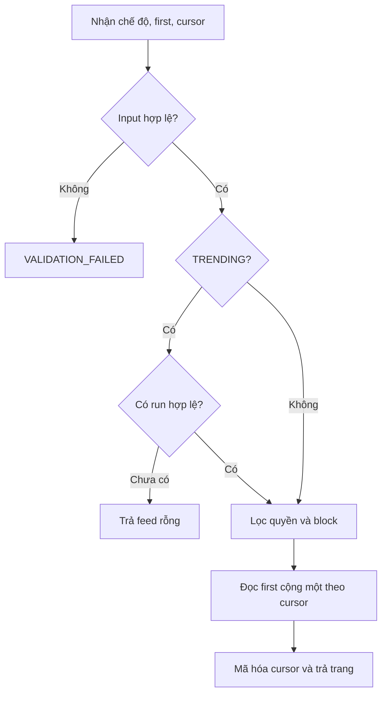
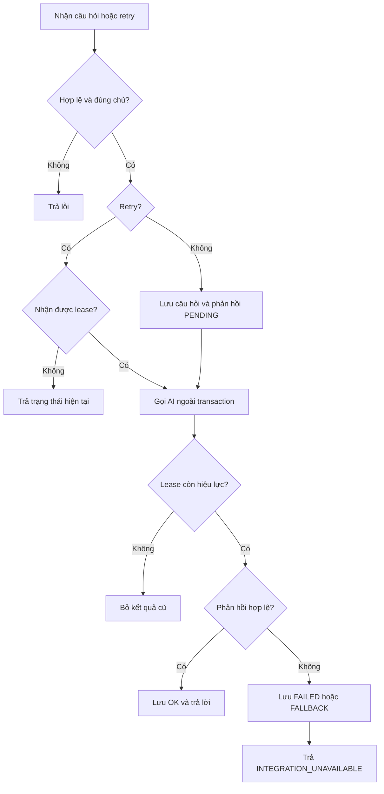

# DOC 7.1-A — Đặc tả thuật toán Backend

| Thuộc tính | Nội dung |
|---|---|
| Dự án | ToMateTo |
| Owner | Backend |
| Reviewer | Lead; DB phối hợp phần truy vấn và chỉ mục |
| Approver | Lead |
| Sprint / WBS | S6 / 6.2.1 |
| Trạng thái | Đề nghị review |
| Ngày cập nhật / Phiên bản | 12/11/2026 / 1.5 |

## 1. Phạm vi

Tài liệu đặc tả các thuật toán xử lý feed, xu hướng, quán gần, quay món, trợ lý, tìm kiếm và chuẩn hóa tên món. Phân trang dùng con trỏ, mặc định 10 và tối đa 50 mục. Quyền đọc và chặn hai chiều được áp dụng trước khi giới hạn kết quả. Thẻ chưa thuộc API v1.

**Tài liệu đầu vào**

| DOC | Nội dung sử dụng |
|---|---|
| DOC 2.1-B — Đặc tả use case | Luồng nghiệp vụ và trường hợp thay thế |
| DOC 3.1-A — Yêu cầu chức năng | Phạm vi và mã REQ của thuật toán |
| DOC 3.2-A — Yêu cầu phi chức năng | Giới hạn phân trang và mục tiêu hiệu năng |
| DOC 5.2-A — Đặc tả API Backend | Đầu vào, đầu ra và lỗi của operation |
| DOC 6.1-A — Thiết kế lớp Backend | Lớp và phương thức liên quan |
| DOC 6.2-A — Sơ đồ tuần tự Backend | Thứ tự xử lý, quyền và giao dịch |
| DOC 5.3-A/B, 6.4-A/B — Thiết kế dữ liệu | Cấu trúc dữ liệu, snapshot và ràng buộc |
| DOC 7.1-A.1 — Truy vấn và chỉ mục DB | Đối chiếu khóa truy vấn, tương tác, lọc bài nguồn và ngữ cảnh trợ lý |

| Thuật toán | Mục đích | Yêu cầu | Lớp / phương thức | Độ phức tạp | Ưu tiên |
|---|---|---|---|---|---|
| Feed theo con trỏ | Trả trang bài theo chế độ và quyền | REQ-007, REQ-028 | FeedQueryService.listFeed, PostRepository.listFeed | Xấu nhất O(n log n), bộ nhớ trang O(k) | Cao |
| Tính và đọc xu hướng | Công bố snapshot và đọc món theo quyền | REQ-024 | DiscoveryService.refreshTrendingSnapshot/getTrending, TrendingSnapshotRepository | O(n + m log m), bộ nhớ O(m) | Cao |
| Tìm quán gần | Chọn quán trong bán kính | REQ-021 | DiscoveryService.getNearbyRestaurants, SearchRepository.findNearby | O(n log n), bộ nhớ O(n) | Cao |
| Quay món | Chọn món ngẫu nhiên hợp lệ | REQ-022 | DiscoveryService.chooseRandomDish | O(n) thời gian và bộ nhớ | Trung bình |
| Gợi ý trợ lý | Tạo và kiểm tra gợi ý | REQ-025, REQ-026 | AssistantService.ask/retry, AiAdapter.complete | O(n + r), ngoài truy vấn và AI | Cao |
| Tìm kiếm | Tìm món, quán và bài phù hợp | REQ-023, REQ-028 | DiscoveryService.search, SearchRepository | Xấu nhất O(n log n), bộ nhớ O(n) | Cao |
| Chuẩn hóa tên món | Nhận diện món trùng tên | REQ-027 | PostNormalizer.resolveDish, DishRepository | O(L) chuẩn hóa; tra cứu tùy chỉ mục | Trung bình |

## 2. Feed theo con trỏ

**Đầu vào:** chế độ LATEST hoặc TRENDING, first, after tùy chọn và người xem. **Đầu ra:** `PostConnection` gồm `edges` với `{ cursor, node }` cho từng bài và `pageInfo { endCursor, hasNextPage }`. Người xem có thể là khách.

```text
NẾU first không được cung cấp: dùng 10
NẾU first ≤ 0: trả VALIDATION_FAILED; NẾU first > 50: giới hạn first về 50
KIỂM TRA cursor hợp lệ cho chế độ
NẾU TRENDING: xác định run từ cursor hoặc run mới nhất đã công bố
NẾU chưa có run: trả PostConnection rỗng, hasNextPage=false
LỌC bài công khai, còn khả dụng và phù hợp quyền của người xem
NẾU đã đăng nhập: loại bài theo điều kiện chặn hai chiều
SẮP XẾP LATEST theo (created_at, id) giảm dần
HOẶC TRENDING theo (score, post_id) giảm dần trong run
LẤY các dòng sau cursor, tối đa first + 1
GIỮ tối đa first dòng và mã hóa cursor cho từng dòng thành edge
TRẢ edges, endCursor từ edge cuối hoặc null nếu rỗng, hasNextPage = có dòng dư
```

**Sau xử lý:** các trang cùng cursor xu hướng đọc cùng run. Cursor sai hoặc run không còn được trả lỗi hợp lệ để client tải lại từ đầu. Danh sách rỗng là kết quả thành công. Ví dụ first=2, truy vấn được 3 bài thì trả 2 bài và hasNextPage=true.

Quy tắc giới hạn first về 50 theo NFR-02 cần đồng bộ với DOC 6.1-A đang mô tả miền 1..50 và DOC 5.2-A về xử lý giá trị không hợp lệ.

Danh sách thông báo, lịch sử trợ lý và bài của tôi dùng cùng cơ chế con trỏ, đọc dư một dòng để xác định hasNextPage. Repository lọc owner hoặc quyền tương ứng trước phân trang và sắp xếp ổn định theo (created_at, id) giảm dần; cursor gắn với danh sách và điều kiện truy vấn.

**Độ phức tạp:** bộ nhớ xử lý trang O(k), với k ≤ 51. Chi phí truy vấn phụ thuộc chỉ mục, điều kiện lọc và kế hoạch DB. DB đối chiếu truy vấn tại WBS 6.2.2.

CursorCodec.decode kiểm tra cursor trước truy vấn. Thiết kế 6.1 hiện khai báo encode(createdAt, id), cần mở rộng payload và chữ ký cho TRENDING gồm run_id, score và post_id từ T21; không dùng chữ ký cũ để mã hóa thiếu thông tin. Trong trường hợp quét n bản ghi và sắp xếp không có chỉ mục phù hợp, thời gian có thể tới O(n log n); không suy O(k) cho toàn truy vấn.



## 3. Tính và đọc xu hướng

**Công bố snapshot.** Job chạy mỗi 15 phút. Đầu vào là bài, lượt thích và lượt lưu đang tồn tại trong cửa sổ 7 ngày. Đầu ra là một run và ba tập snapshot theo DOC 5.3-B T20–T23.

```text
XÁC ĐỊNH cửa sổ [thời điểm tính - 7 ngày, thời điểm tính)
LOẠI bài ẩn hoặc không còn khả dụng
VỚI mỗi bài, ĐẾM likes.created_at nằm trong cửa sổ
GỘP các dòng lưu còn hiệu lực theo (user_id, post_id), lấy MIN(collection_items.added_at)
ĐẾM mỗi user tối đa một lần cho bài nếu mốc MIN nằm trong cửa sổ
ĐIỂM bài = lượt thích + số người lưu
ĐIỂM món = số bài mới + tổng điểm các bài thuộc món
ĐIỂM thẻ nội bộ = số bài mới có thẻ + tổng điểm các bài có thẻ
GHI run, snapshot bài, món và thẻ trong cùng transaction
NẾU lỗi: rollback toàn bộ và tiếp tục dùng run trước
```

Snapshot thẻ dùng liên kết `post_tags` đã có và là tập rỗng nếu không có bài hợp lệ mang thẻ. Thiết kế này giữ cấu trúc công bố ba nhóm của schema. API v1 vẫn chưa nhận hoặc trả thẻ. Việc tính snapshot thẻ từ dữ liệu có sẵn cần DB/Lead duyệt cùng Q15. Lượt đã bỏ thích hoặc bỏ lưu không còn trong tập tính điểm.

**Đọc query `trending(page)`.** B8 đọc món từ T22. Feed TRENDING đọc bài từ T21 theo §2.

```text
KIỂM page theo §2 và giải mã cursor riêng của trending món nếu có
CHỌN run trong cursor, hoặc run đã công bố gần nhất khi lấy trang đầu
NẾU cursor sai phạm vi hoặc run trong cursor đã hết hiệu lực: trả VALIDATION_FAILED
NẾU chưa có run: trả WAITING, edges=[], endCursor=null, hasNextPage=false
ĐỌC món trong T22 của run đó
NỐI T21 với posts theo post_id và giới hạn T21 vào cùng run_id đang đọc
GIỮ món có ít nhất một bài nguồn với posts.dish_id bằng dish_id của món
KIỂM bài nguồn còn hiển thị và viewer được phép xem, áp block hai chiều nếu đã đăng nhập
ÁP điều kiện bài nguồn trước ORDER BY và LIMIT
SẮP XẾP (score, dish_id) giảm dần và lấy dòng sau cursor
ĐỌC first + 1, mã hóa (run_id, score, dish_id) cho từng edge
TRẢ READY với edges và pageInfo, kể cả khi trang rỗng
```

Guest dùng điều kiện bài nguồn công khai. Với người đăng nhập, món bị loại nếu mọi bài nguồn trong run đều bị ẩn hoặc bị lọc theo quyền/chặn. Khi tải tiếp, Backend tiếp tục dùng `run_id` từ cursor. Bài ngoài T21 của run đó không thể thay bài nguồn đã bị ẩn hoặc chặn. Điểm của món lấy từ T22 của cùng run. Tổng hợp xấp xỉ O(n) với n sự kiện, cộng chi phí sắp xếp O(m log m) với m đối tượng. Khi đọc, chi phí phụ thuộc chỉ mục và phép kiểm bài nguồn. [DOC 7.1-A.1 DB, Q17](https://github.com/anqp5002/ToMateTo/blob/4147b4c58108e0dcec0f0559e1d147deff35954d/docs/thiet_ke/7.1-A.1_truy_van_chi_muc_db.md#L260)

## 4. Quán gần

**Đầu vào:** tọa độ tùy chọn. **Đầu ra:** tối đa 50 quán và khoảng cách theo mét. Nếu thiếu tọa độ dùng trung tâm Hà Nội và trả usedDefaultLocation=true. Tọa độ ngoài miền hợp lệ trả VALIDATION_FAILED.

```text
CHỌN tọa độ người dùng hoặc tọa độ mặc định
LẤY ứng viên có tọa độ hợp lệ và thỏa quyền hiển thị
TÍNH khoảng cách mặt cầu từ tọa độ chọn đến từng quán
GIỮ quán cách không quá 5 km
SẮP XẾP theo khoảng cách tăng dần, cùng khoảng cách theo id
TRẢ tối đa 50 kết quả và cờ vị trí mặc định
```

Lọc khoảng cách chính xác trước khi lấy 50 kết quả. Không có quán trả danh sách rỗng. Ví dụ hai quán cách 1 km và 6 km thì chỉ trả quán 1 km. Với n ứng viên, tính khoảng cách O(n), sắp xếp O(n log n), bộ nhớ O(n); truy vấn tiền lọc và chỉ mục do DB đối chiếu. Mục tiêu NFR-03 là ≤2 giây, cần đo khi cài đặt.

DiscoveryService áp dụng giới hạn 50 sau khi lọc khoảng cách và sắp xếp. Repository có thể tiền lọc ứng viên nhưng không cắt sớm các quán hợp lệ.

## 5. Quay món

**Đầu vào:** người xem và danh sách món hợp lệ. **Đầu ra:** `DishSuggestion` gồm món, lý do và trạng thái. API v1 không nhận bộ lọc. Thiết kế đề xuất tập tối đa **40 món**, lấy tối đa **28 món xu hướng** và **12 món seed** trước khi bù phần thiếu. Tỷ lệ này cần Lead/DB duyệt trước khi thay truy vấn Q08.

```text
LẤY món xu hướng đủ quyền theo §3, theo (score, dish_id) giảm dần
LẤY món seed hợp lệ theo dish_id tăng dần
KHỬ TRÙNG theo dish_id, món thuộc cả hai nhóm ưu tiên nhãn xu hướng
CHỌN theo chỉ tiêu 28/12, bù chỗ trống từ phần còn lại của nhóm kia
NẾU không có ứng viên: trả trạng thái rỗng, dish=null, reason=null
CHỌN một chỉ số nguyên đều trong [0, số ứng viên - 1] từ RNG của service
TRẢ READY, món tại chỉ số đó và lý do tương ứng với nhóm đã chọn
```

Mỗi món trong tập cuối có xác suất `1/N`. Tỷ lệ 70/30 mô tả thành phần tập khi đủ dữ liệu. Kiểm thử truyền RNG có seed cố định hoặc RNG giả trả chỉ số đã biết. Ví dụ với ba ứng viên, RNG giả trả 2 thì luôn chọn món thứ ba. Cố định thứ tự pool trước khi kiểm thử và không lấy seed cố định cho lượt quay thật.

`reason` lấy từ mẫu theo nguồn. Món xu hướng trả “Món đang được quan tâm”, món seed trả “Món gợi ý từ danh mục”. Các giá trị rỗng dùng quy ước của API. Nếu có ít hơn 40 món, dùng tập hợp lệ hiện có. Lọc và khử trùng O(n) nếu nguồn đã có thứ tự theo khóa trên.

## 6. Gợi ý trợ lý

**Đầu vào:** principal, câu hỏi không rỗng, session và vị trí tùy chọn. **Đầu ra:** phản hồi đã kiểm chứng hoặc lỗi tích hợp; lịch sử được lưu. Thời gian mỗi lượt tối đa 30 giây.

```text
KIỂM TRA người dùng, quyền sở hữu phiên và nội dung câu hỏi
TẠO hoặc nạp phiên; lưu câu hỏi và phản hồi PENDING trong transaction
LẤY lịch sử đúng chủ phiên và ngữ cảnh công khai đã lọc quyền/block
GIỚI HẠN lịch sử, caption và token theo cấu hình trước khi gọi provider
CHỌN vị trí được phép hoặc mặc định
GỌI AI ngoài transaction với thời hạn tối đa 30 giây
KIỂM TRA tham chiếu món, quán và bài; trích xuất draft nếu có
NẾU kết quả hợp lệ: lưu OK, nội dung đã kiểm và draft hợp lệ hoặc null
TRẢ AssistantReply sau khi ghi thành công với version hiện hành
NẾU timeout hoặc lỗi: lưu FAILED hoặc FALLBACK, trả INTEGRATION_UNAVAILABLE
KHI retry: kiểm owner và trạng thái, nhận lượt xử lý bằng version/lease
CHỈ GHI kết quả nếu version còn hiện hành
```

**Ngân sách ngữ cảnh đề xuất.** Mặc định lấy tối đa **10 tin nhắn đã hoàn tất** trong chính phiên, không tính câu hỏi hiện tại và không gửi các bản ghi PENDING/FAILED. Chỉ lấy dữ liệu bài mà viewer được xem và cắt caption ngữ cảnh về **200 ký tự** như đề xuất của DB. Adapter đếm token theo tokenizer của model. Mặc định tối đa **2.048 token đầu vào** và **512 token đầu ra**, hạ ngân sách đầu vào nếu model có cửa sổ nhỏ hơn tổng hai mức. Tính cả prompt hệ thống, schema và câu hỏi. Bỏ lịch sử cũ nhất rồi giảm ngữ cảnh tham khảo đến khi vừa. Nếu riêng phần bắt buộc vượt ngân sách thì trả lỗi nhập liệu hoặc lỗi cấu hình tương ứng và không gọi provider. Các giá trị này là cấu hình đề xuất cần Lead duyệt. Toàn bộ lượt vẫn trong **30 giây** theo NFR-04.

**Kiểm tham chiếu và draft.** Phân tích phần phản hồi có cấu trúc. Đối chiếu ID món qua `DishRepository.findById` và ID quán qua `RestaurantRepository.findById` theo DOC 6.1-A §4.2. Bỏ ID không tìm thấy. Có thể tra nhiều ID theo lô và đối chiếu tập trả về. Đối chiếu tập ID bài bằng Q20, kể cả với bài được dẫn làm nguồn cho món hoặc quán. Q20 kiểm bài còn hiển thị và quyền xem theo block. Bỏ tham chiếu không hợp lệ và các gợi ý dựa riêng trên tham chiếu đó.

Chỉ dựng `AssistantDraft` từ các trường `dishName`, `caption`, `recipe.ingredients`, `recipe.instructions` và `restaurantName`. Kiểm kiểu, loại trường ngoài danh sách, chuẩn hóa chuỗi và áp ràng buộc của form tạo bài. Draft cần tên món không rỗng để dùng cho UC-19. Nếu draft sai nhưng phần trả lời hợp lệ, lưu nội dung với `post_draft=null`. Nếu không còn phản hồi sử dụng được, lưu FAILED hoặc FALLBACK theo chính sách tích hợp. Khi UC-19 gọi `useAssistantDraft`, kiểm quyền sở hữu phiên và trạng thái draft. FE chỉ dùng kết quả để điền form. Ghi bài vẫn đi qua `createPost`.

Kết quả cũ về sau không ghi đè kết quả mới. Không tự tạo bài từ draft. Ví dụ khi provider timeout, lịch sử vẫn có câu hỏi và trạng thái lỗi để đối chiếu. Với n mục ngữ cảnh và r tham chiếu, kiểm tra O(n+r) ngoài chi phí truy vấn và AI; cần đo NFR-04 khi tích hợp.



## 7. Tìm kiếm

**Mục đích:** tìm món, quán hoặc bài theo REQ-023. **Lớp:** DiscoveryService.search, SearchRepository.searchDishes/searchRestaurants/searchPosts. **Đầu vào:** query, loại tùy chọn, page, người xem. **Đầu ra:** trang kết quả cùng cursor. **Điều kiện trước:** query sau trim có ít nhất 2 ký tự, first dương và được giới hạn tối đa 50.

```text
CHUẨN HÓA từ khóa để tìm không phân biệt hoa thường và dấu
GIẢI MÃ cursor và kiểm tra gắn với tiêu chí tìm kiếm
CHỌN nhóm món, quán, bài theo loại yêu cầu
LỌC quyền và block hai chiều cho nội dung liên quan trước giới hạn
CHẤM relevance trên tên món, tên quán và tên món/caption của bài đã chuẩn hóa
DÙNG điểm lớn nhất trong các trường: khớp toàn bộ = 3, khớp đầu chuỗi = 2, chứa từ khóa = 1
LOẠI dòng có điểm 0; sắp (relevance DESC, type_rank ASC, id ASC)
GIỮ các dòng sau bộ khóa của cursor trong đúng thứ tự trên
ĐỌC first + 1 và tạo cursor cho trang trả về
```

Dùng `type_rank` DISH=1, RESTAURANT=2, POST=3. Cursor chứa `relevance`, `type_rank`, `id` và gắn với từ khóa/loại đã chuẩn hóa. Ví dụ món ID 7 và bài ID 7 có cùng điểm thì món đứng trước. Đây là quy tắc xếp hạng BE đề xuất để DB đồng bộ Q06 và kiểm thứ tự trang.

**Sau xử lý:** không có kết quả trả danh sách rỗng; query/cursor sai trả VALIDATION_FAILED. Ví dụ tìm `pho` có thể khớp `Phở`; từ khóa một ký tự bị từ chối. Với n ứng viên, đối chiếu O(n), sắp xếp xấu nhất O(n log n), bộ nhớ O(n); chỉ mục và phép đo thực tế do DB đối chiếu.

## 8. Chuẩn hóa tên món

**Mục đích:** tránh tạo trùng món theo REQ-027. **Lớp:** PostNormalizer.resolveDish, DishRepository. **Đầu vào:** tên món; **đầu ra:** Dish hợp lệ. **Điều kiện trước:** tên sau bỏ khoảng trắng đầu cuối không rỗng. Thẻ nằm ngoài phạm vi API v1.

```text
DÙNG Dish.normalize để trim tên, gộp khoảng trắng, chuyển chữ thường và bỏ dấu
NẾU khóa chuẩn hóa rỗng: trả VALIDATION_FAILED
TÌM món theo khóa chuẩn hóa
NẾU đã có: dùng món hiện tại
NẾU chưa có: tạo món với khóa duy nhất
NẾU tạo đồng thời bị trùng khóa: đọc lại món đã được tạo
TRẢ món đã tìm hoặc tạo
```

Ví dụ `Phở Bò` và `  phở   bò ` cùng khóa `pho bo`; chuỗi chỉ gồm khoảng trắng bị từ chối. Chuẩn hóa chuỗi dài L mất O(L) thời gian và bộ nhớ; tra cứu tùy chỉ mục, trường hợp xấu quét O(n). Không áp dụng chuẩn hóa này cho thẻ.

Quy tắc bỏ dấu chuyển cả `đ` và `Đ` thành `d`. Ví dụ “Đậu” và “dau” cùng khóa `dau`. DB cần áp cùng quy tắc khi ghi và tìm, gồm chuyển ký tự rõ ràng nếu unaccent của môi trường không thực hiện.

Bộ quy tắc mặc định của PostgreSQL 16 ánh xạ `Đ → D` và `đ → d`. Với cấu hình mặc định, dùng `lower(unaccent(...))` cho kết quả chữ thường. Ca đối chiếu BE–DB dùng cùng hàm chuẩn hóa khi ghi và khi tìm, với ba đầu vào `Đậu`, `đậu` và `dau` đều cho khóa kỳ vọng `dau`. [Bộ quy tắc unaccent của PostgreSQL 16](https://github.com/postgres/postgres/blob/REL_16_STABLE/contrib/unaccent/unaccent.rules#L92)

`PostNormalizer.resolveDish` điều phối việc chuẩn hóa và tra cứu, còn quy tắc chuẩn hóa được dùng chung qua `Dish.normalize()`.

## 9. Trường hợp biên và hiệu năng

| Thuật toán | Điều kiện trước và sau | Trường hợp biên và tối ưu |
|---|---|---|
| Feed | Viewer có thể là khách; trả trang đúng thứ tự và quyền | first=0 bị từ chối, first=51 giới hạn về 50; trang rỗng có hasNextPage=false; cursor sai bị từ chối. Khối lượng xấu nhất là quét toàn bộ tập bài; dùng keyset và chỉ mục phù hợp. |
| Xu hướng | Dữ liệu thời gian hợp lệ; chỉ công bố run hoàn chỉnh | Không có sự kiện cho kết quả rỗng; điểm bằng nhau dùng id ổn định; job lỗi giữ run cũ. Trường hợp xấu nhất là toàn bộ sự kiện trong 7 ngày; tổng hợp theo lô. |
| Quán gần | Tọa độ đủ cặp và trong miền; trả tối đa 50 | Thiếu tọa độ dùng mặc định, (0,0) là tọa độ hợp lệ; quán đúng 5 km được giữ, dữ liệu trùng cần loại theo id. Tập xấu nhất gồm mọi quán có tọa độ; tiền lọc không được loại nhầm. |
| Quay món | Tập ứng viên hợp lệ; trả một món hoặc rỗng | Không có món trả rỗng; một món trả món đó; trùng id chỉ giữ một. Với 40 mục tiêu ưu tiên giới hạn số ứng viên đọc. |
| Trợ lý | Người dùng hợp lệ, câu hỏi không rỗng; lưu lịch sử | Phiên sai chủ bị từ chối; timeout lưu trạng thái lỗi; hai retry tranh lease chỉ một lượt được ghi. Tập xấu nhất là ngữ cảnh tối đa và provider chờ hết hạn; giới hạn ngữ cảnh. |
| Tìm kiếm | Query sau trim tối thiểu 2 ký tự; trả kết quả được phép | Rỗng hoặc một ký tự bị từ chối; không khớp trả rỗng; nhiều kết quả cùng điểm dùng type_rank rồi id. Trường hợp xấu quét toàn bộ ứng viên; đánh giá chỉ mục tìm kiếm. |
| Chuẩn hóa món | Tên hợp lệ; trả một Dish | Tên rỗng từ chối, khác hoa thường hoặc dấu dùng cùng khóa; hai request đồng thời xử lý qua ràng buộc duy nhất. Trường hợp xấu truy vấn quét bảng; dùng chỉ mục khóa chuẩn hóa. |

| NFR | Thuật toán và chỉ tiêu | Cách kiểm chứng |
|---|---|---|
| NFR-01 | Feed và tìm kiếm ≤2 giây với ít nhất 95% request | Đo p95 trên dữ liệu mẫu ít nhất 200 bài đăng. |
| NFR-02 | Danh sách cursor, mặc định 10, tối đa 50, không offset | Đo trang đầu và trang sâu, xem kế hoạch truy vấn. |
| NFR-03 | Quán gần ≤50 kết quả, 5 km, ≤2 giây | Đo truy vấn với dữ liệu vị trí đại diện và kiểm ranh giới 5 km. |
| NFR-04 | Trợ lý ≤30 giây | Đo cả lượt thành công và timeout, gồm xử lý lỗi. |

Chưa có kết quả đo thực tế; các giá trị là mục tiêu kiểm thử, không phải kết quả đạt được.

## 10. Phụ thuộc

| Thuật toán | Phụ thuộc |
|---|---|
| Feed TRENDING | Snapshot do job xu hướng công bố, CursorCodec, bộ lọc quyền |
| Xu hướng | Dữ liệu bài, like, lưu và transaction công bố run |
| Quán gần | Vị trí hợp lệ và dữ liệu quán có tọa độ |
| Quay món | Danh sách món hợp lệ, snapshot xu hướng và seed |
| Trợ lý | Kiểm quyền, dữ liệu công khai, adapter AI và lưu lịch sử |
| Tìm kiếm | Chỉ mục tìm kiếm, quyền và CursorCodec |
| Chuẩn hóa món | DishRepository và ràng buộc duy nhất trên khóa chuẩn hóa |

Feed TRENDING đọc run do job xu hướng công bố. Quay món dùng tập xu hướng và seed. Trợ lý sử dụng dữ liệu được phép hiển thị và có thể trả draft cho luồng tạo bài. Các chỉ tiêu NFR-02, NFR-03 và NFR-04 là mục tiêu thiết kế; kết quả đo hiệu năng được bổ sung khi có môi trường chạy.

Các điểm đồng bộ với DB trước khi dùng truy vấn làm chuẩn: Q06 dùng khóa tìm kiếm có relevance, Q08 áp dụng tập quay theo quyết định đã duyệt, Q15 công bố snapshot theo T20–T23, truy vấn trợ lý kiểm thêm món/quán bên cạnh Q20 và dùng chung quy tắc chuẩn hóa đ/Đ. Đọc món xu hướng và khử trùng lượt lưu áp các quy tắc §3.

## 11. Xác nhận

| Vai trò | Họ tên | Ngày | Chữ ký / xác nhận |
|---|---|---|---|
| Owner — Backend |  |  |  |
| Phối hợp — DB |  |  |  |
| Reviewer / Approver — Lead |  |  |  |
