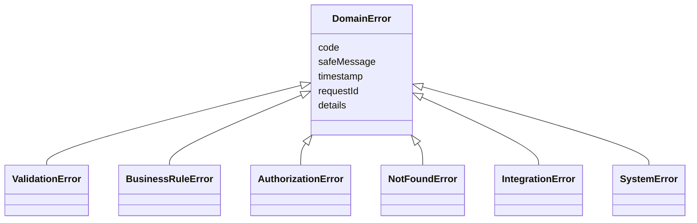

# DOC 7.2-A — Đặc tả xử lý lỗi Backend

| Thuộc tính | Nội dung |
|---|---|
| Dự án | ToMateTo |
| Owner | Backend |
| Reviewer | Lead; FE phối hợp hợp đồng lỗi |
| Approver | Lead |
| Sprint / WBS | S6 / 6.3.1 |
| Trạng thái | Đề nghị review |
| Ngày cập nhật / Phiên bản | 12/11/2026 / 1.5 |

## 1. Mục đích và phạm vi

Backend trả lỗi nhất quán cho GraphQL và upload ảnh, giúp người dùng biết cách tiếp tục và nhóm kỹ thuật tra cứu theo request ID. Thông tin nội bộ, dữ liệu nhạy cảm và stack trace không đưa vào phản hồi. Mã lỗi dùng UPPER_SNAKE_CASE; thông điệp giao diện dùng tiếng Việt, có thể ánh xạ theo khóa để hỗ trợ nhiều ngôn ngữ.

**Tài liệu đầu vào**

| DOC | Nội dung sử dụng |
|---|---|
| DOC 2.1-B — Đặc tả use case | Các nhánh ngoại lệ và hành động tiếp theo |
| DOC 3.2-A — Yêu cầu phi chức năng | Thời gian chờ, bảo mật và khả năng phục hồi |
| DOC 5.2-A — Đặc tả API Backend | Mã lỗi, định dạng phản hồi và HTTP status |
| DOC 5.4-A — Thiết kế bảo mật Backend | Xác thực, giới hạn tần suất và dữ liệu nhạy cảm |
| DOC 6.1-A — Thiết kế lớp Backend | DomainError, ErrorMapper và các lớp xử lý |
| DOC 6.2-A — Sơ đồ tuần tự Backend | Nhánh lỗi, rollback, tích hợp và retry |
| DOC 5.1-A/B — Thiết kế thành phần Backend | Phạm vi job J1 và tích hợp |
| [DOC 7.2-A FE](https://github.com/anqp5002/ToMateTo/blob/cdc31a268418aadb77887713f5103382966d3b94/docs/thiet_ke/7.2-A_xu_ly_loi_frontend.md#L21) và bản tổng hợp BE–FE | Thông điệp, trạng thái giao diện và hành động tiếp theo cho LH-1–LH-8 |
| DOC 5.3-B, 6.4-A/B — Thiết kế dữ liệu | Ràng buộc dữ liệu và trạng thái lịch sử trợ lý |

## 2. Nhóm ngoại lệ

```text
DomainError
├── ValidationError       dữ liệu đầu vào sai
├── BusinessRuleError     vi phạm quy tắc nghiệp vụ
├── AuthorizationError    thiếu xác thực hoặc thiếu quyền
├── NotFoundError         tài nguyên không tồn tại
├── IntegrationError      dịch vụ ngoài không khả dụng
└── SystemError           lỗi nội bộ và cơ sở dữ liệu
```

Ngoại lệ mang code, thông điệp an toàn, thời điểm, requestId và chi tiết tùy chọn. `fieldErrors` gồm field, code và message. Nguyên nhân kỹ thuật được giữ nội bộ để ghi log. Python dùng ngoại lệ runtime, không có checked exception.



Các lớp con kế thừa thuộc tính của DomainError. ValidationError có thể mang fieldErrors; IntegrationError và SystemError giữ nguyên nhân nội bộ; các lớp còn lại dùng code và thông điệp tương ứng tình huống.

| Mã API | Nhóm ngoại lệ |
|---|---|
| VALIDATION_FAILED | ValidationError |
| UNAUTHENTICATED, FORBIDDEN, NOT_AVAILABLE | AuthorizationError |
| NOT_FOUND | NotFoundError |
| ALREADY_EXISTS, CONFLICT, RATE_LIMITED | BusinessRuleError |
| INTEGRATION_UNAVAILABLE | IntegrationError |
| INTERNAL_ERROR | SystemError |

`NOT_AVAILABLE` biểu thị nội dung không được phép hiển thị với viewer. ErrorMapper giữ thông điệp chung để không lộ trạng thái nội bộ hoặc sự tồn tại của tài nguyên bị hạn chế.

`CONFLICT` là mã dự phòng cho cập nhật có kiểm tra xung đột khi hợp đồng hỗ trợ. Hai mã upload PAYLOAD_TOO_LARGE và UNSUPPORTED_MEDIA_TYPE thuộc nhóm ValidationError.

## 3. Danh mục lỗi và hướng xử lý

Code trong cột đầu là `extensions.code` của GraphQL hoặc `error.code` của upload. Nhãn trong ngoặc là trường hợp cụ thể dùng cho fieldErrors hoặc log nội bộ, không tạo thêm mã API cấp cao.

Cột HTTP Status thể hiện trường hợp thông thường theo từng đường xử lý. Mã GraphQL nằm trong `errors`, còn middleware và upload có thể trả HTTP status riêng như §4.

| Mã và tình huống | HTTP Status | Thông điệp cho người dùng | Developer Message | Ngữ cảnh log an toàn / hành động |
|---|---|---|---|---|
| VALIDATION_FAILED · EMAIL_INVALID | 200 GraphQL | Email chưa hợp lệ. Vui lòng kiểm tra lại. | Xác thực định dạng email thất bại; đối chiếu operation và requestId. | Tên trường; sửa email. |
| VALIDATION_FAILED · PASSWORD_INVALID | 200 GraphQL | Mật khẩu chưa hợp lệ. Vui lòng kiểm tra lại. | Mật khẩu không đạt quy tắc; đối chiếu operation và requestId. | Quy tắc thất bại; nhập lại mật khẩu. |
| VALIDATION_FAILED · OTP_INVALID | 200 GraphQL | Mã không hợp lệ hoặc đã hết hạn. | OTP sai, hết hạn hoặc đã dùng; đối chiếu operation và requestId. | Loại xác minh; kiểm tra hoặc yêu cầu mã mới. |
| VALIDATION_FAILED · REQUIRED_FIELD | 200 GraphQL | Vui lòng nhập thông tin bắt buộc. | Thiếu trường bắt buộc; đối chiếu operation và requestId. | Tên trường; bổ sung dữ liệu. |
| VALIDATION_FAILED · CURSOR_INVALID | 200 GraphQL | Không thể tải trang tiếp. Vui lòng tải lại. | Cursor sai hoặc không còn hiệu lực; đối chiếu operation và requestId. | Operation và loại cursor; bắt đầu từ trang đầu. |
| VALIDATION_FAILED · PAGE_SIZE_INVALID | 200 GraphQL | Số lượng mục mỗi trang không hợp lệ. | Kích thước trang không dương; đối chiếu operation và requestId. | Kích thước yêu cầu; chọn số dương. Giá trị trên 50 được giới hạn về 50 theo NFR-02. |
| VALIDATION_FAILED · LOCATION_INVALID | 200 GraphQL | Vị trí chưa hợp lệ. Vui lòng thử lại. | Tọa độ ngoài miền hợp lệ; đối chiếu operation và requestId. | Tên trường tọa độ; kiểm tra dữ liệu vị trí. |
| VALIDATION_FAILED · IMAGE_INVALID | 200 GraphQL; 400 upload | Ảnh không hợp lệ. Vui lòng chọn ảnh khác. | Tệp ảnh không đạt kiểm tra; đối chiếu operation và requestId. | Lý do kiểm tra tệp; chọn ảnh phù hợp. |
| VALIDATION_FAILED · IMAGE_EXPIRED | 200 GraphQL | Ảnh tải lên đã hết hạn. Vui lòng tải lại ảnh. | Asset upload đã hết hạn; đối chiếu operation và requestId. | Trạng thái asset; tải lại ảnh tương ứng. |
| VALIDATION_FAILED · IMAGE_PURPOSE | 200 GraphQL | Ảnh không phù hợp với mục đích sử dụng. | Mục đích asset không khớp operation; đối chiếu operation và requestId. | Loại mục đích; chọn lại ảnh. |
| VALIDATION_FAILED · SELF_FOLLOW | 200 GraphQL | Bạn không thể theo dõi chính mình. | Tài khoản yêu cầu tự theo dõi; đối chiếu operation và requestId. | Operation; chọn tài khoản khác. |
| UNAUTHENTICATED · LOGIN_FAILED | 200 GraphQL | Email hoặc mật khẩu chưa đúng. | Xác minh thông tin đăng nhập thất bại; đối chiếu operation và requestId. | Operation; kiểm tra thông tin. |
| UNAUTHENTICATED · SESSION_INVALID | 200 GraphQL; 401 middleware/upload | Phiên đã hết. Vui lòng đăng nhập lại. | Phiên không còn hiệu lực; đối chiếu operation và requestId. | Lý do xác thực không chứa token; đăng nhập lại. |
| UNAUTHENTICATED · RESET_GRANT_INVALID | 200 GraphQL | Quyền đặt lại mật khẩu đã hết hiệu lực. | Grant đã hết hạn, sai hoặc đã dùng; đối chiếu operation và requestId. | Loại grant; bắt đầu lại khôi phục. |
| FORBIDDEN · OWNER_REQUIRED | 200 GraphQL | Bạn không có quyền thực hiện thao tác này. | Người gọi không sở hữu tài nguyên; đối chiếu operation và requestId. | Operation và loại tài nguyên; kiểm tra quyền sở hữu. |
| NOT_FOUND · RESOURCE_MISSING | 200 GraphQL | Nội dung này không còn khả dụng. | Không tìm thấy tài nguyên; đối chiếu operation và requestId. | Loại tài nguyên; quay lại danh sách. |
| NOT_AVAILABLE · RESOURCE_UNAVAILABLE | 200 GraphQL | Nội dung này không còn khả dụng. | Tài nguyên không khả dụng với người xem; đối chiếu operation và requestId. | Operation; kiểm tra quyền trước khi hiển thị. |
| ALREADY_EXISTS · EMAIL_EXISTS | 200 GraphQL | Email đã được sử dụng. | Email đã tồn tại; đối chiếu operation và requestId. | Trường trùng; chuyển sang đăng nhập. |
| CONFLICT · UPDATE_CONFLICT | 200 GraphQL | Nội dung đã thay đổi. Vui lòng tải lại. | Phát hiện xung đột phiên bản khi chức năng được hỗ trợ; đối chiếu operation và requestId. | Mã dự phòng; updatePost v1 chưa có expectedVersion nên chưa áp dụng phát hiện xung đột. |
| RATE_LIMITED · REQUEST_LIMIT | 200 GraphQL hoặc 429 | Bạn thao tác quá nhanh. Vui lòng thử lại sau. | Request vượt hạn mức cấu hình; đối chiếu operation và requestId. | Loại giới hạn, thời gian chờ nếu có; chờ rồi thử lại. |
| INTEGRATION_UNAVAILABLE · MEDIA_UNAVAILABLE | 200 GraphQL; 503 upload | Không tải được ảnh. Vui lòng thử lại. | Dịch vụ lưu ảnh lỗi hoặc hết thời gian; đối chiếu operation và requestId. | Dịch vụ, loại lỗi, thời gian; giữ ảnh và form. |
| INTEGRATION_UNAVAILABLE · AI_UNAVAILABLE | 200 GraphQL | Trợ lý đang bận. Vui lòng thử lại sau. | Provider AI lỗi hoặc hết thời gian; đối chiếu operation và requestId. | Dịch vụ AI, timeout; lưu lịch sử và cho đối chiếu. |
| INTEGRATION_UNAVAILABLE · EMAIL_UNAVAILABLE | 200 GraphQL (accepted) | Phản hồi chung accepted như trường hợp email không tồn tại. | Dịch vụ email không gửi được; đối chiếu operation và requestId. | Ghi log nội bộ, không trả lỗi theo kết quả gửi riêng của tài khoản. |
| PAYLOAD_TOO_LARGE · IMAGE_TOO_LARGE | 413 upload | Ảnh vượt 10 MB. Vui lòng chọn ảnh nhỏ hơn. | Request vượt giới hạn dung lượng; đối chiếu requestId. | Chọn ảnh phù hợp. |
| UNSUPPORTED_MEDIA_TYPE · REQUEST_CONTENT_TYPE | 415 upload | Không thể tải ảnh. Vui lòng thử lại. | Content-Type request không phải multipart/form-data; đối chiếu requestId. | Gửi đúng định dạng multipart. |
| INTERNAL_ERROR · DATABASE_FAILURE | 200 GraphQL | Hệ thống đang gặp sự cố. Vui lòng thử lại sau. | Transaction hoặc kết nối DB thất bại; đối chiếu operation và requestId. | Lỗi DB và requestId; kiểm tra kết nối và transaction. |
| INTERNAL_ERROR · UNEXPECTED | 200 GraphQL | Hệ thống đang gặp sự cố. Vui lòng thử lại sau. | Ngoại lệ chưa được phân loại; đối chiếu operation và requestId. | Stack trace nội bộ và requestId; tra log. |

## 4. Định dạng và mã HTTP

GraphQL có thể trả HTTP 200 cùng `errors`; client đọc `extensions.code`, không suy thành công chỉ từ HTTP. Ví dụ:

```json
{"data":null,"errors":[{"message":"Vui lòng nhập tên món.","extensions":{"code":"VALIDATION_FAILED","fieldErrors":[{"field":"dishName","code":"REQUIRED","message":"Tên món là bắt buộc."}]}}]}
```

Request GraphQL sai cú pháp hoặc không qua validation có thể trả HTTP 400. Middleware chặn toàn request có thể trả 401, còn giới hạn tần suất có thể trả 429. Lỗi nội bộ khi thực thi GraphQL trả HTTP 200 kèm `errors[].extensions.code=INTERNAL_ERROR`. Upload thành công trả HTTP 201. Các lỗi đã quy định ở DOC 5.2-A §5.2 dùng 400, 401, 413, 415, 429 hoặc 503 theo nguyên nhân. HTTP 500 cho lỗi hệ thống bất ngờ của upload còn cần được đặc tả trong hợp đồng API.

Upload vượt dung lượng dùng `PAYLOAD_TOO_LARGE` với HTTP 413; request không phải multipart dùng `UNSUPPORTED_MEDIA_TYPE` với HTTP 415. Đây là mã của endpoint upload. Khi trả RATE_LIMITED, metadata `errors[].extensions.retryAfterSeconds` của GraphQL chỉ có khi xác định được thời gian chờ; client phải xử lý trường hợp thiếu giá trị.

```json
{"error":{"code":"VALIDATION_FAILED","message":"Ảnh không hợp lệ.","fieldErrors":[{"field":"file","code":"UNSUPPORTED_TYPE","message":"Chọn ảnh JPEG, PNG hoặc WebP."}]}}
```

`X-Request-Id` được trả ở header để đối chiếu log. Thông tin chi tiết trong ví dụ chỉ mô tả lỗi của request, không chứa đường dẫn hệ thống hay khóa nhà cung cấp.

## 5. Xử lý theo tầng

1. **Presentation:** resolver và upload endpoint bắt DomainError, gọi ErrorMapper để tạo phản hồi. Global handler bắt lỗi chưa dự kiến và trả INTERNAL_ERROR.
2. **Business:** service kiểm tra quy tắc, ném lỗi có mã phù hợp; transaction rollback khi thao tác thất bại. Khi AI lỗi, lưu trạng thái lịch sử trong transaction riêng trước khi trả lỗi.
3. **Data:** repository phát hiện lỗi ràng buộc hoặc DB; service chuyển lỗi đã biết thành lỗi nghiệp vụ, lỗi DB khác thành SystemError. Không lộ câu SQL hoặc giá trị nhạy cảm.
4. **Tích hợp:** adapter phân loại timeout/lỗi nhà cung cấp thành IntegrationError. Không giữ transaction DB trong lúc chờ dịch vụ ngoài.

ErrorMapper.toGraphQLError(error) dựng lỗi GraphQL; ErrorMapper.toHttpStatus(error) xác định status cho endpoint HTTP. Một mã nghiệp vụ không tự quyết định HTTP status của mọi GraphQL response.

Các nhánh UC chính gồm sai thông tin đăng nhập → UNAUTHENTICATED, OTP sai → VALIDATION_FAILED, sửa bài của người khác → FORBIDDEN, bài không khả dụng → NOT_AVAILABLE, AI timeout → INTEGRATION_UNAVAILABLE.

## 6. Logging và theo dõi

| Mức | Trường hợp | Thông tin |
|---|---|---|
| INFO | Validation thông thường, cấp OTP đặt lại, kết quả job định kỳ | requestId hoặc jobRunId, operation, event, mã lỗi nếu có và tên trường. Với OTP ghi kết quả cấp mã. Với job ghi tên, thời lượng và kết quả |
| WARN | Sai quyền, vượt hạn mức, lỗi/quá hạn AI, gửi push thất bại | requestId, operation, event, dịch vụ, thời lượng và mã lỗi đã làm sạch |
| ERROR | DB hoặc lỗi hệ thống không dự kiến | requestId, operation, event, thời lượng và nguyên nhân nội bộ đã làm sạch |

Ghi `actorUserId` là ID nội bộ khi đã xác thực và cần đối soát hành động. Bỏ trường này cho khách hoặc khi không cần. Với nghiệp vụ cần ghi email, dùng dạng che như `l***@e***.com` theo DOC 5.4-A. Không ghi mật khẩu, mã OTP, JWT, reset token, push token, secret, nội dung hội thoại hoặc tọa độ chính xác. Log container xem được qua `docker compose logs` theo NFR-09. Theo dõi lỗi theo operation và mã, độ trễ, timeout AI và kết quả worker.

## 7. Retry và giảm ảnh hưởng lỗi

- Không retry validation, quyền hoặc request sai. Khi RATE_LIMITED, client chờ theo metadata nếu có.
- `setLike`, `setFollow`, `markNotificationRead`, `logout`, `removeSavedPost` và `deletePost` có thể gửi lại cùng trạng thái theo hợp đồng.
- `createPost`, `register`, `askAssistant` không tự gửi lại khi mất phản hồi. Client đối chiếu kết quả trước khi người dùng quyết định bước tiếp theo. Header `Idempotency-Key` trong DOC 5.2-A §12.10 là đề xuất đang chờ chốt. Chỉ tự retry bằng khóa khi server đã triển khai và hợp đồng xác định rõ thao tác, phạm vi và hạn khóa.
- Timeout AI tối đa 30 giây. Retry trợ lý dùng ID phản hồi thất bại, kiểm owner và version/lease; không tạo lại câu hỏi. Provider lỗi lưu FAILED hoặc FALLBACK và trả INTEGRATION_UNAVAILABLE.
- Upload lỗi giữ form và ảnh đã chọn; người dùng quyết định thử lại, bỏ ảnh hay hủy. Nếu giao dịch tạo bài rollback, liên kết ảnh và thay đổi trạng thái asset cùng rollback. Asset đã upload vẫn có thể ở PENDING và được dùng lại trong thời hạn nếu người dùng thử lại. J1 chạy `cleanupOrphanMedia` hằng ngày để dọn asset PENDING hết hạn và các mục xóa chờ retry. Worker kiểm ảnh chưa gắn trước khi xóa ở provider.
- Gửi push sau thao tác chính; push lỗi không rollback thao tác đã commit. Với email, xử lý lỗi và thời gian phản hồi nhất quán giữa tài khoản tồn tại và không tồn tại để tránh lộ tài khoản.
- Với lỗi tạm thời khi gọi dịch vụ ngoài, chỉ tự retry khi thao tác an toàn để gửi lại và còn thời gian trong ngân sách của request. Tối đa **3 lần retry** sau lần gọi đầu, chờ lần lượt **100 ms, 400 ms và 1.600 ms** trước mỗi lần. Dừng ngay khi thành công hoặc thời hạn đã hết.
- Circuit breaker là đề xuất mở rộng cần Lead duyệt và bổ sung vào thiết kế thành phần/sequence trước khi cấu hình ngưỡng. Timeout và hành vi dự phòng theo DOC 5.1-A/B, DOC 6.2-A vẫn áp dụng cho từng tích hợp.
- Backoff trên là cấu hình đề xuất để kiểm thử. Toàn bộ lần gọi và thời gian chờ trong một lượt AI cùng nằm trong ngân sách 30 giây. Khi kết quả của thao tác ghi chưa xác định, đối chiếu trạng thái theo từng operation trước khi gửi lại.

## 8. Kiểm tra khi triển khai

Kiểm thử mapping từng mã, HTTP 200 kèm GraphQL errors, rollback, lỗi upload từng ảnh, OTP hết hạn, owner sai, AI timeout và retry đồng thời. Kiểm tra log loại bỏ dữ liệu nhạy cảm và requestId nối được phản hồi với log. Xác minh ngưỡng vận hành và hiệu năng trên môi trường chạy.

## 9. Ánh xạ luồng ngoại lệ

Nhãn E1–E4 tham chiếu mục **Ngoại lệ** theo tên luồng trong [đặc tả UC chi tiết FE thuộc DOC 2.1-B](https://github.com/anqp5002/ToMateTo/blob/main/docs/yeu_cau/2.1_use_case_specifications_fe.md). Mã UC của bảng lấy từ catalog. Các luồng thiếu nhãn phù hợp ghi bằng tên tình huống. Mất phản hồi là trạng thái ở client. FE chỉ dùng mã lỗi server khi đã nhận được response.

| Luồng | Ngoại lệ | Nhóm và mã / hành động |
|---|---|---|
| UC-01 đăng ký | Email trùng, mật khẩu yếu; E1 không xử lý được; E2 mất phản hồi | ALREADY_EXISTS cho email trùng, VALIDATION_FAILED cho mật khẩu yếu; E1 INTERNAL_ERROR nếu server trả lỗi; E2 kiểm tra đăng nhập trước gửi lại. |
| UC-02 đăng nhập | E1 xác thực sai; E2 mất phản hồi | AuthorizationError / UNAUTHENTICATED; E2 chưa xác nhận phiên. |
| UC-03 khôi phục | E1 email lỗi; E2 mật khẩu sai; E3 mất phản hồi | E1 ghi log nội bộ, vẫn trả accepted chung như email không tồn tại; E2 VALIDATION_FAILED; E3 kiểm tra đăng nhập. |
| UC-04 logout | E1 không xác nhận; E2 phiên hết hạn | E1 kiểm tra trạng thái; E2 trở về guest theo hợp đồng. |
| UC-05 feed | E1 tải đầu; E2 tải thêm lỗi | Lỗi server theo nguyên nhân; client giữ trang cũ khi tải thêm lỗi. |
| UC-06 chi tiết | E1 không khả dụng; E2 ảnh lỗi; E3 tải lỗi | NOT_FOUND khi không tìm thấy hoặc NOT_AVAILABLE khi bị hạn chế theo hợp đồng; lỗi ảnh không xóa dữ liệu bài đã đọc. |
| UC-07 tạo bài | E1 tên rỗng; E2 ảnh sai; E3 phiên sai; E4 mất phản hồi | VALIDATION_FAILED; UNAUTHENTICATED; E4 đối chiếu myPosts. |
| UC-08 sửa bài | E1 sai chủ; E2 bài mất hoặc xung đột; E3 dữ liệu sai hoặc lưu lỗi | FORBIDDEN, NOT_FOUND/NOT_AVAILABLE, VALIDATION_FAILED. Xung đột phiên bản chưa được kích hoạt; mất phản hồi cần tải lại bài để đối chiếu trước khi gửi lại. |
| UC-09 xóa bài | E1 sai chủ; E2 mất phản hồi | FORBIDDEN; kiểm tra kết quả hoặc gửi lại theo hợp đồng idempotent. |
| UC-10 xem hồ sơ | E1 không tồn tại hoặc không được xem; E2 tải lỗi | NOT_FOUND/NOT_AVAILABLE hoặc INTERNAL_ERROR; chỉ hiển thị dữ liệu được phép. |
| UC-11 cập nhật hồ sơ | E1 dữ liệu sai; E2 sai phiên hoặc quyền; E3 mất phản hồi | VALIDATION_FAILED, UNAUTHENTICATED/FORBIDDEN; đối chiếu trước khi gửi lại. |
| UC-12 công khai hồ sơ | E1 yêu cầu công khai email; E2 sai quyền; E3 mất phản hồi | VALIDATION_FAILED, FORBIDDEN; kiểm tra trạng thái đã lưu. |
| UC-13 thích/lưu | Mất kết nối | Không suy đoán trạng thái đã ghi; đối chiếu và gửi lại trạng thái đích khi phù hợp. |
| UC-14 theo dõi và thông báo | Tự theo dõi, target không còn, phiên sai hoặc push lỗi | VALIDATION_FAILED, NOT_FOUND hoặc UNAUTHENTICATED theo tình huống. Push lỗi ghi log và giữ kết quả đã commit. |
| UC-15 báo cáo bài | Dữ liệu sai, bài không khả dụng, gửi lặp hoặc vượt hạn mức | VALIDATION_FAILED hoặc NOT_FOUND. Báo cáo lặp trả accepted mà không tạo thêm dòng. Vượt 10 báo cáo/giờ/người trả RATE_LIMITED theo DOC 5.2-A §12.5. |
| UC-16 quán gần | GPS lỗi, thiếu hoặc sai tọa độ | Dùng vị trí mặc định và trả cờ tương ứng khi thiếu. Tọa độ ngoài miền trả VALIDATION_FAILED. |
| UC-17 quay món | Tập ứng viên rỗng hoặc lỗi dữ liệu | Trả kết quả rỗng theo hợp đồng. Chỉ trả INTERNAL_ERROR nếu có lỗi đọc/xử lý dữ liệu. |
| UC-18 trợ lý | Provider timeout | INTEGRATION_UNAVAILABLE. Lưu lịch sử và lấy ID phản hồi lỗi trước khi retry. |
| UC-19 dùng bản nháp | Sai chủ phiên, draft mất hoặc dữ liệu form sai | FORBIDDEN hoặc NOT_FOUND tại useAssistantDraft. Form sai trả VALIDATION_FAILED khi gọi createPost và giữ phần đã nhập. |
| UC-20 tìm kiếm và xu hướng | Từ khóa/cursor sai, không có kết quả hoặc chưa có run | VALIDATION_FAILED cho input sai. Trả connection rỗng khi không khớp. Trending chưa có run trả WAITING. |

## 10. Nguyên tắc bắt lỗi và global handler

Kiểm tra input và quyền sớm trước khi ghi. Chỉ bắt lỗi ở tầng có khả năng xử lý hoặc chuyển đổi; không bỏ qua ngoại lệ. Khi bọc lỗi kỹ thuật, giữ nguyên nguyên nhân nội bộ để truy vết, còn phản hồi chỉ chứa mã và thông điệp an toàn. Global handler ghi ERROR kèm requestId, trả INTERNAL_ERROR, và đảm bảo transaction được rollback. Với dịch vụ ngoài, timeout và fallback theo từng luồng, không tự báo thành công nếu thao tác chính chưa hoàn tất.

## 11. Mã thông điệp và theo dõi

Client có thể ánh xạ khóa `errors.validation.email_invalid`, `errors.auth.login_failed`, `errors.auth.session_invalid`, `errors.resource.forbidden`, `errors.integration.unavailable` và `errors.internal.unexpected` từ mã cùng ngữ cảnh operation. Thứ tự chọn thông điệp hiển thị theo §12. `fieldErrors.code` chỉ được dùng khi server thực sự trả trường này.

Các khóa bổ sung gồm `errors.resource.not_found`, `errors.resource.unavailable`, `errors.validation.email_exists`, `errors.rate.limited`, `errors.conflict.update`, `errors.upload.too_large` và `errors.upload.unsupported_type`. Hai khóa upload ánh xạ lần lượt `PAYLOAD_TOO_LARGE` và `UNSUPPORTED_MEDIA_TYPE`. Khóa `unsupported_type` áp dụng cho Content-Type request không phải multipart/form-data. Khóa xung đột chỉ dùng khi cơ chế tương ứng được kích hoạt.

Theo dõi số lượng lỗi theo operation và code, độ trễ, số timeout provider và trạng thái worker. Kiểm tra log tập trung theo requestId và cấu hình cảnh báo theo điều kiện vận hành thực tế. Chưa mặc định tích hợp công cụ hoặc ngưỡng cảnh báo chưa được xác định trong dự án.

## 12. Phối hợp xử lý lỗi với FE

FE ưu tiên thông điệp tiếng Việt đã định nghĩa cho tình huống trong DOC 7.2-A FE. FE nhận diện tình huống từ mã lỗi API, operation và mã chi tiết nếu BE có trả theo hợp đồng. Khi chưa có thông điệp phù hợp, FE dùng thông báo chung theo thao tác. Thông điệp an toàn trong response BE phục vụ hợp đồng API, còn nội dung hiển thị trên ứng dụng theo quy tắc trên.

Với lỗi nhập liệu cụ thể trong bảng dưới, BE trả nhãn qua `extensions.fieldErrors[].code` và gắn đúng trường input khi xác định được. Ví dụ cursor sai gắn vào `page.after`, kích thước sai gắn vào `page.first`. Dùng `X-Request-Id` để đối chiếu log.

| Mã đối chiếu | Tình huống BE | Hành động FE |
|---|---|---|
| LH-1 | CURSOR_INVALID ở trường after | Giữ danh sách đang xem. Khi người dùng tải lại, bắt đầu từ trang đầu và thay cursor sau khi tải thành công |
| LH-2 | PAGE_SIZE_INVALID ở trường first | Giữ kết quả hiện có và chuẩn hóa kích thước trang trước lần tải lại |
| LH-3 | LOCATION_INVALID | Báo tọa độ không hợp lệ. Cho lấy vị trí lại hoặc tiếp tục với vị trí mặc định bằng request không gửi tọa độ |
| LH-4 | SELF_FOLLOW | Giữ trạng thái đã xác nhận, báo không thể tự theo dõi và ẩn thao tác theo dõi trên hồ sơ của mình |
| LH-5 | IMAGE_EXPIRED hoặc IMAGE_PURPOSE khi gắn ảnh trong mutation | Đọc lỗi GraphQL dù HTTP là 200. Giữ form và các ảnh hợp lệ. Tải lại ảnh hết hạn để lấy uploadId mới hoặc chọn ảnh đúng mục đích |
| LH-6 | RATE_LIMITED ở operation có áp giới hạn | Giữ dữ liệu đang nhập và trạng thái đã xác nhận. Dùng retryAfterSeconds khi có. Nếu thiếu, hiện thông báo và không tự đặt bộ đếm |
| LH-7 | INTERNAL_ERROR khi ghi | Nếu đã xác nhận thất bại, giữ dữ liệu để người dùng kiểm tra và thử lại. Nếu kết quả chưa xác định, đối soát trước khi gửi lại |
| LH-8 | LOGIN_FAILED, SESSION_INVALID, RESET_GRANT_INVALID, EMAIL_EXISTS, RESOURCE_MISSING, REQUEST_LIMIT | Dùng thông điệp FE theo mã và operation. Ví dụ vượt hạn mức gửi OTP hiện “Bạn đã gửi quá nhiều yêu cầu. Vui lòng thử lại sau.” Khi thiếu câu phù hợp, dùng thông báo chung theo thao tác |

## 13. Xác nhận

| Vai trò | Họ tên | Ngày | Chữ ký / xác nhận |
|---|---|---|---|
| Owner — Backend |  |  |  |
| Phối hợp — FE |  |  |  |
| Reviewer / Approver — Lead |  |  |  |
