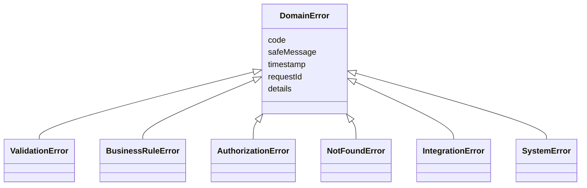

# DOC 7.2-A — Đặc tả xử lý lỗi Backend

| Thuộc tính | Nội dung |
|---|---|
| Dự án | ToMateTo |
| Owner | Backend |
| Reviewer | Lead; FE phối hợp hợp đồng lỗi |
| Approver | Lead |
| Sprint / WBS | S6 / 6.3.1 |
| Trạng thái | Đề nghị review |
| Ngày cập nhật / Phiên bản | 07/11/2026 / 1.3 |

## 1. Mục đích và phạm vi

Backend trả lỗi nhất quán cho GraphQL và upload ảnh, giúp người dùng biết cách tiếp tục và nhóm kỹ thuật tra cứu theo request ID. Thông tin nội bộ, dữ liệu nhạy cảm và stack trace không đưa vào phản hồi. Mã lỗi dùng UPPER_SNAKE_CASE; thông điệp giao diện dùng tiếng Việt, có thể ánh xạ theo khóa để hỗ trợ nhiều ngôn ngữ.

**Tài liệu đầu vào**

| DOC | Nội dung sử dụng |
|---|---|
| DOC 2.1-B — Đặc tả use case | Các nhánh ngoại lệ và hành động tiếp theo |
| DOC 3.2-A — Yêu cầu phi chức năng | Thời gian chờ, bảo mật và khả năng phục hồi |
| DOC 5.2-A — Đặc tả API Backend | Mã lỗi, định dạng phản hồi và HTTP status |
| DOC 5.4-A — Thiết kế bảo mật Backend | Xác thực, giới hạn tần suất và dữ liệu nhạy cảm |
| DOC 6.1-A — Thiết kế lớp Backend | DomainError, ErrorMapper và các lớp xử lý |
| DOC 6.2-A — Sơ đồ tuần tự Backend | Nhánh lỗi, rollback, tích hợp và retry |
| DOC 5.3-B, 6.4-A/B — Thiết kế dữ liệu | Ràng buộc dữ liệu và trạng thái lịch sử trợ lý |

## 2. Nhóm ngoại lệ

```text
DomainError
├── ValidationError       dữ liệu đầu vào sai
├── BusinessRuleError     vi phạm quy tắc nghiệp vụ
├── AuthorizationError    thiếu xác thực hoặc thiếu quyền
├── NotFoundError         tài nguyên không tồn tại
├── IntegrationError      dịch vụ ngoài không khả dụng
└── SystemError           lỗi nội bộ và cơ sở dữ liệu
```

Ngoại lệ mang code, thông điệp an toàn, thời điểm, requestId và chi tiết tùy chọn. `fieldErrors` gồm field, code và message. Nguyên nhân kỹ thuật được giữ nội bộ để ghi log. Python dùng ngoại lệ runtime, không có checked exception.



Các lớp con kế thừa thuộc tính của DomainError. ValidationError có thể mang fieldErrors; IntegrationError và SystemError giữ nguyên nhân nội bộ; các lớp còn lại dùng code và thông điệp tương ứng tình huống.

| Mã API | Nhóm ngoại lệ |
|---|---|
| VALIDATION_FAILED | ValidationError |
| UNAUTHENTICATED, FORBIDDEN | AuthorizationError |
| NOT_FOUND, NOT_AVAILABLE | NotFoundError |
| ALREADY_EXISTS, CONFLICT, RATE_LIMITED | BusinessRuleError |
| INTEGRATION_UNAVAILABLE | IntegrationError |
| INTERNAL_ERROR | SystemError |

`CONFLICT` là mã dự phòng cho cập nhật có kiểm tra xung đột khi hợp đồng hỗ trợ. Hai mã upload PAYLOAD_TOO_LARGE và UNSUPPORTED_MEDIA_TYPE thuộc nhóm ValidationError.

## 3. Danh mục lỗi và hướng xử lý

Code trong cột đầu là `extensions.code` của GraphQL hoặc `error.code` của upload. Nhãn trong ngoặc là trường hợp cụ thể dùng cho fieldErrors hoặc log nội bộ, không tạo thêm mã API cấp cao.

Cột HTTP Status thể hiện trường hợp thông thường theo từng đường xử lý. Mã GraphQL nằm trong `errors`, còn middleware và upload có thể trả HTTP status riêng như §4.

| Mã và tình huống | HTTP Status | Thông điệp cho người dùng | Developer Message | Ngữ cảnh log an toàn / hành động |
|---|---|---|---|---|
| VALIDATION_FAILED · EMAIL_INVALID | 200 GraphQL | Email chưa hợp lệ. Vui lòng kiểm tra lại. | Xác thực định dạng email thất bại; đối chiếu operation và requestId. | Tên trường; sửa email. |
| VALIDATION_FAILED · PASSWORD_INVALID | 200 GraphQL | Mật khẩu chưa hợp lệ. Vui lòng kiểm tra lại. | Mật khẩu không đạt quy tắc; đối chiếu operation và requestId. | Quy tắc thất bại; nhập lại mật khẩu. |
| VALIDATION_FAILED · OTP_INVALID | 200 GraphQL | Mã không hợp lệ hoặc đã hết hạn. | OTP sai, hết hạn hoặc đã dùng; đối chiếu operation và requestId. | Loại xác minh; kiểm tra hoặc yêu cầu mã mới. |
| VALIDATION_FAILED · REQUIRED_FIELD | 200 GraphQL | Vui lòng nhập thông tin bắt buộc. | Thiếu trường bắt buộc; đối chiếu operation và requestId. | Tên trường; bổ sung dữ liệu. |
| VALIDATION_FAILED · CURSOR_INVALID | 200 GraphQL | Không thể tải trang tiếp. Vui lòng tải lại. | Cursor sai hoặc không còn hiệu lực; đối chiếu operation và requestId. | Operation và loại cursor; bắt đầu từ trang đầu. |
| VALIDATION_FAILED · PAGE_SIZE_INVALID | 200 GraphQL | Số lượng mục mỗi trang không hợp lệ. | Kích thước trang không dương; đối chiếu operation và requestId. | Kích thước yêu cầu; chọn số dương. Giá trị trên 50 được giới hạn về 50 theo NFR-02. |
| VALIDATION_FAILED · LOCATION_INVALID | 200 GraphQL | Vị trí chưa hợp lệ. Vui lòng thử lại. | Tọa độ ngoài miền hợp lệ; đối chiếu operation và requestId. | Tên trường tọa độ; kiểm tra dữ liệu vị trí. |
| VALIDATION_FAILED · IMAGE_INVALID | 200 GraphQL; 400 upload | Ảnh không hợp lệ. Vui lòng chọn ảnh khác. | Tệp ảnh không đạt kiểm tra; đối chiếu operation và requestId. | Lý do kiểm tra tệp; chọn ảnh phù hợp. |
| VALIDATION_FAILED · IMAGE_EXPIRED | 200 GraphQL | Ảnh tải lên đã hết hạn. Vui lòng tải lại ảnh. | Asset upload đã hết hạn; đối chiếu operation và requestId. | Trạng thái asset; tải lại ảnh tương ứng. |
| VALIDATION_FAILED · IMAGE_PURPOSE | 200 GraphQL | Ảnh không phù hợp với mục đích sử dụng. | Mục đích asset không khớp operation; đối chiếu operation và requestId. | Loại mục đích; chọn lại ảnh. |
| VALIDATION_FAILED · SELF_FOLLOW | 200 GraphQL | Bạn không thể theo dõi chính mình. | Tài khoản yêu cầu tự theo dõi; đối chiếu operation và requestId. | Operation; chọn tài khoản khác. |
| UNAUTHENTICATED · LOGIN_FAILED | 200 GraphQL | Thông tin đăng nhập chưa đúng. | Xác minh thông tin đăng nhập thất bại; đối chiếu operation và requestId. | Operation; kiểm tra thông tin. |
| UNAUTHENTICATED · SESSION_INVALID | 200 GraphQL; 401 middleware/upload | Phiên đã hết hiệu lực. Vui lòng đăng nhập lại. | Phiên không còn hiệu lực; đối chiếu operation và requestId. | Lý do xác thực không chứa token; đăng nhập lại. |
| UNAUTHENTICATED · RESET_GRANT_INVALID | 200 GraphQL | Quyền đặt lại đã hết hạn. Vui lòng yêu cầu mã mới. | Grant đã hết hạn, sai hoặc đã dùng; đối chiếu operation và requestId. | Loại grant; bắt đầu lại khôi phục. |
| FORBIDDEN · OWNER_REQUIRED | 200 GraphQL | Bạn không có quyền thực hiện thao tác này. | Người gọi không sở hữu tài nguyên; đối chiếu operation và requestId. | Operation và loại tài nguyên; kiểm tra quyền sở hữu. |
| NOT_FOUND · RESOURCE_MISSING | 200 GraphQL | Nội dung không còn tồn tại. | Không tìm thấy tài nguyên; đối chiếu operation và requestId. | Loại tài nguyên; quay lại danh sách. |
| NOT_AVAILABLE · RESOURCE_UNAVAILABLE | 200 GraphQL | Nội dung hiện không khả dụng. | Tài nguyên không khả dụng với người xem; đối chiếu operation và requestId. | Operation; kiểm tra quyền trước khi hiển thị. |
| ALREADY_EXISTS · EMAIL_EXISTS | 200 GraphQL | Email đã được sử dụng. Vui lòng đăng nhập. | Email đã tồn tại; đối chiếu operation và requestId. | Trường trùng; chuyển sang đăng nhập. |
| CONFLICT · UPDATE_CONFLICT | 200 GraphQL | Nội dung đã thay đổi. Vui lòng tải lại. | Phát hiện xung đột phiên bản khi chức năng được hỗ trợ; đối chiếu operation và requestId. | Mã dự phòng; updatePost v1 chưa có expectedVersion nên chưa áp dụng phát hiện xung đột. |
| RATE_LIMITED · REQUEST_LIMIT | 200 GraphQL hoặc 429 | Bạn thao tác quá nhanh. Vui lòng thử lại sau. | Request vượt hạn mức cấu hình; đối chiếu operation và requestId. | Loại giới hạn, thời gian chờ nếu có; chờ rồi thử lại. |
| INTEGRATION_UNAVAILABLE · MEDIA_UNAVAILABLE | 200 GraphQL; 503 upload | Không tải được ảnh. Vui lòng thử lại. | Dịch vụ lưu ảnh lỗi hoặc hết thời gian; đối chiếu operation và requestId. | Dịch vụ, loại lỗi, thời gian; giữ ảnh và form. |
| INTEGRATION_UNAVAILABLE · AI_UNAVAILABLE | 200 GraphQL | Trợ lý đang bận. Vui lòng thử lại sau. | Provider AI lỗi hoặc hết thời gian; đối chiếu operation và requestId. | Dịch vụ AI, timeout; lưu lịch sử và cho đối chiếu. |
| INTEGRATION_UNAVAILABLE · EMAIL_UNAVAILABLE | Nội bộ đối với yêu cầu và gửi lại OTP | Phản hồi chung accepted như trường hợp email không tồn tại. | Dịch vụ email không gửi được; đối chiếu operation và requestId. | Ghi log nội bộ, không trả lỗi theo kết quả gửi riêng của tài khoản. |
| PAYLOAD_TOO_LARGE · IMAGE_TOO_LARGE | 413 upload | Ảnh vượt 10 MB. Vui lòng chọn ảnh nhỏ hơn. | Request vượt giới hạn dung lượng; đối chiếu requestId. | Chọn ảnh phù hợp. |
| UNSUPPORTED_MEDIA_TYPE · REQUEST_CONTENT_TYPE | 415 upload | Không thể tải ảnh. Vui lòng thử lại. | Content-Type request không phải multipart/form-data; đối chiếu requestId. | Gửi đúng định dạng multipart. |
| INTERNAL_ERROR · DATABASE_FAILURE | 200 GraphQL hoặc 500 HTTP | Hệ thống đang gặp sự cố. Vui lòng thử lại sau. | Transaction hoặc kết nối DB thất bại; đối chiếu operation và requestId. | Lỗi DB và requestId; kiểm tra kết nối và transaction. |
| INTERNAL_ERROR · UNEXPECTED | 200 GraphQL hoặc 500 HTTP | Hệ thống đang gặp sự cố. Vui lòng thử lại sau. | Ngoại lệ chưa được phân loại; đối chiếu operation và requestId. | Stack trace nội bộ và requestId; tra log. |

## 4. Định dạng và mã HTTP

GraphQL có thể trả HTTP 200 cùng `errors`; client đọc `extensions.code`, không suy thành công chỉ từ HTTP. Ví dụ:

```json
{"data":null,"errors":[{"message":"Vui lòng nhập tên món.","extensions":{"code":"VALIDATION_FAILED","fieldErrors":[{"field":"dishName","code":"REQUIRED","message":"Tên món là bắt buộc."}]}}]}
```

Request GraphQL sai cú pháp hoặc không qua validation có thể trả HTTP 400; middleware chặn toàn request có thể trả 401, giới hạn tần suất trả 429. Upload thành công trả HTTP 201; lỗi dùng 400 dữ liệu không hợp lệ, 401 chưa xác thực, 413 quá dung lượng, 415 sai content type, 429 vượt hạn mức và 503 dịch vụ ảnh lỗi.

Upload vượt dung lượng dùng `PAYLOAD_TOO_LARGE` với HTTP 413; request không phải multipart dùng `UNSUPPORTED_MEDIA_TYPE` với HTTP 415. Đây là mã của endpoint upload. Khi trả RATE_LIMITED, metadata `retryAfterSeconds` chỉ có khi xác định được thời gian chờ; client phải xử lý trường hợp thiếu giá trị.

```json
{"error":{"code":"VALIDATION_FAILED","message":"Ảnh không hợp lệ.","fieldErrors":[{"field":"file","code":"UNSUPPORTED_TYPE","message":"Chọn ảnh JPEG, PNG hoặc WebP."}]}}
```

`X-Request-Id` được trả ở header để đối chiếu log. Thông tin chi tiết trong ví dụ chỉ mô tả lỗi của request, không chứa đường dẫn hệ thống hay khóa nhà cung cấp.

## 5. Xử lý theo tầng

1. **Presentation:** resolver và upload endpoint bắt DomainError, gọi ErrorMapper để tạo phản hồi. Global handler bắt lỗi chưa dự kiến và trả INTERNAL_ERROR.
2. **Business:** service kiểm tra quy tắc, ném lỗi có mã phù hợp; transaction rollback khi thao tác thất bại. Khi AI lỗi, lưu trạng thái lịch sử trong transaction riêng trước khi trả lỗi.
3. **Data:** repository phát hiện lỗi ràng buộc hoặc DB; service chuyển lỗi đã biết thành lỗi nghiệp vụ, lỗi DB khác thành SystemError. Không lộ câu SQL hoặc giá trị nhạy cảm.
4. **Tích hợp:** adapter phân loại timeout/lỗi nhà cung cấp thành IntegrationError. Không giữ transaction DB trong lúc chờ dịch vụ ngoài.

ErrorMapper.toGraphQLError(error) dựng lỗi GraphQL; ErrorMapper.toHttpStatus(error) xác định status cho endpoint HTTP. Một mã nghiệp vụ không tự quyết định HTTP status của mọi GraphQL response.

Các nhánh UC chính gồm sai thông tin đăng nhập → UNAUTHENTICATED, OTP sai → VALIDATION_FAILED, sửa bài của người khác → FORBIDDEN, bài không khả dụng → NOT_AVAILABLE, AI timeout → INTEGRATION_UNAVAILABLE.

## 6. Logging và theo dõi

| Mức | Trường hợp | Thông tin |
|---|---|---|
| INFO | Validation thông thường | requestId, operation, mã lỗi và tên trường |
| WARN | Sai quyền, giới hạn tần suất, lỗi nghiệp vụ | requestId, operation, loại tài nguyên và mã lỗi |
| ERROR | DB, tích hợp và lỗi không dự kiến | requestId, operation, dịch vụ, thời gian, nguyên nhân nội bộ |

Không ghi mật khẩu, OTP, JWT, reset token, secret, nội dung hội thoại hoặc tọa độ chính xác. Định danh người dùng chỉ dùng khi cần và được kiểm soát truy cập. Theo dõi số lỗi theo mã, thời gian đáp ứng, timeout AI và lỗi job; cảnh báo khi tỷ lệ lỗi hoặc timeout tăng vượt ngưỡng vận hành đã cấu hình.

## 7. Retry và giảm ảnh hưởng lỗi

- Không retry validation, quyền hoặc request sai. Khi RATE_LIMITED, client chờ theo metadata nếu có.
- `setLike`, `setFollow`, `markNotificationRead`, `logout`, `removeSavedPost` và `deletePost` có thể gửi lại cùng trạng thái theo hợp đồng.
- `createPost`, `register`, `askAssistant` không tự gửi lại khi mất phản hồi. Client đối chiếu kết quả trước khi người dùng quyết định bước tiếp theo.
- Timeout AI tối đa 30 giây. Retry trợ lý dùng ID phản hồi thất bại, kiểm owner và version/lease; không tạo lại câu hỏi. Provider lỗi lưu FAILED hoặc FALLBACK và trả INTEGRATION_UNAVAILABLE.
- Upload lỗi giữ form và ảnh đã chọn; người dùng quyết định thử lại, bỏ ảnh hay hủy. Xóa ảnh khỏi provider có thể được worker thử lại qua job bền vững.
- Gửi push sau thao tác chính; push lỗi không rollback thao tác đã commit. Với email, xử lý lỗi và thời gian phản hồi nhất quán giữa tài khoản tồn tại và không tồn tại để tránh lộ tài khoản.
- Với lỗi tạm thời khi gọi dịch vụ ngoài, chỉ tự retry khi thao tác an toàn để gửi lại và còn thời gian trong ngân sách của request. Tối đa **3 lần retry** sau lần gọi đầu, chờ lần lượt **100 ms, 400 ms và 1.600 ms** trước mỗi lần. Dừng ngay khi thành công hoặc thời hạn đã hết.
- Circuit breaker theo từng dịch vụ mở sau **5 lỗi liên tiếp**. Khi mở, từ chối gọi dịch vụ và chuyển sang nhánh lỗi hoặc dự phòng của luồng. Sau **30 giây**, chuyển sang half-open và cho một request thử. Nếu thành công thì đóng và đặt lại bộ đếm; nếu thất bại thì mở lại trong 30 giây.
- Các giá trị retry và circuit breaker là cấu hình thiết kế ban đầu để review. Thời gian chờ, các lần gọi và thời gian backoff của một lượt AI cùng nằm trong giới hạn **30 giây**, không kéo dài thêm sau deadline. Trường hợp chưa xác định được kết quả của thao tác không idempotent phải đối chiếu trước, theo các quy tắc ở trên.

## 8. Kiểm tra khi triển khai

Kiểm thử mapping từng mã, HTTP 200 kèm GraphQL errors, rollback, lỗi upload từng ảnh, OTP hết hạn, owner sai, AI timeout và retry đồng thời. Kiểm tra log loại bỏ dữ liệu nhạy cảm và requestId nối được phản hồi với log. Xác minh ngưỡng vận hành và hiệu năng trên môi trường chạy.

## 9. Ánh xạ luồng ngoại lệ

Mã E dưới đây giữ theo đặc tả FE chi tiết. Mất phản hồi là trạng thái phía client, không tự gán mã lỗi server khi chưa nhận được response. Các luồng BE cũ không có mã E riêng được ghi bằng tên tình huống.

| Luồng | Ngoại lệ | Nhóm và mã / hành động |
|---|---|---|
| UC-01 đăng ký | Email trùng, mật khẩu yếu; E1 không xử lý được; E2 mất phản hồi | ALREADY_EXISTS cho email trùng, VALIDATION_FAILED cho mật khẩu yếu; E1 INTERNAL_ERROR nếu server trả lỗi; E2 kiểm tra đăng nhập trước gửi lại. |
| UC-02 đăng nhập | E1 xác thực sai; E2 mất phản hồi | AuthorizationError / UNAUTHENTICATED; E2 chưa xác nhận phiên. |
| UC-03 khôi phục | E1 email lỗi; E2 mật khẩu sai; E3 mất phản hồi | E1 ghi log nội bộ, vẫn trả accepted chung như email không tồn tại; E2 VALIDATION_FAILED; E3 kiểm tra đăng nhập. |
| UC-04 logout | E1 không xác nhận; E2 phiên hết hạn | E1 kiểm tra trạng thái; E2 trở về guest theo hợp đồng. |
| UC-05 feed | E1 tải đầu; E2 tải thêm lỗi | Lỗi server theo nguyên nhân; client giữ trang cũ khi tải thêm lỗi. |
| UC-06 chi tiết | E1 không khả dụng; E2 ảnh lỗi; E3 tải lỗi | NotFoundError / NOT_FOUND hoặc NOT_AVAILABLE; lỗi ảnh không xóa dữ liệu bài đã đọc. |
| UC-07 tạo bài | E1 tên rỗng; E2 ảnh sai; E3 phiên sai; E4 mất phản hồi | VALIDATION_FAILED; UNAUTHENTICATED; E4 đối chiếu myPosts. |
| UC-08 sửa bài | E1 sai chủ; E2 bài mất hoặc xung đột; E3 dữ liệu sai hoặc lưu lỗi | FORBIDDEN, NOT_FOUND/NOT_AVAILABLE, VALIDATION_FAILED. Xung đột phiên bản chưa được kích hoạt; mất phản hồi cần tải lại bài để đối chiếu trước khi gửi lại. |
| UC-09 xóa bài | E1 sai chủ; E2 mất phản hồi | FORBIDDEN; kiểm tra kết quả hoặc gửi lại theo hợp đồng idempotent. |
| UC-10 xem hồ sơ | E1 không tồn tại hoặc không được xem; E2 tải lỗi | NOT_FOUND/NOT_AVAILABLE hoặc INTERNAL_ERROR; chỉ hiển thị dữ liệu được phép. |
| UC-11 cập nhật hồ sơ | E1 dữ liệu sai; E2 sai phiên hoặc quyền; E3 mất phản hồi | VALIDATION_FAILED, UNAUTHENTICATED/FORBIDDEN; đối chiếu trước khi gửi lại. |
| UC-12 công khai hồ sơ | E1 yêu cầu công khai email; E2 sai quyền; E3 mất phản hồi | VALIDATION_FAILED, FORBIDDEN; kiểm tra trạng thái đã lưu. |
| UC-13 thích/lưu | Mất kết nối | Không suy đoán trạng thái đã ghi; đối chiếu và gửi lại trạng thái đích khi phù hợp. |
| UC-16 quán gần | GPS lỗi | Dùng vị trí mặc định và trả cờ tương ứng; không coi GPS lỗi là lỗi DB. |
| UC-18 trợ lý | Provider timeout | IntegrationError / INTEGRATION_UNAVAILABLE; lưu lịch sử và đối chiếu trước retry. |

## 10. Nguyên tắc bắt lỗi và global handler

Kiểm tra input và quyền sớm trước khi ghi. Chỉ bắt lỗi ở tầng có khả năng xử lý hoặc chuyển đổi; không bỏ qua ngoại lệ. Khi bọc lỗi kỹ thuật, giữ nguyên nguyên nhân nội bộ để truy vết, còn phản hồi chỉ chứa mã và thông điệp an toàn. Global handler ghi ERROR kèm requestId, trả INTERNAL_ERROR, và đảm bảo transaction được rollback. Với dịch vụ ngoài, timeout và fallback theo từng luồng, không tự báo thành công nếu thao tác chính chưa hoàn tất.

## 11. Mã thông điệp và theo dõi

Client có thể ánh xạ khóa `errors.validation.email_invalid`, `errors.auth.login_failed`, `errors.auth.session_invalid`, `errors.resource.forbidden`, `errors.integration.unavailable` và `errors.internal.unexpected` từ mã cùng ngữ cảnh operation. Khi không có khóa chi tiết, dùng thông điệp an toàn theo code cấp cao. `fieldErrors.code` chỉ được dùng khi server thực sự trả trường này.

Các khóa bổ sung gồm `errors.resource.not_found`, `errors.resource.unavailable`, `errors.validation.email_exists`, `errors.rate.limited`, `errors.conflict.update`, `errors.upload.too_large` và `errors.upload.unsupported_type`. Hai khóa upload ánh xạ lần lượt `PAYLOAD_TOO_LARGE` và `UNSUPPORTED_MEDIA_TYPE`. Khóa `unsupported_type` áp dụng cho Content-Type request không phải multipart/form-data. Khóa xung đột chỉ dùng khi cơ chế tương ứng được kích hoạt.

Theo dõi số lượng lỗi theo operation và code, độ trễ, số timeout provider và trạng thái worker. Kiểm tra log tập trung theo requestId và cấu hình cảnh báo theo điều kiện vận hành thực tế. Chưa mặc định tích hợp công cụ hoặc ngưỡng cảnh báo chưa được xác định trong dự án.

## 12. Xác nhận

| Vai trò | Họ tên | Ngày | Chữ ký / xác nhận |
|---|---|---|---|
| Owner — Backend |  |  |  |
| Phối hợp — FE |  |  |  |
| Reviewer / Approver — Lead |  |  |  |
