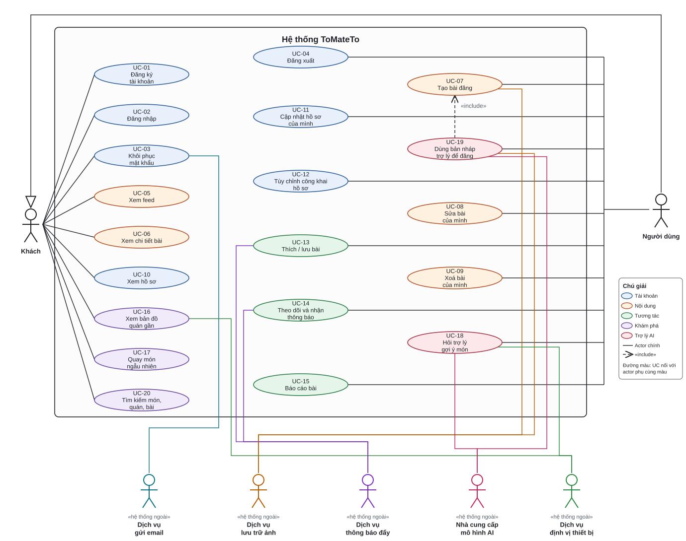

# DOC 2.1-A — Use Case Diagram ToMateTo

| Thông tin | Nội dung |
|---|---|
| Owner | Lead |
| Reviewer | DB |
| Approver | Lead |
| Sprint | S1 (12–18/10/2026) |
| Trạng thái | Bản nháp — trình nhóm tại họp CN 18/10 |
| Mẫu | manual 2.1 (Task 2.1.4) |
| Đầu vào | DOC 2.1-B phần đầu (UC Catalog 20 UC) |

> Cách đọc nhanh:
> 1. **Bên trái** là Khách, nối với 9 chức năng công khai (cột trái). **Bên phải** là Người dùng — một đường ra ray dọc rồi nhánh ngang vào cạnh phải từng oval; Người dùng kế thừa quyền của Khách (tam giác rỗng vòng qua đỉnh). **Không có actor Admin trong v1** (Vision 4.2 — xem RV-09).
> 2. **Phía dưới** là 5 actor `«hệ thống ngoài»` (gửi email, lưu trữ ảnh, thông báo đẩy, mô hình AI, định vị thiết bị), nối với các UC gọi tới dịch vụ ngoài qua kênh dọc + đường ray đáy.
> 3. Màu oval thể hiện **nhóm chức năng** theo cột "Nhóm" của catalog (xem chú giải). `«include»` UC-19 → UC-07: đăng bài từ bản nháp bắt buộc đi qua luồng tạo bài.

## Sơ đồ tổng (20 UC — khớp catalog)

Bản PNG cùng nội dung (độ phân giải cao, in A4 ngang): `hinh/2.1-A_usecase.png`. Mô tả dạng văn bản của sơ đồ (actor, UC, quan hệ): `hinh/2.1-A_usecase.puml` (PlantUML — bản tham chiếu; bản render dàn tay bằng `tools/ve_usecase.py` để không đường nào cắt qua oval — script tự kiểm va chạm đoạn×oval, exit 1 nếu còn). Nội dung hai bản khớp nhau.

## Checklist chống trùng / thiếu UC

Reviewer tick trước khi duyệt:

- [ ] Số oval trong sơ đồ = 20, ID UC-01…UC-20 khớp từng dòng catalog DOC 2.1-B.
- [ ] Không có 2 oval cùng mục tiêu (kiểm cặp hay trùng: UC-07 tạo ↔ UC-08 sửa ↔ UC-09 xoá; UC-05 feed ↔ UC-20 tìm kiếm; UC-18 hỏi trợ lý ↔ UC-19 dùng bản nháp).
- [ ] Mọi actor chính của catalog đều có ít nhất 1 đường nối; không actor nào nằm trong biên hệ thống.
- [ ] `«include»` chỉ xuất hiện ở UC-19 → UC-07; không có quan hệ nào khác.
- [ ] Không vẽ actor Admin (v1 không có trang quản trị — RV-09); không oval nào mang tên "Tải ảnh lên" (bước con của UC-07/UC-19).
- [ ] Màu oval khớp cột Nhóm của catalog (5 nhóm, xem chú giải).

## Theo dõi viết đặc tả

| ID | Tên UC | Người viết đặc tả | Link spec |
|---|---|---|---|
| UC-01 | Đăng ký tài khoản | FE | `2.1_use_case_specifications_fe.md` |
| UC-02 | Đăng nhập | FE | `2.1_use_case_specifications_fe.md` |
| UC-03 | Khôi phục mật khẩu | FE | `2.1_use_case_specifications_fe.md` |
| UC-04 | Đăng xuất | FE | `2.1_use_case_specifications_fe.md` |
| UC-05 | Xem feed | FE | `2.1_use_case_specifications_fe.md` |
| UC-06 | Xem chi tiết bài | FE | `2.1_use_case_specifications_fe.md` |
| UC-07 | Tạo bài đăng | FE | `2.1_use_case_specifications_fe.md` |
| UC-08 | Sửa bài của mình | FE | `2.1_use_case_specifications_fe.md` |
| UC-09 | Xoá bài của mình | FE | `2.1_use_case_specifications_fe.md` |
| UC-10 | Xem hồ sơ | FE | `2.1_use_case_specifications_fe.md` |
| UC-11 | Cập nhật hồ sơ của mình | FE | `2.1_use_case_specifications_fe.md` |
| UC-12 | Tùy chỉnh công khai hồ sơ | FE | `2.1_use_case_specifications_fe.md` |
| UC-13 | Thích / lưu bài | BE | `2.1_usecase_BE.md` |
| UC-14 | Theo dõi và nhận thông báo | BE | `2.1_usecase_BE.md` |
| UC-15 | Báo cáo bài | BE | `2.1_usecase_BE.md` |
| UC-16 | Xem bản đồ quán gần | BE | `2.1_usecase_BE.md` |
| UC-17 | Quay món ngẫu nhiên | BE | `2.1_usecase_BE.md` |
| UC-18 | Hỏi trợ lý gợi ý món | BE | `2.1_usecase_BE.md` |
| UC-19 | Dùng bản nháp của trợ lý để đăng bài | BE | `2.1_usecase_BE.md` |
| UC-20 | Tìm kiếm món, quán, bài | BE | — chưa có đặc tả |

---

## Chữ ký

| Vai trò | Họ tên | Ngày | Chữ ký |
|---|---|---|---|
| Owner (Lead) | | | |
| Reviewer (DB) | | | |
