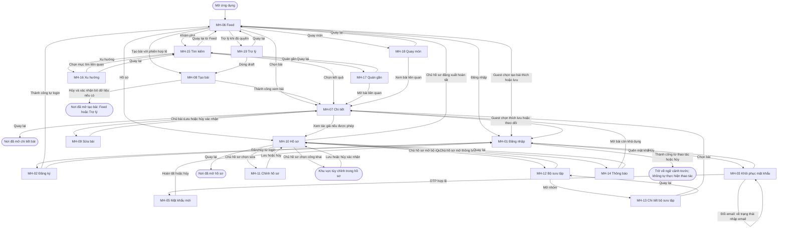

# S2 Sơ đồ điều hướng

> Dự án: ToMateTo  
> DOC: 3.3-B | WBS: 2.3.1  
> Owner: FE | Reviewer: Lead
> Sprint: S2

## 1. Luồng điều hướng
Feed là điểm vào đề xuất. Nút Quay lại/Hủy trả về ngữ cảnh đã mở màn nếu có, theo đặc tả UC. Với điều hướng trực tiếp không có ngữ cảnh, đích dự phòng cần được duyệt. Các đường chức năng khám phá/AI chỉ áp dụng sau khi quyền truy cập được chốt.

Các node “Nơi đã mở” và “Trở về ngữ cảnh trước” mô tả đích theo lịch sử điều hướng, không phải màn hình mới. Chi tiết bài quay về Feed, tìm kiếm, hồ sơ, bộ sưu tập, thông báo hoặc chức năng đã mở bài. Tạo bài mở từ draft trợ lý thì hủy quay về MH-19; mở từ Feed thì hủy quay về MH-06. Sau login, thao tác cần xác thực phải được người dùng chọn lại; không tự tạo bài/thích/lưu/theo dõi.

Khu vực tùy chỉnh công khai nằm trong hồ sơ, không có ID màn riêng. Các đường tới chỉnh hồ sơ, tùy chỉnh công khai, bộ sưu tập, thông báo và đăng xuất chỉ áp dụng cho chủ hồ sơ có phiên hợp lệ. Người xem hồ sơ người khác không được sử dụng các thao tác quản lý đó.

## 2. Ma trận điều hướng

| Từ | Đến | Trigger hoặc điều kiện | UC |
|---|---|---|---|
| Điểm vào | MH-06 | Mở app, đích đề xuất | UC-05 |
| MH-06 trạng thái guest | MH-01 | Chọn tạo bài, thích hoặc lưu | UC-02/07/10/11 |
| MH-07 trạng thái guest | MH-01 | Chọn thích, lưu hoặc theo dõi | UC-02/10/11/13 |
| MH-01 | Ngữ cảnh trước | Login thành công hoặc hủy; thao tác chưa tự thực hiện | UC-02 |
| MH-01 | MH-02 | Chọn đăng ký | UC-01 |
| MH-02 | MH-06 | Đăng ký thành công và tự login | UC-01 |
| MH-02 | Nơi mở | Hủy trước gửi, xác nhận bỏ nếu có dữ liệu | UC-01 |
| MH-01 | MH-03 | Quên mật khẩu | UC-03 |
| MH-03 nhập email | MH-03 xác minh OTP | Yêu cầu OTP được tiếp nhận; đổi trạng thái trong cùng màn | UC-03 |
| MH-03 xác minh OTP | MH-03 nhập email | Đổi email; bỏ OTP đang nhập | UC-03 |
| MH-03 xác minh OTP | MH-03 xác minh OTP | Gửi lại thành công; giữ trạng thái nhập OTP và cập nhật phản hồi gửi mã | UC-03 |
| MH-03 xác minh OTP | MH-03 xác minh OTP | OTP sai/hết hạn hoặc gửi lại lỗi; hiển thị lỗi, không chuyển MH-05 | UC-03 |
| MH-03 xác minh OTP | MH-05 | Xác minh thành công | UC-03 |
| MH-03/05 | MH-01 | Hủy trước đổi mật khẩu hoặc hoàn tất | UC-03 |
| MH-06/10/13/14/15/17/18 | MH-07 | Chọn bài còn khả dụng | UC-06 |
| MH-07 | Nơi mở | Quay lại, giữ ngữ cảnh | UC-06 |
| Ngữ cảnh user | MH-08 | Tạo bài với phiên hợp lệ | UC-07 |
| MH-08 | MH-07 | Đăng thành công rồi xem bài, đích đề xuất | UC-07 |
| MH-08 | Nơi mở | Hủy, xác nhận bỏ dữ liệu nếu có | UC-07 |
| MH-08 mở từ Feed | MH-06 | Hủy và xác nhận bỏ dữ liệu chưa gửi nếu có | UC-07 |
| MH-08 mở từ draft trợ lý | MH-19 | Hủy và xác nhận bỏ dữ liệu chưa gửi nếu có | UC-27/07 |
| MH-07 | MH-09 | Chủ bài sửa | UC-08 |
| MH-09 | MH-07 | Lưu thành công hoặc hủy bỏ thay đổi | UC-08 |
| MH-07 | Danh sách trước | Xóa thành công, đích đề xuất | UC-09/20 |
| MH-06/07 | MH-10 | Hồ sơ hoặc tác giả, đúng quyền | UC-14 |
| MH-10 | Nơi đã mở hồ sơ | Quay lại, giữ ngữ cảnh trước | UC-14 |
| MH-10 | MH-11 | Chủ hồ sơ chọn sửa | UC-15 |
| MH-11 | MH-10 | Lưu hoặc hủy | UC-15 |
| MH-10 của mình | Khu vực riêng tư trong hồ sơ | Chủ hồ sơ chọn tùy chỉnh hiển thị | UC-16 |
| Khu vực riêng tư trong hồ sơ | MH-10 của mình | Lưu thành công hoặc hủy, xác nhận bỏ thay đổi nếu có | UC-16 |
| MH-10 của mình | MH-12 | Chủ hồ sơ có phiên hợp lệ mở bộ sưu tập | UC-12 |
| MH-12 | MH-13 | Chọn nhóm | UC-12 |
| MH-13 | MH-12 | Quay lại | UC-12 |
| MH-12 | MH-10 | Quay lại | UC-12 |
| MH-10 của mình | MH-14 | Chủ hồ sơ có phiên hợp lệ xem thông báo | UC-17 |
| MH-14 | MH-10 | Quay lại | UC-17 |
| MH-06 | MH-15 | Tìm kiếm/khám phá | UC-22 |
| MH-15 | MH-06 hoặc nơi mở | Quay lại, giữ ngữ cảnh trước | UC-22 |
| MH-15 | MH-16 | Xu hướng | UC-23 |
| MH-16 | MH-15 | Xem liên quan hoặc quay lại | UC-22/23 |
| MH-15 | MH-17 | Quán gần | UC-24 |
| MH-17 | MH-15 | Quay lại | UC-24 |
| MH-06 | MH-18 | Quay món | UC-25 |
| MH-18 | MH-06 | Quay lại | UC-25 |
| MH-06 | MH-19 | Trợ lý, quyền cần duyệt | UC-26 |
| MH-19 | MH-08 | Dùng draft, chưa đăng bài | UC-27/07 |
| MH-19 | MH-06 | Quay lại | UC-26 |
| MH-10 của mình | MH-06 trạng thái guest | Chủ hồ sơ đăng xuất hoàn tất, đích đề xuất | UC-04 |

## 3. Lỗi và gián đoạn

- Lỗi form: ở lại nơi nhập, chỉ lỗi theo trường; không điều hướng như thành công.
- Lỗi tải bài: có cách quay về nơi mở hoặc thử lại; không để ngõ cụt.
- Phiên hết hạn: yêu cầu login cho thao tác cá nhân; không tự lặp yêu cầu sau login.
- Mất phản hồi: hỗ trợ kiểm tra kết quả; đóng màn không tự hoàn tác request.
- Hủy form có dữ liệu chưa gửi: xác nhận bỏ hoặc tiếp tục; trạng thái đã lưu giữ nguyên.
- Nội dung đích xóa/ẩn: thông báo không khả dụng, giữ đường quay lại.
